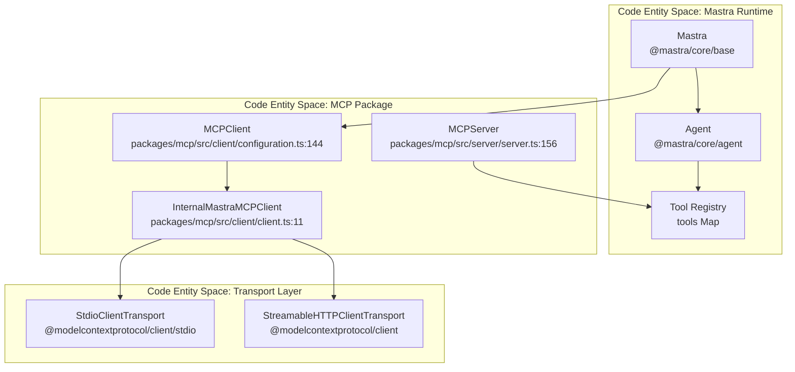
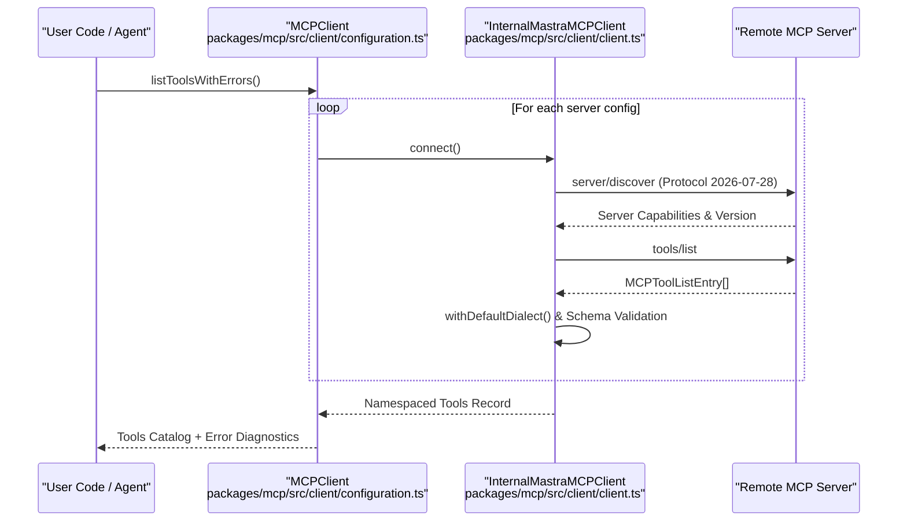
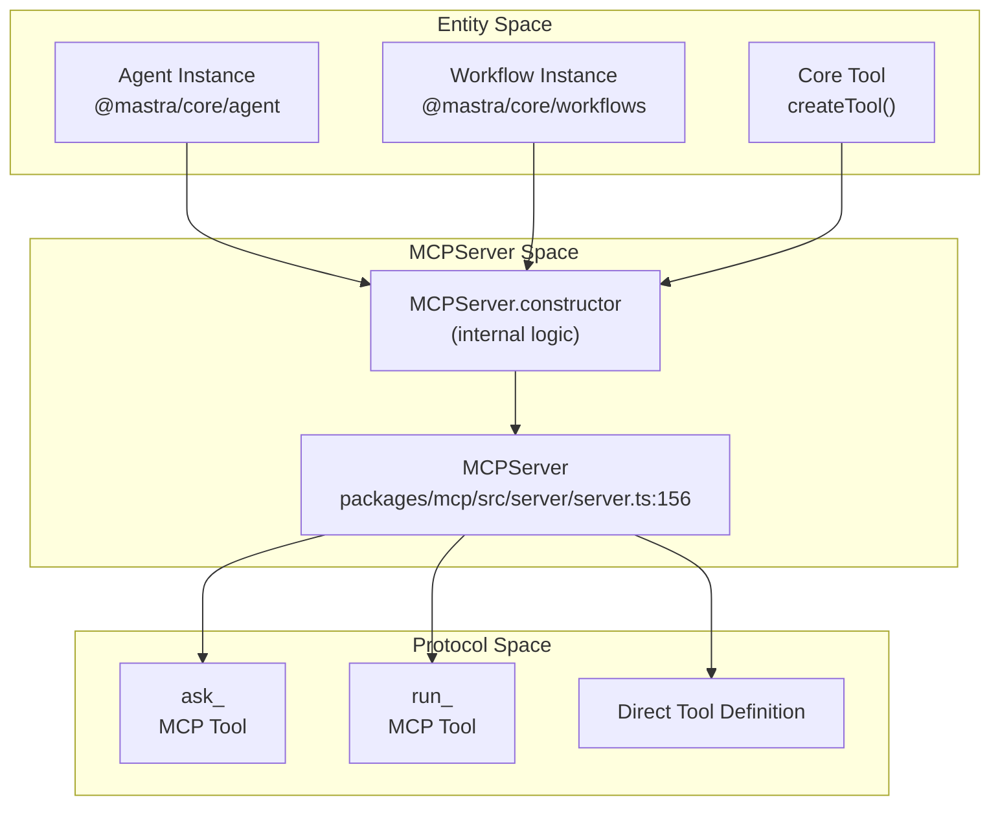

<!-- source: DeepWiki mcp.deepwiki.com · repo mastra-ai/mastra · page 7.8 Model Context Protocol (MCP) Integration · fetched 2026-10-27 -->

# Model Context Protocol (MCP) Integration

Relevant source files

The following files were used as context for generating this wiki page:

- [.changeset/funny-forks-brush.md](.changeset/funny-forks-brush.md)
- [docs/src/content/en/docs/connections/mcp.mdx](docs/src/content/en/docs/connections/mcp.mdx)
- [docs/src/content/en/docs/guides/mcp-authentication-authorization.mdx](docs/src/content/en/docs/guides/mcp-authentication-authorization.mdx)
- [docs/src/content/en/docs/sidebars.js](docs/src/content/en/docs/sidebars.js)
- [docs/src/content/en/reference/sidebars.js](docs/src/content/en/reference/sidebars.js)
- [docs/src/content/en/reference/tools/mcp-client.mdx](docs/src/content/en/reference/tools/mcp-client.mdx)
- [docs/src/content/en/reference/tools/mcp-server.mdx](docs/src/content/en/reference/tools/mcp-server.mdx)
- [docs/vercel.json](docs/vercel.json)
- [docs/vercel.redirects.json](docs/vercel.redirects.json)
- [packages/core/src/mastra/remove-tool.test.ts](packages/core/src/mastra/remove-tool.test.ts)
- [packages/core/src/mcp/index.ts](packages/core/src/mcp/index.ts)
- [packages/core/src/mcp/types.ts](packages/core/src/mcp/types.ts)
- [packages/mcp/CHANGELOG.md](packages/mcp/CHANGELOG.md)
- [packages/mcp/package.json](packages/mcp/package.json)
- [packages/mcp/src/__fixtures__/graceful-shutdown-host.ts](packages/mcp/src/__fixtures__/graceful-shutdown-host.ts)
- [packages/mcp/src/client/client.test.ts](packages/mcp/src/client/client.test.ts)
- [packages/mcp/src/client/client.ts](packages/mcp/src/client/client.ts)
- [packages/mcp/src/client/configuration.test.ts](packages/mcp/src/client/configuration.test.ts)
- [packages/mcp/src/client/configuration.ts](packages/mcp/src/client/configuration.ts)
- [packages/mcp/src/client/index.ts](packages/mcp/src/client/index.ts)
- [packages/mcp/src/client/input-schema-blob-worker.test.ts](packages/mcp/src/client/input-schema-blob-worker.test.ts)
- [packages/mcp/src/client/input-schema-meta-schema.ts](packages/mcp/src/client/input-schema-meta-schema.ts)
- [packages/mcp/src/client/input-schema-test-cases.ts](packages/mcp/src/client/input-schema-test-cases.ts)
- [packages/mcp/src/client/process-hooks.test.ts](packages/mcp/src/client/process-hooks.test.ts)
- [packages/mcp/src/client/serializable-tool-definitions.test.ts](packages/mcp/src/client/serializable-tool-definitions.test.ts)
- [packages/mcp/src/client/types.ts](packages/mcp/src/client/types.ts)
- [packages/mcp/src/server/__tests__/dynamic-tools.test.ts](packages/mcp/src/server/__tests__/dynamic-tools.test.ts)
- [packages/mcp/src/server/__tests__/server-fga.test.ts](packages/mcp/src/server/__tests__/server-fga.test.ts)
- [packages/mcp/src/server/index.ts](packages/mcp/src/server/index.ts)
- [packages/mcp/src/server/server.test.ts](packages/mcp/src/server/server.test.ts)
- [packages/mcp/src/server/server.ts](packages/mcp/src/server/server.ts)

The MCP integration package (`@mastra/mcp`) enables Mastra agents and workflows to discover and execute tools, resources, and prompts exposed by external Model Context Protocol (MCP) servers. It also provides the `MCPServer` runtime to expose native Mastra tools, agents, and workflows as an MCP server conforming to the protocol specification (version `2026-07-28`) [packages/mcp/src/server/server.ts:156-157](), [packages/mcp/src/client/types.ts:23-24]().

For information about tool definition and execution in general, see [Tool System](#6). For details on how tools integrate with agent execution, see [Tool Integration and Execution](#3.3).

## MCP Architecture Overview

The MCP integration consists of client and server components that handle communication over `stdio` and `Streamable HTTP` transports.

Title: "MCP Architecture and Entity Mapping"

Sources: [packages/mcp/src/client/client.ts:11-14](), [packages/mcp/src/client/client.ts:32-34](), [packages/mcp/src/client/configuration.ts:144-146](), [packages/mcp/src/server/server.ts:156-156]()

**Key Components:**

- **`InternalMastraMCPClient`**: Low-level client managing protocol communication, transport lifecycle, and server instructions for a single MCP server connection [packages/mcp/src/client/client.ts:11-11]().
- **`MCPClient`**: High-level manager handling multiple MCP server connections, tool namespacing (e.g., `serverName_toolName`), and aggregate discovery (`listToolsWithErrors`) [packages/mcp/src/client/configuration.ts:144-146](), [packages/mcp/src/client/configuration.test.ts:48-64]().
- **`MCPServer`**: Exposes Mastra tools, agents, and workflows as an MCP server extending `MCPServerBase` [packages/mcp/src/server/server.ts:156-156](), [packages/core/src/mcp/index.ts:28-28]().
- **Transport Layer**: Supports `StdioClientTransport` and `StreamableHTTPClientTransport` under protocol version `2026-07-28` [packages/mcp/src/client/client.ts:14-15](), [packages/mcp/src/client/client.ts:32-32](), [packages/mcp/src/client/types.ts:23-24]().

Sources: [packages/mcp/src/client/client.ts:14-213](), [packages/mcp/src/server/server.ts:156-156](), [packages/mcp/src/client/configuration.ts:90-95](), [packages/core/src/mcp/index.ts:28-28]()

## MCP Client Implementation (`MCPClient` & `InternalMastraMCPClient`)

The client architecture divides responsibilities between aggregate configuration management (`MCPClient`) and single-server protocol handling (`InternalMastraMCPClient`).

Title: "MCP Client Connection and Tool Discovery Flow"

Sources: [packages/mcp/src/client/client.ts:11-11](), [packages/mcp/src/client/client.ts:123-127](), [packages/mcp/src/client/configuration.ts:144-146]()

**Client Features & Protocol Handling:**

- **Protocol Revision Probing**: Connects using protocol version `2026-07-28` via `server/discover`, falling back to legacy handshakes when required [packages/mcp/src/client/types.ts:23-24](), [packages/mcp/src/client/client.ts:42-42]()
- **JSON Schema Dialect Conversion**: Validates incoming tool schemas against complexity bounds (`getJsonSchemaComplexityError`) and normalizes draft versions to JSON Schema 2020-12 (`withDefaultDialect`) [packages/mcp/src/client/client.ts:84-162]()
- **Custom Fetch & Request Context**: Supports `MastraFetchLike` callbacks that receive `RequestContext` for propagating cookies or authorization tokens from incoming HTTP requests [packages/mcp/src/client/types.ts:67-71]()
- **Server Instructions**: Automatically retrieves server instructions (`client.instructions`) after connection, which can be forwarded to guide LLM behavior [packages/mcp/src/client/client.test.ts:53-67]()

Sources: [packages/mcp/src/client/client.ts:84-162](), [packages/mcp/src/client/client.test.ts:53-67](), [packages/mcp/src/client/types.ts:23-71](), [packages/mcp/src/client/configuration.ts:90-95]()

## MCP Server Implementation (`MCPServer`)

The `MCPServer` class exposes local capabilities to external MCP clients (like Cursor or Claude Desktop) over `stdio` or Streamable HTTP [packages/mcp/src/server/server.ts:129-156]().

**Automatic Entity Conversion:**
- **Agents**: Converted to tools named `ask_<agentKey>`. The agent requires a non-empty `description` property [packages/docs/src/content/en/reference/tools/mcp-server.mdx:101-106]().
- **Workflows**: Converted to tools named `run_<workflowKey>`. The workflow's `inputSchema` becomes the tool's input schema [packages/docs/src/content/en/reference/tools/mcp-server.mdx:108-113]().

Title: "Mastra Entity to MCP Tool Conversion"

Sources: [packages/mcp/src/server/server.ts:156-156](), [packages/docs/src/content/en/reference/tools/mcp-server.mdx:101-113]()

- **Continuations (`input_required`)**: Suspends tool execution when user input is needed, round-tripping state securely via `requestState` HMAC signatures [packages/mcp/src/server/server.ts:170-172](), [packages/mcp/src/server/types.ts:102-107]()
- **Fine-Grained Authorization (FGA)**: Maps transport auth info to users via `mapAuthInfoToUser` to enforce permission checks on tools and resources [packages/mcp/src/server/server.ts:169-183](), [packages/docs/src/content/en/reference/tools/mcp-server.mdx:127-139]()

Sources: [packages/mcp/src/server/server.ts:156-183](), [packages/mcp/src/server/types.ts:102-107](), [packages/docs/src/content/en/reference/tools/mcp-server.mdx:101-139]()

## Tool Discovery, Interoperability, and Execution Context

Mastra aggregates tools from multiple MCP servers while handling partial failures and schema compatibility.

- **`listToolsWithErrors()`**: Aggregates tools across all configured servers, returning successfully namespaced tool definitions alongside structured server-specific error details [packages/mcp/src/client/configuration.test.ts:48-98]()
- **Standard Schema Integration**: Automatically converts Zod and other `StandardSchema` instances to standard JSON Schema for MCP advertisement [packages/mcp/src/server/server.ts:17-18]()
- **Tool Execution Context**: Handlers receive `MCPToolExecutionContext` containing `requestContext`, cancellation signals, and transport-level metadata [packages/mcp/src/server/server.ts:20-20](), [packages/mcp/src/server/types.ts:31-34]()

Sources: [packages/mcp/src/client/configuration.test.ts:48-98](), [packages/mcp/src/server/server.ts:17-20](), [packages/mcp/src/server/types.ts:31-34]()

## Testing MCP Integrations

The `@mastra/mcp` test suite verifies protocol compliance for both client and server layers.

- **Client Testing**: `InternalMastraMCPClient` tests validate session management, instruction fetching, and error recovery against mock Streamable HTTP servers [packages/mcp/src/client/client.test.ts:53-171]()
- **Server Testing**: `MCPServer` tests verify proper conversion of agents, workflows, and tools, as well as metadata rendering and FGA restriction enforcement [packages/mcp/src/server/server.test.ts:57-163]()

Sources: [packages/mcp/src/client/client.test.ts:53-171](), [packages/mcp/src/server/server.test.ts:57-163]()

---

