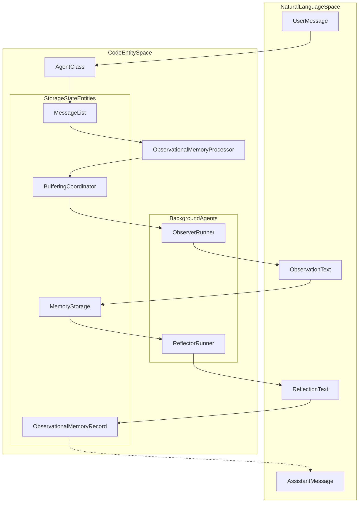
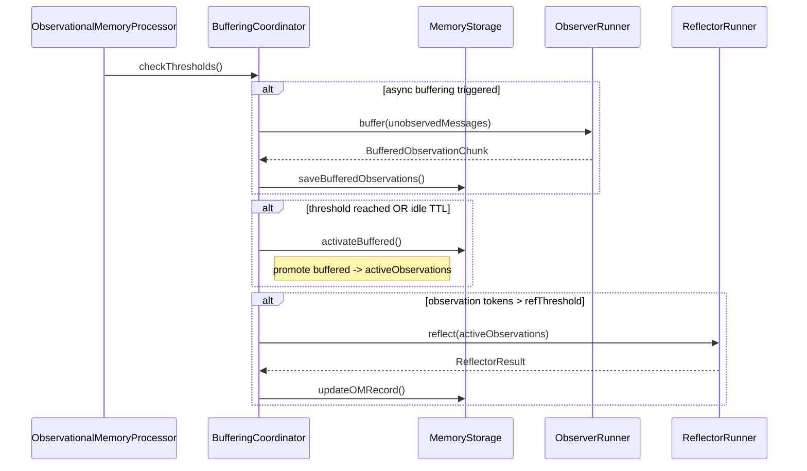

<!-- source: DeepWiki mcp.deepwiki.com · repo mastra-ai/mastra · page 7.9 Observational Memory System · fetched 2026-10-27 -->

# Observational Memory System

<details>
<summary>Relevant source files</summary>

The following files were used as context for generating this wiki page:

- [.changeset/silent-steaks-yell.md](.changeset/silent-steaks-yell.md)
- [docs/src/content/en/docs/memory/message-history.mdx](docs/src/content/en/docs/memory/message-history.mdx)
- [docs/src/content/en/docs/memory/observational-memory.mdx](docs/src/content/en/docs/memory/observational-memory.mdx)
- [docs/src/content/en/docs/memory/overview.mdx](docs/src/content/en/docs/memory/overview.mdx)
- [docs/src/content/en/docs/memory/semantic-recall.mdx](docs/src/content/en/docs/memory/semantic-recall.mdx)
- [docs/src/content/en/reference/memory/memory-class.mdx](docs/src/content/en/reference/memory/memory-class.mdx)
- [docs/src/content/en/reference/memory/observational-memory.mdx](docs/src/content/en/reference/memory/observational-memory.mdx)
- [packages/core/src/loop/test-utils/aimock/scenarios/working-memory-gemini-thought-signature.scenario.test.ts](packages/core/src/loop/test-utils/aimock/scenarios/working-memory-gemini-thought-signature.scenario.test.ts)
- [packages/core/src/memory/memory.ts](packages/core/src/memory/memory.ts)
- [packages/core/src/memory/mock-working-memory-merge.test.ts](packages/core/src/memory/mock-working-memory-merge.test.ts)
- [packages/core/src/memory/mock.ts](packages/core/src/memory/mock.ts)
- [packages/core/src/memory/types.ts](packages/core/src/memory/types.ts)
- [packages/core/src/memory/working-memory-utils.test.ts](packages/core/src/memory/working-memory-utils.test.ts)
- [packages/core/src/memory/working-memory-utils.ts](packages/core/src/memory/working-memory-utils.ts)
- [packages/core/src/processors/memory/message-history.test.ts](packages/core/src/processors/memory/message-history.test.ts)
- [packages/core/src/processors/memory/message-history.ts](packages/core/src/processors/memory/message-history.ts)
- [packages/memory/src/index.test.ts](packages/memory/src/index.test.ts)
- [packages/memory/src/index.ts](packages/memory/src/index.ts)
- [packages/memory/src/processors/observational-memory/__tests__/idle-buffering.test.ts](packages/memory/src/processors/observational-memory/__tests__/idle-buffering.test.ts)
- [packages/memory/src/processors/observational-memory/__tests__/message-utils.test.ts](packages/memory/src/processors/observational-memory/__tests__/message-utils.test.ts)
- [packages/memory/src/processors/observational-memory/__tests__/mid-loop-observation.test.ts](packages/memory/src/processors/observational-memory/__tests__/mid-loop-observation.test.ts)
- [packages/memory/src/processors/observational-memory/__tests__/mock-om-agent.test.ts](packages/memory/src/processors/observational-memory/__tests__/mock-om-agent.test.ts)
- [packages/memory/src/processors/observational-memory/__tests__/observation-groups.test.ts](packages/memory/src/processors/observational-memory/__tests__/observation-groups.test.ts)
- [packages/memory/src/processors/observational-memory/__tests__/observational-memory-api.test.ts](packages/memory/src/processors/observational-memory/__tests__/observational-memory-api.test.ts)
- [packages/memory/src/processors/observational-memory/__tests__/observational-memory.test.ts](packages/memory/src/processors/observational-memory/__tests__/observational-memory.test.ts)
- [packages/memory/src/processors/observational-memory/__tests__/token-counter-digits.test.ts](packages/memory/src/processors/observational-memory/__tests__/token-counter-digits.test.ts)
- [packages/memory/src/processors/observational-memory/__tests__/token-counter-large-tool-result.test.ts](packages/memory/src/processors/observational-memory/__tests__/token-counter-large-tool-result.test.ts)
- [packages/memory/src/processors/observational-memory/index.ts](packages/memory/src/processors/observational-memory/index.ts)
- [packages/memory/src/processors/observational-memory/message-utils.ts](packages/memory/src/processors/observational-memory/message-utils.ts)
- [packages/memory/src/processors/observational-memory/observation-groups.ts](packages/memory/src/processors/observational-memory/observation-groups.ts)
- [packages/memory/src/processors/observational-memory/observation-strategies/async-buffer.ts](packages/memory/src/processors/observational-memory/observation-strategies/async-buffer.ts)
- [packages/memory/src/processors/observational-memory/observation-strategies/base.ts](packages/memory/src/processors/observational-memory/observation-strategies/base.ts)
- [packages/memory/src/processors/observational-memory/observation-strategies/resource-scoped.ts](packages/memory/src/processors/observational-memory/observation-strategies/resource-scoped.ts)
- [packages/memory/src/processors/observational-memory/observation-strategies/sync.ts](packages/memory/src/processors/observational-memory/observation-strategies/sync.ts)
- [packages/memory/src/processors/observational-memory/observation-strategies/types.ts](packages/memory/src/processors/observational-memory/observation-strategies/types.ts)
- [packages/memory/src/processors/observational-memory/observation-turn/step.ts](packages/memory/src/processors/observational-memory/observation-turn/step.ts)
- [packages/memory/src/processors/observational-memory/observation-turn/turn.ts](packages/memory/src/processors/observational-memory/observation-turn/turn.ts)
- [packages/memory/src/processors/observational-memory/observational-memory.ts](packages/memory/src/processors/observational-memory/observational-memory.ts)
- [packages/memory/src/processors/observational-memory/observer-agent.ts](packages/memory/src/processors/observational-memory/observer-agent.ts)
- [packages/memory/src/processors/observational-memory/observer-runner.ts](packages/memory/src/processors/observational-memory/observer-runner.ts)
- [packages/memory/src/processors/observational-memory/processor.ts](packages/memory/src/processors/observational-memory/processor.ts)
- [packages/memory/src/processors/observational-memory/reflector-agent.ts](packages/memory/src/processors/observational-memory/reflector-agent.ts)
- [packages/memory/src/processors/observational-memory/reflector-runner.ts](packages/memory/src/processors/observational-memory/reflector-runner.ts)
- [packages/memory/src/processors/observational-memory/token-counter.test.ts](packages/memory/src/processors/observational-memory/token-counter.test.ts)
- [packages/memory/src/processors/observational-memory/token-counter.ts](packages/memory/src/processors/observational-memory/token-counter.ts)
- [packages/memory/src/processors/observational-memory/tool-result-helpers.ts](packages/memory/src/processors/observational-memory/tool-result-helpers.ts)
- [packages/memory/src/processors/observational-memory/types.ts](packages/memory/src/processors/observational-memory/types.ts)
- [packages/memory/src/tools/om-search-context.test.ts](packages/memory/src/tools/om-search-context.test.ts)
- [packages/memory/src/tools/om-tools.test.ts](packages/memory/src/tools/om-tools.test.ts)
- [packages/memory/src/tools/om-tools.ts](packages/memory/src/tools/om-tools.ts)
- [packages/memory/src/tools/working-memory.test.ts](packages/memory/src/tools/working-memory.test.ts)
- [packages/memory/src/tools/working-memory.ts](packages/memory/src/tools/working-memory.ts)

</details>


## Purpose and Scope

The Observational Memory (OM) system is a three-tier architecture designed to maintain long-term agentic memory while keeping context windows small. It utilizes two background agents—an **Observer** and a **Reflector**—to watch conversations and maintain a dense observation log that replaces raw message history as it grows.

This system provides:
- **Prompt Caching**: Stable context that appends over time rather than shifting dynamically.
- **Compression**: Significant compression of raw history and tool results into dense observations.
- **Zero Context Rot**: Relevant information is prioritized over noisy tool calls or irrelevant tokens.
- **Multimodal Awareness**: Support for image and file attachments during memory extraction.

Sources: `[packages/memory/src/processors/observational-memory/observational-memory.ts:27-55]()`, `[docs/src/content/en/docs/memory/observational-memory.mdx:12-16]()`, `[docs/src/content/en/reference/memory/observational-memory.mdx:9-13]()`

## Architecture Overview

The OM system sits between the Natural Language Space (User/Assistant interaction) and the Code Entity Space (Storage/Processors).

### System Data Flow and Entity Mapping



Sources: `[packages/memory/src/processors/observational-memory/processor.ts:115-135]()`, `[packages/memory/src/processors/observational-memory/buffering-coordinator.ts:26-30]()`, `[packages/memory/src/processors/observational-memory/__tests__/observational-memory.test.ts:55-116]()`

## Three-Tier Memory Structure

The system organizes memory into three distinct layers to balance detail and context length. Thresholds are defined in `OBSERVATIONAL_MEMORY_DEFAULTS`.

| Tier | Component | Description | Default Threshold |
| :--- | :--- | :--- | :--- |
| **1. Recent Messages** | `MessageList` | Exact conversation history for the current task. | `30,000 tokens` |
| **2. Observations** | `Observer` | Concise notes about what happened, extracted from Tier 1. | `30,000 tokens` |
| **3. Reflections** | `Reflector` | Highly condensed patterns and summaries derived from Tier 2. | `40,000 tokens` |

Sources: `[packages/memory/src/processors/observational-memory/types.ts:100-102]()`, `[packages/memory/src/processors/observational-memory/types.ts:219-221]()`, `[packages/memory/src/processors/observational-memory/constants.ts:30-34]()`

## Implementation Detail: The Observer and Reflector

### 1. Observer Agent
The Observer watches unobserved messages. When the token count (estimated via `TokenCounter`) hits the `messageTokens` threshold, it generates observations.

- **Multimodal Awareness**: Handled by the observer prompt construction. It keeps text placeholders like `[Image #1: screenshot.png]` in the transcript it builds for the Observer, and also sends the underlying image parts when possible. `[packages/memory/src/processors/observational-memory/observer-agent.ts:49-53]()`, `[docs/src/content/en/reference/memory/observational-memory.mdx:38-41]()`
- **Temporal Anchoring**: The system ensures observations are anchored to specific times. `[packages/memory/src/processors/observational-memory/observational-memory.ts:118-147]()`
- **Thread Titles**: Can optionally suggest thread titles and update them when topics change if configured. `[packages/memory/src/processors/observational-memory/types.ts:111-111]()`
- **Tool Result Handling**: Tool outputs are sanitized and truncated to prevent context overflow. `[packages/memory/src/processors/observational-memory/__tests__/observational-memory.test.ts:141-142]()`

### 2. Reflector Agent
When cumulative observations exceed token thresholds, the Reflector condenses them.
- **Compression Guidance**: If a reflection is larger than the original observations, the runner can retry with higher compression instructions. `[packages/memory/src/processors/observational-memory/reflector-runner.ts:48-52]()`
- **State Preservation**: The reflector is instructed to maintain immediate operational context like `<current-task>` and `<suggested-response>` tags. `[packages/memory/src/processors/observational-memory/reflector-agent.ts:47-51]()`
- **Consolidation Logic**: Restructures observations by combining related items and condensing overarching patterns. `[docs/src/content/en/reference/memory/observational-memory.mdx:11-13]()`

Sources: `[packages/memory/src/processors/observational-memory/reflector-runner.ts:1-181]()`, `[packages/memory/src/processors/observational-memory/observer-agent.ts:1-60]()`, `[packages/memory/src/processors/observational-memory/__tests__/observational-memory.test.ts:1-142]()`

## Buffering and Activation

OM uses an asynchronous buffering system coordinated by `BufferingCoordinator` to avoid blocking the main agent's execution loop.

### Buffering Sequence Diagram



**Key Mechanisms:**
- **Activation TTL**: Force-activates buffered observations after inactivity (`activateAfterIdle`) or on provider changes (`activateOnProviderChange`). `[packages/memory/src/processors/observational-memory/observational-memory.ts:24-24]()`, `[packages/memory/src/processors/observational-memory/activation-ttl.ts:1-18]()`
- **Token Estimation**: `TokenCounter` handles local token estimation for text and images using `tokenx` for text and provider-aware heuristics for images. `[packages/memory/src/processors/observational-memory/token-counter.ts:5-5]()`, `[docs/src/content/en/reference/memory/observational-memory.mdx:40-41]()`
- **Temporal Markers**: Inserts gap markers (e.g., "Conversation resumed after 10 minutes") to provide context for both the agent and the Observer. `[packages/memory/src/processors/observational-memory/processor.ts:26-26]()`, `[docs/src/content/en/docs/memory/observational-memory.mdx:118-148]()`
- **Buffer on Idle**: Optional `observation.bufferOnIdle` runs buffering when an agent turn ends and the agent becomes idle. `[packages/memory/src/processors/observational-memory/types.ts:188-190]()`, `[docs/src/content/en/docs/memory/observational-memory.mdx:191-200]()`

Sources: `[packages/memory/src/processors/observational-memory/buffering-coordinator.ts:1-20]()`, `[packages/memory/src/processors/observational-memory/token-counter.ts:1-81]()`, `[packages/memory/src/processors/observational-memory/observational-memory.ts:1-179]()`

## Implementation Classes

| Class | File Path | Role |
| :--- | :--- | :--- |
| `ObservationalMemoryProcessor` | `packages/memory/src/processors/observational-memory/processor.ts` | Orchestrates the agent memory lifecycle as a `Processor`. |
| `TokenCounter` | `packages/memory/src/processors/observational-memory/token-counter.ts` | Handles local token estimation and multimodal size probing. |
| `ObserverRunner` | `packages/memory/src/processors/observational-memory/observer-runner.ts` | Executes the Observer agent for message-to-observation extraction. |
| `ReflectorRunner` | `packages/memory/src/processors/observational-memory/reflector-runner.ts` | Executes the Reflector agent and handles compression logic. |
| `BufferingCoordinator` | `packages/memory/src/processors/observational-memory/buffering-coordinator.ts` | Manages the lifecycle of buffered observations and activation triggers. |
| `ObservationalMemory` | `packages/memory/src/processors/observational-memory/observational-memory.ts` | The core engine implementing OM primitives. |

Sources: `[packages/memory/src/processors/observational-memory/processor.ts:1-135]()`, `[packages/memory/src/processors/observational-memory/token-counter.ts:1-81]()`, `[packages/memory/src/processors/observational-memory/observational-memory.ts:1-55]()`

## Configuration Example

```typescript
import { Memory } from '@mastra/memory';
import { Agent } from '@mastra/core/agent';

const agent = new Agent({
  name: 'research-agent',
  model: 'openai/gpt-4o',
  memory: new Memory({
    options: {
      observationalMemory: {
        model: 'google/gemini-2.5-flash',
        scope: 'resource', // Share memory across threads for this resource
        temporalMarkers: true,
        activateAfterIdle: '5m',
        observation: {
          messageTokens: 20000,
          bufferTokens: 0.2, // Buffer every 4000 tokens
          bufferOnIdle: true,
        },
        reflection: {
          observationTokens: 30000,
          activateOnProviderChange: true,
        }
      },
    },
  }),
});
```

Sources: `[docs/src/content/en/reference/memory/observational-memory.mdx:17-136]()`, `[packages/memory/src/processors/observational-memory/types.ts:1-193]()`

---

