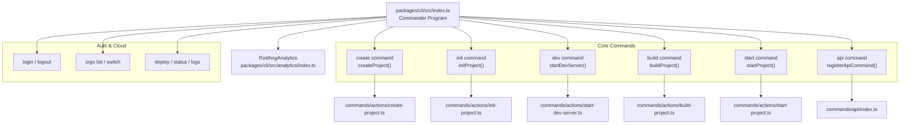
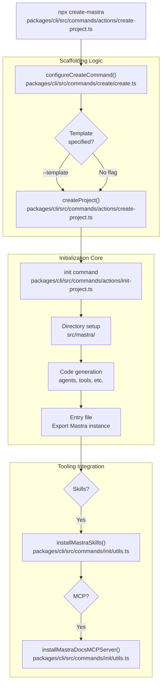
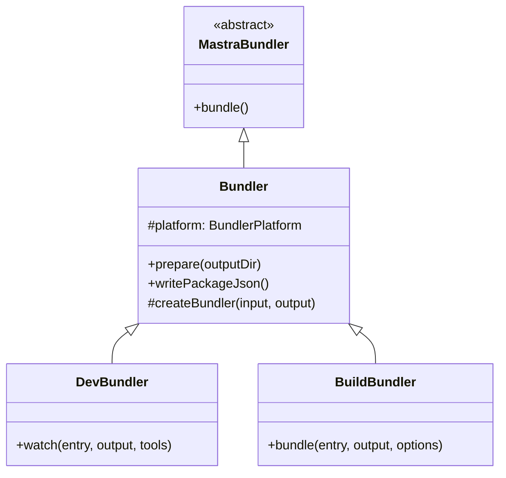

<!-- source: DeepWiki mcp.deepwiki.com · repo mastra-ai/mastra · page 8 CLI and Development Tools · fetched 2026-10-27 -->

# CLI and Development Tools

Relevant source files

The following files were used as context for generating this wiki page:

- [docs/src/content/en/reference/cli/mastra.mdx](docs/src/content/en/reference/cli/mastra.mdx)
- [packages/cli/src/commands/api/api.test.ts](packages/cli/src/commands/api/api.test.ts)
- [packages/cli/src/commands/api/client.test.ts](packages/cli/src/commands/api/client.test.ts)
- [packages/cli/src/commands/api/client.ts](packages/cli/src/commands/api/client.ts)
- [packages/cli/src/commands/api/descriptors.test.ts](packages/cli/src/commands/api/descriptors.test.ts)
- [packages/cli/src/commands/api/index.ts](packages/cli/src/commands/api/index.ts)
- [packages/cli/src/commands/api/schema.test.ts](packages/cli/src/commands/api/schema.test.ts)
- [packages/cli/src/commands/api/schema.ts](packages/cli/src/commands/api/schema.ts)
- [packages/cli/src/commands/api/target.test.ts](packages/cli/src/commands/api/target.test.ts)
- [packages/cli/src/commands/api/target.ts](packages/cli/src/commands/api/target.ts)
- [packages/cli/src/commands/api/types.ts](packages/cli/src/commands/api/types.ts)
- [packages/cli/src/commands/deploy/index.test.ts](packages/cli/src/commands/deploy/index.test.ts)
- [packages/cli/src/commands/deploy/index.ts](packages/cli/src/commands/deploy/index.ts)
- [packages/cli/src/commands/platform-api.d.ts](packages/cli/src/commands/platform-api.d.ts)
- [packages/cli/src/commands/server/deploy.test.ts](packages/cli/src/commands/server/deploy.test.ts)
- [packages/cli/src/commands/server/deploy.ts](packages/cli/src/commands/server/deploy.ts)
- [packages/cli/src/commands/server/platform-api.test.ts](packages/cli/src/commands/server/platform-api.test.ts)
- [packages/cli/src/commands/server/platform-api.ts](packages/cli/src/commands/server/platform-api.ts)
- [packages/cli/src/commands/studio/deploy.test.ts](packages/cli/src/commands/studio/deploy.test.ts)
- [packages/cli/src/commands/studio/deploy.ts](packages/cli/src/commands/studio/deploy.ts)
- [packages/cli/src/commands/studio/platform-api.test.ts](packages/cli/src/commands/studio/platform-api.test.ts)
- [packages/cli/src/commands/studio/platform-api.ts](packages/cli/src/commands/studio/platform-api.ts)
- [packages/cli/src/commands/studio/project-config.test.ts](packages/cli/src/commands/studio/project-config.test.ts)
- [packages/cli/src/commands/studio/project-config.ts](packages/cli/src/commands/studio/project-config.ts)
- [packages/cli/src/index.ts](packages/cli/src/index.ts)

The Mastra CLI provides the complete development lifecycle for AI applications, from project scaffolding to production deployment. This document covers the command-line interface, development server, build pipeline, and platform deployers.

For information about the HTTP server and API endpoints exposed by Mastra, see [Server and API Layer](#9). For details about the bundler configuration and options, see [Build, Test, and CI/CD](#12).

---

## Overview

The Mastra CLI is implemented in `packages/cli/src/index.ts` and provides several primary commands for project management, development, and deployment:

| Command | Purpose | Action Handler |
|---------|---------|---------|
| `create` | Scaffold new projects with templates or interactive prompts | `createProject` |
| `init` | Initialize Mastra in existing projects | `initProject` |
| `dev` | Start development server with hot reload | `startDevServer` |
| `build` | Bundle for production deployment | `buildProject` |
| `deploy` | Deploy to supported cloud platforms | `unifiedDeployAction` |
| `start` | Start a locally built Mastra application in production mode | `startProject` |
| `lint` | Run project linter and preflight bundle checks | `lintProject` |
| `factory dev`| Start development server for Agent Builder | `startDevServer` |
| `worker build`| Bundle for worker deployment | `buildWorker` |
| `api` | Call Mastra APIs directly from the CLI | `registerApiCommand` |

Sources: [packages/cli/src/index.ts:10-19](), [packages/cli/src/index.ts:74-185](), [docs/src/content/en/reference/cli/mastra.mdx:10-13]()

---

## CLI Architecture and Command Structure

**CLI Entry Point and Command Registration**

The CLI uses Commander.js for argument parsing [packages/cli/src/index.ts:61](). Each command is registered with flags and options, then dispatched to action handlers. Commands like `create` and `init` support interactive modes using `@clack/prompts`. The CLI also manages state through a development lock mechanism to prevent concurrent server instances [docs/src/content/en/reference/cli/mastra.mdx:118](). The `api` command provides direct access to Mastra server endpoints for agents, workflows, tools, and memory [packages/cli/src/commands/api/index.ts:31-151]().

Sources: [packages/cli/src/index.ts:1-200](), [packages/cli/src/commands/api/index.ts:31-151](), [docs/src/content/en/reference/cli/mastra.mdx:118]()

---

## Project Creation and Initialization

**Project Creation Pipeline**

The `create` command scaffolds projects from templates or via interactive prompts [packages/cli/src/index.ts:78](), configuring environment variables for providers like OpenAI, Anthropic, and Google [packages/cli/src/commands/init/utils.ts:108-124](). The `init` command sets up the directory structure, exports the `Mastra` instance, and installs required packages [packages/cli/src/index.ts:80-105]().

For details, see [Project Creation and Initialization](#8.1).

Sources: [packages/cli/src/index.ts:78](), [packages/cli/src/index.ts:80-105](), [packages/cli/src/commands/init/utils.ts:108-124]()

---

## Development Server and Hot Reload

The `mastra dev` command starts a local development server with hot-reloading [packages/cli/src/index.ts:129-147](). It uses a `DevBundler` to watch for file changes and manage server processes.

- **DevBundler**: Extends the base `Bundler` class to manage file watching and incremental builds using a neutral target platform.
- **Process Management**: Executes the bundled entry point using `execa` with environment variables such as `MASTRA_DEV=true`.
- **Automatic Refresh**: Handles server restarts and active workflow reloads.
- **HTTPS Support**: Enables secure local development via `--https` flag [docs/src/content/en/reference/cli/mastra.mdx:23-25]().
- **Debugging**: Supports Node.js inspect modes via `--inspect` and `--inspect-brk` flags [docs/src/content/en/reference/cli/mastra.mdx:27-32]().

For details, see [Development Server and Hot Reload](#8.2).

Sources: [packages/cli/src/index.ts:129-147](), [docs/src/content/en/reference/cli/mastra.mdx:23-32]()

---

## Build System and Dependency Analysis

The `mastra build` command prepares applications for production deployment by bundling the Mastra instance and resolving dependencies [docs/src/content/en/reference/cli/mastra.mdx:123-128]().

- **Entry Point Detection**: Locates entry files.
- **Static Analysis**: Detects external dependencies and workspace packages.
- **File-Based Routing**: Discovers file-system routed agents and automatically constructs instances when entry files are omitted.
- **Staleness Detection**: Computes source hashes to determine if rebuilds are necessary.
- **Studio UI Bundling**: The `--studio` flag can be used to bundle the Studio UI with the build [docs/src/content/en/reference/cli/mastra.mdx:137-139]().

For details, see [Build System and Dependency Analysis](#8.3).

Sources: [docs/src/content/en/reference/cli/mastra.mdx:123-139]()

---

## Bundler Architecture and Plugin System

Mastra uses a Rollup-based bundler abstraction to compile TypeScript files into production-ready artifacts.

The `Bundler` class coordinates output directory setup and Rollup configuration, integrating plugins for `esbuild` transpilation and path resolution.

For details, see [Bundler Architecture and Plugin System](#8.4).

Sources: [packages/cli/src/commands/build/build.ts:126-128]()

---

## Platform Deployers

Deployers manage platform-specific stubs and configuration files for target cloud runtimes, working directly with the bundler to satisfy platform constraints. The `mastra deploy` command provides a unified entry point for deploying Mastra projects [packages/cli/src/commands/deploy/index.ts:2-9]().

- **Project and Environment Management**: Automatically creates projects and environments if missing, using package.json names and interactive prompts [packages/cli/src/commands/deploy/index.ts:7-8]().
- **Build Integration**: Runs `mastra build` as part of the deployment process, checking for staleness and worker manifest requirements [packages/cli/src/commands/deploy/index.ts:103-109]().
- **Artifact Upload**: Zips the `.mastra/output` directory and uploads it to the platform [packages/cli/src/commands/deploy/index.ts:600-604]().
- **Environment Variable Handling**: Reads and uploads environment variables from `.env` files [packages/cli/src/commands/deploy/index.ts:50-51]().
- **Observability Configuration**: Automatically injects telemetry tokens for cloud environments.

For details, see [Platform Deployers](#8.5).

Sources: [packages/cli/src/commands/deploy/index.ts:2-9](), [packages/cli/src/commands/deploy/index.ts:50-51](), [packages/cli/src/commands/deploy/index.ts:103-109](), [packages/cli/src/commands/deploy/index.ts:600-604]()

---

## Agent Tooling Integration (Skills and MCP)

The CLI integrates AI coding assistants with project capabilities:

1.  **Skills**: `installMastraSkills` installs pre-built agent capabilities and generates guide documents like `AGENTS.md`.
2.  **MCP**: Configures editors like Cursor or Windsurf to expose Mastra documentation and tools via global configuration paths [packages/cli/src/index.ts:96-98]().

For details, see [Agent Tooling Integration (Skills and MCP)](#8.7).

Sources: [packages/cli/src/index.ts:96-98]()

---

## Analytics and Telemetry

Mastra collects anonymous usage telemetry via PostHog to guide improvements.

-   **Implementation**: The `PosthogAnalytics` class manages tracking events using configured API keys and package versions [packages/cli/src/index.ts:53-57]().
-   **Opt-out**: Telemetry collection can be bypassed or disabled via configuration flags.

For details, see [Analytics and Telemetry](#8.8).

Sources: [packages/cli/src/index.ts:53-57]()

---

## CLI Command Reference

For a complete list of commands, option flags, and usage examples, see [CLI Command Reference](#8.6).

Sources: [packages/cli/src/index.ts:61-190](), [docs/src/content/en/reference/cli/mastra.mdx:8-213]()

---

