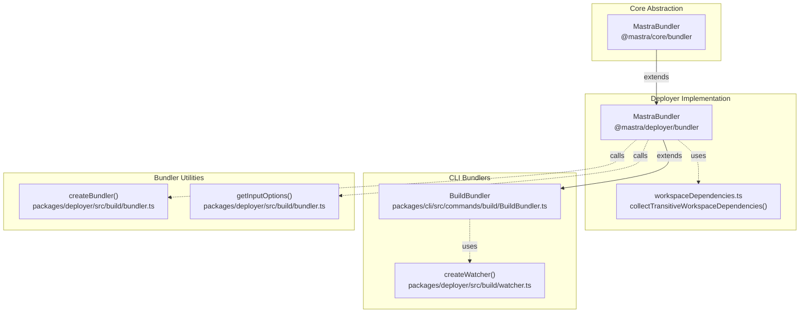

<!-- source: DeepWiki mcp.deepwiki.com · repo mastra-ai/mastra · page 8.4 Bundler Architecture and Plugin System · fetched 2026-10-27 -->

# Bundler Architecture and Plugin System

Relevant source files

The following files were used as context for generating this wiki page:

- [docs/src/content/en/docs/harness/durable-agents.mdx](docs/src/content/en/docs/harness/durable-agents.mdx)
- [docs/src/content/en/reference/agents/durable-agent.mdx](docs/src/content/en/reference/agents/durable-agent.mdx)
- [docs/src/content/en/reference/core/mastra-class.mdx](docs/src/content/en/reference/core/mastra-class.mdx)
- [e2e-tests/monorepo/monorepo.test.ts](e2e-tests/monorepo/monorepo.test.ts)
- [e2e-tests/monorepo/template/apps/custom/package.json](e2e-tests/monorepo/template/apps/custom/package.json)
- [e2e-tests/monorepo/template/apps/custom/src/mastra/index.ts](e2e-tests/monorepo/template/apps/custom/src/mastra/index.ts)
- [e2e-tests/monorepo/template/packages/versionless-dependent/package.json](e2e-tests/monorepo/template/packages/versionless-dependent/package.json)
- [e2e-tests/monorepo/template/packages/versionless-dependent/src/index.ts](e2e-tests/monorepo/template/packages/versionless-dependent/src/index.ts)
- [examples/agent/src/mastra/agents/weather-fs/README.md](examples/agent/src/mastra/agents/weather-fs/README.md)
- [packages/cli/src/commands/build/BuildBundler.test.ts](packages/cli/src/commands/build/BuildBundler.test.ts)
- [packages/cli/src/commands/build/BuildBundler.ts](packages/cli/src/commands/build/BuildBundler.ts)
- [packages/cli/src/commands/build/build.ts](packages/cli/src/commands/build/build.ts)
- [packages/core/src/agent/durable/__tests__/durable-agent-execution-fence.test.ts](packages/core/src/agent/durable/__tests__/durable-agent-execution-fence.test.ts)
- [packages/core/src/agent/durable/__tests__/durable-agent-memory.test.ts](packages/core/src/agent/durable/__tests__/durable-agent-memory.test.ts)
- [packages/core/src/agent/durable/__tests__/evented-split-transport.test.ts](packages/core/src/agent/durable/__tests__/evented-split-transport.test.ts)
- [packages/core/src/agent/durable/__tests__/observe-detach.test.ts](packages/core/src/agent/durable/__tests__/observe-detach.test.ts)
- [packages/core/src/agent/durable/__tests__/recover-active-runs.test.ts](packages/core/src/agent/durable/__tests__/recover-active-runs.test.ts)
- [packages/core/src/agent/durable/__tests__/stream-generation.test.ts](packages/core/src/agent/durable/__tests__/stream-generation.test.ts)
- [packages/core/src/agent/fs-routing/index.test.ts](packages/core/src/agent/fs-routing/index.test.ts)
- [packages/core/src/agent/fs-routing/index.ts](packages/core/src/agent/fs-routing/index.ts)
- [packages/core/src/agent/save-queue/index.ts](packages/core/src/agent/save-queue/index.ts)
- [packages/core/src/agent/save-queue/save-queue.test.ts](packages/core/src/agent/save-queue/save-queue.test.ts)
- [packages/core/src/bundler/types.ts](packages/core/src/bundler/types.ts)
- [packages/core/src/loop/test-utils/aimock/scenarios/durable-input-persistence.scenario.test.ts](packages/core/src/loop/test-utils/aimock/scenarios/durable-input-persistence.scenario.test.ts)
- [packages/core/src/loop/test-utils/aimock/scenarios/observe-lifecycle.scenario.test.ts](packages/core/src/loop/test-utils/aimock/scenarios/observe-lifecycle.scenario.test.ts)
- [packages/core/src/loop/test-utils/aimock/scenarios/save-per-step-failed-save.scenario.test.ts](packages/core/src/loop/test-utils/aimock/scenarios/save-per-step-failed-save.scenario.test.ts)
- [packages/core/src/mastra/index.ts](packages/core/src/mastra/index.ts)
- [packages/core/src/mastra/recover-all-durable-agents.test.ts](packages/core/src/mastra/recover-all-durable-agents.test.ts)
- [packages/deployer/src/build/analyze.test.ts](packages/deployer/src/build/analyze.test.ts)
- [packages/deployer/src/build/analyze.ts](packages/deployer/src/build/analyze.ts)
- [packages/deployer/src/build/analyze/analyzeEntry.test.ts](packages/deployer/src/build/analyze/analyzeEntry.test.ts)
- [packages/deployer/src/build/analyze/analyzeEntry.ts](packages/deployer/src/build/analyze/analyzeEntry.ts)
- [packages/deployer/src/build/analyze/bundleExternals.test.ts](packages/deployer/src/build/analyze/bundleExternals.test.ts)
- [packages/deployer/src/build/analyze/bundleExternals.ts](packages/deployer/src/build/analyze/bundleExternals.ts)
- [packages/deployer/src/build/analyze/externals.ts](packages/deployer/src/build/analyze/externals.ts)
- [packages/deployer/src/build/bundler.ts](packages/deployer/src/build/bundler.ts)
- [packages/deployer/src/build/fs-routing/codegen-eval.test.ts](packages/deployer/src/build/fs-routing/codegen-eval.test.ts)
- [packages/deployer/src/build/fs-routing/codegen.ts](packages/deployer/src/build/fs-routing/codegen.ts)
- [packages/deployer/src/build/fs-routing/discover.ts](packages/deployer/src/build/fs-routing/discover.ts)
- [packages/deployer/src/build/fs-routing/fs-routing.test.ts](packages/deployer/src/build/fs-routing/fs-routing.test.ts)
- [packages/deployer/src/build/fs-routing/prepare.ts](packages/deployer/src/build/fs-routing/prepare.ts)
- [packages/deployer/src/build/index.ts](packages/deployer/src/build/index.ts)
- [packages/deployer/src/build/plugins/node-modules-extension-resolver.test.ts](packages/deployer/src/build/plugins/node-modules-extension-resolver.test.ts)
- [packages/deployer/src/build/plugins/node-modules-extension-resolver.ts](packages/deployer/src/build/plugins/node-modules-extension-resolver.ts)
- [packages/deployer/src/build/plugins/tsconfig-paths.test.ts](packages/deployer/src/build/plugins/tsconfig-paths.test.ts)
- [packages/deployer/src/build/plugins/tsconfig-paths.ts](packages/deployer/src/build/plugins/tsconfig-paths.ts)
- [packages/deployer/src/build/types.ts](packages/deployer/src/build/types.ts)
- [packages/deployer/src/build/watcher.test.ts](packages/deployer/src/build/watcher.test.ts)
- [packages/deployer/src/build/watcher.ts](packages/deployer/src/build/watcher.ts)
- [packages/deployer/src/bundler/index.test.ts](packages/deployer/src/bundler/index.test.ts)
- [packages/deployer/src/bundler/index.ts](packages/deployer/src/bundler/index.ts)
- [packages/deployer/src/bundler/workspaceDependencies.test.ts](packages/deployer/src/bundler/workspaceDependencies.test.ts)
- [packages/deployer/src/bundler/workspaceDependencies.ts](packages/deployer/src/bundler/workspaceDependencies.ts)
- [packages/deployer/src/services/deps.test.ts](packages/deployer/src/services/deps.test.ts)
- [packages/deployer/src/services/deps.ts](packages/deployer/src/services/deps.ts)
- [packages/memory/src/processors/observational-memory/__tests__/inflight-turn-preservation.test.ts](packages/memory/src/processors/observational-memory/__tests__/inflight-turn-preservation.test.ts)
- [stores/libsql/src/storage/durable-agent-input-persistence.test.ts](stores/libsql/src/storage/durable-agent-input-persistence.test.ts)

This document describes the Mastra bundler abstraction hierarchy, platform detection mechanisms, file-system routing codegen, and the Rollup/esbuild plugin configuration system used to bundle Mastra applications for different deployment targets. It details how Mastra handles complex dependency graphs, workspace packages, and output validation to produce optimized ESM bundles.

---

## Class Hierarchy and Abstractions

The Mastra bundler system employs a layered abstraction to separate the core bundler interface, deployer-specific logic, and environment-specific build implementations.

### MastraBundler Abstract Base Class
The `MastraBundler` class in `@mastra/core` defines the essential interface for all bundlers, supporting environment variable loading, tool discovery, and bundling orchestration [packages/core/src/mastra/index.ts:10]().

### Bundler Implementation
The `MastraBundler` class (in `@mastra/deployer`) provides concrete build process implementations, including:
- **Workspace Resolution**: Collecting transitive workspace dependencies and packing them for isolated installs [packages/deployer/src/bundler/index.ts:21-25]().
- **Registry Validation**: Logic to determine if a dependency specifier is a registry version spec (semver, dist tags) or a local file/link [packages/deployer/src/bundler/index.ts:75-91]().
- **Output Management**: Writing `package.json` to the `.mastra/output` directory with pinned dependencies to ensure build reproducibility [packages/deployer/src/bundler/index.ts:139-140]().

### Specialized Bundler Implementations
- **DevBundler / BuildBundler**: Extends `MastraBundler` to support Rollup's watch mode and production builds. It selects the platform as `'neutral'` when running on Bun to preserve Bun-specific globals, otherwise defaulting to `'node'` [packages/cli/src/commands/build/BuildBundler.ts:10-19]().
- **Platform Deployers**: Specific deployers (e.g., Cloudflare, Vercel, Netlify) configure the bundler with target-specific platforms. For example, Cloudflare deployers set the platform to `'browser'` to ensure conditional exports resolve to Worker-compatible implementations.

**Class Hierarchy and Code Entity Association**

Sources: [packages/core/src/mastra/index.ts:10](), [packages/deployer/src/bundler/index.ts:21-25](), [packages/deployer/src/bundler/index.ts:75-91](), [packages/deployer/src/bundler/index.ts:139-140](), [packages/cli/src/commands/build/BuildBundler.ts:10-19](), [packages/deployer/src/build/bundler.ts:61-90](), [packages/deployer/src/build/bundler.ts:189-197]()

---

## Plugin Pipeline and Data Flow

Mastra uses a sophisticated Rollup plugin pipeline to handle TypeScript, ESM shimming, and specialized module resolution.

### Core Plugin Pipeline
The `getInputOptions` function assembles the plugin stack [packages/deployer/src/build/bundler.ts:61-93](). Key plugins include:

- **esbuild**: Handles TypeScript transpilation and minification via `rollup-plugin-esbuild` [packages/deployer/src/build/bundler.ts:9-9]().
- **tsConfigPaths**: Resolves module paths based on the project's `tsconfig.json` [packages/deployer/src/build/bundler.ts:19]().
- **mastraInternalAliasPlugin**: Maps `#server` to the deployer server, `#mastra` to the user's entry file, and handles `@mastra/server/` subpaths [packages/deployer/src/build/bundler.ts:24-46]().
- **mastraToolsAliasPlugin**: Rewrites `#tools` to a virtual `./tools.mjs` to bridge discovered tools into the runtime [packages/deployer/src/build/bundler.ts:48-60]().
- **esmShim**: Injects CJS globals (`__dirname`, `__filename`) into ESM bundles [packages/deployer/src/build/bundler.ts:12-12]().
- **protocolExternalResolver**: Handles resolution of `node:` protocol imports [packages/deployer/src/build/bundler.ts:16-16]().

### Dependency Analysis and Optimization
Before bundling, `analyzeBundle` identifies which dependencies should be externalized and which should be bundled [packages/deployer/src/build/analyze.ts:12-15]().
- **Virtual Dependencies**: `createVirtualDependencies` creates virtual entry points for optimized bundling of external dependencies with specific exports [packages/deployer/src/build/analyze/bundleExternals.ts:47-63]().
- **External Stubbing**: For restricted runtimes, the bundler can inject stubs for unavailable modules to keep the bundle size small and prevent runtime crashes.

**Bundler Data Flow Diagram**

Sources: [packages/deployer/src/build/bundler.ts:61-93](), [packages/deployer/src/build/bundler.ts:105-186](), [packages/deployer/src/build/analyze.ts:12-15](), [packages/deployer/src/build/analyze/bundleExternals.ts:47-63]()

---

## File-System Routing and Codegen

Mastra supports file-system routing for agents, workflows, and tools under the `src/mastra` directory (or custom mastra directories). 
- **Discovery**: The `discoverFsAgents` utility scans directories like `agents/*` to locate configuration (`config.ts`), instructions (`instructions.md`), tools, and workspaces [e2e-tests/monorepo/template/apps/custom/src/mastra/index.ts:1-42](), [packages/deployer/src/build/fs-routing/discover.ts:8]().
- **Codegen**: When no explicit `index.ts` entry file is found, `prepareFsAgentsEntry` and `generateFsAgentsModule` auto-construct a synthetic Mastra instance wiring all discovered file-system primitives together prior to bundling [packages/cli/src/commands/build/build.ts:46-69](), [packages/deployer/src/build/fs-routing/codegen.ts:1-416]().
- **Workspace Mirroring**: `mirrorFsAgentWorkspaces` copies authored workspace seed files into the `.mastra/output` directory so file-system routed agents initialize with correct default files on disk [packages/cli/src/commands/build/build.ts:91-92]().

Sources: [e2e-tests/monorepo/template/apps/custom/src/mastra/index.ts:1-42](), [packages/deployer/src/build/fs-routing/discover.ts:8](), [packages/cli/src/commands/build/build.ts:46-69](), [packages/deployer/src/build/fs-routing/codegen.ts:1-416](), [packages/cli/src/commands/build/build.ts:91-92]()

---

## Output Configuration and Validation

### Output Format
Mastra strictly enforces **ESM** output. The `createBundler` utility ensures all chunks and entry files use the `.mjs` extension to prevent resolution issues in Node.js ESM environments [packages/deployer/src/build/bundler.ts:189-197]().

### Output Validation
Post-bundling, the system validates the output to catch common deployment errors:
- **Missing Native Builds**: Detects if a dependency requires a native binary that cannot be bundled [packages/deployer/src/build/analyze.ts:188-195]().
- **Module Not Found**: Identifies packages that were expected to be bundled or externalized but are missing from the final resolution path [packages/deployer/src/build/analyze.ts:171-180]().
- **CommonJS Failures**: Catches older CJS modules that fail the ESM transformation, providing user feedback to add them to `externals` [packages/deployer/src/build/analyze.ts:156-170]().

Sources: [packages/deployer/src/build/bundler.ts:189-197](), [packages/deployer/src/build/analyze.ts:137-212]()

---

## Summary of Key Functions

| Function | Role | Location |
| :--- | :--- | :--- |
| `getInputOptions` | Assembles Rollup plugin pipeline and platform config | [packages/deployer/src/build/bundler.ts:61]() |
| `analyzeBundle` | Performs static analysis to detect external vs bundled deps | [packages/deployer/src/build/analyze.ts:12]() |
| `createBundler` | Orchestrates the Rollup build and ESM output | [packages/deployer/src/build/bundler.ts:189]() |
| `validateError` | Maps Rollup/Runtime errors to Mastra-specific diagnostics | [packages/deployer/src/build/analyze.ts:137]() |
| `discoverFsAgents` | Discovers file-system routed agents and tools | [packages/deployer/src/build/fs-routing/discover.ts:8]() |

Sources: [packages/deployer/src/build/bundler.ts:61](), [packages/deployer/src/build/analyze.ts:12](), [packages/deployer/src/build/bundler.ts:189](), [packages/deployer/src/build/analyze.ts:137](), [packages/deployer/src/build/fs-routing/discover.ts:8]()

---

