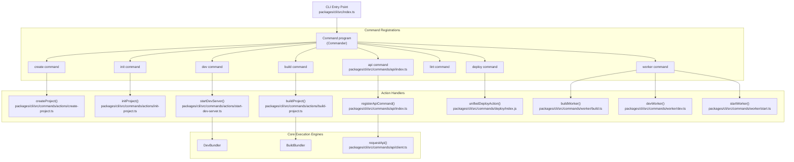
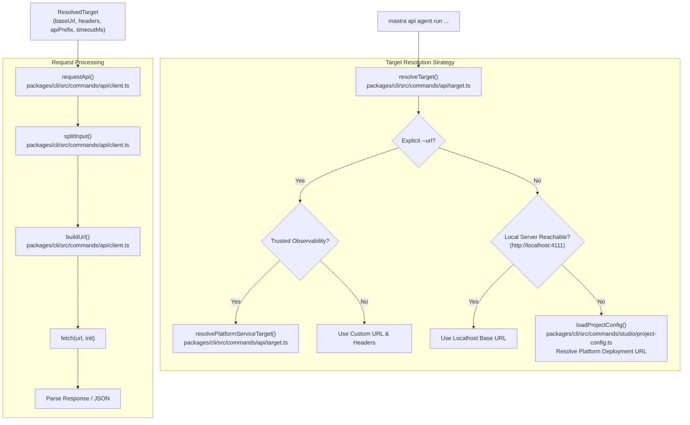
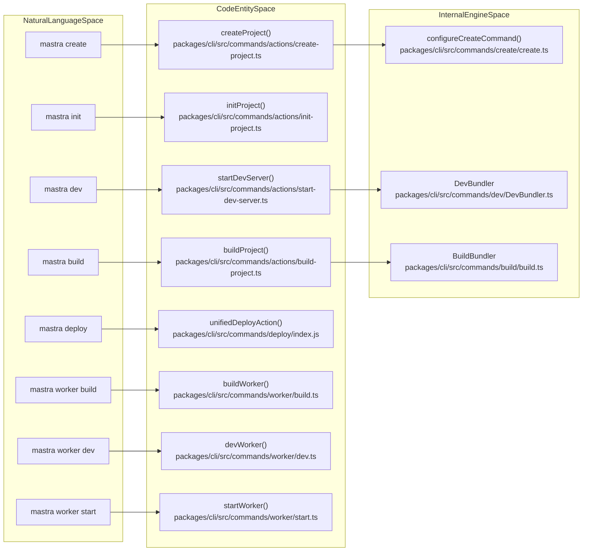
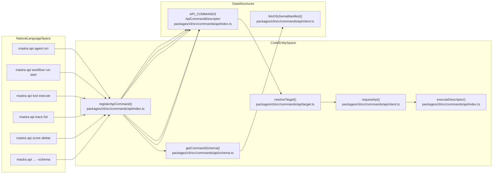

<!-- source: DeepWiki mcp.deepwiki.com · repo mastra-ai/mastra · page 8.6 CLI Command Reference · fetched 2026-10-27 -->

# CLI Command Reference

Relevant source files

The following files were used as context for generating this wiki page:

- [docs/src/content/en/reference/cli/mastra.mdx](docs/src/content/en/reference/cli/mastra.mdx)
- [packages/cli/src/commands/api/api.test.ts](packages/cli/src/commands/api/api.test.ts)
- [packages/cli/src/commands/api/client.test.ts](packages/cli/src/commands/api/client.test.ts)
- [packages/cli/src/commands/api/client.ts](packages/cli/src/commands/api/client.ts)
- [packages/cli/src/commands/api/descriptors.test.ts](packages/cli/src/commands/api/descriptors.test.ts)
- [packages/cli/src/commands/api/index.ts](packages/cli/src/commands/api/index.ts)
- [packages/cli/src/commands/api/schema.test.ts](packages/cli/src/commands/api/schema.test.ts)
- [packages/cli/src/commands/api/schema.ts](packages/cli/src/commands/api/schema.ts)
- [packages/cli/src/commands/api/target.test.ts](packages/cli/src/commands/api/target.test.ts)
- [packages/cli/src/commands/api/target.ts](packages/cli/src/commands/api/target.ts)
- [packages/cli/src/commands/api/types.ts](packages/cli/src/commands/api/types.ts)
- [packages/cli/src/commands/deploy/index.test.ts](packages/cli/src/commands/deploy/index.test.ts)
- [packages/cli/src/commands/deploy/index.ts](packages/cli/src/commands/deploy/index.ts)
- [packages/cli/src/commands/platform-api.d.ts](packages/cli/src/commands/platform-api.d.ts)
- [packages/cli/src/commands/server/deploy.test.ts](packages/cli/src/commands/server/deploy.test.ts)
- [packages/cli/src/commands/server/deploy.ts](packages/cli/src/commands/server/deploy.ts)
- [packages/cli/src/commands/server/platform-api.test.ts](packages/cli/src/commands/server/platform-api.test.ts)
- [packages/cli/src/commands/server/platform-api.ts](packages/cli/src/commands/server/platform-api.ts)
- [packages/cli/src/commands/studio/deploy.test.ts](packages/cli/src/commands/studio/deploy.test.ts)
- [packages/cli/src/commands/studio/deploy.ts](packages/cli/src/commands/studio/deploy.ts)
- [packages/cli/src/commands/studio/platform-api.test.ts](packages/cli/src/commands/studio/platform-api.test.ts)
- [packages/cli/src/commands/studio/platform-api.ts](packages/cli/src/commands/studio/platform-api.ts)
- [packages/cli/src/commands/studio/project-config.test.ts](packages/cli/src/commands/studio/project-config.test.ts)
- [packages/cli/src/commands/studio/project-config.ts](packages/cli/src/commands/studio/project-config.ts)
- [packages/cli/src/index.ts](packages/cli/src/index.ts)

This document provides a comprehensive technical reference for all Mastra Command-Line Interface (CLI) commands, detailing their options, arguments, implementation, data flows, and internal routing. It covers the command-line interface across project creation, initialization, development, building, deployment, maintenance, and the `mastra api` subsystem.

For architectural and subsystem-specific context, see related documentation in sections [8.1](), [8.2](), [8.3](), [8.4](), and [8.5]().

---

## CLI Architecture Overview

The Mastra CLI is built on top of the `commander` library [packages/cli/src/index.ts:3](), establishing a hierarchical command router that maps subcommands to action functions and core bundler engines. The CLI package (`@mastra/cli`) coordinates execution via `wrapAction()` to enforce uniform error handling, process exit codes, and usage tracking [packages/cli/src/index.ts:45]().

### Command Routing and Dispatch Architecture

The following diagram illustrates how CLI commands are registered in `program` and mapped to action handlers and underlying modules:

Title: "CLI Command Routing and Dispatch"

**Sources:**  
[packages/cli/src/index.ts:2-48](), [packages/cli/src/commands/api/index.ts:31-151](), [packages/cli/src/commands/api/client.ts:15-57]()

---

## Global Options and Analytics

The CLI configures global options such as `-v, --version` via `package.json` [packages/cli/src/index.ts:7-50](). Telemetry is handled by `PosthogAnalytics`, which tracks command telemetry unless opted out [packages/cli/src/index.ts:52-58]().

### Sources:
[packages/cli/src/index.ts:7-58]()

---

## Core CLI Commands Reference

### `mastra create` & `mastra init`

- **`mastra create`**: Scaffolds a new Mastra project using `createProject()` [packages/cli/src/index.ts:12,78](). Supports flags like `--default`, `-c, --components`, `-l, --llm`, `--template`, and `--observability` [packages/cli/src/index.ts:82-99]().
- **`mastra init`**: Initializes Mastra structures in an existing repository [packages/cli/src/index.ts:13,80-105](). It accepts directory options (`-d, --dir`), component selectors (`-c, --components`), LLM provider configurations (`-l, --llm`), and code editor MCP setup (`-m, --mcp`) [packages/cli/src/index.ts:83-98]().

**Sources:**  
[packages/cli/src/index.ts:10-105](), [docs/src/content/en/reference/cli/mastra.mdx:10-104]()

---

### `mastra dev` & `mastra factory dev`

Starts the local development server supporting hot-reloading, Studio integration, and API endpoints [docs/src/content/en/reference/cli/mastra.mdx:12-121]().

- **Options**:
  - `-d, --dir <dir>`: Path to Mastra folder [packages/cli/src/index.ts:130]().
  - `-r, --root <root>`: Root folder path [packages/cli/src/index.ts:131]().
  - `-t, --tools <toolsDirs>`: Include tool file paths [packages/cli/src/index.ts:132]().
  - `-e, --env <env>`: Custom environment file [packages/cli/src/index.ts:133]().
  - `-i, --inspect [host:port]`: Start node debugger in inspect mode [packages/cli/src/index.ts:135]().
  - `-b, --inspect-brk [host:port]`: Start node debugger and break immediately [packages/cli/src/index.ts:139]().
  - `-s, --https`: Enable local HTTPS [packages/cli/src/index.ts:146]().
  - `--request-context-presets <file>`: JSON file path for context presets in Studio [docs/src/content/en/reference/cli/mastra.mdx:38-40]().
  - `--custom-args <args>`: Comma-separated list of custom arguments to pass to the Node.js process [packages/cli/src/index.ts:144]().
- **Environment Variables**:
  - `MASTRA_SKIP_PEERDEP_CHECK=1`: Skips peer dependency version mismatch check [docs/src/content/en/reference/cli/mastra.mdx:60-61]().
  - `MASTRA_DEV_NO_CACHE=1`: Forces a full rebuild, bypassing cached assets [docs/src/content/en/reference/cli/mastra.mdx:71-72]().
  - `MASTRA_CONCURRENCY=<num>`: Limits parallel operations during build and evaluation [docs/src/content/en/reference/cli/mastra.mdx:80-81]().
  - `OPENAI_BASE_URL`, `ANTHROPIC_BASE_URL`: Custom provider endpoints for Vercel AI SDK compatible providers [docs/src/content/en/reference/cli/mastra.mdx:94-104]().
- **`mastra factory dev`**: Specialized development server for Agent Builder UI and workflows, sharing dev lock mechanisms [docs/src/content/en/reference/cli/mastra.mdx:110-121](). It accepts the same flags as `mastra dev` [docs/src/content/en/reference/cli/mastra.mdx:120-121]().

**Sources:**  
[packages/cli/src/index.ts:127-149](), [docs/src/content/en/reference/cli/mastra.mdx:12-121]()

---

### `mastra build`, `mastra start`, & `mastra worker build`

- **`mastra build`**: Bundles the Mastra project into production artifacts within `.mastra/output` using Rollup and Hono [docs/src/content/en/reference/cli/mastra.mdx:123-140]().
  - **Flags**:
    - `--studio`: Bundle the Studio UI with the build [docs/src/content/en/reference/cli/mastra.mdx:136]().
  - **Environment Variables**:
    - `MASTRA_SKIP_PEERDEP_CHECK=1`: Skips peer dependency version mismatch check [docs/src/content/en/reference/cli/mastra.mdx:146-147]().
    - `MASTRA_CONCURRENCY=<num>`: Limits parallel operations [docs/src/content/en/reference/cli/mastra.mdx:154-155]().
- **`mastra start`**: Serves the built production application from `.mastra/output` [docs/src/content/en/reference/cli/mastra.mdx:161-180]().
  - **Flags**:
    - `--dir`: Path to the built Mastra output directory (defaults to `.mastra/output`) [docs/src/content/en/reference/cli/mastra.mdx:174]().
    - `--custom-args`: Comma-separated list of custom arguments to pass to the Node.js process [docs/src/content/en/reference/cli/mastra.mdx:178-179]().
- **`mastra worker build`**: Bundles the application specifically for worker runtime targets [docs/src/content/en/reference/cli/mastra.mdx:182-195]().
  - **Flags**:
    - `--dir`: Path to your Mastra source directory (defaults to `src/mastra`) [docs/src/content/en/reference/cli/mastra.mdx:192]().
    - `--root`: Project root directory (defaults to current directory) [docs/src/content/en/reference/cli/mastra.mdx:195]().
    - `--tools`: Comma-separated list of paths to tool files to include [docs/src/content/en/reference/cli/mastra.mdx:201]().

**Sources:**  
[docs/src/content/en/reference/cli/mastra.mdx:123-201]()

---

## The `mastra api` Subsystem

The `mastra api` command suite provides a command-line client for interacting with REST, Agent, Workflow, Tool, MCP, Thread, and Observability endpoints on any running Mastra server or platform deployment [packages/cli/src/commands/api/index.ts:31-47]().

### Target Resolution and Data Flow

When executing an `mastra api` subcommand, the CLI resolves the target server using `resolveTarget()` [packages/cli/src/commands/api/target.ts:44](). It checks explicit URLs, probes local development ports (`http://localhost:4111`), or falls back to platform deployments via project configuration loading (`loadProjectConfig()`) [packages/cli/src/commands/api/target.ts:89-90]().

Title: "Mastra API Request Resolution and Execution Flow"

**Sources:**  
[packages/cli/src/commands/api/target.ts:44-127](), [packages/cli/src/commands/api/client.ts:15-57](), [packages/cli/src/commands/studio/project-config.ts:20-21]()

### Subcommands and Endpoints

The API registry configures endpoints through `registerApiCommand()` [packages/cli/src/commands/api/index.ts:31-151]():
- **`mastra api agent`**: List (`GET /agents`), get (`GET /agents/:agentId`), and run (`POST /agents/:agentId/generate`) agents [packages/cli/src/commands/api/index.ts:48-64]().
- **`mastra api workflow`**: List, inspect, run (`POST /workflows/:workflowId/start-async`), resume, and cancel workflows [packages/cli/src/commands/api/index.ts:66-103]().
- **`mastra api tool`**: List, inspect, and execute (`POST /tools/:toolId/execute`) tools [packages/cli/src/commands/api/index.ts:105-121]().
- **`mastra api mcp`**: Manage MCP server discovery and tool execution [packages/cli/src/commands/api/index.ts:123-148]().
- **`mastra api thread`**: Manage memory threads and message persistence [packages/cli/src/commands/api/index.ts:150-151]().
- **`mastra api trace`**: Manage observability traces, including listing, getting, querying, and aggregating [packages/cli/src/commands/api/api.test.ts:50-102]().
- **`mastra api score`**: Delete scores [packages/cli/src/commands/api/api.test.ts:113-118]().
- **`mastra api feedback`**: Delete feedback [packages/cli/src/commands/api/api.test.ts:119-124]().

**Sources:**  
[packages/cli/src/commands/api/index.ts:31-151](), [packages/cli/src/commands/api/api.test.ts:50-124]()

---

## Natural Language Space to Code Entity Space

### Diagram 1: CLI Lifecycle Commands to Actions

Title: "Lifecycle CLI Mapping to Code Entities"

**Sources:**  
[packages/cli/src/index.ts:10-48](), [packages/cli/src/commands/dev/DevBundler.ts:1-50]()

### Diagram 2: API Subsystem Commands to Execution Functions

Title: "API Subsystem Mapping to Code Entities"

**Sources:**  
[packages/cli/src/commands/api/index.ts:31-151](), [packages/cli/src/commands/api/target.ts:37-121](), [packages/cli/src/commands/api/client.ts:15-149](), [packages/cli/src/commands/api/schema.ts:32-61](), [packages/cli/src/commands/api/api.test.ts:131]()

---

