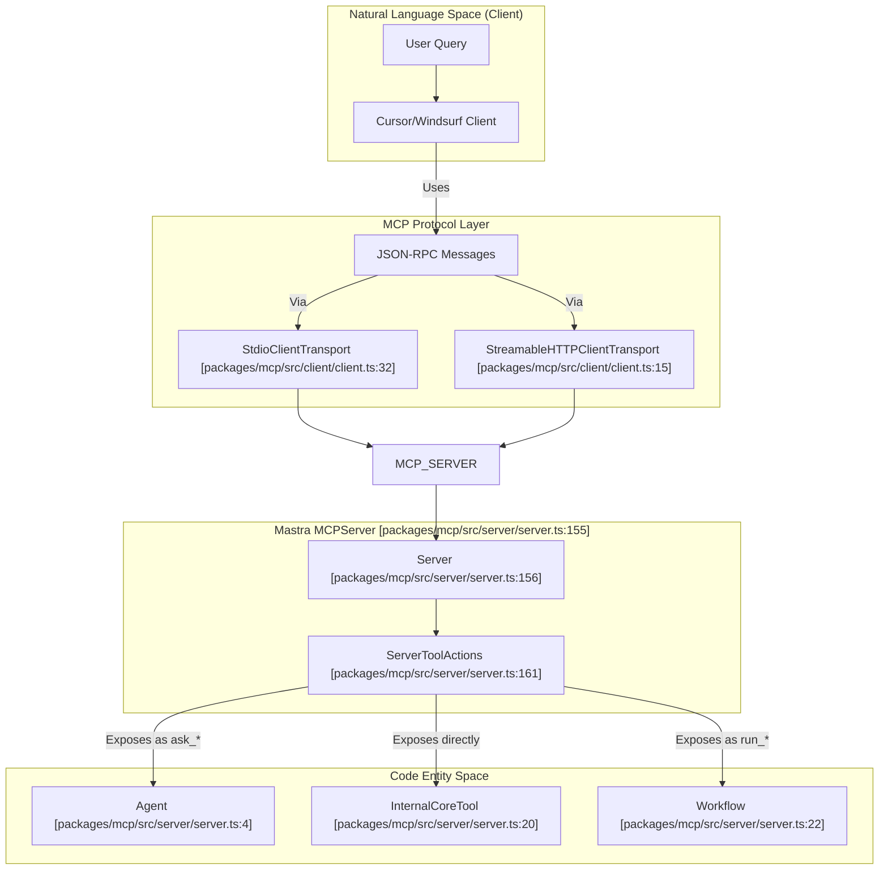
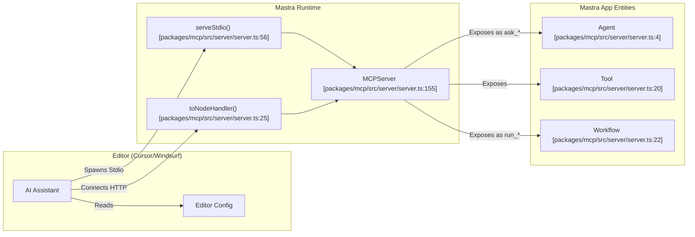

<!-- source: DeepWiki mcp.deepwiki.com · repo mastra-ai/mastra · page 8.7 Agent Tooling Integration (Skills and MCP) · fetched 2026-10-27 -->

# Agent Tooling Integration (Skills and MCP)

Relevant source files

The following files were used as context for generating this wiki page:

- [.agents/skills/real-world-testing/SKILL.md](.agents/skills/real-world-testing/SKILL.md)
- [.changeset/proud-vans-trade.md](.changeset/proud-vans-trade.md)
- [.changeset/quiet-watch-rebuilds.md](.changeset/quiet-watch-rebuilds.md)
- [.coderabbit.yaml](.coderabbit.yaml)
- [.github/scripts/validate-agents-md.mjs](.github/scripts/validate-agents-md.mjs)
- [AGENTS.md](AGENTS.md)
- [client-sdks/client-js/src/resources/workspace.test.ts](client-sdks/client-js/src/resources/workspace.test.ts)
- [client-sdks/client-js/src/resources/workspace.ts](client-sdks/client-js/src/resources/workspace.ts)
- [docs/src/content/en/docs/skills.mdx](docs/src/content/en/docs/skills.mdx)
- [docs/src/content/en/reference/processors/skill-search-processor.mdx](docs/src/content/en/reference/processors/skill-search-processor.mdx)
- [docs/styleguides/DOC.md](docs/styleguides/DOC.md)
- [docs/styleguides/GUIDE_INTEGRATION.md](docs/styleguides/GUIDE_INTEGRATION.md)
- [docs/styleguides/REFERENCE.md](docs/styleguides/REFERENCE.md)
- [docs/styleguides/STYLEGUIDE.md](docs/styleguides/STYLEGUIDE.md)
- [examples/agent/src/mastra/public/workspace/.agents/skills/find-skills/.meta.json](examples/agent/src/mastra/public/workspace/.agents/skills/find-skills/.meta.json)
- [examples/agent/src/mastra/public/workspace/.agents/skills/find-skills/SKILL.md](examples/agent/src/mastra/public/workspace/.agents/skills/find-skills/SKILL.md)
- [examples/agent/src/mastra/public/workspace/.agents/skills/frontend-design/.meta.json](examples/agent/src/mastra/public/workspace/.agents/skills/frontend-design/.meta.json)
- [examples/agent/src/mastra/public/workspace/.agents/skills/frontend-design/LICENSE.txt](examples/agent/src/mastra/public/workspace/.agents/skills/frontend-design/LICENSE.txt)
- [examples/agent/src/mastra/public/workspace/.agents/skills/frontend-design/SKILL.md](examples/agent/src/mastra/public/workspace/.agents/skills/frontend-design/SKILL.md)
- [mastracode/AGENTS.md](mastracode/AGENTS.md)
- [mastracode/tui/e2e/README.md](mastracode/tui/e2e/README.md)
- [mastracode/tui/e2e/fixtures/terminal-resize-reflow.json](mastracode/tui/e2e/fixtures/terminal-resize-reflow.json)
- [packages/auth/AGENTS.md](packages/auth/AGENTS.md)
- [packages/cli/AGENTS.md](packages/cli/AGENTS.md)
- [packages/codemod/.claude/skills/codemod-patterns/SKILL.md](packages/codemod/.claude/skills/codemod-patterns/SKILL.md)
- [packages/codemod/AGENTS.md](packages/codemod/AGENTS.md)
- [packages/core/AGENTS.md](packages/core/AGENTS.md)
- [packages/core/src/agent/__tests__/agent-skills-wiring.test.ts](packages/core/src/agent/__tests__/agent-skills-wiring.test.ts)
- [packages/core/src/agent/__tests__/skills-activation-persistence.test.ts](packages/core/src/agent/__tests__/skills-activation-persistence.test.ts)
- [packages/core/src/agent/__tests__/tool-approval.test.ts](packages/core/src/agent/__tests__/tool-approval.test.ts)
- [packages/core/src/agent/durable/__tests__/durable-agent-skill-tools-approval.test.ts](packages/core/src/agent/durable/__tests__/durable-agent-skill-tools-approval.test.ts)
- [packages/core/src/agent/durable/utils/skill-tools-approval.test.ts](packages/core/src/agent/durable/utils/skill-tools-approval.test.ts)
- [packages/core/src/mastra/run-scope.ts](packages/core/src/mastra/run-scope.ts)
- [packages/core/src/processors/processors/skill-search.test.ts](packages/core/src/processors/processors/skill-search.test.ts)
- [packages/core/src/processors/processors/skill-search.ts](packages/core/src/processors/processors/skill-search.ts)
- [packages/core/src/processors/processors/skills.test.ts](packages/core/src/processors/processors/skills.test.ts)
- [packages/core/src/processors/processors/skills.ts](packages/core/src/processors/processors/skills.ts)
- [packages/core/src/skills/create-skill.ts](packages/core/src/skills/create-skill.ts)
- [packages/core/src/skills/index.ts](packages/core/src/skills/index.ts)
- [packages/core/src/skills/types.ts](packages/core/src/skills/types.ts)
- [packages/core/src/skills/validate.test.ts](packages/core/src/skills/validate.test.ts)
- [packages/core/src/workspace/skills/local-skill-source.ts](packages/core/src/workspace/skills/local-skill-source.ts)
- [packages/core/src/workspace/skills/schemas.test.ts](packages/core/src/workspace/skills/schemas.test.ts)
- [packages/core/src/workspace/skills/schemas.ts](packages/core/src/workspace/skills/schemas.ts)
- [packages/core/src/workspace/skills/skill-source.ts](packages/core/src/workspace/skills/skill-source.ts)
- [packages/core/src/workspace/skills/tools.test.ts](packages/core/src/workspace/skills/tools.test.ts)
- [packages/core/src/workspace/skills/tools.ts](packages/core/src/workspace/skills/tools.ts)
- [packages/core/src/workspace/skills/types.ts](packages/core/src/workspace/skills/types.ts)
- [packages/core/src/workspace/skills/workspace-skills.test.ts](packages/core/src/workspace/skills/workspace-skills.test.ts)
- [packages/core/src/workspace/skills/workspace-skills.ts](packages/core/src/workspace/skills/workspace-skills.ts)
- [packages/core/src/workspace/workspace.test.ts](packages/core/src/workspace/workspace.test.ts)
- [packages/core/src/workspace/workspace.ts](packages/core/src/workspace/workspace.ts)
- [packages/mcp/AGENTS.md](packages/mcp/AGENTS.md)
- [packages/memory/AGENTS.md](packages/memory/AGENTS.md)
- [packages/playground-ui/AGENTS.md](packages/playground-ui/AGENTS.md)
- [packages/playground-ui/CLAUDE.md](packages/playground-ui/CLAUDE.md)
- [packages/playground-ui/src/domains/workspace/__tests__/fixtures/workspace.ts](packages/playground-ui/src/domains/workspace/__tests__/fixtures/workspace.ts)
- [packages/playground-ui/tsconfig.build.json](packages/playground-ui/tsconfig.build.json)
- [packages/playground-ui/vite.config.ts](packages/playground-ui/vite.config.ts)
- [packages/playground/AGENTS.md](packages/playground/AGENTS.md)
- [packages/playground/CLAUDE.md](packages/playground/CLAUDE.md)
- [packages/playground/src/pages/workspace/index.tsx](packages/playground/src/pages/workspace/index.tsx)
- [packages/rag/AGENTS.md](packages/rag/AGENTS.md)
- [packages/server/AGENTS.md](packages/server/AGENTS.md)
- [packages/server/src/server/schemas/workspace.test.ts](packages/server/src/server/schemas/workspace.test.ts)
- [packages/server/src/server/schemas/workspace.ts](packages/server/src/server/schemas/workspace.ts)

This document covers Mastra's integration with external AI coding agents and development environments through two primary mechanisms: **Skills** (pre-built knowledge packages and instructions) and **MCP** (Model Context Protocol). These systems enable AI coding assistants like Cursor, Windsurf, and Claude Code to access Mastra documentation, execute Mastra tools, and interact with agents and workflows.

## Overview

Mastra provides tooling for two distinct integration patterns:

1.  **Skills**: Specialized instruction sets and configuration files (e.g., `SKILL.md`) that teach AI coding agents about project-specific patterns and capabilities [packages/core/src/workspace/skills/workspace-skills.ts:4-6]().
2.  **MCP (Model Context Protocol)**: A standardized protocol for connecting AI agents to external tools and resources [packages/mcp/src/server/server.ts:128-132](). Mastra can both connect to external MCP servers via `InternalMastraMCPClient` and author its own using `MCPServer` to expose agents, tools, and workflows [packages/mcp/src/server/server.ts:95-98](), [packages/mcp/src/client/client.ts:72-74]().

### Tooling Integration Architecture

The following diagram illustrates how the `MCPServer` bridges Mastra's code entities to the MCP protocol for external assistants.

**Mastra MCP Entity Mapping**

**Sources**: [packages/mcp/src/server/server.ts:4-22](), [packages/mcp/src/server/server.ts:155-161](), [packages/mcp/src/client/client.ts:15](), [packages/mcp/src/client/client.ts:32]()

## Skills Installation and Configuration

Mastra supports "Skills"—reusable agentic capabilities—that can be discovered and managed via the `Workspace` system [packages/core/src/workspace/workspace.ts:62-63]().

### Workspace Skills Discovery
Skills are implemented as directories containing a `SKILL.md` file with frontmatter metadata [packages/core/src/workspace/skills/workspace-skills.ts:8-13](). The `WorkspaceSkillsImpl` class handles discovery and indexing of these skills [packages/core/src/workspace/skills/workspace-skills.ts:92-100]().

*   **Validation**: Skills are validated on load using Zod schemas to ensure they contain required fields like `name` and `description` [packages/core/src/workspace/skills/workspace-skills.ts:134](), [packages/core/src/workspace/skills/schemas.ts:5-10]().
*   **Indexing**: Skills can be indexed in a `SearchEngine` for semantic retrieval by agents [packages/core/src/workspace/skills/workspace-skills.ts:34-42]().
*   **Tie-breaking**: When multiple skills have the same name, Mastra deduplicates them, prioritizing specific paths [packages/core/src/workspace/skills/workspace-skills.ts:192-195]().
*   **Processors**: The `SkillsProcessor` injects metadata about available skills into the agent's system prompt [packages/core/src/processors/processors/skills.ts:73-78]().

### Skill Components
A Mastra Skill typically includes:
1.  **SKILL.md**: Instructions and metadata [packages/core/src/workspace/skills/workspace-skills.ts:8]().
2.  **References**: Additional documentation or context files [packages/core/src/workspace/skills/workspace-skills.test.ts:230-233]().
3.  **Scripts**: Executable code that the skill can invoke [packages/core/src/workspace/skills/workspace-skills.test.ts:235-237]().

**Sources**: [packages/core/src/workspace/skills/workspace-skills.ts:1-195](), [packages/core/src/workspace/workspace.ts:62-63](), [packages/core/src/workspace/skills/schemas.ts:5-10](), [packages/core/src/processors/processors/skills.ts:73-78]()

## MCP (Model Context Protocol) Integration

Mastra's MCP implementation is split into `InternalMastraMCPClient` for consuming external tools and `MCPServer` for exposing Mastra capabilities [packages/mcp/src/client/client.ts:18](), [packages/mcp/src/server/server.ts:155]().

### MCPServer: Exposing Capabilities
The `MCPServer` class exposes Mastra tools, agents, and workflows to MCP-compatible clients like Cursor, Windsurf, or Claude Desktop [packages/mcp/src/server/server.ts:128-132]().

*   **Tools**: Exposes standard Mastra tools directly via the `tools` config property [docs/src/content/en/reference/tools/mcp-server.mdx:94-99]().
*   **Agents**: Automatically converts agents into tools named `ask_<agentId>`. Agents must have a description defined [docs/src/content/en/reference/tools/mcp-server.mdx:101-106]().
*   **Workflows**: Automatically converts workflows into tools named `run_<workflowId>`. The workflow's `inputSchema` becomes the tool's input schema [docs/src/content/en/reference/tools/mcp-server.mdx:108-113]().
*   **App Resources**: Supports the MCP Apps extension to serve interactive HTML UIs via the `ui://` URI scheme [packages/mcp/src/server/server.ts:167-170]().

**Sources**: [packages/mcp/src/server/server.ts:128-170](), [docs/src/content/en/reference/tools/mcp-server.mdx:94-113]()

### MCPClient: Consuming External Servers
The `MCPClient` manages connections to one or more MCP servers [packages/mcp/src/client/configuration.ts:106-110](). It handles connection lifecycle, tool namespacing, and authentication [packages/mcp/src/client/configuration.ts:111-120]().

| Transport Type | Code Entity | Description |
| :--- | :--- | :--- |
| **Stdio** | `StdioClientTransport` | For local subprocess-based servers [packages/mcp/src/client/client.ts:32](). |
| **Streamable HTTP** | `StreamableHTTPClientTransport` | High-performance HTTP transport [packages/mcp/src/client/client.ts:15](). |

**Sources**: [packages/mcp/src/client/client.ts:15](), [packages/mcp/src/client/client.ts:32](), [packages/mcp/src/client/configuration.ts:106-120]()

## AI Coding Assistant Integration (Cursor, Windsurf)

Mastra facilitates integration with AI coding assistants by providing a standardized server that these editors can spawn as a subprocess or connect to via HTTP.

### Implementation Data Flow

**Assistant-to-Mastra Connection**

**Sources**: [packages/mcp/src/server/server.ts:4-25](), [packages/mcp/src/server/server.ts:56](), [packages/mcp/src/server/server.ts:155](), [docs/src/content/en/reference/tools/mcp-server.mdx:11-15]()

## Implementation Details

### MCP Server Lifecycle
The `MCPServer` supports multiple start methods:
*   `startStdio()`: Used for local editor integrations where the assistant manages the process [packages/mcp/src/server/server.ts:237]().
*   `startHttp()`: Used for remote integrations via HTTP [packages/mcp/src/server/server.ts:246]().
*   `honoHttpHandler()`: Integration with Hono for HTTP requests [packages/mcp/src/server/server.ts:269]().

### Security and Authorization
Mastra provides granular control over MCP tool execution:
*   **Tool Approval**: The `requireToolApproval` property can be a boolean or a function to require human intervention before tool execution [docs/src/content/en/reference/tools/mcp-client.mdx:171-175](), [packages/mcp/src/client/types.ts:171-175]().
*   **FGA Overrides**: Overrides for Fine-Grained Authorization (FGA) checks for `tools/list` and `tools/call` [docs/src/content/en/reference/tools/mcp-server.mdx:134-139]().
*   **URL Policy**: The `InternalMastraMCPClient` can enforce host allowlists to restrict which external URLs a client can contact [packages/mcp/src/client/url-policy.ts:50-54]().

**Sources**: [packages/mcp/src/server/server.ts:237-269](), [docs/src/content/en/reference/tools/mcp-server.mdx:134-139](), [docs/src/content/en/reference/tools/mcp-client.mdx:171-175](), [packages/mcp/src/client/types.ts:171-175](), [packages/mcp/src/client/url-policy.ts:50-54]()

---

