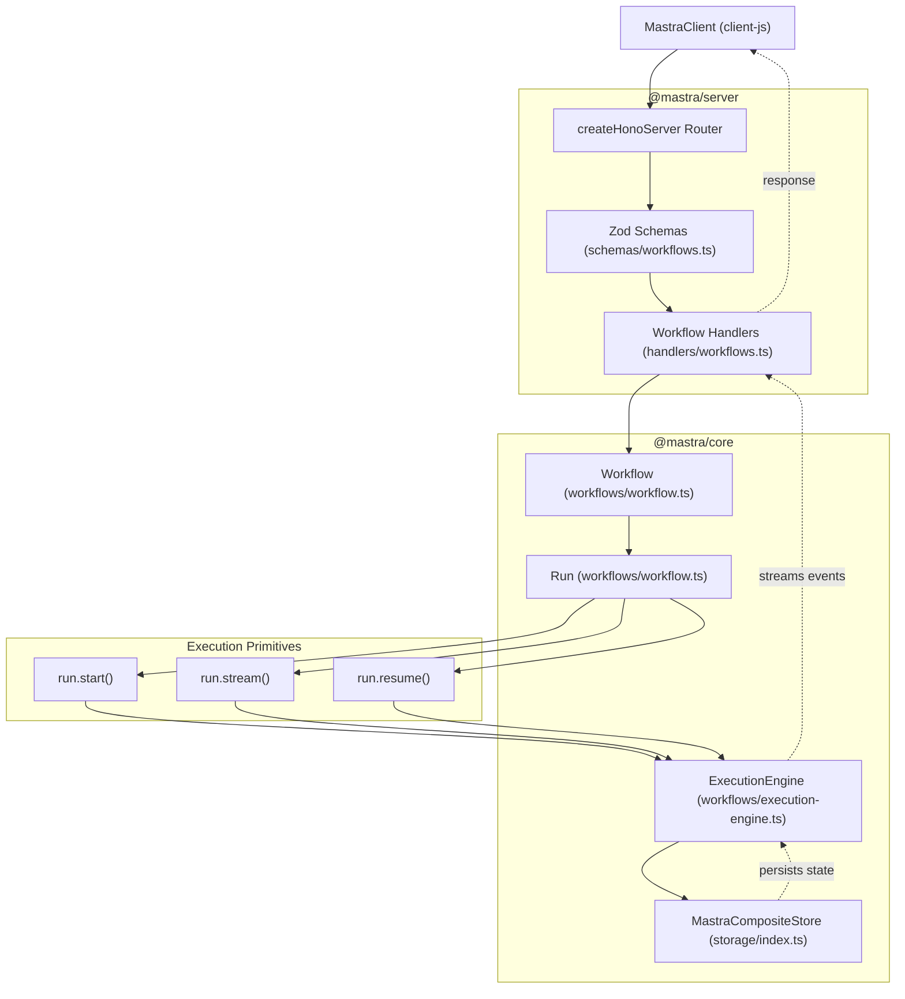
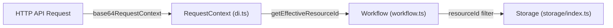

<!-- source: DeepWiki mcp.deepwiki.com · repo mastra-ai/mastra · page 9.3 Workflow API Endpoints · fetched 2026-10-27 -->

# Workflow API Endpoints

<details>
<summary>Relevant source files</summary>

The following files were used as context for generating this wiki page:

- [client-sdks/ai-sdk/src/__tests__/chat-route-credential-headers.test.ts](client-sdks/ai-sdk/src/__tests__/chat-route-credential-headers.test.ts)
- [deployers/cloud/src/utils/execa.ts](deployers/cloud/src/utils/execa.ts)
- [docs/src/content/en/docs/workflows/time-travel.mdx](docs/src/content/en/docs/workflows/time-travel.mdx)
- [docs/src/content/en/reference/client-js/workflows.mdx](docs/src/content/en/reference/client-js/workflows.mdx)
- [docs/src/content/en/reference/streaming/workflows/resumeStream.mdx](docs/src/content/en/reference/streaming/workflows/resumeStream.mdx)
- [docs/src/content/en/reference/workflows/run-methods/restart.mdx](docs/src/content/en/reference/workflows/run-methods/restart.mdx)
- [docs/src/content/en/reference/workflows/run-methods/resume.mdx](docs/src/content/en/reference/workflows/run-methods/resume.mdx)
- [docs/src/content/en/reference/workflows/run-methods/start.mdx](docs/src/content/en/reference/workflows/run-methods/start.mdx)
- [docs/src/content/en/reference/workflows/run-methods/timeTravel.mdx](docs/src/content/en/reference/workflows/run-methods/timeTravel.mdx)
- [docs/src/content/en/reference/workflows/workflow-methods/foreach.mdx](docs/src/content/en/reference/workflows/workflow-methods/foreach.mdx)
- [e2e-tests/deployers/template/cloudflare/src/mastra/index.ts](e2e-tests/deployers/template/cloudflare/src/mastra/index.ts)
- [packages/agent-builder/integration-tests/src/agent-template-behavior.test.ts](packages/agent-builder/integration-tests/src/agent-template-behavior.test.ts)
- [packages/agent-builder/integration-tests/src/workflow-builder-integration.test.ts](packages/agent-builder/integration-tests/src/workflow-builder-integration.test.ts)
- [packages/core/src/workflows/concurrent-time-travel.test.ts](packages/core/src/workflows/concurrent-time-travel.test.ts)
- [packages/core/src/workflows/evented/concurrent-time-travel.test.ts](packages/core/src/workflows/evented/concurrent-time-travel.test.ts)
- [packages/deployer/src/build/analyze/constants.ts](packages/deployer/src/build/analyze/constants.ts)
- [packages/deployer/src/deploy/log.ts](packages/deployer/src/deploy/log.ts)
- [packages/deployer/src/validator/custom-resolver.ts](packages/deployer/src/validator/custom-resolver.ts)
- [packages/deployer/src/validator/validate.test.ts](packages/deployer/src/validator/validate.test.ts)
- [packages/deployer/src/validator/validate.ts](packages/deployer/src/validator/validate.ts)
- [packages/server/src/server/agent-builder-ee-static-imports.test.ts](packages/server/src/server/agent-builder-ee-static-imports.test.ts)
- [packages/server/src/server/handlers/agent-builder.test.ts](packages/server/src/server/handlers/agent-builder.test.ts)
- [packages/server/src/server/handlers/authorship.ts](packages/server/src/server/handlers/authorship.ts)
- [packages/server/src/server/handlers/editor-builder.test.ts](packages/server/src/server/handlers/editor-builder.test.ts)
- [packages/server/src/server/handlers/editor-builder.ts](packages/server/src/server/handlers/editor-builder.ts)
- [packages/server/src/server/handlers/error.test.ts](packages/server/src/server/handlers/error.test.ts)
- [packages/server/src/server/handlers/error.ts](packages/server/src/server/handlers/error.ts)
- [packages/server/src/server/handlers/mcp.ts](packages/server/src/server/handlers/mcp.ts)
- [packages/server/src/server/handlers/tool-schema-overrides.ts](packages/server/src/server/handlers/tool-schema-overrides.ts)
- [packages/server/src/server/handlers/tools.test.ts](packages/server/src/server/handlers/tools.test.ts)
- [packages/server/src/server/handlers/tools.ts](packages/server/src/server/handlers/tools.ts)
- [packages/server/src/server/handlers/utils.test.ts](packages/server/src/server/handlers/utils.test.ts)
- [packages/server/src/server/handlers/utils.ts](packages/server/src/server/handlers/utils.ts)
- [packages/server/src/server/handlers/workflow-builder.test.ts](packages/server/src/server/handlers/workflow-builder.test.ts)
- [packages/server/src/server/handlers/workflow-builder.ts](packages/server/src/server/handlers/workflow-builder.ts)
- [packages/server/src/server/handlers/workflows.restart.test.ts](packages/server/src/server/handlers/workflows.restart.test.ts)
- [packages/server/src/server/handlers/workflows.test.ts](packages/server/src/server/handlers/workflows.test.ts)
- [packages/server/src/server/handlers/workflows.ts](packages/server/src/server/handlers/workflows.ts)
- [packages/server/src/server/schemas/editor-builder.ts](packages/server/src/server/schemas/editor-builder.ts)
- [packages/server/src/server/schemas/workflows.ts](packages/server/src/server/schemas/workflows.ts)
- [packages/server/src/server/server-adapter/mcp-auth.ts](packages/server/src/server/server-adapter/mcp-auth.ts)
- [packages/server/src/server/server-adapter/routes/editor-builder.ts](packages/server/src/server/server-adapter/routes/editor-builder.ts)
- [packages/server/src/server/utils.ts](packages/server/src/server/utils.ts)
- [packages/server/src/server/utils/resolve-builder-model-policy.ts](packages/server/src/server/utils/resolve-builder-model-policy.ts)

</details>


This document describes the HTTP API endpoints exposed by `@mastra/server` for workflow operations. These endpoints enable listing, executing, monitoring, and managing workflow runs via HTTP, including streaming execution, suspend/resume patterns, and time-travel debugging.

For information about workflow execution engines and their implementations, see [Execution Engines](#4.2). For details on workflow state management and persistence, see [Workflow State Management and Persistence](#4.3). For client-side workflow operations, see [Workflow Client Operations](#10.3).

## Architecture Overview

The workflow API layer provides RESTful endpoints that interact with the core workflow system, execution engines, and storage domains. All endpoints are registered under the `/workflows` prefix [packages/server/src/server/server-adapter/routes/workflows.ts:31-31](). The server layer uses `createRoute` to define handlers that bridge HTTP requests to the `Workflow` and `Run` classes in `@mastra/core` [packages/server/src/server/handlers/workflows.ts:39-43]().

**Workflow API Request Flow**



Sources:
- [packages/server/src/server/handlers/workflows.ts:165-177]()
- [client-sdks/client-js/src/resources/workflow.ts:21-36]()
- [packages/server/src/server/server-adapter/routes/workflows.ts:31-31]()
- [packages/server/src/server/utils.ts:181-205]()

## Endpoint Reference

### List Workflows

**GET** `/workflows`

Retrieves metadata for all registered workflows in the Mastra instance. The server iterates through `mastra.listWorkflows()` and serializes them into `WorkflowInfo` objects [packages/server/src/server/handlers/workflows.ts:179-184]().

**Query Parameters:**
- `partial` (string, optional): If "true", returns a lightweight version of the workflow info without full schemas or step details [packages/server/src/server/handlers/workflows.ts:180-182]().

**Response Schema:**
A record where keys are workflow IDs and values are `workflowInfoSchema` objects containing name, description, and step graphs [packages/server/src/server/schemas/workflows.ts:89-89]().

Sources:
- [packages/server/src/server/handlers/workflows.ts:165-208]()
- [packages/server/src/server/schemas/workflows.ts:70-83]()
- [packages/server/src/server/utils.ts:181-205]()

### Get Workflow by ID

**GET** `/workflows/:workflowId`

Retrieves detailed metadata for a specific workflow, including its step graph, schemas, and configuration.

**Path Parameters:**
- `workflowId` (string, required): Unique identifier of the workflow [packages/server/src/server/schemas/workflows.ts:20-22]().

**Implementation:** The handler uses `listWorkflowsFromSystem` to locate the workflow in the main Mastra instance, the temporary `WorkflowRegistry`, or within registered agents [packages/server/src/server/handlers/workflows.ts:114-159]().

Sources:
- [packages/server/src/server/handlers/workflows.ts:213-228]()
- [client-sdks/client-js/src/resources/workflow.ts:34-36]()

### List Workflow Runs

**GET** `/workflows/:workflowId/runs`

Lists historical workflow run records with pagination and filtering.

**Query Parameters:**
- `page` / `perPage` (number, optional): Pagination controls [packages/server/src/server/schemas/workflows.ts:117-117]().
- `fromDate` / `toDate` (string, optional): ISO date strings for range filtering [packages/server/src/server/schemas/workflows.ts:118-119]().
- `status` (string, optional): Filter by `workflowRunStatusSchema` (e.g., 'success', 'failed', 'suspended') [packages/server/src/server/schemas/workflows.ts:121-121]().
- `resourceId` (string, optional): Filter by resource ID for multi-tenancy [packages/server/src/server/schemas/workflows.ts:120-120]().

Sources:
- [packages/server/src/server/handlers/workflows.ts:273-328]()
- [client-sdks/client-js/src/resources/workflow.ts:44-89]()
- [packages/server/src/server/schemas/workflows.ts:117-122]()

### Create Workflow Run

**POST** `/workflows/:workflowId/create-run`

Initializes a new workflow run ID and prepares the execution state.

**Request Body:**
- `resourceId` (string, optional): Tenant/resource identifier [client-sdks/client-js/src/resources/workflow.ts:172-172]().
- `disableScorers` (boolean, optional): Whether to skip evaluation scorers for this run [client-sdks/client-js/src/resources/workflow.ts:173-173]().

**Response:** Returns a `runId` which can then be used to start or stream the workflow [client-sdks/client-js/src/resources/workflow.ts:167-176]().

Sources:
- [client-sdks/client-js/src/resources/workflow.ts:160-181]()

### Stream Workflow Run

**POST** `/workflows/:workflowId/runs/:runId/stream`

Executes a workflow run with Server-Sent Events (SSE) streaming. This endpoint is used for real-time visibility into multi-step processes.

**Request Body:**
- `inputData` (any, optional): The input data for the workflow.
- `initialState` (any, optional): Initial state for the workflow run.
- `closeOnSuspend` (boolean, optional): Whether to close the stream when the workflow suspends [packages/server/src/server/schemas/workflows.ts:154-154]().

Sources:
- [packages/server/src/server/schemas/workflows.ts:153-155]()
- [client-sdks/client-js/src/resources/workflow.ts:190-205]()

### Resume Suspended Workflow

**POST** `/workflows/:workflowId/runs/:runId/resume`

Resumes a suspended workflow run. This is used for human-in-the-loop approvals or external event triggers.

**Request Body:**
- `resumeData` (any): The data to inject into the workflow at the point of suspension [packages/server/src/server/schemas/workflows.ts:163-163]().
- `step` (string | string[], optional): The ID of the step(s) being resumed [packages/server/src/server/schemas/workflows.ts:162-162]().
- `forEachIndex` (number, optional): If the suspended step was part of a `forEach` loop, targets a specific iteration [packages/server/src/server/schemas/workflows.ts:167-167]().

Sources:
- [packages/server/src/server/schemas/workflows.ts:161-168]()
- [client-sdks/client-js/src/resources/workflow.ts:137-160]()

### Get Workflow Run by ID

**GET** `/workflows/:workflowId/runs/:runId`

Retrieves a specific workflow run by its ID.

**Query Parameters:**
- `fields` (string[], optional): Comma-separated list of fields to return (e.g., `result`, `error`, `payload`, `steps`, `activeStepsPath`, `serializedStepGraph`) [client-sdks/client-js/src/resources/workflow.ts:110-112]().
- `withNestedWorkflows` (boolean, optional): Whether to include nested workflow data in steps [client-sdks/client-js/src/resources/workflow.ts:114-116]().

Sources:
- [client-sdks/client-js/src/resources/workflow.ts:100-125]()
- [packages/server/src/server/schemas/workflows.ts:24-26]()

### Delete Workflow Run by ID

**DELETE** `/workflows/:workflowId/runs/:runId`

Deletes a specific workflow run by its ID and associated storage records.

Sources:
- [client-sdks/client-js/src/resources/workflow.ts:132-136]()

### Start Async Workflow

**POST** `/workflows/:workflowId/start-async`

Starts a workflow asynchronously without waiting for its completion. This is useful for long-running processes.

**Request Body:**
- `inputData` (any, optional): The input data for the workflow.
- `resourceId` (string, optional): Tenant identifier.

Sources:
- [packages/server/src/server/schemas/workflows.ts:202-202]()

### Restart Workflow

**POST** `/workflows/:workflowId/runs/:runId/restart`

Restarts a workflow run, typically used for retrying failed executions or re-running with original inputs.

Sources:
- [packages/server/src/server/schemas/workflows.ts:174-177]()

### Time Travel Workflow

**POST** `/workflows/:workflowId/runs/:runId/time-travel`

Executes a workflow from a specific historical step. This allows "winding back" the workflow state to a specific point and re-executing from there.

**Request Body:**
- `step` (string | string[]): The step ID(s) to travel back to [packages/server/src/server/schemas/workflows.ts:187-187]().
- `context` (TimeTravelContext, optional): The state context to restore [packages/server/src/server/schemas/workflows.ts:188-190]().

Sources:
- [packages/server/src/server/schemas/workflows.ts:183-197]()

### Observe Workflow Stream

**GET** `/workflows/:workflowId/runs/:runId/observe`

Observes a workflow run's event stream, replaying historical events from cache if available, and then streaming live events. This is useful for reconnecting to a running workflow or viewing past executions.

**Query Parameters:**
- `from` (number, optional): The index from which to start replaying events. Useful for partial replays after a disconnection.

**Implementation:**
The `observeWorkflowStream` handler first attempts to replay events from the `MastraServerCache` [packages/server/src/server/handlers/workflows.ts:509-511](). If the run is still active and not in a terminal state, it then streams live events. The `cacheRunStream` function ensures that only one process caches a run's chunks to prevent duplication [packages/server/src/server/handlers/workflows.ts:73-107]().

Sources:
- [packages/server/src/server/handlers/workflows.ts:499-558]()
- [packages/server/src/server/handlers/workflows.ts:73-107]()
- [packages/server/src/server/schemas/workflows.ts:210-210]()

### Cancel Workflow Run

**POST** `/workflows/:workflowId/runs/:runId/cancel`

Cancels a running workflow run. This attempts to stop the current execution and prevent further steps from running.

Sources:
- [packages/server/src/server/handlers/workflows.ts:470-494]()
- [packages/server/src/server/schemas/workflows.ts:170-170]()

### List Workflow Run Counts

**GET** `/workflows/run-counts`

Retrieves the number of running and suspended workflow runs, aggregated by workflow ID. This provides a quick overview of active workflow states.

**Implementation:**
The handler queries the storage for workflow runs with `running` or `suspended` statuses and groups them by workflow ID [packages/server/src/server/handlers/workflows.ts:233-268]().

Sources:
- [packages/server/src/server/handlers/workflows.ts:233-268]()
- [packages/server/src/server/schemas/workflows.ts:91-91]()

## Agent Builder Endpoints

Mastra provides a specialized set of workflow endpoints for the Agent Builder system. These endpoints manage workflows used for generating code, merging templates, and building agentic systems. They wrap the standard workflow handlers but register builder-specific temporary workflows via the `WorkflowRegistry` [packages/server/src/server/handlers/agent-builder.ts:36-42]().

| Endpoint | Method | Description |
|----------|--------|-------------|
| `/agent-builder` | `GET` | List available builder actions [packages/server/src/server/handlers/agent-builder.ts:48-73]() |
| `/agent-builder/:actionId` | `GET` | Get details for a builder action [packages/server/src/server/handlers/agent-builder.ts:75-107]() |
| `/agent-builder/:actionId/start-async` | `POST` | Execute builder action asynchronously [client-sdks/client-js/src/resources/agent-builder.ts:92-108]() |
| `/agent-builder/:actionId/stream` | `POST` | Stream builder action execution [client-sdks/client-js/src/resources/agent-builder.ts:184-214]() |

Sources:
- [packages/server/src/server/handlers/agent-builder.ts:10-25]()
- [client-sdks/client-js/src/resources/agent-builder.ts:29-181]()

## Request Context and Multi-Tenancy

The Workflow API utilizes `RequestContext` to handle tenant isolation. The server uses `getEffectiveResourceId` to ensure that if a resource ID is defined in the authenticated context, it overrides any client-provided resource ID for security [packages/server/src/server/handlers/workflows.ts:43-43]().

**Context Entity Mapping:**



Sources:
- [packages/server/src/server/handlers/workflows.ts:43-43]()
- [client-sdks/client-js/src/utils/index.ts:11-15]()

## Client SDK Integration

The `MastraClient` provides a high-level `Workflow` resource that abstracts the HTTP communication [client-sdks/client-js/src/resources/workflow.ts:21-21]().

**`MastraClient` Workflow Resource Methods**

```mermaid
classDiagram
    direction LR
    class MastraClient {
        +getWorkflow(workflowId: string): Workflow
    }
    class Workflow {
        +details(): Promise<GetWorkflowResponse>
        +runs(params?: ListWorkflowRunsParams): Promise<ListWorkflowRunsResponse>
        +createRun(params?: CreateRunParams): Promise<Run>
        +runById(runId: string, options?: GetRunOptions): Promise<GetWorkflowRunByIdResponse>
        +deleteRunById(runId: string): Promise<RouteResponse>
        +getSchema(): Promise<{ inputSchema: object, outputSchema: object }>
    }
    class Run {
        +runId: string
        +start(params: WorkflowStartParams): Promise<RouteResponse>
        +startAsync(params: WorkflowStartParams): Promise<WorkflowRunResult>
        +resume(params: WorkflowResumeParams): Promise<RouteResponse>
        +resumeAsync(params: WorkflowResumeParams): Promise<WorkflowRunResult>
        +stream(params: WorkflowStartParams): Promise<ReadableStream<StreamVNextChunkType>>
        +cancel(): Promise<RouteResponse>
        +timeTravel(params: TimeTravelParams): Promise<WorkflowRunResult>
    }

    MastraClient --> Workflow : "creates"
    Workflow --> Run : "creates/manages"
```

Sources:
- [client-sdks/client-js/src/resources/workflow.ts:21-181]()
- [client-sdks/client-js/src/resources/agent-builder.ts:29-65]()
- [client-sdks/client-js/src/resources/run.ts:34-41]()

---

