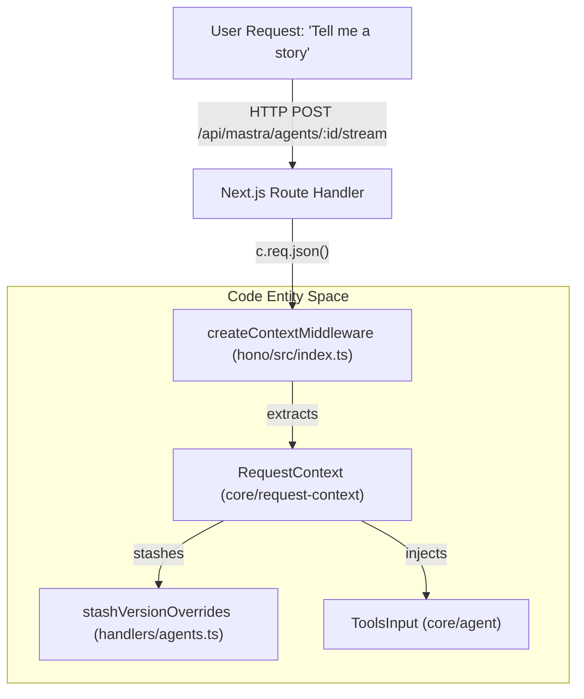
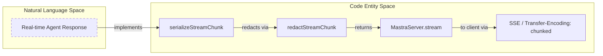

<!-- source: DeepWiki mcp.deepwiki.com · repo mastra-ai/mastra · extra page Server Adapter: Next.js (App Router) · fetched 2026-10-27 -->

# Server Adapter: Next.js (App Router)

Relevant source files

The following files were used as context for generating this wiki page:

- [server-adapters/next/CHANGELOG.md](server-adapters/next/CHANGELOG.md)
- [server-adapters/next/package.json](server-adapters/next/package.json)
- [server-adapters/tanstack-start/package.json](server-adapters/tanstack-start/package.json)

The Next.js adapter for Mastra allows developers to mount the framework's API layer directly into a Next.js App Router project using **Route Handlers**. This implementation leverages the `@mastra/hono` adapter internally, wrapping a Hono instance that runs within the Next.js serverless/edge runtime environment. The `@mastra/next` package provides this integration [server-adapters/next/package.json:2-4]().

## Overview and Implementation

In the Next.js App Router, Mastra is typically exposed through a catch-all route (e.g., `/api/mastra/[[...mastra]]/route.ts`). The adapter bridges the standard Web Request/Response API used by Next.js with the `MastraServer` instance.

### The Adapter Pattern
The implementation follows a "wrapper" pattern where a `MastraServer` (extending the base `MastraServerBase` [packages/server/src/server/server-adapter/index.ts:7-10]()) handles the routing logic, while the Next.js route handler serves as the entry point. The `@mastra/next` package depends on `@mastra/server` and `@mastra/hono` [server-adapters/next/package.json:30-31]().

| Component | Role |
| :--- | :--- |
| **Route Handler** | The `GET`, `POST`, etc. functions in Next.js that receive the `NextRequest`. |
| **MastraServer (Hono)** | Manages the middleware stack, tool registration, and agent/workflow execution [server-adapters/hono/src/index.ts:112-112](). |
| **Prefix Routing** | Next.js uses the file system for routing; Mastra uses the `prefix` to strip the base path before internal routing [server-adapters/hono/src/index.ts:57-58](). |

### Data Flow: Request to Agent
1.  **Request Entry**: A client sends a request to `/api/mastra/agents/my-agent/stream`.
2.  **Context Initialization**: The `createContextMiddleware` parses the `requestContext` from the body (for POST/PUT) or base64-encoded query parameters (for GET) [server-adapters/hono/src/index.ts:133-176]().
3.  **Tool Stashing**: Registered tools are injected into the request context, making them available to agents during the execution loop [server-adapters/hono/src/index.ts:134-134]().
4.  **Execution**: The server identifies the `ServerRoute` and invokes the corresponding handler [packages/server/src/server/server-adapter/index.ts:30-30]().

Sources:
- [server-adapters/hono/src/index.ts:112-176]()
- [packages/server/src/server/server-adapter/index.ts:7-30]()
- [server-adapters/next/package.json:30-31]()

## Natural Language to Code Entity Space

### Request Handling Bridge
This diagram illustrates how a natural language request for an agent interaction maps to specific code entities within the Next.js/Hono adapter layer.

Sources:
- [server-adapters/hono/src/index.ts:113-134]()
- [packages/server/src/server/server-adapter/index.ts:3-6]()

### Streaming Architecture
Mapping the conceptual "Real-time Stream" to the underlying SSE and Chunking entities.

Sources:
- [packages/server/src/server/server-adapter/index.ts:37-38]()
- [server-adapters/hono/src/index.ts:220-250]()

## Deployment and Runtime Constraints

When deploying Mastra within Next.js (especially on Vercel or Netlify), several constraints apply:

### 1. Serverless vs. Edge
*   **Edge Runtime**: Requires the `MCPOptions` to have `serverless: true` to avoid persistent connection errors, as Edge functions do not support long-lived TCP connections for MCP SSE transports [packages/server/src/server/server-adapter/index.ts:102-110]().
*   **Streaming**: Mastra utilizes `hono/streaming` to deliver tokens as they arrive, which is compatible with Next.js Route Handler `Response` objects [server-adapters/hono/src/index.ts:21-21]().

### 2. Body Parsing
In Next.js, the request body can only be read once. The Hono adapter patches `c.req.json()` to memoize the result, preventing "Body is unusable" errors when multiple middlewares (like `bodyLimit`) or handlers need to inspect the payload [server-adapters/hono/src/index.ts:115-129]().

### 3. Prefix Routing
The `prefix` must be correctly passed to the `MastraServer` constructor to ensure that internal route matching ignores the Next.js API path prefix [server-adapters/hono/src/index.ts:57-58]().

## Key Functions and Classes

### `MastraServer` (Hono Implementation)
The core class that manages the Hono application instance. It handles:
*   **Context Middleware**: Merges `paramsRequestContext` and `bodyRequestContext` [server-adapters/hono/src/index.ts:176-176]().
*   **Abort Signals**: Links the underlying Hono request `close` event to an `AbortController` to stop agent execution if the client disconnects [server-adapters/hono/src/index.ts:193-207]().

### `RequestContext` and Security
The adapter ensures that sensitive data (like system prompts or tool definitions) is redacted from stream chunks by default via `redactStreamChunk` unless configured otherwise [packages/server/src/server/server-adapter/index.ts:84-95](). It also manages Fine-Grained Authorization (FGA) by checking route permissions via `checkRouteFGA` [packages/server/src/server/server-adapter/index.ts:10-10]().

### Custom Route Registration
Users can register custom endpoints that benefit from the same middleware stack (auth, context, logging) using `createRoute` and `registerApiRoute` [server-adapters/hono/src/__tests__/hono-adapter.test.ts:150-158]().

| Function / Class | File Path | Role |
| :--- | :--- | :--- |
| `MastraServer` | `server-adapters/hono/src/index.ts` | The Hono-based adapter for Next.js environments. |
| `createRoute` | `packages/server/src/server/server-adapter/index.ts` | Builder for schema-aware API routes. |
| `skipIfFrameworkPublic` | `server-adapters/hono/src/index.ts` | Middleware wrapper to protect framework-internal routes. |
| `normalizeQueryParams` | `packages/server/src/server/server-adapter/index.ts` | Standardizes query parameter access across adapters. |

Sources:
- [server-adapters/hono/src/index.ts:80-112]()
- [packages/server/src/server/server-adapter/index.ts:60-70]()
- [server-adapters/hono/src/__tests__/hono-adapter.test.ts:151-157]()

---

