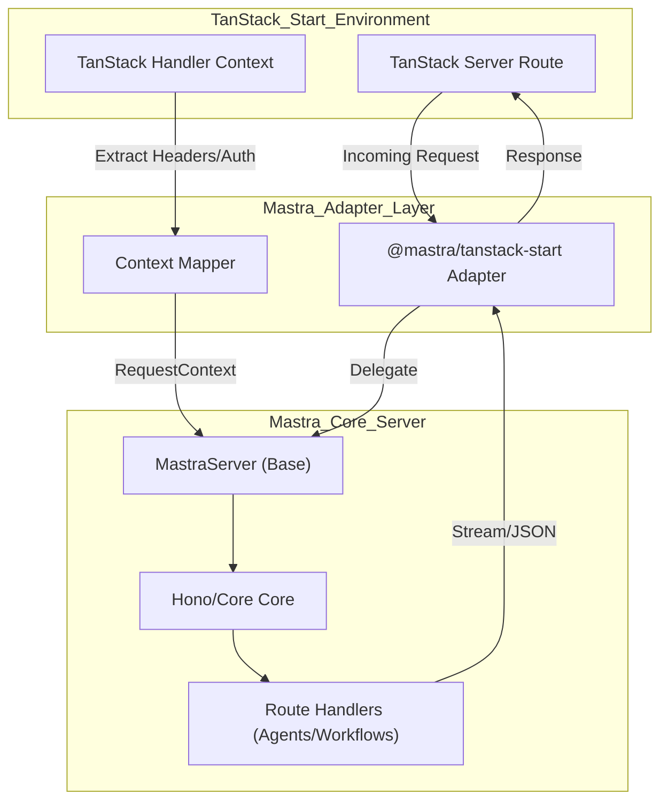
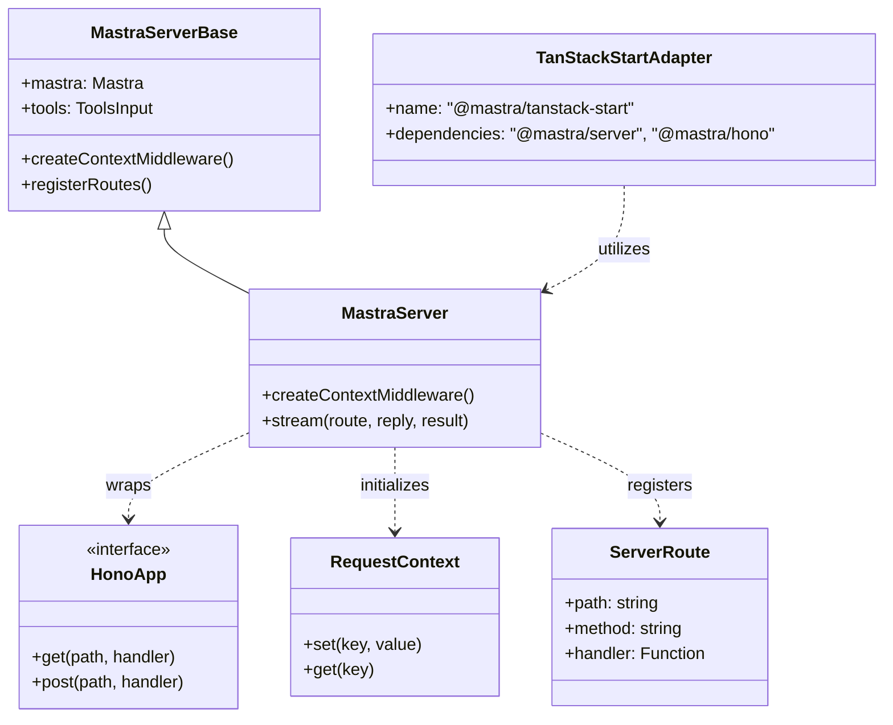

<!-- source: DeepWiki mcp.deepwiki.com · repo mastra-ai/mastra · extra page Server Adapter: TanStack Start · fetched 2026-10-27 -->

# Server Adapter: TanStack Start

Relevant source files

The following files were used as context for generating this wiki page:

- [server-adapters/next/package.json](server-adapters/next/package.json)
- [server-adapters/tanstack-start/CHANGELOG.md](server-adapters/tanstack-start/CHANGELOG.md)
- [server-adapters/tanstack-start/package.json](server-adapters/tanstack-start/package.json)

The TanStack Start adapter enables the integration of Mastra's AI capabilities—including agents, workflows, and memory systems—into applications built with TanStack Start. It utilizes the shared `MastraServer` core to provide standardized API endpoints while mapping to TanStack's server-side routing and handler patterns.

## Overview and Purpose

The TanStack Start adapter follows the same architectural pattern as other Mastra server adapters (like Hono, Express, or Fastify). It wraps a `MastraServer` instance to expose a set of standardized routes for agent execution, workflow management, and memory access [server-adapters/tanstack-start/package.json:30-31](). The `@mastra/tanstack-start` package provides the necessary integration [server-adapters/tanstack-start/package.json:2]().

Key features include:
- **Prefix Routing**: Mounting all Mastra API endpoints under a configurable prefix (e.g., `/api/mastra`).
- **Context Mapping**: Bridging TanStack Start's request context to Mastra's `RequestContext` for tenant isolation and dynamic configuration.
- **Tool Registration**: Allowing server-side tools to be automatically exposed via API endpoints.
- **Streaming Support**: Utilizing Server-Sent Events (SSE) for real-time agent and workflow outputs.

Sources:
- [server-adapters/tanstack-start/package.json:2]()
- [server-adapters/tanstack-start/package.json:30-31]()

## System Architecture

The adapter serves as a translation layer between the TanStack Start server runtime and the `MastraServer` base class. It leverages the fact that Mastra's core server is built on Hono, allowing for high performance and compatibility across various runtimes [server-adapters/tanstack-start/package.json:31]().

### Data Flow Diagram: Request Handling

This diagram illustrates how a request from a TanStack Start route handler is processed by the Mastra adapter.

"TanStack Start Adapter Data Flow"

Sources: [server-adapters/tanstack-start/package.json:30-31]()

## Implementation Details

### Handler Context Mapping
The adapter is responsible for stashing the `Mastra` instance and `RequestContext` into the server's request state. This ensures that downstream handlers (like agent generation) have access to the correct configuration and tenant-specific data. The underlying Hono adapter, `@mastra/hono`, handles the specifics of request context creation and metadata application.

The `createContextMiddleware` function (from `@mastra/hono`) performs the following:
1.  **Request Parsing**: Extracts the `requestContext` from either the request body (for POST/PUT) or base64-encoded query parameters (for GET).
2.  **Metadata Application**: Applies headers like `x-mastra-resource-id` and `x-mastra-client-type` to the internal context via `applyRequestMetadataToContext`.
3.  **Abort Signal Integration**: Links the server's request cancellation signal to Mastra's internal execution loop using `AbortController` to prevent wasted compute.

Sources: [server-adapters/tanstack-start/package.json:31]()

### Prefix Routing and Tool Registration
Mastra routes are registered dynamically based on the provided configuration. The `MastraServer` base class contains the manifest of all available routes.

| Feature | Description |
| :--- | :--- |
| **Prefixing** | All routes are mounted under a base path (default `/api`). |
| **Agent Endpoints** | `/agents/:agentId/generate` and `/agents/:agentId/stream`. |
| **Memory Endpoints** | `/memory/threads` and `/memory/messages`. |
| **Tool Execution** | Automatic routing for tools registered on the `Mastra` instance. |

### Code Entity Space: Server Adapter Classes

This diagram maps the logical server concepts to the specific classes and functions in the codebase.

"Server Adapter Code Entities"

Sources:
- [server-adapters/tanstack-start/package.json:2]()
- [server-adapters/tanstack-start/package.json:30-31]()

## Streaming and SSE
For TanStack Start, streaming is handled via the `stream` method in the adapter. It utilizes `serializeStreamChunk` to transform internal AI chunks into a format compatible with the browser's `ReadableStream`. The underlying `@mastra/hono` package provides the core streaming logic.

The adapter ensures that:
1.  **Redaction**: Sensitive information like system prompts or internal tool calls are redacted before being sent to the client via `redactStreamChunk`, unless configured otherwise.
2.  **Serialization**: Chunks are serialized into a standard SSE format that the client can decode.
3.  **Safety**: Unserializable chunks do not kill the stream; they are logged and skipped.

Sources:
- [server-adapters/tanstack-start/package.json:2-4]()
- [server-adapters/tanstack-start/package.json:30-31]()

---

