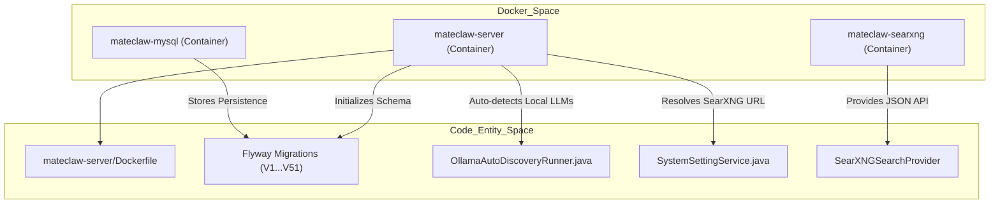
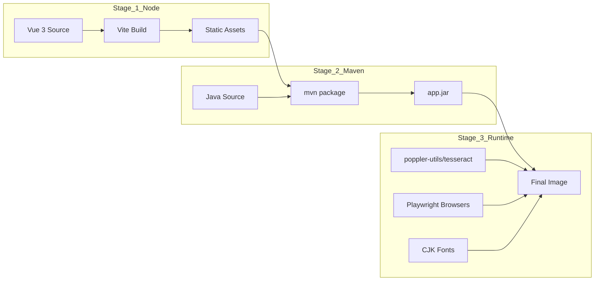

<!-- source: DeepWiki mcp.deepwiki.com · repo matevip/mateclaw · page 1.1 Getting Started & Deployment · fetched 2026-10-27 -->

# Getting Started & Deployment

Relevant source files

The following files were used as context for generating this wiki page:

- [.dockerignore](.dockerignore)
- [.env.example](.env.example)
- [docker-compose.yml](docker-compose.yml)
- [docker/searxng/Dockerfile](docker/searxng/Dockerfile)
- [docker/searxng/settings.yml](docker/searxng/settings.yml)
- [mateclaw-server/Dockerfile](mateclaw-server/Dockerfile)
- [mateclaw-server/settings.xml](mateclaw-server/settings.xml)
- [mateclaw-server/src/main/java/vip/mate/config/FlywayRepairConfig.java](mateclaw-server/src/main/java/vip/mate/config/FlywayRepairConfig.java)
- [mateclaw-server/src/main/java/vip/mate/llm/config/OllamaAutoDiscoveryRunner.java](mateclaw-server/src/main/java/vip/mate/llm/config/OllamaAutoDiscoveryRunner.java)
- [mateclaw-server/src/main/java/vip/mate/system/service/SystemSettingService.java](mateclaw-server/src/main/java/vip/mate/system/service/SystemSettingService.java)
- [mateclaw-server/src/main/java/vip/mate/tool/mcp/runtime/CwdAwareStdioClientTransport.java](mateclaw-server/src/main/java/vip/mate/tool/mcp/runtime/CwdAwareStdioClientTransport.java)
- [mateclaw-server/src/main/resources/application-mysql.yml](mateclaw-server/src/main/resources/application-mysql.yml)
- [mateclaw-server/src/main/resources/db/migration/h2/V14__embedding_model_config.sql](mateclaw-server/src/main/resources/db/migration/h2/V14__embedding_model_config.sql)
- [mateclaw-server/src/main/resources/db/migration/h2/V2__workspace_base_path.sql](mateclaw-server/src/main/resources/db/migration/h2/V2__workspace_base_path.sql)
- [mateclaw-server/src/main/resources/db/migration/h2/V38__wiki_chunk_content_mediumtext.sql](mateclaw-server/src/main/resources/db/migration/h2/V38__wiki_chunk_content_mediumtext.sql)
- [mateclaw-server/src/main/resources/db/migration/mysql/V11__skill_synthesis.sql](mateclaw-server/src/main/resources/db/migration/mysql/V11__skill_synthesis.sql)
- [mateclaw-server/src/main/resources/db/migration/mysql/V12__wiki_chunk_table.sql](mateclaw-server/src/main/resources/db/migration/mysql/V12__wiki_chunk_table.sql)
- [mateclaw-server/src/main/resources/db/migration/mysql/V13__wiki_chunk_embedding.sql](mateclaw-server/src/main/resources/db/migration/mysql/V13__wiki_chunk_embedding.sql)
- [mateclaw-server/src/main/resources/db/migration/mysql/V14__embedding_model_config.sql](mateclaw-server/src/main/resources/db/migration/mysql/V14__embedding_model_config.sql)
- [mateclaw-server/src/main/resources/db/migration/mysql/V2__workspace_base_path.sql](mateclaw-server/src/main/resources/db/migration/mysql/V2__workspace_base_path.sql)
- [mateclaw-server/src/main/resources/db/migration/mysql/V38__wiki_chunk_content_mediumtext.sql](mateclaw-server/src/main/resources/db/migration/mysql/V38__wiki_chunk_content_mediumtext.sql)
- [mateclaw-server/src/main/resources/db/migration/mysql/V4__agent_thinking_level.sql](mateclaw-server/src/main/resources/db/migration/mysql/V4__agent_thinking_level.sql)
- [mateclaw-server/src/main/resources/db/migration/mysql/V5__conversation_parent.sql](mateclaw-server/src/main/resources/db/migration/mysql/V5__conversation_parent.sql)
- [mateclaw-server/src/main/resources/db/migration/mysql/V7__wiki_last_processed_hash.sql](mateclaw-server/src/main/resources/db/migration/mysql/V7__wiki_last_processed_hash.sql)

This page provides technical details on the deployment architecture and initialization procedures for MateClaw. MateClaw is designed as a containerized application using a multi-stage build process to bundle a Vue 3 frontend with a Spring Boot backend, supported by a SearXNG sidecar for privacy-focused web searching.

## Deployment Architecture

MateClaw utilizes `docker-compose` to orchestrate three primary services. The architecture emphasizes local data persistence and "batteries-included" tool dependencies (like Playwright browsers and OCR engines) within the runtime image.

### System Components & Data Flow

The following diagram illustrates the relationship between the deployment entities and the underlying code infrastructure.

**Deployment to Code Entity Mapping**

Sources: [docker-compose.yml:10-100](), [mateclaw-server/Dockerfile:1-100](), [mateclaw-server/src/main/java/vip/mate/llm/config/OllamaAutoDiscoveryRunner.java:36-66](), [mateclaw-server/src/main/java/vip/mate/system/service/SystemSettingService.java:72-77]().

### Docker Compose Configuration

The `docker-compose.yml` file defines the environment and networking for the system:

| Service | Image/Build | Purpose | Key Config |
| :--- | :--- | :--- | :--- |
| `mysql` | `mysql:8.0` | Primary relational store. | `MYSQL_DATABASE`, `MYSQL_USER`, `MYSQL_PASSWORD` [docker-compose.yml:10-32]() |
| `searxng` | `./docker/searxng` | Local search engine sidecar. | `SEARXNG_BASE_URL`, `SEARXNG_SECRET` [docker-compose.yml:40-57]() |
| `mateclaw-server` | `./mateclaw-server/Dockerfile` | The main application. | `SPRING_PROFILES_ACTIVE=mysql`, `shm_size: 2gb` [docker-compose.yml:60-99]() |

**Note on Shared Memory:** The `mateclaw-server` requires `shm_size: 2gb` to support the Playwright/Chromium instances used by `BrowserUseTool`. Without this, the browser will encounter `SIGBUS` errors during page rendering [docker-compose.yml:92-95]().

## Environment Configuration (.env)

MateClaw uses an `.env` file to manage secrets and environment-specific overrides. A template is provided in `.env.example`.

### Critical Variables
*   **Database Credentials:** `DB_ROOT_PASSWORD` and `DB_PASSWORD` are mandatory. If missing, the container orchestration will fail to start to prevent insecure defaults [docker-compose.yml:15-18](), [.env.example:15-20]().
*   **Security:** `JWT_SECRET` (minimum 32 characters) for token signing and `MATECLAW_CORS_ALLOWED_ORIGINS` for frontend access control [.env.example:24-30]().
*   **Build Flags:** `MAVEN_FLAGS=-Paliyun-first` can be set to prioritize mirrors for faster builds in specific regions [mateclaw-server/Dockerfile:27-36](), [.env.example:54-56]().

Sources: [.env.example:1-57](), [docker-compose.yml:15-18]().

## Multi-Stage Dockerfile Implementation

The `mateclaw-server/Dockerfile` uses a three-stage build process to ensure the final runtime image is optimized and contains all necessary binary dependencies for tool execution.

### Build Stages
1.  **Frontend Builder (`node:22-alpine`):** Compiles the Vue 3 application using `pnpm exec vite build`. The output is directed to a temporary `/static` directory [mateclaw-server/Dockerfile:7-19]().
2.  **Backend Builder (`maven:3.9-eclipse-temurin-21`):** 
    *   Installs `mateclaw-plugin-api` into the local Maven cache [mateclaw-server/Dockerfile:33-36]().
    *   Copies the static frontend assets from Stage 1 into `src/main/resources/static` [mateclaw-server/Dockerfile:45]().
    *   Packages the Spring Boot JAR [mateclaw-server/Dockerfile:47]().
3.  **Runtime (`mcr.microsoft.com/playwright:v1.52.0-noble`):** 
    *   Based on Ubuntu Noble to provide `glibc` and pre-installed Chromium/Firefox/WebKit [mateclaw-server/Dockerfile:60]().
    *   Installs `openjdk-21-jre-headless` for the application runtime [mateclaw-server/Dockerfile:82]().
    *   Installs `poppler-utils` (for `pdftotext`) and `tesseract-ocr` (with Chinese support) for `DocumentExtractTool` [mateclaw-server/Dockerfile:85-87]().

**Runtime Image Logic**

Sources: [mateclaw-server/Dockerfile:1-100]().

## Database Initialization & Seeding

MateClaw automates database setup using Flyway migrations and a custom bootstrap runner.

### Flyway Migrations
The system maintains parity between H2 (Desktop/Dev mode) and MySQL (Production/Web mode). Migrations are located in `db/migration/{platform}/`.
*   **V1 Baseline:** Creates core tables like `mate_user`, `mate_agent`, and `mate_tool`.
*   **V14 Embedding Config:** Adds `model_type` to `mate_model_config` to support vector embedding models (e.g., `text-embedding-v3`) alongside chat models [mateclaw-server/src/main/resources/db/migration/mysql/V14__embedding_model_config.sql:1-16]().
*   **V38 Content Expansion:** Expands `mate_wiki_chunk.content` to `MEDIUMTEXT` (MySQL) or `CLOB` (H2) to handle large semantic chunks [mateclaw-server/src/main/resources/db/migration/h2/V38__wiki_chunk_content_mediumtext.sql:1-3]().
*   **V51 ToolGuard Scope:** Refines security by narrowing `ToolGuard` evaluation specifically to shell command execution [mateclaw-server/Dockerfile:1-100]().

### Ollama Auto-Discovery
On startup, the `OllamaAutoDiscoveryRunner` attempts to detect local Ollama instances (default `http://127.0.0.1:11434`).
*   **Model Registration:** Discovered models are automatically added to `mate_model_config` [mateclaw-server/src/main/java/vip/mate/llm/config/OllamaAutoDiscoveryRunner.java:78-84]().
*   **Tool Support Validation:** Models from families known to lack tool support (e.g., `deepseek-r1`, `gemma`) are excluded from auto-activation to prevent 400 errors during agent execution [mateclaw-server/src/main/java/vip/mate/llm/config/OllamaAutoDiscoveryRunner.java:50-58]().

Sources: [mateclaw-server/src/main/java/vip/mate/llm/config/OllamaAutoDiscoveryRunner.java:36-131](), [mateclaw-server/src/main/resources/db/migration/mysql/V14__embedding_model_config.sql:1-29]().

## SearXNG Sidecar Integration

The `searxng` service uses a custom image to ensure compatibility with MateClaw's `SearXNGSearchProvider`.

*   **Configuration:** The `docker/searxng/settings.yml` explicitly enables `json` format and disables the anti-bot `limiter` plugin, which would otherwise block server-side requests [docker/searxng/settings.yml:30-39]().
*   **Resolution:** `SystemSettingService` resolves the SearXNG endpoint by checking the database key `searxngBaseUrl` first, falling back to the `SEARXNG_BASE_URL` environment variable [mateclaw-server/src/main/java/vip/mate/system/service/SystemSettingService.java:72-77]().

Sources: [docker/searxng/Dockerfile:1-10](), [docker/searxng/settings.yml:1-62](), [mateclaw-server/src/main/java/vip/mate/system/service/SystemSettingService.java:94]().

---

