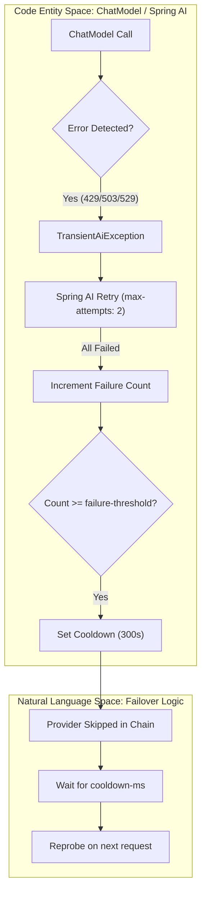
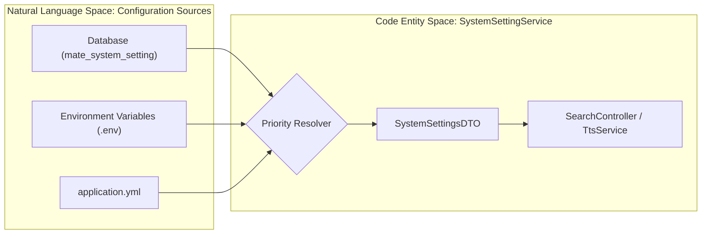

<!-- source: DeepWiki mcp.deepwiki.com · repo matevip/mateclaw · page 1.2 Configuration Reference · fetched 2026-10-27 -->

# Configuration Reference

<details>
<summary>Relevant source files</summary>

The following files were used as context for generating this wiki page:

- [.dockerignore](.dockerignore)
- [.env.example](.env.example)
- [docker-compose.yml](docker-compose.yml)
- [docker/searxng/Dockerfile](docker/searxng/Dockerfile)
- [docker/searxng/settings.yml](docker/searxng/settings.yml)
- [mateclaw-server/Dockerfile](mateclaw-server/Dockerfile)
- [mateclaw-server/settings.xml](mateclaw-server/settings.xml)
- [mateclaw-server/src/main/java/vip/mate/agent/graph/StateGraphReActAgent.java](mateclaw-server/src/main/java/vip/mate/agent/graph/StateGraphReActAgent.java)
- [mateclaw-server/src/main/java/vip/mate/agent/graph/node/SummarizingNode.java](mateclaw-server/src/main/java/vip/mate/agent/graph/node/SummarizingNode.java)
- [mateclaw-server/src/main/java/vip/mate/agent/graph/observation/ObservationProcessor.java](mateclaw-server/src/main/java/vip/mate/agent/graph/observation/ObservationProcessor.java)
- [mateclaw-server/src/main/java/vip/mate/agent/graph/plan/StateGraphPlanExecuteAgent.java](mateclaw-server/src/main/java/vip/mate/agent/graph/plan/StateGraphPlanExecuteAgent.java)
- [mateclaw-server/src/main/java/vip/mate/channel/web/ChatStreamTracker.java](mateclaw-server/src/main/java/vip/mate/channel/web/ChatStreamTracker.java)
- [mateclaw-server/src/main/java/vip/mate/config/GraphObservationProperties.java](mateclaw-server/src/main/java/vip/mate/config/GraphObservationProperties.java)
- [mateclaw-server/src/main/java/vip/mate/config/SecurityStartupValidator.java](mateclaw-server/src/main/java/vip/mate/config/SecurityStartupValidator.java)
- [mateclaw-server/src/main/java/vip/mate/config/ToolTimeoutProperties.java](mateclaw-server/src/main/java/vip/mate/config/ToolTimeoutProperties.java)
- [mateclaw-server/src/main/java/vip/mate/config/WebMvcConfig.java](mateclaw-server/src/main/java/vip/mate/config/WebMvcConfig.java)
- [mateclaw-server/src/main/java/vip/mate/system/service/SystemSettingService.java](mateclaw-server/src/main/java/vip/mate/system/service/SystemSettingService.java)
- [mateclaw-server/src/main/resources/application.yml](mateclaw-server/src/main/resources/application.yml)
- [mateclaw-server/src/main/resources/db/migration/h2/V38__wiki_chunk_content_mediumtext.sql](mateclaw-server/src/main/resources/db/migration/h2/V38__wiki_chunk_content_mediumtext.sql)
- [mateclaw-server/src/main/resources/db/migration/mysql/V38__wiki_chunk_content_mediumtext.sql](mateclaw-server/src/main/resources/db/migration/mysql/V38__wiki_chunk_content_mediumtext.sql)

</details>


This page provides a detailed technical reference for the `application.yml` settings in MateClaw. It covers the configuration of the agentic graph, tool execution budgets, provider failover mechanisms, and the specialized namespaces for Wiki and Memory modules.

## 1. Agent Graph & Observation Budgets

The agent's reasoning loop is governed by observation budgets to prevent context window overflow and excessive token consumption. These settings control when the agent should summarize its history or truncate individual tool outputs.

### 1.1 Observation Thresholds
The `mate.agent.graph.observation` namespace manages the lifecycle of the `OBSERVATION_HISTORY` key within the `StateGraph`.

| Property | Default (YML) | Description |
| :--- | :--- | :--- |
| `max-single-observation-chars` | `16000` | Maximum characters retained for a single tool's output before truncation. |
| `max-total-observation-chars` | `200000` | Cumulative character limit for all observations in the current turn. |
| `large-result-threshold` | `32000` | Threshold at which a single tool result triggers an immediate `SummarizingNode` transition. |
| `min-rounds-for-summarize` | `25` | Runaway-loop safety net: force summarization after this many tool rounds. |
| `head-ratio` | `0.4` | When truncating, the percentage of content kept from the beginning of the output. |

**Implementation Detail:** These properties are mapped to the `GraphObservationProperties` class [mateclaw-server/src/main/java/vip/mate/config/GraphObservationProperties.java:18-44](). The `SummarizingNode` uses these values to determine if it should compress the `observationHistory` into a `summarizedContext` [mateclaw-server/src/main/java/vip/mate/agent/graph/node/SummarizingNode.java:87-92]().

### 1.2 Tool Result Spill Store (RFC-008)
To handle massive tool outputs (e.g., reading a large log file), MateClaw implements a three-layer budget system.

*   **Layer 1:** In-tool caps.
*   **Layer 2 (Spill):** Oversized results are written to disk; the agent receives a pointer (path) to the spill file via the `read_file` tool.
*   **Layer 3:** Aggregate cap on the total tool turn size.

```yaml
mate:
  agent:
    tool-result:
      enabled: true
      per-result-threshold-chars: 16000   # Prevents WebSearch spill-to-disk
      per-turn-budget-chars: 32000        # Headroom for multi-tool turns
      preview-head-chars: 800
      excluded-tools:
        - read_file
        - read_workspace_memory_file
```
*Sources: [mateclaw-server/src/main/resources/application.yml:175-188]()*

## 2. LLM Provider & Failover Logic

MateClaw utilizes a multi-provider failover chain. If a primary provider (e.g., Anthropic) fails, the system automatically cycles to the next available provider.

### 2.1 Health Tracker & Cooldown
The `failover.health` system tracks consecutive failures per provider.

*   **Failure Threshold:** Number of consecutive errors (e.g., 429, 503, 529) before a provider is marked "unhealthy".
*   **Cooldown:** Duration a provider remains in the "skip" list before being probed again (default 300s).

**Failover Lifecycle Diagram**

*Sources: [mateclaw-server/src/main/resources/application.yml:70-76](), [mateclaw-server/src/main/resources/application.yml:146-150]()*

## 3. Conversation Window Management

To maintain performance over long chats, the `ConversationWindowManager` applies compression strategies when token usage nears limits.

| Property | Default | Description |
| :--- | :--- | :--- |
| `default-max-input-tokens` | `128000` | The total context window limit allowed for the model. |
| `compact-trigger-ratio` | `0.75` | Trigger compression when usage hits 75% of the max tokens. |
| `preserve-recent-pairs` | `2` | Always keep the last N User/Assistant message pairs uncompressed. |

*Sources: [mateclaw-server/src/main/resources/application.yml:190-196]()*

## 4. Module-Specific Namespaces

### 4.1 mate.wiki (LLM Wiki Knowledge Base)
Controls the ingestion and retrieval pipeline for the RAG-based Wiki module.

*   **`max-chunk-size`**: 30,000 chars. Limits the amount of text sent to the LLM for a single "digest" operation [mateclaw-server/src/main/resources/application.yml:200]().
*   **`max-parallel-phase-b-pages`**: 3. Controls concurrency during the page generation phase (Phase B) to avoid hitting rate limits [mateclaw-server/src/main/resources/application.yml:203]().
*   **`upload-dir`**: Target directory for raw materials (default `./data/wiki-uploads`) [mateclaw-server/src/main/resources/application.yml:205]().

### 4.2 mate.memory (Memory & Dreaming)
Manages the background "Dreaming" process where the system extracts facts from conversations.

*   **`lifecycle-mediator-enabled`**: Enables the event bus that triggers memory extraction after a conversation turn [mateclaw-server/src/main/resources/application.yml:211]().
*   **`focused-enabled`**: Enables "Focused Dreaming" on specific high-value conversations [mateclaw-server/src/main/resources/application.yml:213]().

## 5. Security & System Configuration

MateClaw enforces strict security defaults, validated at startup by `SecurityStartupValidator` [mateclaw-server/src/main/java/vip/mate/config/SecurityStartupValidator.java:18-32]().

### 5.1 System Settings (DB-backed)
While `application.yml` provides defaults, many operational settings (Search, TTS, STT) are managed via the `mate_system_setting` table and `SystemSettingService` [mateclaw-server/src/main/java/vip/mate/system/service/SystemSettingService.java:12-65]().

**Configuration Priority Diagram**

*Sources: [mateclaw-server/src/main/java/vip/mate/system/service/SystemSettingService.java:72-132]()*

### 5.2 Key Security Properties
*   **`mateclaw.jwt.secret`**: Must be changed from the default `MateClaw-JWT-Secret-Key...` in production [mateclaw-server/src/main/resources/application.yml:98]().
*   **`spring.threads.virtual.enabled`**: Set to `true` to leverage Java 21 Virtual Threads for handling concurrent tool executions and SSE streams [mateclaw-server/src/main/resources/application.yml:18]().
*   **`mateclaw.hooks.trusted-domains`**: A whitelist of domains the Hook system is allowed to invoke via HTTP [mateclaw-server/src/main/resources/application.yml:123]().

## 6. Runtime State Tracking (SSE)

The `ChatStreamTracker` manages the lifecycle of Server-Sent Events (SSE). It includes a `RunState` object that tracks the current execution phase and manages a `messageQueue` for non-interruptible phases [mateclaw-server/src/main/java/vip/mate/channel/web/ChatStreamTracker.java:76-107]().

*   **Emergency Save**: If the JVM is shut down, an `emergencySaveCallback` is triggered to persist in-flight assistant content to the database [mateclaw-server/src/main/java/vip/mate/channel/web/ChatStreamTracker.java:110-119]().
*   **Heartbeat**: A `heartbeatScheduler` sends periodic events to keep the SSE connection alive [mateclaw-server/src/main/java/vip/mate/channel/web/ChatStreamTracker.java:162-167]().

*Sources: [mateclaw-server/src/main/java/vip/mate/channel/web/ChatStreamTracker.java:1-182]()*

---

