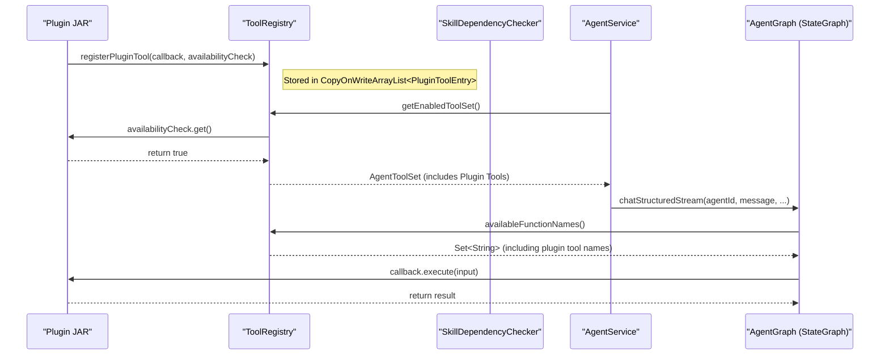
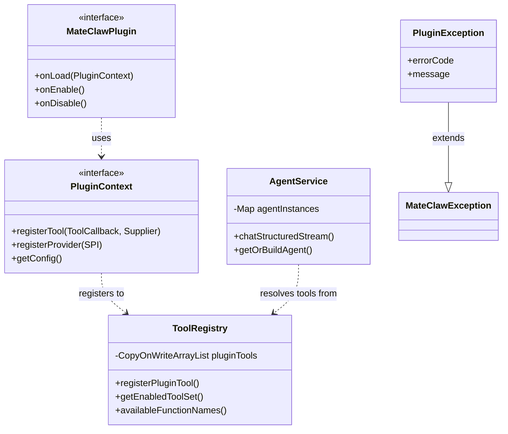

<!-- source: DeepWiki mcp.deepwiki.com · repo matevip/mateclaw · page 10.1 Plugin API Contract · fetched 2026-10-27 -->

# Plugin API Contract

<details>
<summary>Relevant source files</summary>

The following files were used as context for generating this wiki page:

- [mateclaw-server/src/main/java/vip/mate/agent/AgentService.java](mateclaw-server/src/main/java/vip/mate/agent/AgentService.java)
- [mateclaw-server/src/main/java/vip/mate/agent/ThinkingLevelHolder.java](mateclaw-server/src/main/java/vip/mate/agent/ThinkingLevelHolder.java)
- [mateclaw-server/src/main/java/vip/mate/agent/model/AgentEntity.java](mateclaw-server/src/main/java/vip/mate/agent/model/AgentEntity.java)
- [mateclaw-server/src/main/java/vip/mate/channel/service/ChannelService.java](mateclaw-server/src/main/java/vip/mate/channel/service/ChannelService.java)
- [mateclaw-server/src/main/java/vip/mate/cron/service/CronJobService.java](mateclaw-server/src/main/java/vip/mate/cron/service/CronJobService.java)
- [mateclaw-server/src/main/java/vip/mate/exception/MateClawException.java](mateclaw-server/src/main/java/vip/mate/exception/MateClawException.java)
- [mateclaw-server/src/main/java/vip/mate/memory/event/ConversationCompletionPublisher.java](mateclaw-server/src/main/java/vip/mate/memory/event/ConversationCompletionPublisher.java)
- [mateclaw-server/src/main/java/vip/mate/skill/runtime/SkillDependencyChecker.java](mateclaw-server/src/main/java/vip/mate/skill/runtime/SkillDependencyChecker.java)
- [mateclaw-server/src/main/java/vip/mate/tool/ToolRegistry.java](mateclaw-server/src/main/java/vip/mate/tool/ToolRegistry.java)
- [mateclaw-server/src/main/java/vip/mate/tool/mcp/service/McpServerService.java](mateclaw-server/src/main/java/vip/mate/tool/mcp/service/McpServerService.java)
- [mateclaw-server/src/main/java/vip/mate/tool/service/ToolService.java](mateclaw-server/src/main/java/vip/mate/tool/service/ToolService.java)
- [mateclaw-server/src/main/java/vip/mate/workspace/core/service/WorkspaceService.java](mateclaw-server/src/main/java/vip/mate/workspace/core/service/WorkspaceService.java)
- [mateclaw-server/src/main/resources/db/migration/h2/V4__agent_thinking_level.sql](mateclaw-server/src/main/resources/db/migration/h2/V4__agent_thinking_level.sql)
- [mateclaw-server/src/main/resources/db/schema-mysql.sql](mateclaw-server/src/main/resources/db/schema-mysql.sql)
- [mateclaw-server/src/main/resources/db/schema.sql](mateclaw-server/src/main/resources/db/schema.sql)

</details>


The **MateClaw Plugin SDK** provides a formal contract for extending the platform's capabilities via external Java JAR files. This contract is defined in the `mateclaw-plugin-api` module and allows developers to register custom tools, model providers, communication channels, and memory storage backends without modifying the core codebase.

## Core Interface: MateClawPlugin

The entry point for every plugin is the `MateClawPlugin` interface. The system uses a `ServiceLoader` mechanism to discover and initialize these implementations during the application startup sequence.

### Lifecycle Methods
*   `onLoad(PluginContext context)`: Called when the plugin is first discovered. Used for initial configuration and dependency checks.
*   `onEnable()`: Called when the plugin is activated. This is where active registrations (tools, channels) should occur.
*   `onDisable()`: Called during system shutdown or manual plugin unloading to release resources.

**Sources:** `mateclaw-server/src/main/java/vip/mate/tool/ToolRegistry.java:44-50` (Plugin tool entry structures).

## PluginContext & Registration APIs

The `PluginContext` is the primary gateway for a plugin to interact with the MateClaw host. It provides methods to inject functionality into the agent runtime and access system utilities.

### Key Methods
| Method | Description |
| :--- | :--- |
| `registerTool(ToolCallback, Supplier<Boolean>)` | Registers a tool with a lazy availability check evaluated during `AgentToolSet` construction [mateclaw-server/src/main/java/vip/mate/tool/ToolRegistry.java:56-59](). |
| `registerProvider(ModelProviderSPI spi)` | Adds a new LLM provider (e.g., a custom local model or proprietary API). |
| `registerChannel(PluginChannelAdapter adapter)` | Adds a new delivery surface (e.g., a specific IM protocol). |
| `registerMemoryProvider(PluginMemoryProvider spi)` | Plugs in an alternative storage for conversation facts and "Soul" files. |
| `getConfig()` | Retrieves plugin-specific settings from the host's `mate_system_setting` table [mateclaw-server/src/main/resources/db/schema.sql:84-91](). |
| `getLogger()` | Returns a scoped SLF4J logger for the plugin. |

**Sources:** `mateclaw-server/src/main/java/vip/mate/tool/ToolRegistry.java:44-68`, `mateclaw-server/src/main/java/vip/mate/agent/AgentService.java:100-113`.

## Data Flow: Plugin Tool Registration

The following diagram illustrates how a plugin registers a tool and how the `ToolRegistry` manages its lifecycle alongside built-in and MCP tools.

### Plugin Tool Integration Flow

**Sources:** `mateclaw-server/src/main/java/vip/mate/tool/ToolRegistry.java:47-60` (Registration), `mateclaw-server/src/main/java/vip/mate/tool/ToolRegistry.java:149-164` (Lazy Evaluation), `mateclaw-server/src/main/java/vip/mate/skill/runtime/SkillDependencyChecker.java:164-171` (Runtime verification).

## Plugin Manifest (mateclaw-plugin.json)

Every plugin must include a `mateclaw-plugin.json` file in its `META-INF` directory. This manifest is used for validation and SemVer compatibility checks.

### Manifest Schema
```json
{
  "id": "vip.mate.plugin.sample",
  "name": "Sample Plugin",
  "version": "1.0.0",
  "description": "Demonstrates the Plugin API contract",
  "author": "MateClaw Team",
  "mainClass": "vip.mate.plugin.sample.SamplePlugin",
  "minSystemVersion": "1.1.0",
  "type": "EXTENSION"
}
```

### Validation Rules
1.  **ID Uniqueness**: The `id` must not conflict with built-in modules or other loaded plugins.
2.  **SemVer Check**: The `minSystemVersion` is compared against the host's version. If the host version is lower, the plugin will fail to load.
3.  **Main Class**: The `mainClass` must implement `MateClawPlugin`.

**Sources:** `mateclaw-server/src/main/resources/db/schema.sql:115-131` (Tool persistence context).

## Extension Points (SPIs)

The SDK provides specific Service Provider Interfaces (SPIs) for different types of extensions.

### PluginChannelAdapter SPI
Used to implement new communication channels. Unlike built-in adapters, plugin adapters must handle their own lifecycle via the `PluginContext`.
*   **Method**: `sendMessage(String target, String content)`
*   **Method**: `onReceive(MessageCallback callback)`

### PluginMemoryProvider SPI
Allows redirecting the "Memory" and "Wiki" storage.
*   **Implementation**: Can swap the default H2/MySQL storage [mateclaw-server/src/main/resources/db/schema.sql:5-17]() for a vector database or external S3 storage for `MEMORY.md` files.

**Sources:** `mateclaw-server/src/main/java/vip/mate/channel/service/ChannelService.java:57-61` (Enabled channels), `mateclaw-server/src/main/java/vip/mate/agent/AgentService.java:41-42` (Memory lifecycle mediation).

## Code Entity Mapping

The following diagram bridges the gap between the Plugin API concepts and the concrete classes within the MateClaw core.

### Entity Relationship Diagram

**Sources:** `mateclaw-server/src/main/java/vip/mate/tool/ToolRegistry.java:38-50`, `mateclaw-server/src/main/java/vip/mate/agent/AgentService.java:36-45`, `mateclaw-server/src/main/java/vip/mate/exception/MateClawException.java:1-15`.

## Error Handling: PluginException

Plugins should throw `PluginException` for handled errors. The host catches these and wraps them in a `MateClawException` with the error code `err.plugin.execution_failed`.

*   **Transient Errors**: If a plugin throws an exception during `onEnable`, the system will attempt one retry before marking the plugin as `FAILED`.
*   **Thinking Level Integration**: Plugins can query the `ThinkingLevelHolder` to adjust their internal logic based on the user's requested reasoning depth (e.g., `low`, `medium`, `high`, `max`) [mateclaw-server/src/main/java/vip/mate/agent/ThinkingLevelHolder.java:13-33]().
*   **Security**: Plugins are executed within the same JVM; however, tool execution is still subject to the `ToolGuard` evaluation pipeline.

**Sources:** `mateclaw-server/src/main/java/vip/mate/exception/MateClawException.java:12-13`, `mateclaw-server/src/main/java/vip/mate/agent/ThinkingLevelHolder.java:27-28`.

---

