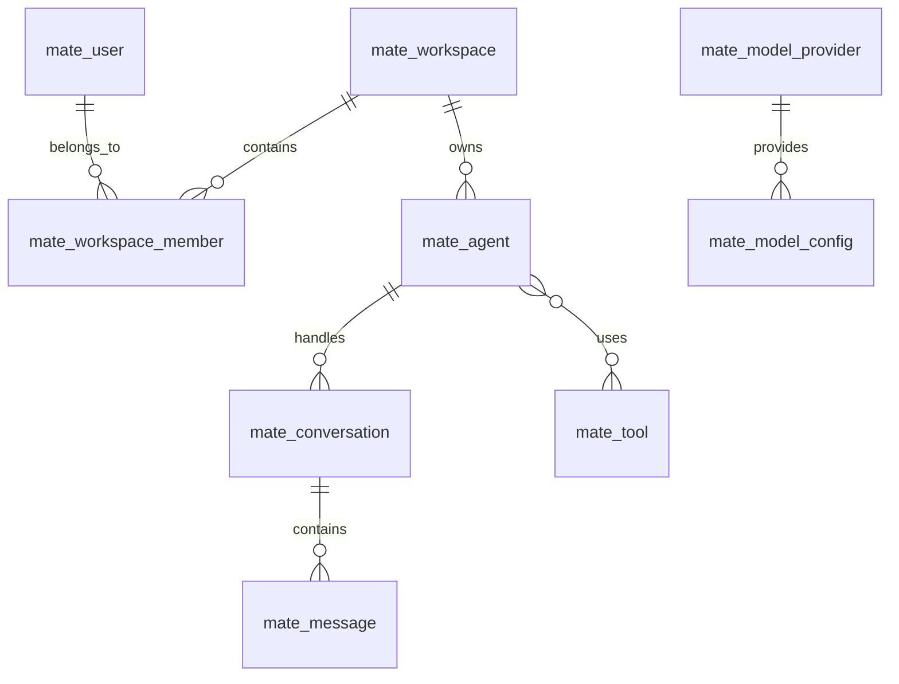

<!-- source: DeepWiki mcp.deepwiki.com · repo matevip/mateclaw · page 11 Database Schema & Migrations · fetched 2026-10-27 -->

# Database Schema & Migrations

<details>
<summary>Relevant source files</summary>

The following files were used as context for generating this wiki page:

- [mateclaw-server/src/main/java/vip/mate/agent/AgentService.java](mateclaw-server/src/main/java/vip/mate/agent/AgentService.java)
- [mateclaw-server/src/main/java/vip/mate/agent/ThinkingLevelHolder.java](mateclaw-server/src/main/java/vip/mate/agent/ThinkingLevelHolder.java)
- [mateclaw-server/src/main/java/vip/mate/agent/model/AgentEntity.java](mateclaw-server/src/main/java/vip/mate/agent/model/AgentEntity.java)
- [mateclaw-server/src/main/java/vip/mate/channel/service/ChannelService.java](mateclaw-server/src/main/java/vip/mate/channel/service/ChannelService.java)
- [mateclaw-server/src/main/java/vip/mate/cron/service/CronJobService.java](mateclaw-server/src/main/java/vip/mate/cron/service/CronJobService.java)
- [mateclaw-server/src/main/java/vip/mate/exception/MateClawException.java](mateclaw-server/src/main/java/vip/mate/exception/MateClawException.java)
- [mateclaw-server/src/main/java/vip/mate/memory/event/ConversationCompletionPublisher.java](mateclaw-server/src/main/java/vip/mate/memory/event/ConversationCompletionPublisher.java)
- [mateclaw-server/src/main/java/vip/mate/tool/mcp/service/McpServerService.java](mateclaw-server/src/main/java/vip/mate/tool/mcp/service/McpServerService.java)
- [mateclaw-server/src/main/java/vip/mate/tool/service/ToolService.java](mateclaw-server/src/main/java/vip/mate/tool/service/ToolService.java)
- [mateclaw-server/src/main/java/vip/mate/workspace/core/service/WorkspaceService.java](mateclaw-server/src/main/java/vip/mate/workspace/core/service/WorkspaceService.java)
- [mateclaw-server/src/main/resources/db/data-en.sql](mateclaw-server/src/main/resources/db/data-en.sql)
- [mateclaw-server/src/main/resources/db/data-mysql-en.sql](mateclaw-server/src/main/resources/db/data-mysql-en.sql)
- [mateclaw-server/src/main/resources/db/data-mysql-zh.sql](mateclaw-server/src/main/resources/db/data-mysql-zh.sql)
- [mateclaw-server/src/main/resources/db/data-zh.sql](mateclaw-server/src/main/resources/db/data-zh.sql)
- [mateclaw-server/src/main/resources/db/migration/h2/V1__baseline_schema.sql](mateclaw-server/src/main/resources/db/migration/h2/V1__baseline_schema.sql)
- [mateclaw-server/src/main/resources/db/migration/h2/V32__bailian_team_provider.sql](mateclaw-server/src/main/resources/db/migration/h2/V32__bailian_team_provider.sql)
- [mateclaw-server/src/main/resources/db/migration/h2/V33__expand_api_key_column.sql](mateclaw-server/src/main/resources/db/migration/h2/V33__expand_api_key_column.sql)
- [mateclaw-server/src/main/resources/db/migration/h2/V34__siliconflow_opencode_providers.sql](mateclaw-server/src/main/resources/db/migration/h2/V34__siliconflow_opencode_providers.sql)
- [mateclaw-server/src/main/resources/db/migration/h2/V4__agent_thinking_level.sql](mateclaw-server/src/main/resources/db/migration/h2/V4__agent_thinking_level.sql)
- [mateclaw-server/src/main/resources/db/migration/mysql/V1__baseline_schema.sql](mateclaw-server/src/main/resources/db/migration/mysql/V1__baseline_schema.sql)
- [mateclaw-server/src/main/resources/db/migration/mysql/V32__bailian_team_provider.sql](mateclaw-server/src/main/resources/db/migration/mysql/V32__bailian_team_provider.sql)
- [mateclaw-server/src/main/resources/db/migration/mysql/V33__expand_api_key_column.sql](mateclaw-server/src/main/resources/db/migration/mysql/V33__expand_api_key_column.sql)
- [mateclaw-server/src/main/resources/db/migration/mysql/V34__siliconflow_opencode_providers.sql](mateclaw-server/src/main/resources/db/migration/mysql/V34__siliconflow_opencode_providers.sql)
- [mateclaw-server/src/main/resources/db/schema-mysql.sql](mateclaw-server/src/main/resources/db/schema-mysql.sql)
- [mateclaw-server/src/main/resources/db/schema.sql](mateclaw-server/src/main/resources/db/schema.sql)
- [mateclaw-ui/src/types/index.ts](mateclaw-ui/src/types/index.ts)

</details>


MateClaw utilizes a dual-database strategy designed for flexibility across development and production environments. It leverages **Flyway** for version-controlled schema migrations and a structured seeding process to initialize the "Personal AI Operating System" with default agents, providers, and tools.

## Dual-Database Strategy

MateClaw supports two primary database engines to balance ease of development with production robustness. The schema is maintained in parallel to ensure feature parity across both environments.

*   **H2 Database**: Used for local development and quick-start scenarios. It allows the system to run without external dependencies [mateclaw-server/src/main/resources/db/schema.sql:2-2]().
*   **MySQL 8.0+ / MariaDB**: Recommended for production deployments, providing better performance, persistence, and concurrent access management [mateclaw-server/src/main/resources/db/schema-mysql.sql:1-16]().

The system uses `CREATE TABLE IF NOT EXISTS` patterns and database-specific scripts to manage this compatibility.

### Database Architecture Overview

The following diagram illustrates how the application interacts with the database layer and how the schema is partitioned into logical groups.

**Database Interaction Map**
```mermaid
graph TD
    subgraph "Application_Layer"
        [AgentService]
        [ConversationService]
        [ChannelService]
        [WorkspaceService]
        [CronJobService]
    end

    subgraph "Persistence_Layer_MyBatis_Plus"
        [AgentMapper]
        [ConversationMapper]
        [ChannelMapper]
        [WorkspaceMapper]
        [CronJobMapper]
    end

    subgraph "Database_Engines"
        direction LR
        DB_H2["H2_Dev_Desktop"]
        DB_MySQL["MySQL_Production"]
    end

    [AgentService] --> [AgentMapper]
    [ConversationService] --> [ConversationMapper]
    [ChannelService] --> [ChannelMapper]
    [WorkspaceService] --> [WorkspaceMapper]
    [CronJobService] --> [CronJobMapper]

    [AgentMapper] -.-> DB_H2
    [AgentMapper] -.-> DB_MySQL
    
    subgraph "Schema_Groups"
        G1["Identity_Auth_mate_user"]
        G2["Agent_Logic_mate_agent_mate_tool_mate_skill"]
        G3["Runtime_State_mate_conversation_mate_message"]
        G4["Infrastructure_mate_model_provider_mate_system_setting"]
    end
```
Sources: [mateclaw-server/src/main/resources/db/schema.sql:5-185](), [mateclaw-server/src/main/java/vip/mate/agent/AgentService.java:38-45](), [mateclaw-server/src/main/java/vip/mate/channel/service/ChannelService.java:31-32](), [mateclaw-server/src/main/java/vip/mate/cron/service/CronJobService.java:46-49]()

## Flyway & Migration Lifecycle

MateClaw uses **Flyway** to manage the evolution of the database schema. Migrations are stored in `src/main/resources/db/migration/` and are separated by database type (`h2` vs `mysql`).

*   **Baseline**: `V1__baseline_schema.sql` establishes the initial table structures [mateclaw-server/src/main/resources/db/migration/h2/V1__baseline_schema.sql:1-10]().
*   **Evolution**: Incremental scripts add columns and configurations. For example, `V4__agent_thinking_level.sql` introduced the `default_thinking_level` column to `mate_agent` [mateclaw-server/src/main/resources/db/migration/h2/V4__agent_thinking_level.sql:1-5]().
*   **Provider Updates**: Migrations like `V34` add new built-in model providers such as SiliconFlow and OpenCode [mateclaw-server/src/main/resources/db/migration/h2/V34__siliconflow_opencode_providers.sql:1-10]().

For a complete chronological list of all migrations up to V51, see [Migration History](#11.2).

## Core Table Groups

The schema is organized into several functional domains that support the AI runtime:

| Domain | Key Tables | Description |
| :--- | :--- | :--- |
| **Identity** | `mate_user`, `mate_workspace` | Manages users and multi-tenant workspace isolation [mateclaw-server/src/main/resources/db/schema.sql:5-17](). |
| **Agent Config** | `mate_agent`, `mate_tool`, `mate_skill` | Defines agent behaviors (ReAct/Plan-Execute), tools, and AI skills [mateclaw-server/src/main/resources/db/schema.sql:20-131](). |
| **LLM Config** | `mate_model_provider`, `mate_model_config` | Stores API keys, base URLs, and model parameters [mateclaw-server/src/main/resources/db/schema.sql:39-81](). |
| **Chat History** | `mate_conversation`, `mate_message` | Persists turns, tool metadata, and token usage [mateclaw-server/src/main/resources/db/schema.sql:150-185](). |
| **System** | `mate_system_setting`, `mate_cron_job` | Global settings and scheduled agentic tasks [mateclaw-server/src/main/resources/db/schema.sql:84-91](). |

For details, see [Core Schema & Seed Data](#11.1).

Sources: [mateclaw-server/src/main/resources/db/schema.sql:5-185](), [mateclaw-server/src/main/java/vip/mate/agent/model/AgentEntity.java:15-65]()

## Seed Data & Initialization

Upon first startup, MateClaw populates the database with essential data. This is handled by a bootstrapping process that selects the appropriate seed script based on locale (EN/ZH) and database type (H2/MySQL).

*   **Default Agents**: Initializes the "MateClaw Assistant" (ID: 1000000001) and "Task Planner" (ID: 1000000002) [mateclaw-server/src/main/resources/db/data-en.sql:8-20]().
*   **Model Providers**: Pre-configures local providers (Ollama, LM Studio) and cloud providers (OpenAI, DashScope, DeepSeek) [mateclaw-server/src/main/resources/db/data-en.sql:31-85]().
*   **Idempotency**: Seed scripts use `MERGE INTO` (H2) or `INSERT ... ON DUPLICATE KEY UPDATE` (MySQL) to ensure safe re-runs [mateclaw-server/src/main/resources/db/data-zh.sql:4-13](), [mateclaw-server/src/main/resources/db/data-mysql-zh.sql:4-13]().

**Entity Relationship Overview**

Sources: [mateclaw-server/src/main/resources/db/data-en.sql:1-85](), [mateclaw-server/src/main/java/vip/mate/workspace/core/service/WorkspaceService.java:32-39]()

---

## Child Pages

- **[Core Schema & Seed Data](#11.1)**: Detailed breakdown of the primary tables and the idempotent seeding logic used for default agents and providers.
- **[Migration History](#11.2)**: A chronological guide to the Flyway migration path from V1 to V51, documenting the introduction of key features like workspace isolation, memory facts, and page locking.

---

