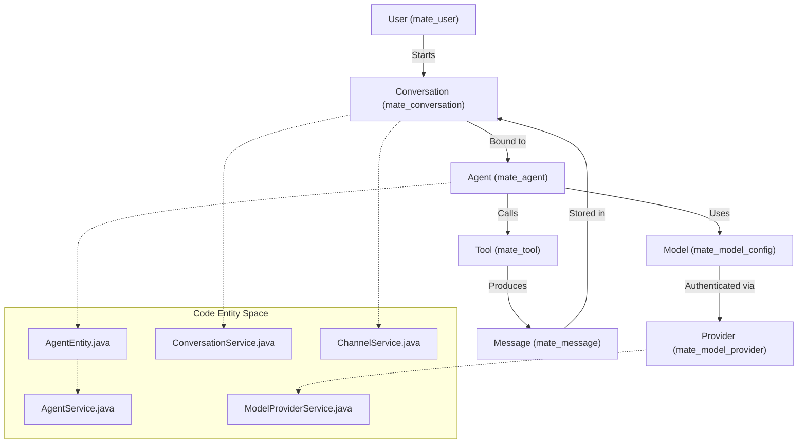
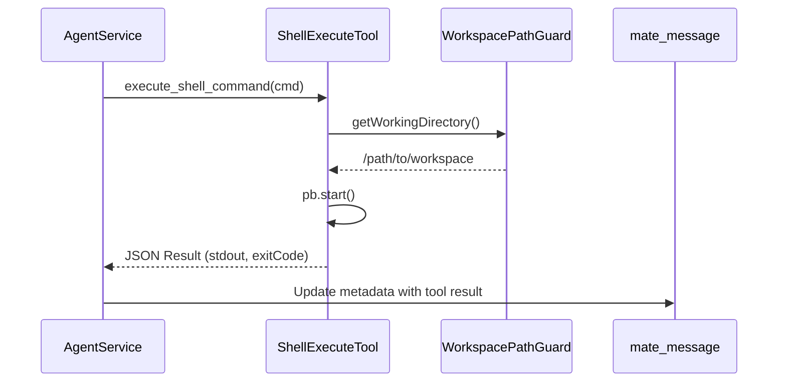

<!-- source: DeepWiki mcp.deepwiki.com · repo matevip/mateclaw · page 11.1 Core Schema & Seed Data · fetched 2026-10-27 -->

# Core Schema & Seed Data

Relevant source files

The following files were used as context for generating this wiki page:

- [mateclaw-server/src/main/java/vip/mate/agent/AgentService.java](mateclaw-server/src/main/java/vip/mate/agent/AgentService.java)
- [mateclaw-server/src/main/java/vip/mate/agent/ThinkingLevelHolder.java](mateclaw-server/src/main/java/vip/mate/agent/ThinkingLevelHolder.java)
- [mateclaw-server/src/main/java/vip/mate/agent/model/AgentEntity.java](mateclaw-server/src/main/java/vip/mate/agent/model/AgentEntity.java)
- [mateclaw-server/src/main/java/vip/mate/approval/ApprovalController.java](mateclaw-server/src/main/java/vip/mate/approval/ApprovalController.java)
- [mateclaw-server/src/main/java/vip/mate/approval/ApprovalService.java](mateclaw-server/src/main/java/vip/mate/approval/ApprovalService.java)
- [mateclaw-server/src/main/java/vip/mate/channel/service/ChannelService.java](mateclaw-server/src/main/java/vip/mate/channel/service/ChannelService.java)
- [mateclaw-server/src/main/java/vip/mate/config/DatabaseBootstrapRunner.java](mateclaw-server/src/main/java/vip/mate/config/DatabaseBootstrapRunner.java)
- [mateclaw-server/src/main/java/vip/mate/cron/service/CronJobService.java](mateclaw-server/src/main/java/vip/mate/cron/service/CronJobService.java)
- [mateclaw-server/src/main/java/vip/mate/exception/MateClawException.java](mateclaw-server/src/main/java/vip/mate/exception/MateClawException.java)
- [mateclaw-server/src/main/java/vip/mate/memory/event/ConversationCompletionPublisher.java](mateclaw-server/src/main/java/vip/mate/memory/event/ConversationCompletionPublisher.java)
- [mateclaw-server/src/main/java/vip/mate/tool/builtin/ShellExecuteTool.java](mateclaw-server/src/main/java/vip/mate/tool/builtin/ShellExecuteTool.java)
- [mateclaw-server/src/main/java/vip/mate/tool/guard/guardian/FileWriteGuardian.java](mateclaw-server/src/main/java/vip/mate/tool/guard/guardian/FileWriteGuardian.java)
- [mateclaw-server/src/main/java/vip/mate/tool/mcp/service/McpServerService.java](mateclaw-server/src/main/java/vip/mate/tool/mcp/service/McpServerService.java)
- [mateclaw-server/src/main/java/vip/mate/tool/service/ToolService.java](mateclaw-server/src/main/java/vip/mate/tool/service/ToolService.java)
- [mateclaw-server/src/main/java/vip/mate/workspace/core/service/WorkspaceService.java](mateclaw-server/src/main/java/vip/mate/workspace/core/service/WorkspaceService.java)
- [mateclaw-server/src/main/resources/db/data-en.sql](mateclaw-server/src/main/resources/db/data-en.sql)
- [mateclaw-server/src/main/resources/db/data-mysql-en.sql](mateclaw-server/src/main/resources/db/data-mysql-en.sql)
- [mateclaw-server/src/main/resources/db/data-mysql-zh.sql](mateclaw-server/src/main/resources/db/data-mysql-zh.sql)
- [mateclaw-server/src/main/resources/db/data-zh.sql](mateclaw-server/src/main/resources/db/data-zh.sql)
- [mateclaw-server/src/main/resources/db/migration/h2/V4__agent_thinking_level.sql](mateclaw-server/src/main/resources/db/migration/h2/V4__agent_thinking_level.sql)
- [mateclaw-server/src/main/resources/db/schema-mysql.sql](mateclaw-server/src/main/resources/db/schema-mysql.sql)
- [mateclaw-server/src/main/resources/db/schema.sql](mateclaw-server/src/main/resources/db/schema.sql)
- [mateclaw-ui/src/types/index.ts](mateclaw-ui/src/types/index.ts)

This page provides a technical deep dive into the MateClaw database architecture, the initialization sequence for default entities (Agents, Providers, Tools), and the mechanism for synchronizing the tool registry. MateClaw utilizes a dual-database strategy supporting **H2** for local development/desktop mode and **MySQL/MariaDB** for production environments.

## Database Entity Overview

The schema is designed to support a multi-tenant workspace architecture where agents, conversations, and files are isolated by `workspace_id`.

### Core Table Definitions

| Table Name | Purpose | Key Fields |
|:---|:---|:---|
| `mate_user` | Identity management and RBAC. | `username`, `password` (BCrypt), `role` (admin/user) [mateclaw-server/src/main/resources/db/schema.sql:5-17]() |
| `mate_agent` | Agentic configuration and persona. | `agent_type` (react/plan_execute), `system_prompt`, `max_iterations`, `default_thinking_level` [mateclaw-server/src/main/resources/db/schema.sql:20-36]() |
| `mate_model_provider` | LLM API credentials and endpoint configs. | `provider_id`, `api_key`, `base_url`, `auth_type`, `oauth_access_token` [mateclaw-server/src/main/resources/db/schema.sql:60-81]() |
| `mate_model_config` | Specific model parameters (temp, tokens). | `model_name`, `provider`, `is_default`, `enable_search` [mateclaw-server/src/main/resources/db/schema.sql:39-57]() |
| `mate_tool` | Registry for built-in and MCP tools. | `bean_name`, `mcp_endpoint`, `params_schema` [mateclaw-server/src/main/resources/db/schema.sql:115-131]() |
| `mate_skill` | User-defined or AI-synthesized skill code. | `skill_type`, `source_code`, `skill_content` [mateclaw-server/src/main/resources/db/schema.sql:94-112]() |
| `mate_conversation` | Session tracking and state management. | `conversation_id`, `agent_id`, `parent_conversation_id` [mateclaw-server/src/main/resources/db/schema.sql:150-165]() |
| `mate_message` | record of chat history with rich metadata. | `role`, `content_parts` (JSON), `metadata` (JSON), `status` [mateclaw-server/src/main/resources/db/schema.sql:168-185]() |
| `mate_channel` | External delivery configurations (WeChat, etc). | `channel_type`, `config_json`, `bot_prefix` [mateclaw-server/src/main/resources/db/schema.sql:134-147]() |

### Data Flow: Natural Language to Database Entities

The following diagram illustrates how a user request interacts with the core schema entities and maps to backend service logic.

**Diagram: Request to Entity Mapping**

**Sources:** [mateclaw-server/src/main/resources/db/schema.sql:1-185](), [mateclaw-server/src/main/java/vip/mate/agent/model/AgentEntity.java:1-50](), [mateclaw-server/src/main/java/vip/mate/agent/AgentService.java:36-45](), [mateclaw-server/src/main/java/vip/mate/channel/service/ChannelService.java:29-32]()

---

## Seed Data & Default Agents

MateClaw provides pre-configured agents and providers to ensure an "out-of-the-box" experience. These are inserted using idempotent SQL scripts (`MERGE INTO` for H2, `ON DUPLICATE KEY UPDATE` for MySQL).

### Default Agent Templates
Three primary agent patterns are seeded by default, all configured with a `max_iterations` of 100:
1.  **MateClaw Assistant (ID: 1000000001)**: A standard **ReAct** agent for general-purpose tool calling [mateclaw-server/src/main/resources/db/data-en.sql:8-13]().
2.  **Task Planner (ID: 1000000002)**: A **Plan-Execute** agent designed for complex multi-step reasoning [mateclaw-server/src/main/resources/db/data-en.sql:15-20]().
3.  **StateGraph ReAct (ID: 1000000003)**: A specialized agent utilizing the **StateGraph** architecture for explicit reasoning loops [mateclaw-server/src/main/resources/db/data-en.sql:22-27]().

### Built-in Providers
The system seeds a wide array of providers, categorized into:
*   **Local**: Ollama (defaulting to `http://127.0.0.1:11434`), LM Studio, llama.cpp, and MLX [mateclaw-server/src/main/resources/db/data-en.sql:31-45]().
*   **Cloud**: DashScope, OpenAI, Azure, Anthropic, DeepSeek, and various regional providers like Kimi and MiniMax [mateclaw-server/src/main/resources/db/data-en.sql:49-85]().

**Sources:** [mateclaw-server/src/main/resources/db/data-en.sql:1-100](), [mateclaw-server/src/main/resources/db/data-mysql-en.sql:1-100]()

---

## Tool Registration & Synchronization

MateClaw uses a dedicated synchronization mechanism to ensure that Spring-managed `@Tool` beans are reflected in the `mate_tool` table.

### ShellExecuteTool Implementation
The `ShellExecuteTool` is a critical built-in tool that provides CLI access within the workspace boundary. It implements platform-specific execution:
*   **Windows**: Uses `cmd.exe /D /S /C` [mateclaw-server/src/main/java/vip/mate/tool/builtin/ShellExecuteTool.java:135-140]().
*   **Unix**: Uses `/bin/sh -c` [mateclaw-server/src/main/java/vip/mate/tool/builtin/ShellExecuteTool.java:141-142]().
*   **Safety**: Implements `ConcurrencyUnsafe` annotation and redirects output to temporary files to prevent pipe blocking during timeouts [mateclaw-server/src/main/java/vip/mate/tool/builtin/ShellExecuteTool.java:46-86]().

**Diagram: Tool Execution & DB Interaction**

**Sources:** [mateclaw-server/src/main/java/vip/mate/tool/builtin/ShellExecuteTool.java:135-152](), [mateclaw-server/src/main/java/vip/mate/agent/AgentService.java:100-112]()

---

## Initialization Logic

The `DatabaseBootstrapRunner` manages the execution of seed data based on the system's environment and locale settings.

### Locale Selection & Desktop Mode
The runner handles two primary deployment modes:
1.  **Web/Dev Mode**: Auto-initializes immediately with `mateclaw.setup.default-locale` (defaulting to zh-CN) [mateclaw-server/src/main/java/vip/mate/config/DatabaseBootstrapRunner.java:53-55]().
2.  **Desktop Mode**: Defers initialization until the user selects a language via the setup API [mateclaw-server/src/main/java/vip/mate/config/DatabaseBootstrapRunner.java:80-83]().

### Dual Database Support
The initialization logic distinguishes between H2 and MySQL to handle syntax differences:
*   **H2 (Desktop/Dev)**: Uses `schema.sql` and `data-en.sql`. H2's `MERGE INTO` syntax is used for idempotency [mateclaw-server/src/main/resources/db/data-en.sql:1-5]().
*   **MySQL (Server)**: Uses `schema-mysql.sql` and `data-mysql-en.sql`. It leverages `ON DUPLICATE KEY UPDATE` to prevent errors on restart [mateclaw-server/src/main/resources/db/data-mysql-en.sql:1-6]().

### Migration History
Schema changes are managed via Flyway. Significant migrations include:
*   **V4**: Introduction of `default_thinking_level` for agents [mateclaw-server/src/main/resources/db/migration/h2/V4__agent_thinking_level.sql:1-5]().
*   **Cron Jobs**: Scheduled tasks are initialized via `CronJobService` which runs after `DatabaseBootstrapRunner` to ensure the schema is ready [mateclaw-server/src/main/java/vip/mate/cron/service/CronJobService.java:42-44]().

**Sources:** [mateclaw-server/src/main/java/vip/mate/config/DatabaseBootstrapRunner.java:1-120](), [mateclaw-server/src/main/resources/db/schema.sql:1-185](), [mateclaw-server/src/main/resources/db/schema-mysql.sql:1-185](), [mateclaw-server/src/main/java/vip/mate/cron/service/CronJobService.java:65-81]()

---

