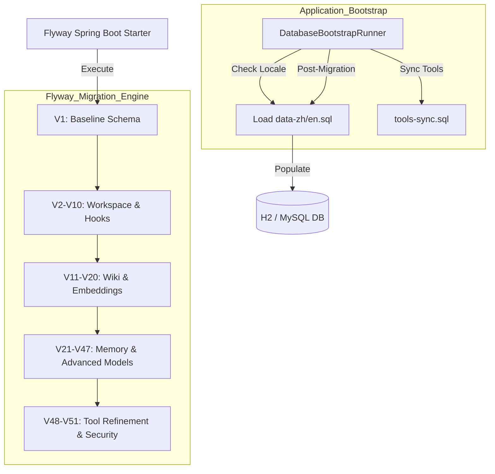
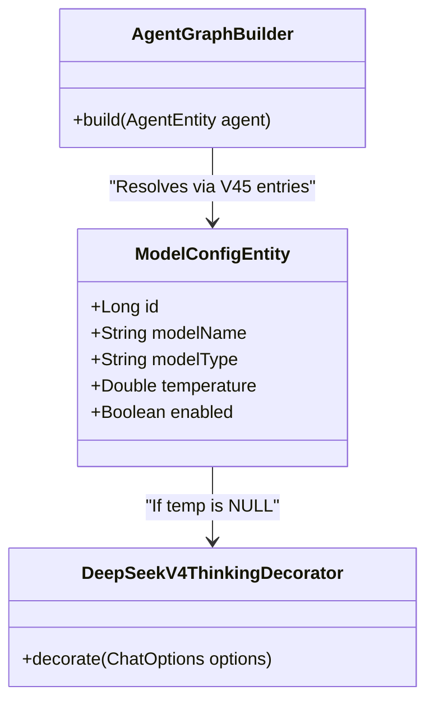
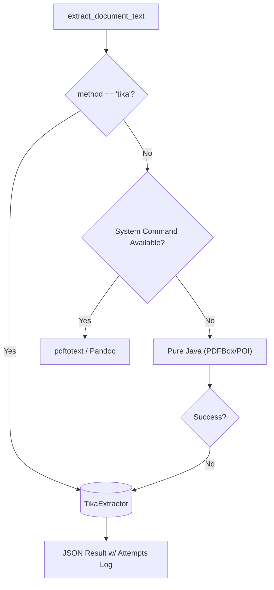

<!-- source: DeepWiki mcp.deepwiki.com · repo matevip/mateclaw · page 11.2 Migration History · fetched 2026-10-27 -->

# Migration History

Relevant source files

The following files were used as context for generating this wiki page:

- [mateclaw-server/pom.xml](mateclaw-server/pom.xml)
- [mateclaw-server/src/main/java/vip/mate/llm/config/OllamaAutoDiscoveryRunner.java](mateclaw-server/src/main/java/vip/mate/llm/config/OllamaAutoDiscoveryRunner.java)
- [mateclaw-server/src/main/java/vip/mate/llm/controller/ClaudeCodeOAuthController.java](mateclaw-server/src/main/java/vip/mate/llm/controller/ClaudeCodeOAuthController.java)
- [mateclaw-server/src/main/java/vip/mate/tool/builtin/DocumentExtractTool.java](mateclaw-server/src/main/java/vip/mate/tool/builtin/DocumentExtractTool.java)
- [mateclaw-server/src/main/java/vip/mate/tool/builtin/DocxRenderTool.java](mateclaw-server/src/main/java/vip/mate/tool/builtin/DocxRenderTool.java)
- [mateclaw-server/src/main/java/vip/mate/tool/builtin/TikaExtractor.java](mateclaw-server/src/main/java/vip/mate/tool/builtin/TikaExtractor.java)
- [mateclaw-server/src/main/java/vip/mate/tool/document/GeneratedFileCache.java](mateclaw-server/src/main/java/vip/mate/tool/document/GeneratedFileCache.java)
- [mateclaw-server/src/main/java/vip/mate/tool/document/GeneratedFileController.java](mateclaw-server/src/main/java/vip/mate/tool/document/GeneratedFileController.java)
- [mateclaw-server/src/main/java/vip/mate/tool/document/MarkdownDocxRenderer.java](mateclaw-server/src/main/java/vip/mate/tool/document/MarkdownDocxRenderer.java)
- [mateclaw-server/src/main/resources/application-mysql.yml](mateclaw-server/src/main/resources/application-mysql.yml)
- [mateclaw-server/src/main/resources/db/migration/h2/V14__embedding_model_config.sql](mateclaw-server/src/main/resources/db/migration/h2/V14__embedding_model_config.sql)
- [mateclaw-server/src/main/resources/db/migration/h2/V1__baseline_schema.sql](mateclaw-server/src/main/resources/db/migration/h2/V1__baseline_schema.sql)
- [mateclaw-server/src/main/resources/db/migration/h2/V32__bailian_team_provider.sql](mateclaw-server/src/main/resources/db/migration/h2/V32__bailian_team_provider.sql)
- [mateclaw-server/src/main/resources/db/migration/h2/V33__expand_api_key_column.sql](mateclaw-server/src/main/resources/db/migration/h2/V33__expand_api_key_column.sql)
- [mateclaw-server/src/main/resources/db/migration/h2/V34__siliconflow_opencode_providers.sql](mateclaw-server/src/main/resources/db/migration/h2/V34__siliconflow_opencode_providers.sql)
- [mateclaw-server/src/main/resources/db/migration/h2/V43__rfc062_claude_code_oauth_provider.sql](mateclaw-server/src/main/resources/db/migration/h2/V43__rfc062_claude_code_oauth_provider.sql)
- [mateclaw-server/src/main/resources/db/migration/h2/V45__deepseek_v4_models.sql](mateclaw-server/src/main/resources/db/migration/h2/V45__deepseek_v4_models.sql)
- [mateclaw-server/src/main/resources/db/migration/h2/V47__agent_max_iterations_100.sql](mateclaw-server/src/main/resources/db/migration/h2/V47__agent_max_iterations_100.sql)
- [mateclaw-server/src/main/resources/db/migration/h2/V48__agent_max_iterations_and_agents_md_tools.sql](mateclaw-server/src/main/resources/db/migration/h2/V48__agent_max_iterations_and_agents_md_tools.sql)
- [mateclaw-server/src/main/resources/db/migration/h2/V49__reenable_write_edit_file_tools.sql](mateclaw-server/src/main/resources/db/migration/h2/V49__reenable_write_edit_file_tools.sql)
- [mateclaw-server/src/main/resources/db/migration/h2/V50__fix_agents_md_tool_guidance_concat.sql](mateclaw-server/src/main/resources/db/migration/h2/V50__fix_agents_md_tool_guidance_concat.sql)
- [mateclaw-server/src/main/resources/db/migration/mysql/V11__skill_synthesis.sql](mateclaw-server/src/main/resources/db/migration/mysql/V11__skill_synthesis.sql)
- [mateclaw-server/src/main/resources/db/migration/mysql/V12__wiki_chunk_table.sql](mateclaw-server/src/main/resources/db/migration/mysql/V12__wiki_chunk_table.sql)
- [mateclaw-server/src/main/resources/db/migration/mysql/V13__wiki_chunk_embedding.sql](mateclaw-server/src/main/resources/db/migration/mysql/V13__wiki_chunk_embedding.sql)
- [mateclaw-server/src/main/resources/db/migration/mysql/V14__embedding_model_config.sql](mateclaw-server/src/main/resources/db/migration/mysql/V14__embedding_model_config.sql)
- [mateclaw-server/src/main/resources/db/migration/mysql/V1__baseline_schema.sql](mateclaw-server/src/main/resources/db/migration/mysql/V1__baseline_schema.sql)
- [mateclaw-server/src/main/resources/db/migration/mysql/V2__workspace_base_path.sql](mateclaw-server/src/main/resources/db/migration/mysql/V2__workspace_base_path.sql)
- [mateclaw-server/src/main/resources/db/migration/mysql/V32__bailian_team_provider.sql](mateclaw-server/src/main/resources/db/migration/mysql/V32__bailian_team_provider.sql)
- [mateclaw-server/src/main/resources/db/migration/mysql/V33__expand_api_key_column.sql](mateclaw-server/src/main/resources/db/migration/mysql/V33__expand_api_key_column.sql)
- [mateclaw-server/src/main/resources/db/migration/mysql/V34__siliconflow_opencode_providers.sql](mateclaw-server/src/main/resources/db/migration/mysql/V34__siliconflow_opencode_providers.sql)
- [mateclaw-server/src/main/resources/db/migration/mysql/V43__rfc062_claude_code_oauth_provider.sql](mateclaw-server/src/main/resources/db/migration/mysql/V43__rfc062_claude_code_oauth_provider.sql)
- [mateclaw-server/src/main/resources/db/migration/mysql/V45__deepseek_v4_models.sql](mateclaw-server/src/main/resources/db/migration/mysql/V45__deepseek_v4_models.sql)
- [mateclaw-server/src/main/resources/db/migration/mysql/V47__agent_max_iterations_100.sql](mateclaw-server/src/main/resources/db/migration/mysql/V47__agent_max_iterations_100.sql)
- [mateclaw-server/src/main/resources/db/migration/mysql/V4__agent_thinking_level.sql](mateclaw-server/src/main/resources/db/migration/mysql/V4__agent_thinking_level.sql)
- [mateclaw-server/src/main/resources/db/migration/mysql/V5__conversation_parent.sql](mateclaw-server/src/main/resources/db/migration/mysql/V5__conversation_parent.sql)
- [mateclaw-server/src/main/resources/db/migration/mysql/V7__wiki_last_processed_hash.sql](mateclaw-server/src/main/resources/db/migration/mysql/V7__wiki_last_processed_hash.sql)
- [mateclaw-ui/package.json](mateclaw-ui/package.json)

This page provides a chronological technical reference of the Flyway migrations (V1–V51) that define the MateClaw database schema and its evolution. MateClaw utilizes a dual-database strategy, maintaining parity between **H2** (for local development and Desktop mode) and **MySQL** (for production deployments).

## Overview of Schema Evolution

The migration pipeline handles the transition from a baseline AI assistant schema to a complex "Personal AI Operating System" supporting multi-agent graphs, hierarchical memory, and a structured wiki knowledge base.

### Core Migration Flow
The following diagram illustrates the relationship between Flyway, the database providers, and the application bootstrap process.

**Database Initialization & Migration Pipeline**

**Sources:** [mateclaw-server/src/main/java/vip/mate/config/DatabaseBootstrapRunner.java:1-50](), [mateclaw-server/src/main/resources/db/migration/mysql/V1__baseline_schema.sql:1-20]()

---

## Chronological Migration Reference

### Phase 1: Foundation (V1–V10)
This phase established the core entities for users, agents, and tool execution.

| Version | Feature | Technical Impact |
| :--- | :--- | :--- |
| **V1** | **Baseline Schema** | Creates `mate_user`, `mate_agent`, `mate_model_config`, `mate_tool`, and `mate_conversation`. [V1__baseline_schema.sql:1-100]() |
| **V2** | **Workspace Base Path** | Adds `base_path` to `mate_workspace` for filesystem isolation. [V2__workspace_base_path.sql:1-5]() |
| **V4** | **Thinking Level** | Introduces `thinking_level` to `mate_agent` to support reasoning models (O1/Claude). [V4__agent_thinking_level.sql:1-5]() |
| **V5** | **Conversation Parent** | Adds `parent_id` to `mate_conversation` for branching/threaded chats. [V5__conversation_parent.sql:1-5]() |
| **V10** | **Hook System** | Creates `mate_hook` and `mate_hook_log` for event-driven tool triggers. |

### Phase 2: Knowledge & Synthesis (V11–V20)
Introduction of the LLM Wiki and automated skill generation.

*   **V11 (Skill Synthesis):** Adds metadata to `mate_skill` to support AI-generated skill packages. [V11__skill_synthesis.sql:1-10]()
*   **V12–V13 (Wiki Chunks):** Introduces `mate_wiki_chunk` and `mate_wiki_chunk_embedding` for RAG (Retrieval-Augmented Generation) pipelines. [V12__wiki_chunk_table.sql:1-15](), [V13__wiki_chunk_embedding.sql:1-10]()
*   **V14 (Embedding Config):** Aligns embedding model management with Chat models, adding `model_type` to `mate_model_config`. [V14__embedding_model_config.sql:3-15]()

### Phase 3: Memory & Security (V21–V40)
Refining the "Personal OS" capabilities through long-term memory and tool safety.

*   **V35 (Security Scan):** Adds `security_scan_result` to `mate_skill` for automated vulnerability assessment of uploaded scripts.
*   **V37 (Wiki Sources):** Introduces `source_entries` to wiki pages to track provenance (e.g., local file paths or URLs). [V37__wiki_page_source_entries.sql:1-10]()

### Phase 4: Modern Model Support & Tool Refinement (V41–V51)
Integration of the latest LLM capabilities and infrastructure updates.

*   **V43 (Claude Code OAuth):** Implements the OAuth provider schema for `ClaudeCodeOAuthService` to handle Anthropic's specific authentication flow. [V43__rfc062_claude_code_oauth_provider.sql:1-20]()
*   **V45 (DeepSeek V4):** Adds `deepseek-v4-flash` and `deepseek-v4-pro` to the model registry, marking them as `thinking-managed`. [V45__deepseek_v4_models.sql:1-15]()
*   **V47 (Iteration Limits):** Increases `max_iterations` for default agents (ReAct/Plan-Execute) from 25 to 100 to support complex document generation tasks. [V47__agent_max_iterations_100.sql:1-17]()
*   **V48 (Agents-MD Tools):** Introduces tool bindings for `AGENTS.md` parsing logic. [V48__agent_max_iterations_and_agents_md_tools.sql:1-10]()
*   **V49 (Re-enable File Tools):** Re-enables `write_file` and `edit_file` tools for default agents to restore local development capabilities. [V49__reenable_write_edit_file_tools.sql:1-10]()
*   **V50 (Fix Tool Guidance):** Corrects concatenation issues in `AGENTS.md` tool guidance strings. [V50__fix_agents_md_tool_guidance_concat.sql:1-5]()
*   **V51 (ToolGuard Narrowing):** Restricts the `DefaultToolGuard` evaluation to only `execute_shell_command`, reducing overhead for safe local tools.

---

## Key Implementation Details

### Model Configuration & Thinking Management
The schema evolution reflects the shift toward "Thinking" models. Version V45 modifies `mate_model_config` to support models where `temperature` and `top_p` are `NULL`, signaling that reasoning effort should be injected instead of standard sampling parameters.

**Model Entity & Thinking Logic**

**Sources:** [mateclaw-server/src/main/resources/db/migration/mysql/V45__deepseek_v4_models.sql:6-10](), [mateclaw-server/src/main/java/vip/mate/llm/config/OllamaAutoDiscoveryRunner.java:94-110]()

### Document Extraction Fallback Chain
RFC-051 introduced a complex fallback mechanism for document processing, reflected in the `DocumentExtractTool`. The migration history shows the addition of Tika (V14 era) as a "last-resort" extractor.

**Extraction Logic Flow**

**Sources:** [mateclaw-server/src/main/java/vip/mate/tool/builtin/DocumentExtractTool.java:48-64](), [mateclaw-server/src/main/java/vip/mate/tool/builtin/TikaExtractor.java:15-32]()

### Workspace Path Security
Migration V2 established the `base_path` for workspaces. This is enforced in code via `WorkspacePathGuard`, ensuring that tools like `DocxRenderTool` cannot write or read files outside the defined boundary.

*   **V2 Impact:** `ALTER TABLE mate_workspace ADD COLUMN base_path VARCHAR(512)` [V2__workspace_base_path.sql:4]()
*   **Enforcement:** `WorkspacePathGuard.validatePath(filePath)` is called before any IO operation. [mateclaw-server/src/main/java/vip/mate/tool/builtin/DocxRenderTool.java:141-144]()

## Summary Table: Schema Versions

| Range | Focus | Key Tables |
| :--- | :--- | :--- |
| **V1–V10** | Core Infrastructure | `mate_user`, `mate_agent`, `mate_tool`, `mate_hook` |
| **V11–V20** | Wiki & RAG | `mate_wiki_knowledge_base`, `mate_wiki_chunk` |
| **V21–V40** | Memory & Skills | `mate_memory_fact`, `mate_skill_security_scan` |
| **V41–V51** | Model Parity & Tools | `mate_model_config`, `mate_agent` (max_iterations) |

**Sources:** [mateclaw-server/src/main/resources/db/migration/mysql/V1__baseline_schema.sql:1-50](), [mateclaw-server/src/main/resources/db/migration/mysql/V47__agent_max_iterations_100.sql:1-10](), [mateclaw-server/src/main/resources/db/migration/h2/V48__agent_max_iterations_and_agents_md_tools.sql:1-5]()

---

