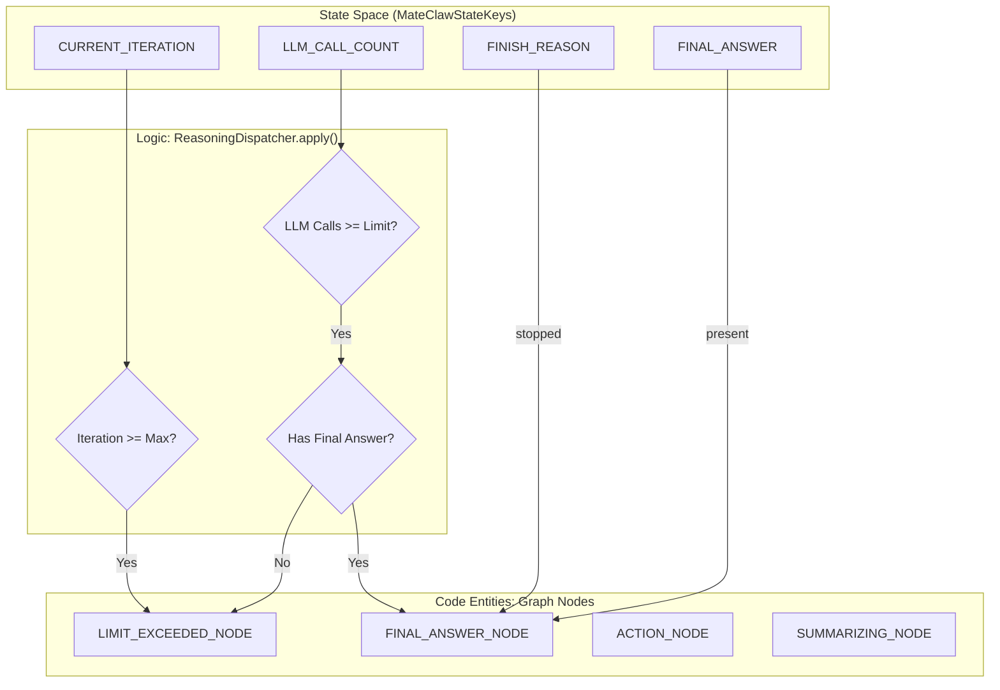
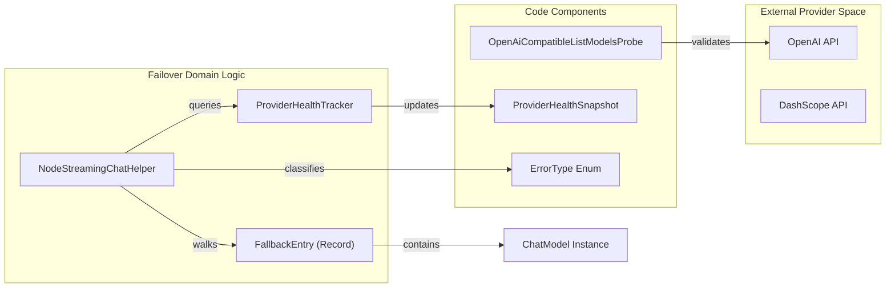

<!-- source: DeepWiki mcp.deepwiki.com · repo matevip/mateclaw · page 13.1 Backend Test Patterns · fetched 2026-10-27 -->

# Backend Test Patterns

Relevant source files

The following files were used as context for generating this wiki page:

- [mateclaw-server/src/main/java/vip/mate/llm/failover/FallbackEntry.java](mateclaw-server/src/main/java/vip/mate/llm/failover/FallbackEntry.java)
- [mateclaw-server/src/main/java/vip/mate/llm/failover/ProviderHealthProperties.java](mateclaw-server/src/main/java/vip/mate/llm/failover/ProviderHealthProperties.java)
- [mateclaw-server/src/main/java/vip/mate/llm/failover/ProviderHealthTracker.java](mateclaw-server/src/main/java/vip/mate/llm/failover/ProviderHealthTracker.java)
- [mateclaw-server/src/main/java/vip/mate/llm/failover/probe/AnthropicListModelsProbe.java](mateclaw-server/src/main/java/vip/mate/llm/failover/probe/AnthropicListModelsProbe.java)
- [mateclaw-server/src/main/java/vip/mate/llm/failover/probe/DashScopeListModelsProbe.java](mateclaw-server/src/main/java/vip/mate/llm/failover/probe/DashScopeListModelsProbe.java)
- [mateclaw-server/src/main/java/vip/mate/llm/failover/probe/OpenAiCompatibleListModelsProbe.java](mateclaw-server/src/main/java/vip/mate/llm/failover/probe/OpenAiCompatibleListModelsProbe.java)
- [mateclaw-server/src/main/java/vip/mate/llm/model/ProviderConfigRequest.java](mateclaw-server/src/main/java/vip/mate/llm/model/ProviderConfigRequest.java)
- [mateclaw-server/src/main/java/vip/mate/memory/lifecycle/MemoryLifecycleEventListener.java](mateclaw-server/src/main/java/vip/mate/memory/lifecycle/MemoryLifecycleEventListener.java)
- [mateclaw-server/src/main/java/vip/mate/memory/lifecycle/MemoryLifecycleMediator.java](mateclaw-server/src/main/java/vip/mate/memory/lifecycle/MemoryLifecycleMediator.java)
- [mateclaw-server/src/main/java/vip/mate/memory/lifecycle/TurnCompletedEvent.java](mateclaw-server/src/main/java/vip/mate/memory/lifecycle/TurnCompletedEvent.java)
- [mateclaw-server/src/main/java/vip/mate/memory/lifecycle/TurnContext.java](mateclaw-server/src/main/java/vip/mate/memory/lifecycle/TurnContext.java)
- [mateclaw-server/src/main/java/vip/mate/memory/lifecycle/TurnStartedEvent.java](mateclaw-server/src/main/java/vip/mate/memory/lifecycle/TurnStartedEvent.java)
- [mateclaw-server/src/test/java/vip/mate/agent/graph/ErrorClassificationTest.java](mateclaw-server/src/test/java/vip/mate/agent/graph/ErrorClassificationTest.java)
- [mateclaw-server/src/test/java/vip/mate/agent/graph/NodeStreamingChatHelperFallbackChainTest.java](mateclaw-server/src/test/java/vip/mate/agent/graph/NodeStreamingChatHelperFallbackChainTest.java)
- [mateclaw-server/src/test/java/vip/mate/agent/graph/edge/ReasoningDispatcherLlmCallCountTest.java](mateclaw-server/src/test/java/vip/mate/agent/graph/edge/ReasoningDispatcherLlmCallCountTest.java)
- [mateclaw-server/src/test/java/vip/mate/agent/graph/node/FinalAnswerNodeTest.java](mateclaw-server/src/test/java/vip/mate/agent/graph/node/FinalAnswerNodeTest.java)
- [mateclaw-server/src/test/java/vip/mate/llm/failover/ProviderHealthTrackerTest.java](mateclaw-server/src/test/java/vip/mate/llm/failover/ProviderHealthTrackerTest.java)
- [mateclaw-server/src/test/java/vip/mate/llm/failover/probe/OpenAiCompatibleListModelsProbeTest.java](mateclaw-server/src/test/java/vip/mate/llm/failover/probe/OpenAiCompatibleListModelsProbeTest.java)
- [mateclaw-server/src/test/java/vip/mate/memory/lifecycle/LifecycleFlagGuardTest.java](mateclaw-server/src/test/java/vip/mate/memory/lifecycle/LifecycleFlagGuardTest.java)
- [mateclaw-server/src/test/java/vip/mate/skill/runtime/SkillSecurityServiceTest.java](mateclaw-server/src/test/java/vip/mate/skill/runtime/SkillSecurityServiceTest.java)
- [mateclaw-webchat/package.json](mateclaw-webchat/package.json)

The MateClaw backend test suite is designed to validate the resilience of the agentic runtime, the accuracy of LLM failover logic, and the integrity of the memory/knowledge pipelines. Testing patterns emphasize mocking external LLM dependencies while strictly verifying state transitions within the `StateGraph` and lifecycle events in the memory system.

## Agent Graph Node & Edge Testing

Testing for the agent runtime focuses on `ReasoningDispatcher` (edge logic) and individual nodes like `FinalAnswerNode`. These tests ensure that the agent correctly handles iteration limits, LLM call budgets, and error states without getting stuck in infinite loops.

### State Transition Validation
The `ReasoningDispatcher` is tested by injecting specific keys into the `OverAllState` and asserting the next node ID. Key scenarios include:
*   **Iteration Limits**: Ensuring `LIMIT_EXCEEDED_NODE` is reached when `CURRENT_ITERATION` matches `MAX_ITERATIONS` [mateclaw-server/src/test/java/vip/mate/agent/graph/edge/ReasoningDispatcherLlmCallCountTest.java:88-95]().
*   **LLM Call Multiplier**: Validating that the total number of LLM calls (tracked via `LLM_CALL_COUNT`) triggers a limit even if the iteration count is low. The threshold is calculated as `MAX_ITERATIONS * LLM_CALL_MULTIPLIER` [mateclaw-server/src/test/java/vip/mate/agent/graph/edge/ReasoningDispatcherLlmCallCountTest.java:47-54]().
*   **Stale State Protection**: Verifying that flags like `SHOULD_SUMMARIZE` or `NEEDS_TOOL_CALL` from previous turns are correctly cleared or overridden during fatal errors to prevent misrouting [mateclaw-server/src/test/java/vip/mate/agent/graph/edge/ReasoningDispatcherLlmCallCountTest.java:129-142]().

### Final Answer Semantics
The `FinalAnswerNode` is tested to ensure it provides a graceful fallback when the LLM fails to generate a response.
*   **Priority Logic**: `FINAL_ANSWER_DRAFT` (often used for streaming partials) is verified to take precedence over the historical `FINAL_ANSWER` [mateclaw-server/src/test/java/vip/mate/agent/graph/node/FinalAnswerNodeTest.java:37-45]().
*   **Graceful Degradation**: If no content is present and the reason is not `stopped`, the node must inject a standard failure message and set the reason to `error_fallback` [mateclaw-server/src/test/java/vip/mate/agent/graph/node/FinalAnswerNodeTest.java:85-92]().

**Agent Routing Decision Map**

Sources: [mateclaw-server/src/test/java/vip/mate/agent/graph/edge/ReasoningDispatcherLlmCallCountTest.java:12-160](), [mateclaw-server/src/test/java/vip/mate/agent/graph/node/FinalAnswerNodeTest.java:11-92]().

---

## LLM Fallback & Health Tracking

MateClaw implements a multi-provider failover chain (RFC-009). Tests ensure that the `NodeStreamingChatHelper` correctly traverses this chain and that the `ProviderHealthTracker` prevents retrying broken providers.

### Fallback Chain Construction
Tests for `NodeStreamingChatHelper` verify:
*   **Order Preservation**: The list of `FallbackEntry` objects maintains the priority defined in the database [mateclaw-server/src/test/java/vip/mate/agent/graph/NodeStreamingChatHelperFallbackChainTest.java:29-48]().
*   **Backwards Compatibility**: Deprecated single-model constructors are wrapped into synthetic 1-entry chains to prevent `NullPointerException` during health lookups [mateclaw-server/src/test/java/vip/mate/agent/graph/NodeStreamingChatHelperFallbackChainTest.java:66-79]().

### Error Classification
A critical part of the fallback logic is identifying which errors should trigger a provider switch versus a hard stop.
*   **Switch-Triggering Errors**: `BILLING` (e.g., HTTP 402, "insufficient_quota") and `MODEL_NOT_FOUND` (e.g., DashScope "url error") are classified to trigger a fallback to the next provider [mateclaw-server/src/test/java/vip/mate/agent/graph/ErrorClassificationTest.java:27-88]().
*   **Hard-Stop Errors**: `AUTH_ERROR` (HTTP 401) and `CLIENT_ERROR` (HTTP 400) terminate the call to prevent wasting quota on invalid requests [mateclaw-server/src/test/java/vip/mate/agent/graph/ErrorClassificationTest.java:91-110]().

### Provider Probing
Liveness probes are tested for URL resolution logic across different protocols.
*   **OpenAI Pathing**: `OpenAiCompatibleListModelsProbe` ensures that `/v1/models` is appended to root URLs, but only `/models` is appended if the base URL already contains a version segment (e.g., LMStudio `/v1` or Zhipu `/v4`) [mateclaw-server/src/main/java/vip/mate/llm/failover/probe/OpenAiCompatibleListModelsProbe.java:131-136](), [mateclaw-server/src/test/java/vip/mate/llm/failover/probe/OpenAiCompatibleListModelsProbeTest.java:23-55]().
*   **Auth Probes**: `AnthropicListModelsProbe` and `DashScopeListModelsProbe` verify that 401/403 errors are treated as definitive failures, while 5xx or unimplemented endpoints are "fail-open" [mateclaw-server/src/main/java/vip/mate/llm/failover/probe/AnthropicListModelsProbe.java:60-74](), [mateclaw-server/src/main/java/vip/mate/llm/failover/probe/DashScopeListModelsProbe.java:58-71]().

**Provider Health & Fallback Entity Mapping**

Sources: [mateclaw-server/src/main/java/vip/mate/llm/failover/FallbackEntry.java:14](), [mateclaw-server/src/test/java/vip/mate/agent/graph/NodeStreamingChatHelperFallbackChainTest.java:91-98](), [mateclaw-server/src/main/java/vip/mate/llm/failover/probe/OpenAiCompatibleListModelsProbe.java:47-58]().

---

## Memory Lifecycle Testing

Testing for the memory system focuses on the `MemoryLifecycleMediator` and its ability to coordinate between agent turns and memory providers.

### Turn Lifecycle Events
Tests validate the synchronous and asynchronous phases of a conversation turn:
*   **Prefetching**: Before an LLM call, `MemoryLifecycleMediator.beforeLlmCall` must invoke `memoryManager.prefetchAll` and publish a `TurnStartedEvent` [mateclaw-server/src/main/java/vip/mate/memory/lifecycle/MemoryLifecycleMediator.java:43-54]().
*   **Synchronization**: After a successful turn, `afterLlmCall` triggers `memoryManager.syncAll` and a `TurnCompletedEvent` [mateclaw-server/src/main/java/vip/mate/memory/lifecycle/MemoryLifecycleMediator.java:61-71]().
*   **Session Termination**: `MemoryLifecycleEventListener` ensures that `onSessionEnd` is dispatched to all providers when a conversation is completed, bypassing standard summarization heuristics [mateclaw-server/src/main/java/vip/mate/memory/lifecycle/MemoryLifecycleEventListener.java:34-41]().

### Flag Guards
The `LifecycleFlagGuardTest` ensures that memory operations are only performed when the appropriate system properties are enabled, preventing unnecessary overhead in configurations where memory features are disabled.

Sources: [mateclaw-server/src/main/java/vip/mate/memory/lifecycle/MemoryLifecycleMediator.java:31-84](), [mateclaw-server/src/main/java/vip/mate/memory/lifecycle/MemoryLifecycleEventListener.java:27-42]().

---

## Test Implementation Details

### Mocking Patterns
*   **ChatModel**: Mocked using Mockito to simulate both successful responses and specific exception messages (e.g., "insufficient_quota") to test the `classifyError` logic [mateclaw-server/src/test/java/vip/mate/agent/graph/ErrorClassificationTest.java:21-25]().
*   **ChatStreamTracker**: Mocked to verify that the helper correctly emits events to the SSE stream during fallback attempts [mateclaw-server/src/test/java/vip/mate/agent/graph/NodeStreamingChatHelperFallbackChainTest.java:26]().
*   **ApplicationEventPublisher**: Used to verify that memory lifecycle events are published at the correct stages [mateclaw-server/src/main/java/vip/mate/memory/lifecycle/MemoryLifecycleMediator.java:34]().

### Integration Testing with H2
For tests requiring database persistence (e.g., `ModelConfigService` or `SkillService`), an H2 in-memory database is used.
*   **Flyway Migrations**: The test suite runs the same Flyway migrations as production to ensure schema consistency.
*   **Test Data Setup**: Data is typically seeded via `@BeforeEach` or SQL scripts to provide a clean state for every test case.

### Reflection for Private State
In certain low-level tests, reflection is used to verify internal state that is not exposed via public APIs, such as the `fallbackChain` list inside `NodeStreamingChatHelper` [mateclaw-server/src/test/java/vip/mate/agent/graph/NodeStreamingChatHelperFallbackChainTest.java:123-127]().

Sources: [mateclaw-server/src/test/java/vip/mate/agent/graph/NodeStreamingChatHelperFallbackChainTest.java:1-128](), [mateclaw-server/src/test/java/vip/mate/agent/graph/ErrorClassificationTest.java:1-112](), [mateclaw-server/src/main/java/vip/mate/memory/lifecycle/MemoryLifecycleMediator.java:31-84]().

---

