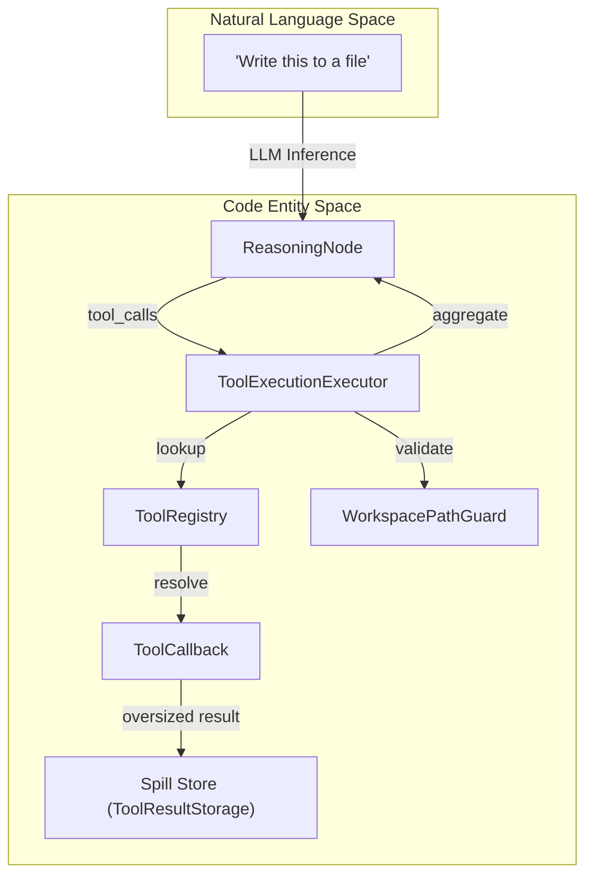
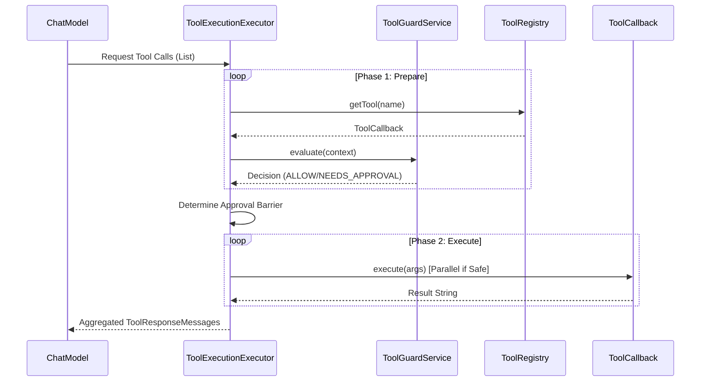

<!-- source: DeepWiki mcp.deepwiki.com · repo matevip/mateclaw · page 2.3 Tool Execution & Security · fetched 2026-10-27 -->

# Tool Execution & Security

Relevant source files

The following files were used as context for generating this wiki page:

- [mateclaw-server/src/main/java/vip/mate/agent/AgentGraphBuilder.java](mateclaw-server/src/main/java/vip/mate/agent/AgentGraphBuilder.java)
- [mateclaw-server/src/main/java/vip/mate/agent/BaseAgent.java](mateclaw-server/src/main/java/vip/mate/agent/BaseAgent.java)
- [mateclaw-server/src/main/java/vip/mate/agent/graph/NodeStreamingChatHelper.java](mateclaw-server/src/main/java/vip/mate/agent/graph/NodeStreamingChatHelper.java)
- [mateclaw-server/src/main/java/vip/mate/agent/graph/executor/ToolExecutionExecutor.java](mateclaw-server/src/main/java/vip/mate/agent/graph/executor/ToolExecutionExecutor.java)
- [mateclaw-server/src/main/java/vip/mate/agent/graph/node/ReasoningNode.java](mateclaw-server/src/main/java/vip/mate/agent/graph/node/ReasoningNode.java)
- [mateclaw-server/src/main/java/vip/mate/approval/ApprovalController.java](mateclaw-server/src/main/java/vip/mate/approval/ApprovalController.java)
- [mateclaw-server/src/main/java/vip/mate/approval/ApprovalService.java](mateclaw-server/src/main/java/vip/mate/approval/ApprovalService.java)
- [mateclaw-server/src/main/java/vip/mate/channel/web/ChatController.java](mateclaw-server/src/main/java/vip/mate/channel/web/ChatController.java)
- [mateclaw-server/src/main/java/vip/mate/config/DatabaseBootstrapRunner.java](mateclaw-server/src/main/java/vip/mate/config/DatabaseBootstrapRunner.java)
- [mateclaw-server/src/main/java/vip/mate/skill/runtime/SkillDependencyChecker.java](mateclaw-server/src/main/java/vip/mate/skill/runtime/SkillDependencyChecker.java)
- [mateclaw-server/src/main/java/vip/mate/tool/ToolRegistry.java](mateclaw-server/src/main/java/vip/mate/tool/ToolRegistry.java)
- [mateclaw-server/src/main/java/vip/mate/tool/builtin/ReadFileTool.java](mateclaw-server/src/main/java/vip/mate/tool/builtin/ReadFileTool.java)
- [mateclaw-server/src/main/java/vip/mate/tool/builtin/ShellExecuteTool.java](mateclaw-server/src/main/java/vip/mate/tool/builtin/ShellExecuteTool.java)
- [mateclaw-server/src/main/java/vip/mate/tool/guard/WorkspacePathGuard.java](mateclaw-server/src/main/java/vip/mate/tool/guard/WorkspacePathGuard.java)
- [mateclaw-server/src/main/java/vip/mate/tool/guard/guardian/FileWriteGuardian.java](mateclaw-server/src/main/java/vip/mate/tool/guard/guardian/FileWriteGuardian.java)

The `ToolExecutionExecutor` serves as the central engine for invoking capabilities within MateClaw. It implements a robust security architecture that balances high-performance parallel execution with strict Human-in-the-Loop (HIL) safety controls and workspace isolation.

## ToolExecutionExecutor: Two-Phase Model

The `ToolExecutionExecutor` manages the lifecycle of tool calls issued by an LLM. It employs a two-phase execution strategy to ensure that security checks and concurrency constraints are respected before any code is executed [mateclaw-server/src/main/java/vip/mate/agent/graph/executor/ToolExecutionExecutor.java:28-35]().

### 1. Preparation Phase (Phase 1)
In this phase, the executor iterates through the requested tool calls sequentially to perform:
*   **Registry Lookup**: Resolving tool names to `ToolCallback` instances via the `ToolRegistry` [mateclaw-server/src/main/java/vip/mate/agent/graph/executor/ToolExecutionExecutor.java:30-30]().
*   **Guard Evaluation**: Passing the invocation context to the `ToolGuard` system for safety analysis [mateclaw-server/src/main/java/vip/mate/agent/graph/executor/ToolExecutionExecutor.java:30-30]().
*   **Concurrency Classification**: Checking if tools are marked with `@ConcurrencyUnsafe` or listed in the `ToolConcurrencyRegistry` [mateclaw-server/src/main/java/vip/mate/agent/graph/executor/ToolExecutionExecutor.java:30-30]().
*   **Approval Barrier Detection**: Identifying the first tool that requires manual user approval. If the $N$-th tool requires approval, tools $N+1$ and beyond are not executed [mateclaw-server/src/main/java/vip/mate/agent/graph/executor/ToolExecutionExecutor.java:34-35]().

### 2. Execution Phase (Phase 2)
Based on the preparation, the executor dispatches tools using a hybrid batching model:
*   **Parallel Execution**: Tools identified as "Concurrency Safe" and appearing before any approval barrier are executed simultaneously using Java 21 Virtual Threads [mateclaw-server/src/main/java/vip/mate/agent/graph/executor/ToolExecutionExecutor.java:42-47]().
*   **Sequential Execution**: Tools marked as "Unsafe" (e.g., `browser_use`, `write_file`) are executed one by one to prevent race conditions or resource conflicts [mateclaw-server/src/main/java/vip/mate/agent/graph/executor/ToolExecutionExecutor.java:56-58]().
*   **Truncation**: Results are intelligently truncated to a hard cap (default 8000 characters) to prevent prompt inflation. The logic detects error patterns (e.g., "stacktrace", "panic") in the tail to preserve them for the agent's reasoning [mateclaw-server/src/main/java/vip/mate/agent/graph/executor/ToolExecutionExecutor.java:75-75](), [mateclaw-server/src/main/java/vip/mate/agent/graph/executor/ToolExecutionExecutor.java:94-112]().

**Sources:** [mateclaw-server/src/main/java/vip/mate/agent/graph/executor/ToolExecutionExecutor.java:25-112](), [mateclaw-server/src/main/java/vip/mate/tool/ToolRegistry.java:118-168]()

## Security & Guard Evaluation

MateClaw implements a multi-layered security stack to prevent malicious tool usage and unauthorized access.

### ToolGuard & Approval Flow
The `ToolGuardService` evaluates tool calls against configured rules. Each evaluation results in a decision: `ALLOW`, `NEEDS_APPROVAL`, or `BLOCK` [mateclaw-server/src/main/java/vip/mate/agent/graph/executor/ToolExecutionExecutor.java:15-19]().

*   **ApprovalBarrier**: If a tool triggers `NEEDS_APPROVAL`, the `ToolExecutionExecutor` halts execution and creates a `PendingApproval` record via `ApprovalService` [mateclaw-server/src/main/java/vip/mate/approval/ApprovalService.java:67-71]().
*   **HIL Approval Flow**: The `ChatController` detects the pending state and surfaces an approval banner in the UI [mateclaw-server/src/main/java/vip/mate/channel/web/ChatController.java:18-21](). Once approved, the `ReasoningNode` uses a `forced_tool_call` mechanism to replay the approved call [mateclaw-server/src/main/java/vip/mate/agent/graph/node/ReasoningNode.java:43-45]().
*   **ShellCommandGuardian**: Specialized logic for `execute_shell_command` prevents dangerous operations. It uses a 60-second default timeout and redirects output to temporary files to ensure timeouts are not blocked by pipe buffers [mateclaw-server/src/main/java/vip/mate/tool/builtin/ShellExecuteTool.java:21-30](), [mateclaw-server/src/main/java/vip/mate/tool/builtin/ShellExecuteTool.java:78-86]().

### WorkspacePathGuard
To prevent directory traversal, the `WorkspacePathGuard` validates every file path used by tools like `read_file` or `write_file` [mateclaw-server/src/main/java/vip/mate/tool/builtin/ReadFileTool.java:68-69]().
*   It ensures paths stay within the `workspaceBasePath` defined for the agent [mateclaw-server/src/main/java/vip/mate/agent/BaseAgent.java:54-56]().
*   If a tool receives a hallucinated path, it attempts to resolve it against the `CHAT_UPLOAD_ROOT` (data/chat-uploads) before rejecting it [mateclaw-server/src/main/java/vip/mate/tool/builtin/ReadFileTool.java:41-42](), [mateclaw-server/src/main/java/vip/mate/tool/builtin/ReadFileTool.java:71-79]().

**Sources:** [mateclaw-server/src/main/java/vip/mate/agent/graph/executor/ToolExecutionExecutor.java:39-60](), [mateclaw-server/src/main/java/vip/mate/agent/graph/node/ReasoningNode.java:37-47](), [mateclaw-server/src/main/java/vip/mate/tool/builtin/ReadFileTool.java:57-109](), [mateclaw-server/src/main/java/vip/mate/approval/ApprovalService.java:31-94]()

## Tool Data Flow and Entity Mapping

The following diagram bridges the natural language request for a tool to the specific code entities responsible for execution.

### Tool Execution Logic Mapping

**Sources:** [mateclaw-server/src/main/java/vip/mate/agent/graph/node/ReasoningNode.java:51-103](), [mateclaw-server/src/main/java/vip/mate/agent/graph/executor/ToolExecutionExecutor.java:39-60](), [mateclaw-server/src/main/java/vip/mate/tool/ToolRegistry.java:29-38]()

## Oversized Results & Spill Store

MateClaw implements a three-level budget chain (RFC-008) to maintain performance while handling large data [mateclaw-server/src/main/java/vip/mate/agent/graph/executor/ToolExecutionExecutor.java:64-70]():

1.  **Layer 1 (Hard Cap)**: `truncateToolResult` clips the string to 8000 characters for the LLM prompt [mateclaw-server/src/main/java/vip/mate/agent/graph/executor/ToolExecutionExecutor.java:75-75]().
2.  **Layer 2 (Spill Store)**: If the result exceeds the spill threshold (e.g., 16KB), the full content is persisted to disk via `ToolResultStorage` [mateclaw-server/src/main/java/vip/mate/agent/graph/executor/ToolExecutionExecutor.java:68-68]().
3.  **Layer 3 (Turn Budget)**: The aggregate size of all tool results in a single turn is limited (e.g., 32KB) to prevent memory exhaustion [mateclaw-server/src/main/java/vip/mate/agent/graph/executor/ToolExecutionExecutor.java:69-69]().

**Sources:** [mateclaw-server/src/main/java/vip/mate/agent/graph/executor/ToolExecutionExecutor.java:61-75](), [mateclaw-server/src/main/java/vip/mate/agent/graph/executor/ToolExecutionExecutor.java:94-112]()

## Registry & Concurrency Control

### ToolRegistry
The `ToolRegistry` is the authoritative source for all available tools, including:
*   **Built-in Tools**: Annotated with `@Tool` [mateclaw-server/src/main/java/vip/mate/tool/ToolRegistry.java:73-109]().
*   **Plugin Tools**: Registered via the Plugin SDK with lazy availability checks [mateclaw-server/src/main/java/vip/mate/tool/ToolRegistry.java:53-59]().
*   **MCP Tools**: Provided by external Model Context Protocol servers via `ToolCallbackProvider` [mateclaw-server/src/main/java/vip/mate/tool/ToolRegistry.java:141-147]().

### ConcurrencyUnsafe
Tools that interact with shared resources are marked as unsafe to prevent parallel execution conflicts.
*   **Annotation**: Developers use `@ConcurrencyUnsafe` (e.g., on `ShellExecuteTool.execute_shell_command`) [mateclaw-server/src/main/java/vip/mate/tool/builtin/ShellExecuteTool.java:46-46]().
*   **Registry**: The `ToolConcurrencyRegistry` maintains a metadata-driven list of these tools [mateclaw-server/src/main/java/vip/mate/agent/graph/executor/ToolExecutionExecutor.java:123-124]().
*   **Fallback**: A hardcoded list (e.g., `browser_use`, `write_file`) is used for backward compatibility [mateclaw-server/src/main/java/vip/mate/agent/graph/executor/ToolExecutionExecutor.java:56-58]().

### Tool System Sequence

**Sources:** [mateclaw-server/src/main/java/vip/mate/agent/graph/executor/ToolExecutionExecutor.java:25-112](), [mateclaw-server/src/main/java/vip/mate/agent/graph/node/ReasoningNode.java:51-103](), [mateclaw-server/src/main/java/vip/mate/tool/ToolRegistry.java:118-168]()

---

