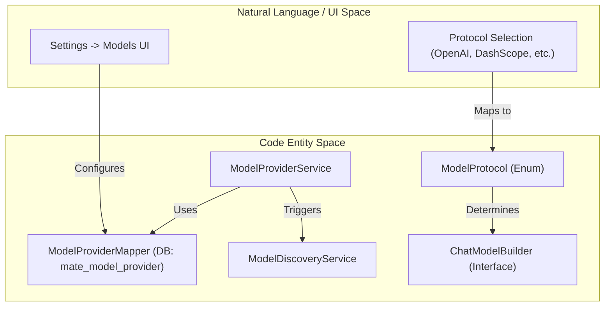
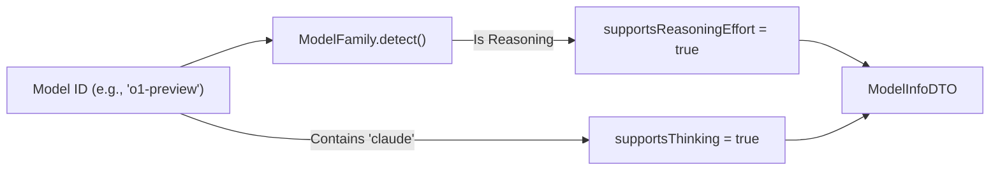

<!-- source: DeepWiki mcp.deepwiki.com · repo matevip/mateclaw · page 3 LLM Provider Layer · fetched 2026-10-27 -->

# LLM Provider Layer

Relevant source files

The following files were used as context for generating this wiki page:

- [mateclaw-server/src/main/java/vip/mate/agent/chatmodel/AgentAnthropicChatModelBuilder.java](mateclaw-server/src/main/java/vip/mate/agent/chatmodel/AgentAnthropicChatModelBuilder.java)
- [mateclaw-server/src/main/java/vip/mate/agent/chatmodel/AgentDashScopeChatModelBuilder.java](mateclaw-server/src/main/java/vip/mate/agent/chatmodel/AgentDashScopeChatModelBuilder.java)
- [mateclaw-server/src/main/java/vip/mate/llm/cache/CachePlanContext.java](mateclaw-server/src/main/java/vip/mate/llm/cache/CachePlanContext.java)
- [mateclaw-server/src/main/java/vip/mate/llm/model/ModelInfoDTO.java](mateclaw-server/src/main/java/vip/mate/llm/model/ModelInfoDTO.java)
- [mateclaw-server/src/main/java/vip/mate/llm/model/ModelProtocol.java](mateclaw-server/src/main/java/vip/mate/llm/model/ModelProtocol.java)
- [mateclaw-server/src/main/java/vip/mate/llm/model/ProviderInfoDTO.java](mateclaw-server/src/main/java/vip/mate/llm/model/ProviderInfoDTO.java)
- [mateclaw-server/src/main/java/vip/mate/llm/service/ModelConfigService.java](mateclaw-server/src/main/java/vip/mate/llm/service/ModelConfigService.java)
- [mateclaw-server/src/main/java/vip/mate/llm/service/ModelDiscoveryService.java](mateclaw-server/src/main/java/vip/mate/llm/service/ModelDiscoveryService.java)
- [mateclaw-server/src/main/java/vip/mate/llm/service/ModelProviderService.java](mateclaw-server/src/main/java/vip/mate/llm/service/ModelProviderService.java)
- [mateclaw-server/src/main/java/vip/mate/memory/event/MemoryWriteEvent.java](mateclaw-server/src/main/java/vip/mate/memory/event/MemoryWriteEvent.java)
- [mateclaw-server/src/main/java/vip/mate/memory/service/SoulSummarizerService.java](mateclaw-server/src/main/java/vip/mate/memory/service/SoulSummarizerService.java)
- [mateclaw-server/src/main/java/vip/mate/memory/service/StructuredMemoryService.java](mateclaw-server/src/main/java/vip/mate/memory/service/StructuredMemoryService.java)
- [mateclaw-server/src/main/java/vip/mate/memory/spi/MemoryManager.java](mateclaw-server/src/main/java/vip/mate/memory/spi/MemoryManager.java)
- [mateclaw-server/src/main/java/vip/mate/memory/spi/MemoryProvider.java](mateclaw-server/src/main/java/vip/mate/memory/spi/MemoryProvider.java)
- [mateclaw-server/src/main/resources/db/migration/h2/V15__purge_unavailable_dashscope_models.sql](mateclaw-server/src/main/resources/db/migration/h2/V15__purge_unavailable_dashscope_models.sql)
- [mateclaw-server/src/main/resources/db/migration/h2/V42__claude_47_gpt_55_models.sql](mateclaw-server/src/main/resources/db/migration/h2/V42__claude_47_gpt_55_models.sql)
- [mateclaw-server/src/main/resources/db/migration/mysql/V15__purge_unavailable_dashscope_models.sql](mateclaw-server/src/main/resources/db/migration/mysql/V15__purge_unavailable_dashscope_models.sql)
- [mateclaw-server/src/main/resources/db/migration/mysql/V42__claude_47_gpt_55_models.sql](mateclaw-server/src/main/resources/db/migration/mysql/V42__claude_47_gpt_55_models.sql)
- [mateclaw-ui/src/views/Settings/Models/ProviderCard.vue](mateclaw-ui/src/views/Settings/Models/ProviderCard.vue)
- [mateclaw-ui/src/views/Settings/Models/index.vue](mateclaw-ui/src/views/Settings/Models/index.vue)
- [mateclaw-ui/src/views/Settings/Models/modals/ProviderConfigModal.vue](mateclaw-ui/src/views/Settings/Models/modals/ProviderConfigModal.vue)
- [mateclaw-ui/src/views/Settings/Models/useProviders.ts](mateclaw-ui/src/views/Settings/Models/useProviders.ts)

The **LLM Provider Layer** is the abstraction foundation of MateClaw that enables the platform to interact with diverse Large Language Model (LLM) backends through a unified interface. It handles the complexities of different API protocols, manages model configurations, ensures high availability via failover mechanisms, and provides specialized builders for advanced features like Anthropic's extended thinking or Claude Code OAuth authentication.

## System Architecture

The layer bridges the gap between the high-level agent runtime and specific vendor implementations. It uses a protocol-based dispatch system to resolve how a model request should be formatted and authenticated.

### Provider to Code Entity Mapping
The following diagram illustrates how the system maps logical providers and protocols to specific Java entities and database records.

**Sources:**
- `ModelProviderService.java`: [23-35]()
- `ModelProtocol.java`: [1-20]()
- `ModelProviderMapper.java` (referenced): [30-31]()
- `useProviders.ts`: [54-59]()

---

## Provider Management & Failover

MateClaw treats LLM providers as a pool of resources. The `ModelProviderService` manages the lifecycle of these providers, including built-in ones (OpenAI, Anthropic, DashScope) and user-defined custom providers.

*   **Model Discovery:** The `ModelDiscoveryService` can automatically fetch available models from a provider's endpoint. It includes a multi-layered filtering system to exclude models that are incompatible with native protocols, particularly for DashScope non-chat modalities or unsupported dot-versioned families [mateclaw-server/src/main/java/vip/mate/llm/service/ModelDiscoveryService.java:46-122]().
*   **Failover & Priority:** Providers can be assigned a `fallbackPriority`. When a primary model fails, the system uses this priority to navigate the failover chain [mateclaw-ui/src/views/Settings/Models/useProviders.ts:44-46]().
*   **Health Tracking:** A background mechanism tracks provider health, allowing for cooldown periods and automatic reprobing of failed endpoints. The UI reflects these states via badges (e.g., "In Cooldown", "Removed") [mateclaw-ui/src/views/Settings/Models/ProviderCard.vue:30-60]().

For details, see [Provider Management & Failover](#3.1).

**Sources:**
- `ModelProviderService.java`: [63-123]()
- `ModelDiscoveryService.java`: [126-159]()
- `useProviders.ts`: [96-115]()
- `ProviderCard.vue`: [23-60]()

---

## ChatModel Builders & Decorators

The `ChatModelBuilder` interface is the core SPI (Service Provider Interface) for creating concrete `ChatModel` instances. The `AgentGraphBuilder` uses the `ModelProtocol` to resolve the correct builder at runtime.

| Protocol | Builder Class | Key Responsibilities |
| :--- | :--- | :--- |
| `ANTHROPIC_MESSAGES` | `AgentAnthropicChatModelBuilder` | Handles extended thinking tokens (4k-32k) and prompt caching [mateclaw-server/src/main/java/vip/mate/agent/chatmodel/AgentAnthropicChatModelBuilder.java:136-147](). |
| `ANTHROPIC_CLAUDE_CODE` | `AgentClaudeCodeChatModelBuilder` | Implements OAuth-based authentication for Claude Code identities. |
| `DASHSCOPE_NATIVE` | `AgentDashScopeChatModelBuilder` | Manages DashScope-specific search strategies and native protocol quirks [mateclaw-server/src/main/java/vip/mate/agent/chatmodel/AgentDashScopeChatModelBuilder.java:103-116](). |
| `OPENAI_COMPATIBLE` | `AgentOpenAiCompatibleChatModelBuilder` | Standard implementation for GPT and compatible APIs. |

### Model Capability Resolution
MateClaw detects model capabilities (like "Deep Thinking" or "Reasoning Effort") based on the model ID and family classification to enable/disable UI features dynamically.

For details, see [ChatModel Builders & Decorators](#3.2).

**Sources:**
- `ModelProtocol.java`: [1-20]()
- `ModelInfoDTO.java`: [32-63]()
- `AgentAnthropicChatModelBuilder.java`: [38-74]()
- `AgentDashScopeChatModelBuilder.java`: [58-70]()

---

## OAuth & Authentication Flows

Beyond standard API keys, MateClaw supports complex authentication flows, most notably for the **Claude Code** integration.

*   **OAuth Lifecycle:** Managed via `ClaudeCodeOAuthService`, this allows users to authenticate MateClaw as a "Claude Code" client, leveraging their personal Anthropic subscriptions.
*   **Token Management:** Includes automatic refreshing and local credential detection (e.g., from `~/.claude/.credentials.json`) [mateclaw-server/src/main/java/vip/mate/llm/service/ModelProviderService.java:27-28]().
*   **UI Integration:** The `ProviderConfigModal` dynamically renders OAuth login/revoke buttons when a provider's `authType` is set to `oauth` [mateclaw-ui/src/views/Settings/Models/modals/ProviderConfigModal.vue:28-61]().

For details, see [OAuth & Authentication Flows](#3.3).

**Sources:**
- `ModelProviderService.java`: [27-34]()
- `ProviderConfigModal.vue`: [28-61]()
- `CachePlanContext.java`: [59-66]()

---

## Database Schema & Migrations

The provider layer is backed by a robust schema that tracks configurations and maintains compatibility across model updates. Idempotent migrations ensure that default models like Claude 4.7 or GPT-5.5 are available across all deployments.

**Key Tables:**
*   `mate_model_provider`: Stores API keys, base URLs, and protocol settings.
*   `mate_model_config`: Stores specific model parameters like temperature, max tokens, and model type (chat vs. embedding) [mateclaw-server/src/main/java/vip/mate/llm/service/ModelConfigService.java:69-81]().

**Sources:**
- `ModelConfigService.java`: [35-58]()
- `V42__claude_47_gpt_55_models.sql (H2)`: [9-25]()
- `V42__claude_47_gpt_55_models.sql (MySQL)`: [9-37]()
- `V15__purge_unavailable_dashscope_models.sql`: [1-10]()

---

