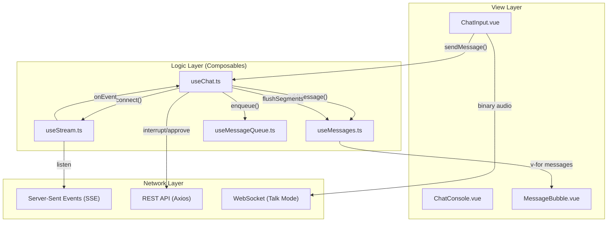

<!-- source: DeepWiki mcp.deepwiki.com · repo matevip/mateclaw · page 4 Chat UI & Frontend Architecture · fetched 2026-10-27 -->

# Chat UI & Frontend Architecture

Relevant source files

The following files were used as context for generating this wiki page:

- [.gitignore](.gitignore)
- [mateclaw-server/src/main/java/vip/mate/config/LoginRateLimitFilter.java](mateclaw-server/src/main/java/vip/mate/config/LoginRateLimitFilter.java)
- [mateclaw-server/src/main/java/vip/mate/config/WebSocketConfig.java](mateclaw-server/src/main/java/vip/mate/config/WebSocketConfig.java)
- [mateclaw-server/src/main/java/vip/mate/tool/builtin/DatasourceTool.java](mateclaw-server/src/main/java/vip/mate/tool/builtin/DatasourceTool.java)
- [mateclaw-server/src/main/java/vip/mate/workspace/conversation/ConversationService.java](mateclaw-server/src/main/java/vip/mate/workspace/conversation/ConversationService.java)
- [mateclaw-ui/index.html](mateclaw-ui/index.html)
- [mateclaw-ui/src/components/chat/ChatInput.vue](mateclaw-ui/src/components/chat/ChatInput.vue)
- [mateclaw-ui/src/components/workspace/WorkspaceSwitcher.vue](mateclaw-ui/src/components/workspace/WorkspaceSwitcher.vue)
- [mateclaw-ui/src/composables/chat/useChat.ts](mateclaw-ui/src/composables/chat/useChat.ts)
- [mateclaw-ui/src/main.ts](mateclaw-ui/src/main.ts)
- [mateclaw-ui/src/router/index.ts](mateclaw-ui/src/router/index.ts)
- [mateclaw-ui/src/views/ChatConsole.vue](mateclaw-ui/src/views/ChatConsole.vue)
- [mateclaw-ui/src/views/Security/Layout.vue](mateclaw-ui/src/views/Security/Layout.vue)
- [mateclaw-ui/src/views/Settings/Layout.vue](mateclaw-ui/src/views/Settings/Layout.vue)
- [mateclaw-ui/src/views/layout/MainLayout.vue](mateclaw-ui/src/views/layout/MainLayout.vue)

The MateClaw frontend is a modern single-page application (SPA) built with **Vue 3**, **TypeScript**, and **Element Plus**. It serves as the primary interface for human-agent interaction, providing a real-time, segmented streaming experience. The architecture emphasizes high-concurrency streaming, interruptible execution phases, and multi-workspace isolation.

## Main Layout & Routing

The application uses a shell-and-frame layout managed by `MainLayout.vue` [mateclaw-ui/src/views/layout/MainLayout.vue:1-151](). It provides a persistent sidebar for navigation and global utilities.

### Core Routing Structure
The routing is organized into logical groups within `router/index.ts` [mateclaw-ui/src/router/index.ts:5-198]():
*   **Core**: Chat console, Dashboard, Agent management, Wiki, and Memory [mateclaw-ui/src/router/index.ts:11-41]().
*   **Connect**: Channel adapters, Skills market, and Tool registry [mateclaw-ui/src/router/index.ts:42-66]().
*   **Settings**: Model configurations, System settings, and Media providers [mateclaw-ui/src/router/index.ts:67-114]().
*   **Security**: Tool Guard policies, File guards, and Audit logs [mateclaw-ui/src/router/index.ts:173-198]().

### Workspace Switcher
The `WorkspaceSwitcher.vue` component [mateclaw-ui/src/components/workspace/WorkspaceSwitcher.vue:1-52]() allows users to toggle between different isolated environments. Switching a workspace triggers a state update in `useWorkspaceStore`, which reloads context-sensitive data like agents and conversation history [mateclaw-ui/src/components/workspace/WorkspaceSwitcher.vue:110-115]().

**Sources:**
* `mateclaw-ui/src/views/layout/MainLayout.vue`
* `mateclaw-ui/src/router/index.ts`
* `mateclaw-ui/src/components/workspace/WorkspaceSwitcher.vue`

## Frontend Architecture Overview

The following diagram illustrates the relationship between the UI components and the underlying logic layers.

### UI to Code Entity Mapping
| Concept | Code Entity | Role |
| :--- | :--- | :--- |
| **Page Shell** | `MainLayout.vue` | Global navigation, workspace switcher, and theme management. |
| **Chat Hub** | `ChatConsole.vue` | Orchestrates the conversation sidebar and the main message area. |
| **Logic Core** | `useChat.ts` | Unified composable managing the "Interrupt + Queue + Resume" model. |
| **Stream Parser** | `useStream.ts` | Low-level SSE parsing into structured events (Thinking, Tool, Content). |
| **Input Controller** | `ChatInput.vue` | Handles user input, attachments, and HiL approval bars. |

### Component Hierarchy
The UI bridges the "Natural Language" input from the user to the "Code Entity" execution on the backend via a structured event pipeline.

Title: Frontend Interaction & Event Flow

**Sources:**
* `mateclaw-ui/src/composables/chat/useChat.ts:1-15]()`
* `mateclaw-ui/src/views/ChatConsole.vue:121-150]()`
* `mateclaw-server/src/main/java/vip/mate/config/WebSocketConfig.java:42-45]()`

## Chat Console & Logic Core

The `ChatConsole.vue` is the primary functional view [mateclaw-ui/src/views/ChatConsole.vue:1-4](). It integrates a conversation sidebar [mateclaw-ui/src/views/ChatConsole.vue:10-119]() with a main chat area [mateclaw-ui/src/views/ChatConsole.vue:121-150]().

### Unified Chat Composable (`useChat`)
The `useChat` composable is the "brain" of the frontend. It implements a sophisticated **Interrupt + Queue + Resume** model [mateclaw-ui/src/composables/chat/useChat.ts:5-11]():
*   **Interruptible Phases**: If a user sends a message while the agent is thinking or streaming, the frontend sends an interrupt request and queues the new message [mateclaw-ui/src/composables/chat/useChat.ts:7-8]().
*   **Non-interruptible Phases**: During tool execution or approval steps, messages are queued and automatically sent once the phase completes [mateclaw-ui/src/composables/chat/useChat.ts:9-10]().
*   **Stale-Event Guard**: Uses an `activeTurnId` to ensure SSE events from a previous connection do not pollute the current message state [mateclaw-ui/src/composables/chat/useChat.ts:126-134]().
*   **Turn Idempotency**: A `processedApprovalIds` set prevents duplicate handling of the same Human-in-the-loop request [mateclaw-ui/src/composables/chat/useChat.ts:160-161]().

For details on SSE lifecycle and message queuing, see [Chat Console & Streaming Client](#4.1).

**Sources:**
* `mateclaw-ui/src/views/ChatConsole.vue`
* `mateclaw-ui/src/composables/chat/useChat.ts`

## Message Rendering & Components

MateClaw uses a **Segmented View** for assistant messages, allowing it to render different types of output (thinking, tool calls, and content) as they arrive in the stream [mateclaw-ui/src/composables/chat/useChat.ts:121-124]().

### Interaction Elements
The `ChatInput.vue` component handles more than just text entry:
*   **Approval Bar**: Appears when an agent requires Human-in-the-Loop (HiL) permission to execute a sensitive tool, replacing the text area with Approve/Deny actions [mateclaw-ui/src/components/chat/ChatInput.vue:61-88]().
*   **Attachment Handling**: Manages file attachments with local blob URL previews for images and videos [mateclaw-ui/src/components/chat/ChatInput.vue:12-58]().
*   **Deep Thinking**: A toggle to enable/disable reasoning effort for supported models [mateclaw-ui/src/components/chat/ChatInput.vue:140-152]().
*   **Talk Mode**: Integration with the WebSocket-based voice interaction system [mateclaw-ui/src/components/chat/ChatInput.vue:154-163]().

For details on Markdown rendering and the approval flow, see [Message Rendering & Components](#4.2).

**Sources:**
* `mateclaw-ui/src/components/chat/ChatInput.vue`
* `mateclaw-ui/src/composables/chat/useChat.ts`

## Child Pages
*   [Chat Console & Streaming Client](#4.1) — SSE lifecycle, interrupt/queue logic, and conversation hydration.
*   [Message Rendering & Components](#4.2) — Segmented views, Markdown pipeline, and HiL approval UI.

---

