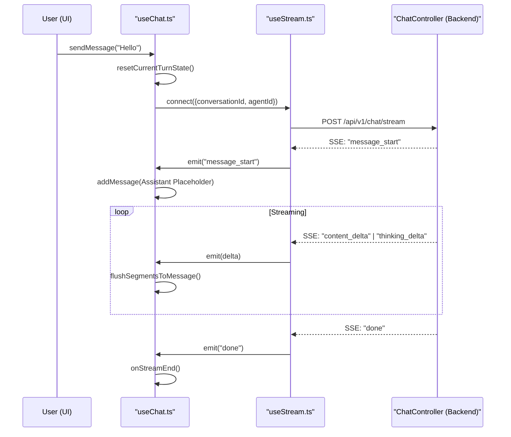
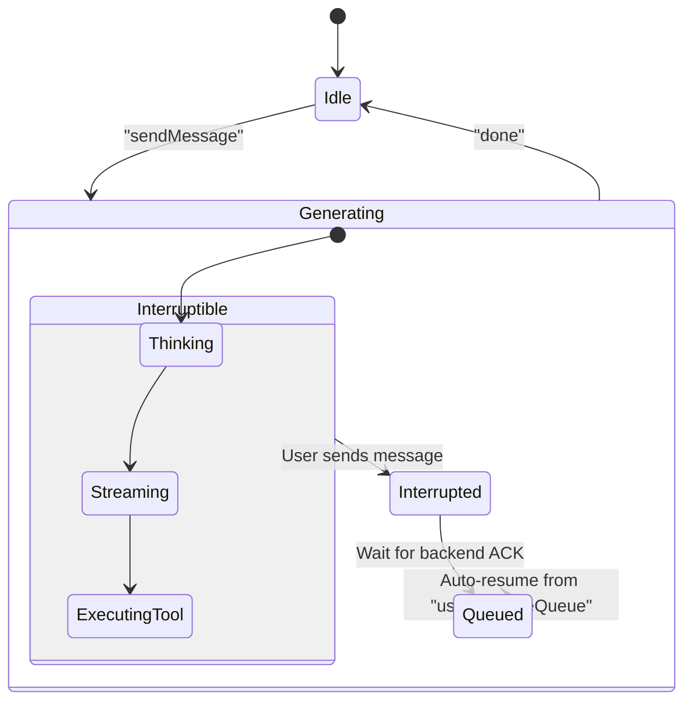

<!-- source: DeepWiki mcp.deepwiki.com · repo matevip/mateclaw · page 4.1 Chat Console & Streaming Client · fetched 2026-10-27 -->

# Chat Console & Streaming Client

Relevant source files

The following files were used as context for generating this wiki page:

- [mateclaw-server/src/main/java/vip/mate/channel/ChannelMessageRouter.java](mateclaw-server/src/main/java/vip/mate/channel/ChannelMessageRouter.java)
- [mateclaw-server/src/main/java/vip/mate/config/WebSocketConfig.java](mateclaw-server/src/main/java/vip/mate/config/WebSocketConfig.java)
- [mateclaw-server/src/main/java/vip/mate/llm/chatgpt/ChatGPTChatModel.java](mateclaw-server/src/main/java/vip/mate/llm/chatgpt/ChatGPTChatModel.java)
- [mateclaw-server/src/main/java/vip/mate/llm/chatgpt/ChatGPTResponsesClient.java](mateclaw-server/src/main/java/vip/mate/llm/chatgpt/ChatGPTResponsesClient.java)
- [mateclaw-server/src/main/java/vip/mate/tool/builtin/DelegateAgentTool.java](mateclaw-server/src/main/java/vip/mate/tool/builtin/DelegateAgentTool.java)
- [mateclaw-server/src/main/java/vip/mate/tool/builtin/DelegationContext.java](mateclaw-server/src/main/java/vip/mate/tool/builtin/DelegationContext.java)
- [mateclaw-server/src/main/java/vip/mate/workspace/conversation/ConversationService.java](mateclaw-server/src/main/java/vip/mate/workspace/conversation/ConversationService.java)
- [mateclaw-server/src/main/java/vip/mate/workspace/conversation/model/ConversationEntity.java](mateclaw-server/src/main/java/vip/mate/workspace/conversation/model/ConversationEntity.java)
- [mateclaw-server/src/main/java/vip/mate/workspace/conversation/model/MessageContentPart.java](mateclaw-server/src/main/java/vip/mate/workspace/conversation/model/MessageContentPart.java)
- [mateclaw-server/src/main/resources/db/migration/h2/V5__conversation_parent.sql](mateclaw-server/src/main/resources/db/migration/h2/V5__conversation_parent.sql)
- [mateclaw-ui/src/components/chat/ChatInput.vue](mateclaw-ui/src/components/chat/ChatInput.vue)
- [mateclaw-ui/src/components/chat/ToolCallSegment.vue](mateclaw-ui/src/components/chat/ToolCallSegment.vue)
- [mateclaw-ui/src/composables/chat/useChat.ts](mateclaw-ui/src/composables/chat/useChat.ts)
- [mateclaw-ui/src/composables/chat/useMessages.ts](mateclaw-ui/src/composables/chat/useMessages.ts)
- [mateclaw-ui/src/composables/chat/useStream.ts](mateclaw-ui/src/composables/chat/useStream.ts)
- [mateclaw-ui/src/composables/useToolLabel.ts](mateclaw-ui/src/composables/useToolLabel.ts)
- [mateclaw-ui/src/utils/messageReconcile.ts](mateclaw-ui/src/utils/messageReconcile.ts)
- [mateclaw-ui/src/views/ChatConsole.vue](mateclaw-ui/src/views/ChatConsole.vue)

The Chat Console is the primary user interface of MateClaw, providing a real-time, multi-agent conversational experience. It utilizes a sophisticated streaming architecture that supports asynchronous task execution, tool call visualization, and an interrupt-and-queue model for seamless interaction.

## ChatConsole.vue Hydration & Polling

`ChatConsole.vue` serves as the orchestration layer for the chat interface. It manages route hydration, conversation lifecycle, and UI state for sidebars and input areas [mateclaw-ui/src/views/ChatConsole.vue:1-4]().

### Route Hydration
When the route changes (e.g., clicking a conversation in the sidebar), the component hydrates the view by:
1.  **Loading History**: Fetching existing messages for the `currentConversationId` [mateclaw-ui/src/views/ChatConsole.vue:59-71]().
2.  **State Recovery**: The UI determines if a conversation is active by checking the `streamStatus` property in the conversation list [mateclaw-ui/src/views/ChatConsole.vue:68-69]().
3.  **Reconnection**: If the status is `running`, the frontend calls `reconnectStream(conversationId)` to attach to the existing SSE stream [mateclaw-ui/src/composables/chat/useChat.ts:78]().

### Conversation Polling
To keep the sidebar up-to-date, especially for background tasks or multi-device sync, the console periodically refreshes the conversation list. This list includes metadata like `lastActiveTime`, `messageCount`, and the `streamStatus` indicator [mateclaw-ui/src/views/ChatConsole.vue:102-106]().

**Sources:** [mateclaw-ui/src/views/ChatConsole.vue](), [mateclaw-ui/src/composables/chat/useChat.ts]()

---

## useChat Composable: Stream Lifecycle

The `useChat` composable is the core logic engine for the frontend. It integrates message management via `useMessages`, SSE parsing via `useStream`, and the queueing system via `useMessageQueue` [mateclaw-ui/src/composables/chat/useChat.ts:1-15]().

### Turn ID & Stale Event Guard
To prevent "ghost" events from an old conversation polluting a new one during rapid switching, `useChat` employs:
*   **`activeTurnId`**: A unique identifier generated for every new assistant response turn [mateclaw-ui/src/composables/chat/useChat.ts:127-134]().
*   **`isStaleEvent`**: A check that compares the `conversationId` in incoming SSE data against the current active session [mateclaw-ui/src/composables/chat/useChat.ts:153-159]().
*   **`flushSegmentsToMessage` Guard**: Only writes segments to messages if the message's internal `_turnId` matches the current `activeTurnId` [mateclaw-ui/src/composables/chat/useChat.ts:137-148]().

### Key Functions
| Function | Description |
| :--- | :--- |
| `sendMessage` | Entry point for user input. Routes to `interrupt` if generating, or `queue` if in a non-interruptible phase [mateclaw-ui/src/composables/chat/useChat.ts:66](). |
| `reconnectStream` | Attaches to an existing SSE stream using the `conversationId` [mateclaw-ui/src/composables/chat/useChat.ts:78](). |
| `interrupt` | (Internal) Sends an interrupt request to the backend to stop the current LLM turn so a new user message can be processed [mateclaw-ui/src/composables/chat/useChat.ts:7-8](). |
| `flushSegmentsToMessage` | Syncs real-time streaming segments (thinking, tool calls) into the message object for rendering [mateclaw-ui/src/composables/chat/useChat.ts:137-148](). |

### Chat Streaming Lifecycle
This diagram bridges user intent to the code entities managing the stream.

**Title: Chat Streaming Lifecycle**

**Sources:** [mateclaw-ui/src/composables/chat/useChat.ts](), [mateclaw-ui/src/composables/chat/useStream.ts]()

---

## useStream: Low-Level SSE Parsing

`useStream.ts` provides a robust wrapper around the `fetch` API to handle `text/event-stream` data [mateclaw-ui/src/composables/chat/useStream.ts:1-4]().

### SSEParser Implementation
The `SSEParser` class handles fragmented network chunks by maintaining a buffer [mateclaw-ui/src/composables/chat/useStream.ts:86-88]().
1.  **Buffering**: Chunks are appended to `buffer` [mateclaw-ui/src/composables/chat/useStream.ts:91]().
2.  **Splitting**: The buffer is split by `\n\n` (the SSE event separator) [mateclaw-ui/src/composables/chat/useStream.ts:95]().
3.  **Parsing**: Each block is parsed for `event:` and `data:` fields. It defaults to `content_delta` if no event type is specified [mateclaw-ui/src/composables/chat/useStream.ts:118-144]().
4.  **Timeout**: A `STREAM_TIMEOUT_MS` (120s) timer is reset on every heartbeat or data chunk to detect dead connections [mateclaw-ui/src/composables/chat/useStream.ts:159-160]().

**Sources:** [mateclaw-ui/src/composables/chat/useStream.ts]()

---

## Message Queue & Interrupt Logic

MateClaw implements an **Interrupt + Queue + Resume** model to handle user input during active generation [mateclaw-ui/src/composables/chat/useChat.ts:5-11]().

### State Dispatching
*   **Interruptible Phases**: `thinking`, `streaming`, and `executing_tool`. Sending a message here triggers an interrupt request; the new message is queued and sent once the backend confirms the turn is stopped [mateclaw-ui/src/composables/chat/useChat.ts:7-9]().
*   **Non-Interruptible Phases**: `summarizing` or `saving`. The message is held in the `useMessageQueue` and automatically resumed when the phase ends [mateclaw-ui/src/composables/chat/useChat.ts:9-10]().
*   **Approval Phase**: During `awaiting_approval`, messages are queued but the approval flow remains active. The `ChatInput.vue` component replaces the input area with an `approval-bar` [mateclaw-ui/src/components/chat/ChatInput.vue:61-88]().

**Title: Interrupt & Queue State Machine**

**Sources:** [mateclaw-ui/src/composables/chat/useChat.ts](), [mateclaw-ui/src/components/chat/ChatInput.vue]()

---

## Attachments & Blob Previews

The `ChatInput.vue` component handles file uploads and multimodal content parts [mateclaw-ui/src/components/chat/ChatInput.vue:1-10]().

### Upload Flow
1.  **Selection**: User selects files via `fileInputRef` or drag-and-drop [mateclaw-ui/src/components/chat/ChatInput.vue:127-137, 193-200]().
2.  **Blob Preview**: For images and videos, a local `URL.createObjectURL` (aliased as `previewUrl`) is generated for immediate preview without waiting for server persistence [mateclaw-ui/src/components/chat/ChatInput.vue:23-38]().
3.  **Upload**: Files are uploaded to the backend, returning a `storedName` and permanent `url` [mateclaw-ui/src/components/chat/ChatInput.vue:15-16]().
4.  **Message Construction**: The files are attached as `MessageContentPart` objects with types like `image`, `file`, or `video` [mateclaw-server/src/main/java/vip/mate/workspace/conversation/model/MessageContentPart.java:1-20]().

**Sources:** [mateclaw-ui/src/components/chat/ChatInput.vue](), [mateclaw-server/src/main/java/vip/mate/workspace/conversation/model/MessageContentPart.java]()

---

## Message Reconcile: Local vs. Remote

To prevent "poorer" database snapshots from overwriting "richer" local streaming data (which contains detailed `segments` and `toolCalls`), MateClaw uses a `reconcileMessages` utility [mateclaw-ui/src/utils/messageReconcile.ts:1-9]().

### Richness Scoring
The utility calculates a `messageRichness` score for every assistant message [mateclaw-ui/src/utils/messageReconcile.ts:34-56]():
*   **Segments**: +120 points per segment (highest weight for timeline accuracy) [mateclaw-ui/src/utils/messageReconcile.ts:41]().
*   **Tool Calls**: +40 points per call [mateclaw-ui/src/utils/messageReconcile.ts:45]().
*   **Content Parts**: Thinking and tool call parts add significant weight [mateclaw-ui/src/utils/messageReconcile.ts:49-50]().

When the stream ends and the frontend refreshes the conversation history, `reconcileMessages` compares the local version and the fetched version, keeping the one with the higher score to ensure the UI doesn't lose detail [mateclaw-ui/src/utils/messageReconcile.ts:136-167]().

**Sources:** [mateclaw-ui/src/utils/messageReconcile.ts]()

---

