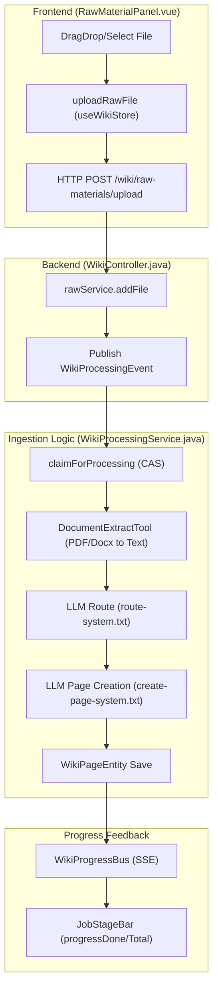
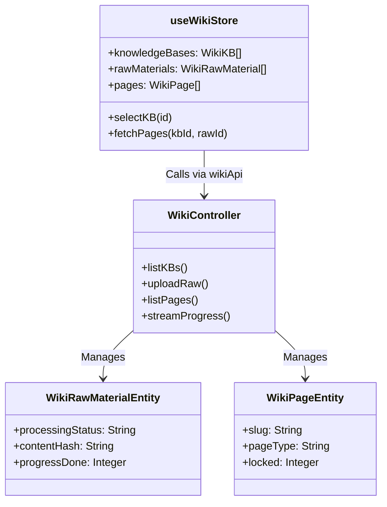

<!-- source: DeepWiki mcp.deepwiki.com · repo matevip/mateclaw · page 5.3 Wiki UI · fetched 2026-10-27 -->

# Wiki UI

Relevant source files

The following files were used as context for generating this wiki page:

- [mateclaw-server/src/main/java/vip/mate/wiki/WikiAutoConfiguration.java](mateclaw-server/src/main/java/vip/mate/wiki/WikiAutoConfiguration.java)
- [mateclaw-server/src/main/java/vip/mate/wiki/controller/WikiController.java](mateclaw-server/src/main/java/vip/mate/wiki/controller/WikiController.java)
- [mateclaw-server/src/main/java/vip/mate/wiki/event/WikiProcessingListener.java](mateclaw-server/src/main/java/vip/mate/wiki/event/WikiProcessingListener.java)
- [mateclaw-server/src/main/java/vip/mate/wiki/job/WikiProcessingJobService.java](mateclaw-server/src/main/java/vip/mate/wiki/job/WikiProcessingJobService.java)
- [mateclaw-server/src/main/java/vip/mate/wiki/model/WikiRawMaterialEntity.java](mateclaw-server/src/main/java/vip/mate/wiki/model/WikiRawMaterialEntity.java)
- [mateclaw-server/src/main/java/vip/mate/wiki/service/WikiContextService.java](mateclaw-server/src/main/java/vip/mate/wiki/service/WikiContextService.java)
- [mateclaw-server/src/main/java/vip/mate/wiki/service/WikiRawMaterialService.java](mateclaw-server/src/main/java/vip/mate/wiki/service/WikiRawMaterialService.java)
- [mateclaw-server/src/main/resources/db/migration/h2/V7__wiki_last_processed_hash.sql](mateclaw-server/src/main/resources/db/migration/h2/V7__wiki_last_processed_hash.sql)
- [mateclaw-server/src/main/resources/db/migration/h2/V8__wiki_raw_progress.sql](mateclaw-server/src/main/resources/db/migration/h2/V8__wiki_raw_progress.sql)
- [mateclaw-server/src/main/resources/prompts/wiki/batch-create-system.txt](mateclaw-server/src/main/resources/prompts/wiki/batch-create-system.txt)
- [mateclaw-server/src/main/resources/prompts/wiki/batch-create-user.txt](mateclaw-server/src/main/resources/prompts/wiki/batch-create-user.txt)
- [mateclaw-server/src/main/resources/prompts/wiki/create-page-system.txt](mateclaw-server/src/main/resources/prompts/wiki/create-page-system.txt)
- [mateclaw-server/src/main/resources/prompts/wiki/create-page-user.txt](mateclaw-server/src/main/resources/prompts/wiki/create-page-user.txt)
- [mateclaw-server/src/main/resources/prompts/wiki/route-system.txt](mateclaw-server/src/main/resources/prompts/wiki/route-system.txt)
- [mateclaw-server/src/main/resources/prompts/wiki/route-user.txt](mateclaw-server/src/main/resources/prompts/wiki/route-user.txt)
- [mateclaw-server/src/test/java/vip/mate/wiki/service/WikiRawMaterialDedupTest.java](mateclaw-server/src/test/java/vip/mate/wiki/service/WikiRawMaterialDedupTest.java)
- [mateclaw-server/src/test/java/vip/mate/wiki/service/WikiRawMaterialRecoveryTest.java](mateclaw-server/src/test/java/vip/mate/wiki/service/WikiRawMaterialRecoveryTest.java)
- [mateclaw-ui/src/api/index.ts](mateclaw-ui/src/api/index.ts)
- [mateclaw-ui/src/i18n/locales/en-US.ts](mateclaw-ui/src/i18n/locales/en-US.ts)
- [mateclaw-ui/src/i18n/locales/zh-CN.ts](mateclaw-ui/src/i18n/locales/zh-CN.ts)
- [mateclaw-ui/src/stores/useWikiStore.ts](mateclaw-ui/src/stores/useWikiStore.ts)
- [mateclaw-ui/src/views/Wiki/components/JobStageBar.vue](mateclaw-ui/src/views/Wiki/components/JobStageBar.vue)
- [mateclaw-ui/src/views/Wiki/components/RawMaterialPanel.vue](mateclaw-ui/src/views/Wiki/components/RawMaterialPanel.vue)
- [mateclaw-ui/src/views/Wiki/components/WikiGraphView.vue](mateclaw-ui/src/views/Wiki/components/WikiGraphView.vue)
- [mateclaw-ui/src/views/Wiki/components/WikiPageViewer.vue](mateclaw-ui/src/views/Wiki/components/WikiPageViewer.vue)
- [mateclaw-ui/src/views/Wiki/index.vue](mateclaw-ui/src/views/Wiki/index.vue)

The Wiki UI provides a structured interface for managing the LLM-powered knowledge base. It facilitates the transition from unstructured "Raw Materials" (PDFs, Markdown, text) to an interlinked "Wiki" structure through drag-and-drop ingestion, SSE-powered progress tracking, and graph-based visualization of knowledge relationships.

## Wiki Index Layout

The main entry point for the Wiki module is `Wiki/index.vue`, which implements a multi-pane shell for knowledge management [mateclaw-ui/src/views/Wiki/index.vue:1-19]().

### Component Structure
*   **Sidebar**: Displays the list of Knowledge Bases (KBs) and a searchable, grouped list of Wiki pages [mateclaw-ui/src/views/Wiki/index.vue:20-51]().
*   **Main Content Area**: Switches between the `WikiPageViewer` (for reading/editing pages), the `RawMaterialPanel` (for ingestion management), and the `WikiGraphView` [mateclaw-ui/src/views/Wiki/index.vue:140-165]().
*   **Batch Operations**: Supports multi-selection for bulk deletion of pages, with protection logic to prevent the deletion of system or locked pages [mateclaw-ui/src/views/Wiki/index.vue:84-97]().

### Page Grouping and Protection
Pages are grouped by type (e.g., `system`, `concept`, `process`). The UI enforces protection rules via `isProtectedPage` where "system" pages (like `overview` or `log`) and "locked" pages are gated against deletion [mateclaw-ui/src/views/Wiki/index.vue:111-137]().

**Sources:** [mateclaw-ui/src/views/Wiki/index.vue:1-165](), [mateclaw-ui/src/stores/useWikiStore.ts:58-64]()

---

## WikiPageViewer and Content Rendering

The `WikiPageViewer.vue` component handles the display and lifecycle of individual Wiki pages [mateclaw-ui/src/views/Wiki/components/WikiPageViewer.vue:1-2]().

### Knowledge Enrichment and Repair
The viewer provides actions for AI-driven maintenance:
*   **Enrich**: Calls `wikiApi.enrichPage` to trigger relationship discovery and link generation [mateclaw-ui/src/views/Wiki/components/WikiPageViewer.vue:167-176]().
*   **Repair**: Calls `wikiApi.repairPage` to fix structural issues or missing summaries using LLM [mateclaw-ui/src/views/Wiki/components/WikiPageViewer.vue:178-192]().

### Wiki-Link Resolution
Content is rendered using `useMarkdownRenderer`. The component includes a regex-based pre-processor that transforms `[[Page Title]]` syntax into clickable router links by matching titles against the `pages` map stored in the `useWikiStore` [mateclaw-ui/src/views/Wiki/components/WikiPageViewer.vue:116-132]().

### Data Flow: Page Viewer
| Feature | Implementation | Source |
| :--- | :--- | :--- |
| **Markdown Rendering** | `renderMarkdown(content)` via `useMarkdownRenderer` | [mateclaw-ui/src/views/Wiki/components/WikiPageViewer.vue:103]() |
| **Backlinks** | Fetched via `wikiApi.getBacklinks` on page load | [mateclaw-ui/src/views/Wiki/components/WikiPageViewer.vue:139-143]() |
| **Citations** | `CitationDrawer` displays source raw materials | [mateclaw-ui/src/views/Wiki/components/WikiPageViewer.vue:75-80]() |
| **Protection UI** | `isProtected` computed property gates delete button | [mateclaw-ui/src/views/Wiki/components/WikiPageViewer.vue:111-114]() |

**Sources:** [mateclaw-ui/src/views/Wiki/components/WikiPageViewer.vue:1-192](), [mateclaw-ui/src/stores/useWikiStore.ts:65-136]()

---

## RawMaterialPanel: Ingestion & SSE Tracking

The `RawMaterialPanel.vue` manages the ingestion pipeline, supporting drag-and-drop uploads and directory scanning [mateclaw-ui/src/views/Wiki/components/RawMaterialPanel.vue:1-13]().

### Upload Pipeline and Progress
1.  **File Selection**: Supports `.txt`, `.md`, `.pdf`, and `.docx` [mateclaw-ui/src/views/Wiki/components/RawMaterialPanel.vue:38]().
2.  **Optimistic UI**: Files are immediately added to an `uploadingFiles` array with a `tempId` [mateclaw-ui/src/views/Wiki/components/RawMaterialPanel.vue:82-86]().
3.  **HTTP Upload**: Uses `axios` on-upload progress to update `uf.httpPct` [mateclaw-ui/src/views/Wiki/components/RawMaterialPanel.vue:113-125]().
4.  **SSE Progress**: Once uploaded, the backend `WikiProgressBus` emits events via `SseEmitter` to track the "Digestion" phase [mateclaw-server/src/main/java/vip/mate/wiki/controller/WikiController.java:237-251]().

### Job Stage Tracking
The `JobStageBar.vue` component visualizes the backend processing pipeline stages: `queued`, `routing`, `phase_a_running`, `phase_b_running`, `enriching`, `embedding`, and `completed` [mateclaw-ui/src/views/Wiki/components/JobStageBar.vue:73-81](). It maps terminal states like `failed` or `partial` to provide retry/repair actions [mateclaw-ui/src/views/Wiki/components/JobStageBar.vue:40-47]().

### Ingestion Flow: Material to Wiki Page

**Sources:** [mateclaw-ui/src/views/Wiki/components/RawMaterialPanel.vue:1-125](), [mateclaw-server/src/main/java/vip/mate/wiki/service/WikiRawMaterialService.java:125-169](), [mateclaw-server/src/main/java/vip/mate/wiki/controller/WikiController.java:237-251](), [mateclaw-ui/src/views/Wiki/components/JobStageBar.vue:73-92]()

---

## WikiConfig and Knowledge Base Settings

The `WikiController` provides endpoints for managing Knowledge Base (KB) configurations, including agent associations and embedding model bindings [mateclaw-server/src/main/java/vip/mate/wiki/controller/WikiController.java:107-126]().

### Knowledge Base Configuration
KBs can be configured with specific properties:
*   **Agent Binding**: Associates a KB with a specific agent for context injection [mateclaw-server/src/main/java/vip/mate/wiki/controller/WikiController.java:100]().
*   **Embedding Model**: Allows binding a specific `embeddingModelId` to a KB [mateclaw-server/src/main/java/vip/mate/wiki/controller/WikiController.java:117-124]().
*   **Context Control**: `WikiContextService` uses `WikiProperties` to limit context injection size via `maxContextChars` [mateclaw-server/src/main/java/vip/mate/wiki/service/WikiContextService.java:56]().

### Auto-Processing
The `WikiProperties` namespace `mate.wiki` includes `autoProcessOnUpload`. If enabled, the `WikiRawMaterialService` immediately publishes a `WikiProcessingEvent` upon file or text addition [mateclaw-server/src/main/java/vip/mate/wiki/service/WikiRawMaterialService.java:113-115]().

**Sources:** [mateclaw-server/src/main/java/vip/mate/wiki/controller/WikiController.java:47-157](), [mateclaw-server/src/main/java/vip/mate/wiki/service/WikiContextService.java:22-103](), [mateclaw-server/src/main/java/vip/mate/wiki/service/WikiRawMaterialService.java:113-115]()

---

## WikiGraphView and State Management

### Knowledge Graph Visualization
`WikiGraphView.vue` provides a visual representation of the knowledge base. It leverages the relationship data between pages to render a graph where:
*   **Nodes**: Represent `WikiPage` entities.
*   **Edges**: Represent links (e.g., `outgoingLinks`) or semantic relations between pages.
*   **Interaction**: Selecting a node allows the user to navigate to the corresponding page in the viewer.

### useWikiStore
The `useWikiStore.ts` Pinia store centralizes the state for the Wiki module, managing KBs, raw materials, and pages [mateclaw-ui/src/stores/useWikiStore.ts:65-71]().

| Action | Role | API Endpoint |
| :--- | :--- | :--- |
| `selectKB` | Sets active KB and fetches its pages/materials | `GET /wiki/knowledge-bases/{id}` |
| `filterPagesByRaw` | Filters the page list to only those derived from a specific material | `GET /wiki/pages?rawId={id}` |
| `addRawText` | Submits raw text for processing | `POST /wiki/raw-materials/text` |
| `uploadRawFile` | Uploads binary files for ingestion | `POST /wiki/raw-materials/upload` |

### Code Entity Mapping

**Sources:** [mateclaw-ui/src/stores/useWikiStore.ts:1-195](), [mateclaw-ui/src/api/index.ts:184-210](), [mateclaw-ui/src/views/Wiki/components/WikiGraphView.vue:1-10]()

---

