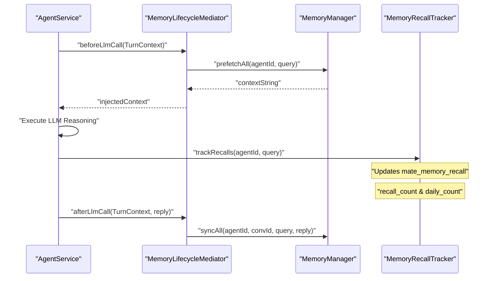
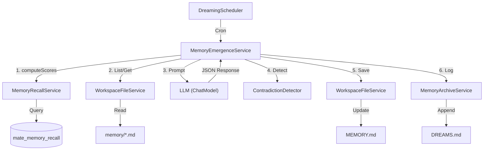

<!-- source: DeepWiki mcp.deepwiki.com · repo matevip/mateclaw · page 6.1 Memory Lifecycle & Dreaming · fetched 2026-10-27 -->

# Memory Lifecycle & Dreaming

Relevant source files

The following files were used as context for generating this wiki page:

- [mateclaw-server/src/main/java/vip/mate/memory/archive/MemoryArchiveService.java](mateclaw-server/src/main/java/vip/mate/memory/archive/MemoryArchiveService.java)
- [mateclaw-server/src/main/java/vip/mate/memory/controller/MemoryController.java](mateclaw-server/src/main/java/vip/mate/memory/controller/MemoryController.java)
- [mateclaw-server/src/main/java/vip/mate/memory/lifecycle/MemoryLifecycleEventListener.java](mateclaw-server/src/main/java/vip/mate/memory/lifecycle/MemoryLifecycleEventListener.java)
- [mateclaw-server/src/main/java/vip/mate/memory/lifecycle/MemoryLifecycleMediator.java](mateclaw-server/src/main/java/vip/mate/memory/lifecycle/MemoryLifecycleMediator.java)
- [mateclaw-server/src/main/java/vip/mate/memory/lifecycle/TurnCompletedEvent.java](mateclaw-server/src/main/java/vip/mate/memory/lifecycle/TurnCompletedEvent.java)
- [mateclaw-server/src/main/java/vip/mate/memory/lifecycle/TurnContext.java](mateclaw-server/src/main/java/vip/mate/memory/lifecycle/TurnContext.java)
- [mateclaw-server/src/main/java/vip/mate/memory/lifecycle/TurnStartedEvent.java](mateclaw-server/src/main/java/vip/mate/memory/lifecycle/TurnStartedEvent.java)
- [mateclaw-server/src/main/java/vip/mate/memory/listener/PostConversationMemoryListener.java](mateclaw-server/src/main/java/vip/mate/memory/listener/PostConversationMemoryListener.java)
- [mateclaw-server/src/main/java/vip/mate/memory/model/DreamReportEntity.java](mateclaw-server/src/main/java/vip/mate/memory/model/DreamReportEntity.java)
- [mateclaw-server/src/main/java/vip/mate/memory/model/MemoryRecallEntity.java](mateclaw-server/src/main/java/vip/mate/memory/model/MemoryRecallEntity.java)
- [mateclaw-server/src/main/java/vip/mate/memory/model/MorningCardSeenEntity.java](mateclaw-server/src/main/java/vip/mate/memory/model/MorningCardSeenEntity.java)
- [mateclaw-server/src/main/java/vip/mate/memory/nudge/MemoryNudgeService.java](mateclaw-server/src/main/java/vip/mate/memory/nudge/MemoryNudgeService.java)
- [mateclaw-server/src/main/java/vip/mate/memory/provider/BuiltinMemoryProvider.java](mateclaw-server/src/main/java/vip/mate/memory/provider/BuiltinMemoryProvider.java)
- [mateclaw-server/src/main/java/vip/mate/memory/provider/SessionSearchProvider.java](mateclaw-server/src/main/java/vip/mate/memory/provider/SessionSearchProvider.java)
- [mateclaw-server/src/main/java/vip/mate/memory/provider/StructuredMemoryProvider.java](mateclaw-server/src/main/java/vip/mate/memory/provider/StructuredMemoryProvider.java)
- [mateclaw-server/src/main/java/vip/mate/memory/repository/DreamReportMapper.java](mateclaw-server/src/main/java/vip/mate/memory/repository/DreamReportMapper.java)
- [mateclaw-server/src/main/java/vip/mate/memory/repository/MemoryRecallMapper.java](mateclaw-server/src/main/java/vip/mate/memory/repository/MemoryRecallMapper.java)
- [mateclaw-server/src/main/java/vip/mate/memory/repository/MorningCardSeenMapper.java](mateclaw-server/src/main/java/vip/mate/memory/repository/MorningCardSeenMapper.java)
- [mateclaw-server/src/main/java/vip/mate/memory/scheduler/DreamingScheduler.java](mateclaw-server/src/main/java/vip/mate/memory/scheduler/DreamingScheduler.java)
- [mateclaw-server/src/main/java/vip/mate/memory/search/SessionSearchResult.java](mateclaw-server/src/main/java/vip/mate/memory/search/SessionSearchResult.java)
- [mateclaw-server/src/main/java/vip/mate/memory/search/SessionSearchService.java](mateclaw-server/src/main/java/vip/mate/memory/search/SessionSearchService.java)
- [mateclaw-server/src/main/java/vip/mate/memory/search/SessionSearchTool.java](mateclaw-server/src/main/java/vip/mate/memory/search/SessionSearchTool.java)
- [mateclaw-server/src/main/java/vip/mate/memory/service/DreamMode.java](mateclaw-server/src/main/java/vip/mate/memory/service/DreamMode.java)
- [mateclaw-server/src/main/java/vip/mate/memory/service/DreamReport.java](mateclaw-server/src/main/java/vip/mate/memory/service/DreamReport.java)
- [mateclaw-server/src/main/java/vip/mate/memory/service/DreamStatus.java](mateclaw-server/src/main/java/vip/mate/memory/service/DreamStatus.java)
- [mateclaw-server/src/main/java/vip/mate/memory/service/MemoryEmergenceService.java](mateclaw-server/src/main/java/vip/mate/memory/service/MemoryEmergenceService.java)
- [mateclaw-server/src/main/java/vip/mate/memory/service/MemoryHilService.java](mateclaw-server/src/main/java/vip/mate/memory/service/MemoryHilService.java)
- [mateclaw-server/src/main/java/vip/mate/memory/service/MemoryRecallService.java](mateclaw-server/src/main/java/vip/mate/memory/service/MemoryRecallService.java)
- [mateclaw-server/src/main/java/vip/mate/memory/service/MemoryRecallTracker.java](mateclaw-server/src/main/java/vip/mate/memory/service/MemoryRecallTracker.java)
- [mateclaw-server/src/main/java/vip/mate/tool/builtin/WorkspaceMemoryTool.java](mateclaw-server/src/main/java/vip/mate/tool/builtin/WorkspaceMemoryTool.java)
- [mateclaw-server/src/main/resources/db/migration/h2/V28__morning_card_seen.sql](mateclaw-server/src/main/resources/db/migration/h2/V28__morning_card_seen.sql)
- [mateclaw-server/src/main/resources/db/migration/mysql/V28__morning_card_seen.sql](mateclaw-server/src/main/resources/db/migration/mysql/V28__morning_card_seen.sql)
- [mateclaw-server/src/main/resources/prompts/memory/emergence-focused-user.txt](mateclaw-server/src/main/resources/prompts/memory/emergence-focused-user.txt)
- [mateclaw-server/src/main/resources/prompts/memory/emergence-scored-user.txt](mateclaw-server/src/main/resources/prompts/memory/emergence-scored-user.txt)
- [mateclaw-server/src/test/java/vip/mate/memory/lifecycle/LifecycleFlagGuardTest.java](mateclaw-server/src/test/java/vip/mate/memory/lifecycle/LifecycleFlagGuardTest.java)

The Memory Lifecycle system in MateClaw manages the transition of information from short-term conversational context to long-term structured knowledge. This process, termed "Dreaming," utilizes an emergence-based architecture where recurring patterns and frequently recalled information are consolidated into core memory files (`MEMORY.md`, `SOUL.md`).

## Memory Lifecycle Mediator

The `MemoryLifecycleMediator` acts as the central coordinator between the agent runtime (`AgentService`) and the memory subsystem. It manages the lifecycle events of a conversation turn, ensuring that memory is retrieved before reasoning and persisted after the response.

### Turn Lifecycle Events
1.  **Before LLM Call**: `MemoryLifecycleMediator.beforeLlmCall(TurnContext)` is invoked [vip/mate/memory/lifecycle/MemoryLifecycleMediator.java:43-54](). It triggers `MemoryManager.prefetchAll` to gather relevant context based on the current `userQuery`.
2.  **After LLM Call**: `MemoryLifecycleMediator.afterLlmCall(TurnContext, String)` is called upon successful turn completion [vip/mate/memory/lifecycle/MemoryLifecycleMediator.java:61-71](). It synchronizes the assistant's reply back to memory providers.
3.  **Session End**: When a conversation is closed, `onSessionEnd` is triggered via the `MemoryLifecycleEventListener` [vip/mate/memory/lifecycle/MemoryLifecycleMediator.java:74-83]().

### Data Flow: Turn Execution
The following diagram illustrates how the Mediator bridges the Agent Runtime and Memory Storage.

**Diagram: Memory Lifecycle Mediation**

Sources: [vip/mate/memory/lifecycle/MemoryLifecycleMediator.java:31-84](), [vip/mate/memory/service/MemoryRecallTracker.java:46-86]()

---

## Memory Recall & Scoring

The `MemoryRecallService` tracks the utility of memory fragments. Every time a tool (like `WorkspaceMemoryTool`) retrieves a file or a snippet is injected into the prompt, the `MemoryRecallTracker` records the event in the `mate_memory_recall` table [vip/mate/memory/service/MemoryRecallTracker.java:46-86]().

### Scoring Algorithm
The `MemoryRecallService.computeScores` function calculates a weighted score for each memory candidate [vip/mate/memory/service/MemoryRecallService.java:149-180]().
*   **Frequency**: Total `recallCount` [vip/mate/memory/model/MemoryRecallEntity.java:36]().
*   **Diversity**: Count of unique `queryHashes` that triggered the recall [vip/mate/memory/service/MemoryRecallService.java:66-72]().
*   **Recency**: Time decay based on `lastRecalledAt` [vip/mate/memory/model/MemoryRecallEntity.java:48]().
*   **Gating**: Candidates must meet `emergenceMinRecallCount` and `emergenceMinUniqueQueries` to be considered for consolidation [vip/mate/memory/service/MemoryRecallService.java:164-175]().

### Snippet-Level Tracking
`MemoryRecallTracker` performs snippet-level tracking for daily notes (`memory/*.md`) by splitting content using the `SECTION_PATTERN` (regex for `##` headers) [vip/mate/memory/service/MemoryRecallTracker.java:34-40](). This allows the system to identify specifically which part of a long daily log was useful [vip/mate/memory/service/MemoryRecallTracker.java:91-127]().

Sources: [vip/mate/memory/service/MemoryRecallService.java:30-180](), [vip/mate/memory/service/MemoryRecallTracker.java:18-170](), [vip/mate/memory/model/MemoryRecallEntity.java:18-66]()

---

## Dreaming & Emergence

The "Dreaming" process is the nightly consolidation of daily notes and high-score recall candidates into the agent's permanent memory.

### Dreaming Modes
`MemoryEmergenceService` supports two modes [vip/mate/memory/service/MemoryEmergenceService.java:71-78]():
1.  **NIGHTLY**: Triggered by `DreamingScheduler` via a cron expression (default `0 0 3 * * ?`) [vip/mate/memory/scheduler/DreamingScheduler.java:37-42]().
2.  **FOCUSED**: Triggered manually via `MemoryController.triggerFocusedDream` [vip/mate/memory/controller/MemoryController.java:55-73](). It prioritizes information related to a specific `topic` using the `memory/emergence-focused-user` prompt [vip/mate/memory/service/MemoryEmergenceService.java:67-71]().

### Consolidation Workflow
1.  **Candidate Gathering**: Loads `memory/*.md` files and scores recall entities via `recallService.computeScores` [vip/mate/memory/service/MemoryEmergenceService.java:81-113]().
2.  **LLM Consolidation**: Invokes an LLM with the `memory/emergence-system` prompt and a list of candidates [vip/mate/memory/service/MemoryEmergenceService.java:120-136]().
3.  **Conflict Resolution**: The `ContradictionDetector` identifies logical conflicts between new findings and existing memory [vip/mate/memory/service/MemoryEmergenceService.java:54]().
4.  **HIL Protection**: The system detects `<!-- user-edited -->` markers in `MEMORY.md`. Sections with this marker are never overwritten, only appended to [vip/mate/memory/service/MemoryHilService.java:34-66]().
5.  **Report Generation**: Produces a `DreamReport` containing `candidateCount`, `promotedCount`, and the `memoryDiff` [vip/mate/memory/service/MemoryEmergenceService.java:157-170]().

**Diagram: Dreaming Consolidation Flow**

Sources: [vip/mate/memory/service/MemoryEmergenceService.java:71-180](), [vip/mate/memory/scheduler/DreamingScheduler.java:27-67](), [vip/mate/memory/service/MemoryHilService.java:14-33]()

---

## Memory Nudge & Extraction

Beyond nightly dreaming, the `MemoryNudgeService` provides near-real-time extraction of structured memories.

*   **Trigger**: Triggered every `N` turns (defined by `mate.memory.nudge-turn-interval`) [vip/mate/memory/nudge/MemoryNudgeService.java:58-67]().
*   **Process**: It builds a transcript of recent messages and asks an LLM to extract user preferences, project details, or feedback [vip/mate/memory/nudge/MemoryNudgeService.java:85-128]().
*   **Persistence**: Extracted entries are saved via `StructuredMemoryService.remember` into the `structured/` workspace directory [vip/mate/memory/nudge/MemoryNudgeService.java:138-150]().

Sources: [vip/mate/memory/nudge/MemoryNudgeService.java:41-160](), [vip/mate/memory/service/StructuredMemoryService.java:1-50]()

---

## Memory Archiving & UI

The `MemoryArchiveService` handles the long-term retention of memory metadata and consolidation logs.

*   **Dream Logs**: Consolidation history is stored in `DREAMS.md`. The `MemoryController` provides an endpoint to retrieve this "Dream Journal" [vip/mate/memory/controller/MemoryController.java:110-124]().
*   **Morning Card**: Every dream run generates a `DreamReportEntity`. The system tracks if the user has seen the "Morning Card" (summary of the dream) via `MorningCardSeenEntity` [vip/mate/memory/model/MorningCardSeenEntity.java:1-15]().

### Key Entities
| Entity | Table | Purpose |
| :--- | :--- | :--- |
| `MemoryRecallEntity` | `mate_memory_recall` | Tracks frequency and diversity of file usage [vip/mate/memory/model/MemoryRecallEntity.java:17-18](). |
| `DreamReportEntity` | `mate_dream_report` | Stores the outcome of each consolidation run [vip/mate/memory/model/DreamReportEntity.java:1-20](). |
| `MorningCardSeenEntity` | `mate_morning_card_seen` | Tracks whether a user has viewed the latest dream summary [vip/mate/memory/model/MorningCardSeenEntity.java:1-15](). |

Sources: [vip/mate/memory/archive/MemoryArchiveService.java:1-30](), [vip/mate/memory/controller/MemoryController.java:93-124](), [vip/mate/memory/model/DreamReportEntity.java:1-20]()

---

