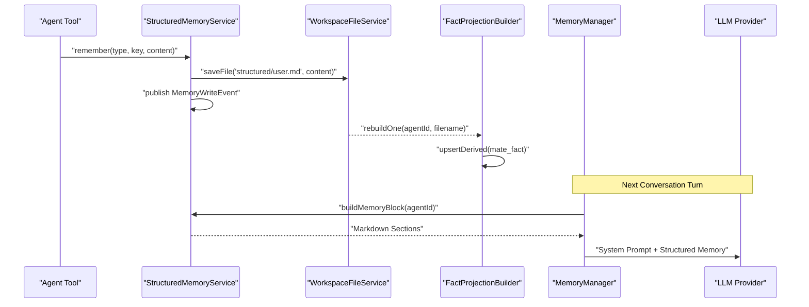
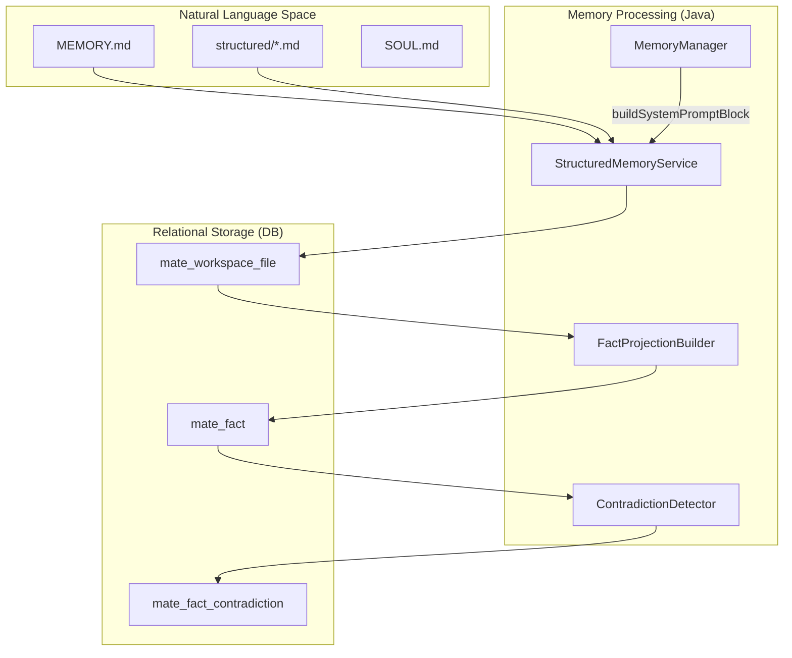

<!-- source: DeepWiki mcp.deepwiki.com · repo matevip/mateclaw · page 6.2 Fact Extraction & Structured Memory · fetched 2026-10-27 -->

# Fact Extraction & Structured Memory

Relevant source files

The following files were used as context for generating this wiki page:

- [mateclaw-server/src/main/java/vip/mate/agent/chatmodel/AgentDashScopeChatModelBuilder.java](mateclaw-server/src/main/java/vip/mate/agent/chatmodel/AgentDashScopeChatModelBuilder.java)
- [mateclaw-server/src/main/java/vip/mate/llm/model/ProviderInfoDTO.java](mateclaw-server/src/main/java/vip/mate/llm/model/ProviderInfoDTO.java)
- [mateclaw-server/src/main/java/vip/mate/llm/service/ModelConfigService.java](mateclaw-server/src/main/java/vip/mate/llm/service/ModelConfigService.java)
- [mateclaw-server/src/main/java/vip/mate/memory/event/MemoryWriteEvent.java](mateclaw-server/src/main/java/vip/mate/memory/event/MemoryWriteEvent.java)
- [mateclaw-server/src/main/java/vip/mate/memory/fact/contradiction/ContradictionDetector.java](mateclaw-server/src/main/java/vip/mate/memory/fact/contradiction/ContradictionDetector.java)
- [mateclaw-server/src/main/java/vip/mate/memory/fact/extraction/CompositeEntityExtractor.java](mateclaw-server/src/main/java/vip/mate/memory/fact/extraction/CompositeEntityExtractor.java)
- [mateclaw-server/src/main/java/vip/mate/memory/fact/extraction/EntityExtractor.java](mateclaw-server/src/main/java/vip/mate/memory/fact/extraction/EntityExtractor.java)
- [mateclaw-server/src/main/java/vip/mate/memory/fact/extraction/ExtractedFact.java](mateclaw-server/src/main/java/vip/mate/memory/fact/extraction/ExtractedFact.java)
- [mateclaw-server/src/main/java/vip/mate/memory/fact/extraction/LlmEntityExtractor.java](mateclaw-server/src/main/java/vip/mate/memory/fact/extraction/LlmEntityExtractor.java)
- [mateclaw-server/src/main/java/vip/mate/memory/fact/extraction/PatternEntityExtractor.java](mateclaw-server/src/main/java/vip/mate/memory/fact/extraction/PatternEntityExtractor.java)
- [mateclaw-server/src/main/java/vip/mate/memory/fact/model/FactContradictionEntity.java](mateclaw-server/src/main/java/vip/mate/memory/fact/model/FactContradictionEntity.java)
- [mateclaw-server/src/main/java/vip/mate/memory/fact/model/FactEntity.java](mateclaw-server/src/main/java/vip/mate/memory/fact/model/FactEntity.java)
- [mateclaw-server/src/main/java/vip/mate/memory/fact/model/FactEntityRefEntity.java](mateclaw-server/src/main/java/vip/mate/memory/fact/model/FactEntityRefEntity.java)
- [mateclaw-server/src/main/java/vip/mate/memory/fact/projection/FactProjectionBuilder.java](mateclaw-server/src/main/java/vip/mate/memory/fact/projection/FactProjectionBuilder.java)
- [mateclaw-server/src/main/java/vip/mate/memory/fact/projection/FactProjectionScheduler.java](mateclaw-server/src/main/java/vip/mate/memory/fact/projection/FactProjectionScheduler.java)
- [mateclaw-server/src/main/java/vip/mate/memory/fact/provider/FactMemoryProvider.java](mateclaw-server/src/main/java/vip/mate/memory/fact/provider/FactMemoryProvider.java)
- [mateclaw-server/src/main/java/vip/mate/memory/fact/query/FactQueryService.java](mateclaw-server/src/main/java/vip/mate/memory/fact/query/FactQueryService.java)
- [mateclaw-server/src/main/java/vip/mate/memory/fact/repository/FactContradictionMapper.java](mateclaw-server/src/main/java/vip/mate/memory/fact/repository/FactContradictionMapper.java)
- [mateclaw-server/src/main/java/vip/mate/memory/fact/repository/FactEntityRefMapper.java](mateclaw-server/src/main/java/vip/mate/memory/fact/repository/FactEntityRefMapper.java)
- [mateclaw-server/src/main/java/vip/mate/memory/fact/tool/FactQueryTool.java](mateclaw-server/src/main/java/vip/mate/memory/fact/tool/FactQueryTool.java)
- [mateclaw-server/src/main/java/vip/mate/memory/listener/PostConversationMemoryListener.java](mateclaw-server/src/main/java/vip/mate/memory/listener/PostConversationMemoryListener.java)
- [mateclaw-server/src/main/java/vip/mate/memory/nudge/MemoryNudgeService.java](mateclaw-server/src/main/java/vip/mate/memory/nudge/MemoryNudgeService.java)
- [mateclaw-server/src/main/java/vip/mate/memory/provider/BuiltinMemoryProvider.java](mateclaw-server/src/main/java/vip/mate/memory/provider/BuiltinMemoryProvider.java)
- [mateclaw-server/src/main/java/vip/mate/memory/provider/SessionSearchProvider.java](mateclaw-server/src/main/java/vip/mate/memory/provider/SessionSearchProvider.java)
- [mateclaw-server/src/main/java/vip/mate/memory/provider/StructuredMemoryProvider.java](mateclaw-server/src/main/java/vip/mate/memory/provider/StructuredMemoryProvider.java)
- [mateclaw-server/src/main/java/vip/mate/memory/search/SessionSearchResult.java](mateclaw-server/src/main/java/vip/mate/memory/search/SessionSearchResult.java)
- [mateclaw-server/src/main/java/vip/mate/memory/search/SessionSearchService.java](mateclaw-server/src/main/java/vip/mate/memory/search/SessionSearchService.java)
- [mateclaw-server/src/main/java/vip/mate/memory/search/SessionSearchTool.java](mateclaw-server/src/main/java/vip/mate/memory/search/SessionSearchTool.java)
- [mateclaw-server/src/main/java/vip/mate/memory/service/SoulSummarizerService.java](mateclaw-server/src/main/java/vip/mate/memory/service/SoulSummarizerService.java)
- [mateclaw-server/src/main/java/vip/mate/memory/service/StructuredMemoryService.java](mateclaw-server/src/main/java/vip/mate/memory/service/StructuredMemoryService.java)
- [mateclaw-server/src/main/java/vip/mate/memory/spi/MemoryManager.java](mateclaw-server/src/main/java/vip/mate/memory/spi/MemoryManager.java)
- [mateclaw-server/src/main/java/vip/mate/memory/spi/MemoryProvider.java](mateclaw-server/src/main/java/vip/mate/memory/spi/MemoryProvider.java)
- [mateclaw-server/src/main/resources/db/migration/h2/V29__memory_fact_projection.sql](mateclaw-server/src/main/resources/db/migration/h2/V29__memory_fact_projection.sql)
- [mateclaw-ui/src/views/Settings/Models/ProviderCard.vue](mateclaw-ui/src/views/Settings/Models/ProviderCard.vue)
- [mateclaw-ui/src/views/Settings/Models/index.vue](mateclaw-ui/src/views/Settings/Models/index.vue)

The Fact Extraction and Structured Memory system transforms raw conversational data and semi-structured Markdown files into a queryable knowledge base for the agent. By projecting high-level memory files into a relational schema, MateClaw enables precise fact retrieval, contradiction detection, and long-term personality evolution.

## Structured Memory Architecture

MateClaw utilizes a "Files-as-Source" approach where the canonical state of memory resides in specific Markdown files within the agent's workspace. The `StructuredMemoryService` manages these files, while the `MemoryManager` orchestrates their injection into the LLM context via the `MemoryProvider` SPI [mateclaw-server/src/main/java/vip/mate/memory/spi/MemoryProvider.java:7-15]().

### Core Workspace Files
- **`MEMORY.md`**: Stores general long-term facts and historical summaries [mateclaw-server/src/main/java/vip/mate/memory/fact/projection/FactProjectionBuilder.java:65-66]().
- **`PROFILE.md`**: Defines the user's profile and preferences.
- **`SOUL.md`**: Contains the agent's persona, core values, and behavioral guidelines.
- **`structured/*.md`**: Specialized memory categories including `user.md`, `feedback.md`, `project.md`, and `reference.md` [mateclaw-server/src/main/java/vip/mate/memory/service/StructuredMemoryService.java:36-36]().

### Data Flow: Memory Write to System Prompt
The following diagram illustrates how a memory write event propagates through the system to influence future agent reasoning.

**Memory Propagation Diagram**

Sources: [mateclaw-server/src/main/java/vip/mate/memory/service/StructuredMemoryService.java:49-80](), [mateclaw-server/src/main/java/vip/mate/memory/fact/projection/FactProjectionBuilder.java:91-101](), [mateclaw-server/src/main/java/vip/mate/memory/spi/MemoryManager.java:83-97]()

---

## Fact Extraction & Projection

The `FactProjectionBuilder` is responsible for synchronizing the relational `mate_fact` table with the Markdown sources. This allows the system to perform complex queries and trust calculations that are impossible in raw text [mateclaw-server/src/main/java/vip/mate/memory/fact/projection/FactProjectionBuilder.java:20-25]().

### Extraction Pipeline
Extraction is handled by the `CompositeEntityExtractor`, which delegates to specialized implementations:
1.  **`PatternEntityExtractor`**: Uses Regex to parse `## Header` sections and `- **Key**: Value` bullet points [mateclaw-server/src/main/java/vip/mate/memory/fact/extraction/PatternEntityExtractor.java:23-27]().
2.  **`LlmEntityExtractor`**: Uses LLM calls to extract semantic triples (Subject-Predicate-Object) from unstructured text.

### Fact Trust & Decay
Facts are not treated as absolute truths. The system calculates a `trust` score for every `ExtractedFact`:
- **Base Trust**: Derived from metadata markers like `> UserFeedback: HELPFUL` (+0.1) or `UNHELPFUL` (-0.2) [mateclaw-server/src/main/java/vip/mate/memory/fact/extraction/PatternEntityExtractor.java:81-88]().
- **Time Decay**: Trust scores undergo exponential decay based on the `mate.memory.fact.trust-half-life-days` property. The formula is `trust * 2^(-daysSinceLastUpdate / halfLifeDays)` [mateclaw-server/src/main/java/vip/mate/memory/fact/projection/FactProjectionBuilder.java:152-161]().

| Field | Description | Source |
| :--- | :--- | :--- |
| `source_ref` | Unique identifier (e.g., `structured/user.md#birthday`) | [mateclaw-server/src/main/java/vip/mate/memory/fact/model/FactEntity.java]() |
| `subject` | The entity the fact is about | [mateclaw-server/src/main/java/vip/mate/memory/fact/extraction/ExtractedFact.java:13-13]() |
| `object_value` | The value or description of the fact | [mateclaw-server/src/main/java/vip/mate/memory/fact/extraction/ExtractedFact.java:15-15]() |
| `confidence` | LLM's confidence in the extraction (0-1) | [mateclaw-server/src/main/java/vip/mate/memory/fact/extraction/ExtractedFact.java:16-16]() |

Sources: [mateclaw-server/src/main/java/vip/mate/memory/fact/projection/FactProjectionBuilder.java:107-145](), [mateclaw-server/src/main/java/vip/mate/memory/fact/extraction/PatternEntityExtractor.java:44-54]()

---

## Contradiction Detection

The `ContradictionDetector` identifies conflicts between newly learned information and existing facts.

- **Trigger**: Runs during the memory consolidation phase of the Dreaming cycle [mateclaw-server/src/main/java/vip/mate/memory/fact/contradiction/ContradictionDetector.java:21-22]().
- **Logic**: It identifies facts with the same `subject` but different `object_value`. For example, if an existing fact states "User location: Beijing" and a new fact states "User location: Shanghai", a contradiction is logged in the `mate_fact_contradiction` table [mateclaw-server/src/main/java/vip/mate/memory/fact/contradiction/ContradictionDetector.java:80-108]().
- **Resolution**: Contradictions are surfaced in the **Morning Card** UI for human-in-the-loop (HiL) resolution.

Sources: [mateclaw-server/src/main/java/vip/mate/memory/fact/contradiction/ContradictionDetector.java:34-48]()

---

## Memory Retrieval Services

### FactQueryService & Tool
The `FactQueryTool` allows agents to programmatically search the projected fact database.
- **`FactQueryService`**: Provides methods to query facts by subject similarity or category.
- **Usage**: When an agent needs to verify a specific detail (e.g., "What was the user's feedback on the last project?"), it invokes the tool to retrieve high-trust facts.

### SessionSearchService
While facts provide discrete data points, the `SessionSearchService` provides full-text search across historical conversation transcripts.
- **`SessionSearchProvider`**: Implements the `MemoryProvider` SPI to inject relevant snippets from past sessions into the current turn's `prefetch` context [mateclaw-server/src/main/java/vip/mate/memory/spi/MemoryProvider.java:65-67]().

### SoulSummarizerService
This service manages the evolution of the `SOUL.md` file. It listens for `MemoryWriteEvent` and periodically triggers an LLM-based reflection to update the agent's persona based on accumulated interactions [mateclaw-server/src/main/java/vip/mate/memory/service/SoulSummarizerService.java]().

---

## Technical Entity Mapping

The following diagram maps the high-level memory concepts to the internal Spring components and database entities.

**Code Entity Space Mapping**

Sources: [mateclaw-server/src/main/java/vip/mate/memory/service/StructuredMemoryService.java:39-41](), [mateclaw-server/src/main/java/vip/mate/memory/fact/projection/FactProjectionBuilder.java:33-38](), [mateclaw-server/src/main/java/vip/mate/memory/spi/MemoryManager.java:29-34](), [mateclaw-server/src/main/java/vip/mate/memory/spi/MemoryManager.java:83-87]()

## Memory Nudging
The `MemoryNudgeService` proactively suggests memory updates to the user. If the agent detects a significant change in user preference or a new project milestone, it generates a "Nudge" event that appears in the UI, asking the user if this information should be permanently remembered.

Sources: [mateclaw-server/src/main/java/vip/mate/memory/nudge/MemoryNudgeService.java]()

---

