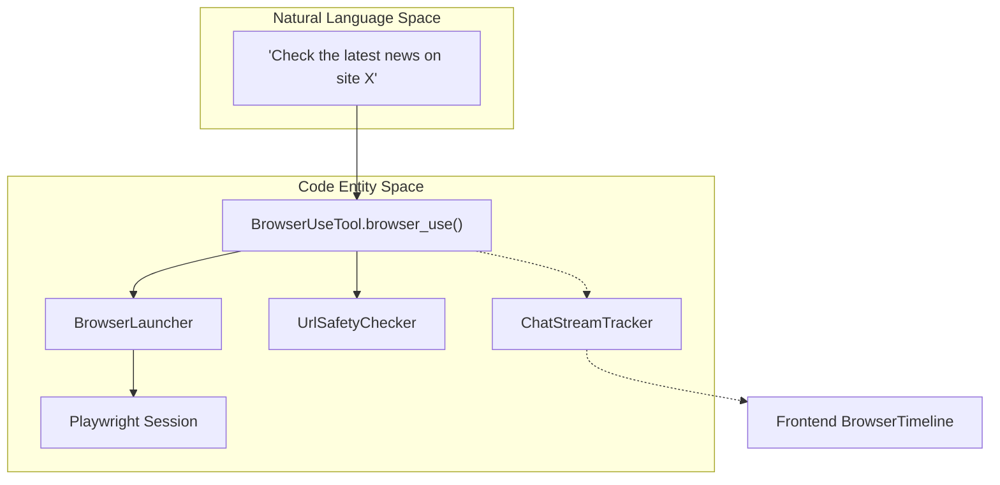
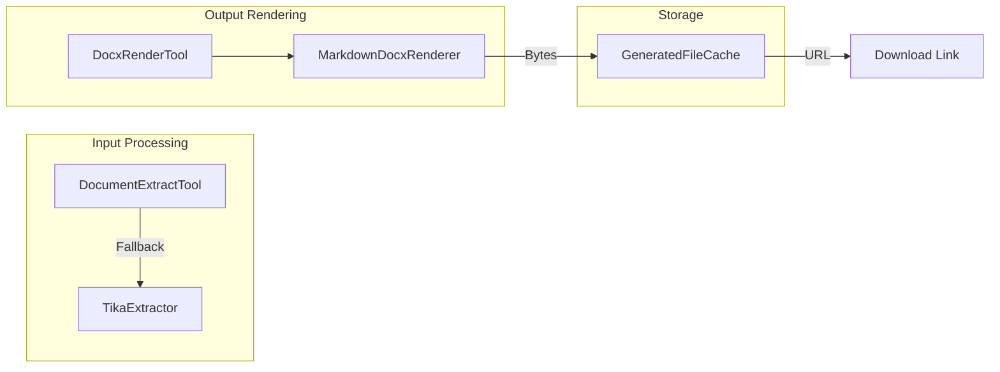

<!-- source: DeepWiki mcp.deepwiki.com · repo matevip/mateclaw · page 7.1 Built-in Tools · fetched 2026-10-27 -->

# Built-in Tools

Relevant source files

The following files were used as context for generating this wiki page:

- [mateclaw-server/pom.xml](mateclaw-server/pom.xml)
- [mateclaw-server/src/main/java/vip/mate/approval/ApprovalController.java](mateclaw-server/src/main/java/vip/mate/approval/ApprovalController.java)
- [mateclaw-server/src/main/java/vip/mate/approval/ApprovalService.java](mateclaw-server/src/main/java/vip/mate/approval/ApprovalService.java)
- [mateclaw-server/src/main/java/vip/mate/config/DatabaseBootstrapRunner.java](mateclaw-server/src/main/java/vip/mate/config/DatabaseBootstrapRunner.java)
- [mateclaw-server/src/main/java/vip/mate/datasource/controller/DatasourceController.java](mateclaw-server/src/main/java/vip/mate/datasource/controller/DatasourceController.java)
- [mateclaw-server/src/main/java/vip/mate/datasource/model/DatasourceEntity.java](mateclaw-server/src/main/java/vip/mate/datasource/model/DatasourceEntity.java)
- [mateclaw-server/src/main/java/vip/mate/datasource/repository/DatasourceMapper.java](mateclaw-server/src/main/java/vip/mate/datasource/repository/DatasourceMapper.java)
- [mateclaw-server/src/main/java/vip/mate/datasource/service/DatasourceConnectionManager.java](mateclaw-server/src/main/java/vip/mate/datasource/service/DatasourceConnectionManager.java)
- [mateclaw-server/src/main/java/vip/mate/datasource/service/DatasourceService.java](mateclaw-server/src/main/java/vip/mate/datasource/service/DatasourceService.java)
- [mateclaw-server/src/main/java/vip/mate/datasource/service/EChartsOptionBuilder.java](mateclaw-server/src/main/java/vip/mate/datasource/service/EChartsOptionBuilder.java)
- [mateclaw-server/src/main/java/vip/mate/datasource/service/SqlValidationService.java](mateclaw-server/src/main/java/vip/mate/datasource/service/SqlValidationService.java)
- [mateclaw-server/src/main/java/vip/mate/skill/workspace/SkillWorkspaceBootstrapRunner.java](mateclaw-server/src/main/java/vip/mate/skill/workspace/SkillWorkspaceBootstrapRunner.java)
- [mateclaw-server/src/main/java/vip/mate/skill/workspace/SkillWorkspaceManager.java](mateclaw-server/src/main/java/vip/mate/skill/workspace/SkillWorkspaceManager.java)
- [mateclaw-server/src/main/java/vip/mate/system/service/SystemHealthService.java](mateclaw-server/src/main/java/vip/mate/system/service/SystemHealthService.java)
- [mateclaw-server/src/main/java/vip/mate/tool/browser/BrowserDiagnosticsService.java](mateclaw-server/src/main/java/vip/mate/tool/browser/BrowserDiagnosticsService.java)
- [mateclaw-server/src/main/java/vip/mate/tool/browser/BrowserHealthController.java](mateclaw-server/src/main/java/vip/mate/tool/browser/BrowserHealthController.java)
- [mateclaw-server/src/main/java/vip/mate/tool/browser/BrowserLauncher.java](mateclaw-server/src/main/java/vip/mate/tool/browser/BrowserLauncher.java)
- [mateclaw-server/src/main/java/vip/mate/tool/browser/BrowserProperties.java](mateclaw-server/src/main/java/vip/mate/tool/browser/BrowserProperties.java)
- [mateclaw-server/src/main/java/vip/mate/tool/browser/UrlSafetyChecker.java](mateclaw-server/src/main/java/vip/mate/tool/browser/UrlSafetyChecker.java)
- [mateclaw-server/src/main/java/vip/mate/tool/builtin/BrowserUseTool.java](mateclaw-server/src/main/java/vip/mate/tool/builtin/BrowserUseTool.java)
- [mateclaw-server/src/main/java/vip/mate/tool/builtin/DelegateAgentTool.java](mateclaw-server/src/main/java/vip/mate/tool/builtin/DelegateAgentTool.java)
- [mateclaw-server/src/main/java/vip/mate/tool/builtin/DelegationContext.java](mateclaw-server/src/main/java/vip/mate/tool/builtin/DelegationContext.java)
- [mateclaw-server/src/main/java/vip/mate/tool/builtin/DocumentExtractTool.java](mateclaw-server/src/main/java/vip/mate/tool/builtin/DocumentExtractTool.java)
- [mateclaw-server/src/main/java/vip/mate/tool/builtin/DocxRenderTool.java](mateclaw-server/src/main/java/vip/mate/tool/builtin/DocxRenderTool.java)
- [mateclaw-server/src/main/java/vip/mate/tool/builtin/ShellExecuteTool.java](mateclaw-server/src/main/java/vip/mate/tool/builtin/ShellExecuteTool.java)
- [mateclaw-server/src/main/java/vip/mate/tool/builtin/SqlQueryTool.java](mateclaw-server/src/main/java/vip/mate/tool/builtin/SqlQueryTool.java)
- [mateclaw-server/src/main/java/vip/mate/tool/builtin/TikaExtractor.java](mateclaw-server/src/main/java/vip/mate/tool/builtin/TikaExtractor.java)
- [mateclaw-server/src/main/java/vip/mate/tool/builtin/WebSearchService.java](mateclaw-server/src/main/java/vip/mate/tool/builtin/WebSearchService.java)
- [mateclaw-server/src/main/java/vip/mate/tool/builtin/WebSearchTool.java](mateclaw-server/src/main/java/vip/mate/tool/builtin/WebSearchTool.java)
- [mateclaw-server/src/main/java/vip/mate/tool/document/GeneratedFileCache.java](mateclaw-server/src/main/java/vip/mate/tool/document/GeneratedFileCache.java)
- [mateclaw-server/src/main/java/vip/mate/tool/document/GeneratedFileController.java](mateclaw-server/src/main/java/vip/mate/tool/document/GeneratedFileController.java)
- [mateclaw-server/src/main/java/vip/mate/tool/document/MarkdownDocxRenderer.java](mateclaw-server/src/main/java/vip/mate/tool/document/MarkdownDocxRenderer.java)
- [mateclaw-server/src/main/java/vip/mate/tool/guard/guardian/FileWriteGuardian.java](mateclaw-server/src/main/java/vip/mate/tool/guard/guardian/FileWriteGuardian.java)
- [mateclaw-server/src/main/java/vip/mate/tool/search/DuckDuckGoSearchProvider.java](mateclaw-server/src/main/java/vip/mate/tool/search/DuckDuckGoSearchProvider.java)
- [mateclaw-server/src/main/java/vip/mate/tool/search/SearXNGSearchProvider.java](mateclaw-server/src/main/java/vip/mate/tool/search/SearXNGSearchProvider.java)
- [mateclaw-server/src/main/java/vip/mate/tool/search/SearchCache.java](mateclaw-server/src/main/java/vip/mate/tool/search/SearchCache.java)
- [mateclaw-server/src/main/java/vip/mate/tool/search/SearchProvider.java](mateclaw-server/src/main/java/vip/mate/tool/search/SearchProvider.java)
- [mateclaw-server/src/main/java/vip/mate/tool/search/SearchQuery.java](mateclaw-server/src/main/java/vip/mate/tool/search/SearchQuery.java)
- [mateclaw-server/src/main/java/vip/mate/tool/search/SerperSearchProvider.java](mateclaw-server/src/main/java/vip/mate/tool/search/SerperSearchProvider.java)
- [mateclaw-server/src/main/java/vip/mate/tool/search/TavilySearchProvider.java](mateclaw-server/src/main/java/vip/mate/tool/search/TavilySearchProvider.java)
- [mateclaw-server/src/main/java/vip/mate/workspace/conversation/model/ConversationEntity.java](mateclaw-server/src/main/java/vip/mate/workspace/conversation/model/ConversationEntity.java)
- [mateclaw-server/src/main/java/vip/mate/workspace/conversation/model/MessageContentPart.java](mateclaw-server/src/main/java/vip/mate/workspace/conversation/model/MessageContentPart.java)
- [mateclaw-server/src/main/resources/db/migration/h2/V47__agent_max_iterations_100.sql](mateclaw-server/src/main/resources/db/migration/h2/V47__agent_max_iterations_100.sql)
- [mateclaw-server/src/main/resources/db/migration/h2/V5__conversation_parent.sql](mateclaw-server/src/main/resources/db/migration/h2/V5__conversation_parent.sql)
- [mateclaw-server/src/main/resources/db/migration/mysql/V47__agent_max_iterations_100.sql](mateclaw-server/src/main/resources/db/migration/mysql/V47__agent_max_iterations_100.sql)
- [mateclaw-server/src/main/resources/skills/sql_query/SKILL.md](mateclaw-server/src/main/resources/skills/sql_query/SKILL.md)
- [mateclaw-ui/package.json](mateclaw-ui/package.json)
- [mateclaw-ui/src/components/chat/ToolCallSegment.vue](mateclaw-ui/src/components/chat/ToolCallSegment.vue)
- [mateclaw-ui/src/composables/chat/useStream.ts](mateclaw-ui/src/composables/chat/useStream.ts)
- [mateclaw-ui/src/composables/useEChartsRenderer.ts](mateclaw-ui/src/composables/useEChartsRenderer.ts)
- [mateclaw-ui/src/composables/useToolLabel.ts](mateclaw-ui/src/composables/useToolLabel.ts)

MateClaw provides a robust suite of built-in tools that enable agents to interact with the physical and digital world—from executing shell commands and browsing the web to rendering professional documents and querying structured databases. These tools are implemented as Spring components annotated with `@Tool`, allowing for seamless integration into the agentic workflow.

## 1. Execution & Automation Tools

### ShellExecuteTool
The `ShellExecuteTool` provides agents with the ability to execute arbitrary commands on the host system. To prevent catastrophic system damage, it is heavily guarded by the `ShellCommandGuardian`.

*   **Implementation**: Uses `ProcessBuilder` to spawn shell instances.
*   **Security**: Every command is intercepted by `ShellCommandGuardian` [mateclaw-server/src/main/java/vip/mate/tool/guard/guardian/ShellCommandGuardian.java:24-24]().
*   **Guard Patterns**: It detects dangerous patterns like `rm -rf /`, `mkfs`, fork bombs, and reverse shells [mateclaw-server/src/main/java/vip/mate/tool/guard/guardian/ShellCommandGuardian.java:130-185]().

### BrowserUseTool
A high-level browser automation tool based on Playwright. It supports a multi-strategy launch approach (system Chrome, Edge, or bundled binaries) and provides an action-based API for agents.

*   **Key Actions**: `start`, `stop`, `open`, `snapshot`, `screenshot`, `click`, `type`, `eval`, and `connect_cdp` [mateclaw-server/src/main/java/vip/mate/tool/builtin/BrowserUseTool.java:78-91]().
*   **CDP Integration**: Can connect to existing Chrome instances via Chrome DevTools Protocol (CDP) and scan local ports (9000-10000) for targets [mateclaw-server/src/main/java/vip/mate/tool/builtin/BrowserUseTool.java:39-40]().
*   **Real-time Feedback**: Uses `ChatStreamTracker` to push browser actions to the UI, allowing users to see what the agent is "seeing" [mateclaw-server/src/main/java/vip/mate/tool/builtin/BrowserUseTool.java:43-53]().
*   **Safety**: Integrates `UrlSafetyChecker` to prevent navigation to restricted internal or malicious domains [mateclaw-server/src/main/java/vip/mate/tool/browser/UrlSafetyChecker.java:18-20]().

**Browser Architecture Diagram**

Sources: [mateclaw-server/src/main/java/vip/mate/tool/builtin/BrowserUseTool.java:35-53](), [mateclaw-server/src/main/java/vip/mate/tool/browser/BrowserLauncher.java:1-10](), [mateclaw-server/src/main/java/vip/mate/tool/browser/UrlSafetyChecker.java:1-15]()

---

## 2. Information Retrieval Tools

### WebSearchTool
A unified interface for multiple search providers managed by `WebSearchService`. It abstracts the complexity of different APIs and provides a consistent `SearchResult` format.

*   **Providers**:
    *   **SearXNG**: Default self-hosted meta-search engine [mateclaw-server/src/main/java/vip/mate/tool/search/SearXNGSearchProvider.java:27-27]().
    *   **Tavily/Serper**: Commercial AI-optimized search providers [mateclaw-server/src/main/java/vip/mate/tool/search/TavilySearchProvider.java:18-18]().
    *   **DuckDuckGo**: Fallback for basic searches without credentials [mateclaw-server/src/main/java/vip/mate/tool/search/DuckDuckGoSearchProvider.java:17-17]().
*   **Caching**: Implements `SearchCache` to reduce API costs and latency [mateclaw-server/src/main/java/vip/mate/tool/search/SearchCache.java:15-15]().
*   **Auto-Detection**: Providers are ranked; SearXNG is prioritized (order 50) over DuckDuckGo (order 100) [mateclaw-server/src/main/java/vip/mate/tool/search/SearXNGSearchProvider.java:45-48]().

### DocumentExtractTool
A resilient extraction tool for PDF and Office documents using a multi-stage fallback chain to ensure maximum compatibility.

*   **Fallback Chain**:
    1.  **System Commands**: `pdftotext` (Poppler) or `pandoc` for high-fidelity extraction [mateclaw-server/src/main/java/vip/mate/tool/builtin/DocumentExtractTool.java:49-49]().
    2.  **Pure Java**: Internal parsers for DOCX/PDF when external tools are missing [mateclaw-server/src/main/java/vip/mate/tool/builtin/DocumentExtractTool.java:50-50]().
    3.  **OCR**: Triggered for scanned PDFs [mateclaw-server/src/main/java/vip/mate/tool/builtin/DocumentExtractTool.java:51-51]().
    4.  **Apache Tika**: Last-resort "catch-all" using `TikaExtractor` [mateclaw-server/src/main/java/vip/mate/tool/builtin/TikaExtractor.java:38-38]().
*   **Forced Mode**: Supports `method: "tika"` in options to skip the automatic chain for testing or performance [mateclaw-server/src/main/java/vip/mate/tool/builtin/DocumentExtractTool.java:87-90]().

Sources: [mateclaw-server/src/main/java/vip/mate/tool/builtin/DocumentExtractTool.java:32-64](), [mateclaw-server/src/main/java/vip/mate/tool/builtin/TikaExtractor.java:15-32]()

---

## 3. Data & Workspace Tools

### SqlQueryTool & DatasourceTool
These tools allow agents to perform data analysis on external databases.

*   **Workflow**: Agents first use `query_datasource` to list tables and describe schemas, then use `execute_sql` for retrieval [mateclaw-server/src/main/java/vip/mate/tool/builtin/SqlQueryTool.java:25-40]().
*   **Safety**: Only `SELECT` statements are permitted; write operations are blocked by `SqlValidationService` [mateclaw-server/src/main/java/vip/mate/datasource/service/SqlValidationService.java:12-15]().
*   **Visualization**: If the result contains numeric columns, the system automatically builds ECharts configurations via `EChartsOptionBuilder` [mateclaw-server/src/main/java/vip/mate/datasource/service/EChartsOptionBuilder.java:15-20]().

### DocxRenderTool
A high-performance, in-process Markdown-to-Docx renderer using Apache POI.

*   **Implementation**: `MarkdownDocxRenderer` handles headings, tables, and images [mateclaw-server/src/main/java/vip/mate/tool/document/MarkdownDocxRenderer.java:66-66]().
*   **Graphics**: Supports SVG rasterization to PNG via Apache Batik [mateclaw-server/src/main/java/vip/mate/tool/document/MarkdownDocxRenderer.java:31-33]().
*   **Fonts**: Configures CJK fonts (FangSong for body, SimHei for headings) to ensure proper rendering of Chinese characters [mateclaw-server/src/main/java/vip/mate/tool/document/MarkdownDocxRenderer.java:94-96]().
*   **Optimization**: `renderDocxFromFile` allows rendering large files without passing the entire content through LLM tokens [mateclaw-server/src/main/java/vip/mate/tool/builtin/DocxRenderTool.java:109-126]().

**Data Extraction and Rendering Flow**

Sources: [mateclaw-server/src/main/java/vip/mate/tool/builtin/DocumentExtractTool.java:52-53](), [mateclaw-server/src/main/java/vip/mate/tool/document/MarkdownDocxRenderer.java:98-102](), [mateclaw-server/src/main/java/vip/mate/tool/document/GeneratedFileCache.java:1-10]()

---

## 4. Agentic & System Tools

### DelegateAgentTool
Enables multi-agent collaboration by delegating tasks to specialized sub-agents.

*   **Serial Delegation**: `delegateToAgent` runs a child agent in a new session and waits for completion [mateclaw-server/src/main/java/vip/mate/tool/builtin/DelegateAgentTool.java:77-79]().
*   **Parallel Delegation**: `delegateParallel` fans out up to 3 child agents concurrently using virtual threads [mateclaw-server/src/main/java/vip/mate/tool/builtin/DelegateAgentTool.java:128-136]().
*   **Isolation**: Child agents are blocked from recursive delegation and discovery tools via `CHILD_DENIED_TOOLS` [mateclaw-server/src/main/java/vip/mate/tool/builtin/DelegateAgentTool.java:53-57]().

### Iteration Control
As of V47, default agents (ReAct and Plan-Execute) have their `max_iterations` bumped to **100** to accommodate complex tool-heavy tasks like document generation with embedded image processing [mateclaw-server/src/main/resources/db/migration/h2/V47__agent_max_iterations_100.sql:12-16]().

| Tool | Purpose | Key Function/Class |
| :--- | :--- | :--- |
| **WorkspaceMemoryTool** | Manages persistent workspace files like `MEMORY.md` and `SOUL.md`. | `WorkspaceMemoryTool` |
| **CronJobTool** | Schedules recurring tasks (e.g., "Remind me every morning"). | `CronJobTool` |
| **SkillManageTool** | Installs, updates, or removes agent skills from the workspace. | `SkillManageTool` |
| **SkillFileTool** | Low-level file operations within the `/skills` directory. | `SkillFileTool` |

Sources: [mateclaw-server/src/main/resources/db/migration/h2/V47__agent_max_iterations_100.sql:1-16](), [mateclaw-server/src/main/java/vip/mate/tool/builtin/DelegateAgentTool.java:39-67](), [mateclaw-server/src/main/java/vip/mate/tool/builtin/DocumentExtractTool.java:1-30]()

---

