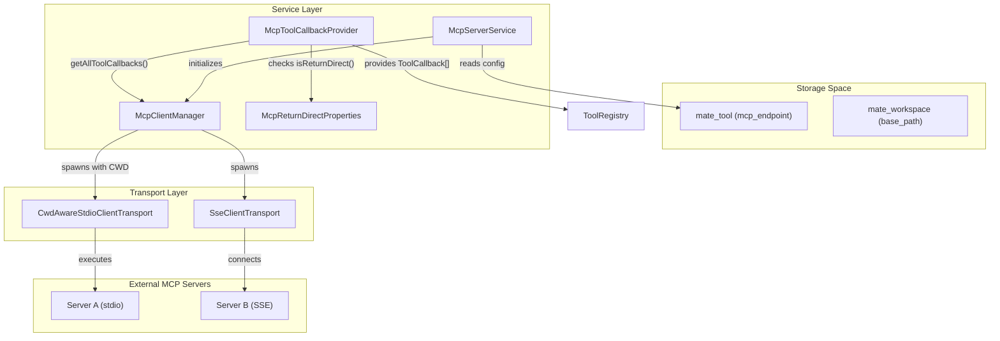
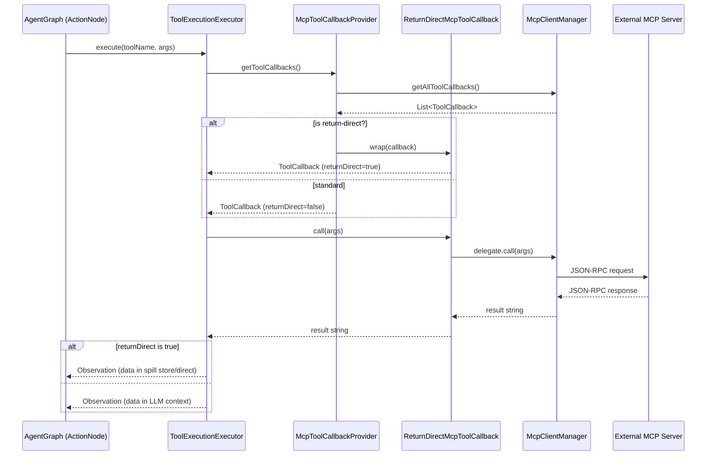

<!-- source: DeepWiki mcp.deepwiki.com · repo matevip/mateclaw · page 7.3 MCP (Model Context Protocol) Integration · fetched 2026-10-27 -->

# MCP (Model Context Protocol) Integration

Relevant source files

The following files were used as context for generating this wiki page:

- [mateclaw-server/src/main/java/vip/mate/config/FlywayRepairConfig.java](mateclaw-server/src/main/java/vip/mate/config/FlywayRepairConfig.java)
- [mateclaw-server/src/main/java/vip/mate/tool/mcp/runtime/CwdAwareStdioClientTransport.java](mateclaw-server/src/main/java/vip/mate/tool/mcp/runtime/CwdAwareStdioClientTransport.java)
- [mateclaw-server/src/main/java/vip/mate/tool/mcp/runtime/McpReturnDirectProperties.java](mateclaw-server/src/main/java/vip/mate/tool/mcp/runtime/McpReturnDirectProperties.java)
- [mateclaw-server/src/main/java/vip/mate/tool/mcp/runtime/McpToolCallbackProvider.java](mateclaw-server/src/main/java/vip/mate/tool/mcp/runtime/McpToolCallbackProvider.java)
- [mateclaw-server/src/main/java/vip/mate/tool/mcp/runtime/ReturnDirectMcpToolCallback.java](mateclaw-server/src/main/java/vip/mate/tool/mcp/runtime/ReturnDirectMcpToolCallback.java)
- [mateclaw-server/src/main/resources/db/migration/h2/V2__workspace_base_path.sql](mateclaw-server/src/main/resources/db/migration/h2/V2__workspace_base_path.sql)

The Model Context Protocol (MCP) integration in MateClaw allows the system to connect to external tool servers and data sources using an open standard. This enables MateClaw to extend its capabilities beyond built-in tools by consuming services from any MCP-compliant server.

## Architectural Overview

MateClaw implements the MCP client role, managing connections to multiple MCP servers simultaneously. The integration is built on top of Spring AI's MCP support but adds enterprise features like workspace isolation, dynamic tool prefixing for specific LLM providers (Claude Code), and "Return Direct" optimizations.

### MCP Component Interaction
This diagram illustrates how MCP servers are registered and how their tools are exposed to the Agent runtime.

Title: MCP Tool Discovery and Registration Flow

Sources: [mateclaw-server/src/main/resources/db/migration/h2/V2__workspace_base_path.sql:5-17](), [mateclaw-server/src/main/java/vip/mate/tool/mcp/runtime/McpToolCallbackProvider.java:29-61](), [mateclaw-server/src/main/java/vip/mate/tool/mcp/runtime/CwdAwareStdioClientTransport.java:22-53]()

## Transport Modes

MateClaw supports three primary transport mechanisms for communicating with MCP servers:

1.  **stdio**: The most common local transport. MateClaw launches the server as a subprocess and communicates via standard input/output.
2.  **SSE (Server-Sent Events)**: Used for remote MCP servers over HTTP.
3.  **Streamable HTTP**: A variation of HTTP transport for long-lived tool execution contexts.

### CwdAwareStdioClientTransport
For `stdio` transports, MateClaw utilizes a specialized transport that is aware of the current working directory (CWD).
*   **CWD Support**: Ensures that MCP servers performing file system operations (like the `filesystem` MCP server) operate within the correct workspace context [mateclaw-server/src/main/java/vip/mate/tool/mcp/runtime/CwdAwareStdioClientTransport.java:56-63]().
*   **PATH Enrichment**: Automatically injects common Node.js and package manager paths (nvm, brew, pnpm, volta) into the subprocess environment. This is critical for Desktop environments where the JRE might not inherit the user's full shell PATH [mateclaw-server/src/main/java/vip/mate/tool/mcp/runtime/CwdAwareStdioClientTransport.java:27-48](), [mateclaw-server/src/main/java/vip/mate/tool/mcp/runtime/CwdAwareStdioClientTransport.java:70-112]().

## Tool Callback Management

MCP tools are dynamically integrated into the Agent's toolset through the `McpToolCallbackProvider`.

### McpToolCallbackProvider
This class implements the Spring AI `ToolCallbackProvider` interface. It acts as a bridge between the `McpClientManager` and the `ToolRegistry`.
*   **Dynamic Discovery**: It fetches the latest active tools from all connected MCP clients whenever `getToolCallbacks()` is invoked [mateclaw-server/src/main/java/vip/mate/tool/mcp/runtime/McpToolCallbackProvider.java:35-42]().
*   **Hot Reloading**: Because it queries the manager on every call, adding or removing an MCP server in the UI takes effect without requiring a system restart [mateclaw-server/src/main/java/vip/mate/tool/mcp/runtime/McpToolCallbackProvider.java:18-20]().

### Return Direct Optimization (RFC-052)
Some MCP tools return large amounts of data (e.g., database exports or medical records) that should not be injected into the LLM's context window to avoid token exhaustion or "distraction."

*   **McpReturnDirectProperties**: Configuration-driven list of tool names that should bypass the LLM context, configured via `mateclaw.mcp.return-direct.tools` [mateclaw-server/src/main/java/vip/mate/tool/mcp/runtime/McpReturnDirectProperties.java:35-52]().
*   **ReturnDirectMcpToolCallback**: A decorator that wraps a standard `ToolCallback` and overrides its metadata to set `returnDirect=true` [mateclaw-server/src/main/java/vip/mate/tool/mcp/runtime/ReturnDirectMcpToolCallback.java:24-46](). This forces the `ToolExecutionExecutor` to route results directly to the user or a spill store instead of the model.

## Implementation Detail: Tool Execution Data Flow

The following diagram maps the logical flow from a user request to the execution of an MCP tool.

Title: MCP Tool Execution Data Flow

Sources: [mateclaw-server/src/main/java/vip/mate/tool/mcp/runtime/McpToolCallbackProvider.java:46-56](), [mateclaw-server/src/main/java/vip/mate/tool/mcp/runtime/ReturnDirectMcpToolCallback.java:49-56](), [mateclaw-server/src/main/java/vip/mate/tool/mcp/runtime/McpReturnDirectProperties.java:49-51]()

## Claude Code Integration & Tool Prefixing

When using the `AgentClaudeCodeChatModelBuilder`, MateClaw applies special handling for MCP tools to maintain compatibility with Anthropic's expectations.

*   **Tool Name Prefixing**: In the Claude Code path, MCP tools may be prefixed to avoid name collisions with built-in tools.
*   **System Prompt Rewrite**: The system prompt is automatically adjusted to include instructions on how the model should interact with these external MCP tools.

## Configuration

MCP servers are configured via the `mate_tool` table where the `tool_type` is set to `mcp` and the `mcp_endpoint` contains the connection string (command for stdio or URL for SSE).

| Field | Description |
| :--- | :--- |
| `name` | Unique identifier for the tool. |
| `mcp_endpoint` | The command line or URL to reach the MCP server. |
| `tool_type` | Must be `mcp` for these servers. |
| `workspace_id` | Scopes the tool availability to a specific workspace [mateclaw-server/src/main/resources/db/migration/h2/V2__workspace_base_path.sql:37](). |

Sources: [mateclaw-server/src/main/resources/db/migration/h2/V2__workspace_base_path.sql:37](), [mateclaw-server/src/main/java/vip/mate/tool/mcp/runtime/McpReturnDirectProperties.java:17-25]()

---

