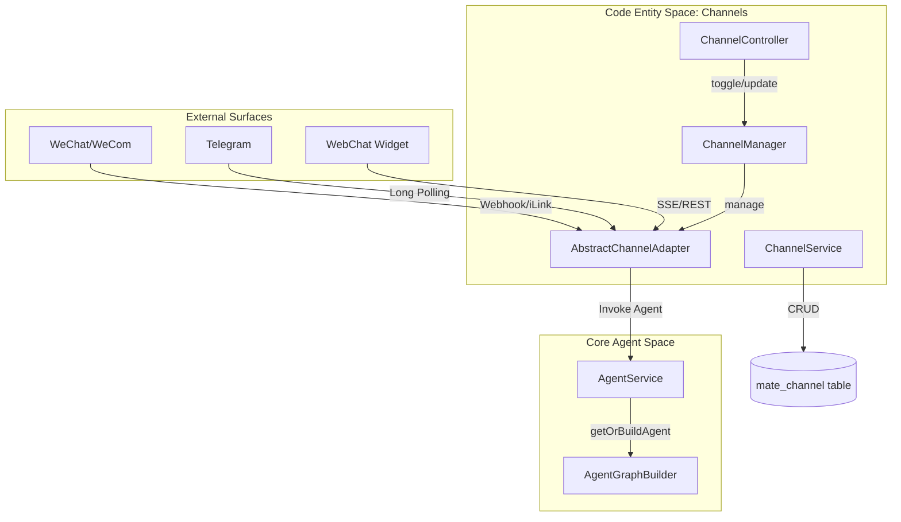
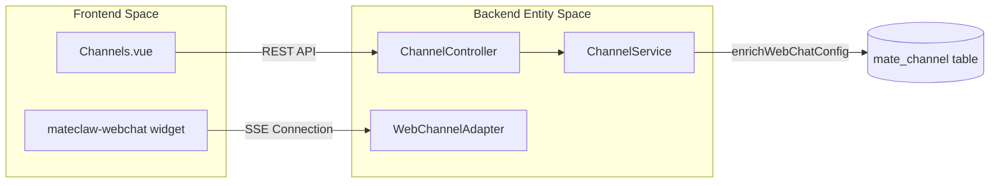

<!-- source: DeepWiki mcp.deepwiki.com · repo matevip/mateclaw · page 8 Channels & Multi-Surface Delivery · fetched 2026-10-27 -->

# Channels & Multi-Surface Delivery

Relevant source files

The following files were used as context for generating this wiki page:

- [mateclaw-server/src/main/java/vip/mate/agent/AgentService.java](mateclaw-server/src/main/java/vip/mate/agent/AgentService.java)
- [mateclaw-server/src/main/java/vip/mate/agent/ThinkingLevelHolder.java](mateclaw-server/src/main/java/vip/mate/agent/ThinkingLevelHolder.java)
- [mateclaw-server/src/main/java/vip/mate/agent/binding/controller/AgentBindingController.java](mateclaw-server/src/main/java/vip/mate/agent/binding/controller/AgentBindingController.java)
- [mateclaw-server/src/main/java/vip/mate/agent/model/AgentEntity.java](mateclaw-server/src/main/java/vip/mate/agent/model/AgentEntity.java)
- [mateclaw-server/src/main/java/vip/mate/audit/service/AuditEventService.java](mateclaw-server/src/main/java/vip/mate/audit/service/AuditEventService.java)
- [mateclaw-server/src/main/java/vip/mate/channel/AbstractChannelAdapter.java](mateclaw-server/src/main/java/vip/mate/channel/AbstractChannelAdapter.java)
- [mateclaw-server/src/main/java/vip/mate/channel/ChannelHealthMonitor.java](mateclaw-server/src/main/java/vip/mate/channel/ChannelHealthMonitor.java)
- [mateclaw-server/src/main/java/vip/mate/channel/ChannelManager.java](mateclaw-server/src/main/java/vip/mate/channel/ChannelManager.java)
- [mateclaw-server/src/main/java/vip/mate/channel/controller/ChannelController.java](mateclaw-server/src/main/java/vip/mate/channel/controller/ChannelController.java)
- [mateclaw-server/src/main/java/vip/mate/channel/service/ChannelService.java](mateclaw-server/src/main/java/vip/mate/channel/service/ChannelService.java)
- [mateclaw-server/src/main/java/vip/mate/channel/wecom/WeComImageCompressor.java](mateclaw-server/src/main/java/vip/mate/channel/wecom/WeComImageCompressor.java)
- [mateclaw-server/src/main/java/vip/mate/channel/weixin/WeixinAesUtil.java](mateclaw-server/src/main/java/vip/mate/channel/weixin/WeixinAesUtil.java)
- [mateclaw-server/src/main/java/vip/mate/cron/service/CronJobService.java](mateclaw-server/src/main/java/vip/mate/cron/service/CronJobService.java)
- [mateclaw-server/src/main/java/vip/mate/dashboard/controller/DashboardController.java](mateclaw-server/src/main/java/vip/mate/dashboard/controller/DashboardController.java)
- [mateclaw-server/src/main/java/vip/mate/dashboard/service/CronJobRunService.java](mateclaw-server/src/main/java/vip/mate/dashboard/service/CronJobRunService.java)
- [mateclaw-server/src/main/java/vip/mate/dashboard/service/DashboardService.java](mateclaw-server/src/main/java/vip/mate/dashboard/service/DashboardService.java)
- [mateclaw-server/src/main/java/vip/mate/exception/MateClawException.java](mateclaw-server/src/main/java/vip/mate/exception/MateClawException.java)
- [mateclaw-server/src/main/java/vip/mate/memory/event/ConversationCompletionPublisher.java](mateclaw-server/src/main/java/vip/mate/memory/event/ConversationCompletionPublisher.java)
- [mateclaw-server/src/main/java/vip/mate/tool/mcp/service/McpServerService.java](mateclaw-server/src/main/java/vip/mate/tool/mcp/service/McpServerService.java)
- [mateclaw-server/src/main/java/vip/mate/tool/service/ToolService.java](mateclaw-server/src/main/java/vip/mate/tool/service/ToolService.java)
- [mateclaw-server/src/main/java/vip/mate/workspace/core/service/WorkspaceService.java](mateclaw-server/src/main/java/vip/mate/workspace/core/service/WorkspaceService.java)
- [mateclaw-server/src/main/resources/db/migration/h2/V4__agent_thinking_level.sql](mateclaw-server/src/main/resources/db/migration/h2/V4__agent_thinking_level.sql)
- [mateclaw-server/src/main/resources/db/schema-mysql.sql](mateclaw-server/src/main/resources/db/schema-mysql.sql)
- [mateclaw-server/src/main/resources/db/schema.sql](mateclaw-server/src/main/resources/db/schema.sql)
- [mateclaw-ui/src/views/Channels.vue](mateclaw-ui/src/views/Channels.vue)
- [mateclaw-ui/src/views/Settings/Models/modals/ManageModelsModal.vue](mateclaw-ui/src/views/Settings/Models/modals/ManageModelsModal.vue)

MateClaw provides a unified delivery layer that allows AI agents to interact with users across diverse platforms, including Instant Messaging (IM) apps, enterprise collaboration tools, and custom web widgets. By abstracting the complexities of different protocols (Webhooks, SSE, Long Polling), MateClaw ensures that an agent's reasoning and tool-calling capabilities are delivered consistently regardless of the surface.

## Channel Framework

The delivery system is built on a provider-agnostic framework that manages the lifecycle of connections and the routing of messages between external platforms and the internal Agent Runtime.

*   **`ChannelAdapter` SPI**: The core interface for all delivery surfaces. It defines the contract for starting, stopping, and handling messages.
*   **`AbstractChannelAdapter`**: Provides shared infrastructure for connection state management (`CONNECTED`, `RECONNECTING`, `ERROR`), configuration parsing from JSON, and an `ExponentialBackoff` mechanism for resilient reconnections [mateclaw-server/src/main/java/vip/mate/channel/AbstractChannelAdapter.java:32-63]().
*   **`ChannelManager`**: Acts as the central registry and orchestrator. It supports **Hot Swapping**, allowing channel configurations (like API keys) to be updated without restarting the entire application by atomically replacing or restarting the adapter instance [mateclaw-server/src/main/java/vip/mate/channel/ChannelManager.java:153-198]().
*   **`ChannelService`**: Handles the persistence and CRUD of channel configurations in the `mate_channel` table [mateclaw-server/src/main/java/vip/mate/channel/service/ChannelService.java:29-146]().
*   **`ChannelController`**: Provides REST endpoints for the UI to manage channels, including a `toggle` method that synchronizes DB state with the `ChannelManager` runtime [mateclaw-server/src/main/java/vip/mate/channel/controller/ChannelController.java:109-124]().

### Channel Lifecycle & Routing

The following diagram illustrates how a message flows from a surface through the framework to the Agent.

**Message Inbound & Framework Routing**

**Sources:** [mateclaw-server/src/main/java/vip/mate/channel/AbstractChannelAdapter.java:32-50](), [mateclaw-server/src/main/java/vip/mate/channel/service/ChannelService.java:138-146](), [mateclaw-server/src/main/java/vip/mate/channel/controller/ChannelController.java:110-124](), [mateclaw-server/src/main/java/vip/mate/agent/AgentService.java:100-113]()

For details on the SPI and lifecycle, see [Channel Framework](#8.1).

## IM Channel Adapters

MateClaw supports a wide array of IM platforms through specialized adapters. These adapters handle platform-specific authentication, message formatting, and media processing.

*   **Weixin (WeChat)**: Uses `WeixinAesUtil` for AES-128-ECB decryption of media files and interaction with WeChat CDNs [mateclaw-server/src/main/java/vip/mate/channel/weixin/WeixinAesUtil.java:20-36]().
*   **WeCom (Enterprise WeChat)**: Features a `WeComImageCompressor` that automatically resizes and compresses images to meet the 2MB upload limit [mateclaw-server/src/main/java/vip/mate/channel/wecom/WeComImageCompressor.java:23-44]().
*   **Other Platforms**: Includes adapters for **Feishu**, **DingTalk**, **Telegram**, **Slack**, and **Discord**.
*   **Cron Integration**: Channels can also be triggered by `CronJobService`, allowing agents to push messages to specific surfaces on a schedule [mateclaw-server/src/main/java/vip/mate/cron/service/CronJobService.java:44-81]().

### Adapter Connectivity Modes

| Channel Type | Connection Mode | UI Identifier |
| :--- | :--- | :--- |
| **Weixin** | iLink / TCP | `weixin` |
| **Telegram** | Long Polling | `telegram` |
| **WeCom/Feishu** | Webhook (Inbound) | `wecom` / `feishu` |
| **WebChat** | SSE (Streaming) | `webchat` |

For details on specific IM integrations, see [IM Channel Adapters](#8.2).

## WebChat Widget & Talk Mode

Beyond third-party IMs, MateClaw provides a first-party embeddable webchat solution.

*   **`mateclaw-webchat`**: A UMD-bundled widget for external websites.
*   **Channel Configuration**: `ChannelService` automatically enriches `webchat` configurations with a unique `api_key` and default UI properties like `primary_color` and `welcome_message` [mateclaw-server/src/main/java/vip/mate/channel/service/ChannelService.java:148-176]().
*   **UI Management**: The `Channels.vue` component provides a specialized interface for configuring these parameters and viewing connection status [mateclaw-ui/src/views/Channels.vue:100-127]().

**WebChat Delivery Architecture**

**Sources:** [mateclaw-ui/src/views/Channels.vue:100-112](), [mateclaw-server/src/main/java/vip/mate/channel/service/ChannelService.java:107-109](), [mateclaw-server/src/main/java/vip/mate/channel/service/ChannelService.java:148-154]()

For details on the widget and voice-enabled chat, see [WebChat Widget & Talk Mode](#8.3).

## Data Schema Reference

Channels are persisted in the `mate_channel` table, which stores the binding between an agent and a specific surface configuration [mateclaw-server/src/main/resources/db/schema.sql:134-147]().

| Field | Type | Description |
| :--- | :--- | :--- |
| `id` | BIGINT | Primary Key |
| `channel_type` | VARCHAR(32) | e.g., `web`, `telegram`, `wecom` |
| `agent_id` | BIGINT | The Agent bound to this channel |
| `config_json` | TEXT | Encrypted or raw JSON config (tokens, secrets) |
| `enabled` | BOOLEAN | Runtime activation status |

**Sources:** [mateclaw-server/src/main/resources/db/schema.sql:134-147](), [mateclaw-server/src/main/resources/db/schema-mysql.sql:132-146]()

---

