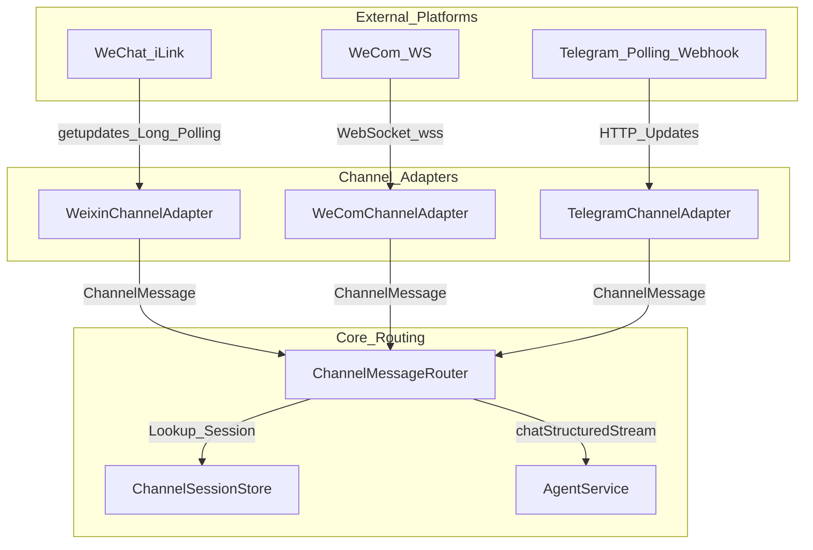
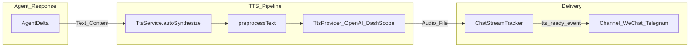

<!-- source: DeepWiki mcp.deepwiki.com · repo matevip/mateclaw · page 8.2 IM Channel Adapters · fetched 2026-10-27 -->

# IM Channel Adapters

Relevant source files

The following files were used as context for generating this wiki page:

- [mateclaw-server/src/main/java/vip/mate/channel/ChannelMessage.java](mateclaw-server/src/main/java/vip/mate/channel/ChannelMessage.java)
- [mateclaw-server/src/main/java/vip/mate/channel/feishu/FeishuChannelAdapter.java](mateclaw-server/src/main/java/vip/mate/channel/feishu/FeishuChannelAdapter.java)
- [mateclaw-server/src/main/java/vip/mate/channel/telegram/TelegramChannelAdapter.java](mateclaw-server/src/main/java/vip/mate/channel/telegram/TelegramChannelAdapter.java)
- [mateclaw-server/src/main/java/vip/mate/channel/wecom/WeComChannelAdapter.java](mateclaw-server/src/main/java/vip/mate/channel/wecom/WeComChannelAdapter.java)
- [mateclaw-server/src/main/java/vip/mate/channel/weixin/ILinkClient.java](mateclaw-server/src/main/java/vip/mate/channel/weixin/ILinkClient.java)
- [mateclaw-server/src/main/java/vip/mate/channel/weixin/WeixinChannelAdapter.java](mateclaw-server/src/main/java/vip/mate/channel/weixin/WeixinChannelAdapter.java)
- [mateclaw-server/src/main/java/vip/mate/common/security/SecretEquals.java](mateclaw-server/src/main/java/vip/mate/common/security/SecretEquals.java)
- [mateclaw-server/src/main/java/vip/mate/exception/GlobalExceptionHandler.java](mateclaw-server/src/main/java/vip/mate/exception/GlobalExceptionHandler.java)
- [mateclaw-server/src/main/java/vip/mate/tool/builtin/CronJobTool.java](mateclaw-server/src/main/java/vip/mate/tool/builtin/CronJobTool.java)
- [mateclaw-server/src/main/java/vip/mate/tool/guard/DefaultToolGuard.java](mateclaw-server/src/main/java/vip/mate/tool/guard/DefaultToolGuard.java)
- [mateclaw-server/src/main/java/vip/mate/tts/TtsService.java](mateclaw-server/src/main/java/vip/mate/tts/TtsService.java)
- [mateclaw-server/src/main/resources/db/migration/h2/V3__register_cron_job_tool.sql](mateclaw-server/src/main/resources/db/migration/h2/V3__register_cron_job_tool.sql)
- [mateclaw-server/src/main/resources/db/migration/mysql/V3__register_cron_job_tool.sql](mateclaw-server/src/main/resources/db/migration/mysql/V3__register_cron_job_tool.sql)
- [mateclaw-server/src/main/resources/messages.properties](mateclaw-server/src/main/resources/messages.properties)
- [mateclaw-server/src/main/resources/messages_en.properties](mateclaw-server/src/main/resources/messages_en.properties)
- [mateclaw-server/src/test/java/vip/mate/channel/telegram/TelegramCaptionSanitizeTest.java](mateclaw-server/src/test/java/vip/mate/channel/telegram/TelegramCaptionSanitizeTest.java)
- [mateclaw-server/src/test/java/vip/mate/common/security/SecretEqualsTest.java](mateclaw-server/src/test/java/vip/mate/common/security/SecretEqualsTest.java)

IM Channel Adapters allow MateClaw to interface with various Instant Messaging (IM) platforms, transforming platform-specific events into a unified message format and delivering agent responses back to the user. This section covers the implementation details of the adapters for WeChat, WeCom, Feishu, Telegram, and others, including security and media handling.

## Overview of Adapter Architecture

All adapters extend the `AbstractChannelAdapter` [mateclaw-server/src/main/java/vip/mate/channel/weixin/WeixinChannelAdapter.java:58-58]() and implement the `doStart`, `doStop`, and `doReconnect` lifecycle methods. They interact with the `ChannelMessageRouter` to dispatch incoming content to the appropriate Agent.

### Data Flow: Platform to Agent

The following diagram illustrates how an external IM event is processed and routed into the MateClaw Agent system.

**IM Message Ingestion Flow**

Sources: [mateclaw-server/src/main/java/vip/mate/channel/weixin/WeixinChannelAdapter.java:30-58](), [mateclaw-server/src/main/java/vip/mate/channel/wecom/WeComChannelAdapter.java:32-60](), [mateclaw-server/src/main/java/vip/mate/channel/telegram/TelegramChannelAdapter.java:27-47]()

---

## Specific Adapter Implementations

### WeixinChannelAdapter (WeChat Personal)
This adapter utilizes the **iLink Bot HTTP API** to enable integration with personal WeChat accounts.

*   **Communication**: Uses `ILinkClient` for HTTP long-polling (`getupdates`) with a server-side hold of 35s [mateclaw-server/src/main/java/vip/mate/channel/weixin/WeixinChannelAdapter.java:34-34]().
*   **Authentication**: Bearer Token obtained via QR code scanning [mateclaw-server/src/main/java/vip/mate/channel/weixin/ILinkClient.java:33-39]().
*   **Message Types**: Supports text, image, voice (with ASR), file, and video [mateclaw-server/src/main/java/vip/mate/channel/weixin/WeixinChannelAdapter.java:37-37]().
*   **Reliability**: Implements a `pollLoop` watchdog that checks for activity every 30s; if no updates are received within 90s (`POLL_STUCK_THRESHOLD_MS`), the adapter is marked as `ERROR` [mateclaw-server/src/main/java/vip/mate/channel/weixin/WeixinChannelAdapter.java:94-99]().

### WeComChannelAdapter (Enterprise WeChat)
Uses the Enterprise WeChat "Intelligent Robot" API via a WebSocket connection.

*   **Connection**: Connects to `wss://openws.work.weixin.qq.com` [mateclaw-server/src/main/java/vip/mate/channel/wecom/WeComChannelAdapter.java:65-65]().
*   **Image Compression**: When sending images, it handles media initialization (`aibot_upload_media_init`), chunked uploading (512KB chunks), and finishing [mateclaw-server/src/main/java/vip/mate/channel/wecom/WeComChannelAdapter.java:90-96]().
*   **Streaming Replies**: Supports `reply_stream` to provide "Thinking..." status updates to the user [mateclaw-server/src/main/java/vip/mate/channel/wecom/WeComChannelAdapter.java:40-40]().

### FeishuChannelAdapter
Supports both Webhook (callback) and WebSocket (long connection) modes.

*   **Security**: In Webhook mode, an `encrypt_key` is mandatory to prevent unauthenticated request abuse [mateclaw-server/src/main/java/vip/mate/channel/feishu/FeishuChannelAdapter.java:113-122]().
*   **Token Management**: Automatically refreshes the `tenant_access_token` 5 minutes before expiration [mateclaw-server/src/main/java/vip/mate/channel/feishu/FeishuChannelAdapter.java:106-107]().

### TelegramChannelAdapter
Supports Long-Polling and Webhook modes with enhanced UX features.

*   **Caption Sanitization**: Implements `sanitizeInboundText` to strip non-printable characters and truncate oversized inputs (4096 limit) [mateclaw-server/src/test/java/vip/mate/channel/telegram/TelegramCaptionSanitizeTest.java:38-42]().
*   **Typing Indicator**: Sends a "typing" action every 4 seconds (`TYPING_INTERVAL_S`) during agent reasoning to keep the user informed [mateclaw-server/src/main/java/vip/mate/channel/telegram/TelegramChannelAdapter.java:66-67]().
*   **Markdown Fallback**: If MarkdownV2 parsing fails during a reply, it automatically downgrades to plain text [mateclaw-server/src/main/java/vip/mate/channel/telegram/TelegramChannelAdapter.java:36-36]().

---

## Security and Integration Components

### Timing-Safe Comparison
The `SecretEquals` class provides a `timingSafeEquals` method. This is used to compare sensitive tokens (like webhook signatures) in constant time, preventing timing attacks where an attacker might deduce a secret by measuring how long a comparison takes [mateclaw-server/src/main/java/vip/mate/common/security/SecretEquals.java:1-15]().

### TtsService Integration
The `TtsService` allows adapters to send voice replies. 

*   **Auto-Synthesis**: When enabled, the service can automatically convert an agent's text response into audio [mateclaw-server/src/main/java/vip/mate/tts/TtsService.java:96-111]().
*   **Flow**: It pre-processes text (removing Markdown symbols like code blocks and bold markers) [mateclaw-server/src/main/java/vip/mate/tts/TtsService.java:183-191](), synthesizes the audio via a provider, and broadcasts a `tts_ready` event via `ChatStreamTracker` [mateclaw-server/src/main/java/vip/mate/tts/TtsService.java:99-105]().

**Voice Reply Data Flow**

Sources: [mateclaw-server/src/main/java/vip/mate/tts/TtsService.java:96-111](), [mateclaw-server/src/main/java/vip/mate/tts/TtsService.java:183-191]()

---

## Configuration Reference

Adapters are configured via a `configJson` field in the `ChannelEntity`. Key parameters include:

| Parameter | Adapter | Description |
| :--- | :--- | :--- |
| `bot_token` | Weixin, Telegram | API authentication token. |
| `bot_id` / `secret` | WeCom | WebSocket authentication credentials. |
| `connection_mode` | Feishu, Telegram | `webhook` or `websocket`/`polling`. |
| `http_proxy` | Telegram | Proxy URL for restricted network environments. |
| `encrypt_key` | Feishu | Key for decrypting webhook payloads. |

Sources: [mateclaw-server/src/main/java/vip/mate/channel/weixin/WeixinChannelAdapter.java:47-53](), [mateclaw-server/src/main/java/vip/mate/channel/wecom/WeComChannelAdapter.java:48-55](), [mateclaw-server/src/main/java/vip/mate/channel/telegram/TelegramChannelAdapter.java:38-43]()

---

