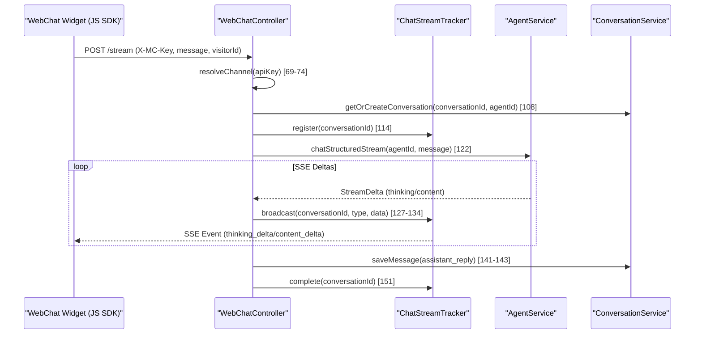
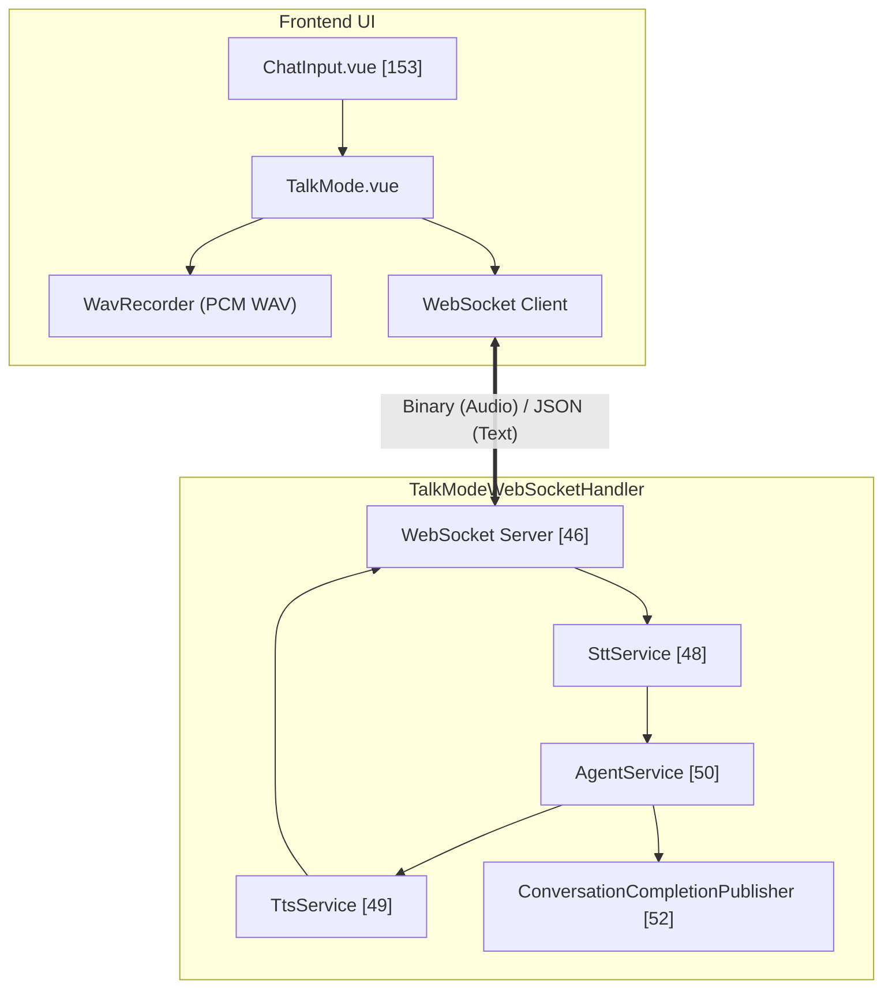

<!-- source: DeepWiki mcp.deepwiki.com · repo matevip/mateclaw · page 8.3 WebChat Widget & Talk Mode · fetched 2026-10-27 -->

# WebChat Widget & Talk Mode

Relevant source files

The following files were used as context for generating this wiki page:

- [mateclaw-server/src/main/java/vip/mate/agent/controller/AgentController.java](mateclaw-server/src/main/java/vip/mate/agent/controller/AgentController.java)
- [mateclaw-server/src/main/java/vip/mate/channel/web/TalkModeWebSocketHandler.java](mateclaw-server/src/main/java/vip/mate/channel/web/TalkModeWebSocketHandler.java)
- [mateclaw-server/src/main/java/vip/mate/channel/web/Utf8SseEmitter.java](mateclaw-server/src/main/java/vip/mate/channel/web/Utf8SseEmitter.java)
- [mateclaw-server/src/main/java/vip/mate/channel/webchat/WebChatController.java](mateclaw-server/src/main/java/vip/mate/channel/webchat/WebChatController.java)
- [mateclaw-server/src/main/java/vip/mate/config/WebSocketConfig.java](mateclaw-server/src/main/java/vip/mate/config/WebSocketConfig.java)
- [mateclaw-server/src/main/java/vip/mate/memory/controller/DreamEventBroadcaster.java](mateclaw-server/src/main/java/vip/mate/memory/controller/DreamEventBroadcaster.java)
- [mateclaw-server/src/main/java/vip/mate/memory/event/DreamCompletedEvent.java](mateclaw-server/src/main/java/vip/mate/memory/event/DreamCompletedEvent.java)
- [mateclaw-server/src/main/java/vip/mate/memory/event/DreamFailedEvent.java](mateclaw-server/src/main/java/vip/mate/memory/event/DreamFailedEvent.java)
- [mateclaw-server/src/main/java/vip/mate/wiki/controller/WikiResearchController.java](mateclaw-server/src/main/java/vip/mate/wiki/controller/WikiResearchController.java)
- [mateclaw-server/src/main/java/vip/mate/wiki/repository/WikiChunkMapper.java](mateclaw-server/src/main/java/vip/mate/wiki/repository/WikiChunkMapper.java)
- [mateclaw-server/src/main/java/vip/mate/workspace/conversation/ConversationService.java](mateclaw-server/src/main/java/vip/mate/workspace/conversation/ConversationService.java)
- [mateclaw-ui/src/components/chat/ChatInput.vue](mateclaw-ui/src/components/chat/ChatInput.vue)
- [mateclaw-ui/src/components/chat/TalkMode.vue](mateclaw-ui/src/components/chat/TalkMode.vue)
- [mateclaw-ui/src/composables/chat/useChat.ts](mateclaw-ui/src/composables/chat/useChat.ts)
- [mateclaw-ui/src/views/ChatConsole.vue](mateclaw-ui/src/views/ChatConsole.vue)
- [mateclaw-ui/src/views/CronJobs.vue](mateclaw-ui/src/views/CronJobs.vue)
- [mateclaw-ui/src/views/Datasources.vue](mateclaw-ui/src/views/Datasources.vue)
- [mateclaw-ui/src/views/Doctor/DoctorDrawer.vue](mateclaw-ui/src/views/Doctor/DoctorDrawer.vue)
- [mateclaw-ui/src/views/Login.vue](mateclaw-ui/src/views/Login.vue)
- [mateclaw-ui/src/views/McpServers.vue](mateclaw-ui/src/views/McpServers.vue)
- [mateclaw-ui/src/views/Security/ToolGuard/index.vue](mateclaw-ui/src/views/Security/ToolGuard/index.vue)
- [mateclaw-ui/src/views/Security/Workspaces/index.vue](mateclaw-ui/src/views/Security/Workspaces/index.vue)
- [mateclaw-ui/src/views/Tools.vue](mateclaw-ui/src/views/Tools.vue)

The WebChat module and Talk Mode provide multi-surface delivery of MateClaw's agent capabilities, extending beyond the primary dashboard into embeddable widgets and voice-driven modal interactions.

## WebChat Widget

The WebChat widget allows external websites to embed MateClaw agents via a JS SDK. It uses an API Key-based authentication mechanism instead of JWT, enabling cross-domain integration without requiring the visitor to have a MateClaw platform account.

### WebChat Backend Controller
The `WebChatController` manages SSE streaming for external requests. It identifies the target agent via a `ChannelEntity` associated with the provided `X-MC-Key` [mateclaw-server/src/main/java/vip/mate/channel/webchat/WebChatController.java:36-74]().

**Key Logic:**
*   **Visitor ID Persistence:** Uses a `visitorId` to generate a unique `conversationId` (formatted as `webchat:{key_prefix}:{visitorId}`), ensuring conversation history is preserved for the specific guest [mateclaw-server/src/main/java/vip/mate/channel/webchat/WebChatController.java:81-82]().
*   **Structured Streaming:** Leverages `agentService.chatStructuredStream` to handle both "thinking" and "content" deltas, broadcasting them via `ChatStreamTracker` [mateclaw-server/src/main/java/vip/mate/channel/webchat/WebChatController.java:122-136]().
*   **UTF-8 Enforcement:** Uses `Utf8SseEmitter` to prevent character encoding issues (mojibake) in diverse browser environments [mateclaw-server/src/main/java/vip/mate/channel/webchat/WebChatController.java:66]().

### WebChat Data Flow
The following diagram maps the request flow from an external widget to the internal agent runtime.

**External Widget to Agent Execution**

Sources: [mateclaw-server/src/main/java/vip/mate/channel/webchat/WebChatController.java:61-158](), [mateclaw-server/src/main/java/vip/mate/workspace/conversation/ConversationService.java:115-132]()

## Talk Mode

Talk Mode provides a "Voice UI" experience using a WebSocket-based full-duplex pipeline. It integrates Speech-to-Text (STT), Agent Reasoning, and Text-to-Speech (TTS) into a single interactive loop.

### TalkModeWebSocketHandler
The `TalkModeWebSocketHandler` manages the lifecycle of a voice session. It processes binary audio frames from the frontend and coordinates the multi-step pipeline [mateclaw-server/src/main/java/vip/mate/channel/web/TalkModeWebSocketHandler.java:31-42]().

1.  **Initialization:** The frontend sends a JSON `init` frame containing the `agentId` and `conversationId` [mateclaw-server/src/main/java/vip/mate/channel/web/TalkModeWebSocketHandler.java:74-89]().
2.  **Audio Ingestion:** Binary messages (WAV format) are received and processed asynchronously [mateclaw-server/src/main/java/vip/mate/channel/web/TalkModeWebSocketHandler.java:97-113]().
3.  **STT Pipeline:** Uses `SttService` to transcribe audio to text. It expects WAV format as the "greatest common denominator" for providers [mateclaw-server/src/main/java/vip/mate/channel/web/TalkModeWebSocketHandler.java:124-131]().
4.  **Agent Turn:** Calls `agentService.chat` synchronously to generate a text response [mateclaw-server/src/main/java/vip/mate/channel/web/TalkModeWebSocketHandler.java:148]().
5.  **TTS Pipeline:** Uses `TtsService` to synthesize the response into audio [mateclaw-server/src/main/java/vip/mate/channel/web/TalkModeWebSocketHandler.java:165-166]().
6.  **Response Delivery:** Sends text replies via JSON frames and binary audio data back to the client [mateclaw-server/src/main/java/vip/mate/channel/web/TalkModeWebSocketHandler.java:161-180]().

### Buffer Configuration
To handle high-fidelity audio recordings, the `WebSocketConfig` overrides default Tomcat buffer sizes. The binary buffer is increased to 8MB to accommodate several minutes of 16kHz PCM audio without triggering `CloseStatus 1009` (Message too big) [mateclaw-server/src/main/java/vip/mate/config/WebSocketConfig.java:27-34]().

### Talk Mode Frontend Component
The frontend implementation (`TalkMode.vue`) uses a state machine to manage UI transitions between `connecting`, `idle`, `listening`, `processing`, and `speaking`.

*   **WavRecorder:** A specialized utility that handles Web Audio API recording and PCM WAV encoding to ensure compatibility with backend STT providers [mateclaw-ui/src/components/chat/ChatInput.vue:153-163]().
*   **Push-to-Talk (PTT):** The component captures audio during active user interaction and streams it to the `/api/v1/talk/ws` endpoint [mateclaw-server/src/main/java/vip/mate/config/WebSocketConfig.java:43]().

**Talk Mode Component Architecture**

Sources: [mateclaw-server/src/main/java/vip/mate/channel/web/TalkModeWebSocketHandler.java:46-180](), [mateclaw-server/src/main/java/vip/mate/config/WebSocketConfig.java:41-45]()

## Implementation Details

### SSE Encoding Safety
MateClaw uses a custom `Utf8SseEmitter` across all streaming endpoints (`WebChatController`, `AgentController`, `WikiResearchController`, and `DreamEventBroadcaster`). This class explicitly sets the `Content-Type` to `text/event-stream;charset=UTF-8` to override default Spring behaviors that might cause encoding issues in GBK locales or behind certain reverse proxies [mateclaw-server/src/main/java/vip/mate/channel/web/Utf8SseEmitter.java:11-55]().

### Persistence & Events
Both WebChat and Talk Mode ensure that interactions are fully integrated into the MateClaw ecosystem:
*   **Message Archiving:** Every turn is saved via `ConversationService.saveMessage` [mateclaw-server/src/main/java/vip/mate/channel/webchat/WebChatController.java:141](), [mateclaw-server/src/main/java/vip/mate/channel/web/TalkModeWebSocketHandler.java:154]().
*   **Memory Extraction:** Upon completion of a turn, a `ConversationCompletionPublisher` event is triggered. This allows the Memory system to perform background fact extraction and "dreaming" on conversations occurring via the widget or voice [mateclaw-server/src/main/java/vip/mate/channel/webchat/WebChatController.java:144-145](), [mateclaw-server/src/main/java/vip/mate/channel/web/TalkModeWebSocketHandler.java:157-158]().

### Interface Comparison

| Feature | Protocol | Auth Mechanism | Primary Component |
| :--- | :--- | :--- | :--- |
| **WebChat** | SSE (HTTP) | `X-MC-Key` Header [36] | `WebChatController` |
| **Talk Mode** | WebSocket | Session Init JSON [74] | `TalkModeWebSocketHandler` |
| **Main Chat** | SSE (HTTP) | JWT (Header) | `AgentController` |

Sources: [mateclaw-server/src/main/java/vip/mate/channel/webchat/WebChatController.java:36-43](), [mateclaw-server/src/main/java/vip/mate/channel/web/TalkModeWebSocketHandler.java:74-89](), [mateclaw-server/src/main/java/vip/mate/agent/controller/AgentController.java:98-105]()

---

