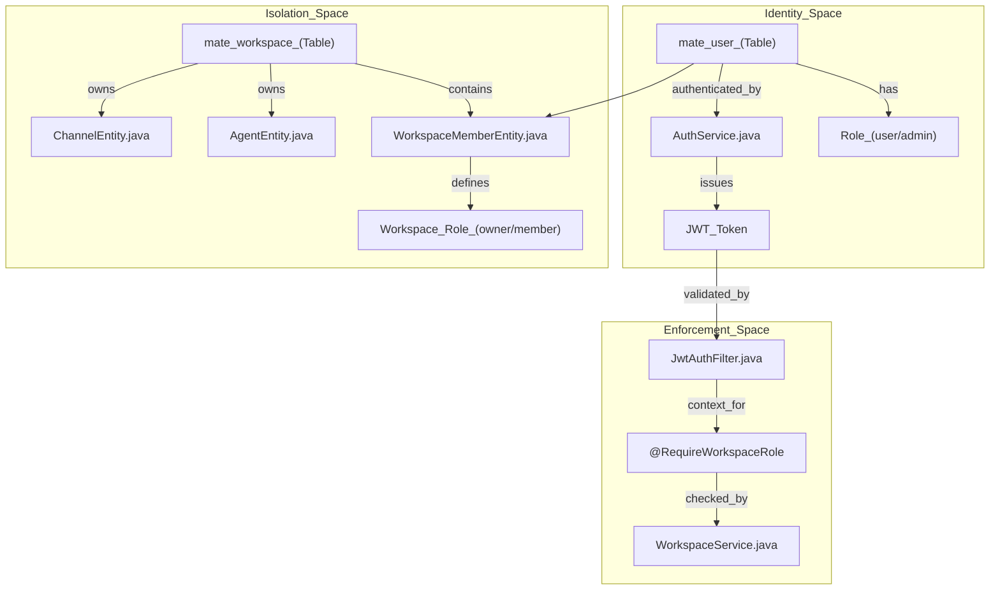
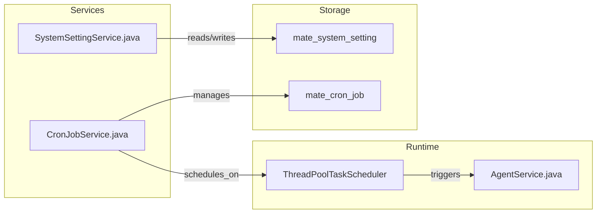

<!-- source: DeepWiki mcp.deepwiki.com · repo matevip/mateclaw · page 9 Security, Workspaces & Administration · fetched 2026-10-27 -->

# Security, Workspaces & Administration

Relevant source files

The following files were used as context for generating this wiki page:

- [mateclaw-server/src/main/java/vip/mate/agent/AgentService.java](mateclaw-server/src/main/java/vip/mate/agent/AgentService.java)
- [mateclaw-server/src/main/java/vip/mate/agent/ThinkingLevelHolder.java](mateclaw-server/src/main/java/vip/mate/agent/ThinkingLevelHolder.java)
- [mateclaw-server/src/main/java/vip/mate/agent/model/AgentEntity.java](mateclaw-server/src/main/java/vip/mate/agent/model/AgentEntity.java)
- [mateclaw-server/src/main/java/vip/mate/auth/controller/AuthController.java](mateclaw-server/src/main/java/vip/mate/auth/controller/AuthController.java)
- [mateclaw-server/src/main/java/vip/mate/auth/model/LoginResponse.java](mateclaw-server/src/main/java/vip/mate/auth/model/LoginResponse.java)
- [mateclaw-server/src/main/java/vip/mate/auth/service/AuthService.java](mateclaw-server/src/main/java/vip/mate/auth/service/AuthService.java)
- [mateclaw-server/src/main/java/vip/mate/channel/service/ChannelService.java](mateclaw-server/src/main/java/vip/mate/channel/service/ChannelService.java)
- [mateclaw-server/src/main/java/vip/mate/config/SecurityConfig.java](mateclaw-server/src/main/java/vip/mate/config/SecurityConfig.java)
- [mateclaw-server/src/main/java/vip/mate/config/SpaForwardController.java](mateclaw-server/src/main/java/vip/mate/config/SpaForwardController.java)
- [mateclaw-server/src/main/java/vip/mate/cron/service/CronJobService.java](mateclaw-server/src/main/java/vip/mate/cron/service/CronJobService.java)
- [mateclaw-server/src/main/java/vip/mate/exception/MateClawException.java](mateclaw-server/src/main/java/vip/mate/exception/MateClawException.java)
- [mateclaw-server/src/main/java/vip/mate/memory/event/ConversationCompletionPublisher.java](mateclaw-server/src/main/java/vip/mate/memory/event/ConversationCompletionPublisher.java)
- [mateclaw-server/src/main/java/vip/mate/tool/mcp/service/McpServerService.java](mateclaw-server/src/main/java/vip/mate/tool/mcp/service/McpServerService.java)
- [mateclaw-server/src/main/java/vip/mate/tool/service/ToolService.java](mateclaw-server/src/main/java/vip/mate/tool/service/ToolService.java)
- [mateclaw-server/src/main/java/vip/mate/workspace/core/controller/WorkspaceController.java](mateclaw-server/src/main/java/vip/mate/workspace/core/controller/WorkspaceController.java)
- [mateclaw-server/src/main/java/vip/mate/workspace/core/service/WorkspaceService.java](mateclaw-server/src/main/java/vip/mate/workspace/core/service/WorkspaceService.java)
- [mateclaw-server/src/main/resources/db/migration/h2/V4__agent_thinking_level.sql](mateclaw-server/src/main/resources/db/migration/h2/V4__agent_thinking_level.sql)
- [mateclaw-server/src/main/resources/db/schema-mysql.sql](mateclaw-server/src/main/resources/db/schema-mysql.sql)
- [mateclaw-server/src/main/resources/db/schema.sql](mateclaw-server/src/main/resources/db/schema.sql)
- [mateclaw-ui/src/components/ChangePasswordDialog.vue](mateclaw-ui/src/components/ChangePasswordDialog.vue)
- [mateclaw-ui/src/views/Security/Members/index.vue](mateclaw-ui/src/views/Security/Members/index.vue)

This section provides a high-level overview of the MateClaw security architecture, the workspace isolation model, and the administrative tools used to manage the system. MateClaw implements a multi-tenant-lite approach where data and configuration are isolated by workspaces, protected by a JWT-based authentication layer and a granular Role-Based Access Control (RBAC) system.

## Security & Isolation Architecture

The system's security posture is built on three pillars: identity verification via `AuthService`, resource isolation via `WorkspaceService`, and runtime execution safety via the `ToolGuard` pipeline.

### Logical Security Model

The following diagram illustrates how security entities in the code relate to the organizational structure of the system.

**Diagram: Security & Workspace Entity Mapping**

**Sources:** [mateclaw-server/src/main/resources/db/schema.sql:5-17](), [mateclaw-server/src/main/java/vip/mate/config/SecurityConfig.java:26-28](), [mateclaw-server/src/main/java/vip/mate/workspace/core/service/WorkspaceService.java:35-39](), [mateclaw-server/src/main/java/vip/mate/workspace/core/model/WorkspaceMemberEntity.java:1-20]()

---

## Authentication & RBAC

MateClaw uses **Spring Security** with a stateless **JWT** strategy. The `SecurityConfig` defines the public vs. protected API boundaries, ensuring that while SSE streams and webhooks are accessible under specific conditions, administrative and workspace-specific actions require a valid token.

- **Identity Management**: Users are stored in the `mate_user` table. Password security is handled by `BCryptPasswordEncoder` [mateclaw-server/src/main/java/vip/mate/config/SecurityConfig.java:34-39]().
- **Workspace Isolation**: Most entities, including Agents [mateclaw-server/src/main/java/vip/mate/agent/model/AgentEntity.java:53](), Tools [mateclaw-server/src/main/resources/db/schema.sql:127](), and Channels [mateclaw-server/src/main/java/vip/mate/channel/service/ChannelService.java:48-52](), are bound to a `workspace_id`.
- **Access Control**: Beyond global roles (User/Admin), the system uses workspace-specific roles (`owner`, `admin`, `member`, `viewer`) managed by `WorkspaceService` [mateclaw-server/src/main/java/vip/mate/workspace/core/service/WorkspaceService.java:144-160]().

For details on JWT issuance, login rate limiting, and the `@RequireWorkspaceRole` implementation, see [Authentication & RBAC](#9.1).

**Sources:** [mateclaw-server/src/main/java/vip/mate/config/SecurityConfig.java:42-79](), [mateclaw-server/src/main/java/vip/mate/auth/service/AuthService.java:48-59](), [mateclaw-server/src/main/java/vip/mate/workspace/core/controller/WorkspaceController.java:75-88](), [mateclaw-ui/src/views/Security/Members/index.vue:41-51]()

---

## Tool Guard & Audit

Because MateClaw agents can execute shell commands and interact with the local filesystem, a robust safety layer is required. The **Tool Guard** system acts as a firewall between the LLM's intent and the system's execution.

- **Evaluation Pipeline**: Every tool call is intercepted before execution. The `AgentService` handles tool replay and approvals after security checks [mateclaw-server/src/main/java/vip/mate/agent/AgentService.java:174-180]().
- **Decision Matrix**: High-risk tools (like shell execution) are subject to `NEEDS_APPROVAL` or `BLOCK` decisions based on patterns.
- **Audit Trail**: Administrative actions and tool executions are tracked to provide a searchable history of agent behavior.

For details on the evaluation pipeline, rule seeding, and the Audit UI, see [Tool Guard & Audit](#9.2).

**Sources:** [mateclaw-server/src/main/resources/db/schema.sql:115-131](), [mateclaw-server/src/main/java/vip/mate/agent/AgentService.java:174-180](), [mateclaw-server/src/main/resources/db/schema-mysql.sql:167-180]()

---

## System Settings & Dashboard

The administrative surface provides global control over the MateClaw instance. This includes managing LLM providers, system-wide settings, and monitoring the health of the background engine.

### Administrative Surface Overview

| Component | Code Entity | Responsibility |
| :--- | :--- | :--- |
| **Global Settings** | `SystemSettingService` | Key-value store for site configuration and global defaults. |
| **Cron Engine** | `CronJobService` | Manages scheduled agent tasks using `ThreadPoolTaskScheduler`. |
| **Workspace Management** | `WorkspaceController` | CRUD for workspaces and member role assignments. |
| **SPA Routing** | `SpaForwardController` | Forwards non-API requests to the Vue frontend. |

**Diagram: Administrative Data Flow**

**Sources:** [mateclaw-server/src/main/resources/db/schema.sql:84-91](), [mateclaw-server/src/main/java/vip/mate/cron/service/CronJobService.java:44-81](), [mateclaw-server/src/main/java/vip/mate/agent/AgentService.java:100-113](), [mateclaw-server/src/main/java/vip/mate/config/SpaForwardController.java:15-26]()

For details on system diagnostics, token usage views, and cron job management, see [System Settings & Dashboard](#9.3).

---

## Child Pages

- [Authentication & RBAC](#9.1) — Detailed look at JWT, Login filters, and Workspace role enforcement.
- [Tool Guard & Audit](#9.2) — Deep dive into the tool execution safety pipeline and audit logging.
- [System Settings & Dashboard](#9.3) — Reference for global configuration, cron jobs, and health diagnostics.

---

