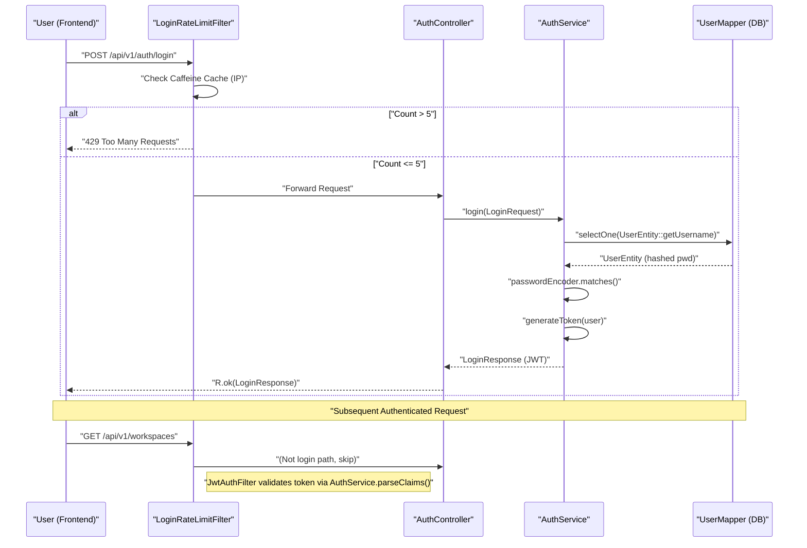
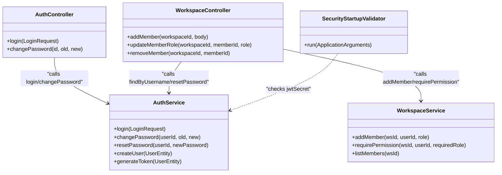

<!-- source: DeepWiki mcp.deepwiki.com · repo matevip/mateclaw · page 9.1 Authentication & RBAC · fetched 2026-10-27 -->

# Authentication & RBAC

Relevant source files

The following files were used as context for generating this wiki page:

- [.gitignore](.gitignore)
- [mateclaw-server/src/main/java/vip/mate/agent/graph/observation/ObservationProcessor.java](mateclaw-server/src/main/java/vip/mate/agent/graph/observation/ObservationProcessor.java)
- [mateclaw-server/src/main/java/vip/mate/auth/controller/AuthController.java](mateclaw-server/src/main/java/vip/mate/auth/controller/AuthController.java)
- [mateclaw-server/src/main/java/vip/mate/auth/model/LoginResponse.java](mateclaw-server/src/main/java/vip/mate/auth/model/LoginResponse.java)
- [mateclaw-server/src/main/java/vip/mate/auth/service/AuthService.java](mateclaw-server/src/main/java/vip/mate/auth/service/AuthService.java)
- [mateclaw-server/src/main/java/vip/mate/config/LoginRateLimitFilter.java](mateclaw-server/src/main/java/vip/mate/config/LoginRateLimitFilter.java)
- [mateclaw-server/src/main/java/vip/mate/config/SecurityConfig.java](mateclaw-server/src/main/java/vip/mate/config/SecurityConfig.java)
- [mateclaw-server/src/main/java/vip/mate/config/SecurityStartupValidator.java](mateclaw-server/src/main/java/vip/mate/config/SecurityStartupValidator.java)
- [mateclaw-server/src/main/java/vip/mate/config/SpaForwardController.java](mateclaw-server/src/main/java/vip/mate/config/SpaForwardController.java)
- [mateclaw-server/src/main/java/vip/mate/config/ToolTimeoutProperties.java](mateclaw-server/src/main/java/vip/mate/config/ToolTimeoutProperties.java)
- [mateclaw-server/src/main/java/vip/mate/config/WebMvcConfig.java](mateclaw-server/src/main/java/vip/mate/config/WebMvcConfig.java)
- [mateclaw-server/src/main/java/vip/mate/tool/builtin/DatasourceTool.java](mateclaw-server/src/main/java/vip/mate/tool/builtin/DatasourceTool.java)
- [mateclaw-server/src/main/java/vip/mate/workspace/core/controller/WorkspaceController.java](mateclaw-server/src/main/java/vip/mate/workspace/core/controller/WorkspaceController.java)
- [mateclaw-ui/src/components/ChangePasswordDialog.vue](mateclaw-ui/src/components/ChangePasswordDialog.vue)
- [mateclaw-ui/src/main.ts](mateclaw-ui/src/main.ts)
- [mateclaw-ui/src/views/Security/Members/index.vue](mateclaw-ui/src/views/Security/Members/index.vue)

MateClaw implements a robust security architecture centered around JSON Web Tokens (JWT) for authentication and a multi-tenant workspace-based Role-Based Access Control (RBAC) system. The security layer ensures isolation between different user environments while providing administrative oversight and protection against common attack vectors like brute-force login attempts.

## Authentication & JWT Lifecycle

Authentication is handled primarily by the `AuthService` and `AuthController`. The system utilizes stateless JWTs to manage user sessions, allowing for horizontal scalability and easy integration with both web and desktop clients.

### Key Components
*   **AuthService**: Manages user entity lifecycle, password hashing via `BCryptPasswordEncoder`, and JWT issuance/validation [mateclaw-server/src/main/java/vip/mate/auth/service/AuthService.java:31-34]().
*   **JwtAuthFilter**: A standard Spring Security filter that intercepts requests to extract and validate the `Authorization: Bearer <token>` header [mateclaw-server/src/main/java/vip/mate/config/SecurityConfig.java:28-28]().
*   **LoginRateLimitFilter**: A security filter that prevents brute-force attacks by limiting IP addresses to a maximum of 5 login attempts per minute using an in-memory Caffeine cache [mateclaw-server/src/main/java/vip/mate/config/LoginRateLimitFilter.java:21-32]().
*   **SecurityStartupValidator**: An `ApplicationRunner` that checks for insecure configurations at startup, such as the use of the default `JWT_SECRET` or an overly permissive CORS configuration [mateclaw-server/src/main/java/vip/mate/config/SecurityStartupValidator.java:18-32]().

### Authentication Data Flow
The following diagram illustrates the login process and subsequent authenticated request flow.

**Login and Token Validation Flow**

**Sources:** [mateclaw-server/src/main/java/vip/mate/config/LoginRateLimitFilter.java:39-55](), [mateclaw-server/src/main/java/vip/mate/auth/service/AuthService.java:48-59](), [mateclaw-server/src/main/java/vip/mate/auth/service/AuthService.java:142-152](), [mateclaw-server/src/main/java/vip/mate/config/SecurityStartupValidator.java:35-51]()

## Workspace-Based RBAC

MateClaw organizes all data and agent activities into **Workspaces**. Access control is scoped to specific workspaces through roles assigned to workspace members. The system also includes a `WorkspaceAccessInterceptor` registered in `WebMvcConfig` to handle workspace-level authorization logic [mateclaw-server/src/main/java/vip/mate/config/WebMvcConfig.java:21-31]().

### Workspace Roles
The system supports distinct roles within a workspace:
1.  **Owner**: Full control, including the ability to delete the workspace [mateclaw-server/src/main/java/vip/mate/workspace/core/controller/WorkspaceController.java:68-69]().
2.  **Admin**: Can manage members, update workspace settings, and create agents [mateclaw-server/src/main/java/vip/mate/workspace/core/controller/WorkspaceController.java:59-61]().
3.  **Member**: Can use agents and view workspace content [mateclaw-ui/src/views/Security/Members/index.vue:49-49]().
4.  **Viewer**: Read-only access to conversations and wiki pages [mateclaw-ui/src/views/Security/Members/index.vue:50-50]().

### Implementation Logic
The `WorkspaceService` provides the `requirePermission` method, which is called by controllers to enforce RBAC. It checks if the authenticated user has the minimum required role for a specific workspace ID [mateclaw-server/src/main/java/vip/mate/workspace/core/controller/WorkspaceController.java:59-59]().

| Action | Required Role | Implementation Point |
| :--- | :--- | :--- |
| Update Workspace | `admin` | `workspaceService.requirePermission(id, userId, "admin")` |
| Delete Workspace | `owner` | `workspaceService.requirePermission(id, userId, "owner")` |
| Add Member | `admin` | `workspaceService.requirePermission(id, userId, "admin")` |
| Update Member Role | `admin` | `workspaceService.requirePermission(id, userId, "admin")` |
| Remove Member | `admin` | `workspaceService.requirePermission(id, userId, "admin")` |

**Sources:** [mateclaw-server/src/main/java/vip/mate/workspace/core/controller/WorkspaceController.java:56-71](), [mateclaw-server/src/main/java/vip/mate/workspace/core/controller/WorkspaceController.java:91-148](), [mateclaw-server/src/main/java/vip/mate/config/WebMvcConfig.java:28-31]()

## User & Member Management UI

The frontend provides interfaces for managing security settings and workspace membership.

### Members Management
The `Members/index.vue` component allows workspace administrators to invite new users or adjust roles for existing ones [mateclaw-ui/src/views/Security/Members/index.vue:1-14](). 
*   **User Creation on Invitation**: If an admin adds a username that doesn't exist in the system, the backend automatically creates a new user account if a password is provided [mateclaw-server/src/main/java/vip/mate/workspace/core/controller/WorkspaceController.java:104-115]().
*   **Role Updates**: Admins can change member roles via a dropdown, which triggers `workspaceTeamApi.updateMemberRole` [mateclaw-ui/src/views/Security/Members/index.vue:41-51]().
*   **Data Resolution**: The UI fetches member lists via `workspaceTeamApi.listMembers`, and the backend hydrates these records with user details from `AuthService.findById` [mateclaw-server/src/main/java/vip/mate/workspace/core/controller/WorkspaceController.java:76-87]().

### Password Security
Users can update their own credentials via the `ChangePasswordDialog.vue`.
*   **Self-Service**: The `AuthService` validates the `oldPassword` using `passwordEncoder.matches` before allowing a password update [mateclaw-server/src/main/java/vip/mate/auth/service/AuthService.java:111-121]().
*   **Admin Reset**: Workspace admins can reset a member's password if they provide a new one during the "Add Member" flow. This uses `AuthService.resetPassword`, which bypasses the old password check for administrative convenience [mateclaw-server/src/main/java/vip/mate/auth/service/AuthService.java:96-106](), [mateclaw-server/src/main/java/vip/mate/workspace/core/controller/WorkspaceController.java:116-121]().

**Security Interface Relationships**

**Sources:** [mateclaw-server/src/main/java/vip/mate/auth/service/AuthService.java:31-121](), [mateclaw-server/src/main/java/vip/mate/workspace/core/controller/WorkspaceController.java:28-149](), [mateclaw-server/src/main/java/vip/mate/config/SecurityStartupValidator.java:35-41]()

## Security Configuration & Startup

### SecurityFilterChain
The `SecurityConfig` class defines the global security policy [mateclaw-server/src/main/java/vip/mate/config/SecurityConfig.java:26-26](). 
*   **Public Endpoints**: Routes such as `/api/v1/auth/login`, SSE stream endpoints (`/api/v1/chat/stream`), and generated file access (`/api/v1/files/generated/**`) are explicitly permitted without a token [mateclaw-server/src/main/java/vip/mate/config/SecurityConfig.java:52-64]().
*   **Statelessness**: The system is configured for `SessionCreationPolicy.STATELESS`, meaning no HTTP sessions are stored on the server [mateclaw-server/src/main/java/vip/mate/config/SecurityConfig.java:49-49]().
*   **Frame Options**: `sameOrigin()` is allowed to support the H2 Console and Electron desktop integration [mateclaw-server/src/main/java/vip/mate/config/SecurityConfig.java:47-47]().
*   **CORS**: Configured via `WebMvcConfig` using the `mateclaw.cors.allowed-origins` property, supporting flexible cross-origin access for dev and production [mateclaw-server/src/main/java/vip/mate/config/WebMvcConfig.java:24-41]().

### SPA Routing
To support Vue Router's history mode, the `SpaForwardController` forwards all non-API and non-static resource requests to `index.html` [mateclaw-server/src/main/java/vip/mate/config/SpaForwardController.java:16-25](). This ensures that refreshing the browser on a client-side route (e.g., `/security/members`) does not result in a 404 error from the Spring Boot server.

**Sources:** [mateclaw-server/src/main/java/vip/mate/config/SecurityConfig.java:42-80](), [mateclaw-server/src/main/java/vip/mate/config/SpaForwardController.java:18-25](), [mateclaw-server/src/main/java/vip/mate/config/WebMvcConfig.java:34-41]()

---

