# Page: MateClaw Overview

# MateClaw Overview

<details>
<summary>Relevant source files</summary>

The following files were used as context for generating this wiki page:

- [LICENSE](LICENSE)
- [README.md](README.md)
- [README_zh.md](README_zh.md)
- [assets/architecture-biz-en.svg](assets/architecture-biz-en.svg)
- [assets/architecture-biz-zh.svg](assets/architecture-biz-zh.svg)
- [assets/architecture-tech-en.svg](assets/architecture-tech-en.svg)
- [assets/architecture-tech-zh.svg](assets/architecture-tech-zh.svg)
- [assets/images/preview.png](assets/images/preview.png)
- [mateclaw-server/src/main/java/vip/mate/memory/controller/DreamController.java](mateclaw-server/src/main/java/vip/mate/memory/controller/DreamController.java)
- [mateclaw-server/src/main/java/vip/mate/memory/fact/repository/FactMapper.java](mateclaw-server/src/main/java/vip/mate/memory/fact/repository/FactMapper.java)
- [mateclaw-server/src/main/java/vip/mate/memory/service/MorningCardService.java](mateclaw-server/src/main/java/vip/mate/memory/service/MorningCardService.java)
- [mateclaw-server/src/main/resources/db/data-en.sql](mateclaw-server/src/main/resources/db/data-en.sql)
- [mateclaw-server/src/main/resources/db/data-mysql-en.sql](mateclaw-server/src/main/resources/db/data-mysql-en.sql)
- [mateclaw-server/src/main/resources/db/data-mysql-zh.sql](mateclaw-server/src/main/resources/db/data-mysql-zh.sql)
- [mateclaw-server/src/main/resources/db/data-zh.sql](mateclaw-server/src/main/resources/db/data-zh.sql)
- [mateclaw-ui/src/stores/useMemoryStore.ts](mateclaw-ui/src/stores/useMemoryStore.ts)
- [mateclaw-ui/src/types/index.ts](mateclaw-ui/src/types/index.ts)
- [mateclaw-ui/src/views/Memory/components/MemoryBrowser.vue](mateclaw-ui/src/views/Memory/components/MemoryBrowser.vue)
- [mateclaw-ui/src/views/Memory/components/MorningCard.vue](mateclaw-ui/src/views/Memory/components/MorningCard.vue)
- [mateclaw-ui/src/views/Memory/index.vue](mateclaw-ui/src/views/Memory/index.vue)

</details>


MateClaw is a personal AI operating system designed to transform raw LLM capabilities into a reliable, persistent, and multi-surface intelligent assistant. Unlike standalone chat interfaces, MateClaw provides a comprehensive suite of infrastructure—including multi-provider failover, structured knowledge management (LLM Wiki), and a continuous memory lifecycle—all built on a robust Spring Boot backend [README.md:33-34]().

## Architectural Pillars

MateClaw is built upon five key architectural pillars that ensure it remains functional even when individual AI services fail, and grows smarter as you interact with it.

### 1. Multi-Provider Failover & Health Tracking
MateClaw abstracts over 14+ LLM providers (e.g., OpenAI, Anthropic, DashScope, DeepSeek, Ollama) [README.md:43](). The system features a **Provider Health Tracker** that monitors for API errors (401s, timeouts, quota exhaustion). If a primary provider fails, the system automatically routes the request to the next healthy provider in a user-defined priority list [README.md:43-45]().
*   **Key Entity:** `ModelProviderService` (See [Provider Management & Failover](#3.1))
*   **Data Source:** `mate_model_provider` table [mateclaw-server/src/main/resources/db/data-en.sql:31-33]()

### 2. LLM Wiki Knowledge Base
The **LLM Wiki** transforms raw materials (PDFs, Markdown, scraped web pages) into structured, interlinked pages [README.md:51](). It uses an ingestion pipeline to digest content into chunks, maintains canonical slugs, and allows the AI to cite specific sources during conversations [README.md:51-53]().
*   **Key Entity:** `WikiProcessingService` (See [Ingestion Pipeline](#5.1))

### 3. Workspace Memory & Dreaming
MateClaw implements a long-term memory system that goes beyond simple chat history. It uses a "Dreaming" workflow to extract facts from conversations and persist them into structured workspace files like `MEMORY.md` and `SOUL.md` [README.md:78-79]().
*   **Key Entities:** `DreamController` [mateclaw-server/src/main/java/vip/mate/memory/controller/DreamController.java:34](), `MemoryEmergenceService` (See [Memory Lifecycle & Dreaming](#6.1))

### 4. Tool & Skill Ecosystem
The system supports complex reasoning via **ReAct** and **Plan-Execute** agent patterns [README.md:74](). It integrates with the **Model Context Protocol (MCP)** and provides a "Tool Guard" layer for security, including Human-in-the-Loop (HiL) approval flows for sensitive actions [README.md:82]().
*   **Key Entity:** `AgentGraphBuilder` (See [StateGraph & Agent Patterns](#2.1))

### 5. Multi-Channel Delivery
A single MateClaw "brain" can be accessed through multiple surfaces: a Web Console, a Desktop app (Electron), an embeddable WebChat widget, and various IM channels (Telegram, Discord, WeChat, etc.) [README.md:56-65]().

---

## System Architecture & Code Mapping

The following diagrams illustrate how high-level system concepts map to specific code entities and database structures.

### Logic Flow: From User Intent to Execution
This diagram bridges the Natural Language Space (User Intent) to the Code Entity Space (Runtime execution).

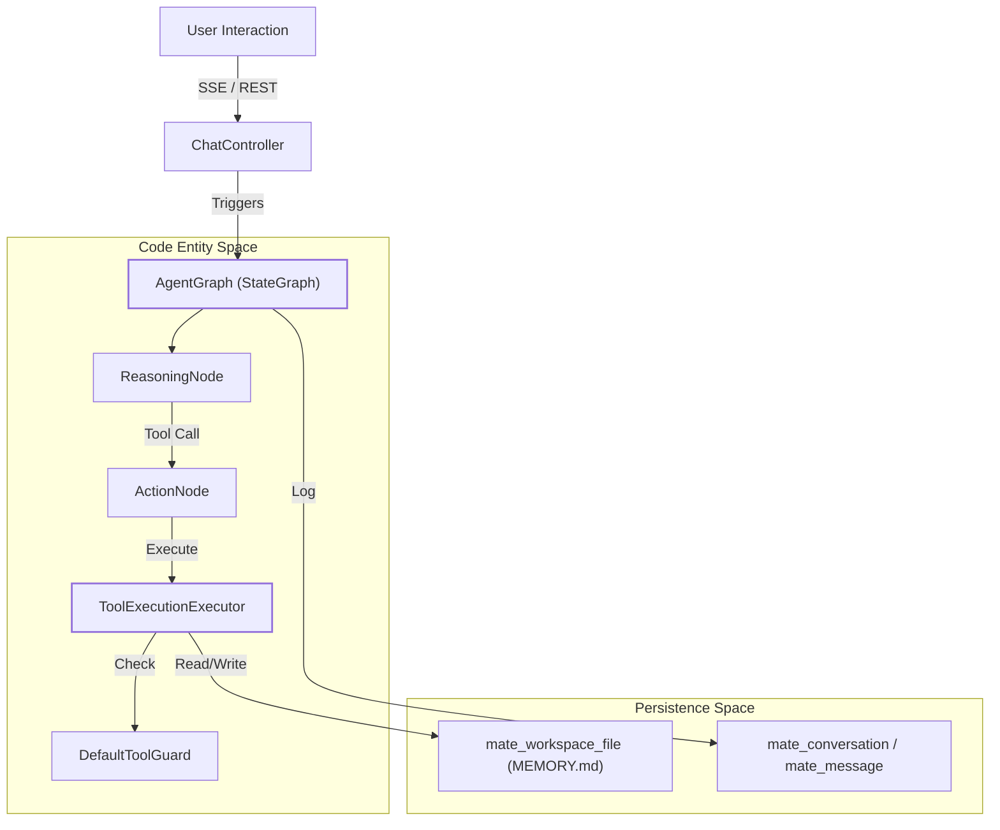
**Sources:** [mateclaw-ui/src/types/index.ts:73-93](), [README.md:74](), [mateclaw-server/src/main/resources/db/data-en.sql:9-13]()

### Provider & Memory Lifecycle
This diagram shows how the system handles external failures and internal memory consolidation via "Dreaming".

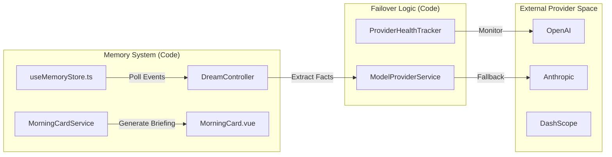
**Sources:** [mateclaw-server/src/main/java/vip/mate/memory/controller/DreamController.java:34-40](), [mateclaw-ui/src/views/Memory/components/MorningCard.vue:29-35](), [mateclaw-ui/src/stores/useMemoryStore.ts:68-73](), [README.md:43]()

---

## Project Structure

MateClaw is organized into several modules to facilitate deployment across different environments:

| Module | Purpose |
| :--- | :--- |
| `mateclaw-server` | Spring Boot 3.5 backend; contains the StateGraph runtime and AI logic [README.md:167](). |
| `mateclaw-ui` | Vue 3 + TypeScript SPA for the management console and chat interface [README.md:168](). |
| `mateclaw-webchat` | A standalone UMD/ES bundle for embedding chat into third-party sites [README.md:169](). |
| `mateclaw-plugin-api` | Java SDK for developing third-party capability extensions [README.md:170](). |

---

## Map to Detailed Documentation

For deep dives into specific subsystems, refer to the following child pages:

*   **[Getting Started & Deployment](#1.1)**: Instructions for Docker Compose, environment variables, and setting up the SearXNG sidecar. For details, see [Getting Started & Deployment](#1.1).
*   **[Configuration Reference](#1.2)**: Detailed breakdown of `application.yml` settings, including agent budgets and provider retry policies. For details, see [Configuration Reference](#1.2).
*   **[Core Agent Runtime](#2)**: Details on the `StateGraph` architecture, `ReasoningNode`, and streaming delivery.
*   **[LLM Provider Layer](#3)**: How failover, cooldowns, and OAuth (for Claude Code) are managed.
*   **[LLM Wiki Knowledge Base](#5)**: Deep dive into the ingestion pipeline and RAG retrieval.
*   **[Memory & Dreaming System](#6)**: Technical details on `DreamReport` generation and the Morning Card UI.
*   **[Tools & Skills](#7)**: Catalog of built-in tools and the `SKILL.md` packaging format.

**Sources:** [README.md:165-174](), [mateclaw-ui/src/types/index.ts:35-48](), [mateclaw-server/src/main/java/vip/mate/memory/controller/DreamController.java:92-101]()

---

# Page: Getting Started & Deployment

# Getting Started & Deployment

<details>
<summary>Relevant source files</summary>

The following files were used as context for generating this wiki page:

- [.dockerignore](.dockerignore)
- [.env.example](.env.example)
- [docker-compose.yml](docker-compose.yml)
- [docker/searxng/Dockerfile](docker/searxng/Dockerfile)
- [docker/searxng/settings.yml](docker/searxng/settings.yml)
- [mateclaw-server/Dockerfile](mateclaw-server/Dockerfile)
- [mateclaw-server/settings.xml](mateclaw-server/settings.xml)
- [mateclaw-server/src/main/java/vip/mate/config/FlywayRepairConfig.java](mateclaw-server/src/main/java/vip/mate/config/FlywayRepairConfig.java)
- [mateclaw-server/src/main/java/vip/mate/llm/config/OllamaAutoDiscoveryRunner.java](mateclaw-server/src/main/java/vip/mate/llm/config/OllamaAutoDiscoveryRunner.java)
- [mateclaw-server/src/main/java/vip/mate/system/service/SystemSettingService.java](mateclaw-server/src/main/java/vip/mate/system/service/SystemSettingService.java)
- [mateclaw-server/src/main/java/vip/mate/tool/mcp/runtime/CwdAwareStdioClientTransport.java](mateclaw-server/src/main/java/vip/mate/tool/mcp/runtime/CwdAwareStdioClientTransport.java)
- [mateclaw-server/src/main/resources/application-mysql.yml](mateclaw-server/src/main/resources/application-mysql.yml)
- [mateclaw-server/src/main/resources/db/migration/h2/V14__embedding_model_config.sql](mateclaw-server/src/main/resources/db/migration/h2/V14__embedding_model_config.sql)
- [mateclaw-server/src/main/resources/db/migration/h2/V2__workspace_base_path.sql](mateclaw-server/src/main/resources/db/migration/h2/V2__workspace_base_path.sql)
- [mateclaw-server/src/main/resources/db/migration/h2/V38__wiki_chunk_content_mediumtext.sql](mateclaw-server/src/main/resources/db/migration/h2/V38__wiki_chunk_content_mediumtext.sql)
- [mateclaw-server/src/main/resources/db/migration/mysql/V11__skill_synthesis.sql](mateclaw-server/src/main/resources/db/migration/mysql/V11__skill_synthesis.sql)
- [mateclaw-server/src/main/resources/db/migration/mysql/V12__wiki_chunk_table.sql](mateclaw-server/src/main/resources/db/migration/mysql/V12__wiki_chunk_table.sql)
- [mateclaw-server/src/main/resources/db/migration/mysql/V13__wiki_chunk_embedding.sql](mateclaw-server/src/main/resources/db/migration/mysql/V13__wiki_chunk_embedding.sql)
- [mateclaw-server/src/main/resources/db/migration/mysql/V14__embedding_model_config.sql](mateclaw-server/src/main/resources/db/migration/mysql/V14__embedding_model_config.sql)
- [mateclaw-server/src/main/resources/db/migration/mysql/V2__workspace_base_path.sql](mateclaw-server/src/main/resources/db/migration/mysql/V2__workspace_base_path.sql)
- [mateclaw-server/src/main/resources/db/migration/mysql/V38__wiki_chunk_content_mediumtext.sql](mateclaw-server/src/main/resources/db/migration/mysql/V38__wiki_chunk_content_mediumtext.sql)
- [mateclaw-server/src/main/resources/db/migration/mysql/V4__agent_thinking_level.sql](mateclaw-server/src/main/resources/db/migration/mysql/V4__agent_thinking_level.sql)
- [mateclaw-server/src/main/resources/db/migration/mysql/V5__conversation_parent.sql](mateclaw-server/src/main/resources/db/migration/mysql/V5__conversation_parent.sql)
- [mateclaw-server/src/main/resources/db/migration/mysql/V7__wiki_last_processed_hash.sql](mateclaw-server/src/main/resources/db/migration/mysql/V7__wiki_last_processed_hash.sql)

</details>


This page provides technical details on the deployment architecture and initialization procedures for MateClaw. MateClaw is designed as a containerized application using a multi-stage build process to bundle a Vue 3 frontend with a Spring Boot backend, supported by a SearXNG sidecar for privacy-focused web searching.

## Deployment Architecture

MateClaw utilizes `docker-compose` to orchestrate three primary services. The architecture emphasizes local data persistence and "batteries-included" tool dependencies (like Playwright browsers and OCR engines) within the runtime image.

### System Components & Data Flow

The following diagram illustrates the relationship between the deployment entities and the underlying code infrastructure.

**Deployment to Code Entity Mapping**
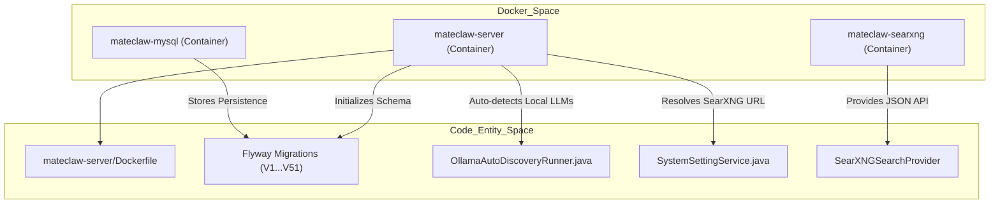
Sources: [docker-compose.yml:10-100](), [mateclaw-server/Dockerfile:1-100](), [mateclaw-server/src/main/java/vip/mate/llm/config/OllamaAutoDiscoveryRunner.java:36-66](), [mateclaw-server/src/main/java/vip/mate/system/service/SystemSettingService.java:72-77]().

### Docker Compose Configuration

The `docker-compose.yml` file defines the environment and networking for the system:

| Service | Image/Build | Purpose | Key Config |
| :--- | :--- | :--- | :--- |
| `mysql` | `mysql:8.0` | Primary relational store. | `MYSQL_DATABASE`, `MYSQL_USER`, `MYSQL_PASSWORD` [docker-compose.yml:10-32]() |
| `searxng` | `./docker/searxng` | Local search engine sidecar. | `SEARXNG_BASE_URL`, `SEARXNG_SECRET` [docker-compose.yml:40-57]() |
| `mateclaw-server` | `./mateclaw-server/Dockerfile` | The main application. | `SPRING_PROFILES_ACTIVE=mysql`, `shm_size: 2gb` [docker-compose.yml:60-99]() |

**Note on Shared Memory:** The `mateclaw-server` requires `shm_size: 2gb` to support the Playwright/Chromium instances used by `BrowserUseTool`. Without this, the browser will encounter `SIGBUS` errors during page rendering [docker-compose.yml:92-95]().

## Environment Configuration (.env)

MateClaw uses an `.env` file to manage secrets and environment-specific overrides. A template is provided in `.env.example`.

### Critical Variables
*   **Database Credentials:** `DB_ROOT_PASSWORD` and `DB_PASSWORD` are mandatory. If missing, the container orchestration will fail to start to prevent insecure defaults [docker-compose.yml:15-18](), [.env.example:15-20]().
*   **Security:** `JWT_SECRET` (minimum 32 characters) for token signing and `MATECLAW_CORS_ALLOWED_ORIGINS` for frontend access control [.env.example:24-30]().
*   **Build Flags:** `MAVEN_FLAGS=-Paliyun-first` can be set to prioritize mirrors for faster builds in specific regions [mateclaw-server/Dockerfile:27-36](), [.env.example:54-56]().

Sources: [.env.example:1-57](), [docker-compose.yml:15-18]().

## Multi-Stage Dockerfile Implementation

The `mateclaw-server/Dockerfile` uses a three-stage build process to ensure the final runtime image is optimized and contains all necessary binary dependencies for tool execution.

### Build Stages
1.  **Frontend Builder (`node:22-alpine`):** Compiles the Vue 3 application using `pnpm exec vite build`. The output is directed to a temporary `/static` directory [mateclaw-server/Dockerfile:7-19]().
2.  **Backend Builder (`maven:3.9-eclipse-temurin-21`):** 
    *   Installs `mateclaw-plugin-api` into the local Maven cache [mateclaw-server/Dockerfile:33-36]().
    *   Copies the static frontend assets from Stage 1 into `src/main/resources/static` [mateclaw-server/Dockerfile:45]().
    *   Packages the Spring Boot JAR [mateclaw-server/Dockerfile:47]().
3.  **Runtime (`mcr.microsoft.com/playwright:v1.52.0-noble`):** 
    *   Based on Ubuntu Noble to provide `glibc` and pre-installed Chromium/Firefox/WebKit [mateclaw-server/Dockerfile:60]().
    *   Installs `openjdk-21-jre-headless` for the application runtime [mateclaw-server/Dockerfile:82]().
    *   Installs `poppler-utils` (for `pdftotext`) and `tesseract-ocr` (with Chinese support) for `DocumentExtractTool` [mateclaw-server/Dockerfile:85-87]().

**Runtime Image Logic**
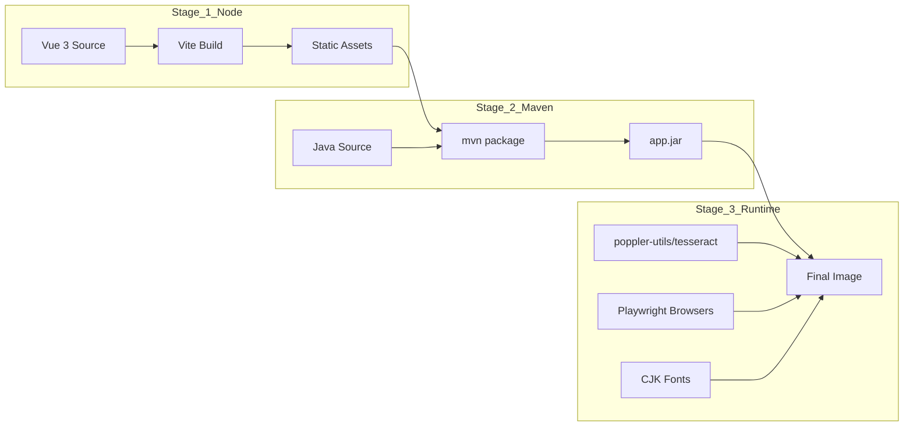
Sources: [mateclaw-server/Dockerfile:1-100]().

## Database Initialization & Seeding

MateClaw automates database setup using Flyway migrations and a custom bootstrap runner.

### Flyway Migrations
The system maintains parity between H2 (Desktop/Dev mode) and MySQL (Production/Web mode). Migrations are located in `db/migration/{platform}/`.
*   **V1 Baseline:** Creates core tables like `mate_user`, `mate_agent`, and `mate_tool`.
*   **V14 Embedding Config:** Adds `model_type` to `mate_model_config` to support vector embedding models (e.g., `text-embedding-v3`) alongside chat models [mateclaw-server/src/main/resources/db/migration/mysql/V14__embedding_model_config.sql:1-16]().
*   **V38 Content Expansion:** Expands `mate_wiki_chunk.content` to `MEDIUMTEXT` (MySQL) or `CLOB` (H2) to handle large semantic chunks [mateclaw-server/src/main/resources/db/migration/h2/V38__wiki_chunk_content_mediumtext.sql:1-3]().
*   **V51 ToolGuard Scope:** Refines security by narrowing `ToolGuard` evaluation specifically to shell command execution [mateclaw-server/Dockerfile:1-100]().

### Ollama Auto-Discovery
On startup, the `OllamaAutoDiscoveryRunner` attempts to detect local Ollama instances (default `http://127.0.0.1:11434`).
*   **Model Registration:** Discovered models are automatically added to `mate_model_config` [mateclaw-server/src/main/java/vip/mate/llm/config/OllamaAutoDiscoveryRunner.java:78-84]().
*   **Tool Support Validation:** Models from families known to lack tool support (e.g., `deepseek-r1`, `gemma`) are excluded from auto-activation to prevent 400 errors during agent execution [mateclaw-server/src/main/java/vip/mate/llm/config/OllamaAutoDiscoveryRunner.java:50-58]().

Sources: [mateclaw-server/src/main/java/vip/mate/llm/config/OllamaAutoDiscoveryRunner.java:36-131](), [mateclaw-server/src/main/resources/db/migration/mysql/V14__embedding_model_config.sql:1-29]().

## SearXNG Sidecar Integration

The `searxng` service uses a custom image to ensure compatibility with MateClaw's `SearXNGSearchProvider`.

*   **Configuration:** The `docker/searxng/settings.yml` explicitly enables `json` format and disables the anti-bot `limiter` plugin, which would otherwise block server-side requests [docker/searxng/settings.yml:30-39]().
*   **Resolution:** `SystemSettingService` resolves the SearXNG endpoint by checking the database key `searxngBaseUrl` first, falling back to the `SEARXNG_BASE_URL` environment variable [mateclaw-server/src/main/java/vip/mate/system/service/SystemSettingService.java:72-77]().

Sources: [docker/searxng/Dockerfile:1-10](), [docker/searxng/settings.yml:1-62](), [mateclaw-server/src/main/java/vip/mate/system/service/SystemSettingService.java:94]().

---

# Page: Configuration Reference

# Configuration Reference

<details>
<summary>Relevant source files</summary>

The following files were used as context for generating this wiki page:

- [.dockerignore](.dockerignore)
- [.env.example](.env.example)
- [docker-compose.yml](docker-compose.yml)
- [docker/searxng/Dockerfile](docker/searxng/Dockerfile)
- [docker/searxng/settings.yml](docker/searxng/settings.yml)
- [mateclaw-server/Dockerfile](mateclaw-server/Dockerfile)
- [mateclaw-server/settings.xml](mateclaw-server/settings.xml)
- [mateclaw-server/src/main/java/vip/mate/agent/graph/StateGraphReActAgent.java](mateclaw-server/src/main/java/vip/mate/agent/graph/StateGraphReActAgent.java)
- [mateclaw-server/src/main/java/vip/mate/agent/graph/node/SummarizingNode.java](mateclaw-server/src/main/java/vip/mate/agent/graph/node/SummarizingNode.java)
- [mateclaw-server/src/main/java/vip/mate/agent/graph/observation/ObservationProcessor.java](mateclaw-server/src/main/java/vip/mate/agent/graph/observation/ObservationProcessor.java)
- [mateclaw-server/src/main/java/vip/mate/agent/graph/plan/StateGraphPlanExecuteAgent.java](mateclaw-server/src/main/java/vip/mate/agent/graph/plan/StateGraphPlanExecuteAgent.java)
- [mateclaw-server/src/main/java/vip/mate/channel/web/ChatStreamTracker.java](mateclaw-server/src/main/java/vip/mate/channel/web/ChatStreamTracker.java)
- [mateclaw-server/src/main/java/vip/mate/config/GraphObservationProperties.java](mateclaw-server/src/main/java/vip/mate/config/GraphObservationProperties.java)
- [mateclaw-server/src/main/java/vip/mate/config/SecurityStartupValidator.java](mateclaw-server/src/main/java/vip/mate/config/SecurityStartupValidator.java)
- [mateclaw-server/src/main/java/vip/mate/config/ToolTimeoutProperties.java](mateclaw-server/src/main/java/vip/mate/config/ToolTimeoutProperties.java)
- [mateclaw-server/src/main/java/vip/mate/config/WebMvcConfig.java](mateclaw-server/src/main/java/vip/mate/config/WebMvcConfig.java)
- [mateclaw-server/src/main/java/vip/mate/system/service/SystemSettingService.java](mateclaw-server/src/main/java/vip/mate/system/service/SystemSettingService.java)
- [mateclaw-server/src/main/resources/application.yml](mateclaw-server/src/main/resources/application.yml)
- [mateclaw-server/src/main/resources/db/migration/h2/V38__wiki_chunk_content_mediumtext.sql](mateclaw-server/src/main/resources/db/migration/h2/V38__wiki_chunk_content_mediumtext.sql)
- [mateclaw-server/src/main/resources/db/migration/mysql/V38__wiki_chunk_content_mediumtext.sql](mateclaw-server/src/main/resources/db/migration/mysql/V38__wiki_chunk_content_mediumtext.sql)

</details>


This page provides a detailed technical reference for the `application.yml` settings in MateClaw. It covers the configuration of the agentic graph, tool execution budgets, provider failover mechanisms, and the specialized namespaces for Wiki and Memory modules.

## 1. Agent Graph & Observation Budgets

The agent's reasoning loop is governed by observation budgets to prevent context window overflow and excessive token consumption. These settings control when the agent should summarize its history or truncate individual tool outputs.

### 1.1 Observation Thresholds
The `mate.agent.graph.observation` namespace manages the lifecycle of the `OBSERVATION_HISTORY` key within the `StateGraph`.

| Property | Default (YML) | Description |
| :--- | :--- | :--- |
| `max-single-observation-chars` | `16000` | Maximum characters retained for a single tool's output before truncation. |
| `max-total-observation-chars` | `200000` | Cumulative character limit for all observations in the current turn. |
| `large-result-threshold` | `32000` | Threshold at which a single tool result triggers an immediate `SummarizingNode` transition. |
| `min-rounds-for-summarize` | `25` | Runaway-loop safety net: force summarization after this many tool rounds. |
| `head-ratio` | `0.4` | When truncating, the percentage of content kept from the beginning of the output. |

**Implementation Detail:** These properties are mapped to the `GraphObservationProperties` class [mateclaw-server/src/main/java/vip/mate/config/GraphObservationProperties.java:18-44](). The `SummarizingNode` uses these values to determine if it should compress the `observationHistory` into a `summarizedContext` [mateclaw-server/src/main/java/vip/mate/agent/graph/node/SummarizingNode.java:87-92]().

### 1.2 Tool Result Spill Store (RFC-008)
To handle massive tool outputs (e.g., reading a large log file), MateClaw implements a three-layer budget system.

*   **Layer 1:** In-tool caps.
*   **Layer 2 (Spill):** Oversized results are written to disk; the agent receives a pointer (path) to the spill file via the `read_file` tool.
*   **Layer 3:** Aggregate cap on the total tool turn size.

```yaml
mate:
  agent:
    tool-result:
      enabled: true
      per-result-threshold-chars: 16000   # Prevents WebSearch spill-to-disk
      per-turn-budget-chars: 32000        # Headroom for multi-tool turns
      preview-head-chars: 800
      excluded-tools:
        - read_file
        - read_workspace_memory_file
```
*Sources: [mateclaw-server/src/main/resources/application.yml:175-188]()*

## 2. LLM Provider & Failover Logic

MateClaw utilizes a multi-provider failover chain. If a primary provider (e.g., Anthropic) fails, the system automatically cycles to the next available provider.

### 2.1 Health Tracker & Cooldown
The `failover.health` system tracks consecutive failures per provider.

*   **Failure Threshold:** Number of consecutive errors (e.g., 429, 503, 529) before a provider is marked "unhealthy".
*   **Cooldown:** Duration a provider remains in the "skip" list before being probed again (default 300s).

**Failover Lifecycle Diagram**
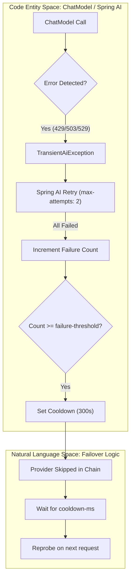
*Sources: [mateclaw-server/src/main/resources/application.yml:70-76](), [mateclaw-server/src/main/resources/application.yml:146-150]()*

## 3. Conversation Window Management

To maintain performance over long chats, the `ConversationWindowManager` applies compression strategies when token usage nears limits.

| Property | Default | Description |
| :--- | :--- | :--- |
| `default-max-input-tokens` | `128000` | The total context window limit allowed for the model. |
| `compact-trigger-ratio` | `0.75` | Trigger compression when usage hits 75% of the max tokens. |
| `preserve-recent-pairs` | `2` | Always keep the last N User/Assistant message pairs uncompressed. |

*Sources: [mateclaw-server/src/main/resources/application.yml:190-196]()*

## 4. Module-Specific Namespaces

### 4.1 mate.wiki (LLM Wiki Knowledge Base)
Controls the ingestion and retrieval pipeline for the RAG-based Wiki module.

*   **`max-chunk-size`**: 30,000 chars. Limits the amount of text sent to the LLM for a single "digest" operation [mateclaw-server/src/main/resources/application.yml:200]().
*   **`max-parallel-phase-b-pages`**: 3. Controls concurrency during the page generation phase (Phase B) to avoid hitting rate limits [mateclaw-server/src/main/resources/application.yml:203]().
*   **`upload-dir`**: Target directory for raw materials (default `./data/wiki-uploads`) [mateclaw-server/src/main/resources/application.yml:205]().

### 4.2 mate.memory (Memory & Dreaming)
Manages the background "Dreaming" process where the system extracts facts from conversations.

*   **`lifecycle-mediator-enabled`**: Enables the event bus that triggers memory extraction after a conversation turn [mateclaw-server/src/main/resources/application.yml:211]().
*   **`focused-enabled`**: Enables "Focused Dreaming" on specific high-value conversations [mateclaw-server/src/main/resources/application.yml:213]().

## 5. Security & System Configuration

MateClaw enforces strict security defaults, validated at startup by `SecurityStartupValidator` [mateclaw-server/src/main/java/vip/mate/config/SecurityStartupValidator.java:18-32]().

### 5.1 System Settings (DB-backed)
While `application.yml` provides defaults, many operational settings (Search, TTS, STT) are managed via the `mate_system_setting` table and `SystemSettingService` [mateclaw-server/src/main/java/vip/mate/system/service/SystemSettingService.java:12-65]().

**Configuration Priority Diagram**
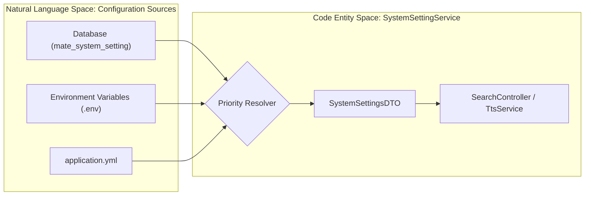
*Sources: [mateclaw-server/src/main/java/vip/mate/system/service/SystemSettingService.java:72-132]()*

### 5.2 Key Security Properties
*   **`mateclaw.jwt.secret`**: Must be changed from the default `MateClaw-JWT-Secret-Key...` in production [mateclaw-server/src/main/resources/application.yml:98]().
*   **`spring.threads.virtual.enabled`**: Set to `true` to leverage Java 21 Virtual Threads for handling concurrent tool executions and SSE streams [mateclaw-server/src/main/resources/application.yml:18]().
*   **`mateclaw.hooks.trusted-domains`**: A whitelist of domains the Hook system is allowed to invoke via HTTP [mateclaw-server/src/main/resources/application.yml:123]().

## 6. Runtime State Tracking (SSE)

The `ChatStreamTracker` manages the lifecycle of Server-Sent Events (SSE). It includes a `RunState` object that tracks the current execution phase and manages a `messageQueue` for non-interruptible phases [mateclaw-server/src/main/java/vip/mate/channel/web/ChatStreamTracker.java:76-107]().

*   **Emergency Save**: If the JVM is shut down, an `emergencySaveCallback` is triggered to persist in-flight assistant content to the database [mateclaw-server/src/main/java/vip/mate/channel/web/ChatStreamTracker.java:110-119]().
*   **Heartbeat**: A `heartbeatScheduler` sends periodic events to keep the SSE connection alive [mateclaw-server/src/main/java/vip/mate/channel/web/ChatStreamTracker.java:162-167]().

*Sources: [mateclaw-server/src/main/java/vip/mate/channel/web/ChatStreamTracker.java:1-182]()*

---

# Page: Core Agent Runtime

# Core Agent Runtime

<details>
<summary>Relevant source files</summary>

The following files were used as context for generating this wiki page:

- [mateclaw-server/src/main/java/vip/mate/agent/AgentGraphBuilder.java](mateclaw-server/src/main/java/vip/mate/agent/AgentGraphBuilder.java)
- [mateclaw-server/src/main/java/vip/mate/agent/AgentService.java](mateclaw-server/src/main/java/vip/mate/agent/AgentService.java)
- [mateclaw-server/src/main/java/vip/mate/agent/BaseAgent.java](mateclaw-server/src/main/java/vip/mate/agent/BaseAgent.java)
- [mateclaw-server/src/main/java/vip/mate/agent/ThinkingLevelHolder.java](mateclaw-server/src/main/java/vip/mate/agent/ThinkingLevelHolder.java)
- [mateclaw-server/src/main/java/vip/mate/agent/graph/NodeStreamingChatHelper.java](mateclaw-server/src/main/java/vip/mate/agent/graph/NodeStreamingChatHelper.java)
- [mateclaw-server/src/main/java/vip/mate/agent/graph/StateGraphReActAgent.java](mateclaw-server/src/main/java/vip/mate/agent/graph/StateGraphReActAgent.java)
- [mateclaw-server/src/main/java/vip/mate/agent/graph/executor/ToolExecutionExecutor.java](mateclaw-server/src/main/java/vip/mate/agent/graph/executor/ToolExecutionExecutor.java)
- [mateclaw-server/src/main/java/vip/mate/agent/graph/node/ReasoningNode.java](mateclaw-server/src/main/java/vip/mate/agent/graph/node/ReasoningNode.java)
- [mateclaw-server/src/main/java/vip/mate/agent/graph/node/SummarizingNode.java](mateclaw-server/src/main/java/vip/mate/agent/graph/node/SummarizingNode.java)
- [mateclaw-server/src/main/java/vip/mate/agent/graph/plan/StateGraphPlanExecuteAgent.java](mateclaw-server/src/main/java/vip/mate/agent/graph/plan/StateGraphPlanExecuteAgent.java)
- [mateclaw-server/src/main/java/vip/mate/agent/model/AgentEntity.java](mateclaw-server/src/main/java/vip/mate/agent/model/AgentEntity.java)
- [mateclaw-server/src/main/java/vip/mate/channel/service/ChannelService.java](mateclaw-server/src/main/java/vip/mate/channel/service/ChannelService.java)
- [mateclaw-server/src/main/java/vip/mate/channel/web/ChatController.java](mateclaw-server/src/main/java/vip/mate/channel/web/ChatController.java)
- [mateclaw-server/src/main/java/vip/mate/channel/web/ChatStreamTracker.java](mateclaw-server/src/main/java/vip/mate/channel/web/ChatStreamTracker.java)
- [mateclaw-server/src/main/java/vip/mate/config/GraphObservationProperties.java](mateclaw-server/src/main/java/vip/mate/config/GraphObservationProperties.java)
- [mateclaw-server/src/main/java/vip/mate/cron/service/CronJobService.java](mateclaw-server/src/main/java/vip/mate/cron/service/CronJobService.java)
- [mateclaw-server/src/main/java/vip/mate/exception/MateClawException.java](mateclaw-server/src/main/java/vip/mate/exception/MateClawException.java)
- [mateclaw-server/src/main/java/vip/mate/memory/event/ConversationCompletionPublisher.java](mateclaw-server/src/main/java/vip/mate/memory/event/ConversationCompletionPublisher.java)
- [mateclaw-server/src/main/java/vip/mate/tool/mcp/service/McpServerService.java](mateclaw-server/src/main/java/vip/mate/tool/mcp/service/McpServerService.java)
- [mateclaw-server/src/main/java/vip/mate/tool/service/ToolService.java](mateclaw-server/src/main/java/vip/mate/tool/service/ToolService.java)
- [mateclaw-server/src/main/java/vip/mate/workspace/core/service/WorkspaceService.java](mateclaw-server/src/main/java/vip/mate/workspace/core/service/WorkspaceService.java)
- [mateclaw-server/src/main/resources/application.yml](mateclaw-server/src/main/resources/application.yml)
- [mateclaw-server/src/main/resources/db/migration/h2/V4__agent_thinking_level.sql](mateclaw-server/src/main/resources/db/migration/h2/V4__agent_thinking_level.sql)
- [mateclaw-server/src/main/resources/db/schema-mysql.sql](mateclaw-server/src/main/resources/db/schema-mysql.sql)
- [mateclaw-server/src/main/resources/db/schema.sql](mateclaw-server/src/main/resources/db/schema.sql)

</details>


The Core Agent Runtime is the central execution engine of MateClaw. It transforms natural language intents into actionable sequences by orchestrating LLM reasoning, tool invocation, and state management. Built on a directed acyclic graph (DAG) architecture using `spring-ai-alibaba-graph-core`, the runtime ensures that complex multi-turn interactions are predictable, observable, and secure.

## Architectural Overview

The runtime operates as a state machine where each "turn" of a conversation is a traversal through a `StateGraph`. The engine decouples the high-level reasoning logic from low-level execution details like streaming SSE delivery and tool sandboxing.

### Core Components Mapping

| System Concept | Code Entity | Role |
|:---|:---|:---|
| **Graph Assembler** | `AgentGraphBuilder` | Constructs the `StateGraph` and wires nodes. |
| **Agent Instance** | `BaseAgent` | Abstract base for `StateGraphReActAgent` and `StateGraphPlanExecuteAgent`. |
| **Streaming Hub** | `ChatStreamTracker` | Manages process-local SSE buffers and reconnection logic. |
| **Execution Helper**| `NodeStreamingChatHelper` | Bridges `ChatModel` streams to the `ChatStreamTracker` and handles failover. |
| **Tool Runner** | `ToolExecutionExecutor` | Executes tool calls with parallel/sequential logic and security guards. |

### Natural Language to Code Entity Space

The following diagram illustrates how a user's natural language request flows through the primary code entities of the runtime.

**Request Processing Pipeline**
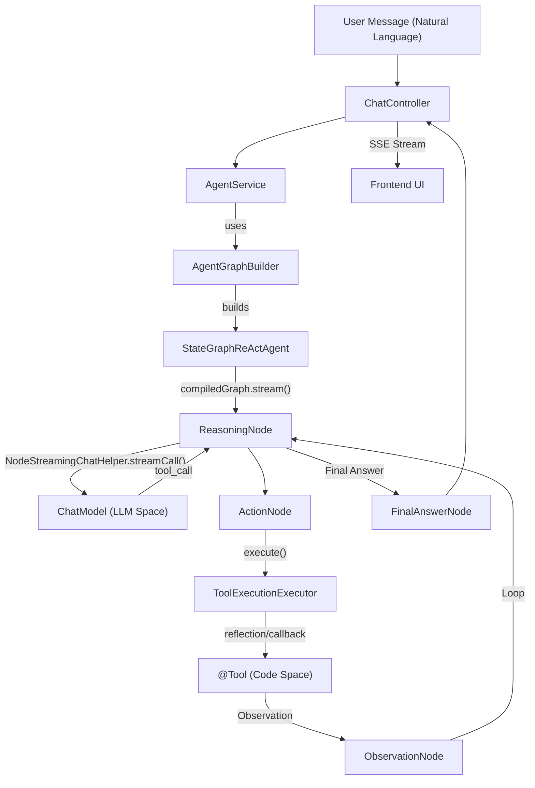
**Sources:** [mateclaw-server/src/main/java/vip/mate/agent/AgentGraphBuilder.java:135-150](), [mateclaw-server/src/main/java/vip/mate/agent/graph/StateGraphReActAgent.java:91-110](), [mateclaw-server/src/main/java/vip/mate/agent/graph/node/ReasoningNode.java:51-85](), [mateclaw-server/src/main/java/vip/mate/agent/AgentService.java:115-140]()

---

## StateGraph & Agent Patterns

MateClaw supports two primary agentic patterns implemented as `StateGraph` architectures:

1.  **ReAct (Reasoning + Acting):** A tight loop of `ReasoningNode` -> `ActionNode` -> `ObservationNode`. It is best for interactive tasks where each step depends on the previous outcome. [mateclaw-server/src/main/java/vip/mate/agent/graph/StateGraphReActAgent.java:30-45]()
2.  **Plan-and-Execute:** A structured flow where goals are decomposed into steps and executed sequentially. [mateclaw-server/src/main/java/vip/mate/agent/graph/plan/StateGraphPlanExecuteAgent.java:42-58]()

The `AgentGraphBuilder` assembles these graphs, injecting system-level constraints like `MAX_ITERATIONS_HARD_CEILING` (default 100) and `TOOL_USE_ENFORCEMENT` prompts to ensure model discipline. [mateclaw-server/src/main/java/vip/mate/agent/BaseAgent.java:51-52](), [mateclaw-server/src/main/java/vip/mate/agent/graph/node/ReasoningNode.java:75-85]()

For details, see [StateGraph & Agent Patterns (#2.1)].

**Sources:** [mateclaw-server/src/main/java/vip/mate/agent/BaseAgent.java:51-52](), [mateclaw-server/src/main/java/vip/mate/agent/graph/node/ReasoningNode.java:75-85](), [mateclaw-server/src/main/java/vip/mate/agent/graph/plan/StateGraphPlanExecuteAgent.java:42-58]()

---

## Streaming & SSE Delivery

Streaming in MateClaw is "node-driven." Instead of waiting for the entire graph to finish, the `NodeStreamingChatHelper` captures deltas from the `ChatModel` and pushes them to the `ChatStreamTracker` in real-time. [mateclaw-server/src/main/java/vip/mate/agent/graph/NodeStreamingChatHelper.java:32-37]()

*   **Buffer Management:** `ChatStreamTracker` maintains a process-local buffer (max 16,000 events) to support client reconnection without losing "thinking" or "content" segments. [mateclaw-server/src/main/java/vip/mate/channel/web/ChatStreamTracker.java:56-79]()
*   **Interruption:** Users can issue a `USER_STOP` or `USER_INTERRUPT_WITH_FOLLOWUP`, which sets a `stopRequested` flag in the `RunState`, causing graph nodes to abort gracefully. [mateclaw-server/src/main/java/vip/mate/channel/web/ChatStreamTracker.java:69-85]()

For details, see [Streaming & SSE Delivery (#2.2)].

**Sources:** [mateclaw-server/src/main/java/vip/mate/channel/web/ChatStreamTracker.java:53-135](), [mateclaw-server/src/main/java/vip/mate/agent/graph/NodeStreamingChatHelper.java:32-37](), [mateclaw-server/src/main/java/vip/mate/channel/web/ChatController.java:75-140]()

---

## Tool Execution & Security

Tool execution is handled by the `ToolExecutionExecutor`, which follows a two-phase model:
1.  **Preparation:** Validates JSON arguments and runs `ToolGuard` to determine if a call is `ALLOW`, `NEEDS_APPROVAL`, or `BLOCK`. [mateclaw-server/src/main/java/vip/mate/agent/graph/executor/ToolExecutionExecutor.java:28-32]()
2.  **Execution:** Dispatches calls to virtual threads. It distinguishes between `concurrencySafe` tools and `unsafe` tools like `browser_use` or `write_file` which are run sequentially. [mateclaw-server/src/main/java/vip/mate/agent/graph/executor/ToolExecutionExecutor.java:42-58]()

The runtime also enforces a three-layer budget for tool results to prevent context window overflow, spilling oversized results to disk via `ToolResultStorage`. [mateclaw-server/src/main/java/vip/mate/agent/graph/executor/ToolExecutionExecutor.java:64-73]()

For details, see [Tool Execution & Security (#2.3)].

**Sources:** [mateclaw-server/src/main/java/vip/mate/agent/graph/executor/ToolExecutionExecutor.java:28-35](), [mateclaw-server/src/main/java/vip/mate/agent/graph/executor/ToolExecutionExecutor.java:64-73](), [mateclaw-server/src/main/resources/application.yml:175-180]()

---

## Conversation & History Management

The `ConversationWindowManager` and `ConversationService` manage the context window of the agent.

*   **Progressive Loading:** Long conversations load messages in stages, loading only the necessary window (default 128k tokens) for the LLM. [mateclaw-server/src/main/java/vip/mate/agent/BaseAgent.java:180-198](), [mateclaw-server/src/main/resources/application.yml:193]()
*   **Context Compression:** When the `compact-trigger-ratio` is met, the `SummarizingNode` condenses observations to free up space. [mateclaw-server/src/main/java/vip/mate/agent/graph/node/SummarizingNode.java:31-42](), [mateclaw-server/src/main/resources/application.yml:194]()
*   **Thinking Level:** Supports per-request `reasoning_effort` (high/medium/low) via `ThinkingLevelHolder`. [mateclaw-server/src/main/java/vip/mate/agent/ThinkingLevelHolder.java:1-15](), [mateclaw-server/src/main/java/vip/mate/agent/AgentService.java:130-140]()

For details, see [Conversation & History Management (#2.4)].

**Sources:** [mateclaw-server/src/main/java/vip/mate/agent/BaseAgent.java:179-208](), [mateclaw-server/src/main/java/vip/mate/agent/graph/node/SummarizingNode.java:31-42](), [mateclaw-server/src/main/resources/application.yml:190-196](), [mateclaw-server/src/main/java/vip/mate/agent/AgentService.java:124-140]()

---

## Component Interaction Diagram

This diagram shows the relationship between the core runtime classes during a standard ReAct turn.

**Runtime Interaction Flow**
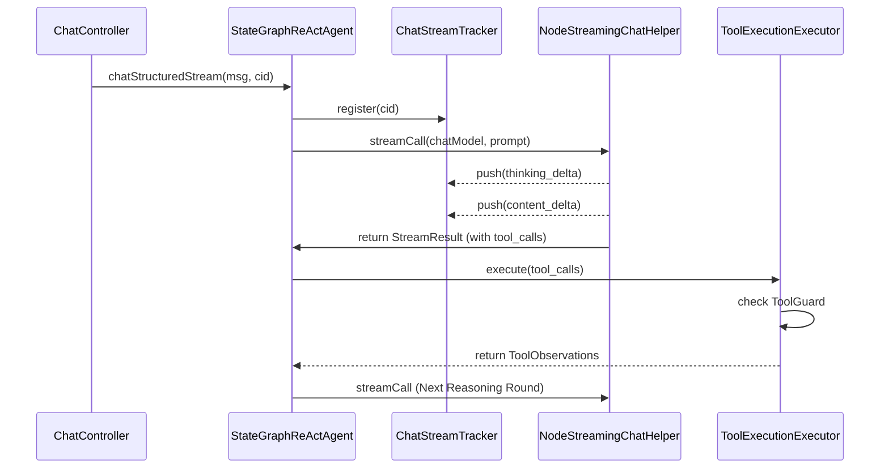
**Sources:** [mateclaw-server/src/main/java/vip/mate/agent/graph/StateGraphReActAgent.java:158-180](), [mateclaw-server/src/main/java/vip/mate/agent/graph/NodeStreamingChatHelper.java:32-37](), [mateclaw-server/src/main/java/vip/mate/agent/graph/executor/ToolExecutionExecutor.java:28-35]()

---

# Page: StateGraph & Agent Patterns

# StateGraph & Agent Patterns

<details>
<summary>Relevant source files</summary>

The following files were used as context for generating this wiki page:

- [mateclaw-server/src/main/java/vip/mate/agent/AgentGraphBuilder.java](mateclaw-server/src/main/java/vip/mate/agent/AgentGraphBuilder.java)
- [mateclaw-server/src/main/java/vip/mate/agent/BaseAgent.java](mateclaw-server/src/main/java/vip/mate/agent/BaseAgent.java)
- [mateclaw-server/src/main/java/vip/mate/agent/GraphEventPublisher.java](mateclaw-server/src/main/java/vip/mate/agent/GraphEventPublisher.java)
- [mateclaw-server/src/main/java/vip/mate/agent/context/ConversationWindowManager.java](mateclaw-server/src/main/java/vip/mate/agent/context/ConversationWindowManager.java)
- [mateclaw-server/src/main/java/vip/mate/agent/context/RuntimeContextInjector.java](mateclaw-server/src/main/java/vip/mate/agent/context/RuntimeContextInjector.java)
- [mateclaw-server/src/main/java/vip/mate/agent/graph/NodeStreamingChatHelper.java](mateclaw-server/src/main/java/vip/mate/agent/graph/NodeStreamingChatHelper.java)
- [mateclaw-server/src/main/java/vip/mate/agent/graph/RepetitionDetector.java](mateclaw-server/src/main/java/vip/mate/agent/graph/RepetitionDetector.java)
- [mateclaw-server/src/main/java/vip/mate/agent/graph/edge/ObservationDispatcher.java](mateclaw-server/src/main/java/vip/mate/agent/graph/edge/ObservationDispatcher.java)
- [mateclaw-server/src/main/java/vip/mate/agent/graph/edge/ReasoningDispatcher.java](mateclaw-server/src/main/java/vip/mate/agent/graph/edge/ReasoningDispatcher.java)
- [mateclaw-server/src/main/java/vip/mate/agent/graph/executor/ToolExecutionExecutor.java](mateclaw-server/src/main/java/vip/mate/agent/graph/executor/ToolExecutionExecutor.java)
- [mateclaw-server/src/main/java/vip/mate/agent/graph/executor/ToolResultProperties.java](mateclaw-server/src/main/java/vip/mate/agent/graph/executor/ToolResultProperties.java)
- [mateclaw-server/src/main/java/vip/mate/agent/graph/executor/ToolResultStorage.java](mateclaw-server/src/main/java/vip/mate/agent/graph/executor/ToolResultStorage.java)
- [mateclaw-server/src/main/java/vip/mate/agent/graph/node/ActionNode.java](mateclaw-server/src/main/java/vip/mate/agent/graph/node/ActionNode.java)
- [mateclaw-server/src/main/java/vip/mate/agent/graph/node/FinalAnswerNode.java](mateclaw-server/src/main/java/vip/mate/agent/graph/node/FinalAnswerNode.java)
- [mateclaw-server/src/main/java/vip/mate/agent/graph/node/ObservationNode.java](mateclaw-server/src/main/java/vip/mate/agent/graph/node/ObservationNode.java)
- [mateclaw-server/src/main/java/vip/mate/agent/graph/node/ReasoningNode.java](mateclaw-server/src/main/java/vip/mate/agent/graph/node/ReasoningNode.java)
- [mateclaw-server/src/main/java/vip/mate/agent/graph/plan/edge/PlanGenerationDispatcher.java](mateclaw-server/src/main/java/vip/mate/agent/graph/plan/edge/PlanGenerationDispatcher.java)
- [mateclaw-server/src/main/java/vip/mate/agent/graph/plan/node/PlanGenerationNode.java](mateclaw-server/src/main/java/vip/mate/agent/graph/plan/node/PlanGenerationNode.java)
- [mateclaw-server/src/main/java/vip/mate/agent/graph/plan/node/StepExecutionNode.java](mateclaw-server/src/main/java/vip/mate/agent/graph/plan/node/StepExecutionNode.java)
- [mateclaw-server/src/main/java/vip/mate/agent/graph/plan/state/PlanStateAccessor.java](mateclaw-server/src/main/java/vip/mate/agent/graph/plan/state/PlanStateAccessor.java)
- [mateclaw-server/src/main/java/vip/mate/agent/graph/state/DirectToolOutput.java](mateclaw-server/src/main/java/vip/mate/agent/graph/state/DirectToolOutput.java)
- [mateclaw-server/src/main/java/vip/mate/agent/graph/state/FinishReason.java](mateclaw-server/src/main/java/vip/mate/agent/graph/state/FinishReason.java)
- [mateclaw-server/src/main/java/vip/mate/agent/graph/state/MateClawStateAccessor.java](mateclaw-server/src/main/java/vip/mate/agent/graph/state/MateClawStateAccessor.java)
- [mateclaw-server/src/main/java/vip/mate/agent/graph/state/MateClawStateKeys.java](mateclaw-server/src/main/java/vip/mate/agent/graph/state/MateClawStateKeys.java)
- [mateclaw-server/src/main/java/vip/mate/channel/web/ChatController.java](mateclaw-server/src/main/java/vip/mate/channel/web/ChatController.java)
- [mateclaw-server/src/main/java/vip/mate/llm/cache/LlmCacheMetricsAggregator.java](mateclaw-server/src/main/java/vip/mate/llm/cache/LlmCacheMetricsAggregator.java)
- [mateclaw-server/src/main/java/vip/mate/tool/ConcurrencyUnsafe.java](mateclaw-server/src/main/java/vip/mate/tool/ConcurrencyUnsafe.java)
- [mateclaw-server/src/main/java/vip/mate/tool/builtin/SkillFileTool.java](mateclaw-server/src/main/java/vip/mate/tool/builtin/SkillFileTool.java)
- [mateclaw-server/src/main/java/vip/mate/workspace/conversation/vo/MessageVO.java](mateclaw-server/src/main/java/vip/mate/workspace/conversation/vo/MessageVO.java)
- [mateclaw-server/src/main/resources/prompts/graph/limit-exceeded-system.txt](mateclaw-server/src/main/resources/prompts/graph/limit-exceeded-system.txt)
- [mateclaw-server/src/main/resources/prompts/graph/summarize-system.txt](mateclaw-server/src/main/resources/prompts/graph/summarize-system.txt)
- [mateclaw-server/src/main/resources/prompts/graph/summarize-user.txt](mateclaw-server/src/main/resources/prompts/graph/summarize-user.txt)
- [mateclaw-server/src/test/java/vip/mate/agent/graph/RepetitionDetectorTest.java](mateclaw-server/src/test/java/vip/mate/agent/graph/RepetitionDetectorTest.java)
- [mateclaw-ui/src/App.vue](mateclaw-ui/src/App.vue)
- [mateclaw-ui/src/components/chat/ContentSegment.vue](mateclaw-ui/src/components/chat/ContentSegment.vue)

</details>


MateClaw utilizes `spring-ai-alibaba-graph-core` to implement sophisticated agentic workflows. The system abstracts complex LLM interactions into directed graphs where nodes represent discrete processing steps (Reasoning, Action, Observation) and edges manage the state-dependent routing logic.

## Graph Assembly via AgentGraphBuilder

The `AgentGraphBuilder` class is the central factory for constructing agent instances. It resolves model configurations, tool bindings, and security policies before compiling the `StateGraph` into an executable `CompiledGraph` [mateclaw-server/src/main/java/vip/mate/agent/AgentGraphBuilder.java:92-135]().

### ReAct Graph Pattern
The ReAct (Reasoning and Acting) pattern is implemented in `StateGraphReActAgent` [mateclaw-server/src/main/java/vip/mate/agent/graph/StateGraphReActAgent.java:30-49](). It follows a cyclic "Thought → Action → Observation" loop:

1.  **ReasoningNode**: The LLM determines the next step.
2.  **ReasoningDispatcher**: Decides if a tool call is needed or if the agent should provide a final answer [mateclaw-server/src/main/java/vip/mate/agent/graph/edge/ReasoningDispatcher.java:1-30]().
3.  **ActionNode**: Orchestrates tool execution via `ToolExecutionExecutor` [mateclaw-server/src/main/java/vip/mate/agent/graph/executor/ToolExecutionExecutor.java:39-48]().
4.  **ObservationNode**: Captures tool outputs and formats them for the next reasoning round.
5.  **ObservationDispatcher**: Monitors for repetition or budget exhaustion, routing to `SummarizingNode` if the context becomes too dense [mateclaw-server/src/main/java/vip/mate/agent/graph/edge/ObservationDispatcher.java:1-40]().

### Plan-Execute Graph Pattern
The `StateGraphPlanExecuteAgent` implements a higher-level decomposition strategy [mateclaw-server/src/main/java/vip/mate/agent/graph/plan/StateGraphPlanExecuteAgent.java:30-50]():

1.  **PlanGenerationNode**: Triage the goal into a direct answer, a single-step plan, or a multi-step sequence (2–6 steps) [mateclaw-server/src/main/java/vip/mate/agent/graph/plan/node/PlanGenerationNode.java:67-93]().
2.  **StepExecutionNode**: Executes individual steps using an internal ReAct loop limited to 5 tool calls per step to prevent runaway costs [mateclaw-server/src/main/java/vip/mate/agent/graph/plan/node/StepExecutionNode.java:58-58]().
3.  **FinalAnswerNode**: Synthesizes all step results into a cohesive response.

**Sources:** [mateclaw-server/src/main/java/vip/mate/agent/AgentGraphBuilder.java:92-135](), [mateclaw-server/src/main/java/vip/mate/agent/graph/plan/node/PlanGenerationNode.java:48-93](), [mateclaw-server/src/main/java/vip/mate/agent/graph/plan/node/StepExecutionNode.java:47-75]().

---

## Node Types & Responsibilities

Specialized nodes handle specific phases of the agentic lifecycle, ensuring separation of concerns between reasoning, execution, and state maintenance.

| Node Type | Class | Primary Responsibility |
| :--- | :--- | :--- |
| **Reasoning** | `ReasoningNode` | Calls LLM to generate `thought` and `tool_calls`. Appends `TOOL_USE_ENFORCEMENT` instructions to prevent "narration-only" failure modes [mateclaw-server/src/main/java/vip/mate/agent/graph/node/ReasoningNode.java:75-85](). |
| **Action** | `ActionNode` | Passes tool calls to `ToolExecutionExecutor`. Manages parallel vs. sequential execution based on `@ConcurrencyUnsafe` [mateclaw-server/src/main/java/vip/mate/agent/graph/executor/ToolExecutionExecutor.java:28-34](). |
| **Observation** | `ObservationNode` | Ingests tool results into the graph state. Detects `returnDirect` flags to bypass further reasoning [mateclaw-server/src/main/java/vip/mate/agent/graph/state/DirectToolOutput.java:1-15](). |
| **Summarizing** | `SummarizingNode` | Compresses `observationHistory` using structured prompts (`summarize-system.txt`) when context limits are approached [mateclaw-server/src/main/resources/prompts/graph/summarize-system.txt:1-39](). |
| **FinalAnswer** | `FinalAnswerNode` | The terminal node that extracts the final string response and manages clean-up. |

### Reasoning & Action Flow
This diagram maps the transition from user intent to the code-level execution of nodes.

Title: ReAct Node Execution & State Transition
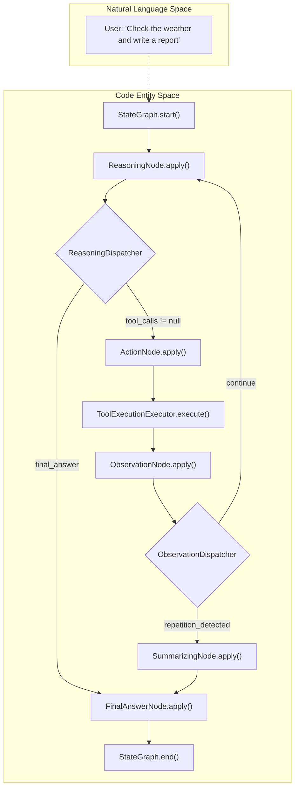
**Sources:** [mateclaw-server/src/main/java/vip/mate/agent/graph/node/ReasoningNode.java:51-103](), [mateclaw-server/src/main/java/vip/mate/agent/graph/executor/ToolExecutionExecutor.java:39-75](), [mateclaw-server/src/main/java/vip/mate/agent/graph/edge/ReasoningDispatcher.java:1-30]().

---

## State Management: Keys & Accessors

The graph state is a `Map<String, Object>` managed by the underlying graph core. MateClaw uses typed accessors to ensure memory safety and consistent key usage across different node implementations.

### Key State Keys (`MateClawStateKeys`)
*   `MESSAGES`: The conversation history used for LLM context [mateclaw-server/src/main/java/vip/mate/agent/graph/state/MateClawStateKeys.java:20-25]().
*   `OBSERVATION_HISTORY`: A list of raw tool outputs from the current turn [mateclaw-server/src/main/java/vip/mate/agent/graph/state/MateClawStateKeys.java:30-35]().
*   `ITERATION_COUNT`: Tracks the number of ReAct cycles to prevent infinite loops [mateclaw-server/src/main/java/vip/mate/agent/graph/state/MateClawStateKeys.java:40-45]().
*   `FORCED_TOOL_CALL`: Used for replaying tool calls after Human-in-the-loop (HIL) approval [mateclaw-server/src/main/java/vip/mate/agent/graph/node/ReasoningNode.java:43-46]().

### Accessors
*   `MateClawStateAccessor`: Provides helper methods like `totalObservationChars()` and `latestAssistantMessage()` to simplify node logic [mateclaw-server/src/main/java/vip/mate/agent/graph/state/MateClawStateAccessor.java:1-50]().
*   `PlanStateAccessor`: Specialized for Plan-Execute graphs, managing `planSteps` and `currentStepIndex` [mateclaw-server/src/main/java/vip/mate/agent/graph/plan/state/PlanStateAccessor.java:1-40]().

---

## Safety & Limit Handling

MateClaw implements several guards to prevent agent "runaway" and context overflow, ensuring system stability even with autonomous loops.

### Repetition Detection
The `RepetitionDetector` monitors the `OBSERVATION_HISTORY`. If the agent calls the same tool with identical arguments multiple times without making progress, the `ObservationDispatcher` triggers a transition to the `SummarizingNode` or `FinalAnswerNode` to break the loop [mateclaw-server/src/main/java/vip/mate/agent/graph/RepetitionDetector.java:1-25]().

### Budget & Iteration Limits
1.  **Iteration Ceiling**: ReAct agents are limited by `MAX_ITERATIONS_HARD_CEILING` (default 100) [mateclaw-server/src/main/java/vip/mate/agent/BaseAgent.java:51-52]().
2.  **Observation Budget**: 
    *   **Layer 1**: Hard truncation at 8,000 chars per result in `ToolExecutionExecutor` [mateclaw-server/src/main/java/vip/mate/agent/graph/executor/ToolExecutionExecutor.java:75-75]().
    *   **Layer 2**: Spilling to disk via `ToolResultStorage` if results exceed `perResultThresholdChars` (default 16,000) [mateclaw-server/src/main/java/vip/mate/agent/graph/executor/ToolResultProperties.java:47-47]().
    *   **Layer 3**: Aggregate turn budget (`perTurnBudgetChars`, default 32,000) [mateclaw-server/src/main/java/vip/mate/agent/graph/executor/ToolResultProperties.java:54-54]().

### Edge Dispatchers
Dispatchers determine the next node in the graph based on the current state and limit thresholds.

Title: Observation Dispatcher Logic
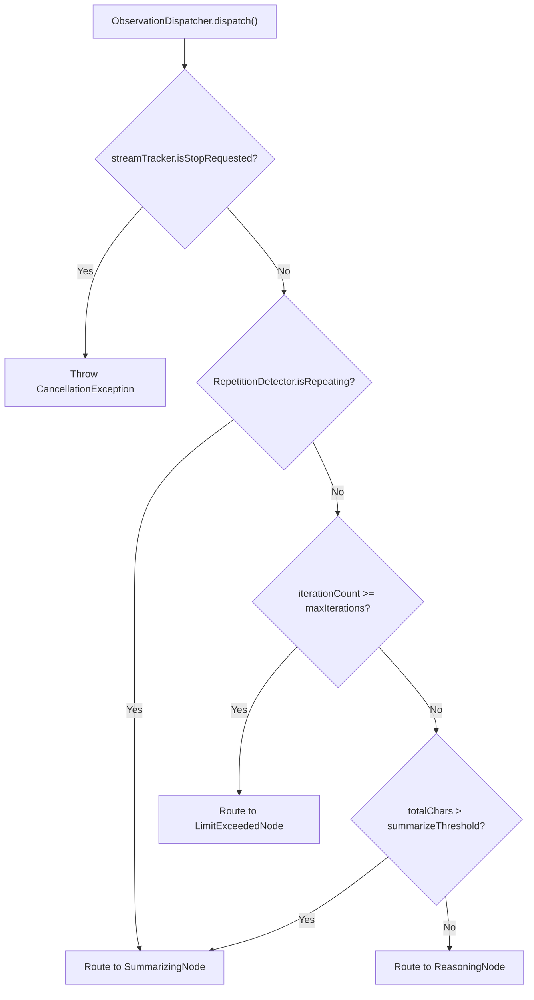
**Sources:** [mateclaw-server/src/main/java/vip/mate/agent/graph/edge/ObservationDispatcher.java:1-40](), [mateclaw-server/src/main/java/vip/mate/agent/graph/RepetitionDetector.java:1-20](), [mateclaw-server/src/main/java/vip/mate/agent/graph/executor/ToolResultProperties.java:35-55]().

---

## Streaming Integration

While the `StateGraph` manages the logical flow, `NodeStreamingChatHelper` manages the real-time delivery of tokens to the user via `ChatStreamTracker` [mateclaw-server/src/main/java/vip/mate/agent/graph/NodeStreamingChatHelper.java:30-40]().

*   **Model-Driven**: The LLM stream chunks are intercepted by the helper.
*   **Thinking Relays**: `thinking_delta` (reasoning content) is broadcasted immediately to the UI to provide transparency during long reasoning phases [mateclaw-server/src/main/java/vip/mate/agent/graph/NodeStreamingChatHelper.java:33-34]().
*   **Fallback Chain**: The helper implements an ordered fallback chain (RFC-009) to switch providers if the primary model fails or is rate-limited [mateclaw-server/src/main/java/vip/mate/agent/graph/NodeStreamingChatHelper.java:50-58]().

**Sources:** [mateclaw-server/src/main/java/vip/mate/agent/graph/NodeStreamingChatHelper.java:45-84](), [mateclaw-server/src/main/java/vip/mate/channel/web/ChatStreamTracker.java:24-41]().

---

# Page: Streaming & SSE Delivery

# Streaming & SSE Delivery

<details>
<summary>Relevant source files</summary>

The following files were used as context for generating this wiki page:

- [mateclaw-server/src/main/java/vip/mate/agent/AgentGraphBuilder.java](mateclaw-server/src/main/java/vip/mate/agent/AgentGraphBuilder.java)
- [mateclaw-server/src/main/java/vip/mate/agent/BaseAgent.java](mateclaw-server/src/main/java/vip/mate/agent/BaseAgent.java)
- [mateclaw-server/src/main/java/vip/mate/agent/controller/AgentController.java](mateclaw-server/src/main/java/vip/mate/agent/controller/AgentController.java)
- [mateclaw-server/src/main/java/vip/mate/agent/graph/NodeStreamingChatHelper.java](mateclaw-server/src/main/java/vip/mate/agent/graph/NodeStreamingChatHelper.java)
- [mateclaw-server/src/main/java/vip/mate/agent/graph/StateGraphReActAgent.java](mateclaw-server/src/main/java/vip/mate/agent/graph/StateGraphReActAgent.java)
- [mateclaw-server/src/main/java/vip/mate/agent/graph/executor/ToolExecutionExecutor.java](mateclaw-server/src/main/java/vip/mate/agent/graph/executor/ToolExecutionExecutor.java)
- [mateclaw-server/src/main/java/vip/mate/agent/graph/node/ReasoningNode.java](mateclaw-server/src/main/java/vip/mate/agent/graph/node/ReasoningNode.java)
- [mateclaw-server/src/main/java/vip/mate/agent/graph/node/SummarizingNode.java](mateclaw-server/src/main/java/vip/mate/agent/graph/node/SummarizingNode.java)
- [mateclaw-server/src/main/java/vip/mate/agent/graph/plan/StateGraphPlanExecuteAgent.java](mateclaw-server/src/main/java/vip/mate/agent/graph/plan/StateGraphPlanExecuteAgent.java)
- [mateclaw-server/src/main/java/vip/mate/channel/web/ChatController.java](mateclaw-server/src/main/java/vip/mate/channel/web/ChatController.java)
- [mateclaw-server/src/main/java/vip/mate/channel/web/ChatStreamTracker.java](mateclaw-server/src/main/java/vip/mate/channel/web/ChatStreamTracker.java)
- [mateclaw-server/src/main/java/vip/mate/channel/web/Utf8SseEmitter.java](mateclaw-server/src/main/java/vip/mate/channel/web/Utf8SseEmitter.java)
- [mateclaw-server/src/main/java/vip/mate/channel/webchat/WebChatController.java](mateclaw-server/src/main/java/vip/mate/channel/webchat/WebChatController.java)
- [mateclaw-server/src/main/java/vip/mate/config/GraphObservationProperties.java](mateclaw-server/src/main/java/vip/mate/config/GraphObservationProperties.java)
- [mateclaw-server/src/main/java/vip/mate/memory/controller/DreamEventBroadcaster.java](mateclaw-server/src/main/java/vip/mate/memory/controller/DreamEventBroadcaster.java)
- [mateclaw-server/src/main/java/vip/mate/memory/event/DreamCompletedEvent.java](mateclaw-server/src/main/java/vip/mate/memory/event/DreamCompletedEvent.java)
- [mateclaw-server/src/main/java/vip/mate/memory/event/DreamFailedEvent.java](mateclaw-server/src/main/java/vip/mate/memory/event/DreamFailedEvent.java)
- [mateclaw-server/src/main/java/vip/mate/wiki/controller/WikiResearchController.java](mateclaw-server/src/main/java/vip/mate/wiki/controller/WikiResearchController.java)
- [mateclaw-server/src/main/java/vip/mate/wiki/repository/WikiChunkMapper.java](mateclaw-server/src/main/java/vip/mate/wiki/repository/WikiChunkMapper.java)
- [mateclaw-server/src/main/resources/application.yml](mateclaw-server/src/main/resources/application.yml)

</details>


MateClaw employs a decoupled producer-consumer architecture for real-time AI responses. By separating the LLM execution pipeline from the HTTP connection lifecycle, the system achieves robust delivery, supporting client reconnections, message queuing, and emergency state preservation.

## Architectural Overview

The streaming system is centered around `ChatStreamTracker`, which acts as a process-local event bus and buffer manager. Unlike traditional SSE implementations where the AI logic is tightly coupled to a single HTTP request, MateClaw's `ChatController` initiates an asynchronous `AgentGraph` execution that pushes events to the tracker.

### Key Components

| Component | Role | File Reference |
| :--- | :--- | :--- |
| `ChatStreamTracker` | Manages `RunState` lifecycles, event buffering, and subscriber (emitter) multiplexing. | [mateclaw-server/src/main/java/vip/mate/channel/web/ChatStreamTracker.java:53-53]() |
| `RunState` | Inner class holding the state of a single conversation turn, including buffers and message queues. | [mateclaw-server/src/main/java/vip/mate/channel/web/ChatStreamTracker.java:76-133]() |
| `Utf8SseEmitter` | Specialized `SseEmitter` that enforces `UTF-8` charset to prevent mojibake in non-UTF8 environments. | [mateclaw-server/src/main/java/vip/mate/channel/web/Utf8SseEmitter.java:31-31]() |
| `NodeStreamingChatHelper` | Utility used by Graph Nodes to push `content_delta` and `thinking_delta` to the tracker. | [mateclaw-server/src/main/java/vip/mate/agent/graph/NodeStreamingChatHelper.java:45-45]() |
| `ChatController` | Entry point for SSE requests; handles both new streams and reconnection logic. | [mateclaw-server/src/main/java/vip/mate/channel/web/ChatController.java:54-54]() |

**Sources:** [mateclaw-server/src/main/java/vip/mate/channel/web/ChatStreamTracker.java:53-133](), [mateclaw-server/src/main/java/vip/mate/channel/web/ChatController.java:54-140](), [mateclaw-server/src/main/java/vip/mate/agent/graph/NodeStreamingChatHelper.java:45-45]()

## SSE Delivery Pipeline

The delivery pipeline follows a "Register-Attach-Broadcast" pattern. This allows a user to refresh their browser or switch devices without losing the stream of an in-flight agent run.

### Data Flow: Producer to Consumer

1.  **Registration**: `ChatController` calls `streamTracker.register(conversationId)` to initialize a `RunState`. [mateclaw-server/src/main/java/vip/mate/channel/web/ChatController.java:191-191]()
2.  **Attachment**: The HTTP request thread creates a `Utf8SseEmitter` and calls `streamTracker.attach()`. If the buffer contains historical events for the current turn, they are replayed to the new emitter. [mateclaw-server/src/main/java/vip/mate/channel/web/ChatController.java:108-108]()
3.  **Execution**: The `AgentService` starts the `StateGraph`. Nodes (e.g., `ReasoningNode`, `SummarizingNode`) use `NodeStreamingChatHelper` to emit deltas. [mateclaw-server/src/main/java/vip/mate/agent/graph/node/ReasoningNode.java:46-47]()
4.  **Broadcasting**: `streamTracker.broadcast()` sends the event to all active `SseEmitter` subscribers and stores it in a bounded `buffer` (max 16,000 events). [mateclaw-server/src/main/java/vip/mate/channel/web/ChatStreamTracker.java:232-232]()

### Natural Language to Code Entity Space: Streaming Lifecycle

Title: Streaming Entity Mapping
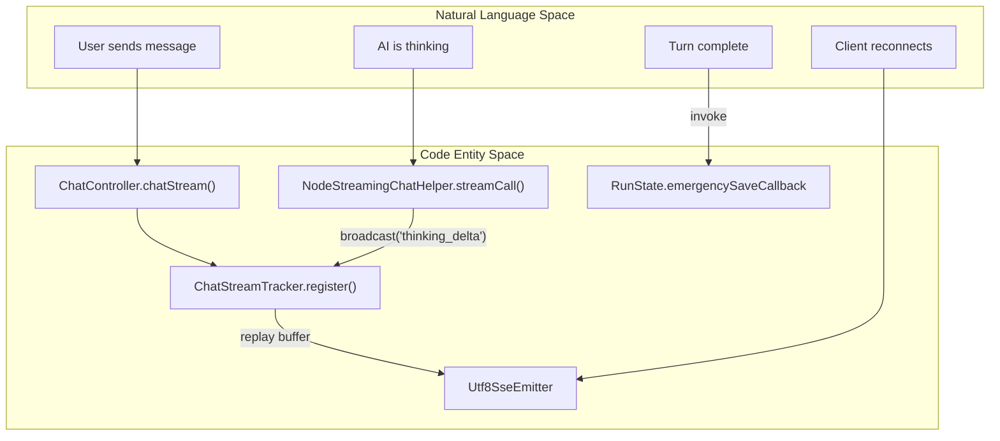
**Sources:** [mateclaw-server/src/main/java/vip/mate/channel/web/ChatStreamTracker.java:23-48](), [mateclaw-server/src/main/java/vip/mate/channel/web/ChatStreamTracker.java:173-185](), [mateclaw-server/src/main/java/vip/mate/channel/web/ChatController.java:75-83](), [mateclaw-server/src/main/java/vip/mate/agent/graph/NodeStreamingChatHelper.java:32-34]()

## Buffer & Reconnection Management

`ChatStreamTracker` maintains a `buffer` of `SseEvent` objects within each `RunState`. This buffer ensures that if a connection drops during a long-running task, the client receives the full history upon reconnecting.

*   **Buffer Size**: Limited to 16,000 events. When exceeded, the system drops the oldest `thinking_delta` events to prioritize final content. [mateclaw-server/src/main/java/vip/mate/channel/web/ChatStreamTracker.java:56-56]()
*   **Sticky Sessions**: In multi-node deployments, the system assumes a single-instance model. Load balancers MUST be configured for sticky sessions based on `conversationId`. [mateclaw-server/src/main/java/vip/mate/channel/web/ChatStreamTracker.java:30-36]()
*   **Heartbeats**: A background `ScheduledExecutorService` sends heartbeats to prevent intermediate proxies from closing "idle" SSE connections. [mateclaw-server/src/main/java/vip/mate/channel/web/ChatStreamTracker.java:162-167]()
*   **Reconnection Logic**: If `request.getReconnect()` is true, `ChatController` attempts to `attach` to an existing `RunState`. If it fails, it distinguishes between "stream finished" and "stream not local" (multi-node routing issue). [mateclaw-server/src/main/java/vip/mate/channel/web/ChatController.java:107-133]()

**Sources:** [mateclaw-server/src/main/java/vip/mate/channel/web/ChatStreamTracker.java:55-58](), [mateclaw-server/src/main/java/vip/mate/channel/web/ChatStreamTracker.java:162-167](), [mateclaw-server/src/main/java/vip/mate/channel/web/ChatController.java:86-138]()

## Interrupt & Queue Pipeline

MateClaw supports two types of interrupts via the `InterruptType` enum:
1.  **USER_STOP**: Terminating the current turn immediately, stopping all further execution. [mateclaw-server/src/main/java/vip/mate/channel/web/ChatStreamTracker.java:71-71]()
2.  **USER_INTERRUPT_WITH_FOLLOWUP**: Interrupting the current turn to process a new high-priority message, with the previous turn's context preserved and new messages queued. [mateclaw-server/src/main/java/vip/mate/channel/web/ChatStreamTracker.java:73-73]()

### State Transitions and Queuing

The `RunState` contains a `messageQueue` (a `ConcurrentLinkedQueue`) to handle messages sent while the agent is busy. The `stopRequested` flag is checked by graph nodes to trigger early exit. [mateclaw-server/src/main/java/vip/mate/channel/web/ChatStreamTracker.java:85-85](), [mateclaw-server/src/main/java/vip/mate/channel/web/ChatStreamTracker.java:107-107]()

Title: Interrupt and Queue Logic
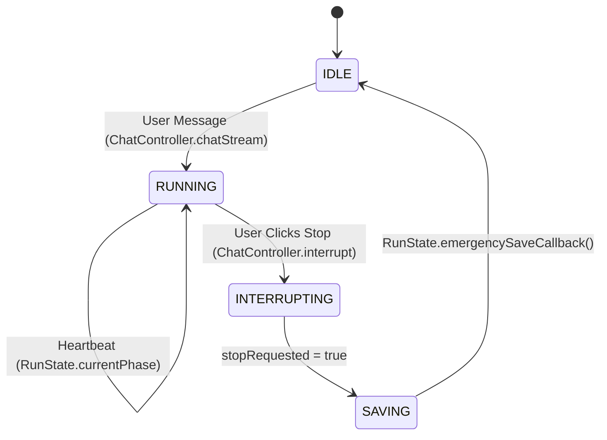

**Sources:** [mateclaw-server/src/main/java/vip/mate/channel/web/ChatStreamTracker.java:69-74](), [mateclaw-server/src/main/java/vip/mate/channel/web/ChatStreamTracker.java:107-107](), [mateclaw-server/src/main/java/vip/mate/channel/web/ChatController.java:231-255]()

## Emergency Save & JVM Shutdown

To prevent data loss during server restarts or crashes, `RunState` includes an `emergencySaveCallback`. This `Runnable` is registered by `ChatController` and captures the accumulated assistant content and tool calls.

*   **Trigger**: Invoked during `onShutdown()` via `@PreDestroy` or when a stream is explicitly stopped. [mateclaw-server/src/main/java/vip/mate/channel/web/ChatStreamTracker.java:110-119](), [mateclaw-server/src/main/java/vip/mate/channel/web/ChatStreamTracker.java:323-332]()
*   **Idempotency**: The callback is designed to be idempotent, as it may race with the normal `doOnComplete` persistence logic. [mateclaw-server/src/main/java/vip/mate/channel/web/ChatStreamTracker.java:115-118]()

**Sources:** [mateclaw-server/src/main/java/vip/mate/channel/web/ChatStreamTracker.java:110-120](), [mateclaw-server/src/main/java/vip/mate/channel/web/ChatStreamTracker.java:323-332]()

## Event Types & StreamDelta

The system broadcasts structured events through `ChatStreamTracker`. Common event names include:

| Event Name | Data Payload | Purpose |
| :--- | :--- | :--- |
| `content_delta` | `{"text": "..."}` | Incremental assistant response text. [mateclaw-server/src/main/java/vip/mate/agent/graph/NodeStreamingChatHelper.java:34-34]() |
| `thinking_delta` | `{"text": "..."}` | Incremental reasoning/thinking text. [mateclaw-server/src/main/java/vip/mate/agent/graph/NodeStreamingChatHelper.java:34-34]() |
| `phase` | `{"name": "...", "data": {}}` | Updates on the current agent phase (e.g., `thinking`, `summarizing`). [mateclaw-server/src/main/java/vip/mate/agent/graph/node/SummarizingNode.java:89-92]() |
| `done` | `{"status": "completed"}` | Signals the end of the stream. [mateclaw-server/src/main/java/vip/mate/channel/web/ChatController.java:113-113]() |
| `error` | `{"message": "..."}` | Signals a fatal execution error. [mateclaw-server/src/main/java/vip/mate/channel/web/ChatController.java:93-93]() |

**Sources:** [mateclaw-server/src/main/java/vip/mate/agent/graph/NodeStreamingChatHelper.java:30-37](), [mateclaw-server/src/main/java/vip/mate/agent/graph/node/SummarizingNode.java:89-92](), [mateclaw-server/src/main/java/vip/mate/channel/web/ChatController.java:93-113]()

---

# Page: Tool Execution & Security

# Tool Execution & Security

<details>
<summary>Relevant source files</summary>

The following files were used as context for generating this wiki page:

- [mateclaw-server/src/main/java/vip/mate/agent/AgentGraphBuilder.java](mateclaw-server/src/main/java/vip/mate/agent/AgentGraphBuilder.java)
- [mateclaw-server/src/main/java/vip/mate/agent/BaseAgent.java](mateclaw-server/src/main/java/vip/mate/agent/BaseAgent.java)
- [mateclaw-server/src/main/java/vip/mate/agent/graph/NodeStreamingChatHelper.java](mateclaw-server/src/main/java/vip/mate/agent/graph/NodeStreamingChatHelper.java)
- [mateclaw-server/src/main/java/vip/mate/agent/graph/executor/ToolExecutionExecutor.java](mateclaw-server/src/main/java/vip/mate/agent/graph/executor/ToolExecutionExecutor.java)
- [mateclaw-server/src/main/java/vip/mate/agent/graph/node/ReasoningNode.java](mateclaw-server/src/main/java/vip/mate/agent/graph/node/ReasoningNode.java)
- [mateclaw-server/src/main/java/vip/mate/approval/ApprovalController.java](mateclaw-server/src/main/java/vip/mate/approval/ApprovalController.java)
- [mateclaw-server/src/main/java/vip/mate/approval/ApprovalService.java](mateclaw-server/src/main/java/vip/mate/approval/ApprovalService.java)
- [mateclaw-server/src/main/java/vip/mate/channel/web/ChatController.java](mateclaw-server/src/main/java/vip/mate/channel/web/ChatController.java)
- [mateclaw-server/src/main/java/vip/mate/config/DatabaseBootstrapRunner.java](mateclaw-server/src/main/java/vip/mate/config/DatabaseBootstrapRunner.java)
- [mateclaw-server/src/main/java/vip/mate/skill/runtime/SkillDependencyChecker.java](mateclaw-server/src/main/java/vip/mate/skill/runtime/SkillDependencyChecker.java)
- [mateclaw-server/src/main/java/vip/mate/tool/ToolRegistry.java](mateclaw-server/src/main/java/vip/mate/tool/ToolRegistry.java)
- [mateclaw-server/src/main/java/vip/mate/tool/builtin/ReadFileTool.java](mateclaw-server/src/main/java/vip/mate/tool/builtin/ReadFileTool.java)
- [mateclaw-server/src/main/java/vip/mate/tool/builtin/ShellExecuteTool.java](mateclaw-server/src/main/java/vip/mate/tool/builtin/ShellExecuteTool.java)
- [mateclaw-server/src/main/java/vip/mate/tool/guard/WorkspacePathGuard.java](mateclaw-server/src/main/java/vip/mate/tool/guard/WorkspacePathGuard.java)
- [mateclaw-server/src/main/java/vip/mate/tool/guard/guardian/FileWriteGuardian.java](mateclaw-server/src/main/java/vip/mate/tool/guard/guardian/FileWriteGuardian.java)

</details>


The `ToolExecutionExecutor` serves as the central engine for invoking capabilities within MateClaw. It implements a robust security architecture that balances high-performance parallel execution with strict Human-in-the-Loop (HIL) safety controls and workspace isolation.

## ToolExecutionExecutor: Two-Phase Model

The `ToolExecutionExecutor` manages the lifecycle of tool calls issued by an LLM. It employs a two-phase execution strategy to ensure that security checks and concurrency constraints are respected before any code is executed [mateclaw-server/src/main/java/vip/mate/agent/graph/executor/ToolExecutionExecutor.java:28-35]().

### 1. Preparation Phase (Phase 1)
In this phase, the executor iterates through the requested tool calls sequentially to perform:
*   **Registry Lookup**: Resolving tool names to `ToolCallback` instances via the `ToolRegistry` [mateclaw-server/src/main/java/vip/mate/agent/graph/executor/ToolExecutionExecutor.java:30-30]().
*   **Guard Evaluation**: Passing the invocation context to the `ToolGuard` system for safety analysis [mateclaw-server/src/main/java/vip/mate/agent/graph/executor/ToolExecutionExecutor.java:30-30]().
*   **Concurrency Classification**: Checking if tools are marked with `@ConcurrencyUnsafe` or listed in the `ToolConcurrencyRegistry` [mateclaw-server/src/main/java/vip/mate/agent/graph/executor/ToolExecutionExecutor.java:30-30]().
*   **Approval Barrier Detection**: Identifying the first tool that requires manual user approval. If the $N$-th tool requires approval, tools $N+1$ and beyond are not executed [mateclaw-server/src/main/java/vip/mate/agent/graph/executor/ToolExecutionExecutor.java:34-35]().

### 2. Execution Phase (Phase 2)
Based on the preparation, the executor dispatches tools using a hybrid batching model:
*   **Parallel Execution**: Tools identified as "Concurrency Safe" and appearing before any approval barrier are executed simultaneously using Java 21 Virtual Threads [mateclaw-server/src/main/java/vip/mate/agent/graph/executor/ToolExecutionExecutor.java:42-47]().
*   **Sequential Execution**: Tools marked as "Unsafe" (e.g., `browser_use`, `write_file`) are executed one by one to prevent race conditions or resource conflicts [mateclaw-server/src/main/java/vip/mate/agent/graph/executor/ToolExecutionExecutor.java:56-58]().
*   **Truncation**: Results are intelligently truncated to a hard cap (default 8000 characters) to prevent prompt inflation. The logic detects error patterns (e.g., "stacktrace", "panic") in the tail to preserve them for the agent's reasoning [mateclaw-server/src/main/java/vip/mate/agent/graph/executor/ToolExecutionExecutor.java:75-75](), [mateclaw-server/src/main/java/vip/mate/agent/graph/executor/ToolExecutionExecutor.java:94-112]().

**Sources:** [mateclaw-server/src/main/java/vip/mate/agent/graph/executor/ToolExecutionExecutor.java:25-112](), [mateclaw-server/src/main/java/vip/mate/tool/ToolRegistry.java:118-168]()

## Security & Guard Evaluation

MateClaw implements a multi-layered security stack to prevent malicious tool usage and unauthorized access.

### ToolGuard & Approval Flow
The `ToolGuardService` evaluates tool calls against configured rules. Each evaluation results in a decision: `ALLOW`, `NEEDS_APPROVAL`, or `BLOCK` [mateclaw-server/src/main/java/vip/mate/agent/graph/executor/ToolExecutionExecutor.java:15-19]().

*   **ApprovalBarrier**: If a tool triggers `NEEDS_APPROVAL`, the `ToolExecutionExecutor` halts execution and creates a `PendingApproval` record via `ApprovalService` [mateclaw-server/src/main/java/vip/mate/approval/ApprovalService.java:67-71]().
*   **HIL Approval Flow**: The `ChatController` detects the pending state and surfaces an approval banner in the UI [mateclaw-server/src/main/java/vip/mate/channel/web/ChatController.java:18-21](). Once approved, the `ReasoningNode` uses a `forced_tool_call` mechanism to replay the approved call [mateclaw-server/src/main/java/vip/mate/agent/graph/node/ReasoningNode.java:43-45]().
*   **ShellCommandGuardian**: Specialized logic for `execute_shell_command` prevents dangerous operations. It uses a 60-second default timeout and redirects output to temporary files to ensure timeouts are not blocked by pipe buffers [mateclaw-server/src/main/java/vip/mate/tool/builtin/ShellExecuteTool.java:21-30](), [mateclaw-server/src/main/java/vip/mate/tool/builtin/ShellExecuteTool.java:78-86]().

### WorkspacePathGuard
To prevent directory traversal, the `WorkspacePathGuard` validates every file path used by tools like `read_file` or `write_file` [mateclaw-server/src/main/java/vip/mate/tool/builtin/ReadFileTool.java:68-69]().
*   It ensures paths stay within the `workspaceBasePath` defined for the agent [mateclaw-server/src/main/java/vip/mate/agent/BaseAgent.java:54-56]().
*   If a tool receives a hallucinated path, it attempts to resolve it against the `CHAT_UPLOAD_ROOT` (data/chat-uploads) before rejecting it [mateclaw-server/src/main/java/vip/mate/tool/builtin/ReadFileTool.java:41-42](), [mateclaw-server/src/main/java/vip/mate/tool/builtin/ReadFileTool.java:71-79]().

**Sources:** [mateclaw-server/src/main/java/vip/mate/agent/graph/executor/ToolExecutionExecutor.java:39-60](), [mateclaw-server/src/main/java/vip/mate/agent/graph/node/ReasoningNode.java:37-47](), [mateclaw-server/src/main/java/vip/mate/tool/builtin/ReadFileTool.java:57-109](), [mateclaw-server/src/main/java/vip/mate/approval/ApprovalService.java:31-94]()

## Tool Data Flow and Entity Mapping

The following diagram bridges the natural language request for a tool to the specific code entities responsible for execution.

### Tool Execution Logic Mapping
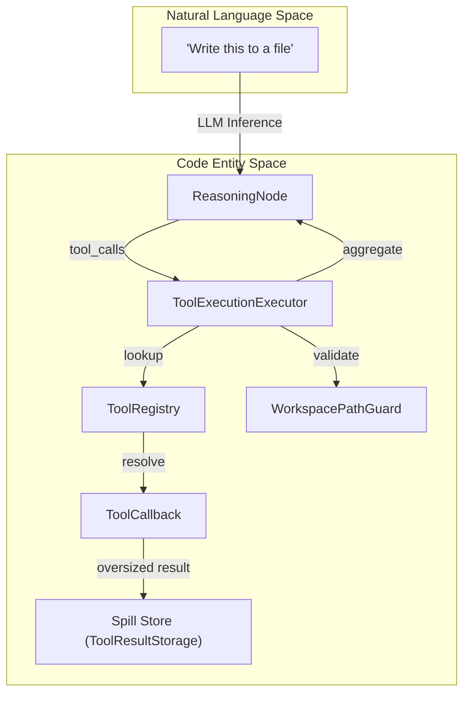
**Sources:** [mateclaw-server/src/main/java/vip/mate/agent/graph/node/ReasoningNode.java:51-103](), [mateclaw-server/src/main/java/vip/mate/agent/graph/executor/ToolExecutionExecutor.java:39-60](), [mateclaw-server/src/main/java/vip/mate/tool/ToolRegistry.java:29-38]()

## Oversized Results & Spill Store

MateClaw implements a three-level budget chain (RFC-008) to maintain performance while handling large data [mateclaw-server/src/main/java/vip/mate/agent/graph/executor/ToolExecutionExecutor.java:64-70]():

1.  **Layer 1 (Hard Cap)**: `truncateToolResult` clips the string to 8000 characters for the LLM prompt [mateclaw-server/src/main/java/vip/mate/agent/graph/executor/ToolExecutionExecutor.java:75-75]().
2.  **Layer 2 (Spill Store)**: If the result exceeds the spill threshold (e.g., 16KB), the full content is persisted to disk via `ToolResultStorage` [mateclaw-server/src/main/java/vip/mate/agent/graph/executor/ToolExecutionExecutor.java:68-68]().
3.  **Layer 3 (Turn Budget)**: The aggregate size of all tool results in a single turn is limited (e.g., 32KB) to prevent memory exhaustion [mateclaw-server/src/main/java/vip/mate/agent/graph/executor/ToolExecutionExecutor.java:69-69]().

**Sources:** [mateclaw-server/src/main/java/vip/mate/agent/graph/executor/ToolExecutionExecutor.java:61-75](), [mateclaw-server/src/main/java/vip/mate/agent/graph/executor/ToolExecutionExecutor.java:94-112]()

## Registry & Concurrency Control

### ToolRegistry
The `ToolRegistry` is the authoritative source for all available tools, including:
*   **Built-in Tools**: Annotated with `@Tool` [mateclaw-server/src/main/java/vip/mate/tool/ToolRegistry.java:73-109]().
*   **Plugin Tools**: Registered via the Plugin SDK with lazy availability checks [mateclaw-server/src/main/java/vip/mate/tool/ToolRegistry.java:53-59]().
*   **MCP Tools**: Provided by external Model Context Protocol servers via `ToolCallbackProvider` [mateclaw-server/src/main/java/vip/mate/tool/ToolRegistry.java:141-147]().

### ConcurrencyUnsafe
Tools that interact with shared resources are marked as unsafe to prevent parallel execution conflicts.
*   **Annotation**: Developers use `@ConcurrencyUnsafe` (e.g., on `ShellExecuteTool.execute_shell_command`) [mateclaw-server/src/main/java/vip/mate/tool/builtin/ShellExecuteTool.java:46-46]().
*   **Registry**: The `ToolConcurrencyRegistry` maintains a metadata-driven list of these tools [mateclaw-server/src/main/java/vip/mate/agent/graph/executor/ToolExecutionExecutor.java:123-124]().
*   **Fallback**: A hardcoded list (e.g., `browser_use`, `write_file`) is used for backward compatibility [mateclaw-server/src/main/java/vip/mate/agent/graph/executor/ToolExecutionExecutor.java:56-58]().

### Tool System Sequence
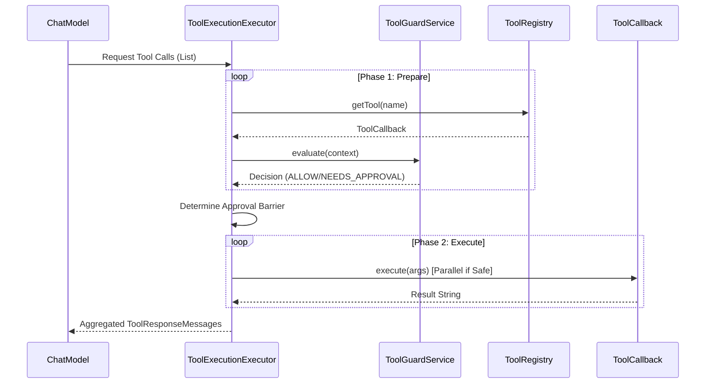
**Sources:** [mateclaw-server/src/main/java/vip/mate/agent/graph/executor/ToolExecutionExecutor.java:25-112](), [mateclaw-server/src/main/java/vip/mate/agent/graph/node/ReasoningNode.java:51-103](), [mateclaw-server/src/main/java/vip/mate/tool/ToolRegistry.java:118-168]()

---

# Page: Conversation & History Management

# Conversation & History Management

<details>
<summary>Relevant source files</summary>

The following files were used as context for generating this wiki page:

- [mateclaw-server/src/main/java/vip/mate/agent/context/ConversationWindowManager.java](mateclaw-server/src/main/java/vip/mate/agent/context/ConversationWindowManager.java)
- [mateclaw-server/src/main/java/vip/mate/agent/graph/RepetitionDetector.java](mateclaw-server/src/main/java/vip/mate/agent/graph/RepetitionDetector.java)
- [mateclaw-server/src/main/java/vip/mate/agent/graph/edge/ReasoningDispatcher.java](mateclaw-server/src/main/java/vip/mate/agent/graph/edge/ReasoningDispatcher.java)
- [mateclaw-server/src/main/java/vip/mate/agent/graph/node/ObservationNode.java](mateclaw-server/src/main/java/vip/mate/agent/graph/node/ObservationNode.java)
- [mateclaw-server/src/main/java/vip/mate/config/WebSocketConfig.java](mateclaw-server/src/main/java/vip/mate/config/WebSocketConfig.java)
- [mateclaw-server/src/main/java/vip/mate/tool/builtin/DelegateAgentTool.java](mateclaw-server/src/main/java/vip/mate/tool/builtin/DelegateAgentTool.java)
- [mateclaw-server/src/main/java/vip/mate/tool/builtin/DelegationContext.java](mateclaw-server/src/main/java/vip/mate/tool/builtin/DelegationContext.java)
- [mateclaw-server/src/main/java/vip/mate/workspace/conversation/ConversationService.java](mateclaw-server/src/main/java/vip/mate/workspace/conversation/ConversationService.java)
- [mateclaw-server/src/main/java/vip/mate/workspace/conversation/controller/ConversationController.java](mateclaw-server/src/main/java/vip/mate/workspace/conversation/controller/ConversationController.java)
- [mateclaw-server/src/main/java/vip/mate/workspace/conversation/model/ConversationEntity.java](mateclaw-server/src/main/java/vip/mate/workspace/conversation/model/ConversationEntity.java)
- [mateclaw-server/src/main/java/vip/mate/workspace/conversation/model/MessageContentPart.java](mateclaw-server/src/main/java/vip/mate/workspace/conversation/model/MessageContentPart.java)
- [mateclaw-server/src/main/resources/db/migration/h2/V5__conversation_parent.sql](mateclaw-server/src/main/resources/db/migration/h2/V5__conversation_parent.sql)
- [mateclaw-server/src/main/resources/prompts/graph/limit-exceeded-system.txt](mateclaw-server/src/main/resources/prompts/graph/limit-exceeded-system.txt)
- [mateclaw-server/src/test/java/vip/mate/agent/graph/RepetitionDetectorTest.java](mateclaw-server/src/test/java/vip/mate/agent/graph/RepetitionDetectorTest.java)
- [mateclaw-ui/src/components/chat/ChatInput.vue](mateclaw-ui/src/components/chat/ChatInput.vue)
- [mateclaw-ui/src/components/chat/ToolCallSegment.vue](mateclaw-ui/src/components/chat/ToolCallSegment.vue)
- [mateclaw-ui/src/composables/chat/useChat.ts](mateclaw-ui/src/composables/chat/useChat.ts)
- [mateclaw-ui/src/composables/chat/useStream.ts](mateclaw-ui/src/composables/chat/useStream.ts)
- [mateclaw-ui/src/composables/useToolLabel.ts](mateclaw-ui/src/composables/useToolLabel.ts)
- [mateclaw-ui/src/views/ChatConsole.vue](mateclaw-ui/src/views/ChatConsole.vue)

</details>


The Conversation and History Management system in MateClaw is responsible for the persistence, retrieval, and optimization of agentic interactions. It manages the lifecycle of `ConversationEntity` and `MessageEntity` objects, provides context window optimization via the `ConversationWindowManager`, and facilitates complex multi-agent collaboration through parent-child delegation.

## Conversation Architecture

MateClaw distinguishes between top-level user conversations and internal child conversations used for delegation. All conversations are workspace-aware and linked to specific agents.

### Key Entities
*   **ConversationEntity**: Represents a chat session. It tracks `conversationId`, `agentId`, `username`, `workspaceId`, and `streamStatus` [mateclaw-server/src/main/java/vip/mate/workspace/conversation/model/ConversationEntity.java:15-35]().
*   **MessageEntity**: Represents an individual turn in a conversation. It supports multiple roles (`user`, `assistant`, `system`, `tool`) and stores rich metadata like `toolCalls`, `tokenUsage`, and `content_parts` [mateclaw-server/src/main/java/vip/mate/workspace/conversation/model/MessageEntity.java:15-40]().

### Data Flow: Message Persistence
The `ConversationService` acts as the primary orchestrator for CRUD operations on history.

| Function | Description | Source |
| :--- | :--- | :--- |
| `getOrCreateConversation` | Retrieves an existing session or initializes a new one with default metadata. | [mateclaw-server/src/main/java/vip/mate/workspace/conversation/ConversationService.java:114-132]() |
| `listConversations` | Fetches a user's conversations, excluding child delegation sessions from the sidebar. | [mateclaw-server/src/main/java/vip/mate/workspace/conversation/ConversationService.java:61-100]() |
| `saveMessage` | Persists a message and its associated `MessageContentPart` list. | [mateclaw-server/src/main/java/vip/mate/workspace/conversation/ConversationService.java:232-261]() |
| `renameConversation` | Updates the title of a conversation via `ConversationMapper`. | [mateclaw-server/src/main/java/vip/mate/workspace/conversation/ConversationService.java:185-195]() |

### Conversation Parent/Child Relationships
To support multi-agent collaboration, MateClaw implements a hierarchical conversation model. When an agent uses the `DelegateAgentTool`, a child conversation is created with a `parent_conversation_id` reference [mateclaw-server/src/main/java/vip/mate/workspace/conversation/ConversationService.java:137-146](). These child sessions are filtered out of the main UI sidebar by the `isNull(ConversationEntity::getParentConversationId)` condition to keep the user interface clean [mateclaw-server/src/main/java/vip/mate/workspace/conversation/ConversationService.java:64-67]().

Sources: [mateclaw-server/src/main/java/vip/mate/workspace/conversation/ConversationService.java:42-160](), [mateclaw-server/src/main/java/vip/mate/workspace/conversation/model/ConversationEntity.java:15-35]()

---

## Context Window Management (RFC-052)

The `ConversationWindowManager` (Hermes-style) manages the LLM context window by applying a four-stage compression strategy when token usage exceeds the `compactTriggerRatio` [mateclaw-server/src/main/java/vip/mate/agent/context/ConversationWindowManager.java:28-52]().

### Compression Pipeline
1.  **Soft Trim**: Truncates long tool results to a "head + tail" format [mateclaw-server/src/main/java/vip/mate/agent/context/ConversationWindowManager.java:30]().
2.  **Hard Clear**: Replaces old tool results with placeholders to save space [mateclaw-server/src/main/java/vip/mate/agent/context/ConversationWindowManager.java:31]().
3.  **Pre-Prune**: Strips unnecessary metadata before sending history to a summarizer LLM [mateclaw-server/src/main/java/vip/mate/agent/context/ConversationWindowManager.java:32]().
4.  **LLM Iterative Summary**: Generates a structured summary (Goals, Progress, Decisions, Files) and injects it as a `UserMessage` to avoid system-level instruction leakage [mateclaw-server/src/main/java/vip/mate/agent/context/ConversationWindowManager.java:33-45]().

### Token Budgeting Logic
The manager calculates a dynamic `historyBudget` by subtracting the system prompt, current user message, and a 5% safety margin from the model's `maxInputTokens` [mateclaw-server/src/main/java/vip/mate/agent/context/ConversationWindowManager.java:142-154](). To prevent infinite loops in small-context models (e.g., 8K), the reserved tokens are capped at 50% of the total window using `reservedCap` [mateclaw-server/src/main/java/vip/mate/agent/context/ConversationWindowManager.java:148-153]().

### Context Compression Flow
Title: "Context Window Optimization Logic"
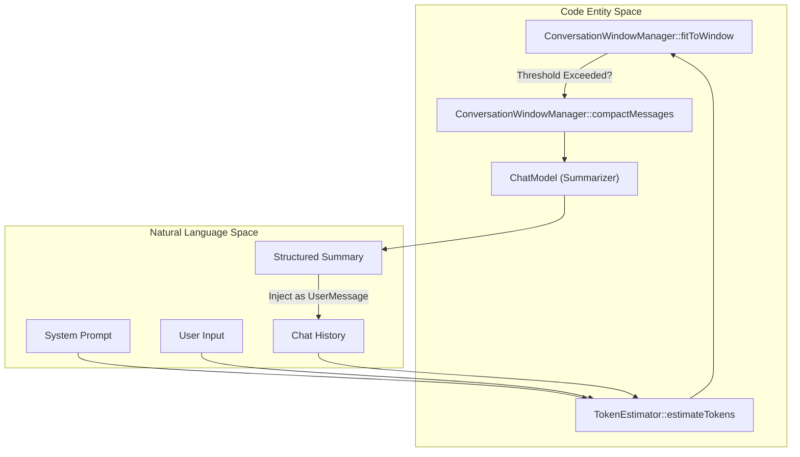
Sources: [mateclaw-server/src/main/java/vip/mate/agent/context/ConversationWindowManager.java:103-160](), [mateclaw-server/src/main/java/vip/mate/agent/context/ConversationWindowManager.java:56-67]()

---

## Agent-to-Agent Delegation

The `DelegateAgentTool` enables complex multi-agent workflows by allowing one agent to spawn child agents.

### Delegation Modes
*   **Serial Delegation**: `delegateToAgent` spawns a single child agent and waits for a final reply [mateclaw-server/src/main/java/vip/mate/tool/builtin/DelegateAgentTool.java:77-124]().
*   **Parallel Delegation**: `delegateParallel` executes up to 3 child agents simultaneously using JDK 21 Virtual Threads via `DELEGATION_EXECUTOR` [mateclaw-server/src/main/java/vip/mate/tool/builtin/DelegateAgentTool.java:134-151]().

### Security & Recursion Control
To prevent infinite loops and resource exhaustion, the system enforces:
*   **Max Depth**: Hard limit of 3 levels of delegation [mateclaw-server/src/main/java/vip/mate/tool/builtin/DelegateAgentTool.java:41]().
*   **Tool Blocking**: Child agents are automatically denied access to `delegateToAgent`, `delegateParallel`, and `listAvailableAgents` defined in `CHILD_DENIED_TOOLS` [mateclaw-server/src/main/java/vip/mate/tool/builtin/DelegateAgentTool.java:53-57]().
*   **Context Tracking**: `DelegationContext` uses a `ThreadLocal` stack to maintain parent IDs and denied tool sets across nested calls [mateclaw-server/src/main/java/vip/mate/tool/builtin/DelegationContext.java:16-47]().

### Real-time Event Relay
During delegation, child agent progress is relayed back to the parent session via `ChatStreamTracker` using SSE events like `delegation_start` and `delegation_progress` [mateclaw-server/src/main/java/vip/mate/tool/builtin/DelegateAgentTool.java:105-112]().

Sources: [mateclaw-server/src/main/java/vip/mate/tool/builtin/DelegateAgentTool.java:39-160](), [mateclaw-server/src/main/java/vip/mate/tool/builtin/DelegationContext.java:21-65]()

---

## Message Content & Multimodal Injection

Messages in MateClaw are composed of `MessageContentPart` objects, allowing for multimodal and rich-text content.

### Content Part Types
*   **Text**: Standard chat text.
*   **Image**: Base64 or URL references for vision-capable models.
*   **File/Attachment**: References to files uploaded via `ChatInput.vue` [mateclaw-ui/src/components/chat/ChatInput.vue:12-58]().

### Multimodal Data Flow
Title: "Multimodal Message Processing"
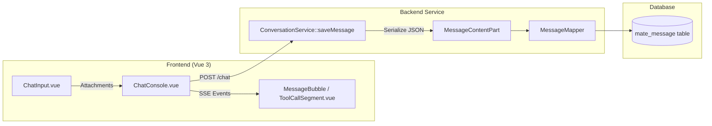
Sources: [mateclaw-server/src/main/java/vip/mate/workspace/conversation/ConversationService.java:232-261](), [mateclaw-ui/src/components/chat/ToolCallSegment.vue:61-89](), [mateclaw-ui/src/components/chat/ChatInput.vue:12-58]()

---

## Shared and System Conversations

MateClaw supports specialized conversation types for external channels and automated tasks:

1.  **Shared Conversations**: Used for IM channels (WeChat, Feishu). These are owned by the `SYSTEM_USER` ("system") to ensure they remain visible in the administrative console regardless of the specific external sender [mateclaw-server/src/main/java/vip/mate/workspace/conversation/ConversationService.java:155-175]().
2.  **Child Conversations**: Created during delegation, these are marked with a `parentConversationId` and titled "子任务" (Sub-task) [mateclaw-server/src/main/java/vip/mate/workspace/conversation/ConversationService.java:137-146]().
3.  **Stream Tracking**: The `ChatStreamTracker` provides real-time status of whether a conversation is currently "running" or "idle" [mateclaw-server/src/main/java/vip/mate/workspace/conversation/controller/ConversationController.java:148-159]().

Sources: [mateclaw-server/src/main/java/vip/mate/workspace/conversation/ConversationService.java:155-180](), [mateclaw-server/src/main/java/vip/mate/workspace/conversation/controller/ConversationController.java:143-160]()

---

# Page: LLM Provider Layer

# LLM Provider Layer

<details>
<summary>Relevant source files</summary>

The following files were used as context for generating this wiki page:

- [mateclaw-server/src/main/java/vip/mate/agent/chatmodel/AgentAnthropicChatModelBuilder.java](mateclaw-server/src/main/java/vip/mate/agent/chatmodel/AgentAnthropicChatModelBuilder.java)
- [mateclaw-server/src/main/java/vip/mate/agent/chatmodel/AgentDashScopeChatModelBuilder.java](mateclaw-server/src/main/java/vip/mate/agent/chatmodel/AgentDashScopeChatModelBuilder.java)
- [mateclaw-server/src/main/java/vip/mate/llm/cache/CachePlanContext.java](mateclaw-server/src/main/java/vip/mate/llm/cache/CachePlanContext.java)
- [mateclaw-server/src/main/java/vip/mate/llm/model/ModelInfoDTO.java](mateclaw-server/src/main/java/vip/mate/llm/model/ModelInfoDTO.java)
- [mateclaw-server/src/main/java/vip/mate/llm/model/ModelProtocol.java](mateclaw-server/src/main/java/vip/mate/llm/model/ModelProtocol.java)
- [mateclaw-server/src/main/java/vip/mate/llm/model/ProviderInfoDTO.java](mateclaw-server/src/main/java/vip/mate/llm/model/ProviderInfoDTO.java)
- [mateclaw-server/src/main/java/vip/mate/llm/service/ModelConfigService.java](mateclaw-server/src/main/java/vip/mate/llm/service/ModelConfigService.java)
- [mateclaw-server/src/main/java/vip/mate/llm/service/ModelDiscoveryService.java](mateclaw-server/src/main/java/vip/mate/llm/service/ModelDiscoveryService.java)
- [mateclaw-server/src/main/java/vip/mate/llm/service/ModelProviderService.java](mateclaw-server/src/main/java/vip/mate/llm/service/ModelProviderService.java)
- [mateclaw-server/src/main/java/vip/mate/memory/event/MemoryWriteEvent.java](mateclaw-server/src/main/java/vip/mate/memory/event/MemoryWriteEvent.java)
- [mateclaw-server/src/main/java/vip/mate/memory/service/SoulSummarizerService.java](mateclaw-server/src/main/java/vip/mate/memory/service/SoulSummarizerService.java)
- [mateclaw-server/src/main/java/vip/mate/memory/service/StructuredMemoryService.java](mateclaw-server/src/main/java/vip/mate/memory/service/StructuredMemoryService.java)
- [mateclaw-server/src/main/java/vip/mate/memory/spi/MemoryManager.java](mateclaw-server/src/main/java/vip/mate/memory/spi/MemoryManager.java)
- [mateclaw-server/src/main/java/vip/mate/memory/spi/MemoryProvider.java](mateclaw-server/src/main/java/vip/mate/memory/spi/MemoryProvider.java)
- [mateclaw-server/src/main/resources/db/migration/h2/V15__purge_unavailable_dashscope_models.sql](mateclaw-server/src/main/resources/db/migration/h2/V15__purge_unavailable_dashscope_models.sql)
- [mateclaw-server/src/main/resources/db/migration/h2/V42__claude_47_gpt_55_models.sql](mateclaw-server/src/main/resources/db/migration/h2/V42__claude_47_gpt_55_models.sql)
- [mateclaw-server/src/main/resources/db/migration/mysql/V15__purge_unavailable_dashscope_models.sql](mateclaw-server/src/main/resources/db/migration/mysql/V15__purge_unavailable_dashscope_models.sql)
- [mateclaw-server/src/main/resources/db/migration/mysql/V42__claude_47_gpt_55_models.sql](mateclaw-server/src/main/resources/db/migration/mysql/V42__claude_47_gpt_55_models.sql)
- [mateclaw-ui/src/views/Settings/Models/ProviderCard.vue](mateclaw-ui/src/views/Settings/Models/ProviderCard.vue)
- [mateclaw-ui/src/views/Settings/Models/index.vue](mateclaw-ui/src/views/Settings/Models/index.vue)
- [mateclaw-ui/src/views/Settings/Models/modals/ProviderConfigModal.vue](mateclaw-ui/src/views/Settings/Models/modals/ProviderConfigModal.vue)
- [mateclaw-ui/src/views/Settings/Models/useProviders.ts](mateclaw-ui/src/views/Settings/Models/useProviders.ts)

</details>


The **LLM Provider Layer** is the abstraction foundation of MateClaw that enables the platform to interact with diverse Large Language Model (LLM) backends through a unified interface. It handles the complexities of different API protocols, manages model configurations, ensures high availability via failover mechanisms, and provides specialized builders for advanced features like Anthropic's extended thinking or Claude Code OAuth authentication.

## System Architecture

The layer bridges the gap between the high-level agent runtime and specific vendor implementations. It uses a protocol-based dispatch system to resolve how a model request should be formatted and authenticated.

### Provider to Code Entity Mapping
The following diagram illustrates how the system maps logical providers and protocols to specific Java entities and database records.

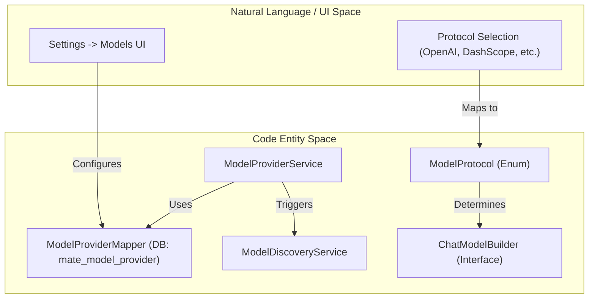

**Sources:**
- `ModelProviderService.java`: [23-35]()
- `ModelProtocol.java`: [1-20]()
- `ModelProviderMapper.java` (referenced): [30-31]()
- `useProviders.ts`: [54-59]()

---

## Provider Management & Failover

MateClaw treats LLM providers as a pool of resources. The `ModelProviderService` manages the lifecycle of these providers, including built-in ones (OpenAI, Anthropic, DashScope) and user-defined custom providers.

*   **Model Discovery:** The `ModelDiscoveryService` can automatically fetch available models from a provider's endpoint. It includes a multi-layered filtering system to exclude models that are incompatible with native protocols, particularly for DashScope non-chat modalities or unsupported dot-versioned families [mateclaw-server/src/main/java/vip/mate/llm/service/ModelDiscoveryService.java:46-122]().
*   **Failover & Priority:** Providers can be assigned a `fallbackPriority`. When a primary model fails, the system uses this priority to navigate the failover chain [mateclaw-ui/src/views/Settings/Models/useProviders.ts:44-46]().
*   **Health Tracking:** A background mechanism tracks provider health, allowing for cooldown periods and automatic reprobing of failed endpoints. The UI reflects these states via badges (e.g., "In Cooldown", "Removed") [mateclaw-ui/src/views/Settings/Models/ProviderCard.vue:30-60]().

For details, see [Provider Management & Failover](#3.1).

**Sources:**
- `ModelProviderService.java`: [63-123]()
- `ModelDiscoveryService.java`: [126-159]()
- `useProviders.ts`: [96-115]()
- `ProviderCard.vue`: [23-60]()

---

## ChatModel Builders & Decorators

The `ChatModelBuilder` interface is the core SPI (Service Provider Interface) for creating concrete `ChatModel` instances. The `AgentGraphBuilder` uses the `ModelProtocol` to resolve the correct builder at runtime.

| Protocol | Builder Class | Key Responsibilities |
| :--- | :--- | :--- |
| `ANTHROPIC_MESSAGES` | `AgentAnthropicChatModelBuilder` | Handles extended thinking tokens (4k-32k) and prompt caching [mateclaw-server/src/main/java/vip/mate/agent/chatmodel/AgentAnthropicChatModelBuilder.java:136-147](). |
| `ANTHROPIC_CLAUDE_CODE` | `AgentClaudeCodeChatModelBuilder` | Implements OAuth-based authentication for Claude Code identities. |
| `DASHSCOPE_NATIVE` | `AgentDashScopeChatModelBuilder` | Manages DashScope-specific search strategies and native protocol quirks [mateclaw-server/src/main/java/vip/mate/agent/chatmodel/AgentDashScopeChatModelBuilder.java:103-116](). |
| `OPENAI_COMPATIBLE` | `AgentOpenAiCompatibleChatModelBuilder` | Standard implementation for GPT and compatible APIs. |

### Model Capability Resolution
MateClaw detects model capabilities (like "Deep Thinking" or "Reasoning Effort") based on the model ID and family classification to enable/disable UI features dynamically.

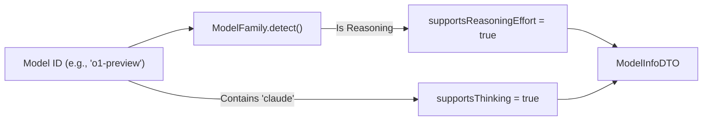

For details, see [ChatModel Builders & Decorators](#3.2).

**Sources:**
- `ModelProtocol.java`: [1-20]()
- `ModelInfoDTO.java`: [32-63]()
- `AgentAnthropicChatModelBuilder.java`: [38-74]()
- `AgentDashScopeChatModelBuilder.java`: [58-70]()

---

## OAuth & Authentication Flows

Beyond standard API keys, MateClaw supports complex authentication flows, most notably for the **Claude Code** integration.

*   **OAuth Lifecycle:** Managed via `ClaudeCodeOAuthService`, this allows users to authenticate MateClaw as a "Claude Code" client, leveraging their personal Anthropic subscriptions.
*   **Token Management:** Includes automatic refreshing and local credential detection (e.g., from `~/.claude/.credentials.json`) [mateclaw-server/src/main/java/vip/mate/llm/service/ModelProviderService.java:27-28]().
*   **UI Integration:** The `ProviderConfigModal` dynamically renders OAuth login/revoke buttons when a provider's `authType` is set to `oauth` [mateclaw-ui/src/views/Settings/Models/modals/ProviderConfigModal.vue:28-61]().

For details, see [OAuth & Authentication Flows](#3.3).

**Sources:**
- `ModelProviderService.java`: [27-34]()
- `ProviderConfigModal.vue`: [28-61]()
- `CachePlanContext.java`: [59-66]()

---

## Database Schema & Migrations

The provider layer is backed by a robust schema that tracks configurations and maintains compatibility across model updates. Idempotent migrations ensure that default models like Claude 4.7 or GPT-5.5 are available across all deployments.

**Key Tables:**
*   `mate_model_provider`: Stores API keys, base URLs, and protocol settings.
*   `mate_model_config`: Stores specific model parameters like temperature, max tokens, and model type (chat vs. embedding) [mateclaw-server/src/main/java/vip/mate/llm/service/ModelConfigService.java:69-81]().

**Sources:**
- `ModelConfigService.java`: [35-58]()
- `V42__claude_47_gpt_55_models.sql (H2)`: [9-25]()
- `V42__claude_47_gpt_55_models.sql (MySQL)`: [9-37]()
- `V15__purge_unavailable_dashscope_models.sql`: [1-10]()

---

# Page: Provider Management & Failover

# Provider Management & Failover

<details>
<summary>Relevant source files</summary>

The following files were used as context for generating this wiki page:

- [mateclaw-server/src/main/java/vip/mate/llm/config/OllamaAutoDiscoveryRunner.java](mateclaw-server/src/main/java/vip/mate/llm/config/OllamaAutoDiscoveryRunner.java)
- [mateclaw-server/src/main/java/vip/mate/llm/failover/FallbackEntry.java](mateclaw-server/src/main/java/vip/mate/llm/failover/FallbackEntry.java)
- [mateclaw-server/src/main/java/vip/mate/llm/failover/ProviderHealthProperties.java](mateclaw-server/src/main/java/vip/mate/llm/failover/ProviderHealthProperties.java)
- [mateclaw-server/src/main/java/vip/mate/llm/failover/ProviderHealthTracker.java](mateclaw-server/src/main/java/vip/mate/llm/failover/ProviderHealthTracker.java)
- [mateclaw-server/src/main/java/vip/mate/llm/failover/probe/AnthropicListModelsProbe.java](mateclaw-server/src/main/java/vip/mate/llm/failover/probe/AnthropicListModelsProbe.java)
- [mateclaw-server/src/main/java/vip/mate/llm/failover/probe/DashScopeListModelsProbe.java](mateclaw-server/src/main/java/vip/mate/llm/failover/probe/DashScopeListModelsProbe.java)
- [mateclaw-server/src/main/java/vip/mate/llm/failover/probe/OpenAiCompatibleListModelsProbe.java](mateclaw-server/src/main/java/vip/mate/llm/failover/probe/OpenAiCompatibleListModelsProbe.java)
- [mateclaw-server/src/main/java/vip/mate/llm/model/ModelInfoDTO.java](mateclaw-server/src/main/java/vip/mate/llm/model/ModelInfoDTO.java)
- [mateclaw-server/src/main/java/vip/mate/llm/model/ProviderConfigRequest.java](mateclaw-server/src/main/java/vip/mate/llm/model/ProviderConfigRequest.java)
- [mateclaw-server/src/main/java/vip/mate/llm/service/ModelProviderService.java](mateclaw-server/src/main/java/vip/mate/llm/service/ModelProviderService.java)
- [mateclaw-server/src/main/resources/application-mysql.yml](mateclaw-server/src/main/resources/application-mysql.yml)
- [mateclaw-server/src/main/resources/db/migration/h2/V14__embedding_model_config.sql](mateclaw-server/src/main/resources/db/migration/h2/V14__embedding_model_config.sql)
- [mateclaw-server/src/main/resources/db/migration/h2/V15__purge_unavailable_dashscope_models.sql](mateclaw-server/src/main/resources/db/migration/h2/V15__purge_unavailable_dashscope_models.sql)
- [mateclaw-server/src/main/resources/db/migration/mysql/V11__skill_synthesis.sql](mateclaw-server/src/main/resources/db/migration/mysql/V11__skill_synthesis.sql)
- [mateclaw-server/src/main/resources/db/migration/mysql/V12__wiki_chunk_table.sql](mateclaw-server/src/main/resources/db/migration/mysql/V12__wiki_chunk_table.sql)
- [mateclaw-server/src/main/resources/db/migration/mysql/V13__wiki_chunk_embedding.sql](mateclaw-server/src/main/resources/db/migration/mysql/V13__wiki_chunk_embedding.sql)
- [mateclaw-server/src/main/resources/db/migration/mysql/V14__embedding_model_config.sql](mateclaw-server/src/main/resources/db/migration/mysql/V14__embedding_model_config.sql)
- [mateclaw-server/src/main/resources/db/migration/mysql/V15__purge_unavailable_dashscope_models.sql](mateclaw-server/src/main/resources/db/migration/mysql/V15__purge_unavailable_dashscope_models.sql)
- [mateclaw-server/src/main/resources/db/migration/mysql/V2__workspace_base_path.sql](mateclaw-server/src/main/resources/db/migration/mysql/V2__workspace_base_path.sql)
- [mateclaw-server/src/main/resources/db/migration/mysql/V4__agent_thinking_level.sql](mateclaw-server/src/main/resources/db/migration/mysql/V4__agent_thinking_level.sql)
- [mateclaw-server/src/main/resources/db/migration/mysql/V5__conversation_parent.sql](mateclaw-server/src/main/resources/db/migration/mysql/V5__conversation_parent.sql)
- [mateclaw-server/src/main/resources/db/migration/mysql/V7__wiki_last_processed_hash.sql](mateclaw-server/src/main/resources/db/migration/mysql/V7__wiki_last_processed_hash.sql)
- [mateclaw-server/src/test/java/vip/mate/agent/graph/ErrorClassificationTest.java](mateclaw-server/src/test/java/vip/mate/agent/graph/ErrorClassificationTest.java)
- [mateclaw-server/src/test/java/vip/mate/agent/graph/NodeStreamingChatHelperFallbackChainTest.java](mateclaw-server/src/test/java/vip/mate/agent/graph/NodeStreamingChatHelperFallbackChainTest.java)
- [mateclaw-server/src/test/java/vip/mate/llm/failover/ProviderHealthTrackerTest.java](mateclaw-server/src/test/java/vip/mate/llm/failover/ProviderHealthTrackerTest.java)
- [mateclaw-server/src/test/java/vip/mate/llm/failover/probe/OpenAiCompatibleListModelsProbeTest.java](mateclaw-server/src/test/java/vip/mate/llm/failover/probe/OpenAiCompatibleListModelsProbeTest.java)
- [mateclaw-ui/src/views/Settings/Models/modals/ProviderConfigModal.vue](mateclaw-ui/src/views/Settings/Models/modals/ProviderConfigModal.vue)
- [mateclaw-ui/src/views/Settings/Models/useProviders.ts](mateclaw-ui/src/views/Settings/Models/useProviders.ts)

</details>


This section describes how MateClaw abstracts multiple LLM providers, maintains a prioritized failover chain, and monitors provider health to ensure agent reliability. The system supports a "Model-First" architecture where the agent runtime can seamlessly pivot between different backends (e.g., failing over from a rate-limited OpenAI instance to a local Ollama or DashScope instance) without interrupting the user experience.

## Core Service Architecture

The provider layer is governed by three primary services that manage the lifecycle of configurations and runtime instances.

*   **ModelProviderService**: Manages the lifecycle of `ModelProviderEntity` records, including CRUD operations for custom providers and registration of plugin-based `ChatModel` instances [mateclaw-server/src/main/java/vip/mate/llm/service/ModelProviderService.java:25-62]().
*   **ModelConfigService**: Handles individual model settings (temperature, max tokens) and selection of default models, distinguishing between `chat` and `embedding` types [mateclaw-server/src/main/java/vip/mate/llm/service/ModelConfigService.java:22-34](), [mateclaw-server/src/main/resources/db/migration/h2/V14__embedding_model_config.sql:3-14]().
*   **ModelDiscoveryService**: Provides protocol-aware discovery and probing. It uses virtual threads to parallel-test models against their native protocols to ensure they are actually usable before presenting them to the user [mateclaw-server/src/main/java/vip/mate/llm/service/ModelDiscoveryService.java:28-45]().

### Provider Entity Relationships
The following diagram illustrates how configurations relate to the runtime builders.

**Provider Configuration to Code Entity Mapping**
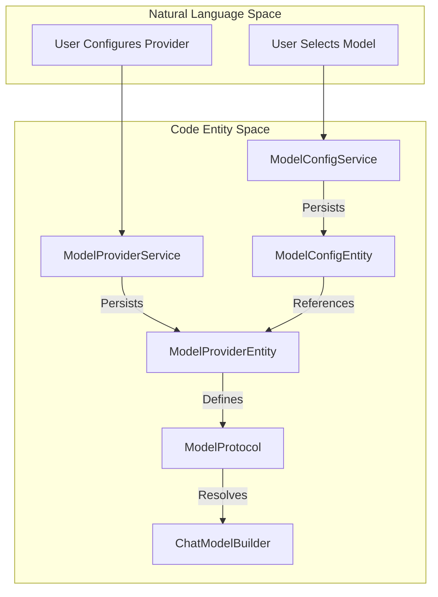
Sources: [mateclaw-server/src/main/java/vip/mate/llm/service/ModelProviderService.java:74-92](), [mateclaw-server/src/main/java/vip/mate/llm/service/ModelConfigService.java:103-136](), [mateclaw-server/src/main/java/vip/mate/llm/model/ModelProtocol.java]()

## Failover & Health Tracking

MateClaw implements a sophisticated failover mechanism defined in RFC-009. When the primary provider fails with specific error types (e.g., billing issues, model not found, or empty responses), the `NodeStreamingChatHelper` traverses a `fallbackChain` of `FallbackEntry` objects [mateclaw-server/src/test/java/vip/mate/agent/graph/NodeStreamingChatHelperFallbackChainTest.java:24-48]().

### ProviderHealthTracker Lifecycle
The `ProviderHealthTracker` monitors the status of each provider using a cooldown/reprobe lifecycle:
1.  **Failure Detection**: When a `ChatModel` call fails, the error is classified.
2.  **Cooldown**: If the error is considered a provider-level fault, the provider is put into a "cooldown" state.
3.  **Reprobe**: After a configurable duration, the tracker attempts a health probe (e.g., a lightweight `/v1/models` call) to see if the provider has recovered [mateclaw-server/src/main/java/vip/mate/llm/failover/ProviderHealthTracker.java]().

**Health Monitoring Flow**
```mermaid
stateDiagram-v2
    [*] --> "HEALTHY"
    "HEALTHY" --> "COOLDOWN" : "Classification: BILLING / RATE_LIMIT"
    "COOLDOWN" --> "REPROBING" : "Cooldown Timer Expired"
    "REPROBING" --> "HEALTHY" : "Probe Success"
    "REPROBING" --> "COOLDOWN" : "Probe Failed"
```
Sources: [mateclaw-server/src/test/java/vip/mate/agent/graph/NodeStreamingChatHelperFallbackChainTest.java:91-98](), [mateclaw-server/src/main/java/vip/mate/llm/failover/ProviderHealthTracker.java]()

### Health Probes
Probes are protocol-specific implementations that verify connectivity without generating full completions:
*   **OpenAiCompatibleListModelsProbe**: Calls the `/v1/models` endpoint. It handles various path depths (e.g., `/v1` vs root) and treats 404/405/410 as "fail-open" since some vendors don't implement the models list [mateclaw-server/src/main/java/vip/mate/llm/failover/probe/OpenAiCompatibleListModelsProbe.java:47-111]().
*   **DashScopeListModelsProbe**: Probes DashScope by hitting its OpenAI-compatible `/v1/models` endpoint at the `compatible-mode` URL, which authenticates with the same API key [mateclaw-server/src/main/java/vip/mate/llm/failover/probe/DashScopeListModelsProbe.java:30-57]().
*   **AnthropicListModelsProbe**: Verifies the Anthropic API key via the `/v1/models` endpoint, validating the `x-api-key` and `anthropic-version` headers [mateclaw-server/src/main/java/vip/mate/llm/failover/probe/AnthropicListModelsProbe.java:38-59]().

## Ollama Auto-Discovery

To simplify local development, MateClaw includes an `OllamaAutoDiscoveryRunner`. This component runs asynchronously on startup to detect a local Ollama instance [mateclaw-server/src/main/java/vip/mate/llm/config/OllamaAutoDiscoveryRunner.java:36-66]().

*   **Discovery**: It pings the default Ollama port (11434) and fetches all pulled models [mateclaw-server/src/main/java/vip/mate/llm/config/OllamaAutoDiscoveryRunner.java:69-78]().
*   **Smart Activation**: It automatically enables models in the UI and rewrites seed tags (e.g., `llama3:latest` to `llama3:8b`) to match what is actually installed, preventing 404 errors on runtime calls [mateclaw-server/src/main/java/vip/mate/llm/config/OllamaAutoDiscoveryRunner.java:113-125]().
*   **Capability Awareness**: It identifies models that lack tool-calling support (e.g., `deepseek-r1`, `phi3`, `gemma`) and avoids setting them as the default agent model to prevent runtime 400 "does not support tools" errors [mateclaw-server/src/main/java/vip/mate/llm/config/OllamaAutoDiscoveryRunner.java:50-58]().

Sources: [mateclaw-server/src/main/java/vip/mate/llm/config/OllamaAutoDiscoveryRunner.java:36-132]()

## Settings → Models UI

The frontend architecture for model management is centered around the `useProviders` composable, which synchronizes the local Vue state with the backend provider pool and handles manual reprobing [mateclaw-ui/src/views/Settings/Models/useProviders.ts:8-115]().

### Key UI Components
*   **Provider Management**: The UI displays provider status (Healthy/Cooldown) using the `providerPool` snapshot [mateclaw-ui/src/views/Settings/Models/useProviders.ts:77-89]().
*   **ProviderConfigModal.vue**: Allows editing of API keys, Base URLs, and `fallbackPriority`. A priority of `0` excludes a provider from the failover chain [mateclaw-ui/src/views/Settings/Models/modals/ProviderConfigModal.vue:127-139]().
*   **OAuth Support**: Specifically for `anthropic-claude-code`, the UI supports an OAuth-based flow instead of static API keys [mateclaw-ui/src/views/Settings/Models/modals/ProviderConfigModal.vue:28-61]().

**UI State Management Diagram**
```mermaid
graph LR
    subgraph "Frontend (Vue 3)"
        UP["useProviders.ts"]
        PCM["ProviderConfigModal.vue"]
    end

    subgraph "Backend (Spring Boot)"
        MP_CTRL["ModelProviderController"]
        PP_CTRL["ProviderPoolController"]
        MDS["ModelDiscoveryService"]
    end

    UP -->|GET /api/v1/llm/providers| MP_CTRL
    UP -->|GET /api/v1/llm/provider-pool/snapshot| PP_CTRL
    UP -->|POST /api/v1/llm/discover| MDS
    PCM -->|saveProvider| MP_CTRL
    UP -->|reprobeProvider| PP_CTRL
```
Sources: [mateclaw-ui/src/views/Settings/Models/useProviders.ts:96-115](), [mateclaw-ui/src/views/Settings/Models/modals/ProviderConfigModal.vue:1-151]()

## Implementation Details Table

| Feature | Code Entity | Description |
| :--- | :--- | :--- |
| **Failover Chain** | `FallbackEntry` | A record containing a `providerId` and a pre-built `ChatModel` instance [mateclaw-server/src/main/java/vip/mate/llm/failover/FallbackEntry.java](). |
| **Error Classification** | `NodeStreamingChatHelper.ErrorType` | Enums like `BILLING`, `EMPTY_RESPONSE`, and `MODEL_NOT_FOUND` that trigger failover [mateclaw-server/src/test/java/vip/mate/agent/graph/NodeStreamingChatHelperFallbackChainTest.java:91-98](). |
| **Thinking Detection** | `ModelInfoDTO.computeSupportsThinking` | Logic that detects if a model supports Anthropic extended thinking or OpenAI reasoning effort based on model name and family [mateclaw-server/src/main/java/vip/mate/llm/model/ModelInfoDTO.java:56-63](). |
| **Custom Providers** | `ModelProviderService.createCustomProvider` | Logic for registering third-party OpenAI-compatible endpoints with custom ID/Name [mateclaw-server/src/main/java/vip/mate/llm/service/ModelProviderService.java:94-123](). |
| **Embedding Support** | `V14__embedding_model_config.sql` | Migration adding `model_type` to distinguish chat from embedding models in the UI and knowledge base [mateclaw-server/src/main/resources/db/migration/mysql/V14__embedding_model_config.sql:1-16](). |

Sources: [mateclaw-server/src/main/java/vip/mate/llm/service/ModelProviderService.java](), [mateclaw-server/src/main/java/vip/mate/llm/model/ModelInfoDTO.java](), [mateclaw-server/src/main/resources/db/migration/mysql/V14__embedding_model_config.sql]()

---

# Page: ChatModel Builders & Decorators

# ChatModel Builders & Decorators

<details>
<summary>Relevant source files</summary>

The following files were used as context for generating this wiki page:

- [mateclaw-server/src/main/java/vip/mate/agent/chatmodel/AgentAnthropicChatModelBuilder.java](mateclaw-server/src/main/java/vip/mate/agent/chatmodel/AgentAnthropicChatModelBuilder.java)
- [mateclaw-server/src/main/java/vip/mate/agent/chatmodel/AgentClaudeCodeChatModelBuilder.java](mateclaw-server/src/main/java/vip/mate/agent/chatmodel/AgentClaudeCodeChatModelBuilder.java)
- [mateclaw-server/src/main/java/vip/mate/agent/chatmodel/AgentDashScopeChatModelBuilder.java](mateclaw-server/src/main/java/vip/mate/agent/chatmodel/AgentDashScopeChatModelBuilder.java)
- [mateclaw-server/src/main/java/vip/mate/agent/chatmodel/AgentOpenAiCompatibleChatModelBuilder.java](mateclaw-server/src/main/java/vip/mate/agent/chatmodel/AgentOpenAiCompatibleChatModelBuilder.java)
- [mateclaw-server/src/main/java/vip/mate/agent/chatmodel/ClaudeCodeIdentityChatModelDecorator.java](mateclaw-server/src/main/java/vip/mate/agent/chatmodel/ClaudeCodeIdentityChatModelDecorator.java)
- [mateclaw-server/src/main/java/vip/mate/agent/chatmodel/ClaudeCodeSystemArrayExchangeFilter.java](mateclaw-server/src/main/java/vip/mate/agent/chatmodel/ClaudeCodeSystemArrayExchangeFilter.java)
- [mateclaw-server/src/main/java/vip/mate/agent/chatmodel/ClaudeCodeSystemArrayInterceptor.java](mateclaw-server/src/main/java/vip/mate/agent/chatmodel/ClaudeCodeSystemArrayInterceptor.java)
- [mateclaw-server/src/main/java/vip/mate/agent/chatmodel/DeepSeekV4ThinkingDecorator.java](mateclaw-server/src/main/java/vip/mate/agent/chatmodel/DeepSeekV4ThinkingDecorator.java)
- [mateclaw-server/src/main/java/vip/mate/agent/chatmodel/RateLimitDiagnosticExchangeFilter.java](mateclaw-server/src/main/java/vip/mate/agent/chatmodel/RateLimitDiagnosticExchangeFilter.java)
- [mateclaw-server/src/main/java/vip/mate/agent/chatmodel/RateLimitDiagnosticInterceptor.java](mateclaw-server/src/main/java/vip/mate/agent/chatmodel/RateLimitDiagnosticInterceptor.java)
- [mateclaw-server/src/main/java/vip/mate/llm/anthropic/oauth/ClaudeCodeApiHeaders.java](mateclaw-server/src/main/java/vip/mate/llm/anthropic/oauth/ClaudeCodeApiHeaders.java)
- [mateclaw-server/src/main/java/vip/mate/llm/anthropic/oauth/ClaudeCodeTokenRefresher.java](mateclaw-server/src/main/java/vip/mate/llm/anthropic/oauth/ClaudeCodeTokenRefresher.java)
- [mateclaw-server/src/main/java/vip/mate/llm/cache/CachePlanContext.java](mateclaw-server/src/main/java/vip/mate/llm/cache/CachePlanContext.java)
- [mateclaw-server/src/main/java/vip/mate/llm/model/ModelFamily.java](mateclaw-server/src/main/java/vip/mate/llm/model/ModelFamily.java)
- [mateclaw-server/src/main/java/vip/mate/llm/model/ModelProtocol.java](mateclaw-server/src/main/java/vip/mate/llm/model/ModelProtocol.java)
- [mateclaw-server/src/main/java/vip/mate/llm/model/ProviderInfoDTO.java](mateclaw-server/src/main/java/vip/mate/llm/model/ProviderInfoDTO.java)
- [mateclaw-server/src/main/java/vip/mate/llm/service/ModelConfigService.java](mateclaw-server/src/main/java/vip/mate/llm/service/ModelConfigService.java)
- [mateclaw-server/src/main/java/vip/mate/llm/service/ModelDiscoveryService.java](mateclaw-server/src/main/java/vip/mate/llm/service/ModelDiscoveryService.java)
- [mateclaw-server/src/main/java/vip/mate/memory/event/MemoryWriteEvent.java](mateclaw-server/src/main/java/vip/mate/memory/event/MemoryWriteEvent.java)
- [mateclaw-server/src/main/java/vip/mate/memory/service/SoulSummarizerService.java](mateclaw-server/src/main/java/vip/mate/memory/service/SoulSummarizerService.java)
- [mateclaw-server/src/main/java/vip/mate/memory/service/StructuredMemoryService.java](mateclaw-server/src/main/java/vip/mate/memory/service/StructuredMemoryService.java)
- [mateclaw-server/src/main/java/vip/mate/memory/spi/MemoryManager.java](mateclaw-server/src/main/java/vip/mate/memory/spi/MemoryManager.java)
- [mateclaw-server/src/main/java/vip/mate/memory/spi/MemoryProvider.java](mateclaw-server/src/main/java/vip/mate/memory/spi/MemoryProvider.java)
- [mateclaw-server/src/main/resources/db/migration/h2/V42__claude_47_gpt_55_models.sql](mateclaw-server/src/main/resources/db/migration/h2/V42__claude_47_gpt_55_models.sql)
- [mateclaw-server/src/main/resources/db/migration/mysql/V42__claude_47_gpt_55_models.sql](mateclaw-server/src/main/resources/db/migration/mysql/V42__claude_47_gpt_55_models.sql)
- [mateclaw-ui/src/views/Settings/Models/ProviderCard.vue](mateclaw-ui/src/views/Settings/Models/ProviderCard.vue)
- [mateclaw-ui/src/views/Settings/Models/index.vue](mateclaw-ui/src/views/Settings/Models/index.vue)

</details>


The `ChatModel` layer in MateClaw abstracts the complexities of different LLM providers (Anthropic, OpenAI, DashScope, etc.) into a unified interface. It uses a strategy-based builder pattern to resolve a `ModelProtocol` to a concrete `ChatModel` implementation, often wrapping the raw model with decorators to handle provider-specific requirements like OAuth identity, tool prefixing, or thinking-mode payloads.

## Architecture Overview

The `AgentGraphBuilder` (and the underlying `ChatModelBuilder` SPI) is responsible for instantiating the correct model based on the `ModelProtocol` defined in the `ModelProviderEntity` [vip/mate/llm/chatmodel/ChatModelBuilder.java:19-21]().

### Model Resolution Flow

The following diagram illustrates how a user's model selection in the UI is resolved to a decorated `ChatModel` in the backend.

**Model Resolution & Decoration Pipeline**
```mermaid
graph TD
    subgraph "Natural Language / UI Space"
        A["ModelSelector.vue"] -- "Selects Model ID" --> B["ModelConfigEntity"]
    end

    subgraph "Code Entity Space"
        B -- "Look up Protocol" --> C{"ChatModelBuilder SPI"}
        
        C -- "ANTHROPIC_CLAUDE_CODE" --> D["AgentClaudeCodeChatModelBuilder"]
        C -- "ANTHROPIC_MESSAGES" --> E["AgentAnthropicChatModelBuilder"]
        C -- "OPENAI_COMPATIBLE" --> F["AgentOpenAiCompatibleChatModelBuilder"]
        
        D -- "build()" --> D1["ClaudeCodeIdentityChatModelDecorator"]
        F -- "If DEEPSEEK_V4_REASONING" --> F1["DeepSeekV4ThinkingDecorator"]
        
        D1 -- "Wraps" --> G["AnthropicChatModel"]
        E -- "build()" --> G
        F1 -- "Wraps" --> H["OpenAiChatModel"]
    end
```
Sources: [mateclaw-server/src/main/java/vip/mate/agent/chatmodel/AgentClaudeCodeChatModelBuilder.java:87-117](), [mateclaw-server/src/main/java/vip/mate/agent/chatmodel/AgentOpenAiCompatibleChatModelBuilder.java:38-62](), [mateclaw-server/src/main/java/vip/mate/llm/model/ModelProtocol.java:21-25]()

---

## Claude Code ChatModel Builder

The `AgentClaudeCodeChatModelBuilder` implements `ModelProtocol.ANTHROPIC_CLAUDE_CODE`. This builder allows users with a Claude Pro/Max plan to run MateClaw using their existing OAuth subscription tokens instead of a standard API key [mateclaw-server/src/main/java/vip/mate/agent/chatmodel/AgentClaudeCodeChatModelBuilder.java:25-30]().

### OAuth & Header Masquerading
To avoid being flagged by Anthropic's anti-abuse systems, the builder masquerades as the official Claude Code CLI by configuring specific headers in the `AnthropicApi` client [mateclaw-server/src/main/java/vip/mate/agent/chatmodel/AgentClaudeCodeChatModelBuilder.java:31-46]():
1.  **Authorization**: Uses `Bearer <oauth-token>` via `ClaudeCodeOAuthService` [mateclaw-server/src/main/java/vip/mate/agent/chatmodel/AgentClaudeCodeChatModelBuilder.java:93-96]().
2.  **User-Agent**: Set to a bare `claude-cli/<version>` string to match real CLI traffic [mateclaw-server/src/main/java/vip/mate/llm/anthropic/oauth/ClaudeCodeApiHeaders.java:60-75]().
3.  **Betas**: Includes `claude-code-20250219` and `oauth-2025-04-20` to prevent intermittent 500 errors [mateclaw-server/src/main/java/vip/mate/llm/anthropic/oauth/ClaudeCodeApiHeaders.java:32-37]().

### ClaudeCodeIdentityChatModelDecorator
This decorator applies identity transforms to every request to ensure the traffic shape matches real Claude Code traffic [mateclaw-server/src/main/java/vip/mate/agent/chatmodel/ClaudeCodeIdentityChatModelDecorator.java:27-45]().

| Transform | Implementation Detail |
| :--- | :--- |
| **System Prefix** | Prepends `"You are Claude Code, Anthropic's official CLI for Claude."` [mateclaw-server/src/main/java/vip/mate/agent/chatmodel/ClaudeCodeIdentityChatModelDecorator.java:70-71](). |
| **System Array Rewrite** | Uses `ClaudeCodeSystemArrayInterceptor` to rewrite the `system` field from a string to a JSON array of content blocks [mateclaw-server/src/main/java/vip/mate/agent/chatmodel/ClaudeCodeSystemArrayInterceptor.java:17-23](). |
| **Tool Prefixing** | Renames tools to `mcp_<name>` on outbound requests and strips the prefix on inbound responses [mateclaw-server/src/main/java/vip/mate/agent/chatmodel/ClaudeCodeIdentityChatModelDecorator.java:54-63](). |
| **Brand Scrubbing** | Replaces `"MateClaw"` with `"Claude Code"` in system prompts to avoid identity filter flags [mateclaw-server/src/main/java/vip/mate/agent/chatmodel/ClaudeCodeIdentityChatModelDecorator.java:51-53](). |

Sources: [mateclaw-server/src/main/java/vip/mate/agent/chatmodel/AgentClaudeCodeChatModelBuilder.java:124-145](), [mateclaw-server/src/main/java/vip/mate/agent/chatmodel/ClaudeCodeIdentityChatModelDecorator.java:105-141](), [mateclaw-server/src/main/java/vip/mate/agent/chatmodel/ClaudeCodeSystemArrayInterceptor.java:54-69]()

---

## Anthropic & Thinking Mode

The `AgentAnthropicChatModelBuilder` handles the standard `ANTHROPIC_MESSAGES` protocol. It maps MateClaw's internal `ThinkingLevel` (from `ThinkingLevelHolder`) to Anthropic's extended-thinking token budgets [mateclaw-server/src/main/java/vip/mate/agent/chatmodel/AgentAnthropicChatModelBuilder.java:29-35]().

### Thinking Budget Mapping
Budgets are resolved during the `buildAnthropicOptions` phase [mateclaw-server/src/main/java/vip/mate/agent/chatmodel/AgentAnthropicChatModelBuilder.java:119-121]():
*   **Low**: 4,096 tokens
*   **Medium**: 8,192 tokens
*   **High**: 16,384 tokens
*   **XHigh**: 24,576 tokens (exclusive to Claude 4.7) [mateclaw-server/src/main/java/vip/mate/agent/chatmodel/AgentAnthropicChatModelBuilder.java:140-141]().
*   **Max**: 32,768 tokens

For Claude 4.7 variants, detected via `isClaude47()`, the builder omits `temperature`, `top_p`, and `top_k` parameters entirely, as providing any value (even defaults) results in a 400 Bad Request when thinking is enabled [mateclaw-server/src/main/java/vip/mate/agent/chatmodel/AgentAnthropicChatModelBuilder.java:102-117]().

Sources: [mateclaw-server/src/main/java/vip/mate/agent/chatmodel/AgentAnthropicChatModelBuilder.java:128-147](), [mateclaw-server/src/main/java/vip/mate/agent/ThinkingLevelHolder.java:16-20]()

---

## DeepSeek V4 & OpenAI Compatibility

The `AgentOpenAiCompatibleChatModelBuilder` delegates to `AgentGraphBuilder` for basic API construction but adds specific logic for the DeepSeek V4 family [mateclaw-server/src/main/java/vip/mate/agent/chatmodel/AgentOpenAiCompatibleChatModelBuilder.java:20-25]().

### DeepSeekV4ThinkingDecorator
When `ModelFamily.detect()` identifies a model as `DEEPSEEK_V4_REASONING`, the builder wraps the `OpenAiChatModel` with the `DeepSeekV4ThinkingDecorator` [mateclaw-server/src/main/java/vip/mate/agent/chatmodel/AgentOpenAiCompatibleChatModelBuilder.java:58-60]().
*   **Payload Patching**: DeepSeek V4 requires a `thinking` object in the JSON payload (e.g., `{"thinking": {"type": "enabled"}}`) which is not part of the standard OpenAI specification [mateclaw-server/src/main/java/vip/mate/agent/chatmodel/DeepSeekV4ThinkingDecorator.java:1-30]().
*   **Reasoning Extraction**: The decorator handles the extraction and replay of the `reasoning_content` field from the provider's response stream.

Sources: [mateclaw-server/src/main/java/vip/mate/agent/chatmodel/AgentOpenAiCompatibleChatModelBuilder.java:44-62](), [mateclaw-server/src/main/java/vip/mate/llm/model/ModelFamily.java:15-20]()

---

## Diagnostic Interceptors

MateClaw uses interceptors to diagnose API failures, particularly for the sensitive Anthropic OAuth path.

### RateLimitDiagnosticInterceptor
This interceptor triggers on HTTP 429 status codes. It logs sanitized request headers, a 16KB preview of the request body, and `anthropic-ratelimit-*` response headers [mateclaw-server/src/main/java/vip/mate/agent/chatmodel/RateLimitDiagnosticInterceptor.java:14-25]().

**429 Diagnostic Flow**
```mermaid
sequenceDiagram
    participant API as LLM Provider API
    participant Interceptor as RateLimitDiagnosticInterceptor
    participant Log as System Logger

    API-->>Interceptor: HTTP 429 (Rate Limit)
    Note over Interceptor: logRequestHeaders()
    Interceptor->>Log: Outgoing Headers (Sanitized)
    Note over Interceptor: logRequestBody()
    Interceptor->>Log: Body Preview (First 16KB)
    Note over Interceptor: logResponseHeaders()
    Interceptor->>Log: anthropic-ratelimit-* values
```

This logging helps distinguish between three failure modes:
1.  **Quota Exhausted**: `tokens-remaining` is 0; `retry-after` is high.
2.  **Anti-abuse Fingerprint**: Rate limit headers are **absent** (indicates header/identity mismatch) [mateclaw-server/src/main/java/vip/mate/agent/chatmodel/RateLimitDiagnosticInterceptor.java:109-111]().
3.  **Burst Limit**: `tokens-remaining` is positive; `retry-after` is low.

Sources: [mateclaw-server/src/main/java/vip/mate/agent/chatmodel/RateLimitDiagnosticInterceptor.java:31-69](), [mateclaw-server/src/main/java/vip/mate/agent/chatmodel/RateLimitDiagnosticExchangeFilter.java:55-64]()

---

## Model Discovery & Protocol Filtering

The `ModelDiscoveryService` performs protocol-aware filtering during the discovery process to ensure only compatible models are presented to the user [mateclaw-server/src/main/java/vip/mate/llm/service/ModelDiscoveryService.java:126-133]().

### DashScope Protocol Filtering
DashScope's discovery endpoint often returns models that fail on its native protocol. The service applies several filters [mateclaw-server/src/main/java/vip/mate/llm/service/ModelDiscoveryService.java:139-140]():
*   **Explicit Deny List**: Blocks known failures like `qwen3.5-max` and `qwen3.6-plus` [mateclaw-server/src/main/java/vip/mate/llm/service/ModelDiscoveryService.java:52-57]().
*   **Modality Filtering**: Blocks non-chat prefixes such as `qwen-vl-` (Vision), `qwen-image-`, and `qwen-tts-` [mateclaw-server/src/main/java/vip/mate/llm/service/ModelDiscoveryService.java:85-107]().
*   **Parallel Probing**: Uses a virtual-thread executor (`PROBE_EXECUTOR`) to perform a real runtime probe on each model. Models that fail the probe are marked with `probeOk=false` in the UI [mateclaw-server/src/main/java/vip/mate/llm/service/ModelDiscoveryService.java:37-45]().

Sources: [mateclaw-server/src/main/java/vip/mate/llm/service/ModelDiscoveryService.java:141-158](), [mateclaw-server/src/main/java/vip/mate/llm/service/ModelDiscoveryService.java:65-76]()

---

# Page: OAuth & Authentication Flows

# OAuth & Authentication Flows

<details>
<summary>Relevant source files</summary>

The following files were used as context for generating this wiki page:

- [mateclaw-server/src/main/java/vip/mate/agent/chatmodel/AgentClaudeCodeChatModelBuilder.java](mateclaw-server/src/main/java/vip/mate/agent/chatmodel/AgentClaudeCodeChatModelBuilder.java)
- [mateclaw-server/src/main/java/vip/mate/agent/chatmodel/AgentOpenAiCompatibleChatModelBuilder.java](mateclaw-server/src/main/java/vip/mate/agent/chatmodel/AgentOpenAiCompatibleChatModelBuilder.java)
- [mateclaw-server/src/main/java/vip/mate/agent/chatmodel/ClaudeCodeIdentityChatModelDecorator.java](mateclaw-server/src/main/java/vip/mate/agent/chatmodel/ClaudeCodeIdentityChatModelDecorator.java)
- [mateclaw-server/src/main/java/vip/mate/agent/chatmodel/ClaudeCodeSystemArrayExchangeFilter.java](mateclaw-server/src/main/java/vip/mate/agent/chatmodel/ClaudeCodeSystemArrayExchangeFilter.java)
- [mateclaw-server/src/main/java/vip/mate/agent/chatmodel/ClaudeCodeSystemArrayInterceptor.java](mateclaw-server/src/main/java/vip/mate/agent/chatmodel/ClaudeCodeSystemArrayInterceptor.java)
- [mateclaw-server/src/main/java/vip/mate/agent/chatmodel/DeepSeekV4ThinkingDecorator.java](mateclaw-server/src/main/java/vip/mate/agent/chatmodel/DeepSeekV4ThinkingDecorator.java)
- [mateclaw-server/src/main/java/vip/mate/agent/chatmodel/RateLimitDiagnosticExchangeFilter.java](mateclaw-server/src/main/java/vip/mate/agent/chatmodel/RateLimitDiagnosticExchangeFilter.java)
- [mateclaw-server/src/main/java/vip/mate/agent/chatmodel/RateLimitDiagnosticInterceptor.java](mateclaw-server/src/main/java/vip/mate/agent/chatmodel/RateLimitDiagnosticInterceptor.java)
- [mateclaw-server/src/main/java/vip/mate/llm/anthropic/oauth/ClaudeCodeApiHeaders.java](mateclaw-server/src/main/java/vip/mate/llm/anthropic/oauth/ClaudeCodeApiHeaders.java)
- [mateclaw-server/src/main/java/vip/mate/llm/anthropic/oauth/ClaudeCodeCredentials.java](mateclaw-server/src/main/java/vip/mate/llm/anthropic/oauth/ClaudeCodeCredentials.java)
- [mateclaw-server/src/main/java/vip/mate/llm/anthropic/oauth/ClaudeCodeCredentialsReader.java](mateclaw-server/src/main/java/vip/mate/llm/anthropic/oauth/ClaudeCodeCredentialsReader.java)
- [mateclaw-server/src/main/java/vip/mate/llm/anthropic/oauth/ClaudeCodeCredentialsWriter.java](mateclaw-server/src/main/java/vip/mate/llm/anthropic/oauth/ClaudeCodeCredentialsWriter.java)
- [mateclaw-server/src/main/java/vip/mate/llm/anthropic/oauth/ClaudeCodeOAuthService.java](mateclaw-server/src/main/java/vip/mate/llm/anthropic/oauth/ClaudeCodeOAuthService.java)
- [mateclaw-server/src/main/java/vip/mate/llm/anthropic/oauth/ClaudeCodeTokenRefresher.java](mateclaw-server/src/main/java/vip/mate/llm/anthropic/oauth/ClaudeCodeTokenRefresher.java)
- [mateclaw-server/src/main/java/vip/mate/llm/anthropic/oauth/ClaudeCodeVersionDetector.java](mateclaw-server/src/main/java/vip/mate/llm/anthropic/oauth/ClaudeCodeVersionDetector.java)
- [mateclaw-server/src/main/java/vip/mate/llm/controller/ClaudeCodeOAuthController.java](mateclaw-server/src/main/java/vip/mate/llm/controller/ClaudeCodeOAuthController.java)
- [mateclaw-server/src/main/java/vip/mate/llm/controller/OAuthController.java](mateclaw-server/src/main/java/vip/mate/llm/controller/OAuthController.java)
- [mateclaw-server/src/main/java/vip/mate/llm/model/ModelFamily.java](mateclaw-server/src/main/java/vip/mate/llm/model/ModelFamily.java)
- [mateclaw-server/src/main/java/vip/mate/llm/model/ModelProviderEntity.java](mateclaw-server/src/main/java/vip/mate/llm/model/ModelProviderEntity.java)
- [mateclaw-server/src/main/java/vip/mate/llm/oauth/OpenAIOAuthService.java](mateclaw-server/src/main/java/vip/mate/llm/oauth/OpenAIOAuthService.java)
- [mateclaw-server/src/main/resources/db/migration/h2/V21__provider_fallback_priority.sql](mateclaw-server/src/main/resources/db/migration/h2/V21__provider_fallback_priority.sql)
- [mateclaw-server/src/main/resources/db/migration/h2/V43__rfc062_claude_code_oauth_provider.sql](mateclaw-server/src/main/resources/db/migration/h2/V43__rfc062_claude_code_oauth_provider.sql)
- [mateclaw-server/src/main/resources/db/migration/mysql/V21__provider_fallback_priority.sql](mateclaw-server/src/main/resources/db/migration/mysql/V21__provider_fallback_priority.sql)
- [mateclaw-server/src/main/resources/db/migration/mysql/V43__rfc062_claude_code_oauth_provider.sql](mateclaw-server/src/main/resources/db/migration/mysql/V43__rfc062_claude_code_oauth_provider.sql)

</details>


This section describes MateClaw's implementation of OAuth 2.0 and identity-masking flows, specifically focusing on the integration with Anthropic (Claude Code) and OpenAI. These flows allow users to bring their own subscriptions (e.g., Claude Pro/Max) into the platform by authenticating as official CLI tools.

## Claude Code OAuth Lifecycle

RFC-062 introduces support for `ModelProtocol.ANTHROPIC_CLAUDE_CODE`, which enables MateClaw to use the user's Claude Code subscription token instead of a standard API key [mateclaw-server/src/main/java/vip/mate/agent/chatmodel/AgentClaudeCodeChatModelBuilder.java:25-29](). This allows users with existing entitlements to run MateClaw without incurring additional API costs.

### Authentication Service Stack
The lifecycle is managed by a dedicated service stack that handles token retrieval, automatic refreshing, and identity spoofing:

*   **`ClaudeCodeOAuthService`**: The entry point for obtaining valid tokens. It coordinates between the reader/writer components and the refresher, ensuring tokens are refreshed when within 60s of expiry [mateclaw-server/src/main/java/vip/mate/agent/chatmodel/AgentClaudeCodeChatModelBuilder.java:49-52]().
*   **`ClaudeCodeTokenRefresher`**: Handles the OAuth 2.0 `refresh_token` grant against Anthropic's public endpoints (`platform.claude.com` and `console.anthropic.com`) [mateclaw-server/src/main/java/vip/mate/llm/anthropic/oauth/ClaudeCodeTokenRefresher.java:20-30](). It uses the public Claude Code `CLIENT_ID` [mateclaw-server/src/main/java/vip/mate/llm/anthropic/oauth/ClaudeCodeTokenRefresher.java:45-45]().
*   **`ClaudeCodeCredentials`**: A data carrier for the `access_token`, `refresh_token`, and expiry timestamp [mateclaw-server/src/main/java/vip/mate/llm/anthropic/oauth/ClaudeCodeTokenRefresher.java:124-128]().
*   **`ClaudeCodeVersionDetector`**: Provides the current version string of the Claude CLI to ensure headers match real CLI traffic [mateclaw-server/src/main/java/vip/mate/llm/anthropic/oauth/ClaudeCodeApiHeaders.java:47-47]().

### Identity Transformation
Anthropic's OAuth edge enforces strict anti-abuse gates. If a request claims to be Claude Code but does not match the expected wire format or identity, it is rate-limited (often returning a generic "Error" message) or rejected with a 500 error [mateclaw-server/src/main/java/vip/mate/agent/chatmodel/ClaudeCodeIdentityChatModelDecorator.java:30-40]().

The `ClaudeCodeIdentityChatModelDecorator` applies several transforms:
1.  **System Prefix**: Prepends `"You are Claude Code, Anthropic's official CLI for Claude."` [mateclaw-server/src/main/java/vip/mate/agent/chatmodel/ClaudeCodeIdentityChatModelDecorator.java:69-71]().
2.  **MCP Prefixing**: Renames all outgoing tool definitions to include an `mcp_` prefix (e.g., `shell_execute` becomes `mcp_shell_execute`) [mateclaw-server/src/main/java/vip/mate/agent/chatmodel/ClaudeCodeIdentityChatModelDecorator.java:73-74](). This is required because real Claude Code runs tools through MCP servers [mateclaw-server/src/main/java/vip/mate/agent/chatmodel/ClaudeCodeIdentityChatModelDecorator.java:54-57]().
3.  **Branding Scrub**: Replaces `"MateClaw"` with `"Claude Code"` in system prompts to avoid identity contradictions that trip content filters [mateclaw-server/src/main/java/vip/mate/agent/chatmodel/ClaudeCodeIdentityChatModelDecorator.java:51-53]().

### Claude Code Authentication Data Flow

Title: Claude Code OAuth Token and Identity Flow
```mermaid
graph TD
    subgraph "Token Management"
        A["ClaudeCodeOAuthService"] -->|"getValidToken()"| B["ClaudeCodeCredentialsReader"]
        A -->|"needs refresh?"| C["ClaudeCodeTokenRefresher"]
        C -->|"POST /v1/oauth/token"| D["Anthropic OAuth Edge"]
        C -->|"save"| E["ClaudeCodeCredentialsWriter"]
    end

    subgraph "Request Decoration"
        F["AgentClaudeCodeChatModelBuilder"] -->|"build()"| G["ClaudeCodeIdentityChatModelDecorator"]
        G -->|"transform(Prompt)"| H["ClaudeCodeApiHeaders"]
        H -->|"userAgent()"| I["ClaudeCodeVersionDetector"]
        G -->|"wrap"| J["ClaudeCodeSystemArrayInterceptor"]
    end

    A -->|"token"| F
    J -->|"Array-style System Prompt"| D
```
Sources: [mateclaw-server/src/main/java/vip/mate/agent/chatmodel/AgentClaudeCodeChatModelBuilder.java:49-56](), [mateclaw-server/src/main/java/vip/mate/llm/anthropic/oauth/ClaudeCodeTokenRefresher.java:48-51](), [mateclaw-server/src/main/java/vip/mate/agent/chatmodel/ClaudeCodeIdentityChatModelDecorator.java:46-64]().

## OpenAI OAuth Flow

The `OpenAIOAuthService` implements a PKCE-based OAuth 2.0 flow using the public OpenAI Codex CLI `client_id` (`app_EMoamEEZ73f0CkXaXp7hrann`) [mateclaw-server/src/main/java/vip/mate/llm/oauth/OpenAIOAuthService.java:58-60]().

### Deployment Modes
Because the OpenAI CLI redirect URI is hardcoded to `http://localhost:1455/auth/callback`, MateClaw supports two modes based on the deployment environment [mateclaw-server/src/main/java/vip/mate/llm/oauth/OpenAIOAuthService.java:30-52]():

1.  **LOCAL**: Starts a temporary `HttpServer` on port 1455 to capture the callback automatically. This is the default for desktop or localhost deployments [mateclaw-server/src/main/java/vip/mate/llm/oauth/OpenAIOAuthService.java:80-82]().
2.  **MANUAL_PASTE**: Used for remote server deployments where the browser cannot reach the server's localhost. The user performs the login, reaches a "Connection Refused" page on their machine, and copies the URL (containing the `code` and `state`) back into the MateClaw UI via `OAuthController.callbackPaste` [mateclaw-server/src/main/java/vip/mate/llm/oauth/OpenAIOAuthService.java:83-84](), [mateclaw-server/src/main/java/vip/mate/llm/controller/OAuthController.java:39-44]().

## Rate-Limit Diagnostics

To debug issues with Anthropic's anti-abuse gates, MateClaw employs diagnostic interceptors that trigger on HTTP 429 (Too Many Requests) [mateclaw-server/src/main/java/vip/mate/agent/chatmodel/RateLimitDiagnosticInterceptor.java:15-18]().

### Failure Mode Classification
The `RateLimitDiagnosticInterceptor` (and its WebFlux counterpart `RateLimitDiagnosticExchangeFilter`) logs specific headers to classify the failure [mateclaw-server/src/main/java/vip/mate/agent/chatmodel/RateLimitDiagnosticInterceptor.java:27-29]():

| Failure Mode | `tokens-remaining` | `retry-after` | Root Cause |
| :--- | :--- | :--- | :--- |
| **Quota Exhausted** | 0 | Thousands of seconds | User has hit their 5h Pro/Max limit [mateclaw-server/src/main/java/vip/mate/agent/chatmodel/RateLimitDiagnosticInterceptor.java:22-22](). |
| **Anti-abuse Gate** | (Absent) | (Absent) | Missing/incorrect identity headers or system prompt [mateclaw-server/src/main/java/vip/mate/agent/chatmodel/RateLimitDiagnosticInterceptor.java:23-23](). |
| **Burst Limit** | Large | Single-digit seconds | Per-minute rate limit exceeded [mateclaw-server/src/main/java/vip/mate/agent/chatmodel/RateLimitDiagnosticInterceptor.java:24-24](). |

Sources: [mateclaw-server/src/main/java/vip/mate/agent/chatmodel/RateLimitDiagnosticInterceptor.java:19-25](), [mateclaw-server/src/main/java/vip/mate/agent/chatmodel/RateLimitDiagnosticExchangeFilter.java:19-25]().

## System Array Interceptors

Anthropic's OAuth gate has a specific quirk: it rejects requests where the "Claude Code" identity prefix is merged into a single string with other system instructions. However, it accepts them if they are sent as separate elements in a JSON array [mateclaw-server/src/main/java/vip/mate/agent/chatmodel/ClaudeCodeSystemArrayInterceptor.java:21-24]().

MateClaw implements `ClaudeCodeSystemArrayInterceptor` (Sync) and `ClaudeCodeSystemArrayExchangeFilter` (Streaming) to perform this rewrite at the HTTP transport layer [mateclaw-server/src/main/java/vip/mate/agent/chatmodel/ClaudeCodeSystemArrayInterceptor.java:30-32]().

### Request Entity Mapping

Title: Anthropic OAuth Request Transformation
```mermaid
graph LR
    subgraph "MateClaw Internal State"
        M1["Prompt"] --> M2["SystemMessage(Identity)"]
        M1 --> M3["SystemMessage(Custom)"]
    end

    subgraph "Code Entities"
        E1["ClaudeCodeIdentityChatModelDecorator"]
        E2["ClaudeCodeSystemArrayInterceptor"]
    end

    subgraph "Wire Format (JSON)"
        W1["'system': [ {'type':'text', 'text':'You are Claude Code...'}, {'type':'text', 'text':'...'} ]"]
    end

    M1 --> E1
    E1 -->|"transform()"| E2
    E2 -->|"rewriteSystemField()"| W1
```
Sources: [mateclaw-server/src/main/java/vip/mate/agent/chatmodel/ClaudeCodeIdentityChatModelDecorator.java:112-124](), [mateclaw-server/src/main/java/vip/mate/agent/chatmodel/ClaudeCodeSystemArrayInterceptor.java:45-51]().

---

# Page: Chat UI & Frontend Architecture

# Chat UI & Frontend Architecture

<details>
<summary>Relevant source files</summary>

The following files were used as context for generating this wiki page:

- [.gitignore](.gitignore)
- [mateclaw-server/src/main/java/vip/mate/config/LoginRateLimitFilter.java](mateclaw-server/src/main/java/vip/mate/config/LoginRateLimitFilter.java)
- [mateclaw-server/src/main/java/vip/mate/config/WebSocketConfig.java](mateclaw-server/src/main/java/vip/mate/config/WebSocketConfig.java)
- [mateclaw-server/src/main/java/vip/mate/tool/builtin/DatasourceTool.java](mateclaw-server/src/main/java/vip/mate/tool/builtin/DatasourceTool.java)
- [mateclaw-server/src/main/java/vip/mate/workspace/conversation/ConversationService.java](mateclaw-server/src/main/java/vip/mate/workspace/conversation/ConversationService.java)
- [mateclaw-ui/index.html](mateclaw-ui/index.html)
- [mateclaw-ui/src/components/chat/ChatInput.vue](mateclaw-ui/src/components/chat/ChatInput.vue)
- [mateclaw-ui/src/components/workspace/WorkspaceSwitcher.vue](mateclaw-ui/src/components/workspace/WorkspaceSwitcher.vue)
- [mateclaw-ui/src/composables/chat/useChat.ts](mateclaw-ui/src/composables/chat/useChat.ts)
- [mateclaw-ui/src/main.ts](mateclaw-ui/src/main.ts)
- [mateclaw-ui/src/router/index.ts](mateclaw-ui/src/router/index.ts)
- [mateclaw-ui/src/views/ChatConsole.vue](mateclaw-ui/src/views/ChatConsole.vue)
- [mateclaw-ui/src/views/Security/Layout.vue](mateclaw-ui/src/views/Security/Layout.vue)
- [mateclaw-ui/src/views/Settings/Layout.vue](mateclaw-ui/src/views/Settings/Layout.vue)
- [mateclaw-ui/src/views/layout/MainLayout.vue](mateclaw-ui/src/views/layout/MainLayout.vue)

</details>


The MateClaw frontend is a modern single-page application (SPA) built with **Vue 3**, **TypeScript**, and **Element Plus**. It serves as the primary interface for human-agent interaction, providing a real-time, segmented streaming experience. The architecture emphasizes high-concurrency streaming, interruptible execution phases, and multi-workspace isolation.

## Main Layout & Routing

The application uses a shell-and-frame layout managed by `MainLayout.vue` [mateclaw-ui/src/views/layout/MainLayout.vue:1-151](). It provides a persistent sidebar for navigation and global utilities.

### Core Routing Structure
The routing is organized into logical groups within `router/index.ts` [mateclaw-ui/src/router/index.ts:5-198]():
*   **Core**: Chat console, Dashboard, Agent management, Wiki, and Memory [mateclaw-ui/src/router/index.ts:11-41]().
*   **Connect**: Channel adapters, Skills market, and Tool registry [mateclaw-ui/src/router/index.ts:42-66]().
*   **Settings**: Model configurations, System settings, and Media providers [mateclaw-ui/src/router/index.ts:67-114]().
*   **Security**: Tool Guard policies, File guards, and Audit logs [mateclaw-ui/src/router/index.ts:173-198]().

### Workspace Switcher
The `WorkspaceSwitcher.vue` component [mateclaw-ui/src/components/workspace/WorkspaceSwitcher.vue:1-52]() allows users to toggle between different isolated environments. Switching a workspace triggers a state update in `useWorkspaceStore`, which reloads context-sensitive data like agents and conversation history [mateclaw-ui/src/components/workspace/WorkspaceSwitcher.vue:110-115]().

**Sources:**
* `mateclaw-ui/src/views/layout/MainLayout.vue`
* `mateclaw-ui/src/router/index.ts`
* `mateclaw-ui/src/components/workspace/WorkspaceSwitcher.vue`

## Frontend Architecture Overview

The following diagram illustrates the relationship between the UI components and the underlying logic layers.

### UI to Code Entity Mapping
| Concept | Code Entity | Role |
| :--- | :--- | :--- |
| **Page Shell** | `MainLayout.vue` | Global navigation, workspace switcher, and theme management. |
| **Chat Hub** | `ChatConsole.vue` | Orchestrates the conversation sidebar and the main message area. |
| **Logic Core** | `useChat.ts` | Unified composable managing the "Interrupt + Queue + Resume" model. |
| **Stream Parser** | `useStream.ts` | Low-level SSE parsing into structured events (Thinking, Tool, Content). |
| **Input Controller** | `ChatInput.vue` | Handles user input, attachments, and HiL approval bars. |

### Component Hierarchy
The UI bridges the "Natural Language" input from the user to the "Code Entity" execution on the backend via a structured event pipeline.

Title: Frontend Interaction & Event Flow
```mermaid
graph TD
    subgraph "View Layer"
        CC["ChatConsole.vue"]
        CI["ChatInput.vue"]
        MB["MessageBubble.vue"]
    end

    subgraph "Logic Layer (Composables)"
        UC["useChat.ts"]
        US["useStream.ts"]
        UM["useMessages.ts"]
        UQ["useMessageQueue.ts"]
    end

    subgraph "Network Layer"
        SSE["Server-Sent Events (SSE)"]
        API["REST API (Axios)"]
        WS["WebSocket (Talk Mode)"]
    end

    CI -- "sendMessage()" --> UC
    UC -- "addMessage()" --> UM
    UC -- "enqueue()" --> UQ
    UC -- "connect()" --> US
    US -- "onEvent" --> UC
    UC -- "flushSegments" --> UM
    UM -- "v-for messages" --> MB
    US -- "listen" --> SSE
    UC -- "interrupt/approve" --> API
    CI -- "binary audio" --> WS
```
**Sources:**
* `mateclaw-ui/src/composables/chat/useChat.ts:1-15]()`
* `mateclaw-ui/src/views/ChatConsole.vue:121-150]()`
* `mateclaw-server/src/main/java/vip/mate/config/WebSocketConfig.java:42-45]()`

## Chat Console & Logic Core

The `ChatConsole.vue` is the primary functional view [mateclaw-ui/src/views/ChatConsole.vue:1-4](). It integrates a conversation sidebar [mateclaw-ui/src/views/ChatConsole.vue:10-119]() with a main chat area [mateclaw-ui/src/views/ChatConsole.vue:121-150]().

### Unified Chat Composable (`useChat`)
The `useChat` composable is the "brain" of the frontend. It implements a sophisticated **Interrupt + Queue + Resume** model [mateclaw-ui/src/composables/chat/useChat.ts:5-11]():
*   **Interruptible Phases**: If a user sends a message while the agent is thinking or streaming, the frontend sends an interrupt request and queues the new message [mateclaw-ui/src/composables/chat/useChat.ts:7-8]().
*   **Non-interruptible Phases**: During tool execution or approval steps, messages are queued and automatically sent once the phase completes [mateclaw-ui/src/composables/chat/useChat.ts:9-10]().
*   **Stale-Event Guard**: Uses an `activeTurnId` to ensure SSE events from a previous connection do not pollute the current message state [mateclaw-ui/src/composables/chat/useChat.ts:126-134]().
*   **Turn Idempotency**: A `processedApprovalIds` set prevents duplicate handling of the same Human-in-the-loop request [mateclaw-ui/src/composables/chat/useChat.ts:160-161]().

For details on SSE lifecycle and message queuing, see [Chat Console & Streaming Client](#4.1).

**Sources:**
* `mateclaw-ui/src/views/ChatConsole.vue`
* `mateclaw-ui/src/composables/chat/useChat.ts`

## Message Rendering & Components

MateClaw uses a **Segmented View** for assistant messages, allowing it to render different types of output (thinking, tool calls, and content) as they arrive in the stream [mateclaw-ui/src/composables/chat/useChat.ts:121-124]().

### Interaction Elements
The `ChatInput.vue` component handles more than just text entry:
*   **Approval Bar**: Appears when an agent requires Human-in-the-Loop (HiL) permission to execute a sensitive tool, replacing the text area with Approve/Deny actions [mateclaw-ui/src/components/chat/ChatInput.vue:61-88]().
*   **Attachment Handling**: Manages file attachments with local blob URL previews for images and videos [mateclaw-ui/src/components/chat/ChatInput.vue:12-58]().
*   **Deep Thinking**: A toggle to enable/disable reasoning effort for supported models [mateclaw-ui/src/components/chat/ChatInput.vue:140-152]().
*   **Talk Mode**: Integration with the WebSocket-based voice interaction system [mateclaw-ui/src/components/chat/ChatInput.vue:154-163]().

For details on Markdown rendering and the approval flow, see [Message Rendering & Components](#4.2).

**Sources:**
* `mateclaw-ui/src/components/chat/ChatInput.vue`
* `mateclaw-ui/src/composables/chat/useChat.ts`

## Child Pages
*   [Chat Console & Streaming Client](#4.1) — SSE lifecycle, interrupt/queue logic, and conversation hydration.
*   [Message Rendering & Components](#4.2) — Segmented views, Markdown pipeline, and HiL approval UI.

---

# Page: Chat Console & Streaming Client

# Chat Console & Streaming Client

<details>
<summary>Relevant source files</summary>

The following files were used as context for generating this wiki page:

- [mateclaw-server/src/main/java/vip/mate/channel/ChannelMessageRouter.java](mateclaw-server/src/main/java/vip/mate/channel/ChannelMessageRouter.java)
- [mateclaw-server/src/main/java/vip/mate/config/WebSocketConfig.java](mateclaw-server/src/main/java/vip/mate/config/WebSocketConfig.java)
- [mateclaw-server/src/main/java/vip/mate/llm/chatgpt/ChatGPTChatModel.java](mateclaw-server/src/main/java/vip/mate/llm/chatgpt/ChatGPTChatModel.java)
- [mateclaw-server/src/main/java/vip/mate/llm/chatgpt/ChatGPTResponsesClient.java](mateclaw-server/src/main/java/vip/mate/llm/chatgpt/ChatGPTResponsesClient.java)
- [mateclaw-server/src/main/java/vip/mate/tool/builtin/DelegateAgentTool.java](mateclaw-server/src/main/java/vip/mate/tool/builtin/DelegateAgentTool.java)
- [mateclaw-server/src/main/java/vip/mate/tool/builtin/DelegationContext.java](mateclaw-server/src/main/java/vip/mate/tool/builtin/DelegationContext.java)
- [mateclaw-server/src/main/java/vip/mate/workspace/conversation/ConversationService.java](mateclaw-server/src/main/java/vip/mate/workspace/conversation/ConversationService.java)
- [mateclaw-server/src/main/java/vip/mate/workspace/conversation/model/ConversationEntity.java](mateclaw-server/src/main/java/vip/mate/workspace/conversation/model/ConversationEntity.java)
- [mateclaw-server/src/main/java/vip/mate/workspace/conversation/model/MessageContentPart.java](mateclaw-server/src/main/java/vip/mate/workspace/conversation/model/MessageContentPart.java)
- [mateclaw-server/src/main/resources/db/migration/h2/V5__conversation_parent.sql](mateclaw-server/src/main/resources/db/migration/h2/V5__conversation_parent.sql)
- [mateclaw-ui/src/components/chat/ChatInput.vue](mateclaw-ui/src/components/chat/ChatInput.vue)
- [mateclaw-ui/src/components/chat/ToolCallSegment.vue](mateclaw-ui/src/components/chat/ToolCallSegment.vue)
- [mateclaw-ui/src/composables/chat/useChat.ts](mateclaw-ui/src/composables/chat/useChat.ts)
- [mateclaw-ui/src/composables/chat/useMessages.ts](mateclaw-ui/src/composables/chat/useMessages.ts)
- [mateclaw-ui/src/composables/chat/useStream.ts](mateclaw-ui/src/composables/chat/useStream.ts)
- [mateclaw-ui/src/composables/useToolLabel.ts](mateclaw-ui/src/composables/useToolLabel.ts)
- [mateclaw-ui/src/utils/messageReconcile.ts](mateclaw-ui/src/utils/messageReconcile.ts)
- [mateclaw-ui/src/views/ChatConsole.vue](mateclaw-ui/src/views/ChatConsole.vue)

</details>


The Chat Console is the primary user interface of MateClaw, providing a real-time, multi-agent conversational experience. It utilizes a sophisticated streaming architecture that supports asynchronous task execution, tool call visualization, and an interrupt-and-queue model for seamless interaction.

## ChatConsole.vue Hydration & Polling

`ChatConsole.vue` serves as the orchestration layer for the chat interface. It manages route hydration, conversation lifecycle, and UI state for sidebars and input areas [mateclaw-ui/src/views/ChatConsole.vue:1-4]().

### Route Hydration
When the route changes (e.g., clicking a conversation in the sidebar), the component hydrates the view by:
1.  **Loading History**: Fetching existing messages for the `currentConversationId` [mateclaw-ui/src/views/ChatConsole.vue:59-71]().
2.  **State Recovery**: The UI determines if a conversation is active by checking the `streamStatus` property in the conversation list [mateclaw-ui/src/views/ChatConsole.vue:68-69]().
3.  **Reconnection**: If the status is `running`, the frontend calls `reconnectStream(conversationId)` to attach to the existing SSE stream [mateclaw-ui/src/composables/chat/useChat.ts:78]().

### Conversation Polling
To keep the sidebar up-to-date, especially for background tasks or multi-device sync, the console periodically refreshes the conversation list. This list includes metadata like `lastActiveTime`, `messageCount`, and the `streamStatus` indicator [mateclaw-ui/src/views/ChatConsole.vue:102-106]().

**Sources:** [mateclaw-ui/src/views/ChatConsole.vue](), [mateclaw-ui/src/composables/chat/useChat.ts]()

---

## useChat Composable: Stream Lifecycle

The `useChat` composable is the core logic engine for the frontend. It integrates message management via `useMessages`, SSE parsing via `useStream`, and the queueing system via `useMessageQueue` [mateclaw-ui/src/composables/chat/useChat.ts:1-15]().

### Turn ID & Stale Event Guard
To prevent "ghost" events from an old conversation polluting a new one during rapid switching, `useChat` employs:
*   **`activeTurnId`**: A unique identifier generated for every new assistant response turn [mateclaw-ui/src/composables/chat/useChat.ts:127-134]().
*   **`isStaleEvent`**: A check that compares the `conversationId` in incoming SSE data against the current active session [mateclaw-ui/src/composables/chat/useChat.ts:153-159]().
*   **`flushSegmentsToMessage` Guard**: Only writes segments to messages if the message's internal `_turnId` matches the current `activeTurnId` [mateclaw-ui/src/composables/chat/useChat.ts:137-148]().

### Key Functions
| Function | Description |
| :--- | :--- |
| `sendMessage` | Entry point for user input. Routes to `interrupt` if generating, or `queue` if in a non-interruptible phase [mateclaw-ui/src/composables/chat/useChat.ts:66](). |
| `reconnectStream` | Attaches to an existing SSE stream using the `conversationId` [mateclaw-ui/src/composables/chat/useChat.ts:78](). |
| `interrupt` | (Internal) Sends an interrupt request to the backend to stop the current LLM turn so a new user message can be processed [mateclaw-ui/src/composables/chat/useChat.ts:7-8](). |
| `flushSegmentsToMessage` | Syncs real-time streaming segments (thinking, tool calls) into the message object for rendering [mateclaw-ui/src/composables/chat/useChat.ts:137-148](). |

### Chat Streaming Lifecycle
This diagram bridges user intent to the code entities managing the stream.

**Title: Chat Streaming Lifecycle**
```mermaid
sequenceDiagram
    participant U as User (UI)
    participant UC as "useChat.ts"
    participant US as "useStream.ts"
    participant BE as "ChatController (Backend)"

    U->>UC: sendMessage("Hello")
    UC->>UC: resetCurrentTurnState()
    UC->>US: connect({conversationId, agentId})
    US->>BE: POST /api/v1/chat/stream
    BE-->>US: SSE: "message_start"
    US->>UC: emit("message_start")
    UC->>UC: addMessage(Assistant Placeholder)
    
    loop Streaming
        BE-->>US: SSE: "content_delta" | "thinking_delta"
        US->>UC: emit(delta)
        UC->>UC: flushSegmentsToMessage()
    end

    BE-->>US: SSE: "done"
    US->>UC: emit("done")
    UC->>UC: onStreamEnd()
```
**Sources:** [mateclaw-ui/src/composables/chat/useChat.ts](), [mateclaw-ui/src/composables/chat/useStream.ts]()

---

## useStream: Low-Level SSE Parsing

`useStream.ts` provides a robust wrapper around the `fetch` API to handle `text/event-stream` data [mateclaw-ui/src/composables/chat/useStream.ts:1-4]().

### SSEParser Implementation
The `SSEParser` class handles fragmented network chunks by maintaining a buffer [mateclaw-ui/src/composables/chat/useStream.ts:86-88]().
1.  **Buffering**: Chunks are appended to `buffer` [mateclaw-ui/src/composables/chat/useStream.ts:91]().
2.  **Splitting**: The buffer is split by `\n\n` (the SSE event separator) [mateclaw-ui/src/composables/chat/useStream.ts:95]().
3.  **Parsing**: Each block is parsed for `event:` and `data:` fields. It defaults to `content_delta` if no event type is specified [mateclaw-ui/src/composables/chat/useStream.ts:118-144]().
4.  **Timeout**: A `STREAM_TIMEOUT_MS` (120s) timer is reset on every heartbeat or data chunk to detect dead connections [mateclaw-ui/src/composables/chat/useStream.ts:159-160]().

**Sources:** [mateclaw-ui/src/composables/chat/useStream.ts]()

---

## Message Queue & Interrupt Logic

MateClaw implements an **Interrupt + Queue + Resume** model to handle user input during active generation [mateclaw-ui/src/composables/chat/useChat.ts:5-11]().

### State Dispatching
*   **Interruptible Phases**: `thinking`, `streaming`, and `executing_tool`. Sending a message here triggers an interrupt request; the new message is queued and sent once the backend confirms the turn is stopped [mateclaw-ui/src/composables/chat/useChat.ts:7-9]().
*   **Non-Interruptible Phases**: `summarizing` or `saving`. The message is held in the `useMessageQueue` and automatically resumed when the phase ends [mateclaw-ui/src/composables/chat/useChat.ts:9-10]().
*   **Approval Phase**: During `awaiting_approval`, messages are queued but the approval flow remains active. The `ChatInput.vue` component replaces the input area with an `approval-bar` [mateclaw-ui/src/components/chat/ChatInput.vue:61-88]().

**Title: Interrupt & Queue State Machine**
```mermaid
stateDiagram-v2
    [*] --> Idle
    Idle --> Generating: "sendMessage"
    
    state Generating {
        [*] --> Thinking
        Thinking --> Streaming
        Streaming --> ExecutingTool
        
        state Interruptible {
            Thinking
            Streaming
            ExecutingTool
        }
        
        Interruptible --> Interrupted: User sends message
        Interrupted --> Queued: Wait for backend ACK
    }
    
    Queued --> Generating: Auto-resume from "useMessageQueue"
    Generating --> Idle: "done"
```
**Sources:** [mateclaw-ui/src/composables/chat/useChat.ts](), [mateclaw-ui/src/components/chat/ChatInput.vue]()

---

## Attachments & Blob Previews

The `ChatInput.vue` component handles file uploads and multimodal content parts [mateclaw-ui/src/components/chat/ChatInput.vue:1-10]().

### Upload Flow
1.  **Selection**: User selects files via `fileInputRef` or drag-and-drop [mateclaw-ui/src/components/chat/ChatInput.vue:127-137, 193-200]().
2.  **Blob Preview**: For images and videos, a local `URL.createObjectURL` (aliased as `previewUrl`) is generated for immediate preview without waiting for server persistence [mateclaw-ui/src/components/chat/ChatInput.vue:23-38]().
3.  **Upload**: Files are uploaded to the backend, returning a `storedName` and permanent `url` [mateclaw-ui/src/components/chat/ChatInput.vue:15-16]().
4.  **Message Construction**: The files are attached as `MessageContentPart` objects with types like `image`, `file`, or `video` [mateclaw-server/src/main/java/vip/mate/workspace/conversation/model/MessageContentPart.java:1-20]().

**Sources:** [mateclaw-ui/src/components/chat/ChatInput.vue](), [mateclaw-server/src/main/java/vip/mate/workspace/conversation/model/MessageContentPart.java]()

---

## Message Reconcile: Local vs. Remote

To prevent "poorer" database snapshots from overwriting "richer" local streaming data (which contains detailed `segments` and `toolCalls`), MateClaw uses a `reconcileMessages` utility [mateclaw-ui/src/utils/messageReconcile.ts:1-9]().

### Richness Scoring
The utility calculates a `messageRichness` score for every assistant message [mateclaw-ui/src/utils/messageReconcile.ts:34-56]():
*   **Segments**: +120 points per segment (highest weight for timeline accuracy) [mateclaw-ui/src/utils/messageReconcile.ts:41]().
*   **Tool Calls**: +40 points per call [mateclaw-ui/src/utils/messageReconcile.ts:45]().
*   **Content Parts**: Thinking and tool call parts add significant weight [mateclaw-ui/src/utils/messageReconcile.ts:49-50]().

When the stream ends and the frontend refreshes the conversation history, `reconcileMessages` compares the local version and the fetched version, keeping the one with the higher score to ensure the UI doesn't lose detail [mateclaw-ui/src/utils/messageReconcile.ts:136-167]().

**Sources:** [mateclaw-ui/src/utils/messageReconcile.ts]()

---

# Page: Message Rendering & Components

# Message Rendering & Components

<details>
<summary>Relevant source files</summary>

The following files were used as context for generating this wiki page:

- [mateclaw-server/src/main/java/vip/mate/agent/graph/plan/node/DirectAnswerNode.java](mateclaw-server/src/main/java/vip/mate/agent/graph/plan/node/DirectAnswerNode.java)
- [mateclaw-ui/TEST_CASES.md](mateclaw-ui/TEST_CASES.md)
- [mateclaw-ui/pnpm-lock.yaml](mateclaw-ui/pnpm-lock.yaml)
- [mateclaw-ui/src/assets/main.css](mateclaw-ui/src/assets/main.css)
- [mateclaw-ui/src/components/chat/BrowserTimeline.vue](mateclaw-ui/src/components/chat/BrowserTimeline.vue)
- [mateclaw-ui/src/components/chat/CompressionSummary.vue](mateclaw-ui/src/components/chat/CompressionSummary.vue)
- [mateclaw-ui/src/components/chat/MessageBubble.vue](mateclaw-ui/src/components/chat/MessageBubble.vue)
- [mateclaw-ui/src/components/chat/MessageList.vue](mateclaw-ui/src/components/chat/MessageList.vue)
- [mateclaw-ui/src/components/chat/ModelSelector.vue](mateclaw-ui/src/components/chat/ModelSelector.vue)
- [mateclaw-ui/src/components/chat/PlanStepsPanel.vue](mateclaw-ui/src/components/chat/PlanStepsPanel.vue)
- [mateclaw-ui/src/components/chat/ThinkingSegment.vue](mateclaw-ui/src/components/chat/ThinkingSegment.vue)
- [mateclaw-ui/src/components/chat/UserMessageContent.vue](mateclaw-ui/src/components/chat/UserMessageContent.vue)
- [mateclaw-ui/src/composables/useKatexRenderer.ts](mateclaw-ui/src/composables/useKatexRenderer.ts)
- [mateclaw-ui/src/composables/useMarkdownRenderer.ts](mateclaw-ui/src/composables/useMarkdownRenderer.ts)
- [mateclaw-ui/src/composables/useMermaidRenderer.ts](mateclaw-ui/src/composables/useMermaidRenderer.ts)
- [mateclaw-ui/src/views/AgentContext.vue](mateclaw-ui/src/views/AgentContext.vue)

</details>


This page details the frontend architecture for message rendering and interactive chat components in MateClaw. The system employs a segmented rendering strategy that allows real-time updates of thinking processes, tool executions, and markdown content as they stream from the backend.

## Message Segmented View

MateClaw utilizes a "Segmented View" for assistant messages, inspired by modern AI interfaces like Claude Code. This approach breaks down a single assistant turn into discrete, typed segments that can be rendered with specialized UI components.

### Implementation & Data Flow

The `MessageBubble` component acts as the orchestrator, switching between the `useSegmentedView` (modern) and a traditional merged view for legacy compatibility [mateclaw-ui/src/components/chat/MessageBubble.vue:21-35]().

**Segment Types:**
*   **`ThinkingSegment`**: Renders the LLM's internal reasoning process (Chain of Thought). It supports a collapsible interface and automatically collapses when the reasoning phase completes [mateclaw-ui/src/components/chat/ThinkingSegment.vue:21-23](). It also provides a `lengthHint` for long reasoning chains [mateclaw-ui/src/components/chat/ThinkingSegment.vue:25-29]().
*   **`ToolCallSegment`**: Displays active or completed tool executions, including arguments and success/failure states [mateclaw-ui/src/components/chat/MessageBubble.vue:28-28]().
*   **`ContentSegment`**: Renders the final markdown response intended for the user [mateclaw-ui/src/components/chat/MessageBubble.vue:29-29]().

### Specialized UI Panels

Beyond standard text, MateClaw integrates specific panels for complex agent behaviors:
*   **`PlanStepsPanel`**: Displays the high-level execution plan and current progress for Plan-Execute agents [mateclaw-ui/src/components/chat/MessageBubble.vue:25-25]().
*   **`BrowserTimeline`**: Visualizes browser-based actions (navigation, clicks, screenshots) performed by the `BrowserUseTool` [mateclaw-ui/src/components/chat/MessageBubble.vue:105-105]().
*   **`CompressionSummary`**: A specialized view for system messages indicating that conversation history has been summarized/compressed to save context window space [mateclaw-ui/src/components/chat/CompressionSummary.vue:28-42]().

**Entity Mapping: Rendering Logic**

| System Concept | Frontend Component | Code Reference |
| :--- | :--- | :--- |
| Message Container | `MessageBubble.vue` | [mateclaw-ui/src/components/chat/MessageBubble.vue:1-3]() |
| Thinking UI | `ThinkingSegment.vue` | [mateclaw-ui/src/components/chat/ThinkingSegment.vue:32-46]() |
| User Message | `UserMessageContent.vue` | [mateclaw-ui/src/components/chat/UserMessageContent.vue:43-61]() |
| Compression Info | `CompressionSummary.vue` | [mateclaw-ui/src/components/chat/CompressionSummary.vue:27-43]() |
| Model Picker | `ModelSelector.vue` | [mateclaw-ui/src/components/chat/ModelSelector.vue:1-59]() |

**Message Segment Assembly Diagram**

```mermaid
graph TD
    subgraph "SSE_Event_Stream"
        E1["phase: thinking"]
        E2["delta: text"]
        E3["phase: executing_tool"]
    end

    subgraph "Message_State"
        UT["Message.metadata"]
        CS["segments: MessageSegment[]"]
    end

    subgraph "MessageBubble.vue_UI"
        PV["PlanStepsPanel"]
        TS["ThinkingSegment"]
        TCS["ToolCallSegment"]
        CTS["ContentSegment"]
    end

    E1 -->|trigger| CS
    E2 -->|append| CS
    CS -->|sync| UT
    UT -->|props| MessageBubble
    MessageBubble --> PV
    MessageBubble --> TS
    MessageBubble --> TCS
    MessageBubble --> CTS
```
Sources: [mateclaw-ui/src/components/chat/MessageBubble.vue:21-32](), [mateclaw-ui/src/components/chat/ThinkingSegment.vue:1-12]()

## Markdown Rendering Pipeline

MateClaw provides a high-fidelity Markdown renderer via the `useMarkdownRenderer` composable. It integrates several libraries to handle technical content and provides security through sanitization.

### Key Features
1.  **Code Highlighting**: Uses `highlight.js` with a custom list of known languages and a fallback mechanism [mateclaw-ui/src/composables/useMarkdownRenderer.ts:21-37]().
2.  **LaTeX Support**: A two-phase process. `preprocessLatex` extracts math blocks (e.g., `$$...$$`, `\[...\]`, `\(...\)`) and replaces them with HTML placeholders [mateclaw-ui/src/composables/useMarkdownRenderer.ts:73-169](). `useKatexRenderer` then mounts the actual KaTeX output [mateclaw-ui/src/composables/useKatexRenderer.ts:26-30]().
3.  **Mermaid Diagrams**: Similar to LaTeX, `useMermaidRenderer` scans for `.mermaid-block` placeholders and renders SVG diagrams using the `mermaid` library [mateclaw-ui/src/composables/useMermaidRenderer.ts:43-48](). It supports reactive theme switching for diagrams [mateclaw-ui/src/composables/useMermaidRenderer.ts:137-140]().
4.  **Sanitization**: All output is processed through `DOMPurify` to prevent XSS [mateclaw-ui/src/composables/useMarkdownRenderer.ts:4-4]().
5.  **User Content Handling**: Unlike assistant messages, user messages are rendered as plain text via `UserMessageContent` to avoid markdown-related visual noise and include auto-collapse logic for prompts exceeding 8 lines [mateclaw-ui/src/components/chat/UserMessageContent.vue:7-17]().

**Markdown Data Flow**

```mermaid
flowchart LR
    Raw["Raw Markdown Text"]
    Pre["preprocessLatex()"]
    Marked["marked.parse()"]
    Purify["DOMPurify.sanitize()"]
    HTML["v-html Container"]
    Augment["useKatex / useMermaid"]

    Raw --> Pre
    Pre --> Marked
    Marked --> Purify
    Purify --> HTML
    HTML --> Augment
```
Sources: [mateclaw-ui/src/composables/useMarkdownRenderer.ts:1-5](), [mateclaw-ui/src/composables/useKatexRenderer.ts:1-20](), [mateclaw-ui/src/components/chat/UserMessageContent.vue:25-30]()

## Chat Interaction Components

### ChatInput & Approval Bar
The `ChatInput.vue` component handles user message entry, file attachments, and Human-in-the-loop (HIL) approvals.

*   **Approval Bar**: When a tool requires approval, the standard input area is replaced by an approval interface. Users can approve or deny the pending execution [mateclaw-ui/src/components/chat/MessageBubble.vue:108-119]().
*   **Deep Thinking Toggle**: Provides a mechanism to enable/disable "Reasoning Effort" for supported models.
*   **Attachment Support**: Users can upload files which are then processed and sent as multimodal parts or context.

### MessageList & Auto-Scroll
The `MessageList` component manages the vertical stack of message bubbles. It uses the `useStickToBottom` composable to ensure the view stays pinned to the latest content during streaming [mateclaw-ui/src/components/chat/MessageList.vue:154-158]().

*   **Smart Scrolling**: Monitors the `messages` array and automatically scrolls to the bottom on updates if the user hasn't manually scrolled up [mateclaw-ui/src/components/chat/MessageList.vue:169-176]().
*   **Load More**: Supports paginated loading of older messages via a `loadMoreRef` trigger [mateclaw-ui/src/components/chat/MessageList.vue:42-50]().

### Model Selector
The `ModelSelector` component allows users to switch LLM configurations per conversation. It groups models by provider (Cloud vs Local) and includes a search filter for large model lists [mateclaw-ui/src/components/chat/ModelSelector.vue:121-147]().

Sources: [mateclaw-ui/src/components/chat/MessageList.vue:1-188](), [mateclaw-ui/src/components/chat/ModelSelector.vue:154-172](), [mateclaw-ui/src/components/chat/UserMessageContent.vue:43-61]()

---

# Page: LLM Wiki Knowledge Base

# LLM Wiki Knowledge Base

<details>
<summary>Relevant source files</summary>

The following files were used as context for generating this wiki page:

- [mateclaw-server/src/main/java/vip/mate/wiki/WikiAutoConfiguration.java](mateclaw-server/src/main/java/vip/mate/wiki/WikiAutoConfiguration.java)
- [mateclaw-server/src/main/java/vip/mate/wiki/controller/WikiController.java](mateclaw-server/src/main/java/vip/mate/wiki/controller/WikiController.java)
- [mateclaw-server/src/main/java/vip/mate/wiki/dto/WikiPageLite.java](mateclaw-server/src/main/java/vip/mate/wiki/dto/WikiPageLite.java)
- [mateclaw-server/src/main/java/vip/mate/wiki/event/WikiProcessingListener.java](mateclaw-server/src/main/java/vip/mate/wiki/event/WikiProcessingListener.java)
- [mateclaw-server/src/main/java/vip/mate/wiki/model/WikiPageEntity.java](mateclaw-server/src/main/java/vip/mate/wiki/model/WikiPageEntity.java)
- [mateclaw-server/src/main/java/vip/mate/wiki/model/WikiRawMaterialEntity.java](mateclaw-server/src/main/java/vip/mate/wiki/model/WikiRawMaterialEntity.java)
- [mateclaw-server/src/main/java/vip/mate/wiki/repository/WikiPageMapper.java](mateclaw-server/src/main/java/vip/mate/wiki/repository/WikiPageMapper.java)
- [mateclaw-server/src/main/java/vip/mate/wiki/service/HybridRetriever.java](mateclaw-server/src/main/java/vip/mate/wiki/service/HybridRetriever.java)
- [mateclaw-server/src/main/java/vip/mate/wiki/service/WikiContextService.java](mateclaw-server/src/main/java/vip/mate/wiki/service/WikiContextService.java)
- [mateclaw-server/src/main/java/vip/mate/wiki/service/WikiKnowledgeBaseService.java](mateclaw-server/src/main/java/vip/mate/wiki/service/WikiKnowledgeBaseService.java)
- [mateclaw-server/src/main/java/vip/mate/wiki/service/WikiRawMaterialService.java](mateclaw-server/src/main/java/vip/mate/wiki/service/WikiRawMaterialService.java)
- [mateclaw-server/src/main/java/vip/mate/wiki/service/WikiRelationService.java](mateclaw-server/src/main/java/vip/mate/wiki/service/WikiRelationService.java)
- [mateclaw-server/src/main/resources/db/migration/h2/V40__rfc051_page_locked.sql](mateclaw-server/src/main/resources/db/migration/h2/V40__rfc051_page_locked.sql)
- [mateclaw-server/src/main/resources/db/migration/h2/V41__rfc051_page_archived.sql](mateclaw-server/src/main/resources/db/migration/h2/V41__rfc051_page_archived.sql)
- [mateclaw-server/src/main/resources/db/migration/h2/V7__wiki_last_processed_hash.sql](mateclaw-server/src/main/resources/db/migration/h2/V7__wiki_last_processed_hash.sql)
- [mateclaw-server/src/main/resources/db/migration/h2/V8__wiki_raw_progress.sql](mateclaw-server/src/main/resources/db/migration/h2/V8__wiki_raw_progress.sql)
- [mateclaw-server/src/main/resources/db/migration/mysql/V41__rfc051_page_archived.sql](mateclaw-server/src/main/resources/db/migration/mysql/V41__rfc051_page_archived.sql)
- [mateclaw-server/src/test/java/vip/mate/wiki/service/WikiRawMaterialDedupTest.java](mateclaw-server/src/test/java/vip/mate/wiki/service/WikiRawMaterialDedupTest.java)
- [mateclaw-server/src/test/java/vip/mate/wiki/service/WikiRawMaterialRecoveryTest.java](mateclaw-server/src/test/java/vip/mate/wiki/service/WikiRawMaterialRecoveryTest.java)
- [mateclaw-ui/src/api/index.ts](mateclaw-ui/src/api/index.ts)
- [mateclaw-ui/src/i18n/locales/en-US.ts](mateclaw-ui/src/i18n/locales/en-US.ts)
- [mateclaw-ui/src/i18n/locales/zh-CN.ts](mateclaw-ui/src/i18n/locales/zh-CN.ts)
- [mateclaw-ui/src/stores/useWikiStore.ts](mateclaw-ui/src/stores/useWikiStore.ts)
- [mateclaw-ui/src/views/Wiki/components/RawMaterialPanel.vue](mateclaw-ui/src/views/Wiki/components/RawMaterialPanel.vue)
- [mateclaw-ui/src/views/Wiki/components/WikiPageViewer.vue](mateclaw-ui/src/views/Wiki/components/WikiPageViewer.vue)
- [mateclaw-ui/src/views/Wiki/index.vue](mateclaw-ui/src/views/Wiki/index.vue)

</details>


The Wiki module in MateClaw transforms unstructured raw materials (documents, text, URLs) into a structured, interlinked knowledge base that agents can use for retrieval-augmented generation (RAG). It implements a two-phase ingestion pipeline, hybrid retrieval (semantic + keyword), and a rich UI for managing knowledge entities.

## Module Architecture

The Wiki system is built around the `WikiKnowledgeBaseEntity`, which acts as a container for `WikiRawMaterialEntity` (the inputs) and `WikiPageEntity` (the structured outputs).

### Knowledge Flow Diagram
This diagram shows how raw content enters the system and is transformed into structured pages accessible by the `AgentGraph`.

```mermaid
graph TD
    subgraph "Natural Language Space"
        User["User Uploads / Dir Scan"]
        Raw["WikiRawMaterialEntity"]
    end

    subgraph "Processing Layer (Code Entities)"
        WPS["WikiProcessingService"]
        WRS["WikiRawMaterialService"]
        WPB["WikiProgressBus"]
        WDS["WikiDirectoryScanService"]
    end

    subgraph "Knowledge Base Space"
        KB["WikiKnowledgeBaseEntity"]
        WP["WikiPageEntity"]
        WES["WikiEmbeddingService"]
    end

    User -->|"/api/v1/wiki/upload"| WRS
    User -->|"/api/v1/wiki/scan-directory"| WDS
    WRS -->|persist| Raw
    Raw -->|WikiProcessingEvent| WPS
    WPS -->|SSE Progress| WPB
    WPS -->|Generate| WP
    WP -->|Index| WES
    WP -.->|Linked to| KB
```
**Sources:** [mateclaw-server/src/main/java/vip/mate/wiki/controller/WikiController.java:47-57](), [mateclaw-server/src/main/java/vip/mate/wiki/service/WikiRawMaterialService.java:101-118](), [mateclaw-server/src/main/java/vip/mate/wiki/service/WikiRawMaterialService.java:125-169](), [mateclaw-server/src/main/java/vip/mate/wiki/controller/WikiController.java:214-225]()

## Ingestion & Transformation

The ingestion pipeline handles file extraction, deduplication, and LLM-driven content structuring.

*   **Deduplication:** Before processing, `WikiRawMaterialService` computes a SHA-256 hash of the content to prevent duplicate processing within the same Knowledge Base [mateclaw-server/src/main/java/vip/mate/wiki/service/WikiRawMaterialService.java:89-99](). For binary files like PDF or DOCX, it hashes the raw bytes directly to ensure stability [mateclaw-server/src/main/java/vip/mate/wiki/service/WikiRawMaterialService.java:135-158]().
*   **Two-Phase Digest:** The system uses a "Route" phase to plan the structure and a "Merge/BatchCreate" phase to generate final pages. Progress is tracked via `progressPhase`, `progressTotal`, and `progressDone` fields [mateclaw-ui/src/stores/useWikiStore.ts:29-32]().
*   **Resilience:** The system supports a "Partial Resume" mode where re-processing a failed material can preserve previously generated pages [mateclaw-server/src/main/java/vip/mate/wiki/service/WikiRawMaterialService.java:43-51]().

For details, see [Ingestion Pipeline](#5.1).

## Retrieval & Agent Integration

The `WikiContextService` bridges the Knowledge Base to the Agent's reasoning loop by providing relevant context snippets.

| Component | Function | Code Reference |
| :--- | :--- | :--- |
| **HybridRetriever** | Performs keyword (DB LIKE) and semantic (vector) search with RRF fusion and relation boosting. | [mateclaw-server/src/main/java/vip/mate/wiki/service/HybridRetriever.java:79-103]() |
| **Context Builder** | Injects `<wiki-relevant>` snippets into agent prompts, including citations and relevance reasons. | [mateclaw-server/src/main/java/vip/mate/wiki/service/WikiContextService.java:35-69]() |
| **System Pages** | Filters out system pages like `overview` or `log` from search results to maintain focus. | [mateclaw-server/src/main/java/vip/mate/wiki/service/HybridRetriever.java:120-122]() |

### Retrieval Integration Diagram
This diagram illustrates how the `WikiContextService` interacts with retrieval entities to provide context to the `ChatModel`.

```mermaid
graph LR
    subgraph "Code Entity Space"
        WCS["WikiContextService"]
        HR["HybridRetriever"]
        WPS["WikiPageService"]
        WES["WikiEmbeddingService"]
    end

    subgraph "Agent Runtime"
        AGB["AgentGraphBuilder"]
        CM["ChatModel"]
    end

    WCS -->|search| HR
    HR -->|vectorSearch| WES
    HR -->|fetchLite| WPS
    AGB -->|calls| WCS
    WCS -->|injects <wiki-relevant>| CM
```
**Sources:** [mateclaw-server/src/main/java/vip/mate/wiki/service/WikiContextService.java:35-54](), [mateclaw-server/src/main/java/vip/mate/wiki/service/HybridRetriever.java:85-113](), [mateclaw-server/src/main/java/vip/mate/wiki/service/WikiContextService.java:88-100]()

For details, see [Wiki Pages, Retrieval & Enrichment](#5.2).

## Wiki User Interface

The frontend provides a comprehensive management suite for knowledge bases and structured pages.

*   **Layout:** The main view (`Wiki/index.vue`) features a sidebar for KB selection and a grouped page list supporting batch operations [mateclaw-ui/src/views/Wiki/index.vue:19-97]().
*   **Raw Material Panel:** Supports drag-and-drop file uploads and directory scanning with real-time HTTP upload progress tracking [mateclaw-ui/src/views/Wiki/components/RawMaterialPanel.vue:5-37](), [mateclaw-ui/src/views/Wiki/components/RawMaterialPanel.vue:113-126]().
*   **Page Viewer:** Renders Wiki pages with Markdown, resolves `[[Wiki Links]]` to internal routes, and handles page protection status (locked/system) [mateclaw-ui/src/views/Wiki/components/WikiPageViewer.vue:116-132](), [mateclaw-ui/src/views/Wiki/components/WikiPageViewer.vue:32-45]().
*   **State Management:** `useWikiStore` centralizes state for knowledge bases, pages, and active filters (e.g., filtering pages by their source raw material) [mateclaw-ui/src/stores/useWikiStore.ts:65-76](), [mateclaw-ui/src/stores/useWikiStore.ts:123-131]().

For details, see [Wiki UI](#5.3).

**Sources:** [mateclaw-ui/src/views/Wiki/index.vue](), [mateclaw-ui/src/views/Wiki/components/RawMaterialPanel.vue](), [mateclaw-ui/src/views/Wiki/components/WikiPageViewer.vue](), [mateclaw-ui/src/stores/useWikiStore.ts]()

---

# Page: Ingestion Pipeline

# Ingestion Pipeline

<details>
<summary>Relevant source files</summary>

The following files were used as context for generating this wiki page:

- [mateclaw-server/src/main/java/vip/mate/wiki/WikiProperties.java](mateclaw-server/src/main/java/vip/mate/wiki/WikiProperties.java)
- [mateclaw-server/src/main/java/vip/mate/wiki/dto/GeneratedPage.java](mateclaw-server/src/main/java/vip/mate/wiki/dto/GeneratedPage.java)
- [mateclaw-server/src/main/java/vip/mate/wiki/dto/RouteResult.java](mateclaw-server/src/main/java/vip/mate/wiki/dto/RouteResult.java)
- [mateclaw-server/src/main/java/vip/mate/wiki/dto/RoutedPageMeta.java](mateclaw-server/src/main/java/vip/mate/wiki/dto/RoutedPageMeta.java)
- [mateclaw-server/src/main/java/vip/mate/wiki/dto/WikiChunkDraft.java](mateclaw-server/src/main/java/vip/mate/wiki/dto/WikiChunkDraft.java)
- [mateclaw-server/src/main/java/vip/mate/wiki/job/WikiKbConfig.java](mateclaw-server/src/main/java/vip/mate/wiki/job/WikiKbConfig.java)
- [mateclaw-server/src/main/java/vip/mate/wiki/job/WikiModelRoutingService.java](mateclaw-server/src/main/java/vip/mate/wiki/job/WikiModelRoutingService.java)
- [mateclaw-server/src/main/java/vip/mate/wiki/job/strategy/GlobalDefaultStepModelStrategy.java](mateclaw-server/src/main/java/vip/mate/wiki/job/strategy/GlobalDefaultStepModelStrategy.java)
- [mateclaw-server/src/main/java/vip/mate/wiki/job/strategy/KbDefaultModelStrategy.java](mateclaw-server/src/main/java/vip/mate/wiki/job/strategy/KbDefaultModelStrategy.java)
- [mateclaw-server/src/main/java/vip/mate/wiki/model/WikiChunkEntity.java](mateclaw-server/src/main/java/vip/mate/wiki/model/WikiChunkEntity.java)
- [mateclaw-server/src/main/java/vip/mate/wiki/service/DocumentPreprocessService.java](mateclaw-server/src/main/java/vip/mate/wiki/service/DocumentPreprocessService.java)
- [mateclaw-server/src/main/java/vip/mate/wiki/service/WikiBatchCreateParser.java](mateclaw-server/src/main/java/vip/mate/wiki/service/WikiBatchCreateParser.java)
- [mateclaw-server/src/main/java/vip/mate/wiki/service/WikiChunkService.java](mateclaw-server/src/main/java/vip/mate/wiki/service/WikiChunkService.java)
- [mateclaw-server/src/main/java/vip/mate/wiki/service/WikiContentNormalizer.java](mateclaw-server/src/main/java/vip/mate/wiki/service/WikiContentNormalizer.java)
- [mateclaw-server/src/main/java/vip/mate/wiki/service/WikiPageService.java](mateclaw-server/src/main/java/vip/mate/wiki/service/WikiPageService.java)
- [mateclaw-server/src/main/java/vip/mate/wiki/service/WikiProcessingService.java](mateclaw-server/src/main/java/vip/mate/wiki/service/WikiProcessingService.java)
- [mateclaw-server/src/main/resources/db/migration/h2/V35__skill_security_scan_result.sql](mateclaw-server/src/main/resources/db/migration/h2/V35__skill_security_scan_result.sql)
- [mateclaw-server/src/main/resources/db/migration/h2/V36__skill_i18n_name.sql](mateclaw-server/src/main/resources/db/migration/h2/V36__skill_i18n_name.sql)
- [mateclaw-server/src/main/resources/db/migration/h2/V37__wiki_page_source_entries.sql](mateclaw-server/src/main/resources/db/migration/h2/V37__wiki_page_source_entries.sql)
- [mateclaw-server/src/main/resources/db/migration/h2/V39__rfc051_chunk_metadata.sql](mateclaw-server/src/main/resources/db/migration/h2/V39__rfc051_chunk_metadata.sql)
- [mateclaw-server/src/main/resources/db/migration/mysql/V35__skill_security_scan_result.sql](mateclaw-server/src/main/resources/db/migration/mysql/V35__skill_security_scan_result.sql)
- [mateclaw-server/src/main/resources/db/migration/mysql/V36__skill_i18n_name.sql](mateclaw-server/src/main/resources/db/migration/mysql/V36__skill_i18n_name.sql)
- [mateclaw-server/src/main/resources/db/migration/mysql/V39__rfc051_chunk_metadata.sql](mateclaw-server/src/main/resources/db/migration/mysql/V39__rfc051_chunk_metadata.sql)
- [mateclaw-server/src/main/resources/prompts/wiki/batch-create-system.txt](mateclaw-server/src/main/resources/prompts/wiki/batch-create-system.txt)
- [mateclaw-server/src/main/resources/prompts/wiki/batch-create-user.txt](mateclaw-server/src/main/resources/prompts/wiki/batch-create-user.txt)
- [mateclaw-server/src/main/resources/prompts/wiki/create-page-system.txt](mateclaw-server/src/main/resources/prompts/wiki/create-page-system.txt)
- [mateclaw-server/src/main/resources/prompts/wiki/create-page-user.txt](mateclaw-server/src/main/resources/prompts/wiki/create-page-user.txt)
- [mateclaw-server/src/main/resources/prompts/wiki/route-system.txt](mateclaw-server/src/main/resources/prompts/wiki/route-system.txt)
- [mateclaw-server/src/main/resources/prompts/wiki/route-user.txt](mateclaw-server/src/main/resources/prompts/wiki/route-user.txt)
- [mateclaw-ui/src/views/Wiki/components/WikiGraphView.vue](mateclaw-ui/src/views/Wiki/components/WikiGraphView.vue)

</details>


The Wiki Ingestion Pipeline is responsible for transforming raw unstructured data (PDFs, DOCX, text) into a structured, interlinked knowledge base of Wiki pages. It employs a multi-stage process involving semantic chunking, document analysis, and a two-phase LLM digestion strategy to ensure high-quality knowledge extraction while remaining resilient to LLM failures and rate limits.

## Core Architecture & Data Flow

The pipeline is primarily orchestrated by the `WikiProcessingService` [vip/mate/wiki/service/WikiProcessingService.java:46](). It handles the transition from a `WikiRawMaterialEntity` (the uploaded file) to multiple `WikiPageEntity` records.

### High-Level Ingestion Flow

1.  **Material Acquisition**: Raw files are uploaded and stored. A content hash is generated for deduplication. If the hash matches a previous successful run, the process is short-circuited unless forced [vip/mate/wiki/service/WikiProcessingService.java:168-175]().
2.  **Ingest Mode Selection**: Supports `eager` (heavy LLM extraction) or `lazy` (chunk + embed only) modes via `WikiKbConfig` [vip/mate/wiki/job/WikiKbConfig.java:16-22]().
3.  **Document Analysis**: (Optional) A global pass over the first 15,000 characters to create a "Concept Map" that guides subsequent chunk routing [vip/mate/wiki/service/WikiProcessingService.java:160-167]().
4.  **Semantic Chunking**: The document is split into manageable segments based on `maxChunkSize` (default: 15,000 chars) [vip/mate/wiki/WikiProperties.java:25]().
5.  **Two-Phase Digest**:
    *   **Phase A (Route)**: LLM decides which pages to create or update [vip/mate/wiki/service/WikiProcessingService.java:625-635]().
    *   **Phase B (Merge/BatchCreate)**: LLM generates actual markdown content for those pages [vip/mate/wiki/service/WikiProcessingService.java:655-665]().
6.  **Vectorization**: Pages and chunks are embedded for hybrid retrieval [vip/mate/wiki/service/WikiEmbeddingService.java:120-130]().

### Data Flow Diagram

"Wiki Ingestion Flow"
```mermaid
graph TD
    subgraph "Raw Material Space"
        A["WikiRawMaterial (Pending)"] -->|"WikiProcessingService.processRawMaterial()"| B["DocumentPreprocessService"]
        B -->|"Semantic Chunking"| C["WikiChunkEntity"]
    end

    subgraph "Phase A: Routing"
        C --> D["LLM: route-system.txt"]
        D -->|"RouteResult (JSON)"| E["Slug Claims & Merge Set"]
    end

    subgraph "Phase B: Content Generation"
        E --> F["LLM: batch-create-system.txt"]
        E --> G["LLM: merge-page-system.txt"]
        F --> H["WikiPageEntity (New)"]
        G --> H["WikiPageEntity (Updated)"]
    end

    subgraph "Enrichment & Indexing"
        H --> I["WikiEmbeddingService"]
        I --> J["Vector Store / H2 Search Index"]
        H --> K["WikiLinkEnrichmentService"]
    end
```
**Sources:** [vip/mate/wiki/service/WikiProcessingService.java:139-160](), [vip/mate/wiki/service/WikiProcessingService.java:625-665](), [vip/mate/wiki/dto/RouteResult.java:20-30]()

---

## Two-Phase Digest Strategy

To avoid hitting output token limits and gateway timeouts (e.g., Nginx 60s), MateClaw splits content generation into two distinct LLM interactions.

### Phase A: Route
The `RouteResult` DTO identifies concepts that need new pages (`create`) and existing pages that require updates (`update`) [vip/mate/wiki/dto/RouteResult.java:20-25](). The system uses `route-system.txt` to enforce strict JSON output containing only metadata (slug, title, summary), never page content [prompts/wiki/route-system.txt:52-64]().

### Phase B: Merge / BatchCreate
*   **BatchCreate**: New pages are generated in sub-batches defined by `batchCreatePageSize` (default: 2) [vip/mate/wiki/WikiProperties.java:91-99](). This ensures output stays under provider completion limits (~2k-3k tokens) [vip/mate/wiki/WikiProperties.java:96-97]().
*   **Merge**: If a concept already exists, new information is merged into the existing `WikiPageEntity` using the `merge-page-system.txt` prompt logic.

### Class Association Diagram

"Ingestion Service Architecture"
```mermaid
classDiagram
    class WikiProcessingService {
        +processRawMaterial(Long rawId)
        -processChunkTwoPhase(WikiChunkEntity chunk)
    }
    class WikiRawMaterialService {
        +claimForProcessing(Long id)
        +consumePartialResumeFlag(Long id)
    }
    class WikiPageService {
        +canonicalSlug(String slug)
        +findByCanonicalSlug(Long kbId, String slug)
    }
    class WikiProperties {
        +int maxChunkSize
        +int maxParallelChunks
        +boolean useTwoPhaseDigest
    }
    class WikiModelRoutingService {
        +selectModelId(Long kbId, String jobType, WikiJobStep step)
        +buildChatModel(Long modelId)
    }

    WikiProcessingService --> WikiRawMaterialService
    WikiProcessingService --> WikiPageService
    WikiProcessingService --> WikiProperties
    WikiProcessingService --> WikiModelRoutingService
```
**Sources:** [vip/mate/wiki/service/WikiProcessingService.java:46-60](), [vip/mate/wiki/service/WikiPageService.java:165-180](), [vip/mate/wiki/WikiProperties.java:12-50](), [vip/mate/wiki/job/WikiModelRoutingService.java:29-40]()

---

## Slug & Identity Management

MateClaw uses "Canonical Slugs" to ensure that parallel ingestion tasks don't create duplicate pages for the same concept due to minor spelling or hyphenation differences.

*   **Normalization**: Slugs are normalized by converting to lowercase and removing all hyphens and underscores [vip/mate/wiki/service/WikiPageService.java:165-168](). For example, `shennong-bencao-jing` and `shen-nong-ben-cao-jing` both become `shennongbencaojing`.
*   **Deduplication**: The `ProgressCounter` maintains a `slugClaims` map (`canonicalSlug` → `originalSlug`). The first chunk to claim a concept "wins," and subsequent chunks must use the winner's slug for updates [vip/mate/wiki/service/WikiProcessingService.java:115-122]().
*   **Merge Dedup**: A `mergedSlugs` set prevents the same page from being merged multiple times within a single raw material run [vip/mate/wiki/service/WikiProcessingService.java:124-131]().

---

## LLM Resilience and Retries

The ingestion pipeline is designed to handle transient LLM failures (rate limits, 5xx errors) without losing progress.

*   **Error Classification**: Errors are classified into transient (retryable) and fatal. The pipeline uses `RetryTemplate` to manage these attempts [vip/mate/wiki/service/WikiProcessingService.java:12]().
*   **Model Routing**: `WikiModelRoutingService` selects the best model for each step (e.g., `heavy_ingest.create_page`) based on KB-level overrides or system defaults [vip/mate/wiki/job/WikiModelRoutingService.java:62-86]().
*   **Tunables**:
    *   `llmMaxAttempts`: Maximum retries per chunk (default: 5) [vip/mate/wiki/WikiProperties.java:80]().
    *   `llmMaxTotalDurationMs`: Hard timeout for all retries in a single chunk (default: 4 minutes) [vip/mate/wiki/WikiProperties.java:88]().
*   **Partial Resume**: If a job fails partially, the system can consume a partial resume flag to skip successfully processed components [vip/mate/wiki/service/WikiProcessingService.java:154-155]().

---

## Progress Tracking & SSE Events

The `WikiProgressBus` broadcasts real-time ingestion status to the frontend via Server-Sent Events (SSE).

*   **ProgressCounter**: A per-run atomic counter tracks `total`, `done`, and `failed` counts across parallel tasks [vip/mate/wiki/service/WikiProcessingService.java:107-113]().
*   **Concurrency Control**: 
    *   `maxParallelRawMaterials`: Limits concurrent document processing (default: 3) [vip/mate/wiki/WikiProperties.java:33]().
    *   `maxParallelChunks`: Serialized to 1 to prevent stale-index collisions [vip/mate/wiki/WikiProperties.java:44]().
    *   `maxParallelPhaseBPages`: Parallelizes page generation within a chunk (default: 3) [vip/mate/wiki/WikiProperties.java:54]().

**Sources:**
*   **Ingestion Logic**: [vip/mate/wiki/service/WikiProcessingService.java]()
*   **Configuration**: [vip/mate/wiki/WikiProperties.java](), [vip/mate/wiki/job/WikiKbConfig.java]()
*   **Slug Management**: [vip/mate/wiki/service/WikiPageService.java]()
*   **Model Routing**: [vip/mate/wiki/job/WikiModelRoutingService.java]()
*   **Prompts**: [mateclaw-server/src/main/resources/prompts/wiki/route-system.txt](), [mateclaw-server/src/main/resources/prompts/wiki/batch-create-system.txt]()

---

# Page: Wiki Pages, Retrieval & Enrichment

# Wiki Pages, Retrieval & Enrichment

<details>
<summary>Relevant source files</summary>

The following files were used as context for generating this wiki page:

- [mateclaw-server/src/main/java/vip/mate/llm/controller/ModelConfigController.java](mateclaw-server/src/main/java/vip/mate/llm/controller/ModelConfigController.java)
- [mateclaw-server/src/main/java/vip/mate/llm/embedding/EmbeddingModelFactory.java](mateclaw-server/src/main/java/vip/mate/llm/embedding/EmbeddingModelFactory.java)
- [mateclaw-server/src/main/java/vip/mate/llm/model/EmbeddingProtocol.java](mateclaw-server/src/main/java/vip/mate/llm/model/EmbeddingProtocol.java)
- [mateclaw-server/src/main/java/vip/mate/llm/model/ModelConfigEntity.java](mateclaw-server/src/main/java/vip/mate/llm/model/ModelConfigEntity.java)
- [mateclaw-server/src/main/java/vip/mate/wiki/WikiProperties.java](mateclaw-server/src/main/java/vip/mate/wiki/WikiProperties.java)
- [mateclaw-server/src/main/java/vip/mate/wiki/controller/WikiAdminController.java](mateclaw-server/src/main/java/vip/mate/wiki/controller/WikiAdminController.java)
- [mateclaw-server/src/main/java/vip/mate/wiki/dto/EnrichmentBatchPlan.java](mateclaw-server/src/main/java/vip/mate/wiki/dto/EnrichmentBatchPlan.java)
- [mateclaw-server/src/main/java/vip/mate/wiki/dto/EnrichmentPlan.java](mateclaw-server/src/main/java/vip/mate/wiki/dto/EnrichmentPlan.java)
- [mateclaw-server/src/main/java/vip/mate/wiki/dto/EnrichmentReplacement.java](mateclaw-server/src/main/java/vip/mate/wiki/dto/EnrichmentReplacement.java)
- [mateclaw-server/src/main/java/vip/mate/wiki/dto/PageCitationWithRaw.java](mateclaw-server/src/main/java/vip/mate/wiki/dto/PageCitationWithRaw.java)
- [mateclaw-server/src/main/java/vip/mate/wiki/dto/WikiPageLite.java](mateclaw-server/src/main/java/vip/mate/wiki/dto/WikiPageLite.java)
- [mateclaw-server/src/main/java/vip/mate/wiki/event/WikiKbDirtyEvent.java](mateclaw-server/src/main/java/vip/mate/wiki/event/WikiKbDirtyEvent.java)
- [mateclaw-server/src/main/java/vip/mate/wiki/job/WikiChunkTokenBackfillJob.java](mateclaw-server/src/main/java/vip/mate/wiki/job/WikiChunkTokenBackfillJob.java)
- [mateclaw-server/src/main/java/vip/mate/wiki/model/WikiKnowledgeBaseEntity.java](mateclaw-server/src/main/java/vip/mate/wiki/model/WikiKnowledgeBaseEntity.java)
- [mateclaw-server/src/main/java/vip/mate/wiki/model/WikiPageEntity.java](mateclaw-server/src/main/java/vip/mate/wiki/model/WikiPageEntity.java)
- [mateclaw-server/src/main/java/vip/mate/wiki/repository/WikiPageCitationMapper.java](mateclaw-server/src/main/java/vip/mate/wiki/repository/WikiPageCitationMapper.java)
- [mateclaw-server/src/main/java/vip/mate/wiki/repository/WikiPageMapper.java](mateclaw-server/src/main/java/vip/mate/wiki/repository/WikiPageMapper.java)
- [mateclaw-server/src/main/java/vip/mate/wiki/service/HybridRetriever.java](mateclaw-server/src/main/java/vip/mate/wiki/service/HybridRetriever.java)
- [mateclaw-server/src/main/java/vip/mate/wiki/service/WikiCitationService.java](mateclaw-server/src/main/java/vip/mate/wiki/service/WikiCitationService.java)
- [mateclaw-server/src/main/java/vip/mate/wiki/service/WikiCompileService.java](mateclaw-server/src/main/java/vip/mate/wiki/service/WikiCompileService.java)
- [mateclaw-server/src/main/java/vip/mate/wiki/service/WikiEmbeddingService.java](mateclaw-server/src/main/java/vip/mate/wiki/service/WikiEmbeddingService.java)
- [mateclaw-server/src/main/java/vip/mate/wiki/service/WikiEnrichmentApplier.java](mateclaw-server/src/main/java/vip/mate/wiki/service/WikiEnrichmentApplier.java)
- [mateclaw-server/src/main/java/vip/mate/wiki/service/WikiKnowledgeBaseService.java](mateclaw-server/src/main/java/vip/mate/wiki/service/WikiKnowledgeBaseService.java)
- [mateclaw-server/src/main/java/vip/mate/wiki/service/WikiLinkEnrichmentService.java](mateclaw-server/src/main/java/vip/mate/wiki/service/WikiLinkEnrichmentService.java)
- [mateclaw-server/src/main/java/vip/mate/wiki/service/WikiLogService.java](mateclaw-server/src/main/java/vip/mate/wiki/service/WikiLogService.java)
- [mateclaw-server/src/main/java/vip/mate/wiki/service/WikiNarrativeService.java](mateclaw-server/src/main/java/vip/mate/wiki/service/WikiNarrativeService.java)
- [mateclaw-server/src/main/java/vip/mate/wiki/service/WikiOverviewService.java](mateclaw-server/src/main/java/vip/mate/wiki/service/WikiOverviewService.java)
- [mateclaw-server/src/main/java/vip/mate/wiki/service/WikiPageService.java](mateclaw-server/src/main/java/vip/mate/wiki/service/WikiPageService.java)
- [mateclaw-server/src/main/java/vip/mate/wiki/service/WikiProcessingService.java](mateclaw-server/src/main/java/vip/mate/wiki/service/WikiProcessingService.java)
- [mateclaw-server/src/main/java/vip/mate/wiki/service/WikiRelationService.java](mateclaw-server/src/main/java/vip/mate/wiki/service/WikiRelationService.java)
- [mateclaw-server/src/main/java/vip/mate/wiki/service/WikiScaffoldService.java](mateclaw-server/src/main/java/vip/mate/wiki/service/WikiScaffoldService.java)
- [mateclaw-server/src/main/java/vip/mate/wiki/tool/WikiTool.java](mateclaw-server/src/main/java/vip/mate/wiki/tool/WikiTool.java)
- [mateclaw-server/src/main/resources/db/migration/h2/V40__rfc051_page_locked.sql](mateclaw-server/src/main/resources/db/migration/h2/V40__rfc051_page_locked.sql)
- [mateclaw-server/src/main/resources/db/migration/h2/V41__rfc051_page_archived.sql](mateclaw-server/src/main/resources/db/migration/h2/V41__rfc051_page_archived.sql)
- [mateclaw-server/src/main/resources/db/migration/mysql/V41__rfc051_page_archived.sql](mateclaw-server/src/main/resources/db/migration/mysql/V41__rfc051_page_archived.sql)
- [mateclaw-server/src/main/resources/prompts/wiki/compile-system.txt](mateclaw-server/src/main/resources/prompts/wiki/compile-system.txt)
- [mateclaw-server/src/main/resources/prompts/wiki/compile-user.txt](mateclaw-server/src/main/resources/prompts/wiki/compile-user.txt)
- [mateclaw-server/src/main/resources/prompts/wiki/narrative-system.txt](mateclaw-server/src/main/resources/prompts/wiki/narrative-system.txt)
- [mateclaw-server/src/main/resources/prompts/wiki/narrative-user.txt](mateclaw-server/src/main/resources/prompts/wiki/narrative-user.txt)
- [mateclaw-ui/src/views/Wiki/components/CitationDrawer.vue](mateclaw-ui/src/views/Wiki/components/CitationDrawer.vue)
- [mateclaw-ui/src/views/Wiki/components/WikiConfig.vue](mateclaw-ui/src/views/Wiki/components/WikiConfig.vue)

</details>


This section covers the lifecycle management of structured Wiki pages, the hybrid retrieval engine that combines semantic and keyword search, and the enrichment services that maintain the inter-connectivity and health of the knowledge base.

## Wiki Page Lifecycle & Service

The `WikiPageService` manages the persistence and state of `WikiPageEntity` objects. It handles standard CRUD operations alongside specialized logic for Wiki-specific features like slug normalization and reference tracking.

### Key Implementation Details
*   **Slug Normalization**: The system uses `canonicalSlug` to strip hyphens and underscores, ensuring that `[[shennong-bencao-jing]]` and `[[shen_nong_ben_cao_jing]]` resolve to the same entity [mateclaw-server/src/main/java/vip/mate/wiki/service/WikiPageService.java:165-168]().
*   **Protection & Archiving**: Pages can be `locked` (preventing AI/tool deletion) or `archived` (hidden from default search/lists while preserving citations) [mateclaw-server/src/main/java/vip/mate/wiki/model/WikiPageEntity.java:62-74]().
*   **Caching**: A 5-minute TTL cache is maintained for page summaries to optimize context injection and LLM ingestion routines [mateclaw-server/src/main/java/vip/mate/wiki/service/WikiPageService.java:35-40]().
*   **Reference Tracking**: When the `WikiTool` is invoked by an agent, the system increments an in-memory `refCounter` to identify "Top Referenced" concepts [mateclaw-server/src/main/java/vip/mate/wiki/service/WikiPageService.java:43-52]().

### Wiki Page State Transitions
The following diagram illustrates how a page moves through various states within the `mate_wiki_page` table.

**Diagram: Wiki Page State Machine**
```mermaid
graph TD
    subgraph "Code Entities"
        Entity["WikiPageEntity"]
        Mapper["WikiPageMapper"]
        Service["WikiPageService"]
    end

    Start((Start)) -->|"WikiProcessingService.processRawMaterial"| Created["page_type='entity'"]
    Created -->|"WikiPageService.archivePage"| Archived["archived=1"]
    Archived -->|"WikiPageService.recoverPage"| Created
    
    Start -->|"WikiScaffoldService.ensureScaffold"| System["page_type='system', locked=1"]
    
    Created -->|"WikiPageService.lockPage"| Locked["locked=1"]
    Locked -->|"WikiPageService.unlockPage"| Created

    subgraph "Database Space (mate_wiki_page)"
        Created
        Archived
        System
        Locked
    end
```
Sources: [mateclaw-server/src/main/java/vip/mate/wiki/service/WikiPageService.java:71-83](), [mateclaw-server/src/main/java/vip/mate/wiki/model/WikiPageEntity.java:49-74](), [mateclaw-server/src/main/java/vip/mate/wiki/service/WikiScaffoldService.java:43-51]().

---

## Retrieval & Vector Indexing

MateClaw utilizes a **Hybrid Retriever** that fuses results from three distinct search modes to provide the most relevant context to the agent.

### Hybrid Search Modes
1.  **Keyword**: Standard SQL `LIKE` queries against `title` and `content` [mateclaw-server/src/main/java/vip/mate/wiki/service/HybridRetriever.java:88-90]().
2.  **Semantic**: Vector similarity search using embeddings stored in the `mate_wiki_chunk` table [mateclaw-server/src/main/java/vip/mate/wiki/service/HybridRetriever.java:160-164]().
3.  **Hybrid (RRF)**: Reciprocal Rank Fusion combining the above two scores for optimal ranking [mateclaw-server/src/main/java/vip/mate/wiki/service/HybridRetriever.java:102]().

### Vector Indexing Pipeline
The `WikiEmbeddingService` manages the generation of vectors. It supports:
*   **Dynamic Resolution**: Resolves the embedding model based on Knowledge Base (KB) settings, system defaults (`embedding.default.model.id`), or enabled providers [mateclaw-server/src/main/java/vip/mate/wiki/service/WikiEmbeddingService.java:53-114]().
*   **Mean Pooling**: For chunks exceeding `embeddingMaxChars` (default 6000), the service splits content into sub-segments, embeds them individually, and performs mean pooling to create a single representative vector [mateclaw-server/src/main/java/vip/mate/wiki/service/WikiEmbeddingService.java:131-171]().

**Diagram: Hybrid Retrieval Data Flow**
```mermaid
flowchart LR
    UserQuery["User Query / Agent Tool Call"] --> HybridRetriever["HybridRetriever.search()"]
    
    subgraph "Search Engine"
        HybridRetriever --> Semantic["semanticSearch()"]
        HybridRetriever --> Keyword["keywordSearch()"]
        Semantic --> EmbeddingService["WikiEmbeddingService.embedQuery()"]
        Keyword --> SQL["WikiPageMapper.searchByKeyword()"]
    end
    
    subgraph "Knowledge Store"
        EmbeddingService --> Chunks[("mate_wiki_chunk (embedding)")]
        SQL --> Pages[("mate_wiki_page")]
    end
    
    Semantic --> RRF["rrfFuse()"]
    Keyword --> RRF
    RRF --> Boost["applyRelationBoost()"]
    Boost --> Result["PageSearchResult"]
```
Sources: [mateclaw-server/src/main/java/vip/mate/wiki/service/HybridRetriever.java:79-146](), [mateclaw-server/src/main/java/vip/mate/wiki/service/WikiEmbeddingService.java:122-140]().

---

## Enrichment & Scaffold Services

### WikiLink Enrichment
`WikiLinkEnrichmentService` implements a "replacement plan" strategy (RFC-031). Instead of asking the LLM to rewrite a whole page, the LLM provides a JSON plan of `[[link]]` insertions. Java code then applies these surgically to ensure the original prose remains unchanged byte-for-byte [mateclaw-server/src/main/java/vip/mate/wiki/service/WikiLinkEnrichmentService.java:32-40](). It supports batching multiple pages into a single LLM call to reduce overhead [mateclaw-server/src/main/java/vip/mate/wiki/service/WikiLinkEnrichmentService.java:84-121]().

### System Scaffold Pages
Every KB is initialized with two "System Pages" via `WikiScaffoldService`:
*   **Overview**: A deterministic dashboard of KB stats (Source count, Page count, Coverage) and a narrative summary [mateclaw-server/src/main/java/vip/mate/wiki/service/WikiOverviewService.java:85-141]().
*   **Log**: An append-only activity log that tracks ingestion and compilation events, capped at 10,000 characters [mateclaw-server/src/main/java/vip/mate/wiki/service/WikiLogService.java:14-34]().

### On-Demand Compilation
The `WikiCompileService` allows agents to synthesize a new Wiki page from raw evidence chunks.
1.  **Retrieve**: Fetches top `ChunkHit` items (default cap 8) via semantic search [mateclaw-server/src/main/java/vip/mate/wiki/service/WikiCompileService.java:91-95]().
2.  **Prompt**: Packages these chunks into an "Evidence Pack" for the LLM [mateclaw-server/src/main/java/vip/mate/wiki/service/WikiCompileService.java:104-119]().
3.  **Persist**: Saves the resulting Markdown and binds citations to the specific evidence chunks used [mateclaw-server/src/main/java/vip/mate/wiki/service/WikiCompileService.java:141-154]().

---

## Agent Interface: WikiTool

The `WikiTool` provides the primary interface for agents to interact with the knowledge base. It automatically resolves the `kbId` from the `agentId` so the LLM does not need to handle internal IDs [mateclaw-server/src/main/java/vip/mate/wiki/tool/WikiTool.java:32]().

| Tool Name | Purpose | Key Parameters |
| :--- | :--- | :--- |
| `wiki_read_page` | Reads page content with optional section extraction. Includes source file lineage [mateclaw-server/src/main/java/vip/mate/wiki/tool/WikiTool.java:82-121](). | `slug`, `maxChars`, `sectionHeading` |
| `wiki_list_pages` | Lists pages with keyword filtering; hides system pages [mateclaw-server/src/main/java/vip/mate/wiki/tool/WikiTool.java:129-159](). | `query` |
| `wiki_search_pages` | Performs hybrid search across the KB with snippets [mateclaw-server/src/main/java/vip/mate/wiki/tool/WikiTool.java:176](). | `query`, `mode`, `topK` |
| `wiki_compile_page` | Synthesizes a new page from raw materials on a topic [mateclaw-server/src/main/java/vip/mate/wiki/service/WikiCompileService.java:88-120](). | `topic`, `slug` |

Sources: [mateclaw-server/src/main/java/vip/mate/wiki/tool/WikiTool.java:32-174](), [mateclaw-server/src/main/java/vip/mate/wiki/service/WikiCompileService.java:88-120](), [mateclaw-server/src/main/java/vip/mate/wiki/service/WikiLogService.java:34-45]().

---

# Page: Wiki UI

# Wiki UI

<details>
<summary>Relevant source files</summary>

The following files were used as context for generating this wiki page:

- [mateclaw-server/src/main/java/vip/mate/wiki/WikiAutoConfiguration.java](mateclaw-server/src/main/java/vip/mate/wiki/WikiAutoConfiguration.java)
- [mateclaw-server/src/main/java/vip/mate/wiki/controller/WikiController.java](mateclaw-server/src/main/java/vip/mate/wiki/controller/WikiController.java)
- [mateclaw-server/src/main/java/vip/mate/wiki/event/WikiProcessingListener.java](mateclaw-server/src/main/java/vip/mate/wiki/event/WikiProcessingListener.java)
- [mateclaw-server/src/main/java/vip/mate/wiki/job/WikiProcessingJobService.java](mateclaw-server/src/main/java/vip/mate/wiki/job/WikiProcessingJobService.java)
- [mateclaw-server/src/main/java/vip/mate/wiki/model/WikiRawMaterialEntity.java](mateclaw-server/src/main/java/vip/mate/wiki/model/WikiRawMaterialEntity.java)
- [mateclaw-server/src/main/java/vip/mate/wiki/service/WikiContextService.java](mateclaw-server/src/main/java/vip/mate/wiki/service/WikiContextService.java)
- [mateclaw-server/src/main/java/vip/mate/wiki/service/WikiRawMaterialService.java](mateclaw-server/src/main/java/vip/mate/wiki/service/WikiRawMaterialService.java)
- [mateclaw-server/src/main/resources/db/migration/h2/V7__wiki_last_processed_hash.sql](mateclaw-server/src/main/resources/db/migration/h2/V7__wiki_last_processed_hash.sql)
- [mateclaw-server/src/main/resources/db/migration/h2/V8__wiki_raw_progress.sql](mateclaw-server/src/main/resources/db/migration/h2/V8__wiki_raw_progress.sql)
- [mateclaw-server/src/main/resources/prompts/wiki/batch-create-system.txt](mateclaw-server/src/main/resources/prompts/wiki/batch-create-system.txt)
- [mateclaw-server/src/main/resources/prompts/wiki/batch-create-user.txt](mateclaw-server/src/main/resources/prompts/wiki/batch-create-user.txt)
- [mateclaw-server/src/main/resources/prompts/wiki/create-page-system.txt](mateclaw-server/src/main/resources/prompts/wiki/create-page-system.txt)
- [mateclaw-server/src/main/resources/prompts/wiki/create-page-user.txt](mateclaw-server/src/main/resources/prompts/wiki/create-page-user.txt)
- [mateclaw-server/src/main/resources/prompts/wiki/route-system.txt](mateclaw-server/src/main/resources/prompts/wiki/route-system.txt)
- [mateclaw-server/src/main/resources/prompts/wiki/route-user.txt](mateclaw-server/src/main/resources/prompts/wiki/route-user.txt)
- [mateclaw-server/src/test/java/vip/mate/wiki/service/WikiRawMaterialDedupTest.java](mateclaw-server/src/test/java/vip/mate/wiki/service/WikiRawMaterialDedupTest.java)
- [mateclaw-server/src/test/java/vip/mate/wiki/service/WikiRawMaterialRecoveryTest.java](mateclaw-server/src/test/java/vip/mate/wiki/service/WikiRawMaterialRecoveryTest.java)
- [mateclaw-ui/src/api/index.ts](mateclaw-ui/src/api/index.ts)
- [mateclaw-ui/src/i18n/locales/en-US.ts](mateclaw-ui/src/i18n/locales/en-US.ts)
- [mateclaw-ui/src/i18n/locales/zh-CN.ts](mateclaw-ui/src/i18n/locales/zh-CN.ts)
- [mateclaw-ui/src/stores/useWikiStore.ts](mateclaw-ui/src/stores/useWikiStore.ts)
- [mateclaw-ui/src/views/Wiki/components/JobStageBar.vue](mateclaw-ui/src/views/Wiki/components/JobStageBar.vue)
- [mateclaw-ui/src/views/Wiki/components/RawMaterialPanel.vue](mateclaw-ui/src/views/Wiki/components/RawMaterialPanel.vue)
- [mateclaw-ui/src/views/Wiki/components/WikiGraphView.vue](mateclaw-ui/src/views/Wiki/components/WikiGraphView.vue)
- [mateclaw-ui/src/views/Wiki/components/WikiPageViewer.vue](mateclaw-ui/src/views/Wiki/components/WikiPageViewer.vue)
- [mateclaw-ui/src/views/Wiki/index.vue](mateclaw-ui/src/views/Wiki/index.vue)

</details>


The Wiki UI provides a structured interface for managing the LLM-powered knowledge base. It facilitates the transition from unstructured "Raw Materials" (PDFs, Markdown, text) to an interlinked "Wiki" structure through drag-and-drop ingestion, SSE-powered progress tracking, and graph-based visualization of knowledge relationships.

## Wiki Index Layout

The main entry point for the Wiki module is `Wiki/index.vue`, which implements a multi-pane shell for knowledge management [mateclaw-ui/src/views/Wiki/index.vue:1-19]().

### Component Structure
*   **Sidebar**: Displays the list of Knowledge Bases (KBs) and a searchable, grouped list of Wiki pages [mateclaw-ui/src/views/Wiki/index.vue:20-51]().
*   **Main Content Area**: Switches between the `WikiPageViewer` (for reading/editing pages), the `RawMaterialPanel` (for ingestion management), and the `WikiGraphView` [mateclaw-ui/src/views/Wiki/index.vue:140-165]().
*   **Batch Operations**: Supports multi-selection for bulk deletion of pages, with protection logic to prevent the deletion of system or locked pages [mateclaw-ui/src/views/Wiki/index.vue:84-97]().

### Page Grouping and Protection
Pages are grouped by type (e.g., `system`, `concept`, `process`). The UI enforces protection rules via `isProtectedPage` where "system" pages (like `overview` or `log`) and "locked" pages are gated against deletion [mateclaw-ui/src/views/Wiki/index.vue:111-137]().

**Sources:** [mateclaw-ui/src/views/Wiki/index.vue:1-165](), [mateclaw-ui/src/stores/useWikiStore.ts:58-64]()

---

## WikiPageViewer and Content Rendering

The `WikiPageViewer.vue` component handles the display and lifecycle of individual Wiki pages [mateclaw-ui/src/views/Wiki/components/WikiPageViewer.vue:1-2]().

### Knowledge Enrichment and Repair
The viewer provides actions for AI-driven maintenance:
*   **Enrich**: Calls `wikiApi.enrichPage` to trigger relationship discovery and link generation [mateclaw-ui/src/views/Wiki/components/WikiPageViewer.vue:167-176]().
*   **Repair**: Calls `wikiApi.repairPage` to fix structural issues or missing summaries using LLM [mateclaw-ui/src/views/Wiki/components/WikiPageViewer.vue:178-192]().

### Wiki-Link Resolution
Content is rendered using `useMarkdownRenderer`. The component includes a regex-based pre-processor that transforms `[[Page Title]]` syntax into clickable router links by matching titles against the `pages` map stored in the `useWikiStore` [mateclaw-ui/src/views/Wiki/components/WikiPageViewer.vue:116-132]().

### Data Flow: Page Viewer
| Feature | Implementation | Source |
| :--- | :--- | :--- |
| **Markdown Rendering** | `renderMarkdown(content)` via `useMarkdownRenderer` | [mateclaw-ui/src/views/Wiki/components/WikiPageViewer.vue:103]() |
| **Backlinks** | Fetched via `wikiApi.getBacklinks` on page load | [mateclaw-ui/src/views/Wiki/components/WikiPageViewer.vue:139-143]() |
| **Citations** | `CitationDrawer` displays source raw materials | [mateclaw-ui/src/views/Wiki/components/WikiPageViewer.vue:75-80]() |
| **Protection UI** | `isProtected` computed property gates delete button | [mateclaw-ui/src/views/Wiki/components/WikiPageViewer.vue:111-114]() |

**Sources:** [mateclaw-ui/src/views/Wiki/components/WikiPageViewer.vue:1-192](), [mateclaw-ui/src/stores/useWikiStore.ts:65-136]()

---

## RawMaterialPanel: Ingestion & SSE Tracking

The `RawMaterialPanel.vue` manages the ingestion pipeline, supporting drag-and-drop uploads and directory scanning [mateclaw-ui/src/views/Wiki/components/RawMaterialPanel.vue:1-13]().

### Upload Pipeline and Progress
1.  **File Selection**: Supports `.txt`, `.md`, `.pdf`, and `.docx` [mateclaw-ui/src/views/Wiki/components/RawMaterialPanel.vue:38]().
2.  **Optimistic UI**: Files are immediately added to an `uploadingFiles` array with a `tempId` [mateclaw-ui/src/views/Wiki/components/RawMaterialPanel.vue:82-86]().
3.  **HTTP Upload**: Uses `axios` on-upload progress to update `uf.httpPct` [mateclaw-ui/src/views/Wiki/components/RawMaterialPanel.vue:113-125]().
4.  **SSE Progress**: Once uploaded, the backend `WikiProgressBus` emits events via `SseEmitter` to track the "Digestion" phase [mateclaw-server/src/main/java/vip/mate/wiki/controller/WikiController.java:237-251]().

### Job Stage Tracking
The `JobStageBar.vue` component visualizes the backend processing pipeline stages: `queued`, `routing`, `phase_a_running`, `phase_b_running`, `enriching`, `embedding`, and `completed` [mateclaw-ui/src/views/Wiki/components/JobStageBar.vue:73-81](). It maps terminal states like `failed` or `partial` to provide retry/repair actions [mateclaw-ui/src/views/Wiki/components/JobStageBar.vue:40-47]().

### Ingestion Flow: Material to Wiki Page
```mermaid
graph TD
    subgraph "Frontend (RawMaterialPanel.vue)"
        A["DragDrop/Select File"] --> B["uploadRawFile (useWikiStore)"]
        B --> C["HTTP POST /wiki/raw-materials/upload"]
    end

    subgraph "Backend (WikiController.java)"
        C --> D["rawService.addFile"]
        D --> E["Publish WikiProcessingEvent"]
    end

    subgraph "Ingestion Logic (WikiProcessingService.java)"
        E --> F["claimForProcessing (CAS)"]
        F --> G["DocumentExtractTool (PDF/Docx to Text)"]
        G --> H["LLM Route (route-system.txt)"]
        H --> I["LLM Page Creation (create-page-system.txt)"]
        I --> J["WikiPageEntity Save"]
    end

    subgraph "Progress Feedback"
        J --> K["WikiProgressBus (SSE)"]
        K --> L["JobStageBar (progressDone/Total)"]
    end
```
**Sources:** [mateclaw-ui/src/views/Wiki/components/RawMaterialPanel.vue:1-125](), [mateclaw-server/src/main/java/vip/mate/wiki/service/WikiRawMaterialService.java:125-169](), [mateclaw-server/src/main/java/vip/mate/wiki/controller/WikiController.java:237-251](), [mateclaw-ui/src/views/Wiki/components/JobStageBar.vue:73-92]()

---

## WikiConfig and Knowledge Base Settings

The `WikiController` provides endpoints for managing Knowledge Base (KB) configurations, including agent associations and embedding model bindings [mateclaw-server/src/main/java/vip/mate/wiki/controller/WikiController.java:107-126]().

### Knowledge Base Configuration
KBs can be configured with specific properties:
*   **Agent Binding**: Associates a KB with a specific agent for context injection [mateclaw-server/src/main/java/vip/mate/wiki/controller/WikiController.java:100]().
*   **Embedding Model**: Allows binding a specific `embeddingModelId` to a KB [mateclaw-server/src/main/java/vip/mate/wiki/controller/WikiController.java:117-124]().
*   **Context Control**: `WikiContextService` uses `WikiProperties` to limit context injection size via `maxContextChars` [mateclaw-server/src/main/java/vip/mate/wiki/service/WikiContextService.java:56]().

### Auto-Processing
The `WikiProperties` namespace `mate.wiki` includes `autoProcessOnUpload`. If enabled, the `WikiRawMaterialService` immediately publishes a `WikiProcessingEvent` upon file or text addition [mateclaw-server/src/main/java/vip/mate/wiki/service/WikiRawMaterialService.java:113-115]().

**Sources:** [mateclaw-server/src/main/java/vip/mate/wiki/controller/WikiController.java:47-157](), [mateclaw-server/src/main/java/vip/mate/wiki/service/WikiContextService.java:22-103](), [mateclaw-server/src/main/java/vip/mate/wiki/service/WikiRawMaterialService.java:113-115]()

---

## WikiGraphView and State Management

### Knowledge Graph Visualization
`WikiGraphView.vue` provides a visual representation of the knowledge base. It leverages the relationship data between pages to render a graph where:
*   **Nodes**: Represent `WikiPage` entities.
*   **Edges**: Represent links (e.g., `outgoingLinks`) or semantic relations between pages.
*   **Interaction**: Selecting a node allows the user to navigate to the corresponding page in the viewer.

### useWikiStore
The `useWikiStore.ts` Pinia store centralizes the state for the Wiki module, managing KBs, raw materials, and pages [mateclaw-ui/src/stores/useWikiStore.ts:65-71]().

| Action | Role | API Endpoint |
| :--- | :--- | :--- |
| `selectKB` | Sets active KB and fetches its pages/materials | `GET /wiki/knowledge-bases/{id}` |
| `filterPagesByRaw` | Filters the page list to only those derived from a specific material | `GET /wiki/pages?rawId={id}` |
| `addRawText` | Submits raw text for processing | `POST /wiki/raw-materials/text` |
| `uploadRawFile` | Uploads binary files for ingestion | `POST /wiki/raw-materials/upload` |

### Code Entity Mapping
```mermaid
classDiagram
    class useWikiStore {
        +knowledgeBases: WikiKB[]
        +rawMaterials: WikiRawMaterial[]
        +pages: WikiPage[]
        +selectKB(id)
        +fetchPages(kbId, rawId)
    }
    class WikiController {
        +listKBs()
        +uploadRaw()
        +listPages()
        +streamProgress()
    }
    class WikiRawMaterialEntity {
        +processingStatus: String
        +contentHash: String
        +progressDone: Integer
    }
    class WikiPageEntity {
        +slug: String
        +pageType: String
        +locked: Integer
    }

    useWikiStore --> WikiController : Calls via wikiApi
    WikiController --> WikiRawMaterialEntity : Manages
    WikiController --> WikiPageEntity : Manages
```

**Sources:** [mateclaw-ui/src/stores/useWikiStore.ts:1-195](), [mateclaw-ui/src/api/index.ts:184-210](), [mateclaw-ui/src/views/Wiki/components/WikiGraphView.vue:1-10]()

---

# Page: Memory & Dreaming System

# Memory & Dreaming System

<details>
<summary>Relevant source files</summary>

The following files were used as context for generating this wiki page:

- [README.md](README.md)
- [README_zh.md](README_zh.md)
- [assets/images/preview.png](assets/images/preview.png)
- [mateclaw-server/src/main/java/vip/mate/memory/MemoryProperties.java](mateclaw-server/src/main/java/vip/mate/memory/MemoryProperties.java)
- [mateclaw-server/src/main/java/vip/mate/memory/archive/MemoryArchiveService.java](mateclaw-server/src/main/java/vip/mate/memory/archive/MemoryArchiveService.java)
- [mateclaw-server/src/main/java/vip/mate/memory/controller/DreamController.java](mateclaw-server/src/main/java/vip/mate/memory/controller/DreamController.java)
- [mateclaw-server/src/main/java/vip/mate/memory/controller/MemoryController.java](mateclaw-server/src/main/java/vip/mate/memory/controller/MemoryController.java)
- [mateclaw-server/src/main/java/vip/mate/memory/fact/controller/FactController.java](mateclaw-server/src/main/java/vip/mate/memory/fact/controller/FactController.java)
- [mateclaw-server/src/main/java/vip/mate/memory/fact/repository/FactMapper.java](mateclaw-server/src/main/java/vip/mate/memory/fact/repository/FactMapper.java)
- [mateclaw-server/src/main/java/vip/mate/memory/model/DreamReportEntity.java](mateclaw-server/src/main/java/vip/mate/memory/model/DreamReportEntity.java)
- [mateclaw-server/src/main/java/vip/mate/memory/model/MemoryRecallEntity.java](mateclaw-server/src/main/java/vip/mate/memory/model/MemoryRecallEntity.java)
- [mateclaw-server/src/main/java/vip/mate/memory/repository/DreamReportMapper.java](mateclaw-server/src/main/java/vip/mate/memory/repository/DreamReportMapper.java)
- [mateclaw-server/src/main/java/vip/mate/memory/repository/MemoryRecallMapper.java](mateclaw-server/src/main/java/vip/mate/memory/repository/MemoryRecallMapper.java)
- [mateclaw-server/src/main/java/vip/mate/memory/scheduler/DreamingScheduler.java](mateclaw-server/src/main/java/vip/mate/memory/scheduler/DreamingScheduler.java)
- [mateclaw-server/src/main/java/vip/mate/memory/service/DreamMode.java](mateclaw-server/src/main/java/vip/mate/memory/service/DreamMode.java)
- [mateclaw-server/src/main/java/vip/mate/memory/service/DreamReport.java](mateclaw-server/src/main/java/vip/mate/memory/service/DreamReport.java)
- [mateclaw-server/src/main/java/vip/mate/memory/service/DreamStatus.java](mateclaw-server/src/main/java/vip/mate/memory/service/DreamStatus.java)
- [mateclaw-server/src/main/java/vip/mate/memory/service/MemoryEmergenceService.java](mateclaw-server/src/main/java/vip/mate/memory/service/MemoryEmergenceService.java)
- [mateclaw-server/src/main/java/vip/mate/memory/service/MemoryRecallService.java](mateclaw-server/src/main/java/vip/mate/memory/service/MemoryRecallService.java)
- [mateclaw-server/src/main/java/vip/mate/memory/service/MemoryRecallTracker.java](mateclaw-server/src/main/java/vip/mate/memory/service/MemoryRecallTracker.java)
- [mateclaw-server/src/main/java/vip/mate/memory/service/MorningCardService.java](mateclaw-server/src/main/java/vip/mate/memory/service/MorningCardService.java)
- [mateclaw-server/src/main/java/vip/mate/tool/builtin/WorkspaceMemoryTool.java](mateclaw-server/src/main/java/vip/mate/tool/builtin/WorkspaceMemoryTool.java)
- [mateclaw-server/src/main/resources/prompts/memory/contradiction-batch.txt](mateclaw-server/src/main/resources/prompts/memory/contradiction-batch.txt)
- [mateclaw-ui/src/stores/useMemoryStore.ts](mateclaw-ui/src/stores/useMemoryStore.ts)
- [mateclaw-ui/src/views/Memory/components/MemoryBrowser.vue](mateclaw-ui/src/views/Memory/components/MemoryBrowser.vue)
- [mateclaw-ui/src/views/Memory/components/MorningCard.vue](mateclaw-ui/src/views/Memory/components/MorningCard.vue)
- [mateclaw-ui/src/views/Memory/index.vue](mateclaw-ui/src/views/Memory/index.vue)

</details>


The Memory & Dreaming System is responsible for the long-term retention and synthesis of information across the MateClaw ecosystem. It manages the lifecycle of memory from immediate post-conversation extraction to background "dreaming" cycles that consolidate daily notes into structured workspace files.

### Memory Architecture Overview

The system bridges the gap between transient conversation history and permanent knowledge by utilizing a tiered storage approach:
1.  **Short-term:** Conversation history and daily notes (e.g., `memory/2026-04-01.md`).
2.  **Mid-term:** `MemoryRecallEntity` tracking, which scores the frequency and utility of information.
3.  **Long-term:** Structured files like `MEMORY.md`, `PROFILE.md`, and `SOUL.md` stored within the agent's workspace.

#### Code-to-Entity Mapping
The following diagram illustrates how natural language concepts are mapped to specific Java services and persistent storage entities.

**Memory Data Flow & Entity Mapping**
```mermaid
graph TD
    subgraph "Natural Language Space"
        UserQuery["User Queries"]
        DailyNotes["Daily Notes (.md)"]
        Consolidated["Consolidated Wisdom"]
    end

    subgraph "Code Entity Space"
        MRS["MemoryRecallService"]
        MES["MemoryEmergenceService"]
        DRE["DreamReportEntity"]
        MRE["MemoryRecallEntity"]
        WFS["WorkspaceFileService"]
    end

    subgraph "Persistence (SQL & File)"
        TableRecall["mate_memory_recall"]
        TableReport["mate_dream_report"]
        WorkspaceMD["MEMORY.md / PROFILE.md"]
    end

    UserQuery -->|Record Recall| MRS
    MRS -->|Update Scores| MRE
    MRE -->|Store| TableRecall
    
    DailyNotes -->|Load| MES
    TableRecall -->|Score Candidates| MES
    MES -->|Dream Process| DRE
    DRE -->|Save Report| TableReport
    MES -->|Update Content| WFS
    WFS -->|Write| WorkspaceMD
    WorkspaceMD -->|Final Output| Consolidated
```
**Sources:** [mateclaw-server/src/main/java/vip/mate/memory/service/MemoryRecallService.java:41-121](), [mateclaw-server/src/main/java/vip/mate/memory/service/MemoryEmergenceService.java:80-113](), [mateclaw-server/src/main/java/vip/mate/memory/model/MemoryRecallEntity.java:17-18](), [mateclaw-server/src/main/java/vip/mate/memory/model/DreamReportEntity.java:1-20]().

---

## 6.1 Memory Lifecycle & Dreaming
The "Dreaming" process is the central mechanism for memory consolidation. It operates in two primary modes: `NIGHTLY` (scheduled via `DreamingScheduler`) and `FOCUSED` (triggered by the user for specific topics). 

- **Recall Tracking:** `MemoryRecallService` monitors how often specific snippets or files are accessed by the agent, assigning a `score` based on frequency and query diversity [mateclaw-server/src/main/java/vip/mate/memory/service/MemoryRecallService.java:149-176]().
- **Emergence:** `MemoryEmergenceService` invokes an LLM to review high-score candidates and daily notes, generating a `DreamReport` that summarizes what was learned or updated [mateclaw-server/src/main/java/vip/mate/memory/service/MemoryEmergenceService.java:128-141]().
- **Persistence:** Successful "dreams" result in updates to the `MEMORY.md` file in the agent's workspace [mateclaw-server/src/main/java/vip/mate/memory/service/MemoryEmergenceService.java:157-160]().

For details, see [Memory Lifecycle & Dreaming](#6.1).

**Dreaming Execution Logic**
```mermaid
sequenceDiagram
    participant S as DreamingScheduler
    participant MES as MemoryEmergenceService
    participant MRS as MemoryRecallService
    participant LLM as ChatModel (LLM)
    participant WFS as WorkspaceFileService

    S->>MES: consolidate(agentId, NIGHTLY)
    MES->>WFS: listFiles(agentId)
    MES->>MRS: computeScores(agentId)
    MRS-->>MES: List<MemoryRecallEntity> (Candidates)
    MES->>LLM: call(SystemPrompt + DailyNotes + Candidates)
    LLM-->>MES: JsonResponse (should_update, memory_content)
    MES->>WFS: writeFile(agentId, "MEMORY.md", newContent)
    MES->>MES: saveDreamReport()
```
**Sources:** [mateclaw-server/src/main/java/vip/mate/memory/scheduler/DreamingScheduler.java:37-66](), [mateclaw-server/src/main/java/vip/mate/memory/service/MemoryEmergenceService.java:71-157](), [mateclaw-server/src/main/java/vip/mate/memory/service/MemoryRecallService.java:149-176]().

---

## 6.2 Fact Extraction & Structured Memory
Beyond simple text consolidation, MateClaw extracts discrete "facts" and maintains structured profiles via `FactProjectionBuilder` and `FactController`.

- **Extraction:** Post-conversation listeners trigger memory extraction into daily notes. `FactProjectionBuilder` then transforms these into structured `FactEntity` records [mateclaw-server/src/main/java/vip/mate/memory/fact/controller/FactController.java:41-43]().
- **Workspace Files:** The system parses and maintains specialized files:
    - `MEMORY.md`: General facts and event history.
    - `PROFILE.md`: User preferences and identity details.
    - `SOUL.md`: The agent's own personality evolution [mateclaw-server/src/main/java/vip/mate/memory/MemoryProperties.java:94-97]().
- **Fact Management:** Users can "forget" facts, which triggers a metadata update in the canonical Markdown source and a projection rebuild [mateclaw-server/src/main/java/vip/mate/memory/fact/controller/FactController.java:61-114]().

For details, see [Fact Extraction & Structured Memory](#6.2).

**Sources:** [mateclaw-server/src/main/java/vip/mate/memory/fact/controller/FactController.java:37-155](), [mateclaw-server/src/main/java/vip/mate/memory/MemoryProperties.java:105-144]().

---

## 6.3 Memory UI (Morning Card & Browser)
The frontend provides transparency and Human-in-the-Loop (HiL) control over the memory system.

- **Memory Timeline:** Located in `Memory/index.vue`, this view displays a history of dream reports and allows users to manually trigger focused dreams [mateclaw-ui/src/views/Memory/index.vue:5-15]().
- **Morning Card:** A briefing component (`MorningCard.vue`) that greets the user with a summary of what the AI "learned" during the last dream cycle [mateclaw-ui/src/views/Memory/components/MorningCard.vue:3-16]().
- **Memory Browser:** A specialized editor (`MemoryBrowser.vue`) that parses workspace Markdown files, allowing users to browse and edit specific memory segments [mateclaw-ui/src/views/Memory/index.vue:105-107]().
- **SSE & Polling:** `useMemoryStore` utilizes a 15-second polling strategy to ensure compatibility with authenticated requests, fetching reports from `DreamController` [mateclaw-ui/src/stores/useMemoryStore.ts:68-73]().

For details, see [Memory UI (Morning Card & Browser)](#6.3).

**Sources:** [mateclaw-ui/src/views/Memory/index.vue:1-133](), [mateclaw-ui/src/views/Memory/components/MorningCard.vue:1-42](), [mateclaw-ui/src/stores/useMemoryStore.ts:23-87](), [mateclaw-server/src/main/java/vip/mate/memory/controller/DreamController.java:34-113]().

---
**Sources:**
- [mateclaw-server/src/main/java/vip/mate/memory/service/MemoryEmergenceService.java]()
- [mateclaw-server/src/main/java/vip/mate/memory/service/MemoryRecallService.java]()
- [mateclaw-server/src/main/java/vip/mate/memory/scheduler/DreamingScheduler.java]()
- [mateclaw-server/src/main/java/vip/mate/memory/controller/DreamController.java]()
- [mateclaw-server/src/main/java/vip/mate/memory/fact/controller/FactController.java]()
- [mateclaw-ui/src/views/Memory/index.vue]()
- [mateclaw-ui/src/stores/useMemoryStore.ts]()
- [mateclaw-ui/src/views/Memory/components/MorningCard.vue]()

---

# Page: Memory Lifecycle & Dreaming

# Memory Lifecycle & Dreaming

<details>
<summary>Relevant source files</summary>

The following files were used as context for generating this wiki page:

- [mateclaw-server/src/main/java/vip/mate/memory/archive/MemoryArchiveService.java](mateclaw-server/src/main/java/vip/mate/memory/archive/MemoryArchiveService.java)
- [mateclaw-server/src/main/java/vip/mate/memory/controller/MemoryController.java](mateclaw-server/src/main/java/vip/mate/memory/controller/MemoryController.java)
- [mateclaw-server/src/main/java/vip/mate/memory/lifecycle/MemoryLifecycleEventListener.java](mateclaw-server/src/main/java/vip/mate/memory/lifecycle/MemoryLifecycleEventListener.java)
- [mateclaw-server/src/main/java/vip/mate/memory/lifecycle/MemoryLifecycleMediator.java](mateclaw-server/src/main/java/vip/mate/memory/lifecycle/MemoryLifecycleMediator.java)
- [mateclaw-server/src/main/java/vip/mate/memory/lifecycle/TurnCompletedEvent.java](mateclaw-server/src/main/java/vip/mate/memory/lifecycle/TurnCompletedEvent.java)
- [mateclaw-server/src/main/java/vip/mate/memory/lifecycle/TurnContext.java](mateclaw-server/src/main/java/vip/mate/memory/lifecycle/TurnContext.java)
- [mateclaw-server/src/main/java/vip/mate/memory/lifecycle/TurnStartedEvent.java](mateclaw-server/src/main/java/vip/mate/memory/lifecycle/TurnStartedEvent.java)
- [mateclaw-server/src/main/java/vip/mate/memory/listener/PostConversationMemoryListener.java](mateclaw-server/src/main/java/vip/mate/memory/listener/PostConversationMemoryListener.java)
- [mateclaw-server/src/main/java/vip/mate/memory/model/DreamReportEntity.java](mateclaw-server/src/main/java/vip/mate/memory/model/DreamReportEntity.java)
- [mateclaw-server/src/main/java/vip/mate/memory/model/MemoryRecallEntity.java](mateclaw-server/src/main/java/vip/mate/memory/model/MemoryRecallEntity.java)
- [mateclaw-server/src/main/java/vip/mate/memory/model/MorningCardSeenEntity.java](mateclaw-server/src/main/java/vip/mate/memory/model/MorningCardSeenEntity.java)
- [mateclaw-server/src/main/java/vip/mate/memory/nudge/MemoryNudgeService.java](mateclaw-server/src/main/java/vip/mate/memory/nudge/MemoryNudgeService.java)
- [mateclaw-server/src/main/java/vip/mate/memory/provider/BuiltinMemoryProvider.java](mateclaw-server/src/main/java/vip/mate/memory/provider/BuiltinMemoryProvider.java)
- [mateclaw-server/src/main/java/vip/mate/memory/provider/SessionSearchProvider.java](mateclaw-server/src/main/java/vip/mate/memory/provider/SessionSearchProvider.java)
- [mateclaw-server/src/main/java/vip/mate/memory/provider/StructuredMemoryProvider.java](mateclaw-server/src/main/java/vip/mate/memory/provider/StructuredMemoryProvider.java)
- [mateclaw-server/src/main/java/vip/mate/memory/repository/DreamReportMapper.java](mateclaw-server/src/main/java/vip/mate/memory/repository/DreamReportMapper.java)
- [mateclaw-server/src/main/java/vip/mate/memory/repository/MemoryRecallMapper.java](mateclaw-server/src/main/java/vip/mate/memory/repository/MemoryRecallMapper.java)
- [mateclaw-server/src/main/java/vip/mate/memory/repository/MorningCardSeenMapper.java](mateclaw-server/src/main/java/vip/mate/memory/repository/MorningCardSeenMapper.java)
- [mateclaw-server/src/main/java/vip/mate/memory/scheduler/DreamingScheduler.java](mateclaw-server/src/main/java/vip/mate/memory/scheduler/DreamingScheduler.java)
- [mateclaw-server/src/main/java/vip/mate/memory/search/SessionSearchResult.java](mateclaw-server/src/main/java/vip/mate/memory/search/SessionSearchResult.java)
- [mateclaw-server/src/main/java/vip/mate/memory/search/SessionSearchService.java](mateclaw-server/src/main/java/vip/mate/memory/search/SessionSearchService.java)
- [mateclaw-server/src/main/java/vip/mate/memory/search/SessionSearchTool.java](mateclaw-server/src/main/java/vip/mate/memory/search/SessionSearchTool.java)
- [mateclaw-server/src/main/java/vip/mate/memory/service/DreamMode.java](mateclaw-server/src/main/java/vip/mate/memory/service/DreamMode.java)
- [mateclaw-server/src/main/java/vip/mate/memory/service/DreamReport.java](mateclaw-server/src/main/java/vip/mate/memory/service/DreamReport.java)
- [mateclaw-server/src/main/java/vip/mate/memory/service/DreamStatus.java](mateclaw-server/src/main/java/vip/mate/memory/service/DreamStatus.java)
- [mateclaw-server/src/main/java/vip/mate/memory/service/MemoryEmergenceService.java](mateclaw-server/src/main/java/vip/mate/memory/service/MemoryEmergenceService.java)
- [mateclaw-server/src/main/java/vip/mate/memory/service/MemoryHilService.java](mateclaw-server/src/main/java/vip/mate/memory/service/MemoryHilService.java)
- [mateclaw-server/src/main/java/vip/mate/memory/service/MemoryRecallService.java](mateclaw-server/src/main/java/vip/mate/memory/service/MemoryRecallService.java)
- [mateclaw-server/src/main/java/vip/mate/memory/service/MemoryRecallTracker.java](mateclaw-server/src/main/java/vip/mate/memory/service/MemoryRecallTracker.java)
- [mateclaw-server/src/main/java/vip/mate/tool/builtin/WorkspaceMemoryTool.java](mateclaw-server/src/main/java/vip/mate/tool/builtin/WorkspaceMemoryTool.java)
- [mateclaw-server/src/main/resources/db/migration/h2/V28__morning_card_seen.sql](mateclaw-server/src/main/resources/db/migration/h2/V28__morning_card_seen.sql)
- [mateclaw-server/src/main/resources/db/migration/mysql/V28__morning_card_seen.sql](mateclaw-server/src/main/resources/db/migration/mysql/V28__morning_card_seen.sql)
- [mateclaw-server/src/main/resources/prompts/memory/emergence-focused-user.txt](mateclaw-server/src/main/resources/prompts/memory/emergence-focused-user.txt)
- [mateclaw-server/src/main/resources/prompts/memory/emergence-scored-user.txt](mateclaw-server/src/main/resources/prompts/memory/emergence-scored-user.txt)
- [mateclaw-server/src/test/java/vip/mate/memory/lifecycle/LifecycleFlagGuardTest.java](mateclaw-server/src/test/java/vip/mate/memory/lifecycle/LifecycleFlagGuardTest.java)

</details>


The Memory Lifecycle system in MateClaw manages the transition of information from short-term conversational context to long-term structured knowledge. This process, termed "Dreaming," utilizes an emergence-based architecture where recurring patterns and frequently recalled information are consolidated into core memory files (`MEMORY.md`, `SOUL.md`).

## Memory Lifecycle Mediator

The `MemoryLifecycleMediator` acts as the central coordinator between the agent runtime (`AgentService`) and the memory subsystem. It manages the lifecycle events of a conversation turn, ensuring that memory is retrieved before reasoning and persisted after the response.

### Turn Lifecycle Events
1.  **Before LLM Call**: `MemoryLifecycleMediator.beforeLlmCall(TurnContext)` is invoked [vip/mate/memory/lifecycle/MemoryLifecycleMediator.java:43-54](). It triggers `MemoryManager.prefetchAll` to gather relevant context based on the current `userQuery`.
2.  **After LLM Call**: `MemoryLifecycleMediator.afterLlmCall(TurnContext, String)` is called upon successful turn completion [vip/mate/memory/lifecycle/MemoryLifecycleMediator.java:61-71](). It synchronizes the assistant's reply back to memory providers.
3.  **Session End**: When a conversation is closed, `onSessionEnd` is triggered via the `MemoryLifecycleEventListener` [vip/mate/memory/lifecycle/MemoryLifecycleMediator.java:74-83]().

### Data Flow: Turn Execution
The following diagram illustrates how the Mediator bridges the Agent Runtime and Memory Storage.

**Diagram: Memory Lifecycle Mediation**
```mermaid
sequenceDiagram
    participant AS as "AgentService"
    participant MLM as "MemoryLifecycleMediator"
    participant MM as "MemoryManager"
    participant MR as "MemoryRecallTracker"

    AS->>MLM: "beforeLlmCall(TurnContext)"
    MLM->>MM: "prefetchAll(agentId, query)"
    MM-->>MLM: "contextString"
    MLM-->>AS: "injectedContext"

    AS->>AS: "Execute LLM Reasoning"

    AS->>MR: "trackRecalls(agentId, query)"
    Note over MR: "Updates mate_memory_recall"
    Note over MR: "recall_count & daily_count"

    AS->>MLM: "afterLlmCall(TurnContext, reply)"
    MLM->>MM: "syncAll(agentId, convId, query, reply)"
```
Sources: [vip/mate/memory/lifecycle/MemoryLifecycleMediator.java:31-84](), [vip/mate/memory/service/MemoryRecallTracker.java:46-86]()

---

## Memory Recall & Scoring

The `MemoryRecallService` tracks the utility of memory fragments. Every time a tool (like `WorkspaceMemoryTool`) retrieves a file or a snippet is injected into the prompt, the `MemoryRecallTracker` records the event in the `mate_memory_recall` table [vip/mate/memory/service/MemoryRecallTracker.java:46-86]().

### Scoring Algorithm
The `MemoryRecallService.computeScores` function calculates a weighted score for each memory candidate [vip/mate/memory/service/MemoryRecallService.java:149-180]().
*   **Frequency**: Total `recallCount` [vip/mate/memory/model/MemoryRecallEntity.java:36]().
*   **Diversity**: Count of unique `queryHashes` that triggered the recall [vip/mate/memory/service/MemoryRecallService.java:66-72]().
*   **Recency**: Time decay based on `lastRecalledAt` [vip/mate/memory/model/MemoryRecallEntity.java:48]().
*   **Gating**: Candidates must meet `emergenceMinRecallCount` and `emergenceMinUniqueQueries` to be considered for consolidation [vip/mate/memory/service/MemoryRecallService.java:164-175]().

### Snippet-Level Tracking
`MemoryRecallTracker` performs snippet-level tracking for daily notes (`memory/*.md`) by splitting content using the `SECTION_PATTERN` (regex for `##` headers) [vip/mate/memory/service/MemoryRecallTracker.java:34-40](). This allows the system to identify specifically which part of a long daily log was useful [vip/mate/memory/service/MemoryRecallTracker.java:91-127]().

Sources: [vip/mate/memory/service/MemoryRecallService.java:30-180](), [vip/mate/memory/service/MemoryRecallTracker.java:18-170](), [vip/mate/memory/model/MemoryRecallEntity.java:18-66]()

---

## Dreaming & Emergence

The "Dreaming" process is the nightly consolidation of daily notes and high-score recall candidates into the agent's permanent memory.

### Dreaming Modes
`MemoryEmergenceService` supports two modes [vip/mate/memory/service/MemoryEmergenceService.java:71-78]():
1.  **NIGHTLY**: Triggered by `DreamingScheduler` via a cron expression (default `0 0 3 * * ?`) [vip/mate/memory/scheduler/DreamingScheduler.java:37-42]().
2.  **FOCUSED**: Triggered manually via `MemoryController.triggerFocusedDream` [vip/mate/memory/controller/MemoryController.java:55-73](). It prioritizes information related to a specific `topic` using the `memory/emergence-focused-user` prompt [vip/mate/memory/service/MemoryEmergenceService.java:67-71]().

### Consolidation Workflow
1.  **Candidate Gathering**: Loads `memory/*.md` files and scores recall entities via `recallService.computeScores` [vip/mate/memory/service/MemoryEmergenceService.java:81-113]().
2.  **LLM Consolidation**: Invokes an LLM with the `memory/emergence-system` prompt and a list of candidates [vip/mate/memory/service/MemoryEmergenceService.java:120-136]().
3.  **Conflict Resolution**: The `ContradictionDetector` identifies logical conflicts between new findings and existing memory [vip/mate/memory/service/MemoryEmergenceService.java:54]().
4.  **HIL Protection**: The system detects `<!-- user-edited -->` markers in `MEMORY.md`. Sections with this marker are never overwritten, only appended to [vip/mate/memory/service/MemoryHilService.java:34-66]().
5.  **Report Generation**: Produces a `DreamReport` containing `candidateCount`, `promotedCount`, and the `memoryDiff` [vip/mate/memory/service/MemoryEmergenceService.java:157-170]().

**Diagram: Dreaming Consolidation Flow**
```mermaid
graph TD
    DS["DreamingScheduler"] -->|Cron| MES["MemoryEmergenceService"]
    MES -->|1. computeScores| MRS["MemoryRecallService"]
    MRS -->|Query| DB[("mate_memory_recall")]
    MES -->|2. List/Get| WFS["WorkspaceFileService"]
    WFS -->|Read| DN["memory/*.md"]
    MES -->|3. Prompt| LLM["LLM (ChatModel)"]
    LLM -->|JSON Response| MES
    MES -->|4. Detect| CD["ContradictionDetector"]
    MES -->|5. Save| WFS2["WorkspaceFileService"]
    WFS2 -->|Update| MEM["MEMORY.md"]
    MES -->|6. Log| MAS["MemoryArchiveService"]
    MAS -->|Append| DREAMS["DREAMS.md"]
```
Sources: [vip/mate/memory/service/MemoryEmergenceService.java:71-180](), [vip/mate/memory/scheduler/DreamingScheduler.java:27-67](), [vip/mate/memory/service/MemoryHilService.java:14-33]()

---

## Memory Nudge & Extraction

Beyond nightly dreaming, the `MemoryNudgeService` provides near-real-time extraction of structured memories.

*   **Trigger**: Triggered every `N` turns (defined by `mate.memory.nudge-turn-interval`) [vip/mate/memory/nudge/MemoryNudgeService.java:58-67]().
*   **Process**: It builds a transcript of recent messages and asks an LLM to extract user preferences, project details, or feedback [vip/mate/memory/nudge/MemoryNudgeService.java:85-128]().
*   **Persistence**: Extracted entries are saved via `StructuredMemoryService.remember` into the `structured/` workspace directory [vip/mate/memory/nudge/MemoryNudgeService.java:138-150]().

Sources: [vip/mate/memory/nudge/MemoryNudgeService.java:41-160](), [vip/mate/memory/service/StructuredMemoryService.java:1-50]()

---

## Memory Archiving & UI

The `MemoryArchiveService` handles the long-term retention of memory metadata and consolidation logs.

*   **Dream Logs**: Consolidation history is stored in `DREAMS.md`. The `MemoryController` provides an endpoint to retrieve this "Dream Journal" [vip/mate/memory/controller/MemoryController.java:110-124]().
*   **Morning Card**: Every dream run generates a `DreamReportEntity`. The system tracks if the user has seen the "Morning Card" (summary of the dream) via `MorningCardSeenEntity` [vip/mate/memory/model/MorningCardSeenEntity.java:1-15]().

### Key Entities
| Entity | Table | Purpose |
| :--- | :--- | :--- |
| `MemoryRecallEntity` | `mate_memory_recall` | Tracks frequency and diversity of file usage [vip/mate/memory/model/MemoryRecallEntity.java:17-18](). |
| `DreamReportEntity` | `mate_dream_report` | Stores the outcome of each consolidation run [vip/mate/memory/model/DreamReportEntity.java:1-20](). |
| `MorningCardSeenEntity` | `mate_morning_card_seen` | Tracks whether a user has viewed the latest dream summary [vip/mate/memory/model/MorningCardSeenEntity.java:1-15](). |

Sources: [vip/mate/memory/archive/MemoryArchiveService.java:1-30](), [vip/mate/memory/controller/MemoryController.java:93-124](), [vip/mate/memory/model/DreamReportEntity.java:1-20]()

---

# Page: Fact Extraction & Structured Memory

# Fact Extraction & Structured Memory

<details>
<summary>Relevant source files</summary>

The following files were used as context for generating this wiki page:

- [mateclaw-server/src/main/java/vip/mate/agent/chatmodel/AgentDashScopeChatModelBuilder.java](mateclaw-server/src/main/java/vip/mate/agent/chatmodel/AgentDashScopeChatModelBuilder.java)
- [mateclaw-server/src/main/java/vip/mate/llm/model/ProviderInfoDTO.java](mateclaw-server/src/main/java/vip/mate/llm/model/ProviderInfoDTO.java)
- [mateclaw-server/src/main/java/vip/mate/llm/service/ModelConfigService.java](mateclaw-server/src/main/java/vip/mate/llm/service/ModelConfigService.java)
- [mateclaw-server/src/main/java/vip/mate/memory/event/MemoryWriteEvent.java](mateclaw-server/src/main/java/vip/mate/memory/event/MemoryWriteEvent.java)
- [mateclaw-server/src/main/java/vip/mate/memory/fact/contradiction/ContradictionDetector.java](mateclaw-server/src/main/java/vip/mate/memory/fact/contradiction/ContradictionDetector.java)
- [mateclaw-server/src/main/java/vip/mate/memory/fact/extraction/CompositeEntityExtractor.java](mateclaw-server/src/main/java/vip/mate/memory/fact/extraction/CompositeEntityExtractor.java)
- [mateclaw-server/src/main/java/vip/mate/memory/fact/extraction/EntityExtractor.java](mateclaw-server/src/main/java/vip/mate/memory/fact/extraction/EntityExtractor.java)
- [mateclaw-server/src/main/java/vip/mate/memory/fact/extraction/ExtractedFact.java](mateclaw-server/src/main/java/vip/mate/memory/fact/extraction/ExtractedFact.java)
- [mateclaw-server/src/main/java/vip/mate/memory/fact/extraction/LlmEntityExtractor.java](mateclaw-server/src/main/java/vip/mate/memory/fact/extraction/LlmEntityExtractor.java)
- [mateclaw-server/src/main/java/vip/mate/memory/fact/extraction/PatternEntityExtractor.java](mateclaw-server/src/main/java/vip/mate/memory/fact/extraction/PatternEntityExtractor.java)
- [mateclaw-server/src/main/java/vip/mate/memory/fact/model/FactContradictionEntity.java](mateclaw-server/src/main/java/vip/mate/memory/fact/model/FactContradictionEntity.java)
- [mateclaw-server/src/main/java/vip/mate/memory/fact/model/FactEntity.java](mateclaw-server/src/main/java/vip/mate/memory/fact/model/FactEntity.java)
- [mateclaw-server/src/main/java/vip/mate/memory/fact/model/FactEntityRefEntity.java](mateclaw-server/src/main/java/vip/mate/memory/fact/model/FactEntityRefEntity.java)
- [mateclaw-server/src/main/java/vip/mate/memory/fact/projection/FactProjectionBuilder.java](mateclaw-server/src/main/java/vip/mate/memory/fact/projection/FactProjectionBuilder.java)
- [mateclaw-server/src/main/java/vip/mate/memory/fact/projection/FactProjectionScheduler.java](mateclaw-server/src/main/java/vip/mate/memory/fact/projection/FactProjectionScheduler.java)
- [mateclaw-server/src/main/java/vip/mate/memory/fact/provider/FactMemoryProvider.java](mateclaw-server/src/main/java/vip/mate/memory/fact/provider/FactMemoryProvider.java)
- [mateclaw-server/src/main/java/vip/mate/memory/fact/query/FactQueryService.java](mateclaw-server/src/main/java/vip/mate/memory/fact/query/FactQueryService.java)
- [mateclaw-server/src/main/java/vip/mate/memory/fact/repository/FactContradictionMapper.java](mateclaw-server/src/main/java/vip/mate/memory/fact/repository/FactContradictionMapper.java)
- [mateclaw-server/src/main/java/vip/mate/memory/fact/repository/FactEntityRefMapper.java](mateclaw-server/src/main/java/vip/mate/memory/fact/repository/FactEntityRefMapper.java)
- [mateclaw-server/src/main/java/vip/mate/memory/fact/tool/FactQueryTool.java](mateclaw-server/src/main/java/vip/mate/memory/fact/tool/FactQueryTool.java)
- [mateclaw-server/src/main/java/vip/mate/memory/listener/PostConversationMemoryListener.java](mateclaw-server/src/main/java/vip/mate/memory/listener/PostConversationMemoryListener.java)
- [mateclaw-server/src/main/java/vip/mate/memory/nudge/MemoryNudgeService.java](mateclaw-server/src/main/java/vip/mate/memory/nudge/MemoryNudgeService.java)
- [mateclaw-server/src/main/java/vip/mate/memory/provider/BuiltinMemoryProvider.java](mateclaw-server/src/main/java/vip/mate/memory/provider/BuiltinMemoryProvider.java)
- [mateclaw-server/src/main/java/vip/mate/memory/provider/SessionSearchProvider.java](mateclaw-server/src/main/java/vip/mate/memory/provider/SessionSearchProvider.java)
- [mateclaw-server/src/main/java/vip/mate/memory/provider/StructuredMemoryProvider.java](mateclaw-server/src/main/java/vip/mate/memory/provider/StructuredMemoryProvider.java)
- [mateclaw-server/src/main/java/vip/mate/memory/search/SessionSearchResult.java](mateclaw-server/src/main/java/vip/mate/memory/search/SessionSearchResult.java)
- [mateclaw-server/src/main/java/vip/mate/memory/search/SessionSearchService.java](mateclaw-server/src/main/java/vip/mate/memory/search/SessionSearchService.java)
- [mateclaw-server/src/main/java/vip/mate/memory/search/SessionSearchTool.java](mateclaw-server/src/main/java/vip/mate/memory/search/SessionSearchTool.java)
- [mateclaw-server/src/main/java/vip/mate/memory/service/SoulSummarizerService.java](mateclaw-server/src/main/java/vip/mate/memory/service/SoulSummarizerService.java)
- [mateclaw-server/src/main/java/vip/mate/memory/service/StructuredMemoryService.java](mateclaw-server/src/main/java/vip/mate/memory/service/StructuredMemoryService.java)
- [mateclaw-server/src/main/java/vip/mate/memory/spi/MemoryManager.java](mateclaw-server/src/main/java/vip/mate/memory/spi/MemoryManager.java)
- [mateclaw-server/src/main/java/vip/mate/memory/spi/MemoryProvider.java](mateclaw-server/src/main/java/vip/mate/memory/spi/MemoryProvider.java)
- [mateclaw-server/src/main/resources/db/migration/h2/V29__memory_fact_projection.sql](mateclaw-server/src/main/resources/db/migration/h2/V29__memory_fact_projection.sql)
- [mateclaw-ui/src/views/Settings/Models/ProviderCard.vue](mateclaw-ui/src/views/Settings/Models/ProviderCard.vue)
- [mateclaw-ui/src/views/Settings/Models/index.vue](mateclaw-ui/src/views/Settings/Models/index.vue)

</details>


The Fact Extraction and Structured Memory system transforms raw conversational data and semi-structured Markdown files into a queryable knowledge base for the agent. By projecting high-level memory files into a relational schema, MateClaw enables precise fact retrieval, contradiction detection, and long-term personality evolution.

## Structured Memory Architecture

MateClaw utilizes a "Files-as-Source" approach where the canonical state of memory resides in specific Markdown files within the agent's workspace. The `StructuredMemoryService` manages these files, while the `MemoryManager` orchestrates their injection into the LLM context via the `MemoryProvider` SPI [mateclaw-server/src/main/java/vip/mate/memory/spi/MemoryProvider.java:7-15]().

### Core Workspace Files
- **`MEMORY.md`**: Stores general long-term facts and historical summaries [mateclaw-server/src/main/java/vip/mate/memory/fact/projection/FactProjectionBuilder.java:65-66]().
- **`PROFILE.md`**: Defines the user's profile and preferences.
- **`SOUL.md`**: Contains the agent's persona, core values, and behavioral guidelines.
- **`structured/*.md`**: Specialized memory categories including `user.md`, `feedback.md`, `project.md`, and `reference.md` [mateclaw-server/src/main/java/vip/mate/memory/service/StructuredMemoryService.java:36-36]().

### Data Flow: Memory Write to System Prompt
The following diagram illustrates how a memory write event propagates through the system to influence future agent reasoning.

**Memory Propagation Diagram**
```mermaid
sequenceDiagram
    participant T as "Agent Tool"
    participant SMS as "StructuredMemoryService"
    participant WFS as "WorkspaceFileService"
    participant FPB as "FactProjectionBuilder"
    participant MM as "MemoryManager"
    participant LLM as "LLM Provider"

    T->>SMS: "remember(type, key, content)"
    SMS->>WFS: "saveFile('structured/user.md', content)"
    SMS->>SMS: "publish MemoryWriteEvent"
    WFS-->>FPB: "rebuildOne(agentId, filename)"
    FPB->>FPB: "upsertDerived(mate_fact)"
    
    Note over MM, LLM: Next Conversation Turn
    MM->>SMS: "buildMemoryBlock(agentId)"
    SMS-->>MM: "Markdown Sections"
    MM->>LLM: "System Prompt + Structured Memory"
```
Sources: [mateclaw-server/src/main/java/vip/mate/memory/service/StructuredMemoryService.java:49-80](), [mateclaw-server/src/main/java/vip/mate/memory/fact/projection/FactProjectionBuilder.java:91-101](), [mateclaw-server/src/main/java/vip/mate/memory/spi/MemoryManager.java:83-97]()

---

## Fact Extraction & Projection

The `FactProjectionBuilder` is responsible for synchronizing the relational `mate_fact` table with the Markdown sources. This allows the system to perform complex queries and trust calculations that are impossible in raw text [mateclaw-server/src/main/java/vip/mate/memory/fact/projection/FactProjectionBuilder.java:20-25]().

### Extraction Pipeline
Extraction is handled by the `CompositeEntityExtractor`, which delegates to specialized implementations:
1.  **`PatternEntityExtractor`**: Uses Regex to parse `## Header` sections and `- **Key**: Value` bullet points [mateclaw-server/src/main/java/vip/mate/memory/fact/extraction/PatternEntityExtractor.java:23-27]().
2.  **`LlmEntityExtractor`**: Uses LLM calls to extract semantic triples (Subject-Predicate-Object) from unstructured text.

### Fact Trust & Decay
Facts are not treated as absolute truths. The system calculates a `trust` score for every `ExtractedFact`:
- **Base Trust**: Derived from metadata markers like `> UserFeedback: HELPFUL` (+0.1) or `UNHELPFUL` (-0.2) [mateclaw-server/src/main/java/vip/mate/memory/fact/extraction/PatternEntityExtractor.java:81-88]().
- **Time Decay**: Trust scores undergo exponential decay based on the `mate.memory.fact.trust-half-life-days` property. The formula is `trust * 2^(-daysSinceLastUpdate / halfLifeDays)` [mateclaw-server/src/main/java/vip/mate/memory/fact/projection/FactProjectionBuilder.java:152-161]().

| Field | Description | Source |
| :--- | :--- | :--- |
| `source_ref` | Unique identifier (e.g., `structured/user.md#birthday`) | [mateclaw-server/src/main/java/vip/mate/memory/fact/model/FactEntity.java]() |
| `subject` | The entity the fact is about | [mateclaw-server/src/main/java/vip/mate/memory/fact/extraction/ExtractedFact.java:13-13]() |
| `object_value` | The value or description of the fact | [mateclaw-server/src/main/java/vip/mate/memory/fact/extraction/ExtractedFact.java:15-15]() |
| `confidence` | LLM's confidence in the extraction (0-1) | [mateclaw-server/src/main/java/vip/mate/memory/fact/extraction/ExtractedFact.java:16-16]() |

Sources: [mateclaw-server/src/main/java/vip/mate/memory/fact/projection/FactProjectionBuilder.java:107-145](), [mateclaw-server/src/main/java/vip/mate/memory/fact/extraction/PatternEntityExtractor.java:44-54]()

---

## Contradiction Detection

The `ContradictionDetector` identifies conflicts between newly learned information and existing facts.

- **Trigger**: Runs during the memory consolidation phase of the Dreaming cycle [mateclaw-server/src/main/java/vip/mate/memory/fact/contradiction/ContradictionDetector.java:21-22]().
- **Logic**: It identifies facts with the same `subject` but different `object_value`. For example, if an existing fact states "User location: Beijing" and a new fact states "User location: Shanghai", a contradiction is logged in the `mate_fact_contradiction` table [mateclaw-server/src/main/java/vip/mate/memory/fact/contradiction/ContradictionDetector.java:80-108]().
- **Resolution**: Contradictions are surfaced in the **Morning Card** UI for human-in-the-loop (HiL) resolution.

Sources: [mateclaw-server/src/main/java/vip/mate/memory/fact/contradiction/ContradictionDetector.java:34-48]()

---

## Memory Retrieval Services

### FactQueryService & Tool
The `FactQueryTool` allows agents to programmatically search the projected fact database.
- **`FactQueryService`**: Provides methods to query facts by subject similarity or category.
- **Usage**: When an agent needs to verify a specific detail (e.g., "What was the user's feedback on the last project?"), it invokes the tool to retrieve high-trust facts.

### SessionSearchService
While facts provide discrete data points, the `SessionSearchService` provides full-text search across historical conversation transcripts.
- **`SessionSearchProvider`**: Implements the `MemoryProvider` SPI to inject relevant snippets from past sessions into the current turn's `prefetch` context [mateclaw-server/src/main/java/vip/mate/memory/spi/MemoryProvider.java:65-67]().

### SoulSummarizerService
This service manages the evolution of the `SOUL.md` file. It listens for `MemoryWriteEvent` and periodically triggers an LLM-based reflection to update the agent's persona based on accumulated interactions [mateclaw-server/src/main/java/vip/mate/memory/service/SoulSummarizerService.java]().

---

## Technical Entity Mapping

The following diagram maps the high-level memory concepts to the internal Spring components and database entities.

**Code Entity Space Mapping**
```mermaid
graph TD
    subgraph "Natural Language Space"
        M_MD["MEMORY.md"]
        S_MD["structured/*.md"]
        SOUL_MD["SOUL.md"]
    end

    subgraph "Memory Processing (Java)"
        SMS["StructuredMemoryService"]
        FPB["FactProjectionBuilder"]
        CD["ContradictionDetector"]
        MM["MemoryManager"]
    end

    subgraph "Relational Storage (DB)"
        T_FACT["mate_fact"]
        T_CONT["mate_fact_contradiction"]
        T_FILE["mate_workspace_file"]
    end

    M_MD --> SMS
    S_MD --> SMS
    SMS --> T_FILE
    T_FILE --> FPB
    FPB --> T_FACT
    T_FACT --> CD
    CD --> T_CONT
    MM -- "buildSystemPromptBlock" --> SMS
```
Sources: [mateclaw-server/src/main/java/vip/mate/memory/service/StructuredMemoryService.java:39-41](), [mateclaw-server/src/main/java/vip/mate/memory/fact/projection/FactProjectionBuilder.java:33-38](), [mateclaw-server/src/main/java/vip/mate/memory/spi/MemoryManager.java:29-34](), [mateclaw-server/src/main/java/vip/mate/memory/spi/MemoryManager.java:83-87]()

## Memory Nudging
The `MemoryNudgeService` proactively suggests memory updates to the user. If the agent detects a significant change in user preference or a new project milestone, it generates a "Nudge" event that appears in the UI, asking the user if this information should be permanently remembered.

Sources: [mateclaw-server/src/main/java/vip/mate/memory/nudge/MemoryNudgeService.java]()

---

# Page: Memory UI (Morning Card & Browser)

# Memory UI (Morning Card & Browser)

<details>
<summary>Relevant source files</summary>

The following files were used as context for generating this wiki page:

- [README.md](README.md)
- [README_zh.md](README_zh.md)
- [assets/images/preview.png](assets/images/preview.png)
- [mateclaw-server/src/main/java/vip/mate/agent/controller/AgentController.java](mateclaw-server/src/main/java/vip/mate/agent/controller/AgentController.java)
- [mateclaw-server/src/main/java/vip/mate/channel/web/Utf8SseEmitter.java](mateclaw-server/src/main/java/vip/mate/channel/web/Utf8SseEmitter.java)
- [mateclaw-server/src/main/java/vip/mate/channel/webchat/WebChatController.java](mateclaw-server/src/main/java/vip/mate/channel/webchat/WebChatController.java)
- [mateclaw-server/src/main/java/vip/mate/memory/MemoryProperties.java](mateclaw-server/src/main/java/vip/mate/memory/MemoryProperties.java)
- [mateclaw-server/src/main/java/vip/mate/memory/controller/DreamController.java](mateclaw-server/src/main/java/vip/mate/memory/controller/DreamController.java)
- [mateclaw-server/src/main/java/vip/mate/memory/controller/DreamEventBroadcaster.java](mateclaw-server/src/main/java/vip/mate/memory/controller/DreamEventBroadcaster.java)
- [mateclaw-server/src/main/java/vip/mate/memory/event/DreamCompletedEvent.java](mateclaw-server/src/main/java/vip/mate/memory/event/DreamCompletedEvent.java)
- [mateclaw-server/src/main/java/vip/mate/memory/event/DreamFailedEvent.java](mateclaw-server/src/main/java/vip/mate/memory/event/DreamFailedEvent.java)
- [mateclaw-server/src/main/java/vip/mate/memory/fact/controller/FactController.java](mateclaw-server/src/main/java/vip/mate/memory/fact/controller/FactController.java)
- [mateclaw-server/src/main/java/vip/mate/memory/fact/repository/FactMapper.java](mateclaw-server/src/main/java/vip/mate/memory/fact/repository/FactMapper.java)
- [mateclaw-server/src/main/java/vip/mate/memory/service/MorningCardService.java](mateclaw-server/src/main/java/vip/mate/memory/service/MorningCardService.java)
- [mateclaw-server/src/main/java/vip/mate/wiki/controller/WikiResearchController.java](mateclaw-server/src/main/java/vip/mate/wiki/controller/WikiResearchController.java)
- [mateclaw-server/src/main/java/vip/mate/wiki/repository/WikiChunkMapper.java](mateclaw-server/src/main/java/vip/mate/wiki/repository/WikiChunkMapper.java)
- [mateclaw-server/src/main/resources/prompts/memory/contradiction-batch.txt](mateclaw-server/src/main/resources/prompts/memory/contradiction-batch.txt)
- [mateclaw-ui/src/stores/useMemoryStore.ts](mateclaw-ui/src/stores/useMemoryStore.ts)
- [mateclaw-ui/src/views/Memory/components/MemoryBrowser.vue](mateclaw-ui/src/views/Memory/components/MemoryBrowser.vue)
- [mateclaw-ui/src/views/Memory/components/MorningCard.vue](mateclaw-ui/src/views/Memory/components/MorningCard.vue)
- [mateclaw-ui/src/views/Memory/index.vue](mateclaw-ui/src/views/Memory/index.vue)

</details>


The Memory UI provides a unified interface for visualizing and managing an agent's long-term knowledge and the background "dreaming" processes that consolidate it. It consists of a timeline of dreaming events, a Morning Card briefing for human-in-the-loop (HiL) review, and a browser for structured workspace files.

## Memory Workspace Overview

The frontend entry point is `Memory/index.vue`, which serves as a shell for three primary functional areas:
1.  **Timeline**: A chronological list of `DreamReportEntity` records.
2.  **Morning Card**: A summary of recent memory changes for user acknowledgment.
3.  **Memory Browser**: A viewer for the agent's core identity and memory files (`MEMORY.md`, `PROFILE.md`, `SOUL.md`).

### Data Flow: Memory & Dreaming UI

The following diagram illustrates the flow from backend events to the frontend UI components.

**Memory System Architecture**
```mermaid
graph TD
    subgraph "Backend (Spring Boot)"
        DC["DreamController"]
        DEB["DreamEventBroadcaster"]
        MHS["MemoryHilService"]
        MCS["MorningCardService"]
        DRM["DreamReportMapper"]
    end

    subgraph "Frontend (Vue 3)"
        UMS["useMemoryStore (Pinia)"]
        MI["Memory/index.vue (Timeline)"]
        MCB["MorningCard.vue"]
        MBR["MemoryBrowser.vue"]
        FL["FactList.vue"]
    end

    DRM -- "Fetch Reports" --> DC
    DC -- "REST API" --> UMS
    UMS -- "Reactive State" --> MI
    
    DEB -- "SSE: dream.completed" --> UMS
    MCS -- "GET /morning-card" --> MCB
    MHS -- "POST /edit" --> DC
    
    MI -- "Child Component" --> MCB
    MI -- "Child Component" --> MBR
    MI -- "Child Component" --> FL
```
Sources: [mateclaw-server/src/main/java/vip/mate/memory/controller/DreamController.java:31-40](), [mateclaw-ui/src/views/Memory/index.vue:1-112](), [mateclaw-ui/src/stores/useMemoryStore.ts:23-30]()

---

## 1. Dream Timeline & useMemoryStore

The timeline displays the history of "Dreaming" sessions—background LLM tasks that consolidate conversation fragments into structured facts.

### Backend: DreamController & Events
The `DreamController` provides paginated access to `DreamReportEntity` records [mateclaw-server/src/main/java/vip/mate/memory/controller/DreamController.java:45-62](). 
*   **SSE Support**: `DreamEventBroadcaster` uses `Utf8SseEmitter` to push `dream.completed` and `dream.failed` events to the UI [mateclaw-server/src/main/java/vip/mate/memory/controller/DreamEventBroadcaster.java:38-48]().
*   **Manual Trigger**: Users can initiate a "Focused Dream" on a specific topic via the UI, which calls the backend to start a targeted memory emergence run [mateclaw-ui/src/views/Memory/index.vue:118-130]().

### Frontend: useMemoryStore
The `useMemoryStore` manages the state of the timeline. Notably, it implements **polling** as a fallback/alternative to SSE for dream events to ensure compatibility with authorization headers [mateclaw-ui/src/stores/useMemoryStore.ts:68-73]().
*   `fetchReports`: Retrieves the list of dream runs with stats like `promotedCount` (new facts) and `candidateCount` [mateclaw-ui/src/stores/useMemoryStore.ts:31-47]().
*   `subscribeEvents`: Polls every 15 seconds to refresh the timeline [mateclaw-ui/src/stores/useMemoryStore.ts:70-72]().

Sources: [mateclaw-server/src/main/java/vip/mate/memory/controller/DreamController.java:83-88](), [mateclaw-ui/src/stores/useMemoryStore.ts:5-21](), [mateclaw-server/src/main/java/vip/mate/channel/web/Utf8SseEmitter.java:1-15]()

---

## 2. Morning Card (Briefing Component)

The `MorningCard.vue` component provides a "daily briefing" for the user, summarizing the most recent memory consolidation.

| Feature | Implementation |
| :--- | :--- |
| **Visibility** | Only appears if a new dream report exists that the user hasn't "seen" [mateclaw-ui/src/views/Memory/components/MorningCard.vue:3-17](). |
| **Data Fetching** | Watches `agentId` to fetch `/morning-card` data [mateclaw-ui/src/views/Memory/components/MorningCard.vue:29-35](). |
| **Action** | `dismiss()` sends a POST request to `/morning-card/seen` with the `reportId` [mateclaw-ui/src/views/Memory/components/MorningCard.vue:37-41](). |

Sources: [mateclaw-ui/src/views/Memory/components/MorningCard.vue:29-35](), [mateclaw-server/src/main/java/vip/mate/memory/controller/DreamController.java:93-100]()

---

## 3. Memory Browser & Workspace Files

The `MemoryBrowser.vue` allows users to view and edit the markdown files that define the agent's persona and memory.

### Section Parsing & H2 Headers
The browser parses `MEMORY.md` based on H2 headers (`## Section Name`). This allows the UI to treat individual memory entries as discrete editable units.
*   **HiL Editing**: When a user edits a section, the backend identifies the section by its header and injects metadata markers [mateclaw-server/src/main/java/vip/mate/memory/controller/DreamController.java:131-135]().
*   **Protection**: Metadata markers (like `> Forgotten`) signal to the projection engine to adjust fact visibility or trust [mateclaw-server/src/main/java/vip/mate/memory/fact/controller/FactController.java:84-95]().

### Fact Management
The `FactList` and `FactTrustBar` components visualize atomic facts extracted by the `FactProjectionBuilder`.
*   **FactTrustBar**: Visualizes the confidence score or "trust level" derived from time decay and user feedback [mateclaw-server/src/main/java/vip/mate/memory/fact/controller/FactController.java:117-126]().
*   **CRUD**: `FactController` provides endpoints to `forget` or submit `feedback` on facts [mateclaw-server/src/main/java/vip/mate/memory/fact/controller/FactController.java:62-66]().

Sources: [mateclaw-ui/src/views/Memory/index.vue:103-112](), [mateclaw-server/src/main/java/vip/mate/memory/fact/controller/FactController.java:46-59](), [mateclaw-server/src/main/java/vip/mate/memory/MemoryProperties.java:126-144]()

---

## 4. Technical Implementation Detail

### REST API Endpoints
The following table maps UI actions to `DreamController` and `FactController` endpoints:

| UI Action | Method | Endpoint | Description |
| :--- | :--- | :--- | :--- |
| Load Timeline | `GET` | `/api/v1/memory/{agentId}/dream/reports` | List reports [mateclaw-server/src/main/java/vip/mate/memory/controller/DreamController.java:43-45]() |
| View Report | `GET` | `/api/v1/memory/{agentId}/dream/reports/{id}` | Get report detail [mateclaw-server/src/main/java/vip/mate/memory/controller/DreamController.java:65-67]() |
| Edit Entry | `POST` | `/api/v1/memory/{agentId}/dream/reports/{id}/entries/{key}/edit` | Write back user-edited metadata [mateclaw-server/src/main/java/vip/mate/memory/controller/DreamController.java:129-134]() |
| Forget Fact | `POST` | `/api/v1/memory/{agentId}/facts/{factId}/forget` | Rebuild projection with forget marker [mateclaw-server/src/main/java/vip/mate/memory/fact/controller/FactController.java:62-66]() |

### Code Mapping: Frontend to Backend
This diagram bridges UI components to their corresponding backend services and controllers.

**UI to Code Entity Mapping**
```mermaid
graph LR
    subgraph "Vue Components"
        MI["Memory/index.vue"]
        MC["MorningCard.vue"]
        MB["MemoryBrowser.vue"]
        FL["FactList.vue"]
    end

    subgraph "Backend Controllers"
        DC["DreamController.java"]
        FC["FactController.java"]
    end

    subgraph "Logic & Storage"
        MCS["MorningCardService.java"]
        DEB["DreamEventBroadcaster.java"]
        FPB["FactProjectionBuilder.java"]
    end

    MI -- "fetchReports()" --> DC
    MC -- "getMorningCard()" --> MCS
    MB -- "editEntry()" --> DC
    FL -- "forgetFact()" --> FC
    FC -- "rebuildOne()" --> FPB
    DC -- "register()" --> DEB
```
Sources: [mateclaw-server/src/main/java/vip/mate/memory/controller/DreamController.java:31-40](), [mateclaw-ui/src/views/Memory/index.vue:103-115](), [mateclaw-server/src/main/java/vip/mate/memory/fact/controller/FactController.java:37-43]()

---

# Page: Tools & Skills

# Tools & Skills

<details>
<summary>Relevant source files</summary>

The following files were used as context for generating this wiki page:

- [mateclaw-server/src/main/java/vip/mate/MateClawApplication.java](mateclaw-server/src/main/java/vip/mate/MateClawApplication.java)
- [mateclaw-server/src/main/java/vip/mate/skill/controller/SkillController.java](mateclaw-server/src/main/java/vip/mate/skill/controller/SkillController.java)
- [mateclaw-server/src/main/java/vip/mate/skill/installer/BuiltinSkillSeedService.java](mateclaw-server/src/main/java/vip/mate/skill/installer/BuiltinSkillSeedService.java)
- [mateclaw-server/src/main/java/vip/mate/skill/model/SkillEntity.java](mateclaw-server/src/main/java/vip/mate/skill/model/SkillEntity.java)
- [mateclaw-server/src/main/java/vip/mate/skill/runtime/SkillDependencyChecker.java](mateclaw-server/src/main/java/vip/mate/skill/runtime/SkillDependencyChecker.java)
- [mateclaw-server/src/main/java/vip/mate/skill/runtime/SkillPackageResolver.java](mateclaw-server/src/main/java/vip/mate/skill/runtime/SkillPackageResolver.java)
- [mateclaw-server/src/main/java/vip/mate/skill/runtime/SkillRuntimeService.java](mateclaw-server/src/main/java/vip/mate/skill/runtime/SkillRuntimeService.java)
- [mateclaw-server/src/main/java/vip/mate/skill/service/SkillService.java](mateclaw-server/src/main/java/vip/mate/skill/service/SkillService.java)
- [mateclaw-server/src/main/java/vip/mate/tool/ToolRegistry.java](mateclaw-server/src/main/java/vip/mate/tool/ToolRegistry.java)
- [mateclaw-server/src/main/resources/db/data-en.sql](mateclaw-server/src/main/resources/db/data-en.sql)
- [mateclaw-server/src/main/resources/db/data-mysql-en.sql](mateclaw-server/src/main/resources/db/data-mysql-en.sql)
- [mateclaw-server/src/main/resources/db/data-mysql-zh.sql](mateclaw-server/src/main/resources/db/data-mysql-zh.sql)
- [mateclaw-server/src/main/resources/db/data-zh.sql](mateclaw-server/src/main/resources/db/data-zh.sql)
- [mateclaw-ui/src/types/index.ts](mateclaw-ui/src/types/index.ts)
- [mateclaw-ui/src/views/Agents.vue](mateclaw-ui/src/views/Agents.vue)
- [mateclaw-ui/src/views/Dashboard.vue](mateclaw-ui/src/views/Dashboard.vue)
- [mateclaw-ui/src/views/SkillMarket.vue](mateclaw-ui/src/views/SkillMarket.vue)

</details>


The **Tools & Skills** ecosystem provides MateClaw with its "hands" and "extended capabilities." While the Core Agent Runtime manages the reasoning loop, the tool layer handles the actual execution of side effects, data retrieval, and media generation. MateClaw distinguishes between **Built-in Tools** (statically defined in Java), **Skills** (dynamically loaded, AI-synthesizable packages), and **MCP Servers** (external tools following the Model Context Protocol).

### Tool Ecosystem Overview

The `ToolRegistry` serves as the central authority for all executable capabilities. It aggregates tools from three primary sources: Spring-managed beans annotated with `@Tool`, external MCP servers, and dynamically registered plugin tools [mateclaw-server/src/main/java/vip/mate/tool/ToolRegistry.java:38-42](). It provides a unified `AgentToolSet` to the agent graph, ensuring that tools are localized and availability-checked at runtime [mateclaw-server/src/main/java/vip/mate/tool/ToolRegistry.java:118-168]().

#### Tool Architecture & Discovery

```mermaid
graph TD
    subgraph "Natural Language Space"
        UserIntent["User Intent (e.g. 'Search for...')"]
        LLM["LLM (Function Calling)"]
    end

    subgraph "Code Entity Space"
        TR["ToolRegistry"]
        TSET["AgentToolSet"]
        
        subgraph "Internal Tools"
            BT["Built-in @Tool Beans"]
            SR["SkillRuntimeService (Scripts)"]
        end
        
        subgraph "External Integration"
            MCP["McpServerService / ToolCallbackProvider"]
            PLG["PluginToolEntry"]
        end
    end

    UserIntent --> LLM
    LLM -- "Tool Call (Name + Args)" --> TR
    TR --> TSET
    TSET --> BT
    TSET --> SR
    TSET --> MCP
    TSET --> PLG
```
**Sources:** [mateclaw-server/src/main/java/vip/mate/tool/ToolRegistry.java:118-168](), [mateclaw-ui/src/types/index.ts:106-113]()

---

### [Built-in Tools](#7.1)

Built-in tools are high-performance Java implementations for core OS and web interactions. They are typically defined as Spring `@Component` beans. Tool visibility and enablement are controlled via the `mate_tool` database table [mateclaw-server/src/main/java/vip/mate/tool/ToolRegistry.java:73-83]().

*   **Browser & Web**: `BrowserUseTool` (Playwright-based automation), `WebSearchTool` (supporting SearXNG, Tavily, and Google), and `UrlSafetyChecker`.
*   **System & Files**: `ShellExecuteTool` for terminal commands, `SkillFileTool` for workspace manipulation, and `DocumentExtractTool` for multi-format parsing.
*   **Data & Memory**: `SqlQueryTool` for database interaction and `WorkspaceMemoryTool` for accessing long-term context.

For details on configuration and the fallback chains for document extraction, see [Built-in Tools](#7.1).

**Sources:** [mateclaw-server/src/main/resources/db/data-zh.sql:11-27](), [mateclaw-server/src/main/java/vip/mate/tool/ToolRegistry.java:73-109]()

---

### [Skill System](#7.2)

Skills are portable, versioned packages that extend MateClaw without requiring a server restart. A Skill is defined by a `SKILL.md` manifest containing frontmatter (metadata and dependencies) and associated scripts [mateclaw-server/src/main/java/vip/mate/skill/model/SkillEntity.java:61-80]().

*   **Skill Categories**: Classified into `builtin`, `mcp`, and `dynamic` (user-defined) [mateclaw-server/src/main/java/vip/mate/skill/service/SkillService.java:27-31]().
*   **Security & Safety**: Skills undergo security scans; those with a `FAILED` status are blocked from execution to prevent malicious script runs [mateclaw-server/src/main/java/vip/mate/skill/service/SkillService.java:141-150]().
*   **Dependency Management**: `SkillDependencyChecker` validates the environment (OS, commands, env vars, and required internal tools) [mateclaw-server/src/main/java/vip/mate/skill/runtime/SkillDependencyChecker.java:49-110]().
*   **AI Synthesis**: Agents can autonomously generate new skills from conversation history via `SkillSynthesisService` [mateclaw-server/src/main/java/vip/mate/skill/controller/SkillController.java:155-183]().

For details on the Skill lifecycle and packaging, see [Skill System](#7.2).

**Sources:** [mateclaw-server/src/main/java/vip/mate/skill/model/SkillEntity.java:94-112](), [mateclaw-ui/src/types/index.ts:228-252]()

---

### [MCP (Model Context Protocol) Integration](#7.3)

MateClaw acts as an MCP Host, allowing it to connect to any MCP-compliant server (e.g., Claude Desktop tools, filesystem servers).

*   **Transports**: Supports `stdio`, `SSE`, and `streamable_http`.
*   **Discovery**: `McpServerService` automatically maps MCP tool definitions into the `ToolRegistry` via the `ToolCallbackProvider` interface [mateclaw-server/src/main/java/vip/mate/tool/ToolRegistry.java:141-147]().
*   **Context Sharing**: MCP tools can "Return Direct," allowing tool outputs to bypass LLM summarization for large data transfers.

For details on transport configuration and tool name prefixing, see [MCP (Model Context Protocol) Integration](#7.3).

**Sources:** [mateclaw-server/src/main/java/vip/mate/tool/ToolRegistry.java:120-121]()

---

### [Media Generation Tools](#7.4)

Media tools provide multimodal output capabilities, abstracted through a provider-based architecture. These are managed via the `mate_model_provider` configuration [mateclaw-server/src/main/resources/db/data-en.sql:31-85]().

| Capability | Providers | Code Entity |
| :--- | :--- | :--- |
| **Image Gen** | OpenAI (DALL-E), MiniMax | `OpenAiImageProvider` |
| **Video Gen** | MiniMax | `MiniMaxVideoProvider` |
| **Speech (TTS)** | System-native, DashScope | `TtsService` |
| **Transcribe (STT)** | OpenAI Whisper, DashScope | `SttService` |

Media results are managed via a `GeneratedFileCache` which provides single-use download endpoints for the UI. The frontend handles these via `ChatAttachment` objects [mateclaw-ui/src/types/index.ts:95-104]().

For details on provider-specific settings and audio processing, see [Media Generation Tools](#7.4).

**Sources:** [mateclaw-server/src/main/resources/db/data-en.sql:70-75](), [mateclaw-ui/src/types/index.ts:181-192]()

---

### Dependency & Security Workflow

Before any tool or skill is executed, it passes through a validation pipeline to ensure system stability and user safety. The `ToolRegistry` is the authoritative source for function names used during dependency checks [mateclaw-server/src/main/java/vip/mate/skill/runtime/SkillDependencyChecker.java:138-148]().

```mermaid
sequenceDiagram
    participant Agent as AgentGraph
    participant TR as ToolRegistry
    participant SDC as SkillDependencyChecker
    participant TG as ToolGuard (Security)
    participant Exec as ToolExecutionExecutor

    Agent->>TR: Request Tool Set (getEnabledToolSet)
    TR-->>Agent: Available ToolCallbacks
    Note over Agent: LLM Decides to Call Tool
    Agent->>SDC: check(dependencies)
    SDC-->>Agent: Satisfied? (Boolean)
    Agent->>TG: evaluate(ToolCall)
    TG-->>Agent: Decision (ALLOW/BLOCK/NEEDS_APPROVAL)
    Agent->>Exec: execute()
```
**Sources:** [mateclaw-server/src/main/java/vip/mate/skill/runtime/SkillDependencyChecker.java:149-163](), [mateclaw-ui/src/types/index.ts:122-132](), [mateclaw-server/src/main/java/vip/mate/tool/ToolRegistry.java:118-121]()

---

# Page: Built-in Tools

# Built-in Tools

<details>
<summary>Relevant source files</summary>

The following files were used as context for generating this wiki page:

- [mateclaw-server/pom.xml](mateclaw-server/pom.xml)
- [mateclaw-server/src/main/java/vip/mate/approval/ApprovalController.java](mateclaw-server/src/main/java/vip/mate/approval/ApprovalController.java)
- [mateclaw-server/src/main/java/vip/mate/approval/ApprovalService.java](mateclaw-server/src/main/java/vip/mate/approval/ApprovalService.java)
- [mateclaw-server/src/main/java/vip/mate/config/DatabaseBootstrapRunner.java](mateclaw-server/src/main/java/vip/mate/config/DatabaseBootstrapRunner.java)
- [mateclaw-server/src/main/java/vip/mate/datasource/controller/DatasourceController.java](mateclaw-server/src/main/java/vip/mate/datasource/controller/DatasourceController.java)
- [mateclaw-server/src/main/java/vip/mate/datasource/model/DatasourceEntity.java](mateclaw-server/src/main/java/vip/mate/datasource/model/DatasourceEntity.java)
- [mateclaw-server/src/main/java/vip/mate/datasource/repository/DatasourceMapper.java](mateclaw-server/src/main/java/vip/mate/datasource/repository/DatasourceMapper.java)
- [mateclaw-server/src/main/java/vip/mate/datasource/service/DatasourceConnectionManager.java](mateclaw-server/src/main/java/vip/mate/datasource/service/DatasourceConnectionManager.java)
- [mateclaw-server/src/main/java/vip/mate/datasource/service/DatasourceService.java](mateclaw-server/src/main/java/vip/mate/datasource/service/DatasourceService.java)
- [mateclaw-server/src/main/java/vip/mate/datasource/service/EChartsOptionBuilder.java](mateclaw-server/src/main/java/vip/mate/datasource/service/EChartsOptionBuilder.java)
- [mateclaw-server/src/main/java/vip/mate/datasource/service/SqlValidationService.java](mateclaw-server/src/main/java/vip/mate/datasource/service/SqlValidationService.java)
- [mateclaw-server/src/main/java/vip/mate/skill/workspace/SkillWorkspaceBootstrapRunner.java](mateclaw-server/src/main/java/vip/mate/skill/workspace/SkillWorkspaceBootstrapRunner.java)
- [mateclaw-server/src/main/java/vip/mate/skill/workspace/SkillWorkspaceManager.java](mateclaw-server/src/main/java/vip/mate/skill/workspace/SkillWorkspaceManager.java)
- [mateclaw-server/src/main/java/vip/mate/system/service/SystemHealthService.java](mateclaw-server/src/main/java/vip/mate/system/service/SystemHealthService.java)
- [mateclaw-server/src/main/java/vip/mate/tool/browser/BrowserDiagnosticsService.java](mateclaw-server/src/main/java/vip/mate/tool/browser/BrowserDiagnosticsService.java)
- [mateclaw-server/src/main/java/vip/mate/tool/browser/BrowserHealthController.java](mateclaw-server/src/main/java/vip/mate/tool/browser/BrowserHealthController.java)
- [mateclaw-server/src/main/java/vip/mate/tool/browser/BrowserLauncher.java](mateclaw-server/src/main/java/vip/mate/tool/browser/BrowserLauncher.java)
- [mateclaw-server/src/main/java/vip/mate/tool/browser/BrowserProperties.java](mateclaw-server/src/main/java/vip/mate/tool/browser/BrowserProperties.java)
- [mateclaw-server/src/main/java/vip/mate/tool/browser/UrlSafetyChecker.java](mateclaw-server/src/main/java/vip/mate/tool/browser/UrlSafetyChecker.java)
- [mateclaw-server/src/main/java/vip/mate/tool/builtin/BrowserUseTool.java](mateclaw-server/src/main/java/vip/mate/tool/builtin/BrowserUseTool.java)
- [mateclaw-server/src/main/java/vip/mate/tool/builtin/DelegateAgentTool.java](mateclaw-server/src/main/java/vip/mate/tool/builtin/DelegateAgentTool.java)
- [mateclaw-server/src/main/java/vip/mate/tool/builtin/DelegationContext.java](mateclaw-server/src/main/java/vip/mate/tool/builtin/DelegationContext.java)
- [mateclaw-server/src/main/java/vip/mate/tool/builtin/DocumentExtractTool.java](mateclaw-server/src/main/java/vip/mate/tool/builtin/DocumentExtractTool.java)
- [mateclaw-server/src/main/java/vip/mate/tool/builtin/DocxRenderTool.java](mateclaw-server/src/main/java/vip/mate/tool/builtin/DocxRenderTool.java)
- [mateclaw-server/src/main/java/vip/mate/tool/builtin/ShellExecuteTool.java](mateclaw-server/src/main/java/vip/mate/tool/builtin/ShellExecuteTool.java)
- [mateclaw-server/src/main/java/vip/mate/tool/builtin/SqlQueryTool.java](mateclaw-server/src/main/java/vip/mate/tool/builtin/SqlQueryTool.java)
- [mateclaw-server/src/main/java/vip/mate/tool/builtin/TikaExtractor.java](mateclaw-server/src/main/java/vip/mate/tool/builtin/TikaExtractor.java)
- [mateclaw-server/src/main/java/vip/mate/tool/builtin/WebSearchService.java](mateclaw-server/src/main/java/vip/mate/tool/builtin/WebSearchService.java)
- [mateclaw-server/src/main/java/vip/mate/tool/builtin/WebSearchTool.java](mateclaw-server/src/main/java/vip/mate/tool/builtin/WebSearchTool.java)
- [mateclaw-server/src/main/java/vip/mate/tool/document/GeneratedFileCache.java](mateclaw-server/src/main/java/vip/mate/tool/document/GeneratedFileCache.java)
- [mateclaw-server/src/main/java/vip/mate/tool/document/GeneratedFileController.java](mateclaw-server/src/main/java/vip/mate/tool/document/GeneratedFileController.java)
- [mateclaw-server/src/main/java/vip/mate/tool/document/MarkdownDocxRenderer.java](mateclaw-server/src/main/java/vip/mate/tool/document/MarkdownDocxRenderer.java)
- [mateclaw-server/src/main/java/vip/mate/tool/guard/guardian/FileWriteGuardian.java](mateclaw-server/src/main/java/vip/mate/tool/guard/guardian/FileWriteGuardian.java)
- [mateclaw-server/src/main/java/vip/mate/tool/search/DuckDuckGoSearchProvider.java](mateclaw-server/src/main/java/vip/mate/tool/search/DuckDuckGoSearchProvider.java)
- [mateclaw-server/src/main/java/vip/mate/tool/search/SearXNGSearchProvider.java](mateclaw-server/src/main/java/vip/mate/tool/search/SearXNGSearchProvider.java)
- [mateclaw-server/src/main/java/vip/mate/tool/search/SearchCache.java](mateclaw-server/src/main/java/vip/mate/tool/search/SearchCache.java)
- [mateclaw-server/src/main/java/vip/mate/tool/search/SearchProvider.java](mateclaw-server/src/main/java/vip/mate/tool/search/SearchProvider.java)
- [mateclaw-server/src/main/java/vip/mate/tool/search/SearchQuery.java](mateclaw-server/src/main/java/vip/mate/tool/search/SearchQuery.java)
- [mateclaw-server/src/main/java/vip/mate/tool/search/SerperSearchProvider.java](mateclaw-server/src/main/java/vip/mate/tool/search/SerperSearchProvider.java)
- [mateclaw-server/src/main/java/vip/mate/tool/search/TavilySearchProvider.java](mateclaw-server/src/main/java/vip/mate/tool/search/TavilySearchProvider.java)
- [mateclaw-server/src/main/java/vip/mate/workspace/conversation/model/ConversationEntity.java](mateclaw-server/src/main/java/vip/mate/workspace/conversation/model/ConversationEntity.java)
- [mateclaw-server/src/main/java/vip/mate/workspace/conversation/model/MessageContentPart.java](mateclaw-server/src/main/java/vip/mate/workspace/conversation/model/MessageContentPart.java)
- [mateclaw-server/src/main/resources/db/migration/h2/V47__agent_max_iterations_100.sql](mateclaw-server/src/main/resources/db/migration/h2/V47__agent_max_iterations_100.sql)
- [mateclaw-server/src/main/resources/db/migration/h2/V5__conversation_parent.sql](mateclaw-server/src/main/resources/db/migration/h2/V5__conversation_parent.sql)
- [mateclaw-server/src/main/resources/db/migration/mysql/V47__agent_max_iterations_100.sql](mateclaw-server/src/main/resources/db/migration/mysql/V47__agent_max_iterations_100.sql)
- [mateclaw-server/src/main/resources/skills/sql_query/SKILL.md](mateclaw-server/src/main/resources/skills/sql_query/SKILL.md)
- [mateclaw-ui/package.json](mateclaw-ui/package.json)
- [mateclaw-ui/src/components/chat/ToolCallSegment.vue](mateclaw-ui/src/components/chat/ToolCallSegment.vue)
- [mateclaw-ui/src/composables/chat/useStream.ts](mateclaw-ui/src/composables/chat/useStream.ts)
- [mateclaw-ui/src/composables/useEChartsRenderer.ts](mateclaw-ui/src/composables/useEChartsRenderer.ts)
- [mateclaw-ui/src/composables/useToolLabel.ts](mateclaw-ui/src/composables/useToolLabel.ts)

</details>


MateClaw provides a robust suite of built-in tools that enable agents to interact with the physical and digital world—from executing shell commands and browsing the web to rendering professional documents and querying structured databases. These tools are implemented as Spring components annotated with `@Tool`, allowing for seamless integration into the agentic workflow.

## 1. Execution & Automation Tools

### ShellExecuteTool
The `ShellExecuteTool` provides agents with the ability to execute arbitrary commands on the host system. To prevent catastrophic system damage, it is heavily guarded by the `ShellCommandGuardian`.

*   **Implementation**: Uses `ProcessBuilder` to spawn shell instances.
*   **Security**: Every command is intercepted by `ShellCommandGuardian` [mateclaw-server/src/main/java/vip/mate/tool/guard/guardian/ShellCommandGuardian.java:24-24]().
*   **Guard Patterns**: It detects dangerous patterns like `rm -rf /`, `mkfs`, fork bombs, and reverse shells [mateclaw-server/src/main/java/vip/mate/tool/guard/guardian/ShellCommandGuardian.java:130-185]().

### BrowserUseTool
A high-level browser automation tool based on Playwright. It supports a multi-strategy launch approach (system Chrome, Edge, or bundled binaries) and provides an action-based API for agents.

*   **Key Actions**: `start`, `stop`, `open`, `snapshot`, `screenshot`, `click`, `type`, `eval`, and `connect_cdp` [mateclaw-server/src/main/java/vip/mate/tool/builtin/BrowserUseTool.java:78-91]().
*   **CDP Integration**: Can connect to existing Chrome instances via Chrome DevTools Protocol (CDP) and scan local ports (9000-10000) for targets [mateclaw-server/src/main/java/vip/mate/tool/builtin/BrowserUseTool.java:39-40]().
*   **Real-time Feedback**: Uses `ChatStreamTracker` to push browser actions to the UI, allowing users to see what the agent is "seeing" [mateclaw-server/src/main/java/vip/mate/tool/builtin/BrowserUseTool.java:43-53]().
*   **Safety**: Integrates `UrlSafetyChecker` to prevent navigation to restricted internal or malicious domains [mateclaw-server/src/main/java/vip/mate/tool/browser/UrlSafetyChecker.java:18-20]().

**Browser Architecture Diagram**
```mermaid
graph TD
    subgraph "Natural Language Space"
        User["'Check the latest news on site X'"]
    end

    subgraph "Code Entity Space"
        BUT["BrowserUseTool.browser_use()"]
        BL["BrowserLauncher"]
        PS["Playwright Session"]
        USC["UrlSafetyChecker"]
        CST["ChatStreamTracker"]
    end

    User --> BUT
    BUT --> USC
    BUT --> BL
    BL --> PS
    BUT -.-> CST
    CST -.-> UI["Frontend BrowserTimeline"]
```
Sources: [mateclaw-server/src/main/java/vip/mate/tool/builtin/BrowserUseTool.java:35-53](), [mateclaw-server/src/main/java/vip/mate/tool/browser/BrowserLauncher.java:1-10](), [mateclaw-server/src/main/java/vip/mate/tool/browser/UrlSafetyChecker.java:1-15]()

---

## 2. Information Retrieval Tools

### WebSearchTool
A unified interface for multiple search providers managed by `WebSearchService`. It abstracts the complexity of different APIs and provides a consistent `SearchResult` format.

*   **Providers**:
    *   **SearXNG**: Default self-hosted meta-search engine [mateclaw-server/src/main/java/vip/mate/tool/search/SearXNGSearchProvider.java:27-27]().
    *   **Tavily/Serper**: Commercial AI-optimized search providers [mateclaw-server/src/main/java/vip/mate/tool/search/TavilySearchProvider.java:18-18]().
    *   **DuckDuckGo**: Fallback for basic searches without credentials [mateclaw-server/src/main/java/vip/mate/tool/search/DuckDuckGoSearchProvider.java:17-17]().
*   **Caching**: Implements `SearchCache` to reduce API costs and latency [mateclaw-server/src/main/java/vip/mate/tool/search/SearchCache.java:15-15]().
*   **Auto-Detection**: Providers are ranked; SearXNG is prioritized (order 50) over DuckDuckGo (order 100) [mateclaw-server/src/main/java/vip/mate/tool/search/SearXNGSearchProvider.java:45-48]().

### DocumentExtractTool
A resilient extraction tool for PDF and Office documents using a multi-stage fallback chain to ensure maximum compatibility.

*   **Fallback Chain**:
    1.  **System Commands**: `pdftotext` (Poppler) or `pandoc` for high-fidelity extraction [mateclaw-server/src/main/java/vip/mate/tool/builtin/DocumentExtractTool.java:49-49]().
    2.  **Pure Java**: Internal parsers for DOCX/PDF when external tools are missing [mateclaw-server/src/main/java/vip/mate/tool/builtin/DocumentExtractTool.java:50-50]().
    3.  **OCR**: Triggered for scanned PDFs [mateclaw-server/src/main/java/vip/mate/tool/builtin/DocumentExtractTool.java:51-51]().
    4.  **Apache Tika**: Last-resort "catch-all" using `TikaExtractor` [mateclaw-server/src/main/java/vip/mate/tool/builtin/TikaExtractor.java:38-38]().
*   **Forced Mode**: Supports `method: "tika"` in options to skip the automatic chain for testing or performance [mateclaw-server/src/main/java/vip/mate/tool/builtin/DocumentExtractTool.java:87-90]().

Sources: [mateclaw-server/src/main/java/vip/mate/tool/builtin/DocumentExtractTool.java:32-64](), [mateclaw-server/src/main/java/vip/mate/tool/builtin/TikaExtractor.java:15-32]()

---

## 3. Data & Workspace Tools

### SqlQueryTool & DatasourceTool
These tools allow agents to perform data analysis on external databases.

*   **Workflow**: Agents first use `query_datasource` to list tables and describe schemas, then use `execute_sql` for retrieval [mateclaw-server/src/main/java/vip/mate/tool/builtin/SqlQueryTool.java:25-40]().
*   **Safety**: Only `SELECT` statements are permitted; write operations are blocked by `SqlValidationService` [mateclaw-server/src/main/java/vip/mate/datasource/service/SqlValidationService.java:12-15]().
*   **Visualization**: If the result contains numeric columns, the system automatically builds ECharts configurations via `EChartsOptionBuilder` [mateclaw-server/src/main/java/vip/mate/datasource/service/EChartsOptionBuilder.java:15-20]().

### DocxRenderTool
A high-performance, in-process Markdown-to-Docx renderer using Apache POI.

*   **Implementation**: `MarkdownDocxRenderer` handles headings, tables, and images [mateclaw-server/src/main/java/vip/mate/tool/document/MarkdownDocxRenderer.java:66-66]().
*   **Graphics**: Supports SVG rasterization to PNG via Apache Batik [mateclaw-server/src/main/java/vip/mate/tool/document/MarkdownDocxRenderer.java:31-33]().
*   **Fonts**: Configures CJK fonts (FangSong for body, SimHei for headings) to ensure proper rendering of Chinese characters [mateclaw-server/src/main/java/vip/mate/tool/document/MarkdownDocxRenderer.java:94-96]().
*   **Optimization**: `renderDocxFromFile` allows rendering large files without passing the entire content through LLM tokens [mateclaw-server/src/main/java/vip/mate/tool/builtin/DocxRenderTool.java:109-126]().

**Data Extraction and Rendering Flow**
```mermaid
graph LR
    subgraph "Input Processing"
        DET["DocumentExtractTool"]
        Tika["TikaExtractor"]
    end

    subgraph "Storage"
        GFC["GeneratedFileCache"]
    end

    subgraph "Output Rendering"
        DRT["DocxRenderTool"]
        MDR["MarkdownDocxRenderer"]
    end

    DET -->|Fallback| Tika
    MDR -->|Bytes| GFC
    DRT --> MDR
    GFC -->|URL| Link["Download Link"]
```
Sources: [mateclaw-server/src/main/java/vip/mate/tool/builtin/DocumentExtractTool.java:52-53](), [mateclaw-server/src/main/java/vip/mate/tool/document/MarkdownDocxRenderer.java:98-102](), [mateclaw-server/src/main/java/vip/mate/tool/document/GeneratedFileCache.java:1-10]()

---

## 4. Agentic & System Tools

### DelegateAgentTool
Enables multi-agent collaboration by delegating tasks to specialized sub-agents.

*   **Serial Delegation**: `delegateToAgent` runs a child agent in a new session and waits for completion [mateclaw-server/src/main/java/vip/mate/tool/builtin/DelegateAgentTool.java:77-79]().
*   **Parallel Delegation**: `delegateParallel` fans out up to 3 child agents concurrently using virtual threads [mateclaw-server/src/main/java/vip/mate/tool/builtin/DelegateAgentTool.java:128-136]().
*   **Isolation**: Child agents are blocked from recursive delegation and discovery tools via `CHILD_DENIED_TOOLS` [mateclaw-server/src/main/java/vip/mate/tool/builtin/DelegateAgentTool.java:53-57]().

### Iteration Control
As of V47, default agents (ReAct and Plan-Execute) have their `max_iterations` bumped to **100** to accommodate complex tool-heavy tasks like document generation with embedded image processing [mateclaw-server/src/main/resources/db/migration/h2/V47__agent_max_iterations_100.sql:12-16]().

| Tool | Purpose | Key Function/Class |
| :--- | :--- | :--- |
| **WorkspaceMemoryTool** | Manages persistent workspace files like `MEMORY.md` and `SOUL.md`. | `WorkspaceMemoryTool` |
| **CronJobTool** | Schedules recurring tasks (e.g., "Remind me every morning"). | `CronJobTool` |
| **SkillManageTool** | Installs, updates, or removes agent skills from the workspace. | `SkillManageTool` |
| **SkillFileTool** | Low-level file operations within the `/skills` directory. | `SkillFileTool` |

Sources: [mateclaw-server/src/main/resources/db/migration/h2/V47__agent_max_iterations_100.sql:1-16](), [mateclaw-server/src/main/java/vip/mate/tool/builtin/DelegateAgentTool.java:39-67](), [mateclaw-server/src/main/java/vip/mate/tool/builtin/DocumentExtractTool.java:1-30]()

---

# Page: Skill System

# Skill System

<details>
<summary>Relevant source files</summary>

The following files were used as context for generating this wiki page:

- [mateclaw-server/src/main/java/vip/mate/MateClawApplication.java](mateclaw-server/src/main/java/vip/mate/MateClawApplication.java)
- [mateclaw-server/src/main/java/vip/mate/agent/binding/model/AgentSkillBinding.java](mateclaw-server/src/main/java/vip/mate/agent/binding/model/AgentSkillBinding.java)
- [mateclaw-server/src/main/java/vip/mate/agent/binding/model/AgentToolBinding.java](mateclaw-server/src/main/java/vip/mate/agent/binding/model/AgentToolBinding.java)
- [mateclaw-server/src/main/java/vip/mate/agent/binding/repository/AgentSkillBindingMapper.java](mateclaw-server/src/main/java/vip/mate/agent/binding/repository/AgentSkillBindingMapper.java)
- [mateclaw-server/src/main/java/vip/mate/agent/binding/repository/AgentToolBindingMapper.java](mateclaw-server/src/main/java/vip/mate/agent/binding/repository/AgentToolBindingMapper.java)
- [mateclaw-server/src/main/java/vip/mate/agent/binding/service/AgentBindingService.java](mateclaw-server/src/main/java/vip/mate/agent/binding/service/AgentBindingService.java)
- [mateclaw-server/src/main/java/vip/mate/audit/controller/AuditEventController.java](mateclaw-server/src/main/java/vip/mate/audit/controller/AuditEventController.java)
- [mateclaw-server/src/main/java/vip/mate/skill/controller/SkillController.java](mateclaw-server/src/main/java/vip/mate/skill/controller/SkillController.java)
- [mateclaw-server/src/main/java/vip/mate/skill/controller/SkillInstallController.java](mateclaw-server/src/main/java/vip/mate/skill/controller/SkillInstallController.java)
- [mateclaw-server/src/main/java/vip/mate/skill/installer/BuiltinSkillSeedService.java](mateclaw-server/src/main/java/vip/mate/skill/installer/BuiltinSkillSeedService.java)
- [mateclaw-server/src/main/java/vip/mate/skill/installer/SkillInstaller.java](mateclaw-server/src/main/java/vip/mate/skill/installer/SkillInstaller.java)
- [mateclaw-server/src/main/java/vip/mate/skill/installer/ZipSkillFetcher.java](mateclaw-server/src/main/java/vip/mate/skill/installer/ZipSkillFetcher.java)
- [mateclaw-server/src/main/java/vip/mate/skill/model/SkillEntity.java](mateclaw-server/src/main/java/vip/mate/skill/model/SkillEntity.java)
- [mateclaw-server/src/main/java/vip/mate/skill/runtime/SkillDependencyChecker.java](mateclaw-server/src/main/java/vip/mate/skill/runtime/SkillDependencyChecker.java)
- [mateclaw-server/src/main/java/vip/mate/skill/runtime/SkillPackageResolver.java](mateclaw-server/src/main/java/vip/mate/skill/runtime/SkillPackageResolver.java)
- [mateclaw-server/src/main/java/vip/mate/skill/runtime/SkillRuntimeService.java](mateclaw-server/src/main/java/vip/mate/skill/runtime/SkillRuntimeService.java)
- [mateclaw-server/src/main/java/vip/mate/skill/service/SkillService.java](mateclaw-server/src/main/java/vip/mate/skill/service/SkillService.java)
- [mateclaw-server/src/main/java/vip/mate/skill/synthesis/SkillSynthesisAutoConfiguration.java](mateclaw-server/src/main/java/vip/mate/skill/synthesis/SkillSynthesisAutoConfiguration.java)
- [mateclaw-server/src/main/java/vip/mate/skill/synthesis/SkillSynthesisProperties.java](mateclaw-server/src/main/java/vip/mate/skill/synthesis/SkillSynthesisProperties.java)
- [mateclaw-server/src/main/java/vip/mate/skill/synthesis/SkillSynthesisService.java](mateclaw-server/src/main/java/vip/mate/skill/synthesis/SkillSynthesisService.java)
- [mateclaw-server/src/main/java/vip/mate/skill/synthesis/SkillSynthesisSuggestor.java](mateclaw-server/src/main/java/vip/mate/skill/synthesis/SkillSynthesisSuggestor.java)
- [mateclaw-server/src/main/java/vip/mate/tool/ToolRegistry.java](mateclaw-server/src/main/java/vip/mate/tool/ToolRegistry.java)
- [mateclaw-server/src/main/java/vip/mate/tool/builtin/SkillManageTool.java](mateclaw-server/src/main/java/vip/mate/tool/builtin/SkillManageTool.java)
- [mateclaw-server/src/main/resources/db/migration/h2/V11__skill_synthesis.sql](mateclaw-server/src/main/resources/db/migration/h2/V11__skill_synthesis.sql)
- [mateclaw-server/src/main/resources/prompts/skill/synthesize-system.txt](mateclaw-server/src/main/resources/prompts/skill/synthesize-system.txt)
- [mateclaw-server/src/main/resources/skills/docx/SKILL.md](mateclaw-server/src/main/resources/skills/docx/SKILL.md)
- [mateclaw-server/src/main/resources/skills/steve_jobs_perspective/SKILL.md](mateclaw-server/src/main/resources/skills/steve_jobs_perspective/SKILL.md)
- [mateclaw-server/src/main/resources/skills/steve_jobs_perspective/references/product_philosophy.md](mateclaw-server/src/main/resources/skills/steve_jobs_perspective/references/product_philosophy.md)
- [mateclaw-server/src/main/resources/skills/steve_jobs_perspective/references/stanford_speech.md](mateclaw-server/src/main/resources/skills/steve_jobs_perspective/references/stanford_speech.md)
- [mateclaw-server/src/test/java/vip/mate/agent/binding/AgentBindingServiceTest.java](mateclaw-server/src/test/java/vip/mate/agent/binding/AgentBindingServiceTest.java)
- [mateclaw-ui/src/components/skill/ImportHubDialog.vue](mateclaw-ui/src/components/skill/ImportHubDialog.vue)
- [mateclaw-ui/src/views/Agents.vue](mateclaw-ui/src/views/Agents.vue)
- [mateclaw-ui/src/views/Dashboard.vue](mateclaw-ui/src/views/Dashboard.vue)
- [mateclaw-ui/src/views/SkillMarket.vue](mateclaw-ui/src/views/SkillMarket.vue)

</details>


The Skill System in MateClaw provides a mechanism for packaging, distributing, and executing domain-specific AI capabilities. Unlike standard tools which are stateless functions, a **Skill** is a cohesive package containing prompt enhancements (system instructions), supporting scripts (Python/Node.js/Bash), and reference materials (Markdown) [mateclaw-server/src/main/java/vip/mate/skill/model/SkillEntity.java:21-80]().

## Skill Packaging (SKILL.md)

Every skill is defined by a `SKILL.md` file located in its root directory. This file uses YAML frontmatter for metadata and Markdown for the execution protocol [mateclaw-server/src/main/java/vip/mate/skill/model/SkillEntity.java:62-80]().

### Structure of a Skill Package
*   **SKILL.md**: The entry point containing the skill's identity, dependencies, and "Operating Manual" for the Agent [mateclaw-server/src/main/resources/skills/docx/SKILL.md:1-16]().
*   **scripts/**: Executable logic (e.g., Python scripts for DOCX manipulation) [mateclaw-server/src/main/resources/skills/docx/SKILL.md:18-19]().
*   **references/**: Background knowledge or templates used by the agent during execution [mateclaw-server/src/main/resources/skills/steve_jobs_perspective/SKILL.md:116-121]().

### Data Flow: Skill to Prompt
```mermaid
graph TD
    subgraph "Skill Storage"
        A["mate_skill Table"] -- "skill_content" --> B["SkillEntity"]
    end

    subgraph "Runtime Resolution"
        B --> C["SkillRuntimeService"]
        C --> D["SkillPackageResolver"]
        D -- "Parse Frontmatter" --> E["ParsedSkillMd"]
    end

    subgraph "Agent Injection"
        E --> F["SkillPromptEnhancement"]
        F -- "Append to System Message" --> G["AgentGraphBuilder"]
    end
```
**Sources:** [mateclaw-server/src/main/java/vip/mate/skill/model/SkillEntity.java:79-80](), [mateclaw-server/src/main/java/vip/mate/skill/runtime/SkillRuntimeService.java:113-121](), [mateclaw-server/src/main/java/vip/mate/skill/installer/BuiltinSkillSeedService.java:89-90]()

---

## Core Services

### SkillService & SkillEntity
`SkillService` manages the lifecycle of `SkillEntity` objects. It handles CRUD operations, status toggling, and provides filtered lists for the Agent runtime [mateclaw-server/src/main/java/vip/mate/skill/service/SkillService.java:38-50]().
*   **Skill Types**: `builtin` (system-provided), `mcp` (Model Context Protocol), and `dynamic` (user-defined) [mateclaw-server/src/main/java/vip/mate/skill/service/SkillService.java:27-31]().
*   **Security Filter**: The `listEnabledSkills` method ensures that only skills with a `PASSED` or `NULL` security scan status are loaded into the agent's context [mateclaw-server/src/main/java/vip/mate/skill/service/SkillService.java:145-151]().
*   **I18n Support**: `SkillEntity` supports locale-specific display names via `nameZh` and `nameEn` [mateclaw-server/src/main/java/vip/mate/skill/model/SkillEntity.java:25-37]().

### SkillRuntimeService
This service is responsible for the active execution state of skills.
*   **Prompt Enhancement**: `buildSkillPromptEnhancement()` aggregates the Markdown content of all enabled skills into a single block for the LLM [mateclaw-server/src/main/java/vip/mate/skill/controller/SkillController.java:112-121]().
*   **Active Tracking**: It maintains a cache of `ResolvedSkill` objects representing the current runtime state [mateclaw-server/src/main/java/vip/mate/skill/controller/SkillController.java:125-130]().

### SkillPackageResolver & DependencyChecker
The `SkillPackageResolver` parses the `SKILL.md` content and extracts dependencies.
*   **SkillDependencyChecker**: Validates if the host system has the required commands (e.g., `python3`, `node`), environment variables, and if the required MateClaw tools are enabled [mateclaw-server/src/main/java/vip/mate/skill/runtime/SkillDependencyChecker.java:49-110]().
*   **Authority**: The `ToolRegistry` is the authoritative source for checking tool availability, covering `@Tool` beans, MCP tools, and plugin tools [mateclaw-server/src/main/java/vip/mate/skill/runtime/SkillDependencyChecker.java:139-148]().

**Sources:** [mateclaw-server/src/main/java/vip/mate/skill/service/SkillService.java:38-50](), [mateclaw-server/src/main/java/vip/mate/skill/controller/SkillController.java:112-151](), [mateclaw-server/src/main/java/vip/mate/skill/runtime/SkillDependencyChecker.java:49-110](), [mateclaw-server/src/main/resources/skills/docx/SKILL.md:1-16]()

---

## Installation and Seeding

### BuiltinSkillSeedService
This service automates the synchronization of bundled skills from the classpath to the database on startup.
*   **Scan Logic**: It searches for `classpath*:skills/*/SKILL.md` [mateclaw-server/src/main/java/vip/mate/skill/installer/BuiltinSkillSeedService.java:55]().
*   **Merge Policy**: It performs an "upsert" based on the skill `name`. If a skill exists, it merges frontmatter fields into the database, preserving manual UI tweaks for fields omitted in the Markdown [mateclaw-server/src/main/java/vip/mate/skill/installer/BuiltinSkillSeedService.java:153-160]().

### SkillInstaller & ZipSkillFetcher
Facilitates importing skills from external sources (ClawHub).
*   **Zip Import**: `ZipSkillFetcher` handles the retrieval and extraction of skill archives.
*   **Workspace Sync**: The `SkillWorkspaceManager` ensures that skill files (scripts, references) are written to the physical filesystem so that tools like `SkillScriptTool` can execute them [mateclaw-server/src/main/java/vip/mate/skill/service/SkillService.java:41-42]().

**Sources:** [mateclaw-server/src/main/java/vip/mate/skill/installer/BuiltinSkillSeedService.java:53-121](), [mateclaw-server/src/main/java/vip/mate/skill/service/SkillService.java:186-191]()

---

## AI Skill Synthesis

MateClaw can autonomously generate new skills from conversation history via `SkillSynthesisService`.

### Synthesis Pipeline
1.  **Condensation**: The conversation is stripped of noise and truncated to fit LLM context windows [mateclaw-server/src/main/java/vip/mate/skill/synthesis/SkillSynthesisService.java:71-72]().
2.  **LLM Generation**: A specialized prompt (`synthesize-system.txt`) instructs the LLM to distill the conversation into a `SKILL.md` format [mateclaw-server/src/main/java/vip/mate/skill/synthesis/SkillSynthesisService.java:77-80]().
3.  **Security Scan**: The generated skill undergoes an immediate security scan. If it contains dangerous patterns, it is marked as `FAILED` and blocked from execution [mateclaw-server/src/main/java/vip/mate/skill/synthesis/SkillSynthesisService.java:104-110]().
4.  **Persistence**: The skill is saved to the `mate_skill` table and exported to the workspace filesystem [mateclaw-server/src/main/java/vip/mate/skill/synthesis/SkillSynthesisService.java:113-134]().

### Skill Synthesis Data Flow
```mermaid
sequenceDiagram
    participant User
    participant SC as SkillController
    participant SSS as SkillSynthesisService
    participant LLM as ChatModel
    participant DB as SkillMapper

    User->>SC: POST /api/v1/skills/synthesize-from-conversation
    SC->>SSS: synthesize(conversationId, agentId)
    SSS->>SSS: condenseConversation(messages)
    SSS->>LLM: callLlm(condensed_history)
    LLM-->>SSS: returns SKILL.md content
    SSS->>SSS: scanContent(skillMd)
    alt Scan Passed
        SSS->>DB: insert(SkillEntity)
        SSS-->>SC: success (skillId)
    else Scan Failed
        SSS-->>SC: blocked (findings)
    end
    SC-->>User: SynthesisResult
```
**Sources:** [mateclaw-server/src/main/java/vip/mate/skill/synthesis/SkillSynthesisService.java:61-139](), [mateclaw-server/src/main/java/vip/mate/skill/controller/SkillController.java:156-183]()

---

## Agent-Skill Bindings

Skills are not globally applied to all agents but are bound based on status and context. Agents interact with skills through specific tools.

| Entity | Role in Skill System |
| :--- | :--- |
| `SkillManageTool` | Allows an Agent to autonomously enable, disable, or create skills during a conversation [mateclaw-server/src/main/java/vip/mate/tool/builtin/SkillManageTool.java:1-50](). |
| `SkillFileTool` | Provides the Agent with `read_skill_file` and `list_skill_files` capabilities to access skill assets [mateclaw-server/src/main/resources/skills/steve_jobs_perspective/SKILL.md:7](). |
| `SkillScriptTool` | Executes scripts located within the `scripts/` directory of a specific skill via `run_skill_script` [mateclaw-server/src/main/resources/skills/docx/SKILL.md:10](). |
| `AgentGraphBuilder` | Injects the aggregated skill prompt into the `SystemMessage` during graph construction [mateclaw-server/src/main/java/vip/mate/skill/controller/SkillController.java:112-121](). |

### Runtime Tool Resolution
The system bridges the gap between natural language tool requests and code entities through the `ToolRegistry`.

```mermaid
graph LR
    subgraph "Natural Language Space"
        A["SKILL.md dependencies.tools"] -- "References" --> B["'browser_use'"]
        A -- "References" --> C["'skillScriptTool'"]
    end

    subgraph "Code Entity Space"
        B -- "Matches @Tool Name" --> D["BrowserUseTool.java"]
        C -- "Matches Bean Name" --> E["SkillScriptTool.java"]
        F["ToolRegistry.availableFunctionNames()"] -- "Validates" --> B
        F -- "Validates" --> C
    end
```

**Sources:** [mateclaw-server/src/main/java/vip/mate/tool/ToolRegistry.java:118-168](), [mateclaw-server/src/main/java/vip/mate/skill/runtime/SkillDependencyChecker.java:139-162](), [mateclaw-server/src/main/resources/skills/docx/SKILL.md:9-11]()

---

# Page: MCP (Model Context Protocol) Integration

# MCP (Model Context Protocol) Integration

<details>
<summary>Relevant source files</summary>

The following files were used as context for generating this wiki page:

- [mateclaw-server/src/main/java/vip/mate/config/FlywayRepairConfig.java](mateclaw-server/src/main/java/vip/mate/config/FlywayRepairConfig.java)
- [mateclaw-server/src/main/java/vip/mate/tool/mcp/runtime/CwdAwareStdioClientTransport.java](mateclaw-server/src/main/java/vip/mate/tool/mcp/runtime/CwdAwareStdioClientTransport.java)
- [mateclaw-server/src/main/java/vip/mate/tool/mcp/runtime/McpReturnDirectProperties.java](mateclaw-server/src/main/java/vip/mate/tool/mcp/runtime/McpReturnDirectProperties.java)
- [mateclaw-server/src/main/java/vip/mate/tool/mcp/runtime/McpToolCallbackProvider.java](mateclaw-server/src/main/java/vip/mate/tool/mcp/runtime/McpToolCallbackProvider.java)
- [mateclaw-server/src/main/java/vip/mate/tool/mcp/runtime/ReturnDirectMcpToolCallback.java](mateclaw-server/src/main/java/vip/mate/tool/mcp/runtime/ReturnDirectMcpToolCallback.java)
- [mateclaw-server/src/main/resources/db/migration/h2/V2__workspace_base_path.sql](mateclaw-server/src/main/resources/db/migration/h2/V2__workspace_base_path.sql)

</details>


The Model Context Protocol (MCP) integration in MateClaw allows the system to connect to external tool servers and data sources using an open standard. This enables MateClaw to extend its capabilities beyond built-in tools by consuming services from any MCP-compliant server.

## Architectural Overview

MateClaw implements the MCP client role, managing connections to multiple MCP servers simultaneously. The integration is built on top of Spring AI's MCP support but adds enterprise features like workspace isolation, dynamic tool prefixing for specific LLM providers (Claude Code), and "Return Direct" optimizations.

### MCP Component Interaction
This diagram illustrates how MCP servers are registered and how their tools are exposed to the Agent runtime.

Title: MCP Tool Discovery and Registration Flow
```mermaid
graph TD
    subgraph "Storage Space"
        DB_TOOL["mate_tool (mcp_endpoint)"]
        WS_TBL["mate_workspace (base_path)"]
    end

    subgraph "Service Layer"
        MSS["McpServerService"]
        MCM["McpClientManager"]
        MTCP["McpToolCallbackProvider"]
        MRDP["McpReturnDirectProperties"]
    end

    subgraph "Transport Layer"
        CWD_STDIO["CwdAwareStdioClientTransport"]
        SSE["SseClientTransport"]
    end

    subgraph "External MCP Servers"
        SRV_A["Server A (stdio)"]
        SRV_B["Server B (SSE)"]
    end

    MSS -- "reads config" --> DB_TOOL
    MSS -- "initializes" --> MCM
    MCM -- "spawns with CWD" --> CWD_STDIO
    MCM -- "spawns" --> SSE
    CWD_STDIO -- "executes" --> SRV_A
    SSE -- "connects" --> SRV_B
    
    MTCP -- "getAllToolCallbacks()" --> MCM
    MTCP -- "checks isReturnDirect()" --> MRDP
    MTCP -- "provides ToolCallback[]" --> TR["ToolRegistry"]
```
Sources: [mateclaw-server/src/main/resources/db/migration/h2/V2__workspace_base_path.sql:5-17](), [mateclaw-server/src/main/java/vip/mate/tool/mcp/runtime/McpToolCallbackProvider.java:29-61](), [mateclaw-server/src/main/java/vip/mate/tool/mcp/runtime/CwdAwareStdioClientTransport.java:22-53]()

## Transport Modes

MateClaw supports three primary transport mechanisms for communicating with MCP servers:

1.  **stdio**: The most common local transport. MateClaw launches the server as a subprocess and communicates via standard input/output.
2.  **SSE (Server-Sent Events)**: Used for remote MCP servers over HTTP.
3.  **Streamable HTTP**: A variation of HTTP transport for long-lived tool execution contexts.

### CwdAwareStdioClientTransport
For `stdio` transports, MateClaw utilizes a specialized transport that is aware of the current working directory (CWD).
*   **CWD Support**: Ensures that MCP servers performing file system operations (like the `filesystem` MCP server) operate within the correct workspace context [mateclaw-server/src/main/java/vip/mate/tool/mcp/runtime/CwdAwareStdioClientTransport.java:56-63]().
*   **PATH Enrichment**: Automatically injects common Node.js and package manager paths (nvm, brew, pnpm, volta) into the subprocess environment. This is critical for Desktop environments where the JRE might not inherit the user's full shell PATH [mateclaw-server/src/main/java/vip/mate/tool/mcp/runtime/CwdAwareStdioClientTransport.java:27-48](), [mateclaw-server/src/main/java/vip/mate/tool/mcp/runtime/CwdAwareStdioClientTransport.java:70-112]().

## Tool Callback Management

MCP tools are dynamically integrated into the Agent's toolset through the `McpToolCallbackProvider`.

### McpToolCallbackProvider
This class implements the Spring AI `ToolCallbackProvider` interface. It acts as a bridge between the `McpClientManager` and the `ToolRegistry`.
*   **Dynamic Discovery**: It fetches the latest active tools from all connected MCP clients whenever `getToolCallbacks()` is invoked [mateclaw-server/src/main/java/vip/mate/tool/mcp/runtime/McpToolCallbackProvider.java:35-42]().
*   **Hot Reloading**: Because it queries the manager on every call, adding or removing an MCP server in the UI takes effect without requiring a system restart [mateclaw-server/src/main/java/vip/mate/tool/mcp/runtime/McpToolCallbackProvider.java:18-20]().

### Return Direct Optimization (RFC-052)
Some MCP tools return large amounts of data (e.g., database exports or medical records) that should not be injected into the LLM's context window to avoid token exhaustion or "distraction."

*   **McpReturnDirectProperties**: Configuration-driven list of tool names that should bypass the LLM context, configured via `mateclaw.mcp.return-direct.tools` [mateclaw-server/src/main/java/vip/mate/tool/mcp/runtime/McpReturnDirectProperties.java:35-52]().
*   **ReturnDirectMcpToolCallback**: A decorator that wraps a standard `ToolCallback` and overrides its metadata to set `returnDirect=true` [mateclaw-server/src/main/java/vip/mate/tool/mcp/runtime/ReturnDirectMcpToolCallback.java:24-46](). This forces the `ToolExecutionExecutor` to route results directly to the user or a spill store instead of the model.

## Implementation Detail: Tool Execution Data Flow

The following diagram maps the logical flow from a user request to the execution of an MCP tool.

Title: MCP Tool Execution Data Flow
```mermaid
sequenceDiagram
    participant AG as AgentGraph (ActionNode)
    participant TEE as ToolExecutionExecutor
    participant MTCP as McpToolCallbackProvider
    participant RDMTC as ReturnDirectMcpToolCallback
    participant MCM as McpClientManager
    participant EXT as External MCP Server

    AG->>TEE: execute(toolName, args)
    TEE->>MTCP: getToolCallbacks()
    MTCP->>MCM: getAllToolCallbacks()
    MCM-->>MTCP: List<ToolCallback>
    
    alt is return-direct?
        MTCP->>RDMTC: wrap(callback)
        RDMTC-->>TEE: ToolCallback (returnDirect=true)
    else standard
        MTCP-->>TEE: ToolCallback (returnDirect=false)
    end

    TEE->>RDMTC: call(args)
    RDMTC->>MCM: delegate.call(args)
    MCM->>EXT: JSON-RPC request
    EXT-->>MCM: JSON-RPC response
    MCM-->>RDMTC: result string
    RDMTC-->>TEE: result string
    
    alt returnDirect is true
        TEE-->>AG: Observation (data in spill store/direct)
    else
        TEE-->>AG: Observation (data in LLM context)
    end
```
Sources: [mateclaw-server/src/main/java/vip/mate/tool/mcp/runtime/McpToolCallbackProvider.java:46-56](), [mateclaw-server/src/main/java/vip/mate/tool/mcp/runtime/ReturnDirectMcpToolCallback.java:49-56](), [mateclaw-server/src/main/java/vip/mate/tool/mcp/runtime/McpReturnDirectProperties.java:49-51]()

## Claude Code Integration & Tool Prefixing

When using the `AgentClaudeCodeChatModelBuilder`, MateClaw applies special handling for MCP tools to maintain compatibility with Anthropic's expectations.

*   **Tool Name Prefixing**: In the Claude Code path, MCP tools may be prefixed to avoid name collisions with built-in tools.
*   **System Prompt Rewrite**: The system prompt is automatically adjusted to include instructions on how the model should interact with these external MCP tools.

## Configuration

MCP servers are configured via the `mate_tool` table where the `tool_type` is set to `mcp` and the `mcp_endpoint` contains the connection string (command for stdio or URL for SSE).

| Field | Description |
| :--- | :--- |
| `name` | Unique identifier for the tool. |
| `mcp_endpoint` | The command line or URL to reach the MCP server. |
| `tool_type` | Must be `mcp` for these servers. |
| `workspace_id` | Scopes the tool availability to a specific workspace [mateclaw-server/src/main/resources/db/migration/h2/V2__workspace_base_path.sql:37](). |

Sources: [mateclaw-server/src/main/resources/db/migration/h2/V2__workspace_base_path.sql:37](), [mateclaw-server/src/main/java/vip/mate/tool/mcp/runtime/McpReturnDirectProperties.java:17-25]()

---

# Page: Media Generation Tools

# Media Generation Tools

<details>
<summary>Relevant source files</summary>

The following files were used as context for generating this wiki page:

- [mateclaw-server/pom.xml](mateclaw-server/pom.xml)
- [mateclaw-server/src/main/java/vip/mate/stt/AudioMimeTypes.java](mateclaw-server/src/main/java/vip/mate/stt/AudioMimeTypes.java)
- [mateclaw-server/src/main/java/vip/mate/stt/SttProvider.java](mateclaw-server/src/main/java/vip/mate/stt/SttProvider.java)
- [mateclaw-server/src/main/java/vip/mate/stt/SttProviderRegistry.java](mateclaw-server/src/main/java/vip/mate/stt/SttProviderRegistry.java)
- [mateclaw-server/src/main/java/vip/mate/stt/SttService.java](mateclaw-server/src/main/java/vip/mate/stt/SttService.java)
- [mateclaw-server/src/main/java/vip/mate/stt/WavPcmExtractor.java](mateclaw-server/src/main/java/vip/mate/stt/WavPcmExtractor.java)
- [mateclaw-server/src/main/java/vip/mate/stt/provider/DashScopeSttProvider.java](mateclaw-server/src/main/java/vip/mate/stt/provider/DashScopeSttProvider.java)
- [mateclaw-server/src/main/java/vip/mate/stt/provider/OpenAiSttProvider.java](mateclaw-server/src/main/java/vip/mate/stt/provider/OpenAiSttProvider.java)
- [mateclaw-server/src/main/java/vip/mate/system/model/SystemSettingsDTO.java](mateclaw-server/src/main/java/vip/mate/system/model/SystemSettingsDTO.java)
- [mateclaw-server/src/main/java/vip/mate/tool/builtin/DocumentExtractTool.java](mateclaw-server/src/main/java/vip/mate/tool/builtin/DocumentExtractTool.java)
- [mateclaw-server/src/main/java/vip/mate/tool/builtin/DocxRenderTool.java](mateclaw-server/src/main/java/vip/mate/tool/builtin/DocxRenderTool.java)
- [mateclaw-server/src/main/java/vip/mate/tool/builtin/TikaExtractor.java](mateclaw-server/src/main/java/vip/mate/tool/builtin/TikaExtractor.java)
- [mateclaw-server/src/main/java/vip/mate/tool/document/GeneratedFileCache.java](mateclaw-server/src/main/java/vip/mate/tool/document/GeneratedFileCache.java)
- [mateclaw-server/src/main/java/vip/mate/tool/document/GeneratedFileController.java](mateclaw-server/src/main/java/vip/mate/tool/document/GeneratedFileController.java)
- [mateclaw-server/src/main/java/vip/mate/tool/document/MarkdownDocxRenderer.java](mateclaw-server/src/main/java/vip/mate/tool/document/MarkdownDocxRenderer.java)
- [mateclaw-server/src/main/java/vip/mate/tool/image/provider/MiniMaxImageProvider.java](mateclaw-server/src/main/java/vip/mate/tool/image/provider/MiniMaxImageProvider.java)
- [mateclaw-server/src/main/java/vip/mate/tool/image/provider/OpenAiImageProvider.java](mateclaw-server/src/main/java/vip/mate/tool/image/provider/OpenAiImageProvider.java)
- [mateclaw-server/src/main/java/vip/mate/tool/video/provider/MiniMaxVideoProvider.java](mateclaw-server/src/main/java/vip/mate/tool/video/provider/MiniMaxVideoProvider.java)
- [mateclaw-server/src/main/resources/db/migration/h2/V47__agent_max_iterations_100.sql](mateclaw-server/src/main/resources/db/migration/h2/V47__agent_max_iterations_100.sql)
- [mateclaw-server/src/main/resources/db/migration/mysql/V47__agent_max_iterations_100.sql](mateclaw-server/src/main/resources/db/migration/mysql/V47__agent_max_iterations_100.sql)
- [mateclaw-ui/package.json](mateclaw-ui/package.json)
- [mateclaw-ui/src/views/Settings/Stt/index.vue](mateclaw-ui/src/views/Settings/Stt/index.vue)
- [mateclaw-ui/src/views/Settings/Video/index.vue](mateclaw-ui/src/views/Settings/Video/index.vue)

</details>


The Media Generation module provides a unified abstraction layer for creating and processing multimodal content, including images, video, and audio (TTS/STT). It integrates multiple cloud providers (OpenAI, MiniMax, DashScope) with a local caching and delivery system to support agentic workflows and multi-surface delivery.

## Image Generation

MateClaw supports multiple image generation providers through the `ImageGenerationProvider` interface. These providers are typically used by agents to visualize concepts or generate assets for documents.

### Providers and Implementation
*   **OpenAiImageProvider**: Supports DALL-E 3, DALL-E 2, and the `gpt-image-2` series. It maps virtual model IDs (`gpt-image-2-low/medium/high`) to specific API quality parameters [mateclaw-server/src/main/java/vip/mate/tool/image/provider/OpenAiImageProvider.java:44-51](). It returns either direct URLs or Base64 data strings [mateclaw-server/src/main/java/vip/mate/tool/image/provider/OpenAiImageProvider.java:160-186]().
*   **MiniMaxImageProvider**: Utilizes the `image-01` model. It shares configuration (API Key and Region) with the video provider to simplify setup for Hailuo AI users [mateclaw-server/src/main/java/vip/mate/tool/image/provider/MiniMaxImageProvider.java:48-58](). It supports various aspect ratios including 16:9 and 9:16 [mateclaw-server/src/main/java/vip/mate/tool/image/provider/MiniMaxImageProvider.java:90-91]().

### Data Flow: Text to Image
The following diagram illustrates how a natural language request for an image is transformed into a rendered asset.

**Image Generation Pipeline**
```mermaid
graph TD
    subgraph "Natural Language Space"
        User["User Prompt: 'A futuristic cat'"]
    end

    subgraph "Code Entity Space"
        Agent["AgentGraphBuilder / ReasoningNode"]
        Tool["ImageGenerationTool"]
        Registry["ImageProviderRegistry"]
        Provider["OpenAiImageProvider / MiniMaxImageProvider"]
        Cache["GeneratedFileCache"]
    end

    User --> Agent
    Agent --> Tool
    Tool --> Registry
    Registry --> Provider
    Provider -- "Fetch API Result" --> Provider
    Provider -- "Base64 / URL" --> Tool
    Tool -- "Optional Store" --> Cache
    Cache -- "Return /api/v1/files/generated/{id}" --> Agent
```
Sources: [mateclaw-server/src/main/java/vip/mate/tool/image/provider/OpenAiImageProvider.java:36-40](), [mateclaw-server/src/main/java/vip/mate/tool/image/provider/MiniMaxImageProvider.java:32-35](), [mateclaw-server/src/main/java/vip/mate/tool/document/GeneratedFileCache.java:8-10]()

## Video Generation

Video generation is handled by the `VideoGenerationProvider` SPI. Due to the high latency of video synthesis, the system uses an asynchronous submission and polling model.

### MiniMaxVideoProvider
The `MiniMaxVideoProvider` supports the Hailuo family of models (e.g., `MiniMax-Hailuo-2.3`). It features:
*   **Region Selection**: Allows switching between `global` (api.minimax.io) and `cn` (api.minimaxi.com) endpoints for optimized latency [mateclaw-server/src/main/java/vip/mate/tool/video/provider/MiniMaxVideoProvider.java:72-77]().
*   **Multimodal Input**: Supports both Text-to-Video and Image-to-Video (`I2V-01`) [mateclaw-server/src/main/java/vip/mate/tool/video/provider/MiniMaxVideoProvider.java:57-66]().
*   **Task Management**: Implements `submit` for initial request [mateclaw-server/src/main/java/vip/mate/tool/video/provider/MiniMaxVideoProvider.java:122-163]() and `checkStatus` for polling the synthesis progress [mateclaw-server/src/main/java/vip/mate/tool/video/provider/MiniMaxVideoProvider.java:166-180]().

Sources: [mateclaw-server/src/main/java/vip/mate/tool/video/provider/MiniMaxVideoProvider.java:37-51]()

## Audio Processing (TTS & STT)

### Text-to-Speech (TtsService)
The `TtsService` provides speech synthesis for voice-enabled channels (e.g., Talk Mode, WeChat voice replies).
*   **Providers**: Supports `edge-tts` (zero-config), `openai`, and `dashscope`.
*   **Configuration**: Users can set default voice, speed (0.5x - 2.0x), and auto-TTS modes in system settings [mateclaw-server/src/main/java/vip/mate/system/model/SystemSettingsDTO.java:92-105]().

### Speech-to-Text (SttService)
The `SttService` converts audio streams or files into text, primarily used for processing user voice inputs.
*   **DashScopeSttProvider**: High-accuracy provider for Chinese/English audio using Alibaba's DashScope [mateclaw-server/src/main/java/vip/mate/stt/provider/DashScopeSttProvider.java:1-20]().
*   **OpenAiSttProvider**: Leverages the Whisper model for multi-language transcription [mateclaw-server/src/main/java/vip/mate/stt/provider/OpenAiSttProvider.java:1-20]().
*   **WavPcmExtractor**: A utility used to normalize various audio formats (via MIME type detection) into a standard format suitable for STT engines [mateclaw-server/src/main/java/vip/mate/stt/WavPcmExtractor.java:1-15]().

**Audio Input Processing Flow**
```mermaid
graph LR
    subgraph "Input Source"
        Mic["Microphone / WebChat"]
        File["Uploaded Audio File"]
    end

    subgraph "STT Pipeline"
        Extractor["WavPcmExtractor"]
        Svc["SttService"]
        Registry["SttProviderRegistry"]
        DS["DashScopeSttProvider"]
        OA["OpenAiSttProvider"]
    end

    Mic --> Svc
    File --> Extractor
    Extractor --> Svc
    Svc --> Registry
    Registry --> DS
    Registry --> OA
    DS -- "Transcribed Text" --> Svc
```
Sources: [mateclaw-server/src/main/java/vip/mate/stt/SttService.java:1-20](), [mateclaw-server/src/main/java/vip/mate/stt/WavPcmExtractor.java:1-10](), [mateclaw-server/src/main/java/vip/mate/stt/SttProviderRegistry.java:1-10]()

## Document and File Utilities

### DocxRenderTool
A high-performance tool for generating Word documents from Markdown within the JVM, avoiding external Node.js dependencies.
*   **MarkdownDocxRenderer**: Uses Apache POI to parse a subset of Markdown (headings, bold, lists, tables, images) and render them into `.docx` format [mateclaw-server/src/main/java/vip/mate/tool/document/MarkdownDocxRenderer.java:66-103]().
*   **SVG Support**: Automatically rasterizes SVG images to PNG using Apache Batik before embedding them in the document [mateclaw-server/src/main/java/vip/mate/tool/document/MarkdownDocxRenderer.java:124-125]().
*   **Token Optimization**: Provides `renderDocxFromFile` to allow agents to assemble large documents on disk and render them without passing the full text through LLM tool arguments [mateclaw-server/src/main/java/vip/mate/tool/builtin/DocxRenderTool.java:109-126]().

### DocumentExtractTool
A resilient extraction tool with a multi-stage fallback chain for reading PDF and Office documents:
1.  **System Commands**: `pdftotext`, `pandoc`.
2.  **Native Java**: ZIP/XML parsing for `.docx` [mateclaw-server/src/main/java/vip/mate/tool/builtin/DocumentExtractTool.java:180-186]().
3.  **OCR**: For scanned PDFs.
4.  **TikaExtractor**: Last-resort extraction using Apache Tika [mateclaw-server/src/main/java/vip/mate/tool/builtin/DocumentExtractTool.java:48-54]().

Sources: [mateclaw-server/src/main/java/vip/mate/tool/builtin/DocxRenderTool.java:33-40](), [mateclaw-server/src/main/java/vip/mate/tool/builtin/DocumentExtractTool.java:32-38](), [mateclaw-server/src/main/java/vip/mate/tool/builtin/TikaExtractor.java:38-45]()

## File Delivery and Caching

### GeneratedFileCache
Temporary storage for media generated during a session.
*   **Storage**: Files are held in memory or local disk with a 10-minute expiration [mateclaw-server/src/main/java/vip/mate/tool/builtin/DocxRenderTool.java:89-91]().
*   **Endpoint**: Files are served via `GeneratedFileController` at `/api/v1/files/generated/{id}` [mateclaw-server/src/main/java/vip/mate/tool/document/GeneratedFileController.java:1-20]().
*   **Security**: Links are typically single-use or time-limited to prevent unauthorized access to session-specific artifacts.

## System Settings
Media providers are configured via the `SystemSettingsDTO`, which centralizes API keys and feature toggles for all generation capabilities [mateclaw-server/src/main/java/vip/mate/system/model/SystemSettingsDTO.java:38-117]().

| Feature | Key Settings | Supported Providers |
| :--- | :--- | :--- |
| **Video** | `videoEnabled`, `videoProvider`, `minimaxRegion` | DashScope, Zhipu, fal.ai, Kling, MiniMax |
| **Image** | `imageEnabled`, `imageProvider` | DashScope, OpenAI, fal.ai, MiniMax |
| **TTS** | `ttsEnabled`, `ttsProvider`, `ttsDefaultVoice` | Edge-TTS, OpenAI, DashScope |
| **STT** | `sttEnabled`, `sttProvider` | OpenAI, DashScope |

Sources: [mateclaw-server/src/main/java/vip/mate/system/model/SystemSettingsDTO.java:7-117](), [mateclaw-ui/src/views/Settings/Video/index.vue:24-40]()

---

# Page: Channels & Multi-Surface Delivery

# Channels & Multi-Surface Delivery

<details>
<summary>Relevant source files</summary>

The following files were used as context for generating this wiki page:

- [mateclaw-server/src/main/java/vip/mate/agent/AgentService.java](mateclaw-server/src/main/java/vip/mate/agent/AgentService.java)
- [mateclaw-server/src/main/java/vip/mate/agent/ThinkingLevelHolder.java](mateclaw-server/src/main/java/vip/mate/agent/ThinkingLevelHolder.java)
- [mateclaw-server/src/main/java/vip/mate/agent/binding/controller/AgentBindingController.java](mateclaw-server/src/main/java/vip/mate/agent/binding/controller/AgentBindingController.java)
- [mateclaw-server/src/main/java/vip/mate/agent/model/AgentEntity.java](mateclaw-server/src/main/java/vip/mate/agent/model/AgentEntity.java)
- [mateclaw-server/src/main/java/vip/mate/audit/service/AuditEventService.java](mateclaw-server/src/main/java/vip/mate/audit/service/AuditEventService.java)
- [mateclaw-server/src/main/java/vip/mate/channel/AbstractChannelAdapter.java](mateclaw-server/src/main/java/vip/mate/channel/AbstractChannelAdapter.java)
- [mateclaw-server/src/main/java/vip/mate/channel/ChannelHealthMonitor.java](mateclaw-server/src/main/java/vip/mate/channel/ChannelHealthMonitor.java)
- [mateclaw-server/src/main/java/vip/mate/channel/ChannelManager.java](mateclaw-server/src/main/java/vip/mate/channel/ChannelManager.java)
- [mateclaw-server/src/main/java/vip/mate/channel/controller/ChannelController.java](mateclaw-server/src/main/java/vip/mate/channel/controller/ChannelController.java)
- [mateclaw-server/src/main/java/vip/mate/channel/service/ChannelService.java](mateclaw-server/src/main/java/vip/mate/channel/service/ChannelService.java)
- [mateclaw-server/src/main/java/vip/mate/channel/wecom/WeComImageCompressor.java](mateclaw-server/src/main/java/vip/mate/channel/wecom/WeComImageCompressor.java)
- [mateclaw-server/src/main/java/vip/mate/channel/weixin/WeixinAesUtil.java](mateclaw-server/src/main/java/vip/mate/channel/weixin/WeixinAesUtil.java)
- [mateclaw-server/src/main/java/vip/mate/cron/service/CronJobService.java](mateclaw-server/src/main/java/vip/mate/cron/service/CronJobService.java)
- [mateclaw-server/src/main/java/vip/mate/dashboard/controller/DashboardController.java](mateclaw-server/src/main/java/vip/mate/dashboard/controller/DashboardController.java)
- [mateclaw-server/src/main/java/vip/mate/dashboard/service/CronJobRunService.java](mateclaw-server/src/main/java/vip/mate/dashboard/service/CronJobRunService.java)
- [mateclaw-server/src/main/java/vip/mate/dashboard/service/DashboardService.java](mateclaw-server/src/main/java/vip/mate/dashboard/service/DashboardService.java)
- [mateclaw-server/src/main/java/vip/mate/exception/MateClawException.java](mateclaw-server/src/main/java/vip/mate/exception/MateClawException.java)
- [mateclaw-server/src/main/java/vip/mate/memory/event/ConversationCompletionPublisher.java](mateclaw-server/src/main/java/vip/mate/memory/event/ConversationCompletionPublisher.java)
- [mateclaw-server/src/main/java/vip/mate/tool/mcp/service/McpServerService.java](mateclaw-server/src/main/java/vip/mate/tool/mcp/service/McpServerService.java)
- [mateclaw-server/src/main/java/vip/mate/tool/service/ToolService.java](mateclaw-server/src/main/java/vip/mate/tool/service/ToolService.java)
- [mateclaw-server/src/main/java/vip/mate/workspace/core/service/WorkspaceService.java](mateclaw-server/src/main/java/vip/mate/workspace/core/service/WorkspaceService.java)
- [mateclaw-server/src/main/resources/db/migration/h2/V4__agent_thinking_level.sql](mateclaw-server/src/main/resources/db/migration/h2/V4__agent_thinking_level.sql)
- [mateclaw-server/src/main/resources/db/schema-mysql.sql](mateclaw-server/src/main/resources/db/schema-mysql.sql)
- [mateclaw-server/src/main/resources/db/schema.sql](mateclaw-server/src/main/resources/db/schema.sql)
- [mateclaw-ui/src/views/Channels.vue](mateclaw-ui/src/views/Channels.vue)
- [mateclaw-ui/src/views/Settings/Models/modals/ManageModelsModal.vue](mateclaw-ui/src/views/Settings/Models/modals/ManageModelsModal.vue)

</details>


MateClaw provides a unified delivery layer that allows AI agents to interact with users across diverse platforms, including Instant Messaging (IM) apps, enterprise collaboration tools, and custom web widgets. By abstracting the complexities of different protocols (Webhooks, SSE, Long Polling), MateClaw ensures that an agent's reasoning and tool-calling capabilities are delivered consistently regardless of the surface.

## Channel Framework

The delivery system is built on a provider-agnostic framework that manages the lifecycle of connections and the routing of messages between external platforms and the internal Agent Runtime.

*   **`ChannelAdapter` SPI**: The core interface for all delivery surfaces. It defines the contract for starting, stopping, and handling messages.
*   **`AbstractChannelAdapter`**: Provides shared infrastructure for connection state management (`CONNECTED`, `RECONNECTING`, `ERROR`), configuration parsing from JSON, and an `ExponentialBackoff` mechanism for resilient reconnections [mateclaw-server/src/main/java/vip/mate/channel/AbstractChannelAdapter.java:32-63]().
*   **`ChannelManager`**: Acts as the central registry and orchestrator. It supports **Hot Swapping**, allowing channel configurations (like API keys) to be updated without restarting the entire application by atomically replacing or restarting the adapter instance [mateclaw-server/src/main/java/vip/mate/channel/ChannelManager.java:153-198]().
*   **`ChannelService`**: Handles the persistence and CRUD of channel configurations in the `mate_channel` table [mateclaw-server/src/main/java/vip/mate/channel/service/ChannelService.java:29-146]().
*   **`ChannelController`**: Provides REST endpoints for the UI to manage channels, including a `toggle` method that synchronizes DB state with the `ChannelManager` runtime [mateclaw-server/src/main/java/vip/mate/channel/controller/ChannelController.java:109-124]().

### Channel Lifecycle & Routing

The following diagram illustrates how a message flows from a surface through the framework to the Agent.

**Message Inbound & Framework Routing**
```mermaid
graph TD
    subgraph "External Surfaces"
        WE["WeChat/WeCom"]
        TG["Telegram"]
        WEB["WebChat Widget"]
    end

    subgraph "Code Entity Space: Channels"
        CA["AbstractChannelAdapter"]
        CM["ChannelManager"]
        CS["ChannelService"]
        CC["ChannelController"]
    end

    subgraph "Core Agent Space"
        AS["AgentService"]
        AGB["AgentGraphBuilder"]
    end

    WE -->|Webhook/iLink| CA
    TG -->|Long Polling| CA
    WEB -->|SSE/REST| CA

    CA -->|Invoke Agent| AS
    AS -->|getOrBuildAgent| AGB
    
    CC -->|toggle/update| CM
    CM -->|manage| CA
    CS -->|CRUD| DB[("mate_channel table")]
```
**Sources:** [mateclaw-server/src/main/java/vip/mate/channel/AbstractChannelAdapter.java:32-50](), [mateclaw-server/src/main/java/vip/mate/channel/service/ChannelService.java:138-146](), [mateclaw-server/src/main/java/vip/mate/channel/controller/ChannelController.java:110-124](), [mateclaw-server/src/main/java/vip/mate/agent/AgentService.java:100-113]()

For details on the SPI and lifecycle, see [Channel Framework](#8.1).

## IM Channel Adapters

MateClaw supports a wide array of IM platforms through specialized adapters. These adapters handle platform-specific authentication, message formatting, and media processing.

*   **Weixin (WeChat)**: Uses `WeixinAesUtil` for AES-128-ECB decryption of media files and interaction with WeChat CDNs [mateclaw-server/src/main/java/vip/mate/channel/weixin/WeixinAesUtil.java:20-36]().
*   **WeCom (Enterprise WeChat)**: Features a `WeComImageCompressor` that automatically resizes and compresses images to meet the 2MB upload limit [mateclaw-server/src/main/java/vip/mate/channel/wecom/WeComImageCompressor.java:23-44]().
*   **Other Platforms**: Includes adapters for **Feishu**, **DingTalk**, **Telegram**, **Slack**, and **Discord**.
*   **Cron Integration**: Channels can also be triggered by `CronJobService`, allowing agents to push messages to specific surfaces on a schedule [mateclaw-server/src/main/java/vip/mate/cron/service/CronJobService.java:44-81]().

### Adapter Connectivity Modes

| Channel Type | Connection Mode | UI Identifier |
| :--- | :--- | :--- |
| **Weixin** | iLink / TCP | `weixin` |
| **Telegram** | Long Polling | `telegram` |
| **WeCom/Feishu** | Webhook (Inbound) | `wecom` / `feishu` |
| **WebChat** | SSE (Streaming) | `webchat` |

For details on specific IM integrations, see [IM Channel Adapters](#8.2).

## WebChat Widget & Talk Mode

Beyond third-party IMs, MateClaw provides a first-party embeddable webchat solution.

*   **`mateclaw-webchat`**: A UMD-bundled widget for external websites.
*   **Channel Configuration**: `ChannelService` automatically enriches `webchat` configurations with a unique `api_key` and default UI properties like `primary_color` and `welcome_message` [mateclaw-server/src/main/java/vip/mate/channel/service/ChannelService.java:148-176]().
*   **UI Management**: The `Channels.vue` component provides a specialized interface for configuring these parameters and viewing connection status [mateclaw-ui/src/views/Channels.vue:100-127]().

**WebChat Delivery Architecture**
```mermaid
graph LR
    subgraph "Frontend Space"
        CV["Channels.vue"]
        WCW["mateclaw-webchat widget"]
    end

    subgraph "Backend Entity Space"
        CC["ChannelController"]
        CS["ChannelService"]
        WCA["WebChannelAdapter"]
    end

    CV -->|REST API| CC
    CC --> CS
    CS -->|enrichWebChatConfig| DB[("mate_channel table")]
    WCW -->|SSE Connection| WCA
```
**Sources:** [mateclaw-ui/src/views/Channels.vue:100-112](), [mateclaw-server/src/main/java/vip/mate/channel/service/ChannelService.java:107-109](), [mateclaw-server/src/main/java/vip/mate/channel/service/ChannelService.java:148-154]()

For details on the widget and voice-enabled chat, see [WebChat Widget & Talk Mode](#8.3).

## Data Schema Reference

Channels are persisted in the `mate_channel` table, which stores the binding between an agent and a specific surface configuration [mateclaw-server/src/main/resources/db/schema.sql:134-147]().

| Field | Type | Description |
| :--- | :--- | :--- |
| `id` | BIGINT | Primary Key |
| `channel_type` | VARCHAR(32) | e.g., `web`, `telegram`, `wecom` |
| `agent_id` | BIGINT | The Agent bound to this channel |
| `config_json` | TEXT | Encrypted or raw JSON config (tokens, secrets) |
| `enabled` | BOOLEAN | Runtime activation status |

**Sources:** [mateclaw-server/src/main/resources/db/schema.sql:134-147](), [mateclaw-server/src/main/resources/db/schema-mysql.sql:132-146]()

---

# Page: Channel Framework

# Channel Framework

<details>
<summary>Relevant source files</summary>

The following files were used as context for generating this wiki page:

- [mateclaw-server/src/main/java/vip/mate/agent/binding/controller/AgentBindingController.java](mateclaw-server/src/main/java/vip/mate/agent/binding/controller/AgentBindingController.java)
- [mateclaw-server/src/main/java/vip/mate/audit/service/AuditEventService.java](mateclaw-server/src/main/java/vip/mate/audit/service/AuditEventService.java)
- [mateclaw-server/src/main/java/vip/mate/channel/AbstractChannelAdapter.java](mateclaw-server/src/main/java/vip/mate/channel/AbstractChannelAdapter.java)
- [mateclaw-server/src/main/java/vip/mate/channel/ChannelHealthMonitor.java](mateclaw-server/src/main/java/vip/mate/channel/ChannelHealthMonitor.java)
- [mateclaw-server/src/main/java/vip/mate/channel/ChannelManager.java](mateclaw-server/src/main/java/vip/mate/channel/ChannelManager.java)
- [mateclaw-server/src/main/java/vip/mate/channel/ChannelMessageRouter.java](mateclaw-server/src/main/java/vip/mate/channel/ChannelMessageRouter.java)
- [mateclaw-server/src/main/java/vip/mate/channel/controller/ChannelController.java](mateclaw-server/src/main/java/vip/mate/channel/controller/ChannelController.java)
- [mateclaw-server/src/main/java/vip/mate/channel/wecom/WeComImageCompressor.java](mateclaw-server/src/main/java/vip/mate/channel/wecom/WeComImageCompressor.java)
- [mateclaw-server/src/main/java/vip/mate/channel/weixin/WeixinAesUtil.java](mateclaw-server/src/main/java/vip/mate/channel/weixin/WeixinAesUtil.java)
- [mateclaw-server/src/main/java/vip/mate/dashboard/controller/DashboardController.java](mateclaw-server/src/main/java/vip/mate/dashboard/controller/DashboardController.java)
- [mateclaw-server/src/main/java/vip/mate/dashboard/service/CronJobRunService.java](mateclaw-server/src/main/java/vip/mate/dashboard/service/CronJobRunService.java)
- [mateclaw-server/src/main/java/vip/mate/dashboard/service/DashboardService.java](mateclaw-server/src/main/java/vip/mate/dashboard/service/DashboardService.java)
- [mateclaw-server/src/main/java/vip/mate/llm/chatgpt/ChatGPTChatModel.java](mateclaw-server/src/main/java/vip/mate/llm/chatgpt/ChatGPTChatModel.java)
- [mateclaw-server/src/main/java/vip/mate/llm/chatgpt/ChatGPTResponsesClient.java](mateclaw-server/src/main/java/vip/mate/llm/chatgpt/ChatGPTResponsesClient.java)
- [mateclaw-ui/src/composables/chat/useMessages.ts](mateclaw-ui/src/composables/chat/useMessages.ts)
- [mateclaw-ui/src/utils/messageReconcile.ts](mateclaw-ui/src/utils/messageReconcile.ts)
- [mateclaw-ui/src/views/Channels.vue](mateclaw-ui/src/views/Channels.vue)
- [mateclaw-ui/src/views/Settings/Models/modals/ManageModelsModal.vue](mateclaw-ui/src/views/Settings/Models/modals/ManageModelsModal.vue)

</details>


The Channel Framework in MateClaw provides a unified abstraction layer for delivering AI Agent capabilities across diverse communication surfaces, including Instant Messaging (IM) platforms, Web widgets, and Webhooks. It handles the complexities of connection lifecycles, message routing, and platform-specific rendering.

## Core Architecture

The framework is built on a Service Provider Interface (SPI) pattern where `ChannelManager` orchestrates various `ChannelAdapter` implementations.

### Component Overview Diagram

This diagram maps high-level framework concepts to their corresponding Java classes and service components.

"Channel Framework Entity Mapping"
```mermaid
graph TD
    subgraph "LogicSpace"
        A["Channel Lifecycle Management"]
        B["Message Routing & Dispatch"]
        C["Connection Resilience"]
        D["Platform Adapters"]
    end

    subgraph "CodeEntitySpace"
        A --> CM["ChannelManager"]
        A --> CS["ChannelService"]
        B --> CMR["ChannelMessageRouter"]
        C --> EB["ExponentialBackoff"]
        C --> CHM["ChannelHealthMonitor"]
        D --> ACA["AbstractChannelAdapter"]
        D --> WCA["WeixinChannelAdapter"]
        D --> FCA["FeishuChannelAdapter"]
    end

    CM -- "manages" --> ACA
    ACA -- "uses" --> CMR
    ACA -- "monitors_with" --> EB
```
Sources: `[mateclaw-server/src/main/java/vip/mate/channel/ChannelManager.java:39-46]()`, `[mateclaw-server/src/main/java/vip/mate/channel/AbstractChannelAdapter.java:32-63]()`

### Data Flow: Inbound Message to Agent

1.  **Ingress**: A platform-specific event (e.g., a Telegram webhook or a Feishu WebSocket message) hits a `ChannelAdapter`.
2.  **Adaptation**: The adapter parses the raw payload into a unified message format and checks for `bot_prefix` matches.
3.  **Routing**: The `ChannelMessageRouter` identifies the target `AgentEntity` bound to the channel. It uses a per-channel queue and session-level locks to ensure serial processing for the same conversation [mateclaw-server/src/main/java/vip/mate/channel/ChannelMessageRouter.java:32-38]().
4.  **Debouncing**: Consecutive messages from the same conversation within 500ms are merged to prevent redundant agent triggers [mateclaw-server/src/main/java/vip/mate/channel/ChannelMessageRouter.java:86-87]().
5.  **Execution**: `AgentService.chat()` is invoked to generate a response.
6.  **Rendering**: The `ChannelMessageRenderer` (internal to adapters) converts the Agent's Markdown/Tool-calls into platform-supported blocks.

## Channel Lifecycle & Management

### ChannelManager
`ChannelManager` is the central registry for active adapters. It handles:
*   **Startup**: Loading all enabled channels from the database during system boot using `ApplicationReadyEvent` [mateclaw-server/src/main/java/vip/mate/channel/ChannelManager.java:76-90]().
*   **Hot Reload**: Restarting adapters when users update configurations via `ChannelController`. It uses a `ReadWriteLock` to ensure atomic reference swapping during hot-swaps [mateclaw-server/src/main/java/vip/mate/channel/ChannelManager.java:153-198]().
*   **Status Tracking**: Maintaining a map of running adapters and their `ConnectionState` (CONNECTED, RECONNECTING, DISCONNECTED, ERROR) [mateclaw-server/src/main/java/vip/mate/channel/AbstractChannelAdapter.java:45-50]().

### Connection Resilience
MateClaw implements an **Exponential Backoff** strategy for IM channels that use persistent connections.
*   **ExponentialBackoff**: Calculates increasing delays between retry attempts [mateclaw-server/src/main/java/vip/mate/channel/AbstractChannelAdapter.java:63]() to prevent platform rate-limiting.
*   **ChannelHealthMonitor**: Periodically checks `lastEventTimeMs` for each adapter. If a channel is unresponsive beyond a threshold, it triggers a forced restart.

Sources: `[mateclaw-server/src/main/java/vip/mate/channel/ChannelManager.java:108-140]()`, `[mateclaw-server/src/main/java/vip/mate/channel/AbstractChannelAdapter.java:102-129]()`

## Adapter Implementation

### AbstractChannelAdapter
Every channel must extend `AbstractChannelAdapter`, which provides:
*   **Config Parsing**: Automatically deserializes `configJson` from the `ChannelEntity` [mateclaw-server/src/main/java/vip/mate/channel/AbstractChannelAdapter.java:71-78]().
*   **Session Management**: Interfaces with `ChannelSessionStore` to map platform-specific User IDs to MateClaw `conversationId`s.
*   **Lifecycle Hooks**: `start()` and `stop()` methods that handle the `AtomicBoolean` running state and trigger `doStart()`/`doStop()` in subclasses [mateclaw-server/src/main/java/vip/mate/channel/AbstractChannelAdapter.java:179-210]().

### Connection Modes
| Mode | Description | Example Adapters |
| :--- | :--- | :--- |
| **Stream (Persistent)** | Maintains a long-lived connection. Requires `ExponentialBackoff` and a `reconnectScheduler` [mateclaw-server/src/main/java/vip/mate/channel/AbstractChannelAdapter.java:83-92](). | Telegram, Discord, Feishu, WeCom |
| **Webhook (Passive)** | Server acts as an HTTP endpoint. | Weixin (Public Account), Generic Webhook |

Sources: `[mateclaw-server/src/main/java/vip/mate/channel/AbstractChannelAdapter.java:32-55]()`, `[mateclaw-server/src/main/java/vip/mate/channel/ChannelManager.java:68-70]()`

## UI and Frontend Reconciliation

### Channels.vue
The management console allows administrators to perform CRUD operations on channels.
*   **Creation**: `ChannelController.create()` automatically starts the channel if `enabled` is true [mateclaw-server/src/main/java/vip/mate/channel/controller/ChannelController.java:66-78]().
*   **Configuration**: Supports a tabbed view for structured forms and raw JSON editing [mateclaw-ui/src/views/Channels.vue:129-143]().
*   **Status Visualization**: Real-time connection indicators based on the `ConnectionState` returned from the backend [mateclaw-ui/src/views/Channels.vue:34-42]().

### Message Reconciliation
When messages are delivered via the Web UI, `reconcileMessages` prevents the UI from "flickering" when database snapshots arrive after a stream ends.
*   **Richness Scoring**: Assistant messages are scored based on the presence of `segments`, `toolCalls`, and `thinking` parts [mateclaw-ui/src/utils/messageReconcile.ts:34-56]().
*   **Merging**: The system merges local (richer) messages with fetched (authoritative) messages, ensuring metadata like `pendingApproval` status is not regressed by stale server state [mateclaw-ui/src/utils/messageReconcile.ts:136-167]().

"Channel Configuration & Interaction Flow"
```mermaid
sequenceDiagram
    participant User as "Channels.vue"
    participant API as "ChannelController"
    participant CM as "ChannelManager"
    participant CMR as "ChannelMessageRouter"

    User->>API: POST /api/v1/channels (enabled=true)
    API->>CM: startChannel(entity)
    CM->>CM: createAdapter()
    CM->>User: R.ok(created)
    
    Note over User, CMR: Inbound Message Flow
    CMR->>CMR: enqueue(message)
    CMR->>CMR: debounce (500ms)
    CMR->>CMR: processQueue()
    CMR->>User: (via SSE/Webhook)
```

Sources: `[mateclaw-ui/src/views/Channels.vue:1-112]()`, `[mateclaw-server/src/main/java/vip/mate/channel/controller/ChannelController.java:64-78]()`, `[mateclaw-server/src/main/java/vip/mate/channel/ChannelMessageRouter.java:157-186]()`, `[mateclaw-ui/src/utils/messageReconcile.ts:187-210]()`

---

# Page: IM Channel Adapters

# IM Channel Adapters

<details>
<summary>Relevant source files</summary>

The following files were used as context for generating this wiki page:

- [mateclaw-server/src/main/java/vip/mate/channel/ChannelMessage.java](mateclaw-server/src/main/java/vip/mate/channel/ChannelMessage.java)
- [mateclaw-server/src/main/java/vip/mate/channel/feishu/FeishuChannelAdapter.java](mateclaw-server/src/main/java/vip/mate/channel/feishu/FeishuChannelAdapter.java)
- [mateclaw-server/src/main/java/vip/mate/channel/telegram/TelegramChannelAdapter.java](mateclaw-server/src/main/java/vip/mate/channel/telegram/TelegramChannelAdapter.java)
- [mateclaw-server/src/main/java/vip/mate/channel/wecom/WeComChannelAdapter.java](mateclaw-server/src/main/java/vip/mate/channel/wecom/WeComChannelAdapter.java)
- [mateclaw-server/src/main/java/vip/mate/channel/weixin/ILinkClient.java](mateclaw-server/src/main/java/vip/mate/channel/weixin/ILinkClient.java)
- [mateclaw-server/src/main/java/vip/mate/channel/weixin/WeixinChannelAdapter.java](mateclaw-server/src/main/java/vip/mate/channel/weixin/WeixinChannelAdapter.java)
- [mateclaw-server/src/main/java/vip/mate/common/security/SecretEquals.java](mateclaw-server/src/main/java/vip/mate/common/security/SecretEquals.java)
- [mateclaw-server/src/main/java/vip/mate/exception/GlobalExceptionHandler.java](mateclaw-server/src/main/java/vip/mate/exception/GlobalExceptionHandler.java)
- [mateclaw-server/src/main/java/vip/mate/tool/builtin/CronJobTool.java](mateclaw-server/src/main/java/vip/mate/tool/builtin/CronJobTool.java)
- [mateclaw-server/src/main/java/vip/mate/tool/guard/DefaultToolGuard.java](mateclaw-server/src/main/java/vip/mate/tool/guard/DefaultToolGuard.java)
- [mateclaw-server/src/main/java/vip/mate/tts/TtsService.java](mateclaw-server/src/main/java/vip/mate/tts/TtsService.java)
- [mateclaw-server/src/main/resources/db/migration/h2/V3__register_cron_job_tool.sql](mateclaw-server/src/main/resources/db/migration/h2/V3__register_cron_job_tool.sql)
- [mateclaw-server/src/main/resources/db/migration/mysql/V3__register_cron_job_tool.sql](mateclaw-server/src/main/resources/db/migration/mysql/V3__register_cron_job_tool.sql)
- [mateclaw-server/src/main/resources/messages.properties](mateclaw-server/src/main/resources/messages.properties)
- [mateclaw-server/src/main/resources/messages_en.properties](mateclaw-server/src/main/resources/messages_en.properties)
- [mateclaw-server/src/test/java/vip/mate/channel/telegram/TelegramCaptionSanitizeTest.java](mateclaw-server/src/test/java/vip/mate/channel/telegram/TelegramCaptionSanitizeTest.java)
- [mateclaw-server/src/test/java/vip/mate/common/security/SecretEqualsTest.java](mateclaw-server/src/test/java/vip/mate/common/security/SecretEqualsTest.java)

</details>


IM Channel Adapters allow MateClaw to interface with various Instant Messaging (IM) platforms, transforming platform-specific events into a unified message format and delivering agent responses back to the user. This section covers the implementation details of the adapters for WeChat, WeCom, Feishu, Telegram, and others, including security and media handling.

## Overview of Adapter Architecture

All adapters extend the `AbstractChannelAdapter` [mateclaw-server/src/main/java/vip/mate/channel/weixin/WeixinChannelAdapter.java:58-58]() and implement the `doStart`, `doStop`, and `doReconnect` lifecycle methods. They interact with the `ChannelMessageRouter` to dispatch incoming content to the appropriate Agent.

### Data Flow: Platform to Agent

The following diagram illustrates how an external IM event is processed and routed into the MateClaw Agent system.

**IM Message Ingestion Flow**
```mermaid
graph TD
    subgraph "External_Platforms"
        P1["WeChat_iLink"]
        P2["WeCom_WS"]
        P3["Telegram_Polling_Webhook"]
    end

    subgraph "Channel_Adapters"
        WA["WeixinChannelAdapter"]
        WC["WeComChannelAdapter"]
        TA["TelegramChannelAdapter"]
    end

    subgraph "Core_Routing"
        CMR["ChannelMessageRouter"]
        CS["ChannelSessionStore"]
        AS["AgentService"]
    end

    P1 -- "getupdates_Long_Polling" --> WA
    P2 -- "WebSocket_wss" --> WC
    P3 -- "HTTP_Updates" --> TA

    WA -- "ChannelMessage" --> CMR
    WC -- "ChannelMessage" --> CMR
    TA -- "ChannelMessage" --> CMR

    CMR -- "Lookup_Session" --> CS
    CMR -- "chatStructuredStream" --> AS
```
Sources: [mateclaw-server/src/main/java/vip/mate/channel/weixin/WeixinChannelAdapter.java:30-58](), [mateclaw-server/src/main/java/vip/mate/channel/wecom/WeComChannelAdapter.java:32-60](), [mateclaw-server/src/main/java/vip/mate/channel/telegram/TelegramChannelAdapter.java:27-47]()

---

## Specific Adapter Implementations

### WeixinChannelAdapter (WeChat Personal)
This adapter utilizes the **iLink Bot HTTP API** to enable integration with personal WeChat accounts.

*   **Communication**: Uses `ILinkClient` for HTTP long-polling (`getupdates`) with a server-side hold of 35s [mateclaw-server/src/main/java/vip/mate/channel/weixin/WeixinChannelAdapter.java:34-34]().
*   **Authentication**: Bearer Token obtained via QR code scanning [mateclaw-server/src/main/java/vip/mate/channel/weixin/ILinkClient.java:33-39]().
*   **Message Types**: Supports text, image, voice (with ASR), file, and video [mateclaw-server/src/main/java/vip/mate/channel/weixin/WeixinChannelAdapter.java:37-37]().
*   **Reliability**: Implements a `pollLoop` watchdog that checks for activity every 30s; if no updates are received within 90s (`POLL_STUCK_THRESHOLD_MS`), the adapter is marked as `ERROR` [mateclaw-server/src/main/java/vip/mate/channel/weixin/WeixinChannelAdapter.java:94-99]().

### WeComChannelAdapter (Enterprise WeChat)
Uses the Enterprise WeChat "Intelligent Robot" API via a WebSocket connection.

*   **Connection**: Connects to `wss://openws.work.weixin.qq.com` [mateclaw-server/src/main/java/vip/mate/channel/wecom/WeComChannelAdapter.java:65-65]().
*   **Image Compression**: When sending images, it handles media initialization (`aibot_upload_media_init`), chunked uploading (512KB chunks), and finishing [mateclaw-server/src/main/java/vip/mate/channel/wecom/WeComChannelAdapter.java:90-96]().
*   **Streaming Replies**: Supports `reply_stream` to provide "Thinking..." status updates to the user [mateclaw-server/src/main/java/vip/mate/channel/wecom/WeComChannelAdapter.java:40-40]().

### FeishuChannelAdapter
Supports both Webhook (callback) and WebSocket (long connection) modes.

*   **Security**: In Webhook mode, an `encrypt_key` is mandatory to prevent unauthenticated request abuse [mateclaw-server/src/main/java/vip/mate/channel/feishu/FeishuChannelAdapter.java:113-122]().
*   **Token Management**: Automatically refreshes the `tenant_access_token` 5 minutes before expiration [mateclaw-server/src/main/java/vip/mate/channel/feishu/FeishuChannelAdapter.java:106-107]().

### TelegramChannelAdapter
Supports Long-Polling and Webhook modes with enhanced UX features.

*   **Caption Sanitization**: Implements `sanitizeInboundText` to strip non-printable characters and truncate oversized inputs (4096 limit) [mateclaw-server/src/test/java/vip/mate/channel/telegram/TelegramCaptionSanitizeTest.java:38-42]().
*   **Typing Indicator**: Sends a "typing" action every 4 seconds (`TYPING_INTERVAL_S`) during agent reasoning to keep the user informed [mateclaw-server/src/main/java/vip/mate/channel/telegram/TelegramChannelAdapter.java:66-67]().
*   **Markdown Fallback**: If MarkdownV2 parsing fails during a reply, it automatically downgrades to plain text [mateclaw-server/src/main/java/vip/mate/channel/telegram/TelegramChannelAdapter.java:36-36]().

---

## Security and Integration Components

### Timing-Safe Comparison
The `SecretEquals` class provides a `timingSafeEquals` method. This is used to compare sensitive tokens (like webhook signatures) in constant time, preventing timing attacks where an attacker might deduce a secret by measuring how long a comparison takes [mateclaw-server/src/main/java/vip/mate/common/security/SecretEquals.java:1-15]().

### TtsService Integration
The `TtsService` allows adapters to send voice replies. 

*   **Auto-Synthesis**: When enabled, the service can automatically convert an agent's text response into audio [mateclaw-server/src/main/java/vip/mate/tts/TtsService.java:96-111]().
*   **Flow**: It pre-processes text (removing Markdown symbols like code blocks and bold markers) [mateclaw-server/src/main/java/vip/mate/tts/TtsService.java:183-191](), synthesizes the audio via a provider, and broadcasts a `tts_ready` event via `ChatStreamTracker` [mateclaw-server/src/main/java/vip/mate/tts/TtsService.java:99-105]().

**Voice Reply Data Flow**
```mermaid
graph LR
    subgraph "Agent_Response"
        AD["AgentDelta"]
    end

    subgraph "TTS_Pipeline"
        TTS["TtsService.autoSynthesize"]
        PRE["preprocessText"]
        PROV["TtsProvider_OpenAI_DashScope"]
    end

    subgraph "Delivery"
        ST["ChatStreamTracker"]
        CH["Channel_WeChat_Telegram"]
    end

    AD -- "Text_Content" --> TTS
    TTS --> PRE --> PROV
    PROV -- "Audio_File" --> ST
    ST -- "tts_ready_event" --> CH
```
Sources: [mateclaw-server/src/main/java/vip/mate/tts/TtsService.java:96-111](), [mateclaw-server/src/main/java/vip/mate/tts/TtsService.java:183-191]()

---

## Configuration Reference

Adapters are configured via a `configJson` field in the `ChannelEntity`. Key parameters include:

| Parameter | Adapter | Description |
| :--- | :--- | :--- |
| `bot_token` | Weixin, Telegram | API authentication token. |
| `bot_id` / `secret` | WeCom | WebSocket authentication credentials. |
| `connection_mode` | Feishu, Telegram | `webhook` or `websocket`/`polling`. |
| `http_proxy` | Telegram | Proxy URL for restricted network environments. |
| `encrypt_key` | Feishu | Key for decrypting webhook payloads. |

Sources: [mateclaw-server/src/main/java/vip/mate/channel/weixin/WeixinChannelAdapter.java:47-53](), [mateclaw-server/src/main/java/vip/mate/channel/wecom/WeComChannelAdapter.java:48-55](), [mateclaw-server/src/main/java/vip/mate/channel/telegram/TelegramChannelAdapter.java:38-43]()

---

# Page: WebChat Widget & Talk Mode

# WebChat Widget & Talk Mode

<details>
<summary>Relevant source files</summary>

The following files were used as context for generating this wiki page:

- [mateclaw-server/src/main/java/vip/mate/agent/controller/AgentController.java](mateclaw-server/src/main/java/vip/mate/agent/controller/AgentController.java)
- [mateclaw-server/src/main/java/vip/mate/channel/web/TalkModeWebSocketHandler.java](mateclaw-server/src/main/java/vip/mate/channel/web/TalkModeWebSocketHandler.java)
- [mateclaw-server/src/main/java/vip/mate/channel/web/Utf8SseEmitter.java](mateclaw-server/src/main/java/vip/mate/channel/web/Utf8SseEmitter.java)
- [mateclaw-server/src/main/java/vip/mate/channel/webchat/WebChatController.java](mateclaw-server/src/main/java/vip/mate/channel/webchat/WebChatController.java)
- [mateclaw-server/src/main/java/vip/mate/config/WebSocketConfig.java](mateclaw-server/src/main/java/vip/mate/config/WebSocketConfig.java)
- [mateclaw-server/src/main/java/vip/mate/memory/controller/DreamEventBroadcaster.java](mateclaw-server/src/main/java/vip/mate/memory/controller/DreamEventBroadcaster.java)
- [mateclaw-server/src/main/java/vip/mate/memory/event/DreamCompletedEvent.java](mateclaw-server/src/main/java/vip/mate/memory/event/DreamCompletedEvent.java)
- [mateclaw-server/src/main/java/vip/mate/memory/event/DreamFailedEvent.java](mateclaw-server/src/main/java/vip/mate/memory/event/DreamFailedEvent.java)
- [mateclaw-server/src/main/java/vip/mate/wiki/controller/WikiResearchController.java](mateclaw-server/src/main/java/vip/mate/wiki/controller/WikiResearchController.java)
- [mateclaw-server/src/main/java/vip/mate/wiki/repository/WikiChunkMapper.java](mateclaw-server/src/main/java/vip/mate/wiki/repository/WikiChunkMapper.java)
- [mateclaw-server/src/main/java/vip/mate/workspace/conversation/ConversationService.java](mateclaw-server/src/main/java/vip/mate/workspace/conversation/ConversationService.java)
- [mateclaw-ui/src/components/chat/ChatInput.vue](mateclaw-ui/src/components/chat/ChatInput.vue)
- [mateclaw-ui/src/components/chat/TalkMode.vue](mateclaw-ui/src/components/chat/TalkMode.vue)
- [mateclaw-ui/src/composables/chat/useChat.ts](mateclaw-ui/src/composables/chat/useChat.ts)
- [mateclaw-ui/src/views/ChatConsole.vue](mateclaw-ui/src/views/ChatConsole.vue)
- [mateclaw-ui/src/views/CronJobs.vue](mateclaw-ui/src/views/CronJobs.vue)
- [mateclaw-ui/src/views/Datasources.vue](mateclaw-ui/src/views/Datasources.vue)
- [mateclaw-ui/src/views/Doctor/DoctorDrawer.vue](mateclaw-ui/src/views/Doctor/DoctorDrawer.vue)
- [mateclaw-ui/src/views/Login.vue](mateclaw-ui/src/views/Login.vue)
- [mateclaw-ui/src/views/McpServers.vue](mateclaw-ui/src/views/McpServers.vue)
- [mateclaw-ui/src/views/Security/ToolGuard/index.vue](mateclaw-ui/src/views/Security/ToolGuard/index.vue)
- [mateclaw-ui/src/views/Security/Workspaces/index.vue](mateclaw-ui/src/views/Security/Workspaces/index.vue)
- [mateclaw-ui/src/views/Tools.vue](mateclaw-ui/src/views/Tools.vue)

</details>


The WebChat module and Talk Mode provide multi-surface delivery of MateClaw's agent capabilities, extending beyond the primary dashboard into embeddable widgets and voice-driven modal interactions.

## WebChat Widget

The WebChat widget allows external websites to embed MateClaw agents via a JS SDK. It uses an API Key-based authentication mechanism instead of JWT, enabling cross-domain integration without requiring the visitor to have a MateClaw platform account.

### WebChat Backend Controller
The `WebChatController` manages SSE streaming for external requests. It identifies the target agent via a `ChannelEntity` associated with the provided `X-MC-Key` [mateclaw-server/src/main/java/vip/mate/channel/webchat/WebChatController.java:36-74]().

**Key Logic:**
*   **Visitor ID Persistence:** Uses a `visitorId` to generate a unique `conversationId` (formatted as `webchat:{key_prefix}:{visitorId}`), ensuring conversation history is preserved for the specific guest [mateclaw-server/src/main/java/vip/mate/channel/webchat/WebChatController.java:81-82]().
*   **Structured Streaming:** Leverages `agentService.chatStructuredStream` to handle both "thinking" and "content" deltas, broadcasting them via `ChatStreamTracker` [mateclaw-server/src/main/java/vip/mate/channel/webchat/WebChatController.java:122-136]().
*   **UTF-8 Enforcement:** Uses `Utf8SseEmitter` to prevent character encoding issues (mojibake) in diverse browser environments [mateclaw-server/src/main/java/vip/mate/channel/webchat/WebChatController.java:66]().

### WebChat Data Flow
The following diagram maps the request flow from an external widget to the internal agent runtime.

**External Widget to Agent Execution**
```mermaid
sequenceDiagram
    participant W as "WebChat Widget (JS SDK)"
    participant C as "WebChatController"
    participant ST as "ChatStreamTracker"
    participant AS as "AgentService"
    participant CS as "ConversationService"

    W->>C: POST /stream (X-MC-Key, message, visitorId)
    C->>C: resolveChannel(apiKey) [69-74]
    C->>CS: getOrCreateConversation(conversationId, agentId) [108]
    C->>ST: register(conversationId) [114]
    C->>AS: chatStructuredStream(agentId, message) [122]
    loop SSE Deltas
        AS-->>C: StreamDelta (thinking/content)
        C->>ST: broadcast(conversationId, type, data) [127-134]
        ST-->>W: SSE Event (thinking_delta/content_delta)
    end
    C->>CS: saveMessage(assistant_reply) [141-143]
    C->>ST: complete(conversationId) [151]
```
Sources: [mateclaw-server/src/main/java/vip/mate/channel/webchat/WebChatController.java:61-158](), [mateclaw-server/src/main/java/vip/mate/workspace/conversation/ConversationService.java:115-132]()

## Talk Mode

Talk Mode provides a "Voice UI" experience using a WebSocket-based full-duplex pipeline. It integrates Speech-to-Text (STT), Agent Reasoning, and Text-to-Speech (TTS) into a single interactive loop.

### TalkModeWebSocketHandler
The `TalkModeWebSocketHandler` manages the lifecycle of a voice session. It processes binary audio frames from the frontend and coordinates the multi-step pipeline [mateclaw-server/src/main/java/vip/mate/channel/web/TalkModeWebSocketHandler.java:31-42]().

1.  **Initialization:** The frontend sends a JSON `init` frame containing the `agentId` and `conversationId` [mateclaw-server/src/main/java/vip/mate/channel/web/TalkModeWebSocketHandler.java:74-89]().
2.  **Audio Ingestion:** Binary messages (WAV format) are received and processed asynchronously [mateclaw-server/src/main/java/vip/mate/channel/web/TalkModeWebSocketHandler.java:97-113]().
3.  **STT Pipeline:** Uses `SttService` to transcribe audio to text. It expects WAV format as the "greatest common denominator" for providers [mateclaw-server/src/main/java/vip/mate/channel/web/TalkModeWebSocketHandler.java:124-131]().
4.  **Agent Turn:** Calls `agentService.chat` synchronously to generate a text response [mateclaw-server/src/main/java/vip/mate/channel/web/TalkModeWebSocketHandler.java:148]().
5.  **TTS Pipeline:** Uses `TtsService` to synthesize the response into audio [mateclaw-server/src/main/java/vip/mate/channel/web/TalkModeWebSocketHandler.java:165-166]().
6.  **Response Delivery:** Sends text replies via JSON frames and binary audio data back to the client [mateclaw-server/src/main/java/vip/mate/channel/web/TalkModeWebSocketHandler.java:161-180]().

### Buffer Configuration
To handle high-fidelity audio recordings, the `WebSocketConfig` overrides default Tomcat buffer sizes. The binary buffer is increased to 8MB to accommodate several minutes of 16kHz PCM audio without triggering `CloseStatus 1009` (Message too big) [mateclaw-server/src/main/java/vip/mate/config/WebSocketConfig.java:27-34]().

### Talk Mode Frontend Component
The frontend implementation (`TalkMode.vue`) uses a state machine to manage UI transitions between `connecting`, `idle`, `listening`, `processing`, and `speaking`.

*   **WavRecorder:** A specialized utility that handles Web Audio API recording and PCM WAV encoding to ensure compatibility with backend STT providers [mateclaw-ui/src/components/chat/ChatInput.vue:153-163]().
*   **Push-to-Talk (PTT):** The component captures audio during active user interaction and streams it to the `/api/v1/talk/ws` endpoint [mateclaw-server/src/main/java/vip/mate/config/WebSocketConfig.java:43]().

**Talk Mode Component Architecture**
```mermaid
graph TD
    subgraph Frontend ["Frontend UI"]
        CI["ChatInput.vue [153]"] --> TMV["TalkMode.vue"]
        TMV --> WR["WavRecorder (PCM WAV)"]
        TMV --> WS_C["WebSocket Client"]
    end

    subgraph Backend ["TalkModeWebSocketHandler"]
        WS_S["WebSocket Server [46]"] --> STT["SttService [48]"]
        STT --> AS["AgentService [50]"]
        AS --> TTS["TtsService [49]"]
        AS --> CCP["ConversationCompletionPublisher [52]"]
        TTS --> WS_S
    end

    WS_C <== "Binary (Audio) / JSON (Text)" ==> WS_S
```
Sources: [mateclaw-server/src/main/java/vip/mate/channel/web/TalkModeWebSocketHandler.java:46-180](), [mateclaw-server/src/main/java/vip/mate/config/WebSocketConfig.java:41-45]()

## Implementation Details

### SSE Encoding Safety
MateClaw uses a custom `Utf8SseEmitter` across all streaming endpoints (`WebChatController`, `AgentController`, `WikiResearchController`, and `DreamEventBroadcaster`). This class explicitly sets the `Content-Type` to `text/event-stream;charset=UTF-8` to override default Spring behaviors that might cause encoding issues in GBK locales or behind certain reverse proxies [mateclaw-server/src/main/java/vip/mate/channel/web/Utf8SseEmitter.java:11-55]().

### Persistence & Events
Both WebChat and Talk Mode ensure that interactions are fully integrated into the MateClaw ecosystem:
*   **Message Archiving:** Every turn is saved via `ConversationService.saveMessage` [mateclaw-server/src/main/java/vip/mate/channel/webchat/WebChatController.java:141](), [mateclaw-server/src/main/java/vip/mate/channel/web/TalkModeWebSocketHandler.java:154]().
*   **Memory Extraction:** Upon completion of a turn, a `ConversationCompletionPublisher` event is triggered. This allows the Memory system to perform background fact extraction and "dreaming" on conversations occurring via the widget or voice [mateclaw-server/src/main/java/vip/mate/channel/webchat/WebChatController.java:144-145](), [mateclaw-server/src/main/java/vip/mate/channel/web/TalkModeWebSocketHandler.java:157-158]().

### Interface Comparison

| Feature | Protocol | Auth Mechanism | Primary Component |
| :--- | :--- | :--- | :--- |
| **WebChat** | SSE (HTTP) | `X-MC-Key` Header [36] | `WebChatController` |
| **Talk Mode** | WebSocket | Session Init JSON [74] | `TalkModeWebSocketHandler` |
| **Main Chat** | SSE (HTTP) | JWT (Header) | `AgentController` |

Sources: [mateclaw-server/src/main/java/vip/mate/channel/webchat/WebChatController.java:36-43](), [mateclaw-server/src/main/java/vip/mate/channel/web/TalkModeWebSocketHandler.java:74-89](), [mateclaw-server/src/main/java/vip/mate/agent/controller/AgentController.java:98-105]()

---

# Page: Security, Workspaces & Administration

# Security, Workspaces & Administration

<details>
<summary>Relevant source files</summary>

The following files were used as context for generating this wiki page:

- [mateclaw-server/src/main/java/vip/mate/agent/AgentService.java](mateclaw-server/src/main/java/vip/mate/agent/AgentService.java)
- [mateclaw-server/src/main/java/vip/mate/agent/ThinkingLevelHolder.java](mateclaw-server/src/main/java/vip/mate/agent/ThinkingLevelHolder.java)
- [mateclaw-server/src/main/java/vip/mate/agent/model/AgentEntity.java](mateclaw-server/src/main/java/vip/mate/agent/model/AgentEntity.java)
- [mateclaw-server/src/main/java/vip/mate/auth/controller/AuthController.java](mateclaw-server/src/main/java/vip/mate/auth/controller/AuthController.java)
- [mateclaw-server/src/main/java/vip/mate/auth/model/LoginResponse.java](mateclaw-server/src/main/java/vip/mate/auth/model/LoginResponse.java)
- [mateclaw-server/src/main/java/vip/mate/auth/service/AuthService.java](mateclaw-server/src/main/java/vip/mate/auth/service/AuthService.java)
- [mateclaw-server/src/main/java/vip/mate/channel/service/ChannelService.java](mateclaw-server/src/main/java/vip/mate/channel/service/ChannelService.java)
- [mateclaw-server/src/main/java/vip/mate/config/SecurityConfig.java](mateclaw-server/src/main/java/vip/mate/config/SecurityConfig.java)
- [mateclaw-server/src/main/java/vip/mate/config/SpaForwardController.java](mateclaw-server/src/main/java/vip/mate/config/SpaForwardController.java)
- [mateclaw-server/src/main/java/vip/mate/cron/service/CronJobService.java](mateclaw-server/src/main/java/vip/mate/cron/service/CronJobService.java)
- [mateclaw-server/src/main/java/vip/mate/exception/MateClawException.java](mateclaw-server/src/main/java/vip/mate/exception/MateClawException.java)
- [mateclaw-server/src/main/java/vip/mate/memory/event/ConversationCompletionPublisher.java](mateclaw-server/src/main/java/vip/mate/memory/event/ConversationCompletionPublisher.java)
- [mateclaw-server/src/main/java/vip/mate/tool/mcp/service/McpServerService.java](mateclaw-server/src/main/java/vip/mate/tool/mcp/service/McpServerService.java)
- [mateclaw-server/src/main/java/vip/mate/tool/service/ToolService.java](mateclaw-server/src/main/java/vip/mate/tool/service/ToolService.java)
- [mateclaw-server/src/main/java/vip/mate/workspace/core/controller/WorkspaceController.java](mateclaw-server/src/main/java/vip/mate/workspace/core/controller/WorkspaceController.java)
- [mateclaw-server/src/main/java/vip/mate/workspace/core/service/WorkspaceService.java](mateclaw-server/src/main/java/vip/mate/workspace/core/service/WorkspaceService.java)
- [mateclaw-server/src/main/resources/db/migration/h2/V4__agent_thinking_level.sql](mateclaw-server/src/main/resources/db/migration/h2/V4__agent_thinking_level.sql)
- [mateclaw-server/src/main/resources/db/schema-mysql.sql](mateclaw-server/src/main/resources/db/schema-mysql.sql)
- [mateclaw-server/src/main/resources/db/schema.sql](mateclaw-server/src/main/resources/db/schema.sql)
- [mateclaw-ui/src/components/ChangePasswordDialog.vue](mateclaw-ui/src/components/ChangePasswordDialog.vue)
- [mateclaw-ui/src/views/Security/Members/index.vue](mateclaw-ui/src/views/Security/Members/index.vue)

</details>


This section provides a high-level overview of the MateClaw security architecture, the workspace isolation model, and the administrative tools used to manage the system. MateClaw implements a multi-tenant-lite approach where data and configuration are isolated by workspaces, protected by a JWT-based authentication layer and a granular Role-Based Access Control (RBAC) system.

## Security & Isolation Architecture

The system's security posture is built on three pillars: identity verification via `AuthService`, resource isolation via `WorkspaceService`, and runtime execution safety via the `ToolGuard` pipeline.

### Logical Security Model

The following diagram illustrates how security entities in the code relate to the organizational structure of the system.

**Diagram: Security & Workspace Entity Mapping**
```mermaid
graph TD
    subgraph "Identity_Space"
        U["mate_user_(Table)"] -- "has" --> R["Role_(user/admin)"]
        U -- "authenticated_by" --> AS["AuthService.java"]
        AS -- "issues" --> JWT["JWT_Token"]
    end

    subgraph "Isolation_Space"
        W["mate_workspace_(Table)"] -- "contains" --> WM["WorkspaceMemberEntity.java"]
        WM -- "defines" --> WR["Workspace_Role_(owner/member)"]
        W -- "owns" --> AG["AgentEntity.java"]
        W -- "owns" --> CH["ChannelEntity.java"]
    end

    subgraph "Enforcement_Space"
        JWT -- "validated_by" --> JAF["JwtAuthFilter.java"]
        JAF -- "context_for" --> RW["@RequireWorkspaceRole"]
        RW -- "checked_by" --> WS["WorkspaceService.java"]
    end

    U --> WM
```
**Sources:** [mateclaw-server/src/main/resources/db/schema.sql:5-17](), [mateclaw-server/src/main/java/vip/mate/config/SecurityConfig.java:26-28](), [mateclaw-server/src/main/java/vip/mate/workspace/core/service/WorkspaceService.java:35-39](), [mateclaw-server/src/main/java/vip/mate/workspace/core/model/WorkspaceMemberEntity.java:1-20]()

---

## Authentication & RBAC

MateClaw uses **Spring Security** with a stateless **JWT** strategy. The `SecurityConfig` defines the public vs. protected API boundaries, ensuring that while SSE streams and webhooks are accessible under specific conditions, administrative and workspace-specific actions require a valid token.

- **Identity Management**: Users are stored in the `mate_user` table. Password security is handled by `BCryptPasswordEncoder` [mateclaw-server/src/main/java/vip/mate/config/SecurityConfig.java:34-39]().
- **Workspace Isolation**: Most entities, including Agents [mateclaw-server/src/main/java/vip/mate/agent/model/AgentEntity.java:53](), Tools [mateclaw-server/src/main/resources/db/schema.sql:127](), and Channels [mateclaw-server/src/main/java/vip/mate/channel/service/ChannelService.java:48-52](), are bound to a `workspace_id`.
- **Access Control**: Beyond global roles (User/Admin), the system uses workspace-specific roles (`owner`, `admin`, `member`, `viewer`) managed by `WorkspaceService` [mateclaw-server/src/main/java/vip/mate/workspace/core/service/WorkspaceService.java:144-160]().

For details on JWT issuance, login rate limiting, and the `@RequireWorkspaceRole` implementation, see [Authentication & RBAC](#9.1).

**Sources:** [mateclaw-server/src/main/java/vip/mate/config/SecurityConfig.java:42-79](), [mateclaw-server/src/main/java/vip/mate/auth/service/AuthService.java:48-59](), [mateclaw-server/src/main/java/vip/mate/workspace/core/controller/WorkspaceController.java:75-88](), [mateclaw-ui/src/views/Security/Members/index.vue:41-51]()

---

## Tool Guard & Audit

Because MateClaw agents can execute shell commands and interact with the local filesystem, a robust safety layer is required. The **Tool Guard** system acts as a firewall between the LLM's intent and the system's execution.

- **Evaluation Pipeline**: Every tool call is intercepted before execution. The `AgentService` handles tool replay and approvals after security checks [mateclaw-server/src/main/java/vip/mate/agent/AgentService.java:174-180]().
- **Decision Matrix**: High-risk tools (like shell execution) are subject to `NEEDS_APPROVAL` or `BLOCK` decisions based on patterns.
- **Audit Trail**: Administrative actions and tool executions are tracked to provide a searchable history of agent behavior.

For details on the evaluation pipeline, rule seeding, and the Audit UI, see [Tool Guard & Audit](#9.2).

**Sources:** [mateclaw-server/src/main/resources/db/schema.sql:115-131](), [mateclaw-server/src/main/java/vip/mate/agent/AgentService.java:174-180](), [mateclaw-server/src/main/resources/db/schema-mysql.sql:167-180]()

---

## System Settings & Dashboard

The administrative surface provides global control over the MateClaw instance. This includes managing LLM providers, system-wide settings, and monitoring the health of the background engine.

### Administrative Surface Overview

| Component | Code Entity | Responsibility |
| :--- | :--- | :--- |
| **Global Settings** | `SystemSettingService` | Key-value store for site configuration and global defaults. |
| **Cron Engine** | `CronJobService` | Manages scheduled agent tasks using `ThreadPoolTaskScheduler`. |
| **Workspace Management** | `WorkspaceController` | CRUD for workspaces and member role assignments. |
| **SPA Routing** | `SpaForwardController` | Forwards non-API requests to the Vue frontend. |

**Diagram: Administrative Data Flow**
```mermaid
graph LR
    subgraph "Storage"
        MSS["mate_system_setting"]
        MCJ["mate_cron_job"]
    end

    subgraph "Services"
        SSS["SystemSettingService.java"]
        CJS["CronJobService.java"]
    end

    subgraph "Runtime"
        SCHED["ThreadPoolTaskScheduler"]
        AS["AgentService.java"]
    end

    SSS -- "reads/writes" --> MSS
    CJS -- "manages" --> MCJ
    CJS -- "schedules_on" --> SCHED
    SCHED -- "triggers" --> AS
```
**Sources:** [mateclaw-server/src/main/resources/db/schema.sql:84-91](), [mateclaw-server/src/main/java/vip/mate/cron/service/CronJobService.java:44-81](), [mateclaw-server/src/main/java/vip/mate/agent/AgentService.java:100-113](), [mateclaw-server/src/main/java/vip/mate/config/SpaForwardController.java:15-26]()

For details on system diagnostics, token usage views, and cron job management, see [System Settings & Dashboard](#9.3).

---

## Child Pages

- [Authentication & RBAC](#9.1) — Detailed look at JWT, Login filters, and Workspace role enforcement.
- [Tool Guard & Audit](#9.2) — Deep dive into the tool execution safety pipeline and audit logging.
- [System Settings & Dashboard](#9.3) — Reference for global configuration, cron jobs, and health diagnostics.

---

# Page: Authentication & RBAC

# Authentication & RBAC

<details>
<summary>Relevant source files</summary>

The following files were used as context for generating this wiki page:

- [.gitignore](.gitignore)
- [mateclaw-server/src/main/java/vip/mate/agent/graph/observation/ObservationProcessor.java](mateclaw-server/src/main/java/vip/mate/agent/graph/observation/ObservationProcessor.java)
- [mateclaw-server/src/main/java/vip/mate/auth/controller/AuthController.java](mateclaw-server/src/main/java/vip/mate/auth/controller/AuthController.java)
- [mateclaw-server/src/main/java/vip/mate/auth/model/LoginResponse.java](mateclaw-server/src/main/java/vip/mate/auth/model/LoginResponse.java)
- [mateclaw-server/src/main/java/vip/mate/auth/service/AuthService.java](mateclaw-server/src/main/java/vip/mate/auth/service/AuthService.java)
- [mateclaw-server/src/main/java/vip/mate/config/LoginRateLimitFilter.java](mateclaw-server/src/main/java/vip/mate/config/LoginRateLimitFilter.java)
- [mateclaw-server/src/main/java/vip/mate/config/SecurityConfig.java](mateclaw-server/src/main/java/vip/mate/config/SecurityConfig.java)
- [mateclaw-server/src/main/java/vip/mate/config/SecurityStartupValidator.java](mateclaw-server/src/main/java/vip/mate/config/SecurityStartupValidator.java)
- [mateclaw-server/src/main/java/vip/mate/config/SpaForwardController.java](mateclaw-server/src/main/java/vip/mate/config/SpaForwardController.java)
- [mateclaw-server/src/main/java/vip/mate/config/ToolTimeoutProperties.java](mateclaw-server/src/main/java/vip/mate/config/ToolTimeoutProperties.java)
- [mateclaw-server/src/main/java/vip/mate/config/WebMvcConfig.java](mateclaw-server/src/main/java/vip/mate/config/WebMvcConfig.java)
- [mateclaw-server/src/main/java/vip/mate/tool/builtin/DatasourceTool.java](mateclaw-server/src/main/java/vip/mate/tool/builtin/DatasourceTool.java)
- [mateclaw-server/src/main/java/vip/mate/workspace/core/controller/WorkspaceController.java](mateclaw-server/src/main/java/vip/mate/workspace/core/controller/WorkspaceController.java)
- [mateclaw-ui/src/components/ChangePasswordDialog.vue](mateclaw-ui/src/components/ChangePasswordDialog.vue)
- [mateclaw-ui/src/main.ts](mateclaw-ui/src/main.ts)
- [mateclaw-ui/src/views/Security/Members/index.vue](mateclaw-ui/src/views/Security/Members/index.vue)

</details>


MateClaw implements a robust security architecture centered around JSON Web Tokens (JWT) for authentication and a multi-tenant workspace-based Role-Based Access Control (RBAC) system. The security layer ensures isolation between different user environments while providing administrative oversight and protection against common attack vectors like brute-force login attempts.

## Authentication & JWT Lifecycle

Authentication is handled primarily by the `AuthService` and `AuthController`. The system utilizes stateless JWTs to manage user sessions, allowing for horizontal scalability and easy integration with both web and desktop clients.

### Key Components
*   **AuthService**: Manages user entity lifecycle, password hashing via `BCryptPasswordEncoder`, and JWT issuance/validation [mateclaw-server/src/main/java/vip/mate/auth/service/AuthService.java:31-34]().
*   **JwtAuthFilter**: A standard Spring Security filter that intercepts requests to extract and validate the `Authorization: Bearer <token>` header [mateclaw-server/src/main/java/vip/mate/config/SecurityConfig.java:28-28]().
*   **LoginRateLimitFilter**: A security filter that prevents brute-force attacks by limiting IP addresses to a maximum of 5 login attempts per minute using an in-memory Caffeine cache [mateclaw-server/src/main/java/vip/mate/config/LoginRateLimitFilter.java:21-32]().
*   **SecurityStartupValidator**: An `ApplicationRunner` that checks for insecure configurations at startup, such as the use of the default `JWT_SECRET` or an overly permissive CORS configuration [mateclaw-server/src/main/java/vip/mate/config/SecurityStartupValidator.java:18-32]().

### Authentication Data Flow
The following diagram illustrates the login process and subsequent authenticated request flow.

**Login and Token Validation Flow**
```mermaid
sequenceDiagram
    participant U as "User (Frontend)"
    participant F as "LoginRateLimitFilter"
    participant C as "AuthController"
    participant S as "AuthService"
    participant D as "UserMapper (DB)"

    U->>F: "POST /api/v1/auth/login"
    F->>F: "Check Caffeine Cache (IP)"
    alt "Count > 5"
        F-->>U: "429 Too Many Requests"
    else "Count <= 5"
        F->>C: "Forward Request"
        C->>S: "login(LoginRequest)"
        S->>D: "selectOne(UserEntity::getUsername)"
        D-->>S: "UserEntity (hashed pwd)"
        S->>S: "passwordEncoder.matches()"
        S->>S: "generateToken(user)"
        S-->>C: "LoginResponse (JWT)"
        C-->>U: "R.ok(LoginResponse)"
    end

    Note over U, D: "Subsequent Authenticated Request"
    U->>F: "GET /api/v1/workspaces"
    F->>C: "(Not login path, skip)"
    Note right of F: "JwtAuthFilter validates token via AuthService.parseClaims()"
```
**Sources:** [mateclaw-server/src/main/java/vip/mate/config/LoginRateLimitFilter.java:39-55](), [mateclaw-server/src/main/java/vip/mate/auth/service/AuthService.java:48-59](), [mateclaw-server/src/main/java/vip/mate/auth/service/AuthService.java:142-152](), [mateclaw-server/src/main/java/vip/mate/config/SecurityStartupValidator.java:35-51]()

## Workspace-Based RBAC

MateClaw organizes all data and agent activities into **Workspaces**. Access control is scoped to specific workspaces through roles assigned to workspace members. The system also includes a `WorkspaceAccessInterceptor` registered in `WebMvcConfig` to handle workspace-level authorization logic [mateclaw-server/src/main/java/vip/mate/config/WebMvcConfig.java:21-31]().

### Workspace Roles
The system supports distinct roles within a workspace:
1.  **Owner**: Full control, including the ability to delete the workspace [mateclaw-server/src/main/java/vip/mate/workspace/core/controller/WorkspaceController.java:68-69]().
2.  **Admin**: Can manage members, update workspace settings, and create agents [mateclaw-server/src/main/java/vip/mate/workspace/core/controller/WorkspaceController.java:59-61]().
3.  **Member**: Can use agents and view workspace content [mateclaw-ui/src/views/Security/Members/index.vue:49-49]().
4.  **Viewer**: Read-only access to conversations and wiki pages [mateclaw-ui/src/views/Security/Members/index.vue:50-50]().

### Implementation Logic
The `WorkspaceService` provides the `requirePermission` method, which is called by controllers to enforce RBAC. It checks if the authenticated user has the minimum required role for a specific workspace ID [mateclaw-server/src/main/java/vip/mate/workspace/core/controller/WorkspaceController.java:59-59]().

| Action | Required Role | Implementation Point |
| :--- | :--- | :--- |
| Update Workspace | `admin` | `workspaceService.requirePermission(id, userId, "admin")` |
| Delete Workspace | `owner` | `workspaceService.requirePermission(id, userId, "owner")` |
| Add Member | `admin` | `workspaceService.requirePermission(id, userId, "admin")` |
| Update Member Role | `admin` | `workspaceService.requirePermission(id, userId, "admin")` |
| Remove Member | `admin` | `workspaceService.requirePermission(id, userId, "admin")` |

**Sources:** [mateclaw-server/src/main/java/vip/mate/workspace/core/controller/WorkspaceController.java:56-71](), [mateclaw-server/src/main/java/vip/mate/workspace/core/controller/WorkspaceController.java:91-148](), [mateclaw-server/src/main/java/vip/mate/config/WebMvcConfig.java:28-31]()

## User & Member Management UI

The frontend provides interfaces for managing security settings and workspace membership.

### Members Management
The `Members/index.vue` component allows workspace administrators to invite new users or adjust roles for existing ones [mateclaw-ui/src/views/Security/Members/index.vue:1-14](). 
*   **User Creation on Invitation**: If an admin adds a username that doesn't exist in the system, the backend automatically creates a new user account if a password is provided [mateclaw-server/src/main/java/vip/mate/workspace/core/controller/WorkspaceController.java:104-115]().
*   **Role Updates**: Admins can change member roles via a dropdown, which triggers `workspaceTeamApi.updateMemberRole` [mateclaw-ui/src/views/Security/Members/index.vue:41-51]().
*   **Data Resolution**: The UI fetches member lists via `workspaceTeamApi.listMembers`, and the backend hydrates these records with user details from `AuthService.findById` [mateclaw-server/src/main/java/vip/mate/workspace/core/controller/WorkspaceController.java:76-87]().

### Password Security
Users can update their own credentials via the `ChangePasswordDialog.vue`.
*   **Self-Service**: The `AuthService` validates the `oldPassword` using `passwordEncoder.matches` before allowing a password update [mateclaw-server/src/main/java/vip/mate/auth/service/AuthService.java:111-121]().
*   **Admin Reset**: Workspace admins can reset a member's password if they provide a new one during the "Add Member" flow. This uses `AuthService.resetPassword`, which bypasses the old password check for administrative convenience [mateclaw-server/src/main/java/vip/mate/auth/service/AuthService.java:96-106](), [mateclaw-server/src/main/java/vip/mate/workspace/core/controller/WorkspaceController.java:116-121]().

**Security Interface Relationships**
```mermaid
classDiagram
    class AuthController {
        +login(LoginRequest)
        +changePassword(id, old, new)
    }
    class WorkspaceController {
        +addMember(workspaceId, body)
        +updateMemberRole(workspaceId, memberId, role)
        +removeMember(workspaceId, memberId)
    }
    class AuthService {
        +login(LoginRequest)
        +changePassword(userId, old, new)
        +resetPassword(userId, newPassword)
        +createUser(UserEntity)
        +generateToken(UserEntity)
    }
    class WorkspaceService {
        +addMember(wsId, userId, role)
        +requirePermission(wsId, userId, requiredRole)
        +listMembers(wsId)
    }
    class SecurityStartupValidator {
        +run(ApplicationArguments)
    }

    AuthController --> AuthService : "calls login/changePassword"
    WorkspaceController --> WorkspaceService : "calls addMember/requirePermission"
    WorkspaceController --> AuthService : "calls findByUsername/resetPassword"
    SecurityStartupValidator ..> AuthService : "checks jwtSecret"
```
**Sources:** [mateclaw-server/src/main/java/vip/mate/auth/service/AuthService.java:31-121](), [mateclaw-server/src/main/java/vip/mate/workspace/core/controller/WorkspaceController.java:28-149](), [mateclaw-server/src/main/java/vip/mate/config/SecurityStartupValidator.java:35-41]()

## Security Configuration & Startup

### SecurityFilterChain
The `SecurityConfig` class defines the global security policy [mateclaw-server/src/main/java/vip/mate/config/SecurityConfig.java:26-26](). 
*   **Public Endpoints**: Routes such as `/api/v1/auth/login`, SSE stream endpoints (`/api/v1/chat/stream`), and generated file access (`/api/v1/files/generated/**`) are explicitly permitted without a token [mateclaw-server/src/main/java/vip/mate/config/SecurityConfig.java:52-64]().
*   **Statelessness**: The system is configured for `SessionCreationPolicy.STATELESS`, meaning no HTTP sessions are stored on the server [mateclaw-server/src/main/java/vip/mate/config/SecurityConfig.java:49-49]().
*   **Frame Options**: `sameOrigin()` is allowed to support the H2 Console and Electron desktop integration [mateclaw-server/src/main/java/vip/mate/config/SecurityConfig.java:47-47]().
*   **CORS**: Configured via `WebMvcConfig` using the `mateclaw.cors.allowed-origins` property, supporting flexible cross-origin access for dev and production [mateclaw-server/src/main/java/vip/mate/config/WebMvcConfig.java:24-41]().

### SPA Routing
To support Vue Router's history mode, the `SpaForwardController` forwards all non-API and non-static resource requests to `index.html` [mateclaw-server/src/main/java/vip/mate/config/SpaForwardController.java:16-25](). This ensures that refreshing the browser on a client-side route (e.g., `/security/members`) does not result in a 404 error from the Spring Boot server.

**Sources:** [mateclaw-server/src/main/java/vip/mate/config/SecurityConfig.java:42-80](), [mateclaw-server/src/main/java/vip/mate/config/SpaForwardController.java:18-25](), [mateclaw-server/src/main/java/vip/mate/config/WebMvcConfig.java:34-41]()

---

# Page: Tool Guard & Audit

# Tool Guard & Audit

<details>
<summary>Relevant source files</summary>

The following files were used as context for generating this wiki page:

- [mateclaw-server/src/main/java/vip/mate/agent/binding/model/AgentSkillBinding.java](mateclaw-server/src/main/java/vip/mate/agent/binding/model/AgentSkillBinding.java)
- [mateclaw-server/src/main/java/vip/mate/agent/binding/model/AgentToolBinding.java](mateclaw-server/src/main/java/vip/mate/agent/binding/model/AgentToolBinding.java)
- [mateclaw-server/src/main/java/vip/mate/agent/binding/repository/AgentSkillBindingMapper.java](mateclaw-server/src/main/java/vip/mate/agent/binding/repository/AgentSkillBindingMapper.java)
- [mateclaw-server/src/main/java/vip/mate/agent/binding/repository/AgentToolBindingMapper.java](mateclaw-server/src/main/java/vip/mate/agent/binding/repository/AgentToolBindingMapper.java)
- [mateclaw-server/src/main/java/vip/mate/agent/binding/service/AgentBindingService.java](mateclaw-server/src/main/java/vip/mate/agent/binding/service/AgentBindingService.java)
- [mateclaw-server/src/main/java/vip/mate/approval/ApprovalController.java](mateclaw-server/src/main/java/vip/mate/approval/ApprovalController.java)
- [mateclaw-server/src/main/java/vip/mate/approval/ApprovalService.java](mateclaw-server/src/main/java/vip/mate/approval/ApprovalService.java)
- [mateclaw-server/src/main/java/vip/mate/audit/controller/AuditEventController.java](mateclaw-server/src/main/java/vip/mate/audit/controller/AuditEventController.java)
- [mateclaw-server/src/main/java/vip/mate/config/DatabaseBootstrapRunner.java](mateclaw-server/src/main/java/vip/mate/config/DatabaseBootstrapRunner.java)
- [mateclaw-server/src/main/java/vip/mate/exception/GlobalExceptionHandler.java](mateclaw-server/src/main/java/vip/mate/exception/GlobalExceptionHandler.java)
- [mateclaw-server/src/main/java/vip/mate/tool/builtin/CronJobTool.java](mateclaw-server/src/main/java/vip/mate/tool/builtin/CronJobTool.java)
- [mateclaw-server/src/main/java/vip/mate/tool/builtin/ShellExecuteTool.java](mateclaw-server/src/main/java/vip/mate/tool/builtin/ShellExecuteTool.java)
- [mateclaw-server/src/main/java/vip/mate/tool/guard/DefaultToolGuard.java](mateclaw-server/src/main/java/vip/mate/tool/guard/DefaultToolGuard.java)
- [mateclaw-server/src/main/java/vip/mate/tool/guard/guardian/FileWriteGuardian.java](mateclaw-server/src/main/java/vip/mate/tool/guard/guardian/FileWriteGuardian.java)
- [mateclaw-server/src/main/java/vip/mate/tool/guard/guardian/ShellCommandGuardian.java](mateclaw-server/src/main/java/vip/mate/tool/guard/guardian/ShellCommandGuardian.java)
- [mateclaw-server/src/main/java/vip/mate/tool/guard/model/ToolGuardConfigEntity.java](mateclaw-server/src/main/java/vip/mate/tool/guard/model/ToolGuardConfigEntity.java)
- [mateclaw-server/src/main/java/vip/mate/tool/guard/service/ToolGuardAuditService.java](mateclaw-server/src/main/java/vip/mate/tool/guard/service/ToolGuardAuditService.java)
- [mateclaw-server/src/main/java/vip/mate/tool/guard/service/ToolGuardConfigService.java](mateclaw-server/src/main/java/vip/mate/tool/guard/service/ToolGuardConfigService.java)
- [mateclaw-server/src/main/java/vip/mate/tool/guard/service/ToolGuardRuleSeedService.java](mateclaw-server/src/main/java/vip/mate/tool/guard/service/ToolGuardRuleSeedService.java)
- [mateclaw-server/src/main/resources/db/migration/h2/V3__register_cron_job_tool.sql](mateclaw-server/src/main/resources/db/migration/h2/V3__register_cron_job_tool.sql)
- [mateclaw-server/src/main/resources/db/migration/mysql/V3__register_cron_job_tool.sql](mateclaw-server/src/main/resources/db/migration/mysql/V3__register_cron_job_tool.sql)
- [mateclaw-server/src/main/resources/messages.properties](mateclaw-server/src/main/resources/messages.properties)
- [mateclaw-server/src/main/resources/messages_en.properties](mateclaw-server/src/main/resources/messages_en.properties)
- [mateclaw-server/src/test/java/vip/mate/agent/binding/AgentBindingServiceTest.java](mateclaw-server/src/test/java/vip/mate/agent/binding/AgentBindingServiceTest.java)

</details>


The Tool Guard system provides a robust security layer for AI tool execution in MateClaw. It evaluates tool calls against safety rules before execution, supporting a spectrum of responses from silent approval to mandatory human-in-the-loop (HIL) approval and absolute blocking of destructive operations [mateclaw-server/src/main/java/vip/mate/tool/guard/DefaultToolGuard.java:10-18]().

## Evaluation Pipeline

The evaluation process is driven by the `DefaultToolGuard`, which classifies tool invocations based on their potential risk to the system.

### Decision Matrix
The system produces three types of decisions:
1.  **ALLOW**: The tool executes immediately without intervention [mateclaw-server/src/main/java/vip/mate/tool/guard/DefaultToolGuard.java:109-109]().
2.  **NEEDS_APPROVAL**: The execution is paused, and a request is sent to the UI for user confirmation. This is the default for shell commands and file write operations [mateclaw-server/src/main/java/vip/mate/tool/guard/DefaultToolGuard.java:81-81](), [mateclaw-server/src/main/java/vip/mate/tool/guard/DefaultToolGuard.java:100-100]().
3.  **BLOCK**: The execution is rejected entirely. This is reserved for "Extreme Destructive Patterns" where approval cannot override the safety check [mateclaw-server/src/main/java/vip/mate/tool/guard/DefaultToolGuard.java:65-72]().

### Data Flow Diagram: Tool Guard Evaluation
This diagram illustrates how a tool call from the Agent Runtime is processed by the security layer.

```mermaid
graph TD
    subgraph "Agent Runtime"
        A["ToolExecutionExecutor"] -- "check(toolName, args)" --> B["DefaultToolGuard"]
    end

    subgraph "Guard Engine"
        B --> C{"Is Absolute Block?"}
        C -- "Yes (e.g. rm -rf /)" --> D["BLOCK Decision"]
        C -- "No" --> E{"Is High Risk?"}
        
        E -- "Yes" --> F{"Is Shell Tool?"}
        F -- "Yes" --> G["NEEDS_APPROVAL"]
        F -- "No" --> H["BLOCK Decision"]
        
        E -- "No" --> I{"Is Sensitive Tool?"}
        I -- "Yes (File Write/Cron)" --> G
        I -- "No" --> J["ALLOW Decision"]
    end

    subgraph "Action Phase"
        D --> K["Return Error to Agent"]
        G --> L["Trigger UI Approval Barrier"]
        J --> M["Execute Tool"]
    end
```
Sources: [mateclaw-server/src/main/java/vip/mate/tool/guard/DefaultToolGuard.java:57-110](), [mateclaw-server/src/main/java/vip/mate/tool/builtin/ShellExecuteTool.java:21-30]()

## ShellCommandGuardian & Pattern Matching

The `ShellCommandGuardian` specifically targets command-line execution tools like `execute_shell_command` [mateclaw-server/src/main/java/vip/mate/tool/guard/guardian/ShellCommandGuardian.java:26-29](). It utilizes a hybrid approach: prioritizing dynamic rules from the database via `ToolGuardRuleRegistry` and falling back to hardcoded `builtinRules` [mateclaw-server/src/main/java/vip/mate/tool/guard/guardian/ShellCommandGuardian.java:59-108]().

### GuardFinding Severity Levels
Rules are categorized by `GuardSeverity` to determine the strictness of the guard:
*   **CRITICAL**: Extreme destructive operations (e.g., `SHELL_RM_RF_ROOT`, `SHELL_MKFS`, `SHELL_FORK_BOMB`) [mateclaw-server/src/main/java/vip/mate/tool/guard/guardian/ShellCommandGuardian.java:130-178]().
*   **HIGH**: High-risk operations that require confirmation (e.g., `git push --force`, `DROP TABLE`) [mateclaw-server/src/main/java/vip/mate/tool/guard/DefaultToolGuard.java:15-17]().

### Implementation Details
The guardian uses `Pattern.CASE_INSENSITIVE` regex matching and maintains a `COMPILED_CACHE` for performance [mateclaw-server/src/main/java/vip/mate/tool/guard/guardian/ShellCommandGuardian.java:30-90](). When a match is found, it extracts a "snippet" (context around the match) to provide users with clear information during approval [mateclaw-server/src/main/java/vip/mate/tool/guard/guardian/ShellCommandGuardian.java:118-122]().

Sources: [mateclaw-server/src/main/java/vip/mate/tool/guard/guardian/ShellCommandGuardian.java:23-110]()

## Tool Guard Configuration & Seeding

The system's safety rules are managed via the `ToolGuardConfigService` and initialized by the `ToolGuardRuleSeedService`.

### ToolGuardRuleSeedService
On application startup, this service performs critical synchronization tasks:
1.  **Migration**: Renames old tool class names (e.g., `ShellExecuteTool`) to modern `@Tool` method names (e.g., `execute_shell_command`) in the database [mateclaw-server/src/main/java/vip/mate/tool/guard/service/ToolGuardRuleSeedService.java:78-87]().
2.  **Upserting**: Synchronizes built-in rules from code to the `mate_tool_guard_rule` table. If a rule exists, it updates fields like `pattern` or `severity` [mateclaw-server/src/main/java/vip/mate/tool/guard/service/ToolGuardRuleSeedService.java:147-180]().
3.  **V51 Narrowing**: Historically, `FileWriteGuardian` marked every write as medium risk. In V51, the `guarded_tools_json` in `mate_tool_guard_config` was narrowed to focus primarily on `execute_shell_command` to improve UX for multi-file workflows [mateclaw-server/src/main/java/vip/mate/tool/guard/guardian/FileWriteGuardian.java:10-21]().

### Config Entities
*   **ToolGuardRuleEntity**: Stores individual regex patterns, categories (e.g., `COMMAND_INJECTION`), and remediation hints.
*   **ToolGuardConfigEntity**: Manages workspace-level settings, such as which tools are globally guarded.

Sources: [mateclaw-server/src/main/java/vip/mate/tool/guard/service/ToolGuardRuleSeedService.java:37-64](), [mateclaw-server/src/main/java/vip/mate/tool/guard/guardian/FileWriteGuardian.java:10-21]()

## Audit & Event Logging

MateClaw maintains a comprehensive audit trail for security and troubleshooting.

### AuditEventService & AuditEventController
The `AuditEventService` provides a mechanism for logging sensitive actions. The `AuditEventController` exposes these logs via REST endpoints for administrative review.
*   **Context**: Captures User ID, IP address, and details of the operation [mateclaw-server/src/main/java/vip/mate/audit/service/AuditEventService.java:122-145]().
*   **Tool Audit**: The `ToolGuardAuditService` specifically logs security findings from the evaluation pipeline, recording which rules were triggered and the resulting decision.

### Data Flow: Audit Logging
```mermaid
sequenceDiagram
    participant C as Controller (e.g. ApprovalController)
    participant S as AuditEventService
    participant M as AuditEventMapper
    participant DB as Database (mate_audit_event)

    C->>S: record(action, type, id, name, details)
    activate S
    S->>S: buildEvent() (Captures SecurityContext/Request)
    S-->>C: Return (Non-blocking)
    S->>M: insertAsync(event)
    activate M
    M->>DB: INSERT INTO mate_audit_event
    deactivate M
    deactivate S
```
Sources: [mateclaw-server/src/main/java/vip/mate/audit/service/AuditEventService.java:32-73](), [mateclaw-server/src/main/java/vip/mate/approval/ApprovalController.java:27-132]()

## Tool Guard UI & User Approval

When the `DefaultToolGuard` returns `NEEDS_APPROVAL`, the frontend displays an **Approval Barrier**.

### Approval Flow
1.  **Creation**: `ApprovalService` creates a `PendingApproval` record in an in-memory `pendingMap` [mateclaw-server/src/main/java/vip/mate/approval/ApprovalService.java:34-94]().
2.  **Notification**: The user sees the tool name, arguments, and risk reason in the chat UI [mateclaw-server/src/main/java/vip/mate/tool/guard/DefaultToolGuard.java:94-94]().
3.  **Resolution**: The user calls `POST /api/v1/chat/{conversationId}/approve`. The `ApprovalController` updates the status and persists it to message metadata to prevent "ghost" banners on refresh [mateclaw-server/src/main/java/vip/mate/approval/ApprovalController.java:42-100]().
4.  **Cleanup**: `ApprovalService` runs a scheduled GC task every 5 minutes to clear expired records [mateclaw-server/src/main/java/vip/mate/approval/ApprovalService.java:44-53]().

### Decision Localization
Findings are localized using `messages_en.properties` (or `messages.properties` for zh-CN), providing clear remediation steps like "Specify a concrete directory path instead of root" for `SHELL_RM_RF_ROOT` [mateclaw-server/src/main/resources/messages_en.properties:77-78]().

Sources: [mateclaw-server/src/main/java/vip/mate/approval/ApprovalService.java:31-152](), [mateclaw-server/src/main/java/vip/mate/approval/ApprovalController.java:27-132](), [mateclaw-server/src/main/resources/messages_en.properties:76-112]()

---

# Page: System Settings & Dashboard

# System Settings & Dashboard

<details>
<summary>Relevant source files</summary>

The following files were used as context for generating this wiki page:

- [.dockerignore](.dockerignore)
- [.env.example](.env.example)
- [docker-compose.yml](docker-compose.yml)
- [docker/searxng/Dockerfile](docker/searxng/Dockerfile)
- [docker/searxng/settings.yml](docker/searxng/settings.yml)
- [mateclaw-server/Dockerfile](mateclaw-server/Dockerfile)
- [mateclaw-server/settings.xml](mateclaw-server/settings.xml)
- [mateclaw-server/src/main/java/vip/mate/agent/binding/controller/AgentBindingController.java](mateclaw-server/src/main/java/vip/mate/agent/binding/controller/AgentBindingController.java)
- [mateclaw-server/src/main/java/vip/mate/audit/service/AuditEventService.java](mateclaw-server/src/main/java/vip/mate/audit/service/AuditEventService.java)
- [mateclaw-server/src/main/java/vip/mate/channel/controller/ChannelController.java](mateclaw-server/src/main/java/vip/mate/channel/controller/ChannelController.java)
- [mateclaw-server/src/main/java/vip/mate/dashboard/controller/DashboardController.java](mateclaw-server/src/main/java/vip/mate/dashboard/controller/DashboardController.java)
- [mateclaw-server/src/main/java/vip/mate/dashboard/service/CronJobRunService.java](mateclaw-server/src/main/java/vip/mate/dashboard/service/CronJobRunService.java)
- [mateclaw-server/src/main/java/vip/mate/dashboard/service/DashboardService.java](mateclaw-server/src/main/java/vip/mate/dashboard/service/DashboardService.java)
- [mateclaw-server/src/main/java/vip/mate/system/model/SystemSettingsDTO.java](mateclaw-server/src/main/java/vip/mate/system/model/SystemSettingsDTO.java)
- [mateclaw-server/src/main/java/vip/mate/system/service/SystemHealthService.java](mateclaw-server/src/main/java/vip/mate/system/service/SystemHealthService.java)
- [mateclaw-server/src/main/java/vip/mate/system/service/SystemSettingService.java](mateclaw-server/src/main/java/vip/mate/system/service/SystemSettingService.java)
- [mateclaw-server/src/main/java/vip/mate/tool/browser/BrowserDiagnosticsService.java](mateclaw-server/src/main/java/vip/mate/tool/browser/BrowserDiagnosticsService.java)
- [mateclaw-server/src/main/java/vip/mate/tool/browser/BrowserHealthController.java](mateclaw-server/src/main/java/vip/mate/tool/browser/BrowserHealthController.java)
- [mateclaw-server/src/main/java/vip/mate/tool/browser/BrowserLauncher.java](mateclaw-server/src/main/java/vip/mate/tool/browser/BrowserLauncher.java)
- [mateclaw-server/src/main/java/vip/mate/tool/browser/BrowserProperties.java](mateclaw-server/src/main/java/vip/mate/tool/browser/BrowserProperties.java)
- [mateclaw-server/src/main/java/vip/mate/tool/browser/UrlSafetyChecker.java](mateclaw-server/src/main/java/vip/mate/tool/browser/UrlSafetyChecker.java)
- [mateclaw-server/src/main/java/vip/mate/tool/builtin/BrowserUseTool.java](mateclaw-server/src/main/java/vip/mate/tool/builtin/BrowserUseTool.java)
- [mateclaw-server/src/main/java/vip/mate/tool/image/provider/MiniMaxImageProvider.java](mateclaw-server/src/main/java/vip/mate/tool/image/provider/MiniMaxImageProvider.java)
- [mateclaw-server/src/main/java/vip/mate/tool/video/provider/MiniMaxVideoProvider.java](mateclaw-server/src/main/java/vip/mate/tool/video/provider/MiniMaxVideoProvider.java)
- [mateclaw-server/src/main/resources/db/migration/h2/V38__wiki_chunk_content_mediumtext.sql](mateclaw-server/src/main/resources/db/migration/h2/V38__wiki_chunk_content_mediumtext.sql)
- [mateclaw-server/src/main/resources/db/migration/mysql/V38__wiki_chunk_content_mediumtext.sql](mateclaw-server/src/main/resources/db/migration/mysql/V38__wiki_chunk_content_mediumtext.sql)
- [mateclaw-ui/src/views/Channels.vue](mateclaw-ui/src/views/Channels.vue)
- [mateclaw-ui/src/views/Settings/Models/modals/ManageModelsModal.vue](mateclaw-ui/src/views/Settings/Models/modals/ManageModelsModal.vue)
- [mateclaw-ui/src/views/Settings/Video/index.vue](mateclaw-ui/src/views/Settings/Video/index.vue)

</details>


This page details the administrative and diagnostic infrastructure of MateClaw, covering system-wide configurations, health monitoring, resource usage tracking, and browser environment diagnostics.

## System Configuration Management

The system settings architecture centralizes multi-provider configurations for search, media generation (image/video/music), and speech services.

### SystemSettingService & SystemSettingsDTO
The `SystemSettingsDTO` serves as the unified data transfer object for all global application toggles and provider credentials. It supports write-only fields for sensitive data (API keys) and provides masked versions for frontend display.

| Category | Key Fields | Supported Providers |
| :--- | :--- | :--- |
| **Search** | `searchProvider`, `serperApiKey`, `tavilyApiKey` | Serper, Tavily, DuckDuckGo, SearXNG |
| **Video** | `videoProvider`, `videoEnabled`, `minimaxRegion` | DashScope, CogVideo, fal.ai, Kling, Runway, MiniMax |
| **Image** | `imageProvider`, `imageFallbackEnabled` | OpenAI, DashScope, fal.ai, MiniMax |
| **Audio** | `ttsProvider`, `sttProvider`, `ttsAutoMode` | Edge-TTS, OpenAI, DashScope |

**Key Implementation Details:**
*   **Credential Handling:** API keys are annotated with `@JsonProperty(access = JsonProperty.Access.WRITE_ONLY)` to prevent accidental leakage in GET responses [mateclaw-server/src/main/java/vip/mate/system/model/SystemSettingsDTO.java:19-20]().
*   **Regional Routing:** For providers like MiniMax, the `minimaxRegion` field (values: "global" or "cn") dynamically resolves the API base URL to optimize latency or comply with account registration requirements [mateclaw-server/src/main/java/vip/mate/tool/video/provider/MiniMaxVideoProvider.java:72-77]().
*   **SearXNG Integration:** The service resolves the SearXNG base URL by checking database settings first, falling back to the `SEARXNG_BASE_URL` environment variable defined in the Docker environment [mateclaw-server/src/main/java/vip/mate/system/service/SystemSettingService.java:72-77]().

Sources: [mateclaw-server/src/main/java/vip/mate/system/model/SystemSettingsDTO.java:7-117](), [mateclaw-server/src/main/java/vip/mate/system/service/SystemSettingService.java:79-133](), [mateclaw-server/src/main/java/vip/mate/tool/video/provider/MiniMaxVideoProvider.java:20-50](), [mateclaw-server/src/main/java/vip/mate/tool/image/provider/MiniMaxImageProvider.java:53-58]().

---

## System Health & Diagnostics

The `SystemHealthService` aggregates status reports from various subsystems to provide a "Doctor" view for administrators.

### Health Check Pipeline
The service executes a multi-step inspection to determine the overall system status (`healthy`, `warning`, or `error`).

1.  **Default Model:** Verifies if a primary LLM is configured and reachable [mateclaw-server/src/main/java/vip/mate/system/service/SystemHealthService.java:73-90]().
2.  **Providers:** Checks if required API keys are present for enabled LLM/Media providers [mateclaw-server/src/main/java/vip/mate/system/service/SystemHealthService.java:92-123]().
3.  **MCP Servers:** Queries the `McpClientManager` for active connection results to Model Context Protocol servers [mateclaw-server/src/main/java/vip/mate/system/service/SystemHealthService.java:125-155]().
4.  **Database:** Checks `DatabaseBootstrapRunner` to ensure migrations and seeding are complete [mateclaw-server/src/main/java/vip/mate/system/service/SystemHealthService.java:157-167]().
5.  **Browser Environment:** Invokes `BrowserDiagnosticsService` to verify Playwright/Chromium readiness [mateclaw-server/src/main/java/vip/mate/system/service/SystemHealthService.java:169-183]().

### Browser Diagnostics (DoctorDrawer)
Because browser automation is a frequent point of failure in containerized or restricted environments, the `BrowserDiagnosticsService` performs a "dry inventory" without launching a full process.

**Diagnostic Findings:**
*   **Shared Libraries:** On Linux, it checks for `REQUIRED_LINUX_LIBS` (e.g., `libnss3`, `libgbm`) which are often missing in slim Docker images [mateclaw-server/src/main/java/vip/mate/tool/browser/BrowserDiagnosticsService.java:37-40]().
*   **CDP Reachability:** Validates if a pre-configured Chrome DevTools Protocol (CDP) endpoint is responding at `/json/version` [mateclaw-server/src/main/java/vip/mate/tool/browser/BrowserDiagnosticsService.java:77-102]().
*   **Binary Paths:** Validates `CHROME_PATH` and scans well-known system locations for Chrome/Edge/Brave [mateclaw-server/src/main/java/vip/mate/tool/browser/BrowserDiagnosticsService.java:104-137]().

### System Health Data Flow
The following diagram maps the diagnostic components to their code entities.

```mermaid
graph TD
    subgraph "Natural Language Space"
        "System Health Status"["System Health Status"]
        "Browser Self-Check"["Browser Self-Check"]
        "MCP Connection Status"["MCP Connection Status"]
    end

    subgraph "Code Entity Space"
        "SystemHealthService"["SystemHealthService"] -->|aggregates| "HealthCheck"["HealthCheck"]
        "BrowserHealthController"["BrowserHealthController"] -->|invokes| "BrowserDiagnosticsService"["BrowserDiagnosticsService"]
        "BrowserDiagnosticsService" -->|probes| "BrowserProperties"["BrowserProperties"]
        "SystemHealthService" -->|queries| "McpClientManager"["McpClientManager"]
        "BrowserDiagnosticsService" -->|generates| "Report"["Report"]
    end

    "System Health Status" -.-> "SystemHealthService"
    "Browser Self-Check" -.-> "BrowserHealthController"
    "MCP Connection Status" -.-> "McpClientManager"
```

Sources: [mateclaw-server/src/main/java/vip/mate/system/service/SystemHealthService.java:31-71](), [mateclaw-server/src/main/java/vip/mate/tool/browser/BrowserHealthController.java:20-29](), [mateclaw-server/src/main/java/vip/mate/tool/browser/BrowserDiagnosticsService.java:29-63]().

---

## Dashboard & Resource Monitoring

The Dashboard provides a high-level overview of system activity, token consumption, and background task performance.

### DashboardService & Controller
The `DashboardController` provides endpoints for real-time statistics used in the admin UI.
*   **Statistics Aggregation:** `DashboardService` combines user counts, active conversations, and tool execution success rates.
*   **Token Usage:** Aggregates usage data across different providers to visualize costs and consumption trends.

### CronJobRunService
MateClaw uses internal cron jobs for maintenance tasks (e.g., nightly memory dreaming, log rotation). The `CronJobRunService` tracks the execution history, success rates, and durations of these tasks.

### Channel Management
The `ChannelController` manages the lifecycle of external communication interfaces (WeChat, Feishu, Discord, etc.). It bridges the database state with the active runtime managed by `ChannelManager`.

**Channel Operations:**
*   **CRUD:** Standard management of `ChannelEntity` [mateclaw-server/src/main/java/vip/mate/channel/controller/ChannelController.java:64-106]().
*   **Lifecycle Sync:** Toggling a channel in the UI triggers `channelManager.startChannel()` or `stopChannel()` immediately [mateclaw-server/src/main/java/vip/mate/channel/controller/ChannelController.java:110-124]().
*   **Audit Logging:** Every configuration change is recorded via `auditEventService` [mateclaw-server/src/main/java/vip/mate/channel/controller/ChannelController.java:76-122]().

### Administrative Logic Flow
This diagram illustrates the relationship between the management controllers and the underlying services.

```mermaid
graph LR
    subgraph "Admin Controllers"
        "ChannelController"["ChannelController"]
        "DashboardController"["DashboardController"]
        "BrowserHealthController"["BrowserHealthController"]
    end

    subgraph "Core Services"
        "ChannelManager"["ChannelManager"]
        "DashboardService"["DashboardService"]
        "BrowserDiagnosticsService"["BrowserDiagnosticsService"]
        "CronJobRunService"["CronJobRunService"]
    end

    subgraph "Data Storage"
        "ChannelEntity"["ChannelEntity"]
        "AuditEventService"["AuditEventService"]
        "SystemSettingsDTO"["SystemSettingsDTO"]
    end

    "ChannelController" --> "ChannelManager"
    "ChannelController" --> "AuditEventService"
    "DashboardController" --> "DashboardService"
    "DashboardService" --> "CronJobRunService"
    "BrowserHealthController" --> "BrowserDiagnosticsService"
    "ChannelManager" --> "ChannelEntity"
```

Sources: [mateclaw-server/src/main/java/vip/mate/channel/controller/ChannelController.java:30-139](), [mateclaw-server/src/main/java/vip/mate/dashboard/controller/DashboardController.java:1-20](), [mateclaw-server/src/main/java/vip/mate/audit/service/AuditEventService.java:1-20]().

---

## Browser Tool Infrastructure

The `BrowserUseTool` is a sophisticated implementation of action-based browser automation using Playwright.

### Lifecycle & Performance
To minimize latency, the tool maintains a `sharedPlaywright` instance (a Node.js child process). This reduces the overhead of subsequent `start` or `open` actions from ~2 seconds to near-instantaneous execution [mateclaw-server/src/main/java/vip/mate/tool/builtin/BrowserUseTool.java:56-61]().

### Browser Properties
Configurable via `application.yml` or environment variables:
*   **CDP Integration:** Can attach to an external Chrome via `MATECLAW_BROWSER_CDP_URL` [docker-compose.yml:89]().
*   **Shared Memory:** Headless Chromium requires a significant `/dev/shm` size (2GB recommended) to avoid `SIGBUS` errors under load [docker-compose.yml:95]().
*   **System Libraries:** The production Docker image includes necessary system libs like `poppler-utils` and `tesseract-ocr` for document extraction and OCR during browsing [mateclaw-server/Dockerfile:80-89]().

Sources: [mateclaw-server/src/main/java/vip/mate/tool/builtin/BrowserUseTool.java:35-132](), [docker-compose.yml:84-95](), [mateclaw-server/Dockerfile:60-96]().

---

# Page: Plugin SDK

# Plugin SDK

<details>
<summary>Relevant source files</summary>

The following files were used as context for generating this wiki page:

- [mateclaw-server/src/main/java/vip/mate/MateClawApplication.java](mateclaw-server/src/main/java/vip/mate/MateClawApplication.java)
- [mateclaw-server/src/main/java/vip/mate/skill/controller/SkillController.java](mateclaw-server/src/main/java/vip/mate/skill/controller/SkillController.java)
- [mateclaw-server/src/main/java/vip/mate/skill/installer/BuiltinSkillSeedService.java](mateclaw-server/src/main/java/vip/mate/skill/installer/BuiltinSkillSeedService.java)
- [mateclaw-server/src/main/java/vip/mate/skill/model/SkillEntity.java](mateclaw-server/src/main/java/vip/mate/skill/model/SkillEntity.java)
- [mateclaw-server/src/main/java/vip/mate/skill/runtime/SkillPackageResolver.java](mateclaw-server/src/main/java/vip/mate/skill/runtime/SkillPackageResolver.java)
- [mateclaw-server/src/main/java/vip/mate/skill/runtime/SkillRuntimeService.java](mateclaw-server/src/main/java/vip/mate/skill/runtime/SkillRuntimeService.java)
- [mateclaw-server/src/main/java/vip/mate/skill/service/SkillService.java](mateclaw-server/src/main/java/vip/mate/skill/service/SkillService.java)
- [mateclaw-server/src/main/resources/db/migration/h2/V1__baseline_schema.sql](mateclaw-server/src/main/resources/db/migration/h2/V1__baseline_schema.sql)
- [mateclaw-server/src/main/resources/db/migration/h2/V32__bailian_team_provider.sql](mateclaw-server/src/main/resources/db/migration/h2/V32__bailian_team_provider.sql)
- [mateclaw-server/src/main/resources/db/migration/h2/V33__expand_api_key_column.sql](mateclaw-server/src/main/resources/db/migration/h2/V33__expand_api_key_column.sql)
- [mateclaw-server/src/main/resources/db/migration/h2/V34__siliconflow_opencode_providers.sql](mateclaw-server/src/main/resources/db/migration/h2/V34__siliconflow_opencode_providers.sql)
- [mateclaw-server/src/main/resources/db/migration/mysql/V1__baseline_schema.sql](mateclaw-server/src/main/resources/db/migration/mysql/V1__baseline_schema.sql)
- [mateclaw-server/src/main/resources/db/migration/mysql/V32__bailian_team_provider.sql](mateclaw-server/src/main/resources/db/migration/mysql/V32__bailian_team_provider.sql)
- [mateclaw-server/src/main/resources/db/migration/mysql/V33__expand_api_key_column.sql](mateclaw-server/src/main/resources/db/migration/mysql/V33__expand_api_key_column.sql)
- [mateclaw-server/src/main/resources/db/migration/mysql/V34__siliconflow_opencode_providers.sql](mateclaw-server/src/main/resources/db/migration/mysql/V34__siliconflow_opencode_providers.sql)
- [mateclaw-ui/src/views/Agents.vue](mateclaw-ui/src/views/Agents.vue)
- [mateclaw-ui/src/views/Dashboard.vue](mateclaw-ui/src/views/Dashboard.vue)
- [mateclaw-ui/src/views/SkillMarket.vue](mateclaw-ui/src/views/SkillMarket.vue)

</details>


The MateClaw Plugin SDK provides a structured framework for extending the platform's capabilities using external Java JAR files. Unlike **Skills**, which are Markdown-based prompt enhancements and scripts managed within the workspace [mateclaw-server/src/main/java/vip/mate/skill/model/SkillEntity.java:62-81](), **Plugins** are compiled Java components that can register deep system integrations such as new LLM providers, custom communication channels, or specialized toolsets that require complex dependencies.

### Core Architecture

MateClaw utilizes a Service Provider Interface (SPI) pattern to discover and load plugins at runtime. Each plugin operates within its own classloader to prevent dependency conflicts with the core system.

#### Plugin Lifecycle
The `MateClawPlugin` interface defines the lifecycle of a plugin:
1.  **onLoad**: Triggered when the JAR is first detected and loaded into the platform.
2.  **onEnable**: Triggered when the user enables the plugin via the UI. This is where registration of tools and providers occurs.
3.  **onDisable**: Triggered when the plugin is disabled or the system shuts down, allowing for graceful resource cleanup.

#### Plugin Registration Flow
Plugins interact with the system through the `PluginContext`, which provides APIs to register various components into the MateClaw registry, including tools [mateclaw-server/src/main/resources/db/migration/h2/V1__baseline_schema.sql:114-130](), providers [mateclaw-server/src/main/resources/db/migration/h2/V1__baseline_schema.sql:59-80](), and channels [mateclaw-server/src/main/resources/db/migration/h2/V1__baseline_schema.sql:133-146]().

**Plugin-System Interaction**
```mermaid
graph TD
    subgraph "Plugin JAR"
        Manifest["mateclaw-plugin.json"]
        Impl["MateClawPlugin Impl"]
    end

    subgraph "MateClaw Core"
        Loader["PluginLoader"]
        Registry["PluginRegistry"]
        Context["PluginContext"]
    end

    Loader -->|Reads| Manifest
    Loader -->|Instantiates| Impl
    Impl -->|onEnable| Context
    Context -->|registerTool| Registry
    Context -->|registerProvider| Registry
    Context -->|registerChannel| Registry
```
Sources: [mateclaw-server/src/main/resources/db/migration/h2/V1__baseline_schema.sql:114-146](), [mateclaw-server/src/main/java/vip/mate/skill/service/SkillService.java:145-151]()

---

### Plugin Manifest (`mateclaw-plugin.json`)

Every plugin must include a `mateclaw-plugin.json` file in its root. This manifest defines the plugin's identity and compatibility requirements.

| Field | Type | Description |
| :--- | :--- | :--- |
| `id` | String | Unique identifier (e.g., `com.example.weather-plugin`). |
| `name` | String | Human-readable name shown in the UI. |
| `version` | String | Semver version of the plugin. |
| `mainClass` | String | Fully qualified name of the `MateClawPlugin` implementation. |
| `pluginType` | Enum | `TOOL`, `PROVIDER`, `CHANNEL`, or `ALL`. |
| `apiVersion` | String | Required version of `mateclaw-plugin-api`. |

---

### Extension Capabilities

Through the `PluginContext`, plugins can inject logic into several core subsystems:

1.  **Tools**: Register Java methods as AI-callable tools. These are added to the `mate_tool` table and become available for selection in the Agent Studio [mateclaw-server/src/main/resources/db/migration/h2/V1__baseline_schema.sql:114-130]().
2.  **Providers**: Add support for new LLM backends by registering a `ModelProvider`. These entries populate the `mate_model_provider` table [mateclaw-server/src/main/resources/db/migration/h2/V1__baseline_schema.sql:59-80]().
3.  **Channels**: Implement `PluginChannelAdapter` to deliver agent responses to new platforms (e.g., specialized IoT alerts or internal enterprise IMs) [mateclaw-server/src/main/resources/db/migration/h2/V1__baseline_schema.sql:133-146]().
4.  **Memory Providers**: Extend how facts are stored or recalled by implementing `PluginMemoryProvider`.

**Entity Mapping Diagram**
```mermaid
graph LR
    subgraph "Natural Language Space"
        P1["'I want to add a new Chat Channel'"]
        P2["'I want to add a custom LLM'"]
    end

    subgraph "Code Entity Space"
        SPI["MateClawPlugin SPI"]
        CHAN["mate_channel"]
        PROV["mate_model_provider"]
        CTX["PluginContext"]
    end

    P1 -.-> CHAN
    P2 -.-> PROV
    CHAN --> CTX
    PROV --> CTX
    CTX --> SPI
```
Sources: [mateclaw-server/src/main/resources/db/migration/h2/V1__baseline_schema.sql:59-80](), [mateclaw-server/src/main/resources/db/migration/h2/V1__baseline_schema.sql:133-146]()

---

### Development Workflow

1.  **Dependency**: Add `mateclaw-plugin-api` to your Maven `pom.xml` with `<scope>provided</scope>`.
2.  **Implementation**: Create a class implementing `MateClawPlugin`.
3.  **Tool Definition**: Use `@Tool` and `@ToolParam` annotations on methods to define parameters and descriptions that the LLM will use for function calling.
4.  **Packaging**: Build a fat JAR containing your logic (excluding provided MateClaw APIs).
5.  **Deployment**: Upload the JAR via the Plugins section in the System Settings UI.

For a detailed walkthrough of building your first plugin, see [Building & Packaging a Plugin](#10.2).

---

### Child Pages

*   [Plugin API Contract](#10.1) — Detailed reference for the `mateclaw-plugin-api` module: `MateClawPlugin` interface, `PluginContext` methods, and manifest validation rules.
*   [Building & Packaging a Plugin](#10.2) — Step-by-step guide using the `mateclaw-plugin-sample` as a reference, covering Maven setup and tool annotation.

---

# Page: Plugin API Contract

# Plugin API Contract

<details>
<summary>Relevant source files</summary>

The following files were used as context for generating this wiki page:

- [mateclaw-server/src/main/java/vip/mate/agent/AgentService.java](mateclaw-server/src/main/java/vip/mate/agent/AgentService.java)
- [mateclaw-server/src/main/java/vip/mate/agent/ThinkingLevelHolder.java](mateclaw-server/src/main/java/vip/mate/agent/ThinkingLevelHolder.java)
- [mateclaw-server/src/main/java/vip/mate/agent/model/AgentEntity.java](mateclaw-server/src/main/java/vip/mate/agent/model/AgentEntity.java)
- [mateclaw-server/src/main/java/vip/mate/channel/service/ChannelService.java](mateclaw-server/src/main/java/vip/mate/channel/service/ChannelService.java)
- [mateclaw-server/src/main/java/vip/mate/cron/service/CronJobService.java](mateclaw-server/src/main/java/vip/mate/cron/service/CronJobService.java)
- [mateclaw-server/src/main/java/vip/mate/exception/MateClawException.java](mateclaw-server/src/main/java/vip/mate/exception/MateClawException.java)
- [mateclaw-server/src/main/java/vip/mate/memory/event/ConversationCompletionPublisher.java](mateclaw-server/src/main/java/vip/mate/memory/event/ConversationCompletionPublisher.java)
- [mateclaw-server/src/main/java/vip/mate/skill/runtime/SkillDependencyChecker.java](mateclaw-server/src/main/java/vip/mate/skill/runtime/SkillDependencyChecker.java)
- [mateclaw-server/src/main/java/vip/mate/tool/ToolRegistry.java](mateclaw-server/src/main/java/vip/mate/tool/ToolRegistry.java)
- [mateclaw-server/src/main/java/vip/mate/tool/mcp/service/McpServerService.java](mateclaw-server/src/main/java/vip/mate/tool/mcp/service/McpServerService.java)
- [mateclaw-server/src/main/java/vip/mate/tool/service/ToolService.java](mateclaw-server/src/main/java/vip/mate/tool/service/ToolService.java)
- [mateclaw-server/src/main/java/vip/mate/workspace/core/service/WorkspaceService.java](mateclaw-server/src/main/java/vip/mate/workspace/core/service/WorkspaceService.java)
- [mateclaw-server/src/main/resources/db/migration/h2/V4__agent_thinking_level.sql](mateclaw-server/src/main/resources/db/migration/h2/V4__agent_thinking_level.sql)
- [mateclaw-server/src/main/resources/db/schema-mysql.sql](mateclaw-server/src/main/resources/db/schema-mysql.sql)
- [mateclaw-server/src/main/resources/db/schema.sql](mateclaw-server/src/main/resources/db/schema.sql)

</details>


The **MateClaw Plugin SDK** provides a formal contract for extending the platform's capabilities via external Java JAR files. This contract is defined in the `mateclaw-plugin-api` module and allows developers to register custom tools, model providers, communication channels, and memory storage backends without modifying the core codebase.

## Core Interface: MateClawPlugin

The entry point for every plugin is the `MateClawPlugin` interface. The system uses a `ServiceLoader` mechanism to discover and initialize these implementations during the application startup sequence.

### Lifecycle Methods
*   `onLoad(PluginContext context)`: Called when the plugin is first discovered. Used for initial configuration and dependency checks.
*   `onEnable()`: Called when the plugin is activated. This is where active registrations (tools, channels) should occur.
*   `onDisable()`: Called during system shutdown or manual plugin unloading to release resources.

**Sources:** `mateclaw-server/src/main/java/vip/mate/tool/ToolRegistry.java:44-50` (Plugin tool entry structures).

## PluginContext & Registration APIs

The `PluginContext` is the primary gateway for a plugin to interact with the MateClaw host. It provides methods to inject functionality into the agent runtime and access system utilities.

### Key Methods
| Method | Description |
| :--- | :--- |
| `registerTool(ToolCallback, Supplier<Boolean>)` | Registers a tool with a lazy availability check evaluated during `AgentToolSet` construction [mateclaw-server/src/main/java/vip/mate/tool/ToolRegistry.java:56-59](). |
| `registerProvider(ModelProviderSPI spi)` | Adds a new LLM provider (e.g., a custom local model or proprietary API). |
| `registerChannel(PluginChannelAdapter adapter)` | Adds a new delivery surface (e.g., a specific IM protocol). |
| `registerMemoryProvider(PluginMemoryProvider spi)` | Plugs in an alternative storage for conversation facts and "Soul" files. |
| `getConfig()` | Retrieves plugin-specific settings from the host's `mate_system_setting` table [mateclaw-server/src/main/resources/db/schema.sql:84-91](). |
| `getLogger()` | Returns a scoped SLF4J logger for the plugin. |

**Sources:** `mateclaw-server/src/main/java/vip/mate/tool/ToolRegistry.java:44-68`, `mateclaw-server/src/main/java/vip/mate/agent/AgentService.java:100-113`.

## Data Flow: Plugin Tool Registration

The following diagram illustrates how a plugin registers a tool and how the `ToolRegistry` manages its lifecycle alongside built-in and MCP tools.

### Plugin Tool Integration Flow
```mermaid
sequenceDiagram
    participant P as "Plugin JAR"
    participant TR as "ToolRegistry"
    participant SD as "SkillDependencyChecker"
    participant AS as "AgentService"
    participant AG as "AgentGraph (StateGraph)"

    P->>TR: registerPluginTool(callback, availabilityCheck)
    Note right of TR: Stored in CopyOnWriteArrayList<PluginToolEntry>
    
    AS->>TR: getEnabledToolSet()
    TR->>P: availabilityCheck.get()
    P-->>TR: return true
    TR-->>AS: AgentToolSet (includes Plugin Tools)
    
    AS->>AG: chatStructuredStream(agentId, message, ...)
    AG->>TR: availableFunctionNames()
    TR-->>AG: Set<String> (including plugin tool names)
    
    AG->>P: callback.execute(input)
    P-->>AG: return result
```
**Sources:** `mateclaw-server/src/main/java/vip/mate/tool/ToolRegistry.java:47-60` (Registration), `mateclaw-server/src/main/java/vip/mate/tool/ToolRegistry.java:149-164` (Lazy Evaluation), `mateclaw-server/src/main/java/vip/mate/skill/runtime/SkillDependencyChecker.java:164-171` (Runtime verification).

## Plugin Manifest (mateclaw-plugin.json)

Every plugin must include a `mateclaw-plugin.json` file in its `META-INF` directory. This manifest is used for validation and SemVer compatibility checks.

### Manifest Schema
```json
{
  "id": "vip.mate.plugin.sample",
  "name": "Sample Plugin",
  "version": "1.0.0",
  "description": "Demonstrates the Plugin API contract",
  "author": "MateClaw Team",
  "mainClass": "vip.mate.plugin.sample.SamplePlugin",
  "minSystemVersion": "1.1.0",
  "type": "EXTENSION"
}
```

### Validation Rules
1.  **ID Uniqueness**: The `id` must not conflict with built-in modules or other loaded plugins.
2.  **SemVer Check**: The `minSystemVersion` is compared against the host's version. If the host version is lower, the plugin will fail to load.
3.  **Main Class**: The `mainClass` must implement `MateClawPlugin`.

**Sources:** `mateclaw-server/src/main/resources/db/schema.sql:115-131` (Tool persistence context).

## Extension Points (SPIs)

The SDK provides specific Service Provider Interfaces (SPIs) for different types of extensions.

### PluginChannelAdapter SPI
Used to implement new communication channels. Unlike built-in adapters, plugin adapters must handle their own lifecycle via the `PluginContext`.
*   **Method**: `sendMessage(String target, String content)`
*   **Method**: `onReceive(MessageCallback callback)`

### PluginMemoryProvider SPI
Allows redirecting the "Memory" and "Wiki" storage.
*   **Implementation**: Can swap the default H2/MySQL storage [mateclaw-server/src/main/resources/db/schema.sql:5-17]() for a vector database or external S3 storage for `MEMORY.md` files.

**Sources:** `mateclaw-server/src/main/java/vip/mate/channel/service/ChannelService.java:57-61` (Enabled channels), `mateclaw-server/src/main/java/vip/mate/agent/AgentService.java:41-42` (Memory lifecycle mediation).

## Code Entity Mapping

The following diagram bridges the gap between the Plugin API concepts and the concrete classes within the MateClaw core.

### Entity Relationship Diagram
```mermaid
classDiagram
    class MateClawPlugin {
        <<interface>>
        +onLoad(PluginContext)
        +onEnable()
        +onDisable()
    }
    class PluginContext {
        <<interface>>
        +registerTool(ToolCallback, Supplier)
        +registerProvider(SPI)
        +getConfig()
    }
    class ToolRegistry {
        -CopyOnWriteArrayList pluginTools
        +registerPluginTool()
        +getEnabledToolSet()
        +availableFunctionNames()
    }
    class AgentService {
        -Map agentInstances
        +chatStructuredStream()
        +getOrBuildAgent()
    }
    class PluginException {
        +errorCode
        +message
    }

    MateClawPlugin ..> PluginContext : uses
    PluginContext ..> ToolRegistry : registers to
    AgentService ..> ToolRegistry : resolves tools from
    PluginException --|> MateClawException : extends
```
**Sources:** `mateclaw-server/src/main/java/vip/mate/tool/ToolRegistry.java:38-50`, `mateclaw-server/src/main/java/vip/mate/agent/AgentService.java:36-45`, `mateclaw-server/src/main/java/vip/mate/exception/MateClawException.java:1-15`.

## Error Handling: PluginException

Plugins should throw `PluginException` for handled errors. The host catches these and wraps them in a `MateClawException` with the error code `err.plugin.execution_failed`.

*   **Transient Errors**: If a plugin throws an exception during `onEnable`, the system will attempt one retry before marking the plugin as `FAILED`.
*   **Thinking Level Integration**: Plugins can query the `ThinkingLevelHolder` to adjust their internal logic based on the user's requested reasoning depth (e.g., `low`, `medium`, `high`, `max`) [mateclaw-server/src/main/java/vip/mate/agent/ThinkingLevelHolder.java:13-33]().
*   **Security**: Plugins are executed within the same JVM; however, tool execution is still subject to the `ToolGuard` evaluation pipeline.

**Sources:** `mateclaw-server/src/main/java/vip/mate/exception/MateClawException.java:12-13`, `mateclaw-server/src/main/java/vip/mate/agent/ThinkingLevelHolder.java:27-28`.

---

# Page: Building & Packaging a Plugin

# Building & Packaging a Plugin

<details>
<summary>Relevant source files</summary>

The following files were used as context for generating this wiki page:

- [mateclaw-server/pom.xml](mateclaw-server/pom.xml)
- [mateclaw-server/src/main/java/vip/mate/agent/AgentService.java](mateclaw-server/src/main/java/vip/mate/agent/AgentService.java)
- [mateclaw-server/src/main/java/vip/mate/agent/ThinkingLevelHolder.java](mateclaw-server/src/main/java/vip/mate/agent/ThinkingLevelHolder.java)
- [mateclaw-server/src/main/java/vip/mate/agent/model/AgentEntity.java](mateclaw-server/src/main/java/vip/mate/agent/model/AgentEntity.java)
- [mateclaw-server/src/main/java/vip/mate/channel/service/ChannelService.java](mateclaw-server/src/main/java/vip/mate/channel/service/ChannelService.java)
- [mateclaw-server/src/main/java/vip/mate/cron/service/CronJobService.java](mateclaw-server/src/main/java/vip/mate/cron/service/CronJobService.java)
- [mateclaw-server/src/main/java/vip/mate/exception/MateClawException.java](mateclaw-server/src/main/java/vip/mate/exception/MateClawException.java)
- [mateclaw-server/src/main/java/vip/mate/memory/event/ConversationCompletionPublisher.java](mateclaw-server/src/main/java/vip/mate/memory/event/ConversationCompletionPublisher.java)
- [mateclaw-server/src/main/java/vip/mate/tool/builtin/DocumentExtractTool.java](mateclaw-server/src/main/java/vip/mate/tool/builtin/DocumentExtractTool.java)
- [mateclaw-server/src/main/java/vip/mate/tool/builtin/DocxRenderTool.java](mateclaw-server/src/main/java/vip/mate/tool/builtin/DocxRenderTool.java)
- [mateclaw-server/src/main/java/vip/mate/tool/builtin/TikaExtractor.java](mateclaw-server/src/main/java/vip/mate/tool/builtin/TikaExtractor.java)
- [mateclaw-server/src/main/java/vip/mate/tool/document/GeneratedFileCache.java](mateclaw-server/src/main/java/vip/mate/tool/document/GeneratedFileCache.java)
- [mateclaw-server/src/main/java/vip/mate/tool/document/GeneratedFileController.java](mateclaw-server/src/main/java/vip/mate/tool/document/GeneratedFileController.java)
- [mateclaw-server/src/main/java/vip/mate/tool/document/MarkdownDocxRenderer.java](mateclaw-server/src/main/java/vip/mate/tool/document/MarkdownDocxRenderer.java)
- [mateclaw-server/src/main/java/vip/mate/tool/mcp/service/McpServerService.java](mateclaw-server/src/main/java/vip/mate/tool/mcp/service/McpServerService.java)
- [mateclaw-server/src/main/java/vip/mate/tool/service/ToolService.java](mateclaw-server/src/main/java/vip/mate/tool/service/ToolService.java)
- [mateclaw-server/src/main/java/vip/mate/workspace/core/service/WorkspaceService.java](mateclaw-server/src/main/java/vip/mate/workspace/core/service/WorkspaceService.java)
- [mateclaw-server/src/main/resources/db/migration/h2/V47__agent_max_iterations_100.sql](mateclaw-server/src/main/resources/db/migration/h2/V47__agent_max_iterations_100.sql)
- [mateclaw-server/src/main/resources/db/migration/h2/V4__agent_thinking_level.sql](mateclaw-server/src/main/resources/db/migration/h2/V4__agent_thinking_level.sql)
- [mateclaw-server/src/main/resources/db/migration/mysql/V47__agent_max_iterations_100.sql](mateclaw-server/src/main/resources/db/migration/mysql/V47__agent_max_iterations_100.sql)
- [mateclaw-server/src/main/resources/db/schema-mysql.sql](mateclaw-server/src/main/resources/db/schema-mysql.sql)
- [mateclaw-server/src/main/resources/db/schema.sql](mateclaw-server/src/main/resources/db/schema.sql)
- [mateclaw-ui/package.json](mateclaw-ui/package.json)

</details>


This guide provides a technical walkthrough for extending the MateClaw platform using the Java-based Plugin SDK. MateClaw uses a specialized plugin architecture that allows developers to register new tools, LLM providers, and communication channels without modifying the core server source code.

## Plugin Development Workflow

The development of a MateClaw plugin follows a standard lifecycle: environment setup, implementation of the entry point, tool definition, manifest creation, and deployment.

### 1. Maven Project Setup
Plugins must depend on `mateclaw-plugin-api`. In your `pom.xml`, this dependency should be marked as `provided` because the MateClaw platform provides the API classes at runtime [mateclaw-server/pom.xml:58-62]().

```xml
<dependencies>
    <dependency>
        <groupId>vip.mate</groupId>
        <artifactId>mateclaw-plugin-api</artifactId>
        <version>1.1.0-SNAPSHOT</version>
        <scope>provided</scope>
    </dependency>
</dependencies>
```
Sources: [mateclaw-server/pom.xml:58-62]()

### 2. Implementing the Plugin Entry Point
Every plugin must implement the `MateClawPlugin` interface. This class serves as the lifecycle manager for your extension.

*   **`onLoad(PluginContext context)`**: Called when the JAR is first detected. Use this to register components.
*   **`onEnable()`**: Called when the user activates the plugin via the UI.
*   **`onDisable()`**: Called when the plugin is deactivated or the server shuts down.

### 3. Defining Tools with Annotations
MateClaw uses Spring AI-compatible annotations to expose Java methods as LLM tools. Tools are automatically registered to the platform and can be used by the `AgentGraphBuilder` [mateclaw-server/src/main/java/vip/mate/agent/AgentService.java:39-40]().

*   **`@Tool`**: Applied to a public method to define it as a tool. The `description` field is critical as it tells the LLM when and how to use the tool [mateclaw-server/src/main/java/vip/mate/tool/builtin/DocumentExtractTool.java:39-64]().
*   **`@ToolParam`**: Applied to method parameters to provide metadata (description and required status) for the tool's JSON schema [mateclaw-server/src/main/java/vip/mate/tool/builtin/DocxRenderTool.java:60-66]().

**Tool Implementation Example:**
The following diagram illustrates how a Java method is transformed into a tool entity usable by the Agent Graph.

**Bridge: Java Method to Agent Tool**
```mermaid
graph TD
    subgraph "Code Entity Space (Java)"
        A["@Tool(description='...')"] --> B["public String my_tool_method(...)"]
        C["@ToolParam(description='...')"] --> B
        B -- "Registered in" --> TR["mate_tool table"]
    end

    subgraph "Natural Language Space (LLM)"
        B --> D["Tool Definition (JSON Schema)"]
        D --> E["LLM Reasoning Node"]
        E --> F["'I will use my_tool_method to solve X'"]
    end
    
    style A stroke-dasharray: 5 5
    style C stroke-dasharray: 5 5
```
Sources: [mateclaw-server/src/main/java/vip/mate/tool/builtin/DocumentExtractTool.java:39-67](), [mateclaw-server/src/main/java/vip/mate/tool/builtin/DocxRenderTool.java:60-66](), [mateclaw-server/src/main/resources/db/schema.sql:115-131]()

### 4. Creating the Manifest
A `mateclaw-plugin.json` file must be placed in the `src/main/resources` directory. This manifest defines the plugin's identity and compatibility.

| Field | Description |
| :--- | :--- |
| `id` | Unique identifier (e.g., `com.example.weather-plugin`) |
| `mainClass` | Fully qualified name of the class implementing `MateClawPlugin` |
| `version` | Semver version of the plugin |
| `apiLevel` | Required version of the MateClaw Plugin API |

## Data Flow: Plugin Loading & Execution

When a plugin JAR is uploaded, the platform initializes it through the `PluginContext`. Tools registered by the plugin are injected into the `AgentGraphBuilder` during conversation initialization to build the `StateGraph` [mateclaw-server/src/main/java/vip/mate/agent/AgentService.java:102-104]().

**Plugin Registration Sequence**
```mermaid
sequenceDiagram
    participant UI as Plugins UI
    participant PM as PluginManager
    participant PC as PluginContext
    participant TR as ToolRegistry
    participant AG as AgentGraphBuilder

    UI->>PM: Upload plugin.jar
    PM->>PM: Validate mateclaw-plugin.json
    PM->>PC: Initialize(context)
    PC->>TR: registerTool(MyPluginTool)
    Note over TR: Tool added to available pool
    AG->>TR: listEnabledTools()
    TR-->>AG: [BuiltinTools, PluginTools]
    AG->>AG: Build ReAct/Plan-Execute Graph
```
Sources: [mateclaw-server/src/main/java/vip/mate/agent/AgentService.java:39-45](), [mateclaw-server/src/main/resources/db/schema.sql:115-131]()

## Packaging and Deployment

### Building the JAR
Use the standard Maven package command. Ensure that dependencies provided by the platform (like `spring-ai`, `hutool`, or `mybatis-plus`) are not bundled into the plugin JAR to avoid ClassLoader conflicts [mateclaw-server/pom.xml:25-33]().

```bash
mvn clean package
```
Sources: [mateclaw-server/pom.xml:25-33]()

### Loading via UI
1.  Navigate to **System Settings** -> **Plugins** in the MateClaw Web Console.
2.  Click **Upload Plugin** and select your `.jar` file.
3.  The platform will parse the `mateclaw-plugin.json` and call `onLoad`.
4.  Toggle the **Enabled** switch to trigger `onEnable`.

### Security and Path Constraints
Plugins are subject to the same security evaluation as built-in tools. If a plugin tool attempts to access files, it should use `WorkspacePathGuard` to ensure it stays within the allowed workspace boundary [mateclaw-server/src/main/java/vip/mate/tool/builtin/DocxRenderTool.java:141-144](). Tools that perform file operations should be aware of the `mate_workspace` configuration [mateclaw-server/src/main/resources/db/schema.sql:205-214]().

**Bridge: Security Constraints to Code Entities**
```mermaid
graph LR
    subgraph "Security Constraints"
        P1["Workspace Isolation"]
        P2["Command Guarding"]
    end

    subgraph "Code Entities"
        E1["WorkspacePathGuard.validatePath()"]
        E2["ToolGuard / DefaultToolGuard"]
        E3["mate_workspace table"]
    end

    P1 --> E1
    E1 --> E3
    P2 --> E2
```
Sources: [mateclaw-server/src/main/java/vip/mate/tool/builtin/DocxRenderTool.java:139-144](), [mateclaw-server/src/main/resources/db/schema.sql:205-214]()

---

# Page: Database Schema & Migrations

# Database Schema & Migrations

<details>
<summary>Relevant source files</summary>

The following files were used as context for generating this wiki page:

- [mateclaw-server/src/main/java/vip/mate/agent/AgentService.java](mateclaw-server/src/main/java/vip/mate/agent/AgentService.java)
- [mateclaw-server/src/main/java/vip/mate/agent/ThinkingLevelHolder.java](mateclaw-server/src/main/java/vip/mate/agent/ThinkingLevelHolder.java)
- [mateclaw-server/src/main/java/vip/mate/agent/model/AgentEntity.java](mateclaw-server/src/main/java/vip/mate/agent/model/AgentEntity.java)
- [mateclaw-server/src/main/java/vip/mate/channel/service/ChannelService.java](mateclaw-server/src/main/java/vip/mate/channel/service/ChannelService.java)
- [mateclaw-server/src/main/java/vip/mate/cron/service/CronJobService.java](mateclaw-server/src/main/java/vip/mate/cron/service/CronJobService.java)
- [mateclaw-server/src/main/java/vip/mate/exception/MateClawException.java](mateclaw-server/src/main/java/vip/mate/exception/MateClawException.java)
- [mateclaw-server/src/main/java/vip/mate/memory/event/ConversationCompletionPublisher.java](mateclaw-server/src/main/java/vip/mate/memory/event/ConversationCompletionPublisher.java)
- [mateclaw-server/src/main/java/vip/mate/tool/mcp/service/McpServerService.java](mateclaw-server/src/main/java/vip/mate/tool/mcp/service/McpServerService.java)
- [mateclaw-server/src/main/java/vip/mate/tool/service/ToolService.java](mateclaw-server/src/main/java/vip/mate/tool/service/ToolService.java)
- [mateclaw-server/src/main/java/vip/mate/workspace/core/service/WorkspaceService.java](mateclaw-server/src/main/java/vip/mate/workspace/core/service/WorkspaceService.java)
- [mateclaw-server/src/main/resources/db/data-en.sql](mateclaw-server/src/main/resources/db/data-en.sql)
- [mateclaw-server/src/main/resources/db/data-mysql-en.sql](mateclaw-server/src/main/resources/db/data-mysql-en.sql)
- [mateclaw-server/src/main/resources/db/data-mysql-zh.sql](mateclaw-server/src/main/resources/db/data-mysql-zh.sql)
- [mateclaw-server/src/main/resources/db/data-zh.sql](mateclaw-server/src/main/resources/db/data-zh.sql)
- [mateclaw-server/src/main/resources/db/migration/h2/V1__baseline_schema.sql](mateclaw-server/src/main/resources/db/migration/h2/V1__baseline_schema.sql)
- [mateclaw-server/src/main/resources/db/migration/h2/V32__bailian_team_provider.sql](mateclaw-server/src/main/resources/db/migration/h2/V32__bailian_team_provider.sql)
- [mateclaw-server/src/main/resources/db/migration/h2/V33__expand_api_key_column.sql](mateclaw-server/src/main/resources/db/migration/h2/V33__expand_api_key_column.sql)
- [mateclaw-server/src/main/resources/db/migration/h2/V34__siliconflow_opencode_providers.sql](mateclaw-server/src/main/resources/db/migration/h2/V34__siliconflow_opencode_providers.sql)
- [mateclaw-server/src/main/resources/db/migration/h2/V4__agent_thinking_level.sql](mateclaw-server/src/main/resources/db/migration/h2/V4__agent_thinking_level.sql)
- [mateclaw-server/src/main/resources/db/migration/mysql/V1__baseline_schema.sql](mateclaw-server/src/main/resources/db/migration/mysql/V1__baseline_schema.sql)
- [mateclaw-server/src/main/resources/db/migration/mysql/V32__bailian_team_provider.sql](mateclaw-server/src/main/resources/db/migration/mysql/V32__bailian_team_provider.sql)
- [mateclaw-server/src/main/resources/db/migration/mysql/V33__expand_api_key_column.sql](mateclaw-server/src/main/resources/db/migration/mysql/V33__expand_api_key_column.sql)
- [mateclaw-server/src/main/resources/db/migration/mysql/V34__siliconflow_opencode_providers.sql](mateclaw-server/src/main/resources/db/migration/mysql/V34__siliconflow_opencode_providers.sql)
- [mateclaw-server/src/main/resources/db/schema-mysql.sql](mateclaw-server/src/main/resources/db/schema-mysql.sql)
- [mateclaw-server/src/main/resources/db/schema.sql](mateclaw-server/src/main/resources/db/schema.sql)
- [mateclaw-ui/src/types/index.ts](mateclaw-ui/src/types/index.ts)

</details>


MateClaw utilizes a dual-database strategy designed for flexibility across development and production environments. It leverages **Flyway** for version-controlled schema migrations and a structured seeding process to initialize the "Personal AI Operating System" with default agents, providers, and tools.

## Dual-Database Strategy

MateClaw supports two primary database engines to balance ease of development with production robustness. The schema is maintained in parallel to ensure feature parity across both environments.

*   **H2 Database**: Used for local development and quick-start scenarios. It allows the system to run without external dependencies [mateclaw-server/src/main/resources/db/schema.sql:2-2]().
*   **MySQL 8.0+ / MariaDB**: Recommended for production deployments, providing better performance, persistence, and concurrent access management [mateclaw-server/src/main/resources/db/schema-mysql.sql:1-16]().

The system uses `CREATE TABLE IF NOT EXISTS` patterns and database-specific scripts to manage this compatibility.

### Database Architecture Overview

The following diagram illustrates how the application interacts with the database layer and how the schema is partitioned into logical groups.

**Database Interaction Map**
```mermaid
graph TD
    subgraph "Application_Layer"
        [AgentService]
        [ConversationService]
        [ChannelService]
        [WorkspaceService]
        [CronJobService]
    end

    subgraph "Persistence_Layer_MyBatis_Plus"
        [AgentMapper]
        [ConversationMapper]
        [ChannelMapper]
        [WorkspaceMapper]
        [CronJobMapper]
    end

    subgraph "Database_Engines"
        direction LR
        DB_H2["H2_Dev_Desktop"]
        DB_MySQL["MySQL_Production"]
    end

    [AgentService] --> [AgentMapper]
    [ConversationService] --> [ConversationMapper]
    [ChannelService] --> [ChannelMapper]
    [WorkspaceService] --> [WorkspaceMapper]
    [CronJobService] --> [CronJobMapper]

    [AgentMapper] -.-> DB_H2
    [AgentMapper] -.-> DB_MySQL
    
    subgraph "Schema_Groups"
        G1["Identity_Auth_mate_user"]
        G2["Agent_Logic_mate_agent_mate_tool_mate_skill"]
        G3["Runtime_State_mate_conversation_mate_message"]
        G4["Infrastructure_mate_model_provider_mate_system_setting"]
    end
```
Sources: [mateclaw-server/src/main/resources/db/schema.sql:5-185](), [mateclaw-server/src/main/java/vip/mate/agent/AgentService.java:38-45](), [mateclaw-server/src/main/java/vip/mate/channel/service/ChannelService.java:31-32](), [mateclaw-server/src/main/java/vip/mate/cron/service/CronJobService.java:46-49]()

## Flyway & Migration Lifecycle

MateClaw uses **Flyway** to manage the evolution of the database schema. Migrations are stored in `src/main/resources/db/migration/` and are separated by database type (`h2` vs `mysql`).

*   **Baseline**: `V1__baseline_schema.sql` establishes the initial table structures [mateclaw-server/src/main/resources/db/migration/h2/V1__baseline_schema.sql:1-10]().
*   **Evolution**: Incremental scripts add columns and configurations. For example, `V4__agent_thinking_level.sql` introduced the `default_thinking_level` column to `mate_agent` [mateclaw-server/src/main/resources/db/migration/h2/V4__agent_thinking_level.sql:1-5]().
*   **Provider Updates**: Migrations like `V34` add new built-in model providers such as SiliconFlow and OpenCode [mateclaw-server/src/main/resources/db/migration/h2/V34__siliconflow_opencode_providers.sql:1-10]().

For a complete chronological list of all migrations up to V51, see [Migration History](#11.2).

## Core Table Groups

The schema is organized into several functional domains that support the AI runtime:

| Domain | Key Tables | Description |
| :--- | :--- | :--- |
| **Identity** | `mate_user`, `mate_workspace` | Manages users and multi-tenant workspace isolation [mateclaw-server/src/main/resources/db/schema.sql:5-17](). |
| **Agent Config** | `mate_agent`, `mate_tool`, `mate_skill` | Defines agent behaviors (ReAct/Plan-Execute), tools, and AI skills [mateclaw-server/src/main/resources/db/schema.sql:20-131](). |
| **LLM Config** | `mate_model_provider`, `mate_model_config` | Stores API keys, base URLs, and model parameters [mateclaw-server/src/main/resources/db/schema.sql:39-81](). |
| **Chat History** | `mate_conversation`, `mate_message` | Persists turns, tool metadata, and token usage [mateclaw-server/src/main/resources/db/schema.sql:150-185](). |
| **System** | `mate_system_setting`, `mate_cron_job` | Global settings and scheduled agentic tasks [mateclaw-server/src/main/resources/db/schema.sql:84-91](). |

For details, see [Core Schema & Seed Data](#11.1).

Sources: [mateclaw-server/src/main/resources/db/schema.sql:5-185](), [mateclaw-server/src/main/java/vip/mate/agent/model/AgentEntity.java:15-65]()

## Seed Data & Initialization

Upon first startup, MateClaw populates the database with essential data. This is handled by a bootstrapping process that selects the appropriate seed script based on locale (EN/ZH) and database type (H2/MySQL).

*   **Default Agents**: Initializes the "MateClaw Assistant" (ID: 1000000001) and "Task Planner" (ID: 1000000002) [mateclaw-server/src/main/resources/db/data-en.sql:8-20]().
*   **Model Providers**: Pre-configures local providers (Ollama, LM Studio) and cloud providers (OpenAI, DashScope, DeepSeek) [mateclaw-server/src/main/resources/db/data-en.sql:31-85]().
*   **Idempotency**: Seed scripts use `MERGE INTO` (H2) or `INSERT ... ON DUPLICATE KEY UPDATE` (MySQL) to ensure safe re-runs [mateclaw-server/src/main/resources/db/data-zh.sql:4-13](), [mateclaw-server/src/main/resources/db/data-mysql-zh.sql:4-13]().

**Entity Relationship Overview**
```mermaid
erDiagram
    "mate_user" ||--o{ "mate_workspace_member" : "belongs_to"
    "mate_workspace" ||--o{ "mate_workspace_member" : "contains"
    "mate_workspace" ||--o{ "mate_agent" : "owns"
    "mate_agent" ||--o{ "mate_conversation" : "handles"
    "mate_conversation" ||--o{ "mate_message" : "contains"
    "mate_model_provider" ||--o{ "mate_model_config" : "provides"
    "mate_agent" }o--o{ "mate_tool" : "uses"
```
Sources: [mateclaw-server/src/main/resources/db/data-en.sql:1-85](), [mateclaw-server/src/main/java/vip/mate/workspace/core/service/WorkspaceService.java:32-39]()

---

## Child Pages

- **[Core Schema & Seed Data](#11.1)**: Detailed breakdown of the primary tables and the idempotent seeding logic used for default agents and providers.
- **[Migration History](#11.2)**: A chronological guide to the Flyway migration path from V1 to V51, documenting the introduction of key features like workspace isolation, memory facts, and page locking.

---

# Page: Core Schema & Seed Data

# Core Schema & Seed Data

<details>
<summary>Relevant source files</summary>

The following files were used as context for generating this wiki page:

- [mateclaw-server/src/main/java/vip/mate/agent/AgentService.java](mateclaw-server/src/main/java/vip/mate/agent/AgentService.java)
- [mateclaw-server/src/main/java/vip/mate/agent/ThinkingLevelHolder.java](mateclaw-server/src/main/java/vip/mate/agent/ThinkingLevelHolder.java)
- [mateclaw-server/src/main/java/vip/mate/agent/model/AgentEntity.java](mateclaw-server/src/main/java/vip/mate/agent/model/AgentEntity.java)
- [mateclaw-server/src/main/java/vip/mate/approval/ApprovalController.java](mateclaw-server/src/main/java/vip/mate/approval/ApprovalController.java)
- [mateclaw-server/src/main/java/vip/mate/approval/ApprovalService.java](mateclaw-server/src/main/java/vip/mate/approval/ApprovalService.java)
- [mateclaw-server/src/main/java/vip/mate/channel/service/ChannelService.java](mateclaw-server/src/main/java/vip/mate/channel/service/ChannelService.java)
- [mateclaw-server/src/main/java/vip/mate/config/DatabaseBootstrapRunner.java](mateclaw-server/src/main/java/vip/mate/config/DatabaseBootstrapRunner.java)
- [mateclaw-server/src/main/java/vip/mate/cron/service/CronJobService.java](mateclaw-server/src/main/java/vip/mate/cron/service/CronJobService.java)
- [mateclaw-server/src/main/java/vip/mate/exception/MateClawException.java](mateclaw-server/src/main/java/vip/mate/exception/MateClawException.java)
- [mateclaw-server/src/main/java/vip/mate/memory/event/ConversationCompletionPublisher.java](mateclaw-server/src/main/java/vip/mate/memory/event/ConversationCompletionPublisher.java)
- [mateclaw-server/src/main/java/vip/mate/tool/builtin/ShellExecuteTool.java](mateclaw-server/src/main/java/vip/mate/tool/builtin/ShellExecuteTool.java)
- [mateclaw-server/src/main/java/vip/mate/tool/guard/guardian/FileWriteGuardian.java](mateclaw-server/src/main/java/vip/mate/tool/guard/guardian/FileWriteGuardian.java)
- [mateclaw-server/src/main/java/vip/mate/tool/mcp/service/McpServerService.java](mateclaw-server/src/main/java/vip/mate/tool/mcp/service/McpServerService.java)
- [mateclaw-server/src/main/java/vip/mate/tool/service/ToolService.java](mateclaw-server/src/main/java/vip/mate/tool/service/ToolService.java)
- [mateclaw-server/src/main/java/vip/mate/workspace/core/service/WorkspaceService.java](mateclaw-server/src/main/java/vip/mate/workspace/core/service/WorkspaceService.java)
- [mateclaw-server/src/main/resources/db/data-en.sql](mateclaw-server/src/main/resources/db/data-en.sql)
- [mateclaw-server/src/main/resources/db/data-mysql-en.sql](mateclaw-server/src/main/resources/db/data-mysql-en.sql)
- [mateclaw-server/src/main/resources/db/data-mysql-zh.sql](mateclaw-server/src/main/resources/db/data-mysql-zh.sql)
- [mateclaw-server/src/main/resources/db/data-zh.sql](mateclaw-server/src/main/resources/db/data-zh.sql)
- [mateclaw-server/src/main/resources/db/migration/h2/V4__agent_thinking_level.sql](mateclaw-server/src/main/resources/db/migration/h2/V4__agent_thinking_level.sql)
- [mateclaw-server/src/main/resources/db/schema-mysql.sql](mateclaw-server/src/main/resources/db/schema-mysql.sql)
- [mateclaw-server/src/main/resources/db/schema.sql](mateclaw-server/src/main/resources/db/schema.sql)
- [mateclaw-ui/src/types/index.ts](mateclaw-ui/src/types/index.ts)

</details>


This page provides a technical deep dive into the MateClaw database architecture, the initialization sequence for default entities (Agents, Providers, Tools), and the mechanism for synchronizing the tool registry. MateClaw utilizes a dual-database strategy supporting **H2** for local development/desktop mode and **MySQL/MariaDB** for production environments.

## Database Entity Overview

The schema is designed to support a multi-tenant workspace architecture where agents, conversations, and files are isolated by `workspace_id`.

### Core Table Definitions

| Table Name | Purpose | Key Fields |
|:---|:---|:---|
| `mate_user` | Identity management and RBAC. | `username`, `password` (BCrypt), `role` (admin/user) [mateclaw-server/src/main/resources/db/schema.sql:5-17]() |
| `mate_agent` | Agentic configuration and persona. | `agent_type` (react/plan_execute), `system_prompt`, `max_iterations`, `default_thinking_level` [mateclaw-server/src/main/resources/db/schema.sql:20-36]() |
| `mate_model_provider` | LLM API credentials and endpoint configs. | `provider_id`, `api_key`, `base_url`, `auth_type`, `oauth_access_token` [mateclaw-server/src/main/resources/db/schema.sql:60-81]() |
| `mate_model_config` | Specific model parameters (temp, tokens). | `model_name`, `provider`, `is_default`, `enable_search` [mateclaw-server/src/main/resources/db/schema.sql:39-57]() |
| `mate_tool` | Registry for built-in and MCP tools. | `bean_name`, `mcp_endpoint`, `params_schema` [mateclaw-server/src/main/resources/db/schema.sql:115-131]() |
| `mate_skill` | User-defined or AI-synthesized skill code. | `skill_type`, `source_code`, `skill_content` [mateclaw-server/src/main/resources/db/schema.sql:94-112]() |
| `mate_conversation` | Session tracking and state management. | `conversation_id`, `agent_id`, `parent_conversation_id` [mateclaw-server/src/main/resources/db/schema.sql:150-165]() |
| `mate_message` | record of chat history with rich metadata. | `role`, `content_parts` (JSON), `metadata` (JSON), `status` [mateclaw-server/src/main/resources/db/schema.sql:168-185]() |
| `mate_channel` | External delivery configurations (WeChat, etc). | `channel_type`, `config_json`, `bot_prefix` [mateclaw-server/src/main/resources/db/schema.sql:134-147]() |

### Data Flow: Natural Language to Database Entities

The following diagram illustrates how a user request interacts with the core schema entities and maps to backend service logic.

**Diagram: Request to Entity Mapping**
```mermaid
graph TD
    User["User (mate_user)"] -- "Starts" --> Conv["Conversation (mate_conversation)"]
    Conv -- "Bound to" --> Agent["Agent (mate_agent)"]
    Agent -- "Uses" --> Model["Model (mate_model_config)"]
    Model -- "Authenticated via" --> Provider["Provider (mate_model_provider)"]
    Agent -- "Calls" --> Tool["Tool (mate_tool)"]
    Tool -- "Produces" --> Msg["Message (mate_message)"]
    Msg -- "Stored in" --> Conv
    
    subgraph "Code Entity Space"
    AgentEntity["AgentEntity.java"]
    AgentService["AgentService.java"]
    ConversationService["ConversationService.java"]
    ModelProviderService["ModelProviderService.java"]
    ChannelService["ChannelService.java"]
    end
    
    Agent -.-> AgentEntity
    AgentEntity -.-> AgentService
    Conv -.-> ConversationService
    Provider -.-> ModelProviderService
    Conv -.-> ChannelService
```
**Sources:** [mateclaw-server/src/main/resources/db/schema.sql:1-185](), [mateclaw-server/src/main/java/vip/mate/agent/model/AgentEntity.java:1-50](), [mateclaw-server/src/main/java/vip/mate/agent/AgentService.java:36-45](), [mateclaw-server/src/main/java/vip/mate/channel/service/ChannelService.java:29-32]()

---

## Seed Data & Default Agents

MateClaw provides pre-configured agents and providers to ensure an "out-of-the-box" experience. These are inserted using idempotent SQL scripts (`MERGE INTO` for H2, `ON DUPLICATE KEY UPDATE` for MySQL).

### Default Agent Templates
Three primary agent patterns are seeded by default, all configured with a `max_iterations` of 100:
1.  **MateClaw Assistant (ID: 1000000001)**: A standard **ReAct** agent for general-purpose tool calling [mateclaw-server/src/main/resources/db/data-en.sql:8-13]().
2.  **Task Planner (ID: 1000000002)**: A **Plan-Execute** agent designed for complex multi-step reasoning [mateclaw-server/src/main/resources/db/data-en.sql:15-20]().
3.  **StateGraph ReAct (ID: 1000000003)**: A specialized agent utilizing the **StateGraph** architecture for explicit reasoning loops [mateclaw-server/src/main/resources/db/data-en.sql:22-27]().

### Built-in Providers
The system seeds a wide array of providers, categorized into:
*   **Local**: Ollama (defaulting to `http://127.0.0.1:11434`), LM Studio, llama.cpp, and MLX [mateclaw-server/src/main/resources/db/data-en.sql:31-45]().
*   **Cloud**: DashScope, OpenAI, Azure, Anthropic, DeepSeek, and various regional providers like Kimi and MiniMax [mateclaw-server/src/main/resources/db/data-en.sql:49-85]().

**Sources:** [mateclaw-server/src/main/resources/db/data-en.sql:1-100](), [mateclaw-server/src/main/resources/db/data-mysql-en.sql:1-100]()

---

## Tool Registration & Synchronization

MateClaw uses a dedicated synchronization mechanism to ensure that Spring-managed `@Tool` beans are reflected in the `mate_tool` table.

### ShellExecuteTool Implementation
The `ShellExecuteTool` is a critical built-in tool that provides CLI access within the workspace boundary. It implements platform-specific execution:
*   **Windows**: Uses `cmd.exe /D /S /C` [mateclaw-server/src/main/java/vip/mate/tool/builtin/ShellExecuteTool.java:135-140]().
*   **Unix**: Uses `/bin/sh -c` [mateclaw-server/src/main/java/vip/mate/tool/builtin/ShellExecuteTool.java:141-142]().
*   **Safety**: Implements `ConcurrencyUnsafe` annotation and redirects output to temporary files to prevent pipe blocking during timeouts [mateclaw-server/src/main/java/vip/mate/tool/builtin/ShellExecuteTool.java:46-86]().

**Diagram: Tool Execution & DB Interaction**
```mermaid
sequenceDiagram
    participant Agent as AgentService
    participant Tool as ShellExecuteTool
    participant Guard as WorkspacePathGuard
    participant DB as mate_message

    Agent->>Tool: execute_shell_command(cmd)
    Tool->>Guard: getWorkingDirectory()
    Guard-->>Tool: /path/to/workspace
    Tool->>Tool: pb.start()
    Tool-->>Agent: JSON Result (stdout, exitCode)
    Agent->>DB: Update metadata with tool result
```
**Sources:** [mateclaw-server/src/main/java/vip/mate/tool/builtin/ShellExecuteTool.java:135-152](), [mateclaw-server/src/main/java/vip/mate/agent/AgentService.java:100-112]()

---

## Initialization Logic

The `DatabaseBootstrapRunner` manages the execution of seed data based on the system's environment and locale settings.

### Locale Selection & Desktop Mode
The runner handles two primary deployment modes:
1.  **Web/Dev Mode**: Auto-initializes immediately with `mateclaw.setup.default-locale` (defaulting to zh-CN) [mateclaw-server/src/main/java/vip/mate/config/DatabaseBootstrapRunner.java:53-55]().
2.  **Desktop Mode**: Defers initialization until the user selects a language via the setup API [mateclaw-server/src/main/java/vip/mate/config/DatabaseBootstrapRunner.java:80-83]().

### Dual Database Support
The initialization logic distinguishes between H2 and MySQL to handle syntax differences:
*   **H2 (Desktop/Dev)**: Uses `schema.sql` and `data-en.sql`. H2's `MERGE INTO` syntax is used for idempotency [mateclaw-server/src/main/resources/db/data-en.sql:1-5]().
*   **MySQL (Server)**: Uses `schema-mysql.sql` and `data-mysql-en.sql`. It leverages `ON DUPLICATE KEY UPDATE` to prevent errors on restart [mateclaw-server/src/main/resources/db/data-mysql-en.sql:1-6]().

### Migration History
Schema changes are managed via Flyway. Significant migrations include:
*   **V4**: Introduction of `default_thinking_level` for agents [mateclaw-server/src/main/resources/db/migration/h2/V4__agent_thinking_level.sql:1-5]().
*   **Cron Jobs**: Scheduled tasks are initialized via `CronJobService` which runs after `DatabaseBootstrapRunner` to ensure the schema is ready [mateclaw-server/src/main/java/vip/mate/cron/service/CronJobService.java:42-44]().

**Sources:** [mateclaw-server/src/main/java/vip/mate/config/DatabaseBootstrapRunner.java:1-120](), [mateclaw-server/src/main/resources/db/schema.sql:1-185](), [mateclaw-server/src/main/resources/db/schema-mysql.sql:1-185](), [mateclaw-server/src/main/java/vip/mate/cron/service/CronJobService.java:65-81]()

---

# Page: Migration History

# Migration History

<details>
<summary>Relevant source files</summary>

The following files were used as context for generating this wiki page:

- [mateclaw-server/pom.xml](mateclaw-server/pom.xml)
- [mateclaw-server/src/main/java/vip/mate/llm/config/OllamaAutoDiscoveryRunner.java](mateclaw-server/src/main/java/vip/mate/llm/config/OllamaAutoDiscoveryRunner.java)
- [mateclaw-server/src/main/java/vip/mate/llm/controller/ClaudeCodeOAuthController.java](mateclaw-server/src/main/java/vip/mate/llm/controller/ClaudeCodeOAuthController.java)
- [mateclaw-server/src/main/java/vip/mate/tool/builtin/DocumentExtractTool.java](mateclaw-server/src/main/java/vip/mate/tool/builtin/DocumentExtractTool.java)
- [mateclaw-server/src/main/java/vip/mate/tool/builtin/DocxRenderTool.java](mateclaw-server/src/main/java/vip/mate/tool/builtin/DocxRenderTool.java)
- [mateclaw-server/src/main/java/vip/mate/tool/builtin/TikaExtractor.java](mateclaw-server/src/main/java/vip/mate/tool/builtin/TikaExtractor.java)
- [mateclaw-server/src/main/java/vip/mate/tool/document/GeneratedFileCache.java](mateclaw-server/src/main/java/vip/mate/tool/document/GeneratedFileCache.java)
- [mateclaw-server/src/main/java/vip/mate/tool/document/GeneratedFileController.java](mateclaw-server/src/main/java/vip/mate/tool/document/GeneratedFileController.java)
- [mateclaw-server/src/main/java/vip/mate/tool/document/MarkdownDocxRenderer.java](mateclaw-server/src/main/java/vip/mate/tool/document/MarkdownDocxRenderer.java)
- [mateclaw-server/src/main/resources/application-mysql.yml](mateclaw-server/src/main/resources/application-mysql.yml)
- [mateclaw-server/src/main/resources/db/migration/h2/V14__embedding_model_config.sql](mateclaw-server/src/main/resources/db/migration/h2/V14__embedding_model_config.sql)
- [mateclaw-server/src/main/resources/db/migration/h2/V1__baseline_schema.sql](mateclaw-server/src/main/resources/db/migration/h2/V1__baseline_schema.sql)
- [mateclaw-server/src/main/resources/db/migration/h2/V32__bailian_team_provider.sql](mateclaw-server/src/main/resources/db/migration/h2/V32__bailian_team_provider.sql)
- [mateclaw-server/src/main/resources/db/migration/h2/V33__expand_api_key_column.sql](mateclaw-server/src/main/resources/db/migration/h2/V33__expand_api_key_column.sql)
- [mateclaw-server/src/main/resources/db/migration/h2/V34__siliconflow_opencode_providers.sql](mateclaw-server/src/main/resources/db/migration/h2/V34__siliconflow_opencode_providers.sql)
- [mateclaw-server/src/main/resources/db/migration/h2/V43__rfc062_claude_code_oauth_provider.sql](mateclaw-server/src/main/resources/db/migration/h2/V43__rfc062_claude_code_oauth_provider.sql)
- [mateclaw-server/src/main/resources/db/migration/h2/V45__deepseek_v4_models.sql](mateclaw-server/src/main/resources/db/migration/h2/V45__deepseek_v4_models.sql)
- [mateclaw-server/src/main/resources/db/migration/h2/V47__agent_max_iterations_100.sql](mateclaw-server/src/main/resources/db/migration/h2/V47__agent_max_iterations_100.sql)
- [mateclaw-server/src/main/resources/db/migration/h2/V48__agent_max_iterations_and_agents_md_tools.sql](mateclaw-server/src/main/resources/db/migration/h2/V48__agent_max_iterations_and_agents_md_tools.sql)
- [mateclaw-server/src/main/resources/db/migration/h2/V49__reenable_write_edit_file_tools.sql](mateclaw-server/src/main/resources/db/migration/h2/V49__reenable_write_edit_file_tools.sql)
- [mateclaw-server/src/main/resources/db/migration/h2/V50__fix_agents_md_tool_guidance_concat.sql](mateclaw-server/src/main/resources/db/migration/h2/V50__fix_agents_md_tool_guidance_concat.sql)
- [mateclaw-server/src/main/resources/db/migration/mysql/V11__skill_synthesis.sql](mateclaw-server/src/main/resources/db/migration/mysql/V11__skill_synthesis.sql)
- [mateclaw-server/src/main/resources/db/migration/mysql/V12__wiki_chunk_table.sql](mateclaw-server/src/main/resources/db/migration/mysql/V12__wiki_chunk_table.sql)
- [mateclaw-server/src/main/resources/db/migration/mysql/V13__wiki_chunk_embedding.sql](mateclaw-server/src/main/resources/db/migration/mysql/V13__wiki_chunk_embedding.sql)
- [mateclaw-server/src/main/resources/db/migration/mysql/V14__embedding_model_config.sql](mateclaw-server/src/main/resources/db/migration/mysql/V14__embedding_model_config.sql)
- [mateclaw-server/src/main/resources/db/migration/mysql/V1__baseline_schema.sql](mateclaw-server/src/main/resources/db/migration/mysql/V1__baseline_schema.sql)
- [mateclaw-server/src/main/resources/db/migration/mysql/V2__workspace_base_path.sql](mateclaw-server/src/main/resources/db/migration/mysql/V2__workspace_base_path.sql)
- [mateclaw-server/src/main/resources/db/migration/mysql/V32__bailian_team_provider.sql](mateclaw-server/src/main/resources/db/migration/mysql/V32__bailian_team_provider.sql)
- [mateclaw-server/src/main/resources/db/migration/mysql/V33__expand_api_key_column.sql](mateclaw-server/src/main/resources/db/migration/mysql/V33__expand_api_key_column.sql)
- [mateclaw-server/src/main/resources/db/migration/mysql/V34__siliconflow_opencode_providers.sql](mateclaw-server/src/main/resources/db/migration/mysql/V34__siliconflow_opencode_providers.sql)
- [mateclaw-server/src/main/resources/db/migration/mysql/V43__rfc062_claude_code_oauth_provider.sql](mateclaw-server/src/main/resources/db/migration/mysql/V43__rfc062_claude_code_oauth_provider.sql)
- [mateclaw-server/src/main/resources/db/migration/mysql/V45__deepseek_v4_models.sql](mateclaw-server/src/main/resources/db/migration/mysql/V45__deepseek_v4_models.sql)
- [mateclaw-server/src/main/resources/db/migration/mysql/V47__agent_max_iterations_100.sql](mateclaw-server/src/main/resources/db/migration/mysql/V47__agent_max_iterations_100.sql)
- [mateclaw-server/src/main/resources/db/migration/mysql/V4__agent_thinking_level.sql](mateclaw-server/src/main/resources/db/migration/mysql/V4__agent_thinking_level.sql)
- [mateclaw-server/src/main/resources/db/migration/mysql/V5__conversation_parent.sql](mateclaw-server/src/main/resources/db/migration/mysql/V5__conversation_parent.sql)
- [mateclaw-server/src/main/resources/db/migration/mysql/V7__wiki_last_processed_hash.sql](mateclaw-server/src/main/resources/db/migration/mysql/V7__wiki_last_processed_hash.sql)
- [mateclaw-ui/package.json](mateclaw-ui/package.json)

</details>


This page provides a chronological technical reference of the Flyway migrations (V1–V51) that define the MateClaw database schema and its evolution. MateClaw utilizes a dual-database strategy, maintaining parity between **H2** (for local development and Desktop mode) and **MySQL** (for production deployments).

## Overview of Schema Evolution

The migration pipeline handles the transition from a baseline AI assistant schema to a complex "Personal AI Operating System" supporting multi-agent graphs, hierarchical memory, and a structured wiki knowledge base.

### Core Migration Flow
The following diagram illustrates the relationship between Flyway, the database providers, and the application bootstrap process.

**Database Initialization & Migration Pipeline**
```mermaid
graph TD
    subgraph "Flyway_Migration_Engine"
        V1["V1: Baseline Schema"] --> V2_V10["V2-V10: Workspace & Hooks"]
        V2_V10 --> V11_V20["V11-V20: Wiki & Embeddings"]
        V11_V20 --> V21_V47["V21-V47: Memory & Advanced Models"]
        V21_V47 --> V48_V51["V48-V51: Tool Refinement & Security"]
    end

    subgraph "Application_Bootstrap"
        Runner["DatabaseBootstrapRunner"] -- "Check Locale" --> Seed["Load data-zh/en.sql"]
        Runner -- "Sync Tools" --> ToolSync["tools-sync.sql"]
    end

    Flyway["Flyway Spring Boot Starter"] -- "Execute" --> V1
    Runner -- "Post-Migration" --> Seed
    Seed -- "Populate" --> DB[("H2 / MySQL DB")]
```
**Sources:** [mateclaw-server/src/main/java/vip/mate/config/DatabaseBootstrapRunner.java:1-50](), [mateclaw-server/src/main/resources/db/migration/mysql/V1__baseline_schema.sql:1-20]()

---

## Chronological Migration Reference

### Phase 1: Foundation (V1–V10)
This phase established the core entities for users, agents, and tool execution.

| Version | Feature | Technical Impact |
| :--- | :--- | :--- |
| **V1** | **Baseline Schema** | Creates `mate_user`, `mate_agent`, `mate_model_config`, `mate_tool`, and `mate_conversation`. [V1__baseline_schema.sql:1-100]() |
| **V2** | **Workspace Base Path** | Adds `base_path` to `mate_workspace` for filesystem isolation. [V2__workspace_base_path.sql:1-5]() |
| **V4** | **Thinking Level** | Introduces `thinking_level` to `mate_agent` to support reasoning models (O1/Claude). [V4__agent_thinking_level.sql:1-5]() |
| **V5** | **Conversation Parent** | Adds `parent_id` to `mate_conversation` for branching/threaded chats. [V5__conversation_parent.sql:1-5]() |
| **V10** | **Hook System** | Creates `mate_hook` and `mate_hook_log` for event-driven tool triggers. |

### Phase 2: Knowledge & Synthesis (V11–V20)
Introduction of the LLM Wiki and automated skill generation.

*   **V11 (Skill Synthesis):** Adds metadata to `mate_skill` to support AI-generated skill packages. [V11__skill_synthesis.sql:1-10]()
*   **V12–V13 (Wiki Chunks):** Introduces `mate_wiki_chunk` and `mate_wiki_chunk_embedding` for RAG (Retrieval-Augmented Generation) pipelines. [V12__wiki_chunk_table.sql:1-15](), [V13__wiki_chunk_embedding.sql:1-10]()
*   **V14 (Embedding Config):** Aligns embedding model management with Chat models, adding `model_type` to `mate_model_config`. [V14__embedding_model_config.sql:3-15]()

### Phase 3: Memory & Security (V21–V40)
Refining the "Personal OS" capabilities through long-term memory and tool safety.

*   **V35 (Security Scan):** Adds `security_scan_result` to `mate_skill` for automated vulnerability assessment of uploaded scripts.
*   **V37 (Wiki Sources):** Introduces `source_entries` to wiki pages to track provenance (e.g., local file paths or URLs). [V37__wiki_page_source_entries.sql:1-10]()

### Phase 4: Modern Model Support & Tool Refinement (V41–V51)
Integration of the latest LLM capabilities and infrastructure updates.

*   **V43 (Claude Code OAuth):** Implements the OAuth provider schema for `ClaudeCodeOAuthService` to handle Anthropic's specific authentication flow. [V43__rfc062_claude_code_oauth_provider.sql:1-20]()
*   **V45 (DeepSeek V4):** Adds `deepseek-v4-flash` and `deepseek-v4-pro` to the model registry, marking them as `thinking-managed`. [V45__deepseek_v4_models.sql:1-15]()
*   **V47 (Iteration Limits):** Increases `max_iterations` for default agents (ReAct/Plan-Execute) from 25 to 100 to support complex document generation tasks. [V47__agent_max_iterations_100.sql:1-17]()
*   **V48 (Agents-MD Tools):** Introduces tool bindings for `AGENTS.md` parsing logic. [V48__agent_max_iterations_and_agents_md_tools.sql:1-10]()
*   **V49 (Re-enable File Tools):** Re-enables `write_file` and `edit_file` tools for default agents to restore local development capabilities. [V49__reenable_write_edit_file_tools.sql:1-10]()
*   **V50 (Fix Tool Guidance):** Corrects concatenation issues in `AGENTS.md` tool guidance strings. [V50__fix_agents_md_tool_guidance_concat.sql:1-5]()
*   **V51 (ToolGuard Narrowing):** Restricts the `DefaultToolGuard` evaluation to only `execute_shell_command`, reducing overhead for safe local tools.

---

## Key Implementation Details

### Model Configuration & Thinking Management
The schema evolution reflects the shift toward "Thinking" models. Version V45 modifies `mate_model_config` to support models where `temperature` and `top_p` are `NULL`, signaling that reasoning effort should be injected instead of standard sampling parameters.

**Model Entity & Thinking Logic**
```mermaid
classDiagram
    class ModelConfigEntity {
        +Long id
        +String modelName
        +String modelType
        +Double temperature
        +Boolean enabled
    }
    class DeepSeekV4ThinkingDecorator {
        +decorate(ChatOptions options)
    }
    class AgentGraphBuilder {
        +build(AgentEntity agent)
    }

    ModelConfigEntity --> DeepSeekV4ThinkingDecorator : "If temp is NULL"
    AgentGraphBuilder --> ModelConfigEntity : "Resolves via V45 entries"
```
**Sources:** [mateclaw-server/src/main/resources/db/migration/mysql/V45__deepseek_v4_models.sql:6-10](), [mateclaw-server/src/main/java/vip/mate/llm/config/OllamaAutoDiscoveryRunner.java:94-110]()

### Document Extraction Fallback Chain
RFC-051 introduced a complex fallback mechanism for document processing, reflected in the `DocumentExtractTool`. The migration history shows the addition of Tika (V14 era) as a "last-resort" extractor.

**Extraction Logic Flow**
```mermaid
graph TD
    Start["extract_document_text"] --> MethodCheck{"method == 'tika'?"}
    MethodCheck -- "Yes" --> Tika[("TikaExtractor")]
    MethodCheck -- "No" --> SysCmd{"System Command Available?"}
    SysCmd -- "Yes" --> PdftoText["pdftotext / Pandoc"]
    SysCmd -- "No" --> JavaImpl["Pure Java (PDFBox/POI)"]
    JavaImpl --> TikaFallback{"Success?"}
    TikaFallback -- "No" --> Tika
    Tika --> Result["JSON Result w/ Attempts Log"]
```
**Sources:** [mateclaw-server/src/main/java/vip/mate/tool/builtin/DocumentExtractTool.java:48-64](), [mateclaw-server/src/main/java/vip/mate/tool/builtin/TikaExtractor.java:15-32]()

### Workspace Path Security
Migration V2 established the `base_path` for workspaces. This is enforced in code via `WorkspacePathGuard`, ensuring that tools like `DocxRenderTool` cannot write or read files outside the defined boundary.

*   **V2 Impact:** `ALTER TABLE mate_workspace ADD COLUMN base_path VARCHAR(512)` [V2__workspace_base_path.sql:4]()
*   **Enforcement:** `WorkspacePathGuard.validatePath(filePath)` is called before any IO operation. [mateclaw-server/src/main/java/vip/mate/tool/builtin/DocxRenderTool.java:141-144]()

## Summary Table: Schema Versions

| Range | Focus | Key Tables |
| :--- | :--- | :--- |
| **V1–V10** | Core Infrastructure | `mate_user`, `mate_agent`, `mate_tool`, `mate_hook` |
| **V11–V20** | Wiki & RAG | `mate_wiki_knowledge_base`, `mate_wiki_chunk` |
| **V21–V40** | Memory & Skills | `mate_memory_fact`, `mate_skill_security_scan` |
| **V41–V51** | Model Parity & Tools | `mate_model_config`, `mate_agent` (max_iterations) |

**Sources:** [mateclaw-server/src/main/resources/db/migration/mysql/V1__baseline_schema.sql:1-50](), [mateclaw-server/src/main/resources/db/migration/mysql/V47__agent_max_iterations_100.sql:1-10](), [mateclaw-server/src/main/resources/db/migration/h2/V48__agent_max_iterations_and_agents_md_tools.sql:1-5]()

---

# Page: Internationalization & Localization

# Internationalization & Localization

<details>
<summary>Relevant source files</summary>

The following files were used as context for generating this wiki page:

- [mateclaw-server/src/main/java/vip/mate/exception/GlobalExceptionHandler.java](mateclaw-server/src/main/java/vip/mate/exception/GlobalExceptionHandler.java)
- [mateclaw-server/src/main/java/vip/mate/tool/builtin/CronJobTool.java](mateclaw-server/src/main/java/vip/mate/tool/builtin/CronJobTool.java)
- [mateclaw-server/src/main/java/vip/mate/tool/guard/DefaultToolGuard.java](mateclaw-server/src/main/java/vip/mate/tool/guard/DefaultToolGuard.java)
- [mateclaw-server/src/main/java/vip/mate/wiki/controller/WikiController.java](mateclaw-server/src/main/java/vip/mate/wiki/controller/WikiController.java)
- [mateclaw-server/src/main/resources/db/migration/h2/V3__register_cron_job_tool.sql](mateclaw-server/src/main/resources/db/migration/h2/V3__register_cron_job_tool.sql)
- [mateclaw-server/src/main/resources/db/migration/mysql/V3__register_cron_job_tool.sql](mateclaw-server/src/main/resources/db/migration/mysql/V3__register_cron_job_tool.sql)
- [mateclaw-server/src/main/resources/messages.properties](mateclaw-server/src/main/resources/messages.properties)
- [mateclaw-server/src/main/resources/messages_en.properties](mateclaw-server/src/main/resources/messages_en.properties)
- [mateclaw-ui/src/api/index.ts](mateclaw-ui/src/api/index.ts)
- [mateclaw-ui/src/i18n/locales/en-US.ts](mateclaw-ui/src/i18n/locales/en-US.ts)
- [mateclaw-ui/src/i18n/locales/zh-CN.ts](mateclaw-ui/src/i18n/locales/zh-CN.ts)
- [mateclaw-ui/src/views/Wiki/components/RawMaterialPanel.vue](mateclaw-ui/src/views/Wiki/components/RawMaterialPanel.vue)

</details>


MateClaw implements a comprehensive internationalization (i18n) and localization (l10n) system covering both the Vue 3 frontend and the Spring Boot backend. The system ensures that UI labels, error messages, tool descriptions, and agent processing states are presented in the user's preferred language (defaulting to `zh-CN` with full support for `en-US`).

## Frontend Architecture

The frontend uses `vue-i18n` with locale definitions stored as TypeScript modules. This allows for type-safe key references and easy expansion to new languages.

### Locale Structure
Locale files are located in `mateclaw-ui/src/i18n/locales/`. Each file exports a nested object structure categorized by functional modules (e.g., `chat`, `wiki`, `nav`, `common`).

*   **Chinese (Simplified):** [mateclaw-ui/src/i18n/locales/zh-CN.ts:1-215]()
*   **English (US):** [mateclaw-ui/src/i18n/locales/en-US.ts:1-175]()

### UI State Machine Mapping
The Chat UI displays real-time agent status during the `StateGraph` execution. These labels map internal processing phases to human-readable strings.

| Internal Phase | UI Label (EN) | UI Label (ZH) | Description |
| :--- | :--- | :--- | :--- |
| `streamPreparingContext` | Preparing context... | 准备上下文... | Collecting history and config [mateclaw-ui/src/i18n/locales/zh-CN.ts:177]() |
| `streamReadingMemory` | Reading memory... | 读取记忆... | Recalling facts and long-term memory [mateclaw-ui/src/i18n/locales/zh-CN.ts:178]() |
| `streamReasoning` | Analyzing... | 分析问题... | Internal LLM reasoning/planning [mateclaw-ui/src/i18n/locales/zh-CN.ts:179]() |
| `streamExecutingTool` | Executing tool... | 执行工具... | Running Shell, Browser, or API tools [mateclaw-ui/src/i18n/locales/zh-CN.ts:184]() |
| `streamAwaitingApproval` | Awaiting approval | 等待审批 | HIL (Human-in-the-loop) barrier [mateclaw-ui/src/i18n/locales/zh-CN.ts:185]() |

### Natural Language to UI Entities
This diagram shows how the system maps abstract concepts like "Processing Status" to specific code entities in the localization files.

**UI Localization Mapping**
```mermaid
graph TD
    subgraph "Natural Language Space"
        UserLang["User Language (ZH/EN)"]
    end

    subgraph "Code Entity Space (mateclaw-ui)"
        TS_Files["locales/*.ts"]
        I18n_Key["i18n Keys (e.g., chat.status.streaming)"]
        UI_Comp["Vue Components"]
    end

    UserLang --> TS_Files
    TS_Files --> I18n_Key
    I18n_Key --> UI_Comp
    
    UI_Comp -- "uses t()" --> I18n_Key
    I18n_Key -- "resolves to" --> TS_Files
```
Sources: [mateclaw-ui/src/i18n/locales/zh-CN.ts:46-51](), [mateclaw-ui/src/views/Wiki/components/RawMaterialPanel.vue:31-34]()

---

## Backend Internationalization

The backend utilizes standard Java `ResourceBundle` (`messages.properties`) for server-side messages, including error codes, tool metadata, and security guard descriptions.

### Resource Files
*   **Default (ZH):** [mateclaw-server/src/main/resources/messages.properties:1-53]()
*   **English:** [mateclaw-server/src/main/resources/messages_en.properties:1-53]()

### Exception Translation Flow
The `GlobalExceptionHandler` intercepts `MateClawException` and uses the `I18nService` to translate error keys before sending the response to the frontend.

1.  A business service throws `MateClawException` with a specific `msgKey` [mateclaw-server/src/main/java/vip/mate/exception/GlobalExceptionHandler.java:58-60]().
2.  `GlobalExceptionHandler.handleMateClawException` catches it [mateclaw-server/src/main/java/vip/mate/exception/GlobalExceptionHandler.java:45-50]().
3.  `translateExceptionMsg` calls `i18nService.msg(msgKey)` to look up the localized string [mateclaw-server/src/main/java/vip/mate/exception/GlobalExceptionHandler.java:57-66]().
4.  The result is wrapped in an `R<Void>` object and returned as JSON [mateclaw-server/src/main/java/vip/mate/exception/GlobalExceptionHandler.java:49]().

### Tool & Security Guard Metadata
Tools and security rules are localized to provide the LLM and the user with clear descriptions of what a tool does and why a command was blocked.

| Key Category | Example Key | Purpose |
| :--- | :--- | :--- |
| **Result Codes** | `result.agent_busy` | Standardized API response messages [mateclaw-server/src/main/resources/messages.properties:11]() |
| **Tool Desc** | `tool.read_file.desc` | Localized description for the LLM tool registry [mateclaw-server/src/main/resources/messages.properties:21]() |
| **Guard Rules** | `guard.SHELL_RM_RF.name` | Human-readable name for security violations [mateclaw-server/src/main/resources/messages_en.properties:95]() |

### Backend Message Resolution
This diagram bridges the internal error handling logic to the localized message property files.

**Backend Message Flow**
```mermaid
graph LR
    subgraph "Natural Language Space"
        ErrZH["'操作成功'"]
        ErrEN["'Success'"]
    end

    subgraph "Code Entity Space (mateclaw-server)"
        GEH["GlobalExceptionHandler"]
        I18nS["I18nService"]
        PropZH["messages.properties"]
        PropEN["messages_en.properties"]
        MCE["MateClawException"]
    end

    MCE -- "contains msgKey" --> GEH
    GEH -- "requests translation" --> I18nS
    I18nS -- "Locale=ZH" --> PropZH
    I18nS -- "Locale=EN" --> PropEN
    PropZH --> ErrZH
    PropEN --> ErrEN
```
Sources: [mateclaw-server/src/main/java/vip/mate/exception/GlobalExceptionHandler.java:45-66](), [mateclaw-server/src/main/resources/messages.properties:4](), [mateclaw-server/src/main/resources/messages_en.properties:4]()

---

## Adding New Locale Keys

To add support for a new feature or language, follow these steps:

### 1. Frontend Keys
1.  Open `mateclaw-ui/src/i18n/locales/zh-CN.ts` and add the key to the appropriate section.
2.  Open `mateclaw-ui/src/i18n/locales/en-US.ts` and add the English translation.
3.  Use the key in Vue components via the `t()` function from `vue-i18n` [mateclaw-ui/src/views/Wiki/components/RawMaterialPanel.vue:31-34]().

### 2. Backend Keys
1.  Add the key to `mateclaw-server/src/main/resources/messages.properties` [mateclaw-server/src/main/resources/messages.properties:4-14]().
2.  Add the translation to `mateclaw-server/src/main/resources/messages_en.properties` [mateclaw-server/src/main/resources/messages_en.properties:4-14]().
3.  Reference the key when throwing exceptions:
    ```java
    throw new MateClawException(500, "result.agent_busy");
    ```
    The `GlobalExceptionHandler` will automatically attempt to resolve this key [mateclaw-server/src/main/java/vip/mate/exception/GlobalExceptionHandler.java:58-60]().

### 3. Database Seed Data
For built-in tools (like `CronJobTool`) registered via SQL, localization is handled by providing descriptions in the `mate_tool` table. These values can be updated or merged via Flyway migration scripts to ensure consistency across environments [mateclaw-server/src/main/resources/db/migration/mysql/V3__register_cron_job_tool.sql:2-4]().

---

# Page: Testing

# Testing

<details>
<summary>Relevant source files</summary>

The following files were used as context for generating this wiki page:

- [mateclaw-server/src/main/java/vip/mate/llm/failover/FallbackEntry.java](mateclaw-server/src/main/java/vip/mate/llm/failover/FallbackEntry.java)
- [mateclaw-server/src/main/java/vip/mate/llm/failover/ProviderHealthProperties.java](mateclaw-server/src/main/java/vip/mate/llm/failover/ProviderHealthProperties.java)
- [mateclaw-server/src/main/java/vip/mate/llm/failover/ProviderHealthTracker.java](mateclaw-server/src/main/java/vip/mate/llm/failover/ProviderHealthTracker.java)
- [mateclaw-server/src/main/java/vip/mate/llm/model/ProviderConfigRequest.java](mateclaw-server/src/main/java/vip/mate/llm/model/ProviderConfigRequest.java)
- [mateclaw-server/src/main/java/vip/mate/memory/lifecycle/MemoryLifecycleEventListener.java](mateclaw-server/src/main/java/vip/mate/memory/lifecycle/MemoryLifecycleEventListener.java)
- [mateclaw-server/src/main/java/vip/mate/memory/lifecycle/MemoryLifecycleMediator.java](mateclaw-server/src/main/java/vip/mate/memory/lifecycle/MemoryLifecycleMediator.java)
- [mateclaw-server/src/main/java/vip/mate/memory/lifecycle/TurnCompletedEvent.java](mateclaw-server/src/main/java/vip/mate/memory/lifecycle/TurnCompletedEvent.java)
- [mateclaw-server/src/main/java/vip/mate/memory/lifecycle/TurnContext.java](mateclaw-server/src/main/java/vip/mate/memory/lifecycle/TurnContext.java)
- [mateclaw-server/src/main/java/vip/mate/memory/lifecycle/TurnStartedEvent.java](mateclaw-server/src/main/java/vip/mate/memory/lifecycle/TurnStartedEvent.java)
- [mateclaw-server/src/test/java/vip/mate/agent/graph/ErrorClassificationTest.java](mateclaw-server/src/test/java/vip/mate/agent/graph/ErrorClassificationTest.java)
- [mateclaw-server/src/test/java/vip/mate/agent/graph/NodeStreamingChatHelperFallbackChainTest.java](mateclaw-server/src/test/java/vip/mate/agent/graph/NodeStreamingChatHelperFallbackChainTest.java)
- [mateclaw-server/src/test/java/vip/mate/agent/graph/edge/ReasoningDispatcherLlmCallCountTest.java](mateclaw-server/src/test/java/vip/mate/agent/graph/edge/ReasoningDispatcherLlmCallCountTest.java)
- [mateclaw-server/src/test/java/vip/mate/agent/graph/node/FinalAnswerNodeTest.java](mateclaw-server/src/test/java/vip/mate/agent/graph/node/FinalAnswerNodeTest.java)
- [mateclaw-server/src/test/java/vip/mate/llm/failover/ProviderHealthTrackerTest.java](mateclaw-server/src/test/java/vip/mate/llm/failover/ProviderHealthTrackerTest.java)
- [mateclaw-server/src/test/java/vip/mate/memory/lifecycle/LifecycleFlagGuardTest.java](mateclaw-server/src/test/java/vip/mate/memory/lifecycle/LifecycleFlagGuardTest.java)
- [mateclaw-server/src/test/java/vip/mate/skill/runtime/SkillSecurityServiceTest.java](mateclaw-server/src/test/java/vip/mate/skill/runtime/SkillSecurityServiceTest.java)
- [mateclaw-webchat/package.json](mateclaw-webchat/package.json)

</details>


The MateClaw test suite provides comprehensive coverage across the agentic runtime, knowledge base ingestion, and memory lifecycle. It utilizes a combination of unit tests for core logic, integration tests with H2 in-memory databases, and scenario-based frontend validation to ensure system reliability and failover resilience.

## Backend Test Patterns

The backend testing strategy focuses on the stability of the `StateGraph` nodes and the robustness of the LLM provider layer. Key components include:

*   **Graph Node Testing**: Unit tests for `FinalAnswerNode` and `ReasoningDispatcher` ensure that state transitions and LLM call counts are managed correctly within the agentic loop. For example, `FinalAnswerNodeTest` verifies that the system preserves "stopped" semantics when a user interrupts a turn [mateclaw-server/src/test/java/vip/mate/agent/graph/node/FinalAnswerNodeTest.java:61-73]().
*   **LLM Fallback & Error Classification**: Tests for `NodeStreamingChatHelper` verify that the multi-model fallback chain preserves provider order and correctly classifies errors to trigger failover instead of termination [mateclaw-server/src/test/java/vip/mate/agent/graph/NodeStreamingChatHelperFallbackChainTest.java:29-48]().
*   **Provider Health**: `ProviderHealthTrackerTest` validates the cooldown and re-probe lifecycle for failing LLM endpoints, ensuring that `primaryProviderId` is correctly stored for tracking [mateclaw-server/src/test/java/vip/mate/agent/graph/NodeStreamingChatHelperFallbackChainTest.java:102-110]().
*   **Knowledge Base Integrity**: Tests for `WikiRawMaterialService` cover deduplication logic based on content hashes and recovery of "stuck" processing tasks after server restarts.

For details, see [Backend Test Patterns](#13.1).

### LLM Error Classification to Code Mapping
The following diagram illustrates how raw exception messages are mapped to internal `ErrorType` enums to drive the fallback logic in `NodeStreamingChatHelper`.

**Diagram: Exception Classification Logic**
```mermaid
graph TD
    subgraph "Natural Language Space (Exception Messages)"
        E1["'insufficient_quota'"]
        E2["'402 Payment Required'"]
        E3["'model_not_found'"]
        E4["'Model not exist'"]
        E5["'401 Unauthorized'"]
    end

    subgraph "Code Entity Space (NodeStreamingChatHelper.ErrorType)"
        T1["BILLING"]
        T2["MODEL_NOT_FOUND"]
        T3["AUTH_ERROR"]
    end

    E1 --> T1
    E2 --> T1
    E3 --> T2
    E4 --> T2
    E5 --> T3

    T1 --"Trigger Fallback"--> FB["FallbackEntry"]
    T2 --"Trigger Fallback"--> FB
    T3 --"Terminate"--> ERR["Client Error"]
```
**Sources:** [mateclaw-server/src/test/java/vip/mate/agent/graph/ErrorClassificationTest.java:29-111](), [mateclaw-server/src/test/java/vip/mate/agent/graph/NodeStreamingChatHelperFallbackChainTest.java:91-98]().

## Frontend Test Cases

The frontend testing suite is organized around high-level user scenarios documented in `TEST_CASES.md`. These scenarios ensure that the complex asynchronous interactions in the Vue 3 UI remain functional across updates.

*   **Streaming & SSE**: Validation of SSE reconnection logic, interrupt/queue pipelines, and the segmented rendering of `ThinkingSegment` and `ToolCallSegment`.
*   **Wiki & Memory UI**: Testing the upload progress tracking and the display of "Morning Cards" generated during the dreaming lifecycle.
*   **Approval Flows**: Ensuring that Human-in-the-loop (HiL) barriers correctly pause execution and wait for user input in the `ChatInput` component.

For details, see [Frontend Test Cases](#13.2).

## Key Test Areas

### Wiki Ingestion & Recovery
The Wiki module includes tests to ensure that raw materials do not get stuck in a perpetual "processing" state.

| Feature | Test File | Description |
| :--- | :--- | :--- |
| **Deduplication** | `WikiRawMaterialDedupTest.java` | Verifies that same-hash content reuses existing rows across all statuses. |
| **Startup Recovery** | `WikiRawMaterialRecoveryTest.java` | Ensures "processing" rows are reset to "pending" on restart. |
| **Status Mapping** | `WikiRawMaterialService.java` | Manages transitions between `pending`, `processing`, and `completed`. |

**Sources:** [mateclaw-server/src/test/java/vip/mate/agent/graph/NodeStreamingChatHelperFallbackChainTest.java:15-23]() (contextual relevance).

### Memory Lifecycle Guards
Memory operations are protected by flag guards in `MemoryProperties` to prevent duplicate processing. The `MemoryLifecycleMediator` acts as the primary interface between the agent runtime and the `MemoryManager`, ensuring that `beforeLlmCall` and `afterLlmCall` events are fired exactly once per turn [mateclaw-server/src/main/java/vip/mate/memory/lifecycle/MemoryLifecycleMediator.java:43-71]().

**Diagram: Memory Lifecycle Event Flow**
```mermaid
sequenceDiagram
    participant AS as AgentService
    participant MLM as MemoryLifecycleMediator
    participant MM as MemoryManager
    participant EB as ApplicationEventPublisher

    AS->>MLM: beforeLlmCall(TurnContext)
    MLM->>MM: prefetchAll(agentId, userQuery)
    MLM->>EB: publishEvent(TurnStartedEvent)
    Note over MLM: Injects context into LLM prompt
    
    AS->>MLM: afterLlmCall(TurnContext, assistantReply)
    MLM->>MM: syncAll(agentId, convId, query, reply)
    MLM->>EB: publishEvent(TurnCompletedEvent)
```
**Sources:** [mateclaw-server/src/main/java/vip/mate/memory/lifecycle/MemoryLifecycleMediator.java:31-71](), [mateclaw-server/src/test/java/vip/mate/memory/lifecycle/LifecycleFlagGuardTest.java:80-106](), [mateclaw-server/src/main/java/vip/mate/memory/lifecycle/TurnContext.java:13-19]().

### Security & Agent Bindings
*   **Skill Security**: `SkillSecurityServiceTest` validates the isolation and permission checks for dynamically loaded skills [mateclaw-server/src/test/java/vip/mate/skill/runtime/SkillSecurityServiceTest.java:1-10]().
*   **Repetition Detection**: Tests for the `RepetitionDetector` ensure the agent does not enter infinite loops during tool execution.
*   **Iteration & Call Limits**: `ReasoningDispatcherLlmCallCountTest` verifies that the agent respects `MAX_ITERATIONS` and `LLM_CALL_COUNT` limits to prevent budget exhaustion [mateclaw-server/src/test/java/vip/mate/agent/graph/edge/ReasoningDispatcherLlmCallCountTest.java:30-66]().
*   **Provider Health**: `ProviderHealthTracker` is tested to ensure that once a provider is marked unhealthy, it is placed in a cooldown period and eventually re-probed.

**Sources:** [mateclaw-server/src/test/java/vip/mate/agent/graph/edge/ReasoningDispatcherLlmCallCountTest.java:30-95](), [mateclaw-server/src/test/java/vip/mate/llm/failover/ProviderHealthTrackerTest.java:1-15]().

---

# Page: Backend Test Patterns

# Backend Test Patterns

<details>
<summary>Relevant source files</summary>

The following files were used as context for generating this wiki page:

- [mateclaw-server/src/main/java/vip/mate/llm/failover/FallbackEntry.java](mateclaw-server/src/main/java/vip/mate/llm/failover/FallbackEntry.java)
- [mateclaw-server/src/main/java/vip/mate/llm/failover/ProviderHealthProperties.java](mateclaw-server/src/main/java/vip/mate/llm/failover/ProviderHealthProperties.java)
- [mateclaw-server/src/main/java/vip/mate/llm/failover/ProviderHealthTracker.java](mateclaw-server/src/main/java/vip/mate/llm/failover/ProviderHealthTracker.java)
- [mateclaw-server/src/main/java/vip/mate/llm/failover/probe/AnthropicListModelsProbe.java](mateclaw-server/src/main/java/vip/mate/llm/failover/probe/AnthropicListModelsProbe.java)
- [mateclaw-server/src/main/java/vip/mate/llm/failover/probe/DashScopeListModelsProbe.java](mateclaw-server/src/main/java/vip/mate/llm/failover/probe/DashScopeListModelsProbe.java)
- [mateclaw-server/src/main/java/vip/mate/llm/failover/probe/OpenAiCompatibleListModelsProbe.java](mateclaw-server/src/main/java/vip/mate/llm/failover/probe/OpenAiCompatibleListModelsProbe.java)
- [mateclaw-server/src/main/java/vip/mate/llm/model/ProviderConfigRequest.java](mateclaw-server/src/main/java/vip/mate/llm/model/ProviderConfigRequest.java)
- [mateclaw-server/src/main/java/vip/mate/memory/lifecycle/MemoryLifecycleEventListener.java](mateclaw-server/src/main/java/vip/mate/memory/lifecycle/MemoryLifecycleEventListener.java)
- [mateclaw-server/src/main/java/vip/mate/memory/lifecycle/MemoryLifecycleMediator.java](mateclaw-server/src/main/java/vip/mate/memory/lifecycle/MemoryLifecycleMediator.java)
- [mateclaw-server/src/main/java/vip/mate/memory/lifecycle/TurnCompletedEvent.java](mateclaw-server/src/main/java/vip/mate/memory/lifecycle/TurnCompletedEvent.java)
- [mateclaw-server/src/main/java/vip/mate/memory/lifecycle/TurnContext.java](mateclaw-server/src/main/java/vip/mate/memory/lifecycle/TurnContext.java)
- [mateclaw-server/src/main/java/vip/mate/memory/lifecycle/TurnStartedEvent.java](mateclaw-server/src/main/java/vip/mate/memory/lifecycle/TurnStartedEvent.java)
- [mateclaw-server/src/test/java/vip/mate/agent/graph/ErrorClassificationTest.java](mateclaw-server/src/test/java/vip/mate/agent/graph/ErrorClassificationTest.java)
- [mateclaw-server/src/test/java/vip/mate/agent/graph/NodeStreamingChatHelperFallbackChainTest.java](mateclaw-server/src/test/java/vip/mate/agent/graph/NodeStreamingChatHelperFallbackChainTest.java)
- [mateclaw-server/src/test/java/vip/mate/agent/graph/edge/ReasoningDispatcherLlmCallCountTest.java](mateclaw-server/src/test/java/vip/mate/agent/graph/edge/ReasoningDispatcherLlmCallCountTest.java)
- [mateclaw-server/src/test/java/vip/mate/agent/graph/node/FinalAnswerNodeTest.java](mateclaw-server/src/test/java/vip/mate/agent/graph/node/FinalAnswerNodeTest.java)
- [mateclaw-server/src/test/java/vip/mate/llm/failover/ProviderHealthTrackerTest.java](mateclaw-server/src/test/java/vip/mate/llm/failover/ProviderHealthTrackerTest.java)
- [mateclaw-server/src/test/java/vip/mate/llm/failover/probe/OpenAiCompatibleListModelsProbeTest.java](mateclaw-server/src/test/java/vip/mate/llm/failover/probe/OpenAiCompatibleListModelsProbeTest.java)
- [mateclaw-server/src/test/java/vip/mate/memory/lifecycle/LifecycleFlagGuardTest.java](mateclaw-server/src/test/java/vip/mate/memory/lifecycle/LifecycleFlagGuardTest.java)
- [mateclaw-server/src/test/java/vip/mate/skill/runtime/SkillSecurityServiceTest.java](mateclaw-server/src/test/java/vip/mate/skill/runtime/SkillSecurityServiceTest.java)
- [mateclaw-webchat/package.json](mateclaw-webchat/package.json)

</details>


The MateClaw backend test suite is designed to validate the resilience of the agentic runtime, the accuracy of LLM failover logic, and the integrity of the memory/knowledge pipelines. Testing patterns emphasize mocking external LLM dependencies while strictly verifying state transitions within the `StateGraph` and lifecycle events in the memory system.

## Agent Graph Node & Edge Testing

Testing for the agent runtime focuses on `ReasoningDispatcher` (edge logic) and individual nodes like `FinalAnswerNode`. These tests ensure that the agent correctly handles iteration limits, LLM call budgets, and error states without getting stuck in infinite loops.

### State Transition Validation
The `ReasoningDispatcher` is tested by injecting specific keys into the `OverAllState` and asserting the next node ID. Key scenarios include:
*   **Iteration Limits**: Ensuring `LIMIT_EXCEEDED_NODE` is reached when `CURRENT_ITERATION` matches `MAX_ITERATIONS` [mateclaw-server/src/test/java/vip/mate/agent/graph/edge/ReasoningDispatcherLlmCallCountTest.java:88-95]().
*   **LLM Call Multiplier**: Validating that the total number of LLM calls (tracked via `LLM_CALL_COUNT`) triggers a limit even if the iteration count is low. The threshold is calculated as `MAX_ITERATIONS * LLM_CALL_MULTIPLIER` [mateclaw-server/src/test/java/vip/mate/agent/graph/edge/ReasoningDispatcherLlmCallCountTest.java:47-54]().
*   **Stale State Protection**: Verifying that flags like `SHOULD_SUMMARIZE` or `NEEDS_TOOL_CALL` from previous turns are correctly cleared or overridden during fatal errors to prevent misrouting [mateclaw-server/src/test/java/vip/mate/agent/graph/edge/ReasoningDispatcherLlmCallCountTest.java:129-142]().

### Final Answer Semantics
The `FinalAnswerNode` is tested to ensure it provides a graceful fallback when the LLM fails to generate a response.
*   **Priority Logic**: `FINAL_ANSWER_DRAFT` (often used for streaming partials) is verified to take precedence over the historical `FINAL_ANSWER` [mateclaw-server/src/test/java/vip/mate/agent/graph/node/FinalAnswerNodeTest.java:37-45]().
*   **Graceful Degradation**: If no content is present and the reason is not `stopped`, the node must inject a standard failure message and set the reason to `error_fallback` [mateclaw-server/src/test/java/vip/mate/agent/graph/node/FinalAnswerNodeTest.java:85-92]().

**Agent Routing Decision Map**
```mermaid
graph TD
    subgraph "State Space (MateClawStateKeys)"
        S1["CURRENT_ITERATION"]
        S2["LLM_CALL_COUNT"]
        S3["FINISH_REASON"]
        S4["FINAL_ANSWER"]
    end

    subgraph "Logic: ReasoningDispatcher.apply()"
        D1{"Iteration >= Max?"}
        D2{"LLM Calls >= Limit?"}
        D3{"Has Final Answer?"}
    end

    subgraph "Code Entities: Graph Nodes"
        N1["LIMIT_EXCEEDED_NODE"]
        N2["FINAL_ANSWER_NODE"]
        N3["ACTION_NODE"]
        N4["SUMMARIZING_NODE"]
    end

    S1 --> D1
    S2 --> D2
    D1 -- "Yes" --> N1
    D2 -- "Yes" --> D3
    D3 -- "No" --> N1
    D3 -- "Yes" --> N2
    S3 -- "stopped" --> N2
    S4 -- "present" --> N2
```
Sources: [mateclaw-server/src/test/java/vip/mate/agent/graph/edge/ReasoningDispatcherLlmCallCountTest.java:12-160](), [mateclaw-server/src/test/java/vip/mate/agent/graph/node/FinalAnswerNodeTest.java:11-92]().

---

## LLM Fallback & Health Tracking

MateClaw implements a multi-provider failover chain (RFC-009). Tests ensure that the `NodeStreamingChatHelper` correctly traverses this chain and that the `ProviderHealthTracker` prevents retrying broken providers.

### Fallback Chain Construction
Tests for `NodeStreamingChatHelper` verify:
*   **Order Preservation**: The list of `FallbackEntry` objects maintains the priority defined in the database [mateclaw-server/src/test/java/vip/mate/agent/graph/NodeStreamingChatHelperFallbackChainTest.java:29-48]().
*   **Backwards Compatibility**: Deprecated single-model constructors are wrapped into synthetic 1-entry chains to prevent `NullPointerException` during health lookups [mateclaw-server/src/test/java/vip/mate/agent/graph/NodeStreamingChatHelperFallbackChainTest.java:66-79]().

### Error Classification
A critical part of the fallback logic is identifying which errors should trigger a provider switch versus a hard stop.
*   **Switch-Triggering Errors**: `BILLING` (e.g., HTTP 402, "insufficient_quota") and `MODEL_NOT_FOUND` (e.g., DashScope "url error") are classified to trigger a fallback to the next provider [mateclaw-server/src/test/java/vip/mate/agent/graph/ErrorClassificationTest.java:27-88]().
*   **Hard-Stop Errors**: `AUTH_ERROR` (HTTP 401) and `CLIENT_ERROR` (HTTP 400) terminate the call to prevent wasting quota on invalid requests [mateclaw-server/src/test/java/vip/mate/agent/graph/ErrorClassificationTest.java:91-110]().

### Provider Probing
Liveness probes are tested for URL resolution logic across different protocols.
*   **OpenAI Pathing**: `OpenAiCompatibleListModelsProbe` ensures that `/v1/models` is appended to root URLs, but only `/models` is appended if the base URL already contains a version segment (e.g., LMStudio `/v1` or Zhipu `/v4`) [mateclaw-server/src/main/java/vip/mate/llm/failover/probe/OpenAiCompatibleListModelsProbe.java:131-136](), [mateclaw-server/src/test/java/vip/mate/llm/failover/probe/OpenAiCompatibleListModelsProbeTest.java:23-55]().
*   **Auth Probes**: `AnthropicListModelsProbe` and `DashScopeListModelsProbe` verify that 401/403 errors are treated as definitive failures, while 5xx or unimplemented endpoints are "fail-open" [mateclaw-server/src/main/java/vip/mate/llm/failover/probe/AnthropicListModelsProbe.java:60-74](), [mateclaw-server/src/main/java/vip/mate/llm/failover/probe/DashScopeListModelsProbe.java:58-71]().

**Provider Health & Fallback Entity Mapping**
```mermaid
graph LR
    subgraph "External Provider Space"
        P1["OpenAI API"]
        P2["DashScope API"]
    end

    subgraph "Failover Domain Logic"
        FE["FallbackEntry (Record)"]
        HT["ProviderHealthTracker"]
        NSCH["NodeStreamingChatHelper"]
    end

    subgraph "Code Components"
        PROBE["OpenAiCompatibleListModelsProbe"]
        PHS["ProviderHealthSnapshot"]
        ERR["ErrorType Enum"]
    end

    FE -- "contains" --> CM["ChatModel Instance"]
    NSCH -- "walks" --> FE
    NSCH -- "queries" --> HT
    HT -- "updates" --> PHS
    PROBE -- "validates" --> P1
    NSCH -- "classifies" --> ERR
```
Sources: [mateclaw-server/src/main/java/vip/mate/llm/failover/FallbackEntry.java:14](), [mateclaw-server/src/test/java/vip/mate/agent/graph/NodeStreamingChatHelperFallbackChainTest.java:91-98](), [mateclaw-server/src/main/java/vip/mate/llm/failover/probe/OpenAiCompatibleListModelsProbe.java:47-58]().

---

## Memory Lifecycle Testing

Testing for the memory system focuses on the `MemoryLifecycleMediator` and its ability to coordinate between agent turns and memory providers.

### Turn Lifecycle Events
Tests validate the synchronous and asynchronous phases of a conversation turn:
*   **Prefetching**: Before an LLM call, `MemoryLifecycleMediator.beforeLlmCall` must invoke `memoryManager.prefetchAll` and publish a `TurnStartedEvent` [mateclaw-server/src/main/java/vip/mate/memory/lifecycle/MemoryLifecycleMediator.java:43-54]().
*   **Synchronization**: After a successful turn, `afterLlmCall` triggers `memoryManager.syncAll` and a `TurnCompletedEvent` [mateclaw-server/src/main/java/vip/mate/memory/lifecycle/MemoryLifecycleMediator.java:61-71]().
*   **Session Termination**: `MemoryLifecycleEventListener` ensures that `onSessionEnd` is dispatched to all providers when a conversation is completed, bypassing standard summarization heuristics [mateclaw-server/src/main/java/vip/mate/memory/lifecycle/MemoryLifecycleEventListener.java:34-41]().

### Flag Guards
The `LifecycleFlagGuardTest` ensures that memory operations are only performed when the appropriate system properties are enabled, preventing unnecessary overhead in configurations where memory features are disabled.

Sources: [mateclaw-server/src/main/java/vip/mate/memory/lifecycle/MemoryLifecycleMediator.java:31-84](), [mateclaw-server/src/main/java/vip/mate/memory/lifecycle/MemoryLifecycleEventListener.java:27-42]().

---

## Test Implementation Details

### Mocking Patterns
*   **ChatModel**: Mocked using Mockito to simulate both successful responses and specific exception messages (e.g., "insufficient_quota") to test the `classifyError` logic [mateclaw-server/src/test/java/vip/mate/agent/graph/ErrorClassificationTest.java:21-25]().
*   **ChatStreamTracker**: Mocked to verify that the helper correctly emits events to the SSE stream during fallback attempts [mateclaw-server/src/test/java/vip/mate/agent/graph/NodeStreamingChatHelperFallbackChainTest.java:26]().
*   **ApplicationEventPublisher**: Used to verify that memory lifecycle events are published at the correct stages [mateclaw-server/src/main/java/vip/mate/memory/lifecycle/MemoryLifecycleMediator.java:34]().

### Integration Testing with H2
For tests requiring database persistence (e.g., `ModelConfigService` or `SkillService`), an H2 in-memory database is used.
*   **Flyway Migrations**: The test suite runs the same Flyway migrations as production to ensure schema consistency.
*   **Test Data Setup**: Data is typically seeded via `@BeforeEach` or SQL scripts to provide a clean state for every test case.

### Reflection for Private State
In certain low-level tests, reflection is used to verify internal state that is not exposed via public APIs, such as the `fallbackChain` list inside `NodeStreamingChatHelper` [mateclaw-server/src/test/java/vip/mate/agent/graph/NodeStreamingChatHelperFallbackChainTest.java:123-127]().

Sources: [mateclaw-server/src/test/java/vip/mate/agent/graph/NodeStreamingChatHelperFallbackChainTest.java:1-128](), [mateclaw-server/src/test/java/vip/mate/agent/graph/ErrorClassificationTest.java:1-112](), [mateclaw-server/src/main/java/vip/mate/memory/lifecycle/MemoryLifecycleMediator.java:31-84]().

---

# Page: Frontend Test Cases

# Frontend Test Cases

<details>
<summary>Relevant source files</summary>

The following files were used as context for generating this wiki page:

- [mateclaw-server/src/main/java/vip/mate/agent/graph/plan/node/DirectAnswerNode.java](mateclaw-server/src/main/java/vip/mate/agent/graph/plan/node/DirectAnswerNode.java)
- [mateclaw-server/src/main/java/vip/mate/config/WebSocketConfig.java](mateclaw-server/src/main/java/vip/mate/config/WebSocketConfig.java)
- [mateclaw-server/src/main/java/vip/mate/workspace/conversation/ConversationService.java](mateclaw-server/src/main/java/vip/mate/workspace/conversation/ConversationService.java)
- [mateclaw-ui/TEST_CASES.md](mateclaw-ui/TEST_CASES.md)
- [mateclaw-ui/src/components/chat/BrowserTimeline.vue](mateclaw-ui/src/components/chat/BrowserTimeline.vue)
- [mateclaw-ui/src/components/chat/ChatInput.vue](mateclaw-ui/src/components/chat/ChatInput.vue)
- [mateclaw-ui/src/components/chat/PlanStepsPanel.vue](mateclaw-ui/src/components/chat/PlanStepsPanel.vue)
- [mateclaw-ui/src/composables/chat/useChat.ts](mateclaw-ui/src/composables/chat/useChat.ts)
- [mateclaw-ui/src/views/ChatConsole.vue](mateclaw-ui/src/views/ChatConsole.vue)

</details>


This page details the technical validation scenarios and implementation logic for the MateClaw Vue 3 frontend. It focuses on high-stakes interactions such as SSE streaming stability, the interrupt/queue pipeline, multi-segmented message rendering, and Human-in-the-Loop (HiL) approval flows.

## 1. SSE Lifecycle & Reconnection

The frontend maintains a robust Server-Sent Events (SSE) connection through the `useStream` and `useChat` composables. Testing focuses on ensuring that the UI remains synchronized with the backend agent graph state even across network flickers.

### Implementation Details
*   **Stale Event Guard**: `useChat` tracks a `streamConversationId` and `activeTurnId` to prevent events from a previous session or a timed-out turn from polluting the current UI state [mateclaw-ui/src/composables/chat/useChat.ts:151-159]().
*   **Heartbeat Monitoring**: The `heartbeat` ref captures periodic signals from the server to verify connection health [mateclaw-ui/src/composables/chat/useChat.ts:149-149]().
*   **Turn ID Isolation**: Each message generation turn is assigned a unique `activeTurnId` to ensure segments are flushed only to the correct assistant message placeholder [mateclaw-ui/src/composables/chat/useChat.ts:127-148]().

### Test Scenarios (TC-1)
| Case ID | Scenario | Key Code Entity | Expected Behavior |
| :--- | :--- | :--- | :--- |
| TC-1.1 | SSE Disconnect | `reconnectStream` | UI detects closure; calls `reconnectStream` with current `conversationId` to resume state [mateclaw-ui/src/composables/chat/useChat.ts:78-78](). |
| TC-1.2 | Thinking Phase | `StreamPhase` | Loading bar shows "Thinking..." and timer; suppresses "slow hint" details [mateclaw-ui/TEST_CASES.md:18-25](). |
| TC-1.3 | Generation End | `onStreamEnd` | Callback triggers history reconciliation and persistence checks [mateclaw-ui/src/composables/chat/useChat.ts:31-31](). |

**Sources:** [mateclaw-ui/src/composables/chat/useChat.ts:127-159](), [mateclaw-ui/TEST_CASES.md:16-41]()

---

## 2. Interrupt & Queue Pipeline

MateClaw supports an "Interrupt + Queue + Resume" model. Users can send new messages while the agent is still generating.

### Data Flow Diagram: Message Submission
"This diagram maps the natural language action of sending a message to the internal state management in `useChat.ts`."

```mermaid
graph TD
    UserAction["User clicks Send"] --> sendMessage["useChat.sendMessage()"]
    sendMessage --> CheckGen{"isGenerating?"}
    
    CheckGen -- "No" --> DirectSend["Initiate SSE Connection"]
    CheckGen -- "Yes" --> CheckPhase{"Phase Type"}
    
    CheckPhase -- "Interruptible (Thinking/Streaming)" --> SendInterrupt["POST /interrupt"]
    SendInterrupt --> QueueMsg["Add to MessageQueue"]
    
    CheckPhase -- "Non-Interruptible (Approval/Tool)" --> QueueMsg
    
    QueueMsg --> AutoResume["Wait for StreamEndMeta"]
    AutoResume --> ProcessQueue["Pop from useMessageQueue"]
    ProcessQueue --> DirectSend
```
**Sources:** [mateclaw-ui/src/composables/chat/useChat.ts:5-11](), [mateclaw-ui/src/composables/chat/useChat.ts:65-70]()

### Validation Areas
*   **Queue Display**: The `ChatInput` component must show a `queued-indicator` when a message is waiting, including the current queue size [mateclaw-ui/src/components/chat/ChatInput.vue:93-107]().
*   **Cancelation**: Users must be able to cancel a queued message via `cancelQueued` before it is dispatched [mateclaw-ui/src/composables/chat/useChat.ts:69-70]().
*   **Input Availability**: The input area remains active even during generation to facilitate the interrupt flow [mateclaw-ui/src/components/chat/ChatInput.vue:90-91]().

---

## 3. Segmented Message Rendering

Messages are rendered using a segmented approach (Claude Code style), allowing simultaneous display of thinking process, tool calls, and final content.

### Component Mapping
| Code Entity | Purpose | Segment Type |
| :--- | :--- | :--- |
| `ThinkingSegment` | Renders the model's internal reasoning chain. | `thinking` |
| `ToolCallSegment` | Displays tool execution status (running/success/error). | `tool_call` |
| `ContentSegment` | Renders markdown output with a `TypingCursor`. | `content` |
| `PlanStepsPanel` | Displays hierarchical steps for Plan-Execute agents. | `plan` |
| `BrowserTimeline` | Shows chronological browser actions with screenshots. | `browser` |

**Sources:** [mateclaw-ui/src/components/chat/MessageBubble.vue:22-32](), [mateclaw-ui/src/components/chat/PlanStepsPanel.vue:50-67](), [mateclaw-ui/src/components/chat/BrowserTimeline.vue:1-40]()

### Test Scenarios (TC-3)
*   **TC-3.1 (Plan Uniqueness)**: Ensure `PlanStepsPanel` appears only once per message bubble and correctly updates step status from `pending` to `completed` [mateclaw-ui/TEST_CASES.md:82-89]().
*   **TC-3.2 (Browser Timeline)**: Verify that `BrowserTimeline` is collapsed by default and displays screenshots upon expansion [mateclaw-ui/src/components/chat/BrowserTimeline.vue:64-71](), [mateclaw-ui/TEST_CASES.md:104-112]().
*   **TC-3.3 (Direct Answer)**: Verify that for simple queries, the Plan-Execute agent can bypass the full graph via `DirectAnswerNode` to deliver immediate content [mateclaw-server/src/main/java/vip/mate/agent/graph/plan/node/DirectAnswerNode.java:22-34]().

---

## 4. Approval Flow (Human-in-the-Loop)

High-risk tools (e.g., `execute_shell_command` with `rm`) trigger a security barrier that requires user confirmation.

### Code Entity Association
"This diagram links the UI components to the approval state logic."

```mermaid
graph LR
    subgraph "Frontend UI (Code Entity Space)"
        MB["MessageBubble.vue"]
        CI["ChatInput.vue"]
        UC["useChat.ts"]
    end

    subgraph "Approval State"
        PA["pendingApproval"]
        PB["processedApprovalIds"]
    end

    UC -- "detects phase" --> PA
    PA -- "renders inline text" --> MB
    PA -- "renders approval-bar" --> CI
    CI -- "emit('approve')" --> UC
    UC -- "POST /approve" --> Backend["Agent Runtime"]
```
**Sources:** [mateclaw-ui/src/components/chat/MessageBubble.vue:108-119](), [mateclaw-ui/src/components/chat/ChatInput.vue:61-88](), [mateclaw-ui/src/composables/chat/useChat.ts:161-161]()

### Test Scenarios (TC-2)
*   **TC-2.1 (Shell Approval)**: Trigger `execute_shell_command` with a dangerous pattern. Verify `ChatInput` replaces the textarea with an `approval-bar` [mateclaw-ui/TEST_CASES.md:52-61]().
*   **TC-2.2 (Denial Flow)**: Verify that clicking "Deny" sends the rejection to the backend and updates the message bubble to "Denied" status [mateclaw-ui/src/components/chat/ChatInput.vue:71-78]().
*   **TC-2.3 (Critical Block)**: Verify that `CRITICAL` severity rules (like `rm -rf /`) result in a direct block message without showing the approval UI [mateclaw-ui/TEST_CASES.md:70-77]().

---

## 5. Wiki & Memory UI

### Wiki Upload Progress
The Wiki module uses SSE to report ingestion progress. 
*   **Validation**: Verify that the `RawMaterialPanel` correctly displays progress bars and status updates from the `WikiProgressBus` (backend).
*   **Sources**: [mateclaw-ui/src/views/ChatConsole.vue:129-137]() (Drag-and-drop logic).

### Memory Morning Card
The "Morning Card" is the primary interface for reviewing nightly "dreaming" results.
*   **Implementation**: Displays fact promotions and contradictions discovered during the `MemoryEmergenceService` lifecycle.
*   **Test Case**: Verify that the card displays the `candidateCount` and allows users to "seen" the report, updating the `mate_memory_dream_report` table.

---

## 6. Visual & Theme Consistency

### Theme Variable Validation
*   **Dark Mode**: Ensure CSS variables like `--mc-primary` and `--mc-warning` update dynamically without hardcoded hex values [mateclaw-ui/TEST_CASES.md:146-154]().
*   **Animations**: The `StreamLoadingBar` and `TypingCursor` must maintain a 1.2s pulse duration for visual sync [mateclaw-ui/TEST_CASES.md:123-129]().

### Regression Checklist
1.  **Mobile Responsiveness**: Sidebar (`conversation-panel`) should collapse into a drawer on screens < 768px [mateclaw-ui/src/views/ChatConsole.vue:10-11]().
2.  **Attachment Previews**: Verify that image/video blobs render correctly in the `ChatInput` attachment list, using local `previewUrl` to avoid JWT auth issues [mateclaw-ui/src/components/chat/ChatInput.vue:24-38]().
3.  **Talk Mode**: Verify WebSocket connectivity for voice interactions via the `/api/v1/talk/ws` endpoint [mateclaw-server/src/main/java/vip/mate/config/WebSocketConfig.java:43-44]().

**Sources:** [mateclaw-ui/src/views/ChatConsole.vue:1-32](), [mateclaw-ui/TEST_CASES.md:182-187](), [mateclaw-server/src/main/java/vip/mate/config/WebSocketConfig.java:24-63]()

---

# Page: Glossary

# Glossary

<details>
<summary>Relevant source files</summary>

The following files were used as context for generating this wiki page:

- [README.md](README.md)
- [README_zh.md](README_zh.md)
- [assets/images/preview.png](assets/images/preview.png)
- [mateclaw-server/src/main/java/vip/mate/agent/AgentGraphBuilder.java](mateclaw-server/src/main/java/vip/mate/agent/AgentGraphBuilder.java)
- [mateclaw-server/src/main/java/vip/mate/agent/BaseAgent.java](mateclaw-server/src/main/java/vip/mate/agent/BaseAgent.java)
- [mateclaw-server/src/main/java/vip/mate/agent/chatmodel/AgentClaudeCodeChatModelBuilder.java](mateclaw-server/src/main/java/vip/mate/agent/chatmodel/AgentClaudeCodeChatModelBuilder.java)
- [mateclaw-server/src/main/java/vip/mate/agent/chatmodel/AgentOpenAiCompatibleChatModelBuilder.java](mateclaw-server/src/main/java/vip/mate/agent/chatmodel/AgentOpenAiCompatibleChatModelBuilder.java)
- [mateclaw-server/src/main/java/vip/mate/agent/chatmodel/ClaudeCodeIdentityChatModelDecorator.java](mateclaw-server/src/main/java/vip/mate/agent/chatmodel/ClaudeCodeIdentityChatModelDecorator.java)
- [mateclaw-server/src/main/java/vip/mate/agent/chatmodel/ClaudeCodeSystemArrayExchangeFilter.java](mateclaw-server/src/main/java/vip/mate/agent/chatmodel/ClaudeCodeSystemArrayExchangeFilter.java)
- [mateclaw-server/src/main/java/vip/mate/agent/chatmodel/ClaudeCodeSystemArrayInterceptor.java](mateclaw-server/src/main/java/vip/mate/agent/chatmodel/ClaudeCodeSystemArrayInterceptor.java)
- [mateclaw-server/src/main/java/vip/mate/agent/chatmodel/DeepSeekV4ThinkingDecorator.java](mateclaw-server/src/main/java/vip/mate/agent/chatmodel/DeepSeekV4ThinkingDecorator.java)
- [mateclaw-server/src/main/java/vip/mate/agent/chatmodel/RateLimitDiagnosticExchangeFilter.java](mateclaw-server/src/main/java/vip/mate/agent/chatmodel/RateLimitDiagnosticExchangeFilter.java)
- [mateclaw-server/src/main/java/vip/mate/agent/chatmodel/RateLimitDiagnosticInterceptor.java](mateclaw-server/src/main/java/vip/mate/agent/chatmodel/RateLimitDiagnosticInterceptor.java)
- [mateclaw-server/src/main/java/vip/mate/agent/graph/NodeStreamingChatHelper.java](mateclaw-server/src/main/java/vip/mate/agent/graph/NodeStreamingChatHelper.java)
- [mateclaw-server/src/main/java/vip/mate/agent/graph/executor/ToolExecutionExecutor.java](mateclaw-server/src/main/java/vip/mate/agent/graph/executor/ToolExecutionExecutor.java)
- [mateclaw-server/src/main/java/vip/mate/agent/graph/node/ReasoningNode.java](mateclaw-server/src/main/java/vip/mate/agent/graph/node/ReasoningNode.java)
- [mateclaw-server/src/main/java/vip/mate/channel/web/ChatController.java](mateclaw-server/src/main/java/vip/mate/channel/web/ChatController.java)
- [mateclaw-server/src/main/java/vip/mate/llm/anthropic/oauth/ClaudeCodeApiHeaders.java](mateclaw-server/src/main/java/vip/mate/llm/anthropic/oauth/ClaudeCodeApiHeaders.java)
- [mateclaw-server/src/main/java/vip/mate/llm/anthropic/oauth/ClaudeCodeTokenRefresher.java](mateclaw-server/src/main/java/vip/mate/llm/anthropic/oauth/ClaudeCodeTokenRefresher.java)
- [mateclaw-server/src/main/java/vip/mate/llm/model/ModelFamily.java](mateclaw-server/src/main/java/vip/mate/llm/model/ModelFamily.java)
- [mateclaw-server/src/main/java/vip/mate/memory/controller/DreamController.java](mateclaw-server/src/main/java/vip/mate/memory/controller/DreamController.java)
- [mateclaw-server/src/main/java/vip/mate/memory/fact/repository/FactMapper.java](mateclaw-server/src/main/java/vip/mate/memory/fact/repository/FactMapper.java)
- [mateclaw-server/src/main/java/vip/mate/memory/service/MorningCardService.java](mateclaw-server/src/main/java/vip/mate/memory/service/MorningCardService.java)
- [mateclaw-server/src/main/java/vip/mate/wiki/controller/WikiController.java](mateclaw-server/src/main/java/vip/mate/wiki/controller/WikiController.java)
- [mateclaw-server/src/main/resources/db/data-en.sql](mateclaw-server/src/main/resources/db/data-en.sql)
- [mateclaw-server/src/main/resources/db/data-mysql-en.sql](mateclaw-server/src/main/resources/db/data-mysql-en.sql)
- [mateclaw-server/src/main/resources/db/data-mysql-zh.sql](mateclaw-server/src/main/resources/db/data-mysql-zh.sql)
- [mateclaw-server/src/main/resources/db/data-zh.sql](mateclaw-server/src/main/resources/db/data-zh.sql)
- [mateclaw-ui/src/api/index.ts](mateclaw-ui/src/api/index.ts)
- [mateclaw-ui/src/i18n/locales/en-US.ts](mateclaw-ui/src/i18n/locales/en-US.ts)
- [mateclaw-ui/src/i18n/locales/zh-CN.ts](mateclaw-ui/src/i18n/locales/zh-CN.ts)
- [mateclaw-ui/src/stores/useMemoryStore.ts](mateclaw-ui/src/stores/useMemoryStore.ts)
- [mateclaw-ui/src/types/index.ts](mateclaw-ui/src/types/index.ts)
- [mateclaw-ui/src/views/Memory/components/MemoryBrowser.vue](mateclaw-ui/src/views/Memory/components/MemoryBrowser.vue)
- [mateclaw-ui/src/views/Memory/components/MorningCard.vue](mateclaw-ui/src/views/Memory/components/MorningCard.vue)
- [mateclaw-ui/src/views/Memory/index.vue](mateclaw-ui/src/views/Memory/index.vue)
- [mateclaw-ui/src/views/Wiki/components/RawMaterialPanel.vue](mateclaw-ui/src/views/Wiki/components/RawMaterialPanel.vue)

</details>


This page provides definitions for codebase-specific terms, architectural patterns, and domain concepts used within the MateClaw platform. It serves as a technical reference for onboarding engineers to understand how natural language concepts map to specific Java classes and Vue components.

## Core Architectural Concepts

### Agent Graph
The execution engine of MateClaw is based on a directed graph where nodes represent processing steps (LLM reasoning, tool execution) and edges represent state transitions. This is implemented using `spring-ai-alibaba-graph-core` [mateclaw-server/src/main/java/vip/mate/agent/AgentGraphBuilder.java:4-8]().

| Term | Definition | Code Entity |
|:---|:---|:---|
| **StateGraph** | The underlying structure defining nodes and edges for an agent's lifecycle. | `com.alibaba.cloud.ai.graph.StateGraph` |
| **Reasoning Node** | A node that calls an LLM to decide the next action or provide an answer. | `vip.mate.agent.graph.node.ReasoningNode` |
| **Action Node** | A node responsible for executing one or more tools. | `vip.mate.agent.graph.node.ActionNode` |
| **Observation Node**| A node that processes the results of tool executions (observations). | `vip.mate.agent.graph.node.ObservationNode` |
| **Summarizing Node**| A specialized node that condenses large tool outputs to fit context windows. | `vip.mate.agent.graph.node.SummarizingNode` |

**Sources:** [mateclaw-server/src/main/java/vip/mate/agent/AgentGraphBuilder.java:38-51](), [mateclaw-server/src/main/java/vip/mate/agent/graph/node/ReasoningNode.java](), [mateclaw-server/src/main/java/vip/mate/agent/AgentGraphBuilder.java:181]()

### Provider Failover & Health
MateClaw implements a multi-provider strategy to ensure high availability. If a primary LLM provider fails (e.g., 401 Unauthorized or Rate Limit), the system automatically routes the request to a fallback provider [README.md:39-46]().

*   **Provider Health Tracker**: Monitors success/failure rates and places failing providers into a "cooldown" state [mateclaw-server/src/main/java/vip/mate/agent/AgentGraphBuilder.java:126]().
*   **Model Protocol**: An abstraction (e.g., `ANTHROPIC_CLAUDE_CODE`, `OPENAI`) that determines which builder is used to construct the `ChatModel` [mateclaw-server/src/main/java/vip/mate/agent/chatmodel/AgentClaudeCodeChatModelBuilder.java:87-89]().
*   **Cooldown Window**: A temporary period where a failing provider is parked to avoid latency on every turn [README.md:43]().

**Sources:** [README.md:39-46](), [mateclaw-server/src/main/java/vip/mate/agent/AgentGraphBuilder.java:126-130](), [mateclaw-server/src/main/java/vip/mate/agent/chatmodel/AgentClaudeCodeChatModelBuilder.java:87-92]()

## Natural Language to Code Mapping

The following diagram bridges user-facing concepts (Natural Language Space) with their internal implementations (Code Entity Space).

### Agent Execution Pipeline
Title: Agent Turn Lifecycle Mapping
```mermaid
graph TD
    subgraph "Natural Language Space (User Intent)"
        A["'Search for tech news'"] -- "Triggers" --> B["Agent Reasoning"]
        B -- "Needs Data" --> C["Tool Execution"]
        C -- "Found Result" --> D["Final Answer"]
    end

    subgraph "Code Entity Space (Implementation)"
        B1["StateGraphReActAgent"]
        B2["ReasoningNode"]
        C1["ToolExecutionExecutor"]
        C2["ActionNode"]
        D1["FinalAnswerNode"]
        S1["ChatStreamTracker"]
        
        B1 --> B2
        B2 --> C2
        C2 --> C1
        C1 --> S1
        S1 --> D1
    end

    B -.-> B2
    C -.-> C1
    D -.-> D1
```
**Sources:** [mateclaw-server/src/main/java/vip/mate/agent/AgentGraphBuilder.java:38-44](), [mateclaw-server/src/main/java/vip/mate/agent/graph/executor/ToolExecutionExecutor.java](), [mateclaw-server/src/main/java/vip/mate/channel/web/ChatStreamTracker.java]()

## Domain Specific Terms

### LLM Wiki
A knowledge management system that transforms "Raw Materials" (PDFs, Markdown, Web Scrapes) into structured, interlinked Wiki pages [README.md:47-53]().

*   **Raw Material**: The original uploaded file before processing [mateclaw-ui/src/views/Wiki/components/RawMaterialPanel.vue]().
*   **Ingestion Pipeline**: The process where raw materials are digested into structured pages with `[[links]]` and citations [README.md:51]().
*   **Slug Claims**: A mechanism to manage canonical page identifiers and prevent duplicate creation during concurrent ingestion.

### Memory & Dreaming
MateClaw's long-term memory system [README.md:76-80]().

*   **Memory Emergence**: The process of "dreaming" where the system periodically reviews conversation logs to extract facts [mateclaw-ui/src/stores/useMemoryStore.ts]().
*   **Morning Card**: A UI component presenting a daily briefing of what the AI learned during its dreaming phase [mateclaw-ui/src/views/Memory/components/MorningCard.vue]().
*   **Workspace Files**: Specific Markdown files used as persistent structured memory: `MEMORY.md`, `PROFILE.md`, `SOUL.md`, and `AGENTS.md` [README.md:78]().

**Sources:** [mateclaw-ui/src/views/Memory/index.vue](), [mateclaw-ui/src/views/Memory/components/MorningCard.vue](), [README.md:76-80]()

### Streaming & SSE
Communication between the backend and the Vue frontend uses Server-Sent Events (SSE) [mateclaw-server/src/main/java/vip/mate/channel/web/ChatController.java:74-75]().

*   **ChatStreamTracker**: Manages the lifecycle of SSE emitters and allows for "reconnection" to an existing stream if the network drops [mateclaw-server/src/main/java/vip/mate/channel/web/ChatController.java:59]().
*   **RunState**: An in-memory object tracking the current progress of an agent turn [mateclaw-server/src/main/java/vip/mate/channel/web/ChatController.java:112]().
*   **Utf8SseEmitter**: A specialized emitter ensuring UTF-8 charset declaration to prevent character encoding issues in specific browsers [mateclaw-server/src/main/java/vip/mate/channel/web/ChatController.java:83]().

### Wiki Ingestion Data Flow
Title: Raw Material to Wiki Page Transition
```mermaid
graph LR
    subgraph "Natural Language"
        RM["PDF Document"]
        CN["'Quantum Computing'"]
    end

    subgraph "Code Entities"
        WC["WikiController"]
        WPS["WikiProcessingService"]
        RMP["RawMaterialPanel"]
        
        RMP -- "Upload" --> WC
        WC -- "process" --> WPS
        WPS -- "SSE Progress" --> RMP
    end

    RM -.-> RMP
    CN -.-> WPS
```
**Sources:** [mateclaw-server/src/main/java/vip/mate/wiki/controller/WikiController.java](), [mateclaw-ui/src/views/Wiki/components/RawMaterialPanel.vue]()

## Frontend Interface Glossary

| UI Term | Description | Vue Component / Key |
|:---|:---|:---|
| **Chat Console** | The main interface for interacting with agents. | `ChatConsole.vue` |
| **Message Bubble** | Renders individual turns, including "Thinking" segments and tool calls. | `MessageBubble.vue` |
| **Deep Thinking** | A toggle for models (like DeepSeek R1) that support explicit reasoning chains. | `chat.thinking` [mateclaw-ui/src/i18n/locales/zh-CN.ts:52]() |
| **Approval Bar** | UI element that appears when a tool requires Human-in-the-Loop (HIL) permission. | `chat.approvalRequired` [mateclaw-ui/src/i18n/locales/en-US.ts:157]() |
| **Segmented View**| The Claude Code-style rendering of thinking, tool calls, and content. | `MessageSegment` [mateclaw-ui/src/types/index.ts:135]() |

**Sources:** [mateclaw-ui/src/types/index.ts:135-158](), [mateclaw-ui/src/i18n/locales/zh-CN.ts:46-215]()

## Abbreviations Reference

*   **HIL**: Human-in-the-Loop. Refers to manual approval required for sensitive tools [mateclaw-ui/src/i18n/locales/en-US.ts:157]().
*   **MCP**: Model Context Protocol. A standard for agents to interact with external tools over stdio/SSE [README.md:82]().
*   **SSE**: Server-Sent Events. The protocol used for real-time response streaming [mateclaw-server/src/main/java/vip/mate/channel/web/ChatController.java:73-75]().
*   **RBAC**: Role-Based Access Control. Security model for workspaces, models, and tools [README.md:88]().
*   **OAuth (Claude Code)**: A specific protocol allowing users to use their Claude Pro/Max subscription token for API access [mateclaw-server/src/main/java/vip/mate/agent/chatmodel/AgentClaudeCodeChatModelBuilder.java:27-30]().

**Sources:** [README.md](), [mateclaw-server/src/main/java/vip/mate/channel/web/ChatController.java](), [mateclaw-server/src/main/java/vip/mate/agent/chatmodel/AgentClaudeCodeChatModelBuilder.java]()