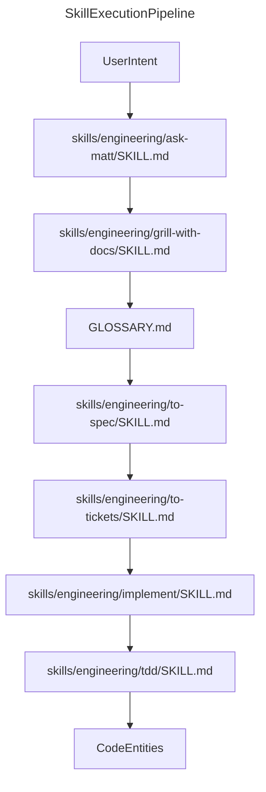
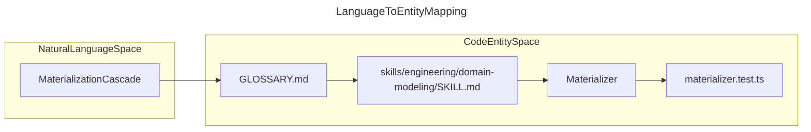

<!-- source: DeepWiki mcp.deepwiki.com · repo mattpocock/skills · page 1 Overview · fetched 2026-10-27 -->

# Overview

Relevant source files

The following files were used as context for generating this wiki page:

- [.claude-plugin/plugin.json](.claude-plugin/plugin.json)
- [.out-of-scope/subagent-recursion.md](.out-of-scope/subagent-recursion.md)
- [README.md](README.md)
- [SCOPE.md](SCOPE.md)
- [skills/engineering/README.md](skills/engineering/README.md)
- [skills/in-progress/README.md](skills/in-progress/README.md)

The `mattpocock/skills` repository provides a collection of Markdown-based, modular capabilities ("skills") consumed by coding agents such as Claude Code, Codex, and GitHub Copilot [README.md:11-19](). Unlike monolithic frameworks (e.g., GSD, BMAD, Spec-Kit) that impose rigid top-down execution models, these skills are small, composable, and adaptable primitives designed to align human intent with real-world codebases [README.md:17-19]().

## Skill Taxonomy and Buckets

Skills are organized into distinct bucket directories under `skills/` based on their stability, lifecycle status, and function [SCOPE.md:14-18]():

| Bucket | Role / Stability | Description |
|--------|------------------|-------------|
| `engineering/` | Promoted | Daily code work, architecture, and technical execution workflows [skills/engineering/README.md:1-3](). |
| `productivity/` | Promoted | Daily non-code workflows, communication, and teaching utilities [.claude-plugin/plugin.json:42-48](). |
| `in-progress/` | Non-promoted (Beta) | Public beta skills excluded from the core plugin manifest, requiring individual installation [skills/in-progress/README.md:1-4](). |
| `misc/` | Non-promoted | Frozen, unmaintained utilities [SCOPE.md:17](). |
| `deprecated/` | Retired | Retired skills; deleted rather than archived [SCOPE.md:14-18](). |

Sources: [.claude-plugin/plugin.json:21-49](), [skills/in-progress/README.md:1-4](), [SCOPE.md:14-18]()

## Composable Skills over Monolithic Workflows

The repository relies on composable primitives rather than a single black-box framework. Developers combine skills like `skills/engineering/grill-with-docs/SKILL.md`, `skills/engineering/to-spec/SKILL.md`, and `skills/engineering/tdd/SKILL.md` to progressively bridge natural language intent with concrete code entities [README.md:17-19](), [README.md:101-154]().

### Skill Execution Pipeline

Sources: [README.md:11-19](), [README.md:101-154](), [.claude-plugin/plugin.json:21-49]()

### Language to Entity Mapping

Sources: [README.md:132-154](), [skills/engineering/domain-modeling/SKILL.md:1-30]()

## Child Pages

For detailed specifications and mechanics, refer to the following child pages:

- **[Getting Started and Installation](#1.1)** — Claude Code plugin installation, `npx skills@latest add mattpocock/skills`, per-skill beta installs, and local symlink workflows via `scripts/link-skills.sh`.
- **[Repository Conventions and Release Pipeline](#1.2)** — Maintainer rules from `CLAUDE.md` and `AGENTS.md`, prose standards (forbidding em-dashes), documentation authoring standards (`.agents/writing-docs.md`), decision records (`.agents/adr/`), and the changesets release pipeline (`scripts/sync-plugin-version.mjs`).

Sources: [README.md:25-82](), [CLAUDE.md:1-25](), [scripts/link-skills.sh:1-15]()

---

