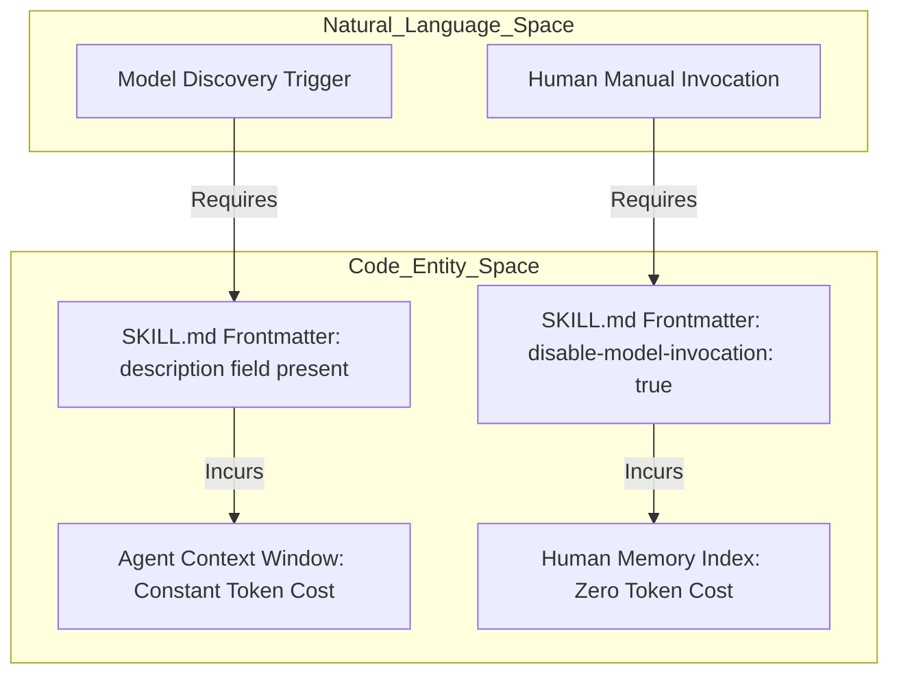
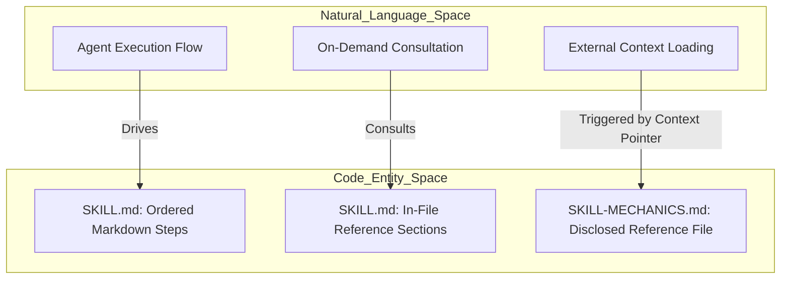

<!-- source: DeepWiki mcp.deepwiki.com · repo mattpocock/skills · page 2.3 Writing Skills and Docs for Agents · fetched 2026-10-27 -->

# Writing Skills and Docs for Agents

Relevant source files

The following files were used as context for generating this wiki page:

- [.out-of-scope/lazy-load-writing-for-agents.md](.out-of-scope/lazy-load-writing-for-agents.md)
- [docs/engineering/to-spec.md](docs/engineering/to-spec.md)
- [docs/productivity/writing-for-agents.md](docs/productivity/writing-for-agents.md)
- [skills/productivity/README.md](skills/productivity/README.md)
- [skills/productivity/writing-for-agents/SKILL-MECHANICS.md](skills/productivity/writing-for-agents/SKILL-MECHANICS.md)
- [skills/productivity/writing-for-agents/SKILL.md](skills/productivity/writing-for-agents/SKILL.md)
- [skills/productivity/writing-for-agents/agents/openai.yaml](skills/productivity/writing-for-agents/agents/openai.yaml)

## Purpose and Scope

This page specifies the mechanics and authoring guidelines implemented by the `writing-for-agents` skill and its companion `SKILL-MECHANICS.md` [skills/productivity/writing-for-agents/SKILL.md:1-8](), as well as the human-facing documentation template enforced by `.agents/writing-docs.md`. It covers information hierarchy, progressive disclosure, leading words, no-op pruning, failure modes, and the management of archived documentation for retired skills.

---

## Skill Architecture and Invocation Mechanics

The `writing-for-agents` skill governs how instructions are parsed by coding agents (`Claude Code`, `Codex`), ensuring uniform process execution across sessions [docs/productivity/writing-for-agents.md:3-3](). When authoring skills, the YAML frontmatter and file layout dictate whether a capability operates under model-driven discovery or strict manual invocation [skills/productivity/writing-for-agents/SKILL-MECHANICS.md:5-12]().

### The Two Loads

Authoring decisions constantly balance two fundamental constraints:
*   **Context Load**: The token cost of always-loaded material resident in the agent's window (e.g., skill descriptions in frontmatter, global instructions in `AGENTS.md` or `CLAUDE.md`) [skills/productivity/writing-for-agents/SKILL.md:24-24]().
*   **Cognitive Load**: The human cost of tracking which documents exist and when to invoke them [skills/productivity/writing-for-agents/SKILL.md:25-25]().

### Invocation Taxonomy

Skills choose between two execution modes via frontmatter flags:

| Invocation Mode | YAML Frontmatter Configuration | Context Load | Cognitive Load | Discoverability |
| :--- | :--- | :--- | :--- | :--- |
| **Model-Invoked** | Omit `disable-model-invocation` (retains `description`) [skills/productivity/writing-for-agents/SKILL-MECHANICS.md:9-9]() | High (description stays in context) [skills/productivity/writing-for-agents/SKILL-MECHANICS.md:9-9]() | Low (agent discovers it) [skills/productivity/writing-for-agents/SKILL-MECHANICS.md:9-9]() | Autonomous & cross-skill invocation [skills/productivity/writing-for-agents/SKILL-MECHANICS.md:9-9]() |
| **User-Invoked** | `disable-model-invocation: true` (description becomes human-facing) [skills/productivity/writing-for-agents/SKILL-MECHANICS.md:10-10]() | Zero (stripped from context) [skills/productivity/writing-for-agents/SKILL-MECHANICS.md:10-10]() | High (human acts as index) [skills/productivity/writing-for-agents/SKILL-MECHANICS.md:10-10]() | Manual invocation only (`/<skill-name>`) [skills/productivity/writing-for-agents/SKILL-MECHANICS.md:10-10]() |

Sources:
* [skills/productivity/writing-for-agents/SKILL.md:20-28]()
* [skills/productivity/writing-for-agents/SKILL-MECHANICS.md:5-15]()

---

## Information Hierarchy and Progressive Disclosure

Documents are structured into a ranked ladder of accessibility, preventing context bloat while ensuring necessary reference material is retrievable [skills/productivity/writing-for-agents/SKILL.md:29-37]().

1.  **In-file Step**: Ordered executable instructions (`1. Do X`, `2. Then Y`) [skills/productivity/writing-for-agents/SKILL.md:33-33]().
2.  **In-file Reference**: Flat peer sets of rules, definitions, or parameters consulted on demand [skills/productivity/writing-for-agents/SKILL.md:34-34]().
3.  **Disclosed Reference**: Secondary markdown files (e.g., `SKILL-MECHANICS.md`) reached via context pointers and loaded dynamically [skills/productivity/writing-for-agents/SKILL.md:35-35]().

Sources:
* [skills/productivity/writing-for-agents/SKILL.md:29-39]()
* [skills/productivity/writing-for-agents/SKILL-MECHANICS.md:1-4]()

### Co-location and Sprawl Prevention
*   **Co-location**: Keeping definitions, rules, and caveats for a single concept grouped under one heading rather than fragmented across files [skills/productivity/writing-for-agents/SKILL.md:41-41]().
*   **Sprawl**: The failure mode where a document becomes excessively long, thinning attention. Cured by progressive disclosure and branching [skills/productivity/writing-for-agents/SKILL.md:43-43]().

---

## Core Levers of Predictability

### Leading Words
A **leading word** is a compact concept existing in model pretraining (e.g., *tight*, *red*, *tracer bullet*, *fog of war*) that anchors behavior across execution and invocation pointers in minimal tokens [skills/productivity/writing-for-agents/SKILL.md:63-65]().

### Completion Criteria and Legwork
Every instruction sequence terminates in a completion criterion with two properties:
*   **Clarity**: Binary checkability preventing **premature completion** (stopping before genuine execution is complete) [skills/productivity/writing-for-agents/SKILL.md:47-49]().
*   **Demand**: Exhaustiveness standards that drive internal search and validation (**legwork**) without requiring verbose procedural steps [skills/productivity/writing-for-agents/SKILL.md:50-50]().

### Pruning and No-Op Detection
The primary authoring operation is deletion. A **no-op** instruction explains what the model already knows, consuming context tokens while altering no behavior [docs/productivity/writing-for-agents.md:5-5](). Instructions must be evaluated against duplication, sediment, and sprawl [docs/productivity/writing-for-agents/SKILL.md:30-30]().

---

## Failure Modes and Router Skills

### Common Failure Modes
*   **Premature Completion**: Vague completion thresholds leading to truncated agent runs [skills/productivity/writing-for-agents/SKILL.md:49-49]().
*   **No-op Bloat**: Explanatory text that does not enforce constraints or change control flow [docs/productivity/writing-for-agents.md:5-5]().
*   **Duplication**: Repeating definitions or constraints across multiple sections [docs/productivity/writing-for-agents/SKILL.md:41-41]().

### Router Skills
When user-invoked skills proliferate, a **router skill** (such as `ask-matt`) aggregates invocation knowledge into a single user-invoked entry point, reducing human cognitive load without adding persistent context load to autonomous agent turns [skills/productivity/writing-for-agents/SKILL-MECHANICS.md:20-22]().

Sources:
* [skills/productivity/writing-for-agents/SKILL.md:40-70]()
* [skills/productivity/writing-for-agents/SKILL-MECHANICS.md:20-22]()
* [docs/productivity/writing-for-agents.md:5-48]()

---

## Human-Facing Documentation Standards

Human-facing documentation pages for promoted skills (published at `https://aihero.dev/skills-<skill-name>`) follow a strict structural template to minimize cognitive load [docs/.agents/writing-docs.md:3-5]().

### Page Structure & Fixed Sections
*   **Absolute Links**: All hyperlinks use absolute URLs (`https://aihero.dev/skills-<name>` or `https://github.com/mattpocock/skills/...`) [docs/.agents/writing-docs.md:9-9]().
*   **No Install Commands**: Install widgets are rendered automatically by the platform template [docs/.agents/writing-docs.md:19-19]().
*   **What it does**: Concise definition leading with the skill's one-sentence job and defining constraint [docs/.agents/writing-docs.md:23-25]().
*   **When to reach for it**: Explicit invocation mode and trigger boundaries [docs/.agents/writing-docs.md:28-32]().
*   **Common questions**: Real questions sourced from issues, repositories, and changelogs, ordered by frequency [docs/.agents/writing-docs.md:44-57]().
*   **It's working if**: Observable success criteria [docs/.agents/writing-docs.md:58-58]().

### Archived Pages for Removed Skills
When a promoted skill is removed, its documentation page is retained as an **archived page** [docs/.agents/writing-docs.md:7-8](). The content remains accessible, prefixed with a banner notice specifying the removal version and recommended migration path, preserving URL validity across releases [docs/.agents/writing-docs.md:7-8]().

Sources:
* [docs/.agents/writing-docs.md:1-59]()

---

