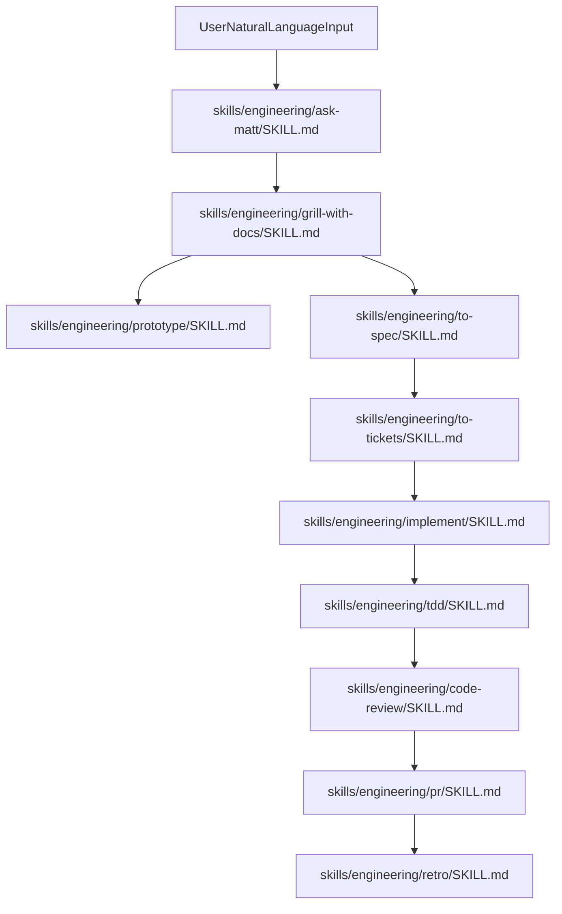
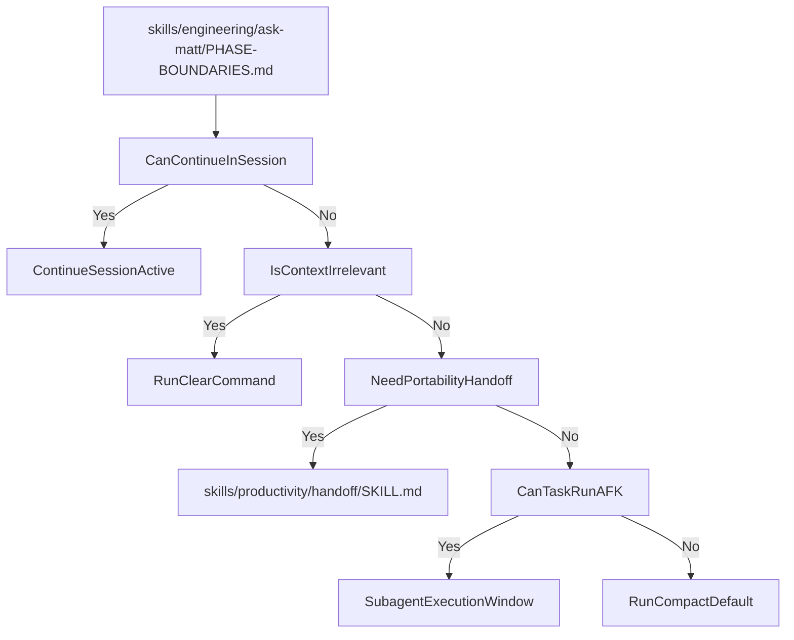

<!-- source: DeepWiki mcp.deepwiki.com · repo mattpocock/skills · page 2.4 Ask-Matt Router, Flows and Phase Boundaries · fetched 2026-10-27 -->

# Ask-Matt Router, Flows and Phase Boundaries

Relevant source files

The following files were used as context for generating this wiki page:

- [.changeset/ask-matt-read-skill-first.md](.changeset/ask-matt-read-skill-first.md)
- [docs/engineering/ask-matt.md](docs/engineering/ask-matt.md)
- [skills/engineering/ask-matt/PHASE-BOUNDARIES.md](skills/engineering/ask-matt/PHASE-BOUNDARIES.md)
- [skills/engineering/ask-matt/SKILL.md](skills/engineering/ask-matt/SKILL.md)

This page documents the `ask-matt` router skill, which acts as a centralized routing engine across the skills repository [skills/engineering/ask-matt/SKILL.md:2-3](). It details the main idea-to-ship flow, integration on-ramps, codebase health upkeep, phase boundary management via `PHASE-BOUNDARIES.md`, and smart-zone context handling.

Sources:
- [skills/engineering/ask-matt/SKILL.md:2-3]()
- [docs/engineering/ask-matt.md:1-6]()

## Overview and Router Mechanics

The `ask-matt` router (`skills/engineering/ask-matt/SKILL.md`) functions as a static manual map rather than an automated execution daemon [docs/engineering/ask-matt.md:5-6](). It accepts a natural language description of an operational state and outputs the appropriate skill sequence, workflow flow, or phase boundary decision [docs/engineering/ask-matt.md:2-5](). 

Recent updates enforce that `ask-matt` reads a skill's target `SKILL.md` before stating its functionality or recommending a step be skipped, rather than trusting static local summaries [.changeset/ask-matt-read-skill-first.md:1-5](). Because many skills declare `disable-model-invocation: true` in their frontmatter, the router provides an explicit text-based index over otherwise hidden agent capabilities [skills/engineering/ask-matt/SKILL.md:4](), [docs/engineering/ask-matt.md:55-58]().

Sources:
- [skills/engineering/ask-matt/SKILL.md:1-5]()
- [docs/engineering/ask-matt.md:2-6]()
- [docs/engineering/ask-matt.md:55-58]()
- [.changeset/ask-matt-read-skill-first.md:1-5]()

## The Main Flow: Idea to Ship

The primary route for feature implementation is the idea-to-ship flow [skills/engineering/ask-matt/SKILL.md:13-33]().

**Diagram: Natural Language to Code Entity Mapping for Main Flow**

Sources:
- [skills/engineering/ask-matt/SKILL.md:13-33]()

1. **`/grill-with-docs`**: Initial stateful interview process retaining insights in `GLOSSARY.md` and ADRs under `docs/adr/` [skills/engineering/ask-matt/SKILL.md:16-17]().
2. **Prototyping Branch**: For exploratory code, bridge via `/handoff` to `/prototype`, then return via `/handoff` [skills/engineering/ask-matt/SKILL.md:18-21]().
3. **Multi-Session vs Single-Session Build**: 
   - Multi-session builds route through `/to-spec` and `/to-tickets`, followed by `/implement` per tracer-bullet ticket or `/implement-spec` for task graphs [skills/engineering/ask-matt/SKILL.md:22-25]().
   - Single-session builds invoke `/implement` directly [skills/engineering/ask-matt/SKILL.md:26]().
4. **Execution and Closure**: Execution drives `/tdd` and concludes with `/code-review`, `/pr`, and `/retro` [skills/engineering/ask-matt/SKILL.md:28-32]().

Sources:
- [skills/engineering/ask-matt/SKILL.md:13-33]()

## On-Ramps

Starting situations that generate operational work before merging into the main flow include:
- **`/triage`**: Manages incoming external bugs and feature requests, converting them into agent-ready issues [skills/engineering/ask-matt/SKILL.md:44-46]().
- **`/diagnosing-bugs`**: Establishes tight feedback loops for complex failures, closing with regression tests and handing off to `/improve-codebase-architecture` if architectural seams are missing [skills/engineering/ask-matt/SKILL.md:48]().
- **`/wayfinder`**: Charts large, foggy greenfield efforts using decision tickets on issue trackers, handing off to `/to-spec` when resolved [skills/engineering/ask-matt/SKILL.md:50-52]().

Sources:
- [skills/engineering/ask-matt/SKILL.md:40-52]()

## Codebase Health and Standalone Categories

Upkeep routines operate independently of feature pipelines:
- **`/improve-codebase-architecture`**: Scans the repository for deepening opportunities, outputting candidates that re-enter the main flow via `/grill-with-docs` [skills/engineering/ask-matt/SKILL.md:58]().
- **Domain Modeling & Codebase Design**: Foundational vocabulary references (`/domain-modeling`, `/codebase-design`) utilized by engineering skills [skills/engineering/ask-matt/SKILL.md:60-64]().

Sources:
- [skills/engineering/ask-matt/SKILL.md:54-64]()

## Phase Boundaries and `PHASE-BOUNDARIES.md`

Phase boundaries govern context management between distinct chunks of work [skills/engineering/ask-matt/PHASE-BOUNDARIES.md:3-5](). 

**Diagram: Natural Language to Code Entity Mapping for Phase Boundaries**

Sources:
- [skills/engineering/ask-matt/PHASE-BOUNDARIES.md:1-39]()

The five context management options are evaluated top-to-bottom:
1. **Continue**: Retains the session as a primary source if smart-zone limits (~150k tokens) allow [skills/engineering/ask-matt/PHASE-BOUNDARIES.md:21-22]().
2. **`/clear`**: Empties context entirely if prior data is completely disposable [skills/engineering/ask-matt/PHASE-BOUNDARIES.md:23-25]().
3. **`/handoff`**: Exports portable Markdown state when changing harnesses, repositories, or transferring ownership [skills/engineering/ask-matt/PHASE-BOUNDARIES.md:27-34]().
4. **Subagent**: Delegates isolated tasks to background workers [skills/engineering/ask-matt/PHASE-BOUNDARIES.md:36]().
5. **`/compact`**: Compresses existing context as the default fallback option [skills/engineering/ask-matt/PHASE-BOUNDARIES.md:38-40]().

Sources:
- [skills/engineering/ask-matt/PHASE-BOUNDARIES.md:1-41]()

## Smart-Zone Context Management

The smart-zone denotes the safe processing threshold (approximately 150k tokens) where state-of-the-art models maintain rigorous analytical reasoning [skills/engineering/ask-matt/SKILL.md:38](). Approaching this threshold before completing foundational specification steps requires executing `/compact` at the nearest phase boundary to prevent semantic degradation [skills/engineering/ask-matt/SKILL.md:38-39]().

Sources:
- [skills/engineering/ask-matt/SKILL.md:34-39]()

---

