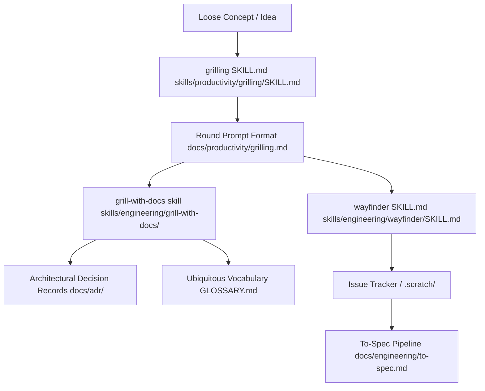
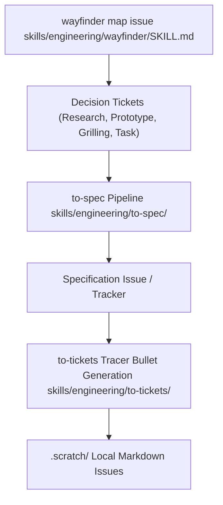

<!-- source: DeepWiki mcp.deepwiki.com · repo mattpocock/skills · page 3 Planning and Specification Skills · fetched 2026-10-27 -->

# Planning and Specification Skills

Relevant source files

The following files were used as context for generating this wiki page:

- [.changeset/grilling-yes-accepts-recommendation.md](.changeset/grilling-yes-accepts-recommendation.md)
- [docs/productivity/grilling.md](docs/productivity/grilling.md)
- [skills/engineering/ask-matt/SKILL.md](skills/engineering/ask-matt/SKILL.md)
- [skills/productivity/grilling/SKILL.md](skills/productivity/grilling/SKILL.md)

## Purpose and Scope

This section provides an overview of the skills that transform a loose idea into agreed, written work. These skills cover the entire spectrum from initial concept clarification to detailed task breakdown, ensuring that development efforts are well-defined and aligned with project goals.

The key skills in this category include:
- The `grilling` primitive and its wrappers (`grill-with-docs`, `grill-me`).
- `wayfinder` for mapping large, complex efforts.
- `prototype` for answering questions that talking cannot settle.
- `research` for gathering information from primary sources.
- The `to-spec` and `to-tickets` pipeline for formalizing specifications and breaking them into actionable tasks.

This page offers a high-level introduction to each skill and their interrelationships. For detailed information on each topic, refer to the linked child pages.

Sources: [skills/engineering/ask-matt/SKILL.md:17-26](), [docs/productivity/grilling.md:13-18]()

---

## Planning Pipeline and Code Entity Mapping

Diagram: "Planning Pipeline Natural Language to Code Entities"

Sources: [skills/productivity/grilling/SKILL.md:1-28](), [docs/productivity/grilling.md:1-66](), [skills/engineering/ask-matt/SKILL.md:17-26]()

---

## The Grilling Primitive

The `grilling` skill is a model-invoked interview loop designed to stress-test a plan, decision, or idea [docs/productivity/grilling.md:1-5](). It maps the subject as a **design tree**, where every decision branches into dependent decisions [docs/productivity/grilling.md:3-4](). The skill operates in **rounds**, presenting the **frontier** of questions whose prerequisites are already settled [docs/productivity/grilling.md:5](). This ensures that only relevant questions are asked at any given time [docs/productivity/grilling.md:5]().

The `grilling` primitive distinguishes between **facts**, which the agent is responsible for finding via sub-agents, and **decisions**, which are presented to the user [docs/productivity/grilling.md:29](). Each question is formatted with symbols (`❓`, `➡️`) so that "yes" accepts the recommended answer [.changeset/grilling-yes-accepts-recommendation.md:5](). The session concludes when the design tree is fully explored and a shared understanding is confirmed [docs/productivity/grilling.md:28-29]().

For details on the design tree, frontier, rounds, question formatting, and the confirmation gate, see [The Grilling Primitive](#3.1).

Sources: [docs/productivity/grilling.md:1-5](), [skills/productivity/grilling/SKILL.md:6-8](), [docs/productivity/grilling.md:21-29](), [.changeset/grilling-yes-accepts-recommendation.md:5]()

---

## Grill-With-Docs and Grill-Me

While `grilling` is the core interview primitive, it is often wrapped by other skills that provide additional context or produce specific artifacts [docs/productivity/grilling.md:13-19]().

- **`grill-with-docs`**: This is the stateful wrapper used when working within a repository [docs/productivity/grilling.md:16](). It leverages the `grilling` primitive to sharpen an idea and writes the agreed-upon vocabulary to `GLOSSARY.md` and architectural decision records (ADRs) to `docs/adr/` [docs/productivity/grilling.md:16](). It also manages `GLOSSARY-MAP.md` for multi-context repositories and enforces three ADR gates.
- **`grill-me`**: This is the stateless counterpart, used when there is no working directory or persistent documentation is not required [docs/productivity/grilling.md:15](). It provides the same interview experience as `grilling` but without the documentation side effects [docs/productivity/grilling.md:15]().

The choice between `grill-with-docs` and `grill-me` depends on whether a persistent record of the discussion and decisions is needed [docs/productivity/grilling.md:13-16]().

For details on when to use each skill, their statefulness, and their downstream handoffs, see [Grill-With-Docs and Grill-Me](#3.2).

Sources: [skills/engineering/ask-matt/SKILL.md:17-17](), [docs/productivity/grilling.md:13-16]()

---

## Wayfinder: Mapping Large Efforts

The `wayfinder` skill is designed for tackling large, complex efforts like greenfield projects or significant feature builds that are too big to hold in a single session [skills/engineering/ask-matt/SKILL.md:52](). It creates a stateful map of **decision tickets** on the issue tracker, systematically resolving them one at a time [skills/engineering/ask-matt/SKILL.md:52]().

`wayfinder` uses metaphors like "fog-of-war" and "frontier" to describe the process of clarifying unknowns [skills/engineering/ask-matt/SKILL.md:52](). It defines various ticket types (`research`, `prototype`, `grilling`, `task`) and includes mechanisms for claiming/assigning tickets, bootstrapping or resuming maps, and an early exit when the route is clear [skills/engineering/ask-matt/SKILL.md:52](). Once the map is clear, `wayfinder` hands off to `to-spec` to consolidate the decisions into a buildable plan [skills/engineering/ask-matt/SKILL.md:54]().

For details on the map artifact structure, ticket types, metaphors, locking mechanisms, and handoff to `to-spec`, see [Wayfinder: Mapping Large Efforts](#3.3).

Sources: [skills/engineering/ask-matt/SKILL.md:52-54]()

---

## Ticket and Specification Mapping to Code Space

Diagram: "Ticket and Specification Mapping Entities"

Sources: [skills/engineering/ask-matt/SKILL.md:25-27]()

---

## To-Spec and To-Tickets

This pipeline formalizes the outcomes of planning discussions into actionable development tasks [skills/engineering/ask-matt/SKILL.md:25-27]().

- **`to-spec`**: This skill synthesizes a settled conversation (often from a `grilling` session or `wayfinder` map) into a formal specification issue [skills/engineering/ask-matt/SKILL.md:25](). The key here is synthesis without inventing new decisions, focusing on identifying seams for testing and implementation [skills/engineering/ask-matt/SKILL.md:25](). The output is an issue tracker entry [skills/engineering/ask-matt/SKILL.md:25]().
- **`to-tickets`**: Following `to-spec`, this skill takes the specification and breaks it down into smaller, tracer-bullet tickets [skills/engineering/ask-matt/SKILL.md:25](). Each ticket represents a thin vertical slice of functionality and declares its blocking edges [skills/engineering/ask-matt/SKILL.md:25](). These tickets can be managed locally under `.scratch/` or integrated with real issue trackers [skills/engineering/ask-matt/SKILL.md:26]().

This pipeline ensures that development work is based on clear, agreed-upon specifications and broken down into manageable, interdependent tasks.

For details on the synthesis process, issue tracker output, tracer-bullet methodology, and local `.scratch/` layout, see [To-Spec and To-Tickets](#3.4).

Sources: [skills/engineering/ask-matt/SKILL.md:25-27]()

---

## Prototyping

The `prototype` skill is a crucial detour when a question cannot be settled through conversation alone, especially when it involves how something should look or feel [docs/productivity/grilling.md:18](). It allows for the creation of throwaway code to answer specific questions [skills/engineering/ask-matt/SKILL.md:20-23]().

The skill supports two main branches:
- **LOGIC prototypes**: Single, shareable HTML files that include guided walkthroughs and free-play buttons, focusing on business logic or complex interactions [skills/engineering/ask-matt/SKILL.md:20-23]().
- **UI prototypes**: Structurally different variants presented behind a `PrototypeSwitcher` bar, allowing for easy comparison of different user interface approaches [skills/engineering/ask-matt/SKILL.md:20-23]().

The philosophy is "throwaway-first," meaning the prototype's primary purpose is to answer a question, not to become production code [skills/engineering/ask-matt/SKILL.md:20-23](). The prototype branch is captured as a primary source, and its findings integrate back into `wayfinder`, `grilling`, or `to-spec` processes [skills/engineering/ask-matt/SKILL.md:20-23]().

For details on the two branches, throwaway philosophy, and integration with other planning skills, see [Prototyping](#3.5).

Sources: [docs/productivity/grilling.md:18-18](), [skills/engineering/ask-matt/SKILL.md:20-23]()

---

## Research

The `research` skill facilitates answering questions by delegating to background agents to find information from primary sources [skills/engineering/ask-matt/SKILL.md:52](). This is particularly useful for gathering external data, understanding existing systems, or exploring technical options [skills/engineering/ask-matt/SKILL.md:52]().

The output of the `research` skill is typically cited Markdown, ensuring transparency and verifiability of the information [skills/engineering/ask-matt/SKILL.md:52](). It distinguishes between information with a short shelf-life and more enduring decisions that might warrant an ADR [skills/engineering/ask-matt/SKILL.md:52](). `wayfinder` research tickets often consume the output of this skill to inform decision-making [skills/engineering/ask-matt/SKILL.md:52]().

For details on the background-agent delegation model, output format, shelf-life considerations, and integration with `wayfinder`, see [Research](#3.6).

Sources: [skills/engineering/ask-matt/SKILL.md:52-54]()

---

