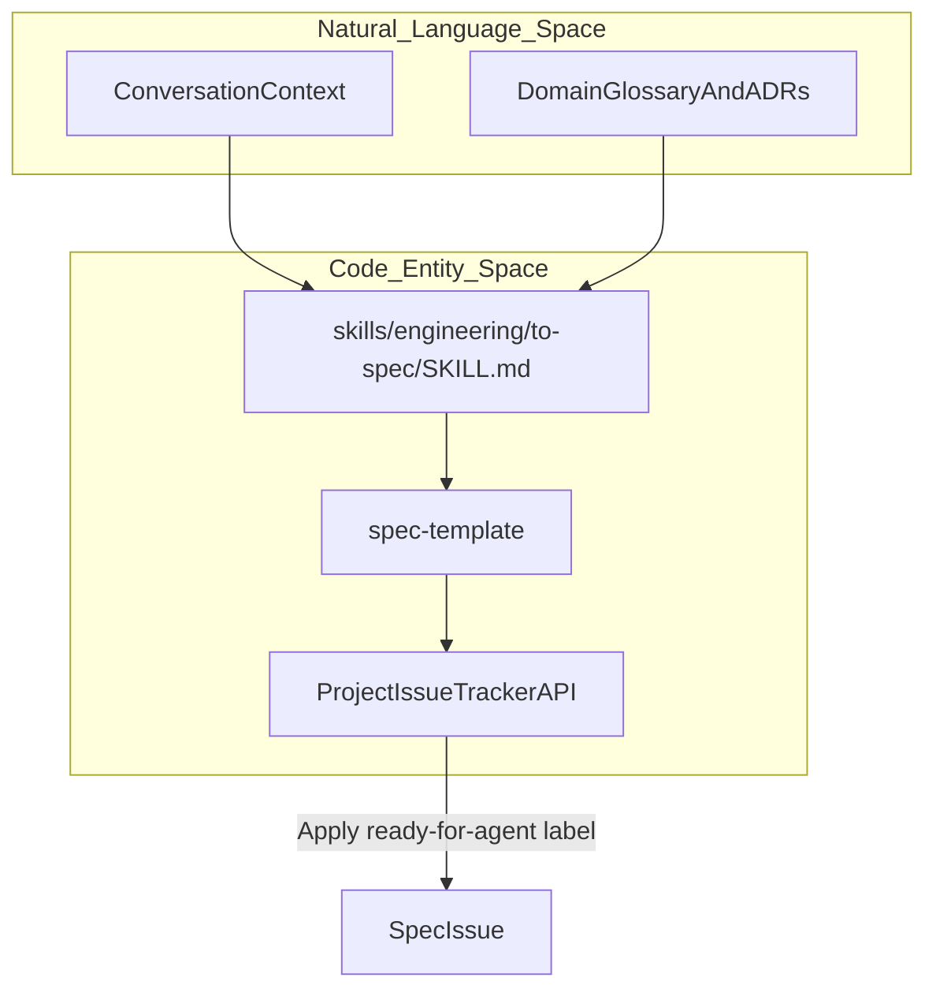
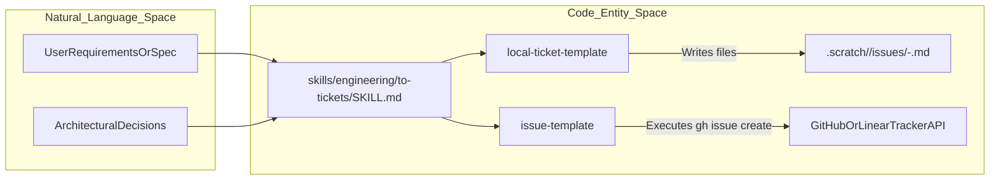
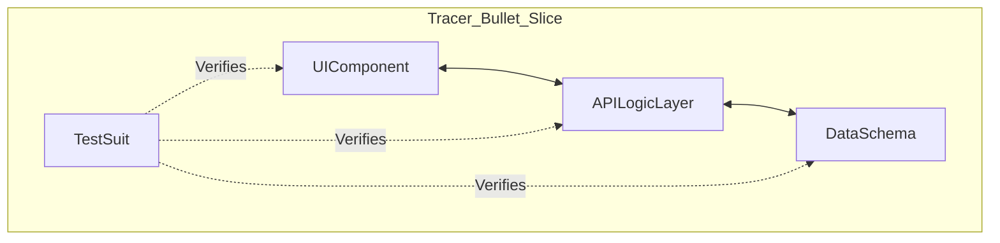

<!-- source: DeepWiki mcp.deepwiki.com · repo mattpocock/skills · page 3.4 To-Spec and To-Tickets · fetched 2026-10-27 -->

# To-Spec and To-Tickets

Relevant source files

The following files were used as context for generating this wiki page:

- [.changeset/to-tickets-sub-issues.md](.changeset/to-tickets-sub-issues.md)
- [docs/engineering/to-spec.md](docs/engineering/to-spec.md)
- [docs/engineering/to-tickets.md](docs/engineering/to-tickets.md)
- [docs/productivity/writing-for-agents.md](docs/productivity/writing-for-agents.md)
- [skills/engineering/code-review/SKILL.md](skills/engineering/code-review/SKILL.md)
- [skills/engineering/to-spec/SKILL.md](skills/engineering/to-spec/SKILL.md)
- [skills/engineering/to-tickets/SKILL.md](skills/engineering/to-tickets/SKILL.md)
- [skills/in-progress/claude-handoff/SKILL.md](skills/in-progress/claude-handoff/SKILL.md)
- [skills/productivity/writing-for-agents/SKILL.md](skills/productivity/writing-for-agents/SKILL.md)

## Purpose and Scope

This document details the `to-spec` [skills/engineering/to-spec/SKILL.md:2-3]() and `to-tickets` [skills/engineering/to-tickets/SKILL.md:2-3]() skills, which form a critical pipeline for transforming a settled conversation or idea into actionable, structured work items. The `to-spec` skill synthesizes existing knowledge into a formal specification, while `to-tickets` breaks that specification down into vertically sliced, tracer-bullet tickets with defined blocking dependencies [skills/engineering/to-tickets/SKILL.md:3-3](), [docs/engineering/to-tickets.md:3-5](). This pipeline ensures that work is clearly defined, traceable, and ready for implementation, whether managed in local `.scratch/` files or integrated with real issue trackers [skills/engineering/to-tickets/SKILL.md:62-63](), [docs/engineering/to-tickets.md:23-24]().

Sources: [skills/engineering/to-spec/SKILL.md:2-3](), [skills/engineering/to-tickets/SKILL.md:2-3](), [skills/engineering/to-tickets/SKILL.md:62-63](), [docs/engineering/to-tickets.md:3-5](), [docs/engineering/to-tickets.md:23-24]()

## To-Spec: From Conversation to Specification

The `to-spec` skill takes the current conversation context and codebase understanding to produce a formal specification [skills/engineering/to-spec/SKILL.md:7-7](). Its defining constraint is that it *does not interview the user*; instead, it synthesizes what is already known [skills/engineering/to-spec/SKILL.md:7-7](), [docs/engineering/to-spec.md:5-5](). The spec serves as a record of decisions already made, not a forum for new ones [docs/engineering/to-spec.md:5-6]().

### When to Reach for It

`to-spec` is a user-invoked skill (`disable-model-invocation: true`), meaning the agent will not call it automatically [skills/engineering/to-spec/SKILL.md:4-4](), [docs/engineering/to-spec.md:9-9](). It is used when a build is too large for a single agent session and needs to be split across several [docs/engineering/to-spec.md:11-12]().

| Where you are | What to run |
| :--- | :--- |
| You haven't decided anything yet | `grill-with-docs` first [docs/engineering/to-spec.md:15-15]() |
| Decided, and the work fits one context window | `implement`: skip the spec [docs/engineering/to-spec.md:16-16]() |
| Decided, and the work spans several sessions | `/to-spec`, then `to-tickets` [docs/engineering/to-spec.md:17-17]() |
| A `wayfinder` map has cleared | `/to-spec #<map_issue>` [docs/engineering/to-spec.md:18-18]() |

The spec is a decision record that survives the clearing of context windows, capturing the shape of the solution, choices made, and deliberate refusals [docs/engineering/to-spec.md:26-28]().

### Process

The `to-spec` process involves three main steps [skills/engineering/to-spec/SKILL.md:11-19]():

1.  **Explore the repo**: Understand the current codebase, use the project's domain glossary, and respect ADRs [skills/engineering/to-spec/SKILL.md:13-14]().
2.  **Sketch out seams**: Identify and propose seams where the feature will be tested, preferring existing seams and checking with the user [skills/engineering/to-spec/SKILL.md:15-18]().
3.  **Write and publish the spec**: Generate the spec using a predefined template and publish it to the project issue tracker with the `ready-for-agent` triage label [skills/engineering/to-spec/SKILL.md:19-19]().

### Specification Template

The spec follows a detailed template to ensure comprehensive coverage of the planned work [skills/engineering/to-spec/SKILL.md:21-75]():

| Section | Description |
| :--- | :--- |
| **Problem Statement** | The user's problem from their perspective [skills/engineering/to-spec/SKILL.md:24-26](). |
| **Solution** | The solution to the problem, from the user's perspective [skills/engineering/to-spec/SKILL.md:28-30](). |
| **User Stories** | An extensive, numbered list of user stories in the format `As an <actor>, I want a <feature>, so that <benefit>` [skills/engineering/to-spec/SKILL.md:32-42](). |
| **Implementation Decisions** | Details on modules, interfaces, technical clarifications, architectural decisions, schema changes, API contracts, and specific interactions. Avoids specific file paths or code snippets unless from a prototype encoding a precise decision [skills/engineering/to-spec/SKILL.md:44-57](). |
| **Testing Decisions** | What makes a good test, which modules will be tested, and prior art for tests [skills/engineering/to-spec/SKILL.md:59-66](). |
| **Out of Scope** | Description of what is explicitly not included in this spec [skills/engineering/to-spec/SKILL.md:68-70](). |
| **Further Notes** | Any additional notes about the feature [skills/engineering/to-spec/SKILL.md:72-74](). |

### Seams and Testing

Before writing the spec, `to-spec` sketches the **seams** where the feature will be tested. It prioritizes existing seams and aims for the highest possible seam, ideally one across the entire change [skills/engineering/to-spec/SKILL.md:15-17](), [docs/engineering/to-spec.md:31-33](). These agreed-upon seams are crucial because `tdd` works only at pre-agreed seams, and `code-review` reviews the diff against the spec [docs/engineering/to-spec.md:33-34]().

### Prerequisites

`to-spec` requires `setup-matt-pocock-skills` to have configured an issue tracker and triage label vocabulary for the repository, as it publishes the spec as an issue [docs/engineering/to-spec.md:21-23](). This can be a real tracker (e.g., GitHub) or local markdown files under `.scratch/` [docs/engineering/to-spec.md:23-23]().

### Spec Generation and Publishing Pipeline

Sources: [skills/engineering/to-spec/SKILL.md:1-75](), [skills/engineering/to-spec/SKILL.md:7-19](), [skills/engineering/to-spec/SKILL.md:21-75](), [docs/engineering/to-spec.md:5-23](), [docs/engineering/to-spec.md:26-34]()

## To-Tickets: From Specification to Tracer-Bullet Tickets

The `to-tickets` skill breaks down a plan, spec, or conversation into a set of **tracer-bullet tickets**, each declaring its **blocking edges** [skills/engineering/to-tickets/SKILL.md:3-3](). Each ticket represents a narrow but complete path through every layer of the change (schema, API, UI, tests) and is sized to fit in a single fresh context window [docs/engineering/to-tickets.md:5-6]().

### When to Reach for It

`to-tickets` is a user-invoked skill (`disable-model-invocation: true`) [skills/engineering/to-tickets/SKILL.md:4-4](), [docs/engineering/to-tickets.md:9-9](). It is typically used after a spec has been created for multi-session work, or directly from a conversation if no formal spec is needed [docs/engineering/to-tickets.md:13-14]().

| Where you are | What to run |
| :--- | :--- |
| You have a spec issue and the build spans several sessions | `/to-tickets`, or `/to-tickets #<spec_issue>` [docs/engineering/to-tickets.md:13-13]() |
| The plan is only in the conversation, never written up | `/to-tickets` reads the thread directly, no spec needed [docs/engineering/to-tickets.md:14-14]() |
| The whole change fits in one context window | `implement`, skip the tickets [docs/engineering/to-tickets.md:15-15]() |
| Nothing is decided yet | `grill-with-docs`, then `to-spec` [docs/engineering/to-tickets.md:16-16]() |
| A `wayfinder` map has cleared | `to-spec` first, to collapse the map, then `/to-tickets` [docs/engineering/to-tickets.md:17-17]() |

Tickets produced by `to-tickets` are agent-ready by construction and do not require `triage` [docs/engineering/to-tickets.md:19-20]().

### Prerequisites

Similar to `to-spec`, `to-tickets` requires `setup-matt-pocock-skills` to have configured an issue tracker and triage label vocabulary for the repository [docs/engineering/to-tickets.md:23-24](). It supports real trackers (GitHub, Linear) or local markdown files under `.scratch/` [docs/engineering/to-tickets.md:24-24]().

### Process

The `to-tickets` skill follows a structured five-step process to convert a plan or spec into tickets [skills/engineering/to-tickets/SKILL.md:13-58]():

1.  **Gather context**: Work from the conversation or a provided reference (spec path, issue number, URL) [skills/engineering/to-tickets/SKILL.md:15-17]().
2.  **Explore the codebase (optional)**: Understand the current state, use domain glossary, respect ADRs, and look for prefactoring opportunities [skills/engineering/to-tickets/SKILL.md:19-24]().
3.  **Draft vertical slices**: Break the work into tracer-bullet tickets, each with blocking edges [skills/engineering/to-tickets/SKILL.md:25-38]().
    *   **Vertical Slice Rules**: Each slice cuts a narrow but COMPLETE path through every layer, is demoable, sized for a single context window, and prefactoring is done first [skills/engineering/to-tickets/SKILL.md:29-36]().
    *   **Wide Refactor Exception**: For mechanical changes with a wide blast radius, `to-tickets` sequences an **expand–contract** approach: expand (add new form), migrate (move call sites in batches), then contract (delete old form) [skills/engineering/to-tickets/SKILL.md:40-40](), [docs/engineering/to-tickets.md:48-52]().
4.  **Quiz the user**: Present the proposed breakdown as a numbered list, showing title, blockers, and what it delivers. Iterate until the user approves [skills/engineering/to-tickets/SKILL.md:42-56]().
5.  **Publish the tickets**: Publish approved tickets in dependency order to the configured tracker. Apply the `ready-for-agent` label [skills/engineering/to-tickets/SKILL.md:58-67]().

### Ticket Structure and Storage Layout

Every ticket created by the skill follows a strict template depending on whether local markdown files or a real issue tracker is used [skills/engineering/to-tickets/SKILL.md:60-64]().

#### Local `.scratch/` Layout vs Real Trackers

| Backend Type | Storage Mechanism | Blocking Edges Representation |
| :--- | :--- | :--- |
| **Local Markdown (`.scratch/`)** | `.scratch/<feature-slug>/issues/<NN>-<slug>.md`, numbered from `01` in dependency order [skills/engineering/to-tickets/SKILL.md:62-62]() | Text fields inside the local ticket file specifying dependencies [skills/engineering/to-tickets/SKILL.md:62-62](), [docs/engineering/to-tickets.md:39-39]() |
| **Real Trackers (GitHub, Linear)** | Published via API (`gh issue create`, etc.) [skills/engineering/to-tickets/SKILL.md:63-63]() | Native blocking links (e.g., `--blocked-by 12,15`) or parent/sub-issue relations (`--parent <n>`) [.changeset/to-tickets-sub-issues.md:5-5](), [docs/engineering/to-tickets.md:64-68]() |

#### Ticket Data Flow and Storage Architecture

Sources: [skills/engineering/to-tickets/SKILL.md:1-105](), [skills/engineering/to-tickets/SKILL.md:60-103](), [docs/engineering/to-tickets.md:37-41]()

#### Ticket Body Components
The generated ticket includes [skills/engineering/to-tickets/SKILL.md:69-103]():

| Section | Description |
| :--- | :--- |
| **What to build** | End-to-end behavior from the user's perspective. Avoids specific file paths or code snippets that go stale fast [skills/engineering/to-tickets/SKILL.md:73-73](), [skills/engineering/to-tickets/SKILL.md:105-105](). |
| **Blocked by** | Real identifiers of dependencies. A ticket with no blockers is on the **frontier** and can start immediately [skills/engineering/to-tickets/SKILL.md:38-38](), [skills/engineering/to-tickets/SKILL.md:75-75](). |
| **Acceptance criteria** | A checklist of verifiable outcomes [skills/engineering/to-tickets/SKILL.md:79-80](). |
| **Status / Label** | Applies `ready-for-agent` so an agent can pick it up automatically [skills/engineering/to-tickets/SKILL.md:63-63](), [skills/engineering/to-tickets/SKILL.md:77-77](). |

### Tracer Bullet Methodology

#### Tracer Bullet Architecture Diagram

The "tracer bullet" establishes the complete integration path with minimal functionality. This validates that all layers work together before adding breadth or complexity [skills/engineering/to-tickets/SKILL.md:27-27](), [docs/engineering/to-tickets.md:5-6]().

### Vertical Slices vs Horizontal Slices

The core philosophy of the `to-tickets` skill is **vertical slicing**: breaking work into thin end-to-end features rather than layer-by-layer implementations [skills/engineering/to-tickets/SKILL.md:8-9]().

**Horizontal slicing** (discouraged) divides work by technical layer (e.g., database schema changes or UI components). **Vertical slicing** (recommended) divides work by deliverable user-facing behavior [docs/engineering/to-tickets.md:25-28]().

#### Vertical Slice Rules
The skill enforces specific rules for valid vertical slices [skills/engineering/to-tickets/SKILL.md:29-36]():

-   Each slice cuts a narrow but **COMPLETE** path through every layer (schema, API, UI, tests) — vertical, NOT a horizontal slice of one layer [skills/engineering/to-tickets/SKILL.md:31-31]().
-   A completed slice is demoable or verifiable on its own [skills/engineering/to-tickets/SKILL.md:32-32]().
-   Each slice is sized to fit in a single fresh context window [skills/engineering/to-tickets/SKILL.md:33-33]().
-   Any prefactoring should be done first to "make the change easy, then make the easy change" [skills/engineering/to-tickets/SKILL.md:23-24](), [skills/engineering/to-tickets/SKILL.md:34-34]().

Sources: [skills/engineering/to-tickets/SKILL.md:3-105](), [docs/engineering/to-tickets.md:3-68](), [.changeset/to-tickets-sub-issues.md:5-5]()

---

