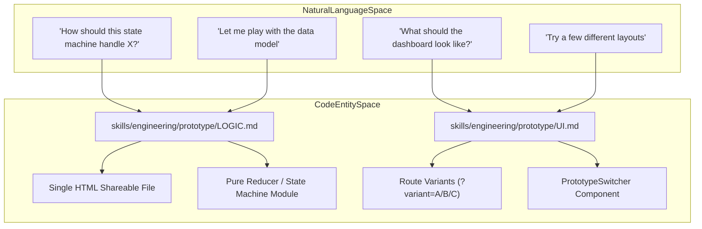
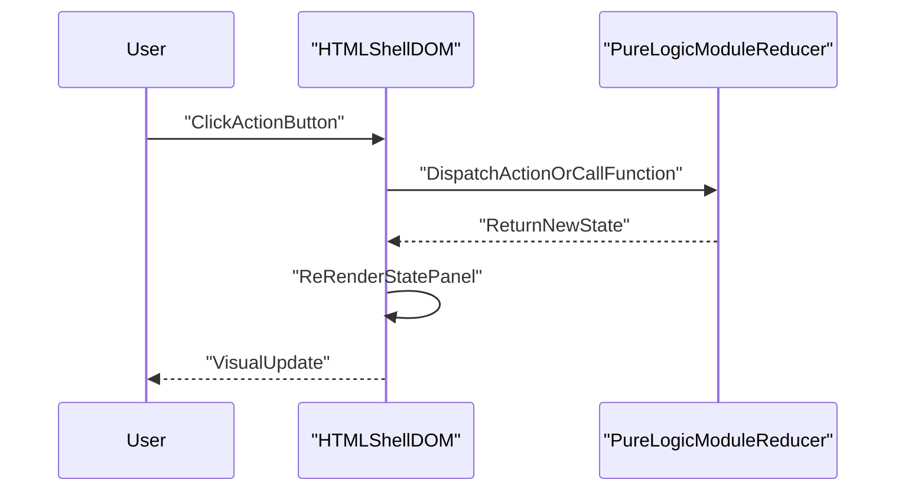
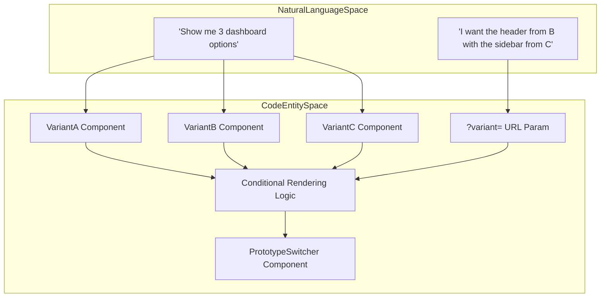
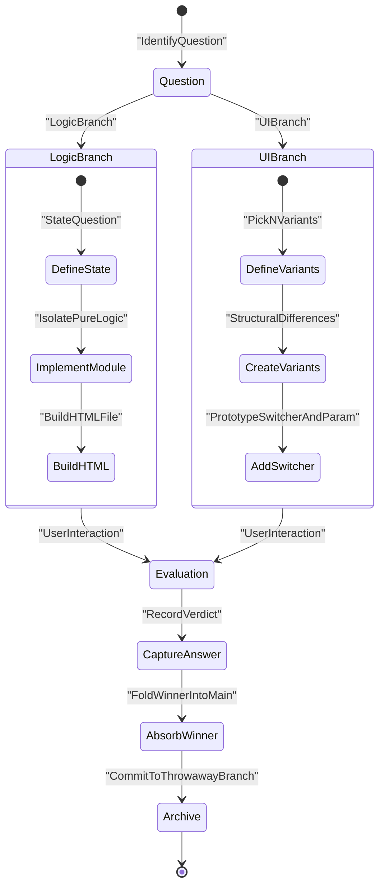

<!-- source: DeepWiki mcp.deepwiki.com · repo mattpocock/skills · page 3.5 Prototyping · fetched 2026-10-27 -->

# Prototyping

Relevant source files

The following files were used as context for generating this wiki page:

- [docs/engineering/prototype.md](docs/engineering/prototype.md)
- [skills/engineering/prototype/LOGIC.md](skills/engineering/prototype/LOGIC.md)
- [skills/engineering/prototype/SKILL.md](skills/engineering/prototype/SKILL.md)
- [skills/engineering/prototype/UI.md](skills/engineering/prototype/UI.md)
- [skills/engineering/prototype/agents/openai.yaml](skills/engineering/prototype/agents/openai.yaml)

The `prototype` skill (`skills/engineering/prototype/SKILL.md`) builds throwaway code to answer a specific technical or design question before committing to a final implementation [skills/engineering/prototype/SKILL.md:8-9](). It follows a throwaway-first philosophy, ensuring explorations do not rot within the production codebase [skills/engineering/prototype/SKILL.md:21-22]().

The skill integrates with upstream discovery flows like [grilling]() and [wayfinder](), as well as downstream specification steps like [to-spec]() [docs/engineering/prototype.md:11-13](). Agents invoke or recommend it when tasks require sanity-checking a state model or exploring UI options [skills/engineering/prototype/SKILL.md:3-4](), [docs/engineering/prototype/md:9-9]().

Sources: [skills/engineering/prototype/SKILL.md:3-9](), [docs/engineering/prototype.md:9-13]()

## The Two-Branch Approach

The skill routes between two distinct branches (`skills/engineering/prototype/LOGIC.md` and `skills/engineering/prototype/UI.md`) depending on the question being asked [skills/engineering/prototype/SKILL.md:11-18]().

| Branch | Primary Question | Artifact |
| :--- | :--- | :--- |
| **Logic** (`skills/engineering/prototype/LOGIC.md`) | "Does this logic / state model feel right?" | A single shareable HTML file with free-play buttons and guided walkthroughs [skills/engineering/prototype/SKILL.md:14-14](), [skills/engineering/prototype/LOGIC.md:1-3]() |
| **UI** (`skills/engineering/prototype/UI.md`) | "What should this look like?" | Toggleable route variations behind a `?variant=` param and `PrototypeSwitcher` bar [skills/engineering/prototype/SKILL.md:15-15](), [skills/engineering/prototype/UI.md:1-3](), [skills/engineering/prototype/UI.md:68-68]() |

### Diagram: Natural Language to Code Entity Mapping: Logic vs UI

Sources: [skills/engineering/prototype/SKILL.md:13-18](), [skills/engineering/prototype/LOGIC.md:1-12](), [skills/engineering/prototype/UI.md:1-13]()

---

## Logic Prototypes

Logic prototypes (`skills/engineering/prototype/LOGIC.md`) explore business logic, state transitions, or complex data shapes [skills/engineering/prototype/LOGIC.md:1-3]().

### Implementation Architecture
The architecture separates the pure underlying logic from the interactive HTML shell:

1. **Portable Logic Module**: The core logic is placed behind a pure interface (reducer, state machine, or pure functions) defined inside a `<script>` block [skills/engineering/prototype/LOGIC.md:24-32](). It remains completely pure with no DOM references so it can be lifted directly into production [skills/engineering/prototype/LOGIC.md:33-33]().
2. **Shareable HTML Shell**: A self-contained HTML file requiring no bundler or server [skills/engineering/prototype/LOGIC.md:35-37](). It renders a readable state panel, free-play action buttons, and tabbed guided walkthrough scenarios [skills/engineering/prototype/LOGIC.md:41-46]().

### Diagram: Data Flow in Logic Prototypes

Sources: [skills/engineering/prototype/LOGIC.md:22-51]()

---

## UI Prototypes

UI prototypes (`skills/engineering/prototype/UI.md`) explore structural layout and information hierarchy [skills/engineering/prototype/UI.md:1-3]().

### Sub-Shapes
1. **Sub-Shape A (Preferred)**: Adjustment to an existing page. Variants (`VariantA`, `VariantB`, `VariantC`) render on the existing route, gated by `?variant=` search parameters [skills/engineering/prototype/UI.md:18-20](), [skills/engineering/prototype/UI.md:62-70]().
2. **Sub-Shape B (Last Resort)**: A throwaway route under `/prototype/<name>` when no host page exists [skills/engineering/prototype/UI.md:24-28]().

### The Prototype Switcher
The `PrototypeSwitcher` component provides a floating bottom bar [skills/engineering/prototype/UI.md:77-83]() that updates URL search params via `router.replace` or `navigate` [skills/engineering/prototype/UI.md:87-87](), supports arrow key navigation [skills/engineering/prototype/UI.md:88-88](), and is guarded by production environment checks (`process.env.NODE_ENV !== 'production'`) [skills/engineering/prototype/UI.md:90-90]().

### Diagram: Mapping UI Intent to Code Components

Sources: [skills/engineering/prototype/UI.md:36-76](), [skills/engineering/prototype/UI.md:96-97]()

---

## Universal Prototyping Rules and Lifecycle

All prototypes adhere to strict operational constraints [skills/engineering/prototype/SKILL.md:19-26]():
- **Throwaway from day one**: Located near usage but explicitly named [skills/engineering/prototype/SKILL.md:21-21]().
- **Trivial to run**: One command or double-clickable HTML [skills/engineering/prototype/SKILL.md:22-22]().
- **No persistence by default**: In-memory state [skills/engineering/prototype/SKILL.md:23-23]().
- **Skip polish**: No tests or extra abstractions [skills/engineering/prototype/SKILL.md:24-24]().
- **Surface state**: Full state visible after actions [skills/engineering/prototype/SKILL.md:25-25]().
- **Capture as primary source**: Answer recorded in issues or ADRs, winner absorbed into `main`, and full prototype committed to a throwaway branch (`prototype/<name>`) out of `main` [skills/engineering/prototype/SKILL.md:26-26](), [docs/engineering/prototype.md:30-30]().

### Diagram: Prototype Lifecycle

Sources: [skills/engineering/prototype/SKILL.md:11-26](), [skills/engineering/prototype/LOGIC.md:18-59](), [skills/engineering/prototype/UI.md:34-101](), [docs/engineering/prototype.md:15-30]()

---

