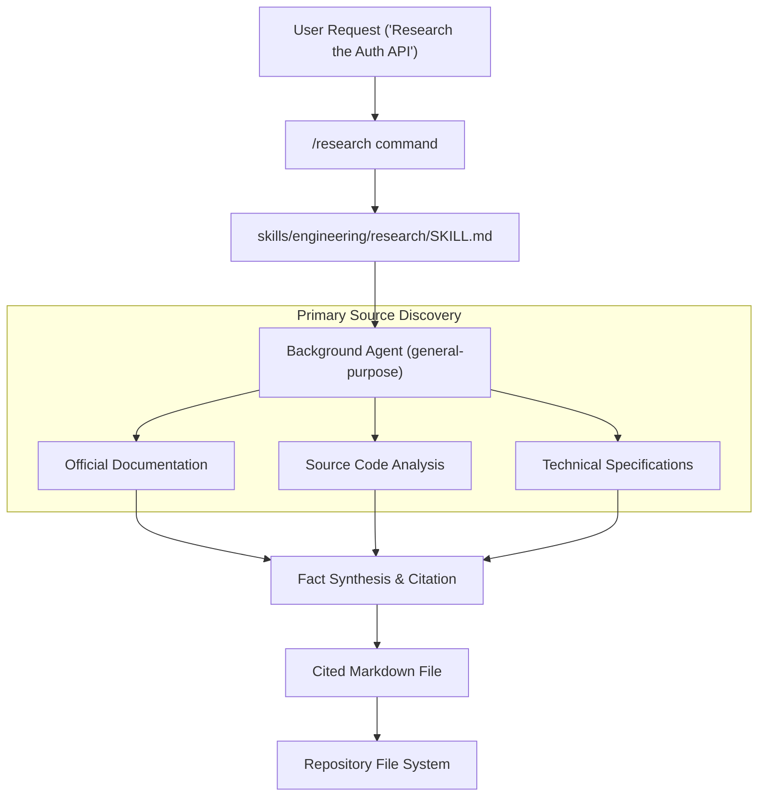
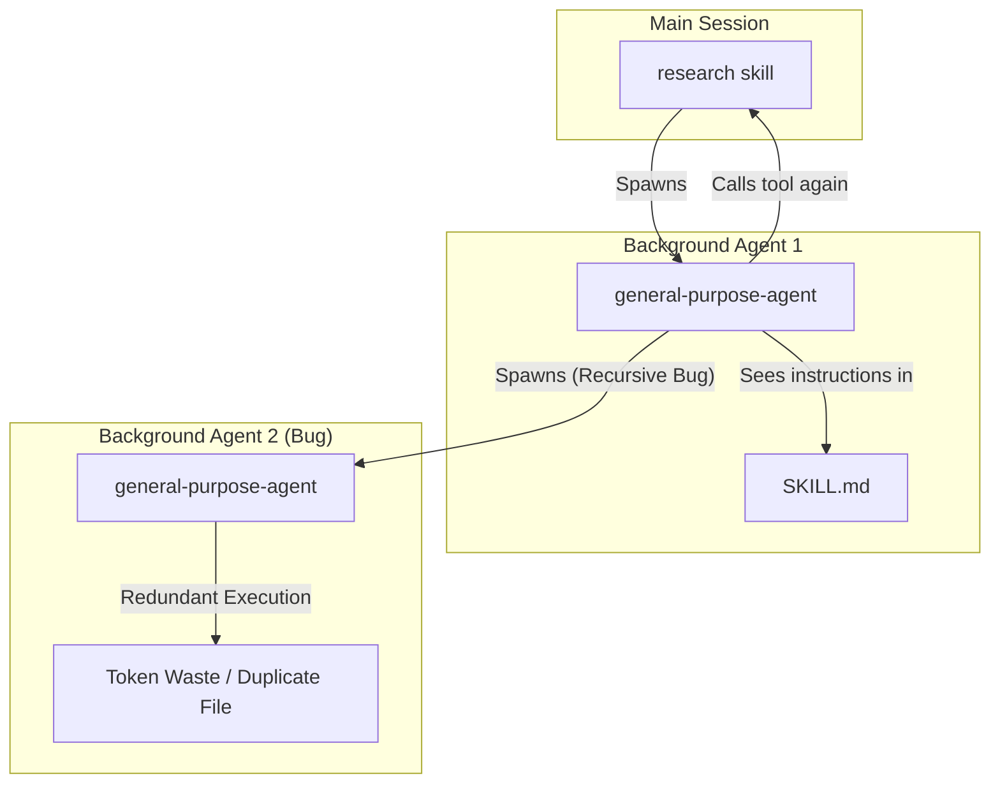

<!-- source: DeepWiki mcp.deepwiki.com · repo mattpocock/skills · page 3.6 Research · fetched 2026-10-27 -->

# Research

Relevant source files

The following files were used as context for generating this wiki page:

- [.changeset/wayfinder-labels-refs-research-prs.md](.changeset/wayfinder-labels-refs-research-prs.md)
- [docs/engineering/research.md](docs/engineering/research.md)
- [skills/engineering/research/SKILL.md](skills/engineering/research/SKILL.md)

The `research` skill is a specialized utility designed to delegate investigative legwork to a background agent. It focuses exclusively on gathering facts from primary sources—such as official documentation, source code, and technical specifications—and persisting those findings into the repository as cited Markdown files [docs/engineering/research.md:1-5]().

Sources: [docs/engineering/research.md:1-5]()

## Background-Agent Delegation Model

Unlike standard conversational skills, `research` does not provide answers within the active chat session. Instead, it invokes a **background agent** to perform the reading and synthesis [docs/engineering/research.md:23-26](). This allows the primary agent (and the user) to continue working on other tasks while the research is conducted asynchronously [skills/engineering/research/SKILL.md:6-7]().

### Data Flow and Execution

The skill follows a strict "primary source" constraint, meaning it is instructed to bypass secondary summaries (like blog posts) in favor of the sources that "own" the information [docs/engineering/research.md:3-4]().

### Research Execution Flow
The following diagram illustrates the transition from a Natural Language request to the execution of the background agent.

Sources: [docs/engineering/research.md:1-5](), [skills/engineering/research/SKILL.md:1-12]()

## Output Format and Persistence

The primary artifact of a research run is a single Markdown file. The skill is designed to adapt to the host repository's existing documentation conventions [skills/engineering/research/SKILL.md:11-12]().

*   **Citations:** Every claim made in the research file must include a link back to the primary source [docs/engineering/research.md:5-6]().
*   **Location:** If no clear convention exists (e.g., a `docs/` or `notes/` folder), the agent selects a "sensible" location and informs the user [skills/engineering/research/SKILL.md:12]().
*   **Shelf-Life vs. ADRs:** There is a critical distinction between research files and Architectural Decision Records (ADRs). Research files are considered "short-lived assets" representing facts true at the time of writing. ADRs, by contrast, record durable decisions [docs/engineering/research.md:21-22]().

### Comparison of Knowledge Artifacts

| Artifact Type | Purpose | Shelf Life | Recommended Action |
| :--- | :--- | :--- | :--- |
| **Research File** | External facts (APIs, Specs) | Short (Stales quickly) | Delete/Archive after use |
| **ADR** | Internal Decisions | Long (Project lifecycle) | Commit to Git |
| **CONTEXT.md** | Domain/Architecture Map | Long (Project lifecycle) | Commit to Git |

Sources: [docs/engineering/research.md:21-22](), [docs/engineering/research.md:41-42]()

## Known Implementation Issues

### The Sub-Agent Nesting Bug
A significant known issue (Issue #530) involves the background agent recursively invoking the `research` skill [docs/engineering/research.md:33-35](). Because the background agent is often a `general-purpose` agent with access to the same toolset, it may interpret the research instructions as a prompt to spawn *another* background agent [docs/engineering/research.md:35-36]().

*   **Impact:** This can lead to overlapping runs and excessive token consumption (reported up to 450k tokens for a single task) [docs/engineering/research.md:35-36]().
*   **Workaround:** Users currently apply manual patches to sub-agent briefs to explicitly forbid further delegation [docs/engineering/research.md:35-37]().

### Technical Entity Mapping: Delegation Bug
This diagram maps the code-level concepts of the delegation failure.

Sources: [docs/engineering/research.md:33-37]()

## Integration with Wayfinder

The `wayfinder` skill can generate research tickets when an investigation is needed outside the working directory [docs/engineering/research.md:11](), [docs/engineering/research.md:19](). Updates to `wayfinder` ensure that research branches do not open pull requests automatically, and tickets are resolved according to their specific label types [.changeset/wayfinder-labels-refs-research-prs.md:1-5]().

Sources: [docs/engineering/research.md:11](), [docs/engineering/research.md:19](), [.changeset/wayfinder-labels-refs-research-prs.md:1-5]()

---

