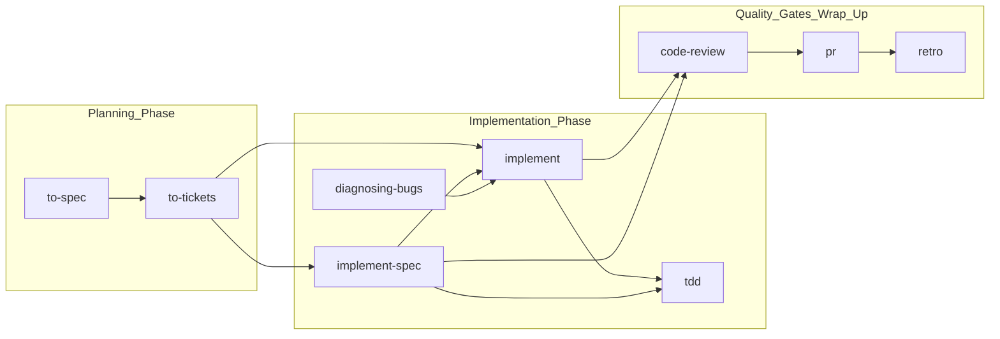

<!-- source: DeepWiki mcp.deepwiki.com · repo mattpocock/skills · page 4 Implementation Skills · fetched 2026-10-27 -->

# Implementation Skills

Relevant source files

The following files were used as context for generating this wiki page:

- [.changeset/implement-skill-tool-wording.md](.changeset/implement-skill-tool-wording.md)
- [.changeset/implement-ticket-reference.md](.changeset/implement-ticket-reference.md)
- [docs/engineering/implement-spec.md](docs/engineering/implement-spec.md)
- [docs/engineering/implement.md](docs/engineering/implement.md)
- [docs/engineering/pr.md](docs/engineering/pr.md)
- [docs/engineering/retro.md](docs/engineering/retro.md)
- [skills/engineering/implement/SKILL.md](skills/engineering/implement/SKILL.md)

## Purpose and Scope

This page documents the **Implementation Skills** category, which provides AI agent capabilities for the implementation phase of software development. These skills guide code writing practices, interface design decisions, and development environment configuration.

Implementation Skills focus on the execution of code. They operate after planning is complete (see Planning and Specification Skills) and before quality gates are enforced.

This page provides a high-level overview of the skills in this category. For detailed workflows, see the child pages: 
- [Implement and Implement-Spec](#4.1)
- [Test-Driven Development](#4.2)
- [Diagnosing Bugs](#4.3)
- [Code Review](#4.4)
- [Pull Requests and Retrospectives](#4.5)

Sources: [docs/engineering/tdd.md:1-8](), [docs/engineering/implement.md:1-15]()

---

## Skill Catalog

The Implementation Skills category contains primary skills used for feature implementation, debugging, and repository configuration:

| Skill | File Path | Primary Use Case |
|-------|-----------|------------------|
| `implement` | [skills/engineering/implement/SKILL.md:2-3]() | Implement work based on a spec or set of tickets |
| `implement-spec` | `docs/engineering/implement-spec.md` | Orchestrate implementation of a full spec with multiple tickets |
| `tdd` | [skills/engineering/tdd/SKILL.md:2-3]() | Test-driven development with red-green loop |
| `diagnosing-bugs` | `docs/engineering/diagnosing-bugs.md` | Disciplined loop for diagnosing and fixing bugs |
| `code-review` | `docs/engineering/code-review.md` | Two-axis evaluation of code against standards and spec |
| `pr` | [docs/engineering/pr.md:1-3]() | Format a pull request body |
| `retro` | [docs/engineering/retro.md:1-5]() | Retrospective on a coding session to improve the environment |

Sources: [skills/engineering/tdd/SKILL.md:1-4](), [skills/engineering/implement/SKILL.md:1-5](), [docs/engineering/tdd.md:1-5](), [docs/engineering/implement.md:1-6](), [docs/engineering/implement-spec.md:1-6](), [docs/engineering/pr.md:1-3](), [docs/engineering/retro.md:1-5]()

---

## Development Lifecycle Integration

### Workflow Position Diagram

This diagram shows how Implementation Skills integrate into the feature development pipeline:

1. **Planning Phase** produces specs and tickets.
2. **Implementation Phase** uses `implement` for single tickets or `implement-spec` for orchestrating a full spec with multiple tickets [docs/engineering/implement-spec.md:1-6](). Both drive `tdd` for test-first development [docs/engineering/implement.md:36-36](), [docs/engineering/implement-spec.md:51-52](). `diagnosing-bugs` is used for handling hard failures.
3. **Quality Gates and Wrap-up** use `code-review` as the closing step for `implement` and `implement-spec` [docs/engineering/implement.md:39-39](), [docs/engineering/implement-spec.md:3-3](). `pr` formats the pull request body [docs/engineering/pr.md:1-3](), and `retro` provides a post-session improvement loop [docs/engineering/retro.md:1-5]().

Sources: [docs/engineering/implement.md:33-41](), [skills/engineering/tdd/SKILL.md:3-3](), [skills/engineering/implement/SKILL.md:9-13](), [docs/engineering/implement-spec.md:1-6](), [docs/engineering/pr.md:1-3](), [docs/engineering/retro.md:1-5]()

---

## Skill Overview

### Implement and Implement-Spec

The `implement` skill acts as the final execution step in the main flow. It consumes a single ticket plus spec in a fresh context window [docs/engineering/implement.md:41-41](). It drives `tdd` at pre-agreed seams and initiates code-review upon completion before committing [docs/engineering/implement.md:33-39](). It never reopens the plan, focusing solely on execution [docs/engineering/implement.md:5-5]().

For larger efforts, `implement-spec` orchestrates the implementation of an entire spec with multiple tickets. It treats tickets as a task graph with blocking edges, allowing it to identify a ready frontier of tickets that can be worked on in parallel by implementer subagents in their own git worktrees [docs/engineering/implement-spec.md:1-6](). All work is merged onto a single integration branch [docs/engineering/implement-spec.md:3-3]().

For details, see [Implement and Implement-Spec](#4.1).

Sources: [skills/engineering/implement/SKILL.md:1-15](), [docs/engineering/implement.md:1-48](), [docs/engineering/implement-spec.md:1-59]()

### Test-Driven Development (TDD)

The `tdd` skill implements a strict red-green-refactor loop [docs/engineering/tdd.md:31-31](). It emphasizes testing only at pre-agreed seams (public boundaries) rather than internal implementation details [docs/engineering/tdd.md:35-35](). It focuses on vertical slices (tracer bullets) to build concrete behavior test-first [docs/engineering/tdd.md:32-32](). 

For details on writing good tests and mocking at system boundaries, see [Test-Driven Development](#4.2).

Sources: [skills/engineering/tdd/SKILL.md:1-38](), [docs/engineering/tdd.md:31-35]()

### Diagnosing Bugs

The `diagnosing-bugs` skill provides a disciplined loop for identifying and fixing issues. This involves building a feedback loop, reproducing and minimizing the bug, hypothesizing, instrumenting, fixing with a regression test, cleaning up, and conducting a post-mortem. It covers the HITL bash loop template and can hand off to `improve-codebase-architecture` for systemic issues.

For details, see [Diagnosing Bugs](#4.3).

Sources: [docs/engineering/diagnosing-bugs.md]()

### Code Review

The `code-review` skill evaluates changes along two axes: adherence to Standards and fulfillment of the Spec. It employs a parallel sub-agent pipeline and uses fixed-point git diffing to assess changes. It includes phases for spec and standards discovery and aggregates non-merged output.

For details, see [Code Review](#4.4).

Sources: [docs/engineering/code-review.md]()

### Pull Requests and Retrospectives

The `pr` skill defines the structure for a pull request body, including a visual Summary, Evidence of functionality, and a Merge Danger assessment (categorizing changes as one-way door or two-way door and identifying their blast radius) [docs/engineering/pr.md:19-23](). It is a format reference, not a workflow, and does not open the PR itself [docs/engineering/pr.md:3-3]().

The `retro` skill performs a retrospective on a coding session to suggest improvements to the agent's environment, rather than the code itself [docs/engineering/retro.md:1-5](). It identifies moments where the agent struggled and proposes fixes such as navigation pointers, automated checks, or updates to `CODING_STANDARDS.md` for the reviewing agent [docs/engineering/retro.md:13-24]().

For details, see [Pull Requests and Retrospectives](#4.5).

Sources: [docs/engineering/pr.md:1-71](), [docs/engineering/retro.md:1-60]()

---

