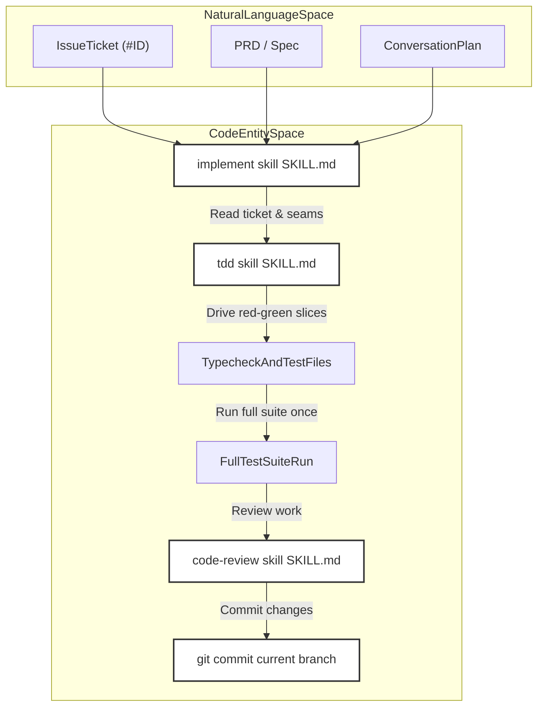
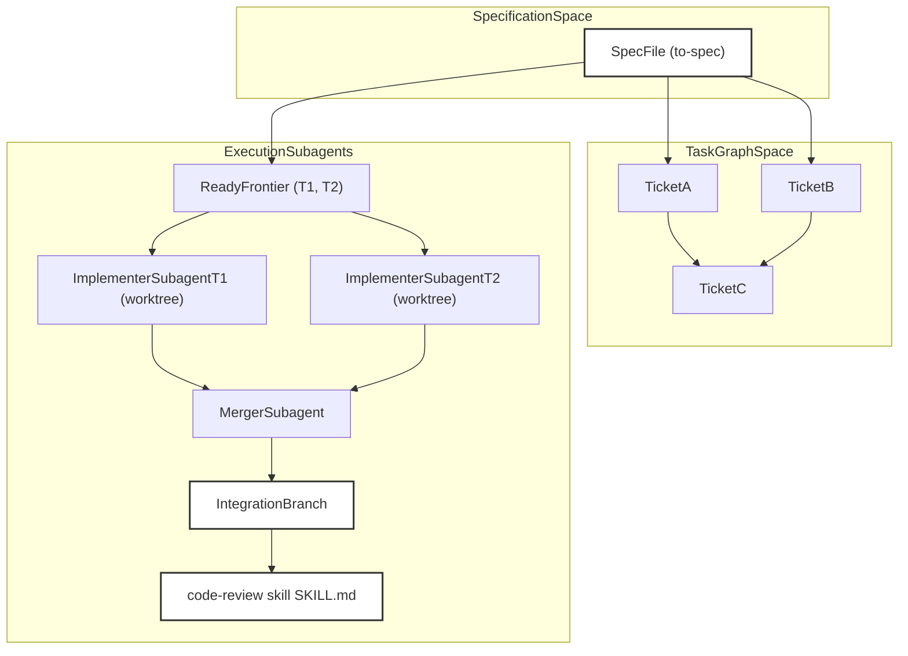

<!-- source: DeepWiki mcp.deepwiki.com · repo mattpocock/skills · page 4.1 Implement and Implement-Spec · fetched 2026-10-27 -->

# Implement and Implement-Spec

Relevant source files

The following files were used as context for generating this wiki page:

- [.changeset/implement-skill-tool-wording.md](.changeset/implement-skill-tool-wording.md)
- [.changeset/implement-ticket-reference.md](.changeset/implement-ticket-reference.md)
- [docs/engineering/implement.md](docs/engineering/implement.md)
- [skills/engineering/implement-spec/SKILL.md](skills/engineering/implement-spec/SKILL.md)
- [skills/engineering/implement-spec/agents/openai.yaml](skills/engineering/implement-spec/agents/openai.yaml)
- [skills/engineering/implement/SKILL.md](skills/engineering/implement/SKILL.md)
- [skills/engineering/implement/agents/openai.yaml](skills/engineering/implement/agents/openai.yaml)

This page documents the `implement` skill, which serves as the final execution step in the main development flow [docs/engineering/implement.md:3-5](), and the `implement-spec` skill, which orchestrates the implementation of an entire specification across multiple subagents in git worktrees [skills/engineering/implement-spec/SKILL.md:3-27]().

## 1. The `implement` Skill

The `implement` skill is a user-invoked capability designed to transform high-level requirements (PRDs or decomposed issues) into committed code [skills/engineering/implement/SKILL.md:1-3](). It operates as the final stage of the development lifecycle, following the planning and decomposition phases [docs/engineering/implement.md:3-5]().

### 1.1 Role in the Main Flow

The skill is designed to run in a fresh context window to minimize noise and maximize the model's reasoning capacity on the specific task at hand [docs/engineering/implement.md:41-41](). It functions as the execution engine, executing a plan where the spec and architectural seams have already been settled upstream [docs/engineering/implement.md:43-45](). It is explicitly marked with `disable-model-invocation: true`, meaning it must be triggered manually by the user [skills/engineering/implement/SKILL.md:4-4](). This also means no other skill can call it [docs/engineering/implement.md:9-9]().

The `implement` skill never reopens the plan; it does not conduct interviews, clarifying rounds, or propose alternative approaches. Its sole job is to convert the settled input into a commit [docs/engineering/implement.md:5-5]().

Sources: [docs/engineering/implement.md:3-41](), [skills/engineering/implement/SKILL.md:1-5]()

### 1.2 Execution Loop and Data Flow

A single run of `implement` covers one ticket and follows a strict sequence [docs/engineering/implement.md:33-39]():

1.  **Context Loading**: Reads the ticket or spec and identifies the **seams** [docs/engineering/implement.md:35-35](). If a ticket reference is passed, it fetches it from the issue tracker and states its title before starting [skills/engineering/implement/SKILL.md:9-10]().
2.  **TDD Integration**: Calls the `Skill` tool with `tdd` at pre-agreed seams [skills/engineering/implement/SKILL.md:11-11](), proceeding one red-green slice at a time [docs/engineering/implement.md:36-36]().
3.  **Verification**: Performs incremental verification through regular typechecking and individual test file execution [docs/engineering/implement.md:37-37](), [skills/engineering/implement/SKILL.md:13-13]().
4.  **Completion**: Runs the full test suite once at the end [docs/engineering/implement.md:38-38](), then calls the `Skill` tool with `code-review` to review the work [skills/engineering/implement/SKILL.md:15-15]().
5.  **Persistence**: Commits the finalized work to the current branch [docs/engineering/implement.md:39-39](), [skills/engineering/implement/SKILL.md:17-17]().

Sources: [docs/engineering/implement.md:33-39](), [skills/engineering/implement/SKILL.md:7-17]()

### 1.3 Implementation Strategy Diagram

The following diagram bridges natural language inputs to code execution entities within `implement`.

Title: "Implement Skill Execution Flow"

Sources: [skills/engineering/implement/SKILL.md:7-17](), [docs/engineering/implement.md:33-39]()

### 1.4 Pre-agreed Seams

The core concept `implement` relies on is the **seam**: a public boundary at which behavior is observed without needing to inspect internal implementation details [docs/engineering/implement.md:43-44](). Tests are designed to live at these seams, ensuring durability even if the underlying implementation changes [docs/engineering/implement.md:45-46]().

The term "pre-agreed" is crucial. `implement` itself does not agree on seams; it relies on them being established upstream, typically during the `to-spec` phase [docs/engineering/implement.md:47-48](). If seams are not explicitly agreed upon, the `tdd` skill will ask for confirmation. Naming seams in the specification is the recommended way to prevent unguided coding [docs/engineering/implement.md:47-48]().

Sources: [docs/engineering/implement.md:43-48]()

### 1.5 Prerequisites and Limitations

*   **Branching**: `implement` commits to the current branch and does not create new ones [docs/engineering/implement.md:27-27]().
*   **Tracker Configuration**: If tickets originate from `to-tickets`, the issue tracker must have been configured by `setup-matt-pocock-skills` [docs/engineering/implement.md:29-30]().
*   **No Parallel Execution**: `implement` is designed for one invocation per ticket. Running multiple `implement` sessions in parallel within the same checkout is unsupported and risks Git state corruption [docs/engineering/implement.md:56-58]().
*   **No Pull Request Creation**: The skill commits directly to the current branch without opening a PR automatically [docs/engineering/implement.md:60-61]().
*   **Ticket Closure**: `implement` does not close tickets or mark acceptance criteria as complete [docs/engineering/implement.md:51-54]().
*   **Code Review Visibility**: `code-review` operates on `git diff <fixed-point>...HEAD` [docs/engineering/implement.md:63-65]().

Sources: [docs/engineering/implement.md:27-65]()

---

## 2. The `implement-spec` Skill

The `implement-spec` skill implements an entire specification and its associated task graph of tickets in a single run [skills/engineering/implement-spec/SKILL.md:3-13](). It orchestrates multiple implementer subagents in git worktrees against a single integration branch [skills/engineering/implement-spec/SKILL.md:11-27]().

### 2.1 Task Graph Execution

Unlike `implement`, `implement-spec` treats tickets as a **task graph** with blocking relationships [skills/engineering/implement-spec/SKILL.md:13-13](). This exposes a **frontier** of ready tickets whose blockers are complete, enabling parallel execution [skills/engineering/implement-spec/SKILL.md:13-14]().

Title: "Task Graph and Frontier Execution Flow"

Sources: [skills/engineering/implement-spec/SKILL.md:13-37](), [docs/engineering/implement-spec.md:5-5]()

### 2.2 Execution Steps

The `implement-spec` skill follows a strict sequence of steps [skills/engineering/implement-spec/SKILL.md:20-40]():

1.  **Read Spec and Tickets**: Understand the task graph and blocking relationships [skills/engineering/implement-spec/SKILL.md:21-21]().
2.  **Optional Exploration**: Run an exploration subagent to save markdown notes outside the repo [skills/engineering/implement-spec/SKILL.md:23-25]().
3.  **Create Integration Branch**: Initialize the integration branch and optionally open a draft PR after the first merge [skills/engineering/implement-spec/SKILL.md:27-28]().
4.  **Implementer Subagents**: Launch background implementer subagents in separate worktrees for ready tickets, invoking `tdd` and merging the integration branch tip before reporting completion [skills/engineering/implement-spec/SKILL.md:27-31]().
5.  **Merger Subagent**: Merge completed work into the integration branch [skills/engineering/implement-spec/SKILL.md:32-33]().
6.  **Advance Frontier**: Kick off new subagents as the frontier updates [skills/engineering/implement-spec/SKILL.md:34-35]().
7.  **Code Review**: Run `code-review` on the integration branch and fix issues with an implementer subagent [skills/engineering/implement-spec/SKILL.md:36-36]().
8.  **Finalization**: Mark PR ready or resolve tickets, then clean up worktrees [skills/engineering/implement-spec/SKILL.md:38-40]().

Sources: [skills/engineering/implement-spec/SKILL.md:20-40]()

### 2.3 Prerequisites

*   **Issue Tracker**: Configured via `setup-matt-pocock-skills` [docs/engineering/implement-spec.md:20-21]().
*   **Tickets with Blocking Edges**: Generated by `to-tickets` to establish the task graph [docs/engineering/implement-spec.md:21-22]().
*   **Subagent Harness**: Capable of executing background subagents in git worktrees [docs/engineering/implement-spec.md:22-23]().

Sources: [docs/engineering/implement-spec.md:20-23]()

### 2.4 Integration Branch Management

Concurrency in `implement-spec` relies on the **integration branch**. Subagents base their work on this branch and merge its tip before reporting completion, ensuring fast-forward merges when integrating back [docs/engineering/implement-spec.md:26-31]().

Sources: [docs/engineering/implement-spec.md:26-31]()

### 2.5 Comparison with `implement` and Limitations

`implement-spec` automates multi-ticket spec execution, unlike the single-ticket `/implement` command [docs/engineering/implement-spec.md:39-41](). Considerations include:
*   **End-of-Run Review**: Review happens on the integration branch rather than per-ticket [docs/engineering/implement-spec.md:41-41]().
*   **Collision Management**: Worktrees reduce overlap, but concurrent subagents touching shared files require careful frontier sequencing [docs/engineering/implement-spec.md:54-56]().

Sources: [docs/engineering/implement-spec.md:39-56]()

---

