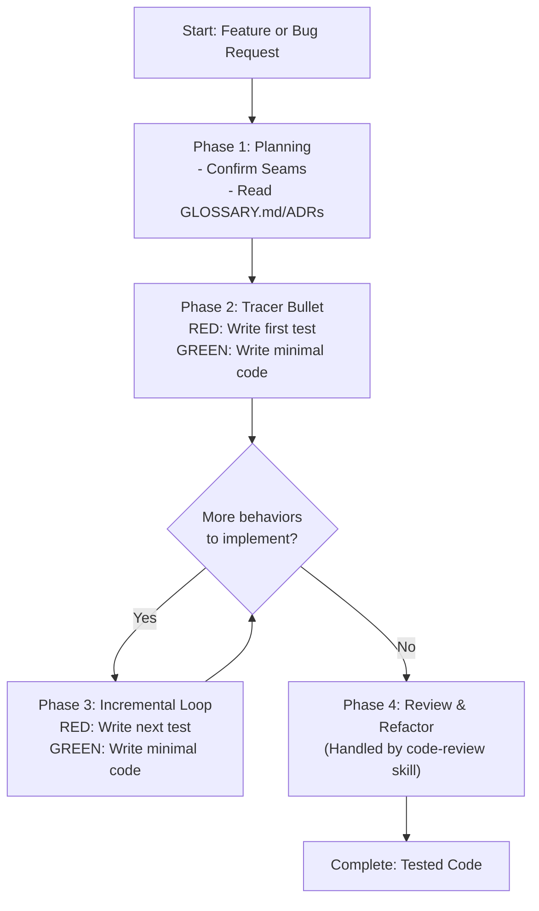
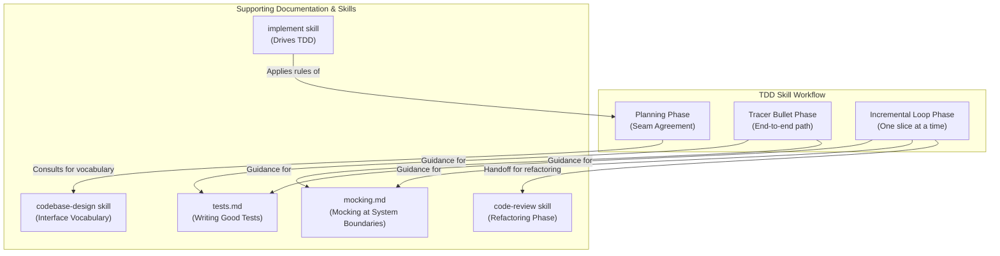
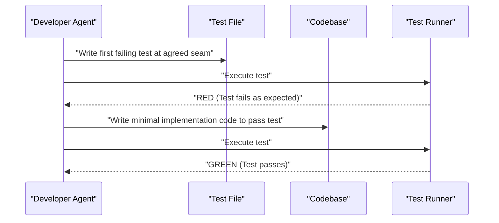

<!-- source: DeepWiki mcp.deepwiki.com · repo mattpocock/skills · page 4.2 Test-Driven Development · fetched 2026-10-27 -->

# Test-Driven Development

Relevant source files

The following files were used as context for generating this wiki page:

- [.changeset/tdd-seam-tradeoffs.md](.changeset/tdd-seam-tradeoffs.md)
- [docs/engineering/tdd.md](docs/engineering/tdd.md)
- [skills/engineering/tdd/SKILL.md](skills/engineering/tdd/SKILL.md)
- [skills/productivity/grill-me/SKILL.md](skills/productivity/grill-me/SKILL.md)

The `tdd` skill implements a disciplined red-green loop for test-driven development [skills/engineering/tdd/SKILL.md:8-8](). Its purpose is to guide the creation of features or bug fixes by ensuring tests are written first, are robust, and verify behavior through public interfaces rather than implementation details [skills/engineering/tdd/SKILL.md:12-16](). This page outlines the `tdd` skill's vertical-slice loop, including planning, the tracer bullet, the incremental loop, and the refactor phase, along with a per-cycle checklist.

As a parent page, this overview covers high-level concepts and links to child pages for specific details on test styles ([Writing Good Tests](#4.2.1)) and mocking strategies ([Mocking at System Boundaries](#4.2.2)).

The `tdd` skill acts as a reference for best practices, not a direct driver of the coding process [docs/engineering/tdd.md:5-5](). Other skills, such as `implement`, consume its guidelines to execute the TDD loop [docs/engineering/implement.md:3-3]().

Sources: [skills/engineering/tdd/SKILL.md:8-16](), [docs/engineering/tdd.md:5-5](), [docs/engineering/implement.md:3-3]()

## Workflow Overview

The `tdd` workflow is structured around a disciplined red-green cycle, emphasizing vertical slices of functionality. The traditional "refactor" phase has been explicitly separated and moved to the `code-review` skill to streamline the implementation process [docs/engineering/tdd.md:31-31]().

### TDD Workflow Phases

Sources: [skills/engineering/tdd/SKILL.md:36-38](), [docs/engineering/tdd.md:31-31]()

### TDD Skill and Supporting Documentation

Sources: [skills/engineering/tdd/SKILL.md:16-26](), [docs/engineering/tdd.md:25-32](), [docs/engineering/implement.md:3-3]()

## Phase 1: Planning and Seams

The initial planning phase is crucial for defining the scope of testing and ensuring test durability. It focuses on identifying and agreeing upon **seams**, which are the public boundaries where behavior can be observed without inspecting internal implementation details [skills/engineering/tdd/SKILL.md:20-20]().

* **Contextual Awareness**: Read `GLOSSARY.md` (if present) to align test names and interface vocabulary with the project's domain language and respect existing Architecture Decision Records (ADRs) [skills/engineering/tdd/SKILL.md:10-10]().
* **Seam Confirmation**: Explicitly write down and confirm the seams under test with the user. The `tdd` skill will not write tests at unconfirmed seams [skills/engineering/tdd/SKILL.md:22-22](), [docs/engineering/tdd.md:35-35]().
* **Interface Design Consultation**: If the design of the interface itself is unclear (e.g., module depth, seam placement), consult the `codebase-design` skill for relevant vocabulary and principles [skills/engineering/tdd/SKILL.md:26-26]().

Sources: [skills/engineering/tdd/SKILL.md:10-26](), [docs/engineering/tdd.md:35-35]()

## Phase 2: Tracer Bullet

The first cycle of the `tdd` loop is a **tracer bullet**. This involves writing a single test that proves an end-to-end path for a minimal piece of functionality [docs/engineering/tdd.md:33-33](). This step validates the chosen interface design and confirms that the basic system setup works before proceeding with more complex behaviors.

Sources: [skills/engineering/tdd/SKILL.md:36-37](), [docs/engineering/tdd.md:33-33]()

## Phase 3: Incremental Loop

After the tracer bullet, the `tdd` skill proceeds with an incremental loop, adding one behavior at a time. Each cycle strictly adheres to the RED-GREEN pattern, building out functionality in small, verifiable steps [skills/engineering/tdd/SKILL.md:32-32]().

* **Red Before Green**: Always write a failing test first, then write only the minimum amount of code required to make that test pass [skills/engineering/tdd/SKILL.md:36-36]().
* **One Slice at a Time**: Each cycle focuses on a single seam, a single test, and a minimal implementation [skills/engineering/tdd/SKILL.md:37-37]().
* **Independent Source of Truth**: Expected values in tests must come from an independent source (e.g., a known-good literal, a worked example, the specification) to prevent **tautological tests** [skills/engineering/tdd/SKILL.md:31-31]().

For details on writing effective tests and avoiding anti-patterns, see [Writing Good Tests](#4.2.1).

Sources: [skills/engineering/tdd/SKILL.md:30-37](), [docs/engineering/tdd.md:31-34]()

## Phase 4: Review and Refactor

The `tdd` skill explicitly separates the **refactoring** phase from the red-green implementation loop [skills/engineering/tdd/SKILL.md:38-38](). Refactoring is deferred to the `code-review` skill [skills/engineering/tdd/SKILL.md:38-38](), [docs/engineering/tdd.md:31-31](), allowing implementation and review to occur in distinct sessions for better focus and outcomes [docs/engineering/tdd.md:51-51]().

Sources: [skills/engineering/tdd/SKILL.md:38-38](), [docs/engineering/tdd.md:31-32](), [docs/engineering/tdd.md:51-51]()

## Per-Cycle Checklist and Quality Criteria

To ensure the effectiveness and maintainability of the test suite, each `tdd` cycle should adhere to the following quality criteria:

* **Behavioral Verification**: Tests verify behavior through public interfaces rather than implementation details [skills/engineering/tdd/SKILL.md:12-16]().
* **Seam Adherence**: Tests must only be written at pre-agreed seams [skills/engineering/tdd/SKILL.md:20-22]().
* **Implementation-Coupling Prevention**: Avoid mocking internal collaborators or testing private methods [skills/engineering/tdd/SKILL.md:30-30]().
* **Mocking Discipline**: Restrict mocks exclusively to system boundaries (external APIs, time, randomness, filesystem, database) rather than internal modules [docs/engineering/tdd.md:45-45]().

For a deeper dive into test styles, see [Writing Good Tests](#4.2.1). For detailed guidance on mocking practices, refer to [Mocking at System Boundaries](#4.2.2).

Sources: [skills/engineering/tdd/SKILL.md:12-32](), [docs/engineering/tdd.md:37-46]()

---

