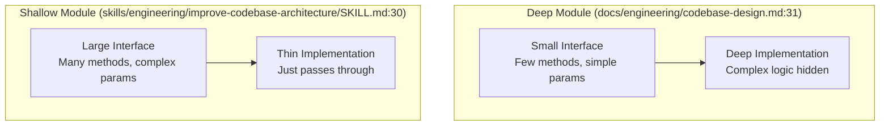
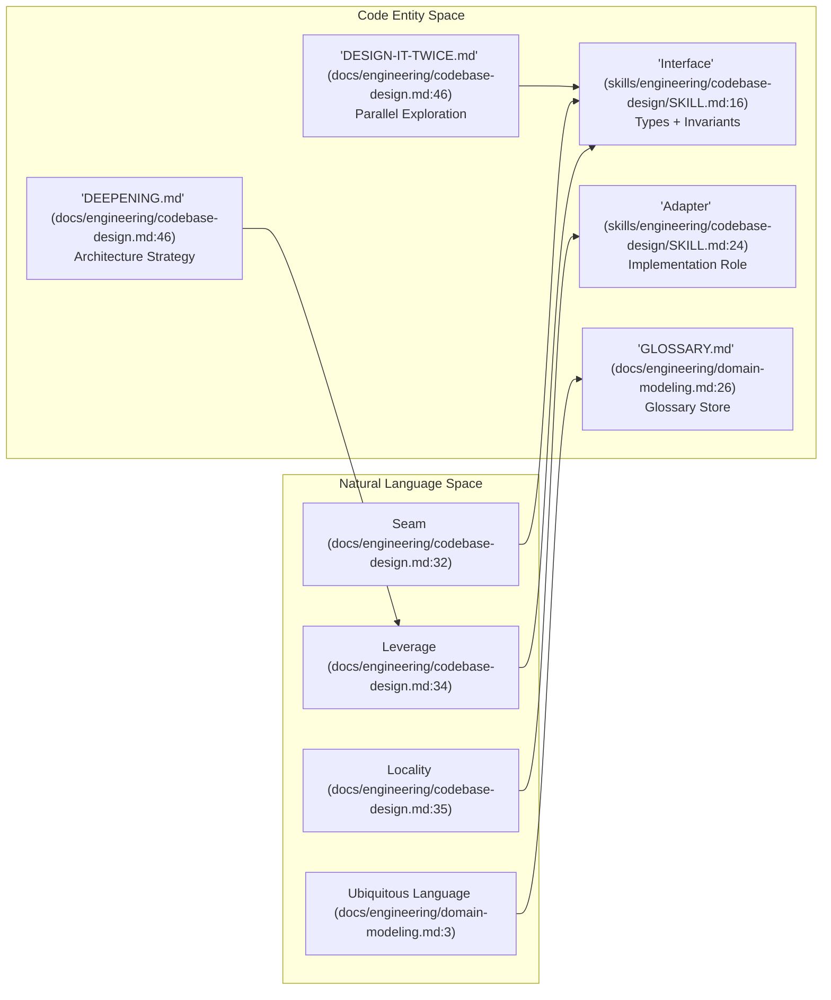
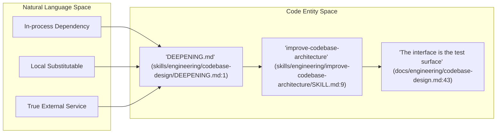
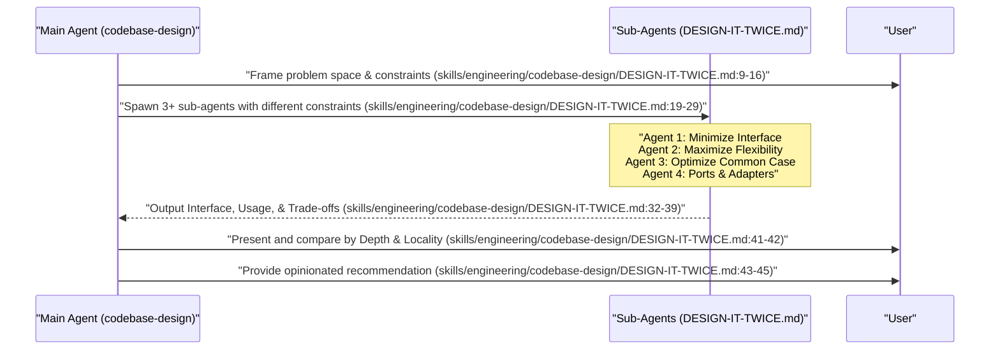

<!-- source: DeepWiki mcp.deepwiki.com · repo mattpocock/skills · page 5.1 Codebase Design: Deep Modules and Seams · fetched 2026-10-27 -->

# Codebase Design: Deep Modules and Seams

Relevant source files

The following files were used as context for generating this wiki page:

- [docs/engineering/codebase-design.md](docs/engineering/codebase-design.md)
- [docs/engineering/domain-modeling.md](docs/engineering/domain-modeling.md)
- [skills/engineering/codebase-design/DESIGN-IT-TWICE.md](skills/engineering/codebase-design/DESIGN-IT-TWICE.md)
- [skills/engineering/codebase-design/SKILL.md](skills/engineering/codebase-design/SKILL.md)
- [skills/engineering/domain-modeling/SKILL.md](skills/engineering/domain-modeling/SKILL.md)
- [skills/engineering/improve-codebase-architecture/SKILL.md](skills/engineering/improve-codebase-architecture/SKILL.md)

## Purpose and Scope

This document explains the deep module design philosophy used across the skills repository. A deep module is defined by a small, simple interface that encapsulates significant internal complexity. This principle provides **leverage** for callers and **locality** for maintainers, ensuring that changes and verification concentrate in one place rather than spreading across the codebase [skills/engineering/improve-codebase-architecture/SKILL.md:8-9](), [docs/engineering/codebase-design.md:34-35]().

The `codebase-design` skill acts as the single source of truth for this vocabulary, ensuring that design conversations across other skills—such as `tdd`, `domain-modeling`, and `improve-codebase-architecture`—remain consistent [docs/engineering/codebase-design.md:1-5](), [skills/engineering/improve-codebase-architecture/SKILL.md:11-14]().

Sources: [docs/engineering/codebase-design.md:1-5](), [docs/engineering/codebase-design.md:34-35](), [skills/engineering/improve-codebase-architecture/SKILL.md:8-9](), [skills/engineering/improve-codebase-architecture/SKILL.md:11-14]()

## Core Glossary

The framework uses a specific vocabulary to discuss design. Consistent use of these terms is required to avoid the ambiguity of overloaded terms like "component," "service," "API," or "boundary" [docs/engineering/codebase-design.md:3-3](), [skills/engineering/improve-codebase-architecture/SKILL.md:12-14]().

| Term | Definition |
| :--- | :--- |
| **Module** | Anything with an interface and an implementation. Deliberately scale-agnostic: a function, a class, a package, a slice spanning tiers [docs/engineering/codebase-design.md:29-29](). |
| **Interface** | Everything a caller must know to use it correctly: the type signature, plus invariants, ordering constraints, error modes, required config, performance characteristics [docs/engineering/codebase-design.md:30-30](). |
| **Depth** | Leverage at the interface: how much behaviour a caller or a test can exercise per unit of interface they have to learn. **Deep**: a lot of behaviour behind a small interface. **Shallow**: the interface is nearly as complex as the implementation [docs/engineering/codebase-design.md:31-31](). |
| **Seam** | Michael Feathers' term: a place you can alter behaviour without editing in that place. It is the *location* of an interface, and where to put it is its own decision, separate from what goes behind it [docs/engineering/codebase-design.md:32-32](). |
| **Adapter** | A concrete thing satisfying an interface at a seam. Names a role, not a substance: an in-memory fake and a Postgres repo are both adapters [docs/engineering/codebase-design.md:33-33](). |
| **Leverage** | What callers get from depth: more capability per unit of interface learned [docs/engineering/codebase-design.md:34-34](). |
| **Locality** | What maintainers get from depth: change, bugs and verification concentrate in one place. Fix once, fixed everywhere [docs/engineering/codebase-design.md:35-35](). |

Sources: [docs/engineering/codebase-design.md:23-35](), [skills/engineering/improve-codebase-architecture/SKILL.md:12-14]()

## Deep vs Shallow Structure

The distinction between deep and shallow modules is a measure of leverage. A deep module provides more capability per unit of interface learned. Depth is a property of the interface, not the implementation—a deep module can be internally composed of small, swappable parts that are never surfaced to callers [docs/engineering/codebase-design.md:39-41](), [skills/engineering/codebase-design/SKILL.md:62-62]().

Title: Deep vs Shallow Module Structural Comparison

Sources: [docs/engineering/codebase-design.md:31-41](), [skills/engineering/improve-codebase-architecture/SKILL.md:30](), [skills/engineering/codebase-design/SKILL.md:62-62]()

## Mapping Concepts to Code Space

This first bridge diagram maps abstract architectural design terms to concrete repository entities and files.

Title: Natural Language to Code Entity Space Mapping

Sources: [docs/engineering/codebase-design.md:23-46](), [docs/engineering/domain-modeling.md:3](), [docs/engineering/domain-modeling.md:26](), [skills/engineering/codebase-design/SKILL.md:16](), [skills/engineering/codebase-design/SKILL.md:24](), [skills/engineering/codebase-design/DESIGN-IT-TWICE.md:1-5]()

## Deepening Strategies and Dependency Mapping

Deepening is the process of refactoring that turns shallow modules into deep ones. When assessing a candidate for deepening, its dependencies must be classified to determine the testing and seam strategy [skills/engineering/improve-codebase-architecture/SKILL.md:9](), [skills/engineering/codebase-design/DEEPENING.md:1-7]().

| Dependency Category | Description | Testing/Seam Strategy |
| :--- | :--- | :--- |
| **In-process** | Pure computation, in-memory state, no I/O. | Merge modules; test through new interface directly. No adapter needed [skills/engineering/codebase-design/DEEPENING.md:9-11](). |
| **Local-substitutable** | Dependencies that have local test stand-ins (PGLite for Postgres, in-memory filesystem). | Internal seam; test with stand-in running in the suite [skills/engineering/codebase-design/DEEPENING.md:13-16](). |
| **Remote but owned** | Your own services across a network boundary (microservices, internal APIs). | Define a **port**; inject in-memory adapter for tests and HTTP/gRPC for production [skills/engineering/codebase-design/DEEPENING.md:18-22](). |
| **True external** | Third-party services (Stripe, Twilio, etc.) you don't control. | Deepened module takes external dependency as an injected port; tests provide a mock adapter [skills/engineering/codebase-design/DEEPENING.md:24-26](). |

This second bridge diagram connects dependency classifications and architectural test concepts directly to their definitions and handling inside `DEEPENING.md` and codebase patterns.

Title: Dependency Classification to Code Strategy Mapping

Sources: [skills/engineering/codebase-design/DEEPENING.md:1-26](), [skills/engineering/improve-codebase-architecture/SKILL.md:9](), [docs/engineering/codebase-design.md:43]()

## Principles for Testability

To maintain depth and testability, the following rules are applied to interface design:

1. **The Interface is the Test Surface**: Callers and tests cross the same seam. Tests should assert on observable outcomes through the interface, not internal state. If a test changes when the implementation changes, it is "testing past the interface" [docs/engineering/codebase-design.md:43-43](), [skills/engineering/codebase-design/DEEPENING.md:34-37]().
2. **The Deletion Test**: Imagine deleting the module. If complexity vanishes, it was a pass-through (shallow). If it reappears across N callers, it was earning its keep [docs/engineering/codebase-design.md:42-42](), [skills/engineering/improve-codebase-architecture/SKILL.md:35-36]().
3. **Seam Discipline**: One adapter means a hypothetical seam; two adapters (typically production + test) means a real one. Don't cut a seam until something actually varies across it [docs/engineering/codebase-design.md:44-44](), [skills/engineering/codebase-design/DEEPENING.md:29-31]().

Sources: [docs/engineering/codebase-design.md:39-45](), [skills/engineering/codebase-design/DEEPENING.md:29-37](), [skills/engineering/improve-codebase-architecture/SKILL.md:35-36]()

## Design It Twice Process

When exploring alternative interfaces for a deepening candidate, the `DESIGN-IT-TWICE.md` workflow is used to avoid anchoring on the first plausible idea. This involves spinning up parallel sub-agents to produce three or more radically different interfaces for the same module [docs/engineering/codebase-design.md:46-46](), [skills/engineering/codebase-design/DESIGN-IT-TWICE.md:1-3](), [skills/engineering/improve-codebase-architecture/SKILL.md:71-71]().

The process involves:
1. **Frame the problem space**: The main agent explains the constraints, dependencies, and provides a rough code sketch to the user [skills/engineering/codebase-design/DESIGN-IT-TWICE.md:9-16]().
2. **Spawn sub-agents**: Multiple sub-agents are spawned in parallel, each with a different design constraint (e.g., minimize interface, maximize flexibility, optimize for common caller, or design around ports & adapters) [skills/engineering/codebase-design/DESIGN-IT-TWICE.md:19-29](). Each sub-agent outputs its proposed interface, usage example, what the implementation hides, dependency strategy, and trade-offs [skills/engineering/codebase-design/DESIGN-IT-TWICE.md:32-39]().
3. **Present and compare**: The main agent presents the designs sequentially, compares them by depth, locality, and seam placement, and provides an opinionated recommendation, potentially proposing a hybrid design [skills/engineering/codebase-design/DESIGN-IT-TWICE.md:41-44]().

Title: Interface Exploration Pipeline Execution Sequence

Sources: [docs/engineering/codebase-design.md:46-46](), [skills/engineering/codebase-design/DESIGN-IT-TWICE.md:1-44](), [skills/engineering/improve-codebase-architecture/SKILL.md:71-71]()

---

