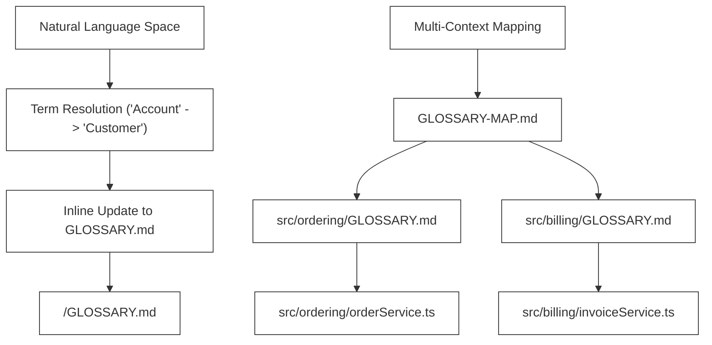
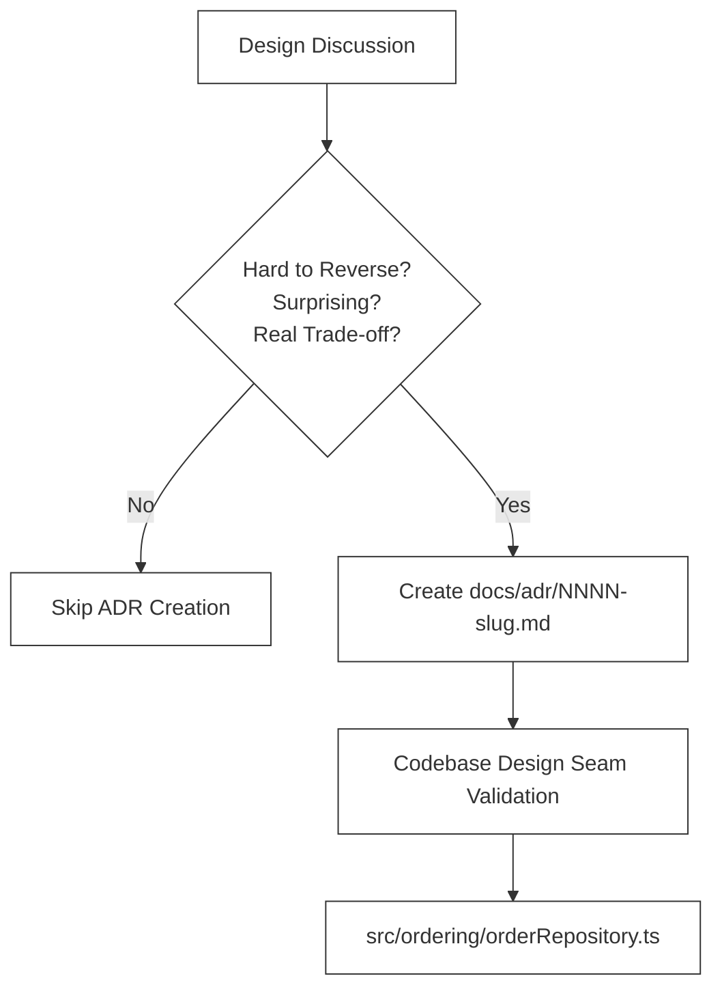

<!-- source: DeepWiki mcp.deepwiki.com · repo mattpocock/skills · page 5.2 Domain Modeling, GLOSSARY.md and ADRs · fetched 2026-10-27 -->

# Domain Modeling, GLOSSARY.md and ADRs

<details>
<summary>Relevant source files</summary>

The following files were used as context for generating this wiki page:

- [GLOSSARY.md](GLOSSARY.md)
- [skills/engineering/codebase-design/SKILL.md](skills/engineering/codebase-design/SKILL.md)
- [skills/engineering/domain-modeling/GLOSSARY-FORMAT.md](skills/engineering/domain-modeling/GLOSSARY-FORMAT.md)
- [skills/engineering/domain-modeling/SKILL.md](skills/engineering/domain-modeling/SKILL.md)

</details>


This page documents the `domain-modeling` skill (`skills/engineering/domain-modeling/SKILL.md:2-3`), which establishes and maintains a ubiquitous language within a codebase. It covers the active discipline of inline term resolution, the structured format for glossaries (`GLOSSARY-FORMAT.md`), the strict creation gates for Architectural Decision Records (`ADR-FORMAT.md`), and multi-context repository navigation via `GLOSSARY-MAP.md`.

## 1. Domain Modeling: Active Ubiquitous Language Discipline

The `domain-modeling` skill is an active engineering discipline used to build and sharpen a project's domain model [skills/engineering/domain-modeling/SKILL.md:8]. Unlike passive documentation reading, it is invoked when changing or challenging the model: addressing conflicting terms, inventing edge-case scenarios, and recording decisions as they crystallize [skills/engineering/domain-modeling/SKILL.md:8].

### Core Behavioral Rules
During a session, the agent enforces specific behavioral protocols:
*   **Glossary Challenge**: When a user employs a term conflicting with `GLOSSARY.md`, it is immediately challenged [skills/engineering/domain-modeling/SKILL.md:46].
*   **Fuzzy Language Sharpening**: Vague or overloaded terms are split into precise canonical entities (e.g., distinguishing `Customer` from `User`) [skills/engineering/domain-modeling/SKILL.md:49-50].
*   **Concrete Scenarios**: Domain relationships are stress-tested using edge-case scenarios to enforce strict conceptual boundaries [skills/engineering/domain-modeling/SKILL.md:53-54].
*   **Code Cross-Referencing**: Statements about runtime behavior are verified against actual source files (`src/`) to surface contradictions [skills/engineering/domain-modeling/SKILL.md:56-58].
*   **Inline Updates**: Terms are written to `GLOSSARY.md` immediately upon resolution, avoiding batch processing [skills/engineering/domain-modeling/SKILL.md:60-62].

Sources: [skills/engineering/domain-modeling/SKILL.md:6-62]()

---

## 2. Artifact Architecture: GLOSSARY.md and Multi-Context Maps

Repositories adopt either single-context or multi-context structures depending on architectural boundaries [skills/engineering/domain-modeling/SKILL.md:12-38]. 

### Single vs. Multi-Context Layouts
*   **Single Context**: A single `GLOSSARY.md` resides at the repo root alongside `docs/adr/` and `src/` [skills/engineering/domain-modeling/SKILL.md:14-22].
*   **Multi-Context**: A `GLOSSARY-MAP.md` resides at the root, mapping sub-directories (e.g., `src/ordering/`, `src/billing/`) to their respective `GLOSSARY.md` files and context-specific `docs/adr/` paths [skills/engineering/domain-modeling/SKILL.md:24-38].

```
/
├── GLOSSARY-MAP.md
├── docs/
│   └── adr/                          ← system-wide decisions
├── src/
│   ├── ordering/
│   │   ├── GLOSSARY.md
│   │   └── docs/adr/                 ← context-specific decisions
│   └── billing/
│       ├── GLOSSARY.md
│       └── docs/adr/
```

### Glossary Formatting Rules
As defined in [skills/engineering/domain-modeling/GLOSSARY-FORMAT.md:1-60](), `GLOSSARY.md` must be entirely devoid of implementation details, general programming concepts, or specs [skills/engineering/domain-modeling/SKILL.md:64-65], [skills/engineering/domain-modeling/GLOSSARY-FORMAT.md:28-30]. Each entry defines what an entity *is* in one or two sentences, paired with an `_Avoid_` directive for rejected synonyms [skills/engineering/domain-modeling/GLOSSARY-FORMAT.md:12-28].

Sources: [skills/engineering/domain-modeling/SKILL.md:12-38](), [skills/engineering/domain-modeling/GLOSSARY-FORMAT.md:1-60]()

---

## 3. Architectural Decision Records (ADRs) and Creation Gates

ADRs record significant structural choices under `docs/adr/` or context-specific paths [skills/engineering/domain-modeling/SKILL.md:17-38]. The agent must exercise restraint, offering ADRs sparingly [skills/engineering/domain-modeling/SKILL.md:66].

### The Three ADR Creation Gates
An ADR is only warranted if **all three** conditions are satisfied simultaneously [skills/engineering/domain-modeling/SKILL.md:68-73]:
1.  **Hard to reverse**: The future cost of altering the decision is high [skills/engineering/domain-modeling/SKILL.md:70].
2.  **Surprising without context**: A future maintainer examining the code will question the rationale [skills/engineering/domain-modeling/SKILL.md:71].
3.  **Real trade-off**: Genuine alternatives existed, and a specific path was chosen for explicit reasons [skills/engineering/domain-modeling/SKILL.md:72].

Sources: [skills/engineering/domain-modeling/SKILL.md:66-74]()

---

## 4. Natural Language Space to Code Entity Space

The following diagrams illustrate how natural language abstractions bridge to concrete code directories and files via the `domain-modeling` artifact structure.

### Diagram: Natural Language Resolution to Directory Structures


Sources: [skills/engineering/domain-modeling/SKILL.md:12-40](), [skills/engineering/domain-modeling/GLOSSARY-FORMAT.md:32-60]()

### Diagram: ADR Gates and Code Seam Enforcement


Sources: [skills/engineering/domain-modeling/SKILL.md:66-74](), [skills/engineering/codebase-design/SKILL.md:20-28]()

---

