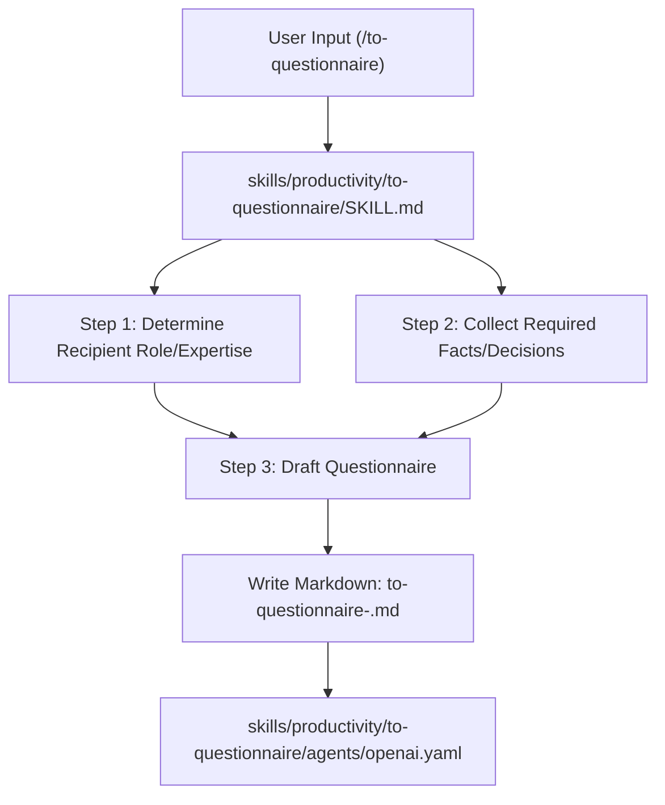
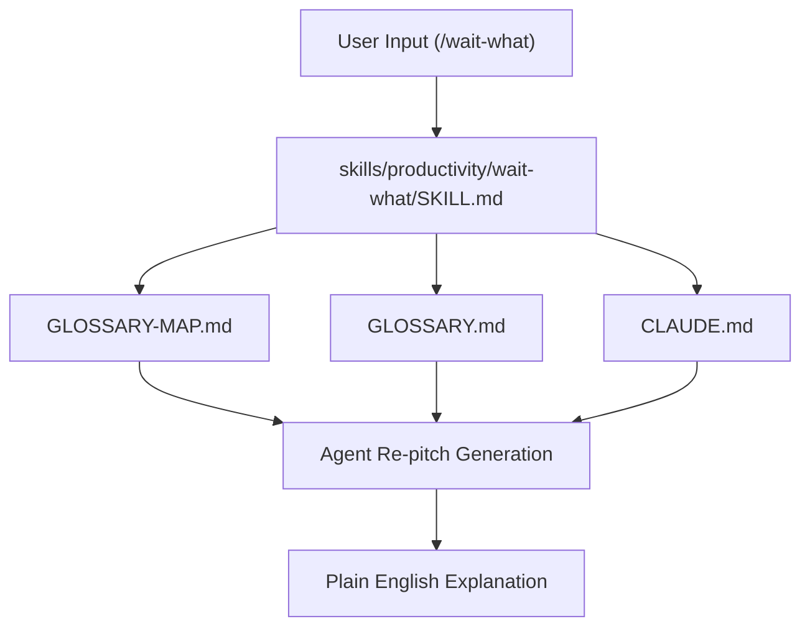

<!-- source: DeepWiki mcp.deepwiki.com · repo mattpocock/skills · page 7.3 To-Questionnaire and Wait-What · fetched 2026-10-27 -->

# To-Questionnaire and Wait-What

Relevant source files

The following files were used as context for generating this wiki page:

- [docs/productivity/to-questionnaire.md](docs/productivity/to-questionnaire.md)
- [docs/productivity/wait-what.md](docs/productivity/wait-what.md)
- [skills/productivity/to-questionnaire/SKILL.md](skills/productivity/to-questionnaire/SKILL.md)
- [skills/productivity/to-questionnaire/agents/openai.yaml](skills/productivity/to-questionnaire/agents/openai.yaml)
- [skills/productivity/wait-what/SKILL.md](skills/productivity/wait-what/SKILL.md)

## Purpose and Scope

This page details two productivity skills in the `mattpocock/skills` repository: **to-questionnaire** and **wait-what** [docs/productivity/to-questionnaire.md:1-3](), [docs/productivity/wait-what.md:1-3](). Both skills manage knowledge gaps and communication breakdowns during human-agent interactions, but operate in entirely different phases:
- **`to-questionnaire`** handles external knowledge gaps by transforming an unresolved decision into a structured asynchronous Markdown questionnaire aimed at a specific recipient [docs/productivity/to-questionnaire.md:3-5]().
- **`wait-what`** provides an immediate conversational repair mechanism, re-pitching a confusing message in plain English using project vocabulary and simplified standards [docs/productivity/wait-what.md:3-4]().

Both skills are strictly user-invoked (`disable-model-invocation: true`) to prevent unsolicited executions [skills/productivity/to-questionnaire/SKILL.md:4-5](), [skills/productivity/wait-what/SKILL.md:4-5]().

Sources:
- [docs/productivity/to-questionnaire.md:1-5]()
- [docs/productivity/wait-what.md:1-4]()
- [skills/productivity/to-questionnaire/SKILL.md:4-5]()
- [skills/productivity/wait-what/SKILL.md:4-5]()

---

## to-Questionnaire

### Purpose and Mechanism

The `to-questionnaire` skill converts a decision that cannot be resolved independently into a Markdown questionnaire [`to-questionnaire-<slug>.md`] intended for an external recipient [docs/productivity/to-questionnaire.md:3-5](), [skills/productivity/to-questionnaire/SKILL.md:16](). 

The core architectural rule of this skill is to **grill the send, never the subject** [docs/productivity/to-questionnaire.md:5](). Because the user lacks the subject matter knowledge (which is why they need to ask someone else), interviewing them about the topic is unproductive [docs/productivity/to-questionnaire.md:5](). Instead, the skill interviews the user about two accessible parameters:
1. **Who is it going to?** (Role, expertise, relationship) [skills/productivity/to-questionnaire/SKILL.md:12]().
2. **What do you need back?** (Concrete decisions or facts required) [skills/productivity/to-questionnaire/SKILL.md:14]().

Sources:
- [docs/productivity/to-questionnaire.md:3-5]()
- [skills/productivity/to-questionnaire/SKILL.md:9-16]()

### When to Reach for It

Use `to-questionnaire` when planning stalls due to missing knowledge that resides exclusively in another person's head [docs/productivity/to-questionnaire.md:11]().

| Where the answers reside | Recommended skill |
| --- | --- |
| Your own head (unsharpened) | `grill-me` [docs/productivity/to-questionnaire.md:15]() |
| The codebase | `grill-with-docs` [docs/productivity/to-questionnaire.md:16]() |
| Someone else's head | `to-questionnaire` [docs/productivity/to-questionnaire.md:17]() |
| Nobody's head yet (needs a reaction) | `prototype` [docs/productivity/to-questionnaire.md:18]() |

Sources:
- [docs/productivity/to-questionnaire.md:11-19]()

### Implementation and Data Flow

The skill executes a two-step interview followed by file generation [skills/productivity/to-questionnaire/SKILL.md:12-16](). 

Diagram Title: "To-Questionnaire Natural Language to Code Entity Mapping"

Sources:
- [skills/productivity/to-questionnaire/SKILL.md:12-16]()
- [skills/productivity/to-questionnaire/agents/openai.yaml:1-5]()

### Document Structure

The generated questionnaire follows a strict discovery layout [skills/productivity/to-questionnaire/SKILL.md:20]():
- **Purpose & Header:** Identifies sender, recipient, and the overarching decision [skills/productivity/to-questionnaire/SKILL.md:26-28]().
- **Context:** A single paragraph orienting a recipient lacking prior context [skills/productivity/to-questionnaire/SKILL.md:30-32]().
- **How to Answer:** Instructions encouraging partial answers and flagging uncertainties ("I don't know") [skills/productivity/to-questionnaire/SKILL.md:34-36]().
- **Thematic Sections:** Flat, grouped lists ordered most-important-first, featuring single-idea questions with answer stubs and optional `_why this matters_` annotations [skills/productivity/to-questionnaire/SKILL.md:38-48]().
- **Catch-all:** A closing prompt asking for omitted insights [skills/productivity/to-questionnaire/SKILL.md:50-52]().

Sources:
- [skills/productivity/to-questionnaire/SKILL.md:20-54]()

---

## wait-What

### Purpose and Mechanism

You invoke `wait-what` via `/wait-what` when an agent message fails to land due to excessive jargon, missing premises, or confusing structure [docs/productivity/wait-what.md:3-11](). The agent responds by re-pitching the message in plain English using `ASD-STE100 Simplified Technical English` and the project's `GLOSSARY.md` vocabulary [skills/productivity/wait-what/SKILL.md:7]().

The skill relies on a minimalist design (three lines of prompt instructions) to prevent model verbosity bloating [docs/productivity/wait-what.md:5-6]().

Sources:
- [docs/productivity/wait-what.md:3-11]()
- [skills/productivity/wait-what/SKILL.md:1-7]()

### The Name is the Mechanism

Unlike output-focused compaction commands (`/tldr`, `/no-fluff`), which instruct the model on how to format its *output* (frequently resulting in clipped, unhelpful fragments), `wait-what` addresses the *listener's state* [docs/productivity/wait-what.md:15-17](). 

| Command Type | Target | Resulting Behavior |
| --- | --- | --- |
| Output-focused (`/tldr`) | Model output length | Cuts words, increases obscurity [docs/productivity/wait-what.md:15-17]() |
| Listener-focused (`/wait-what`) | Listener comprehension state | Restores missing context and simplifies vocabulary [docs/productivity/wait-what.md:15-17]() |

Sources:
- [docs/productivity/wait-what.md:15-17]()

### Context Integration and Data Flow

When invoked, `wait-what` pulls terminology from global configurations and local domain mapping files [skills/productivity/wait-what/SKILL.md:7]().

Diagram Title: "Wait-What Context Integration Mapping"

Sources:
- [docs/productivity/wait-what.md:23]()
- [skills/productivity/wait-what/SKILL.md:7]()

---

## Comparative Summary

| Dimension | `to-questionnaire` | `wait-what` |
| --- | --- | --- |
| **Primary Goal** | Externalize unresolved decisions into a structured document [docs/productivity/to-questionnaire.md:3-5]() | Repair real-time comprehension failures within a session [docs/productivity/wait-what.md:3-11]() |
| **Target Audience** | An external person holding missing domain knowledge [docs/productivity/to-questionnaire.md:11]() | The user currently interacting with the agent [docs/productivity/wait-what.md:3]() |
| **Artifact Produced** | A Markdown file (`to-questionnaire-<slug>.md`) [skills/productivity/to-questionnaire/SKILL.md:16]() | A conversational re-pitch in chat [docs/productivity/wait-what.md:3]() |
| **Vocabulary Source** | User interview responses [skills/productivity/to-questionnaire/SKILL.md:12-14]() | Project `GLOSSARY.md` and `ASD-STE100` [skills/productivity/wait-what/SKILL.md:7]() |

Sources:
- [docs/productivity/to-questionnaire.md:3-11]()
- [docs/productivity/to-questionnaire.md:15-16]()
- [docs/productivity/wait-what.md:3-11]()
- [skills/productivity/to-questionnaire/SKILL.md:12-16]()
- [skills/productivity/wait-what/SKILL.md:7]()

---

