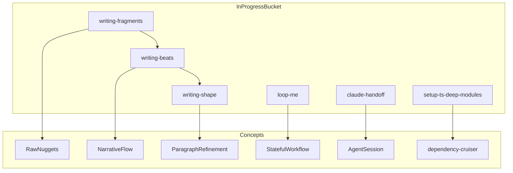
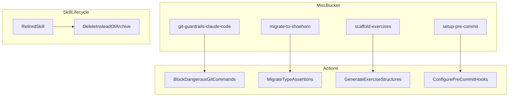

<!-- source: DeepWiki mcp.deepwiki.com · repo mattpocock/skills · page 8 Experimental, Misc and Deprecated Skills · fetched 2026-10-27 -->

# Experimental, Misc and Deprecated Skills

Relevant source files

The following files were used as context for generating this wiki page:

- [.claude-plugin/plugin.json](.claude-plugin/plugin.json)
- [skills/deprecated/README.md](skills/deprecated/README.md)
- [skills/in-progress/README.md](skills/in-progress/README.md)
- [skills/misc/README.md](skills/misc/README.md)

This page provides an overview of skills within the `skills/in-progress`, `skills/misc`, and `skills/deprecated` directories. It explains the lifecycle of skills as they move from experimental prototypes to stable tools, are maintained as one-off utilities, or are eventually retired.

## Skill Lifecycle and Graduation

Skills in this repository follow a progression based on their stability and utility:
1. **In-Progress**: Experimental skills located in `skills/in-progress/`. These are "Beta" and public on purpose for feedback, but are excluded from the main plugin manifest and top-level documentation until they graduate to a stable bucket [skills/in-progress/README.md:1-3](). They must be installed individually [skills/in-progress/README.md:5-9]().
2. **Stable (Promoted)**: Skills that have graduated to core categories such as `engineering/` or `productivity/`, which are included in the `.claude-plugin/plugin.json` manifest [.claude-plugin/plugin.json:21-49]().
3. **Misc**: Tools kept around but rarely used, such as `git-guardrails-claude-code` or `setup-pre-commit`. These are not promoted in the plugin [skills/misc/README.md:1-3]().
4. **Deprecated**: Skills no longer in active use. Currently, the `skills/deprecated/` bucket is empty because retired skills are typically deleted, with the replacement named in the changeset commit [skills/deprecated/README.md:1-3]().

Sources:
- [skills/in-progress/README.md:1-3]()
- [skills/in-progress/README.md:5-9]()
- [.claude-plugin/plugin.json:21-49]()
- [skills/misc/README.md:1-3]()
- [skills/deprecated/README.md:1-3]()

## In-Progress Skills

The `in-progress/` bucket contains experimental skills that are still under development. These skills are not part of the main plugin and must be installed individually. They can change or disappear without warning [skills/in-progress/README.md:1-3](). 

### 8.1 In-Progress Writing Skills

This set of skills focuses on a structured approach to writing, from initial idea generation to final article shaping using `writing-fragments`, `writing-beats`, and `writing-shape` [skills/in-progress/README.md:12-14]().

For details, see [In-Progress Writing Skills](#8.1).

### 8.2 In-Progress Workflow Skills

These skills aim to enhance workflow management and agent collaboration, including `loop-me` and `claude-handoff` [skills/in-progress/README.md:11-15]().

For details, see [In-Progress Workflow Skills](#8.2).

### 8.3 Setup-TS-Deep-Modules

The `setup-ts-deep-modules` skill configures `dependency-cruiser` in a TypeScript repository to enforce deep module boundaries [skills/in-progress/README.md:16-16]().

For details, see [Setup-TS-Deep-Modules](#8.3).

**In-Progress Skills Overview**

Sources:
- [skills/in-progress/README.md:11-16]()

## Misc and Deprecated Buckets

This section covers the `misc/` bucket, which contains utilities not promoted to the main plugin, and the `deprecated/` bucket, which follows a delete-rather-than-archive policy [skills/misc/README.md:1-3](), [skills/deprecated/README.md:1-3]().

### 8.4 Misc and Deprecated Buckets

The `misc/` bucket contains various one-off utilities such as `git-guardrails-claude-code`, `migrate-to-shoehorn`, `scaffold-exercises`, and `setup-pre-commit` [skills/misc/README.md:5-8](). The `deprecated/` bucket maintains a delete-rather-than-archive policy [skills/deprecated/README.md:1-3]().

For details, see [Misc and Deprecated Buckets](#8.4).

**Misc Utilities and Deprecation Flow**

Sources:
- [skills/misc/README.md:5-8]()
- [skills/deprecated/README.md:1-3]()

---

