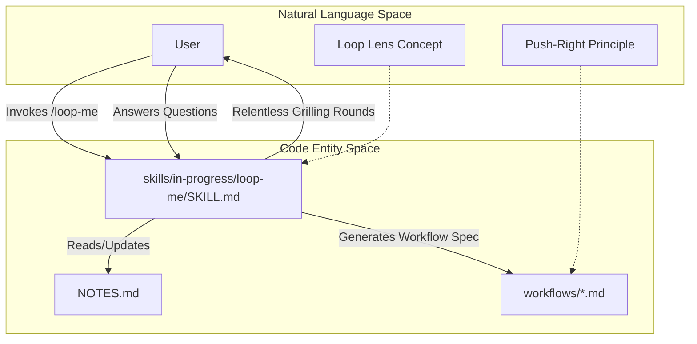
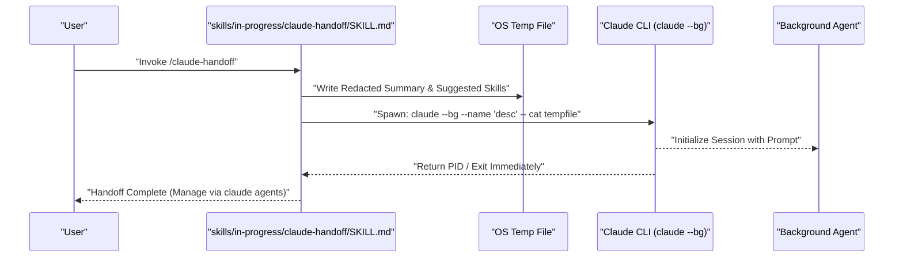

<!-- source: DeepWiki mcp.deepwiki.com · repo mattpocock/skills · page 8.2 In-Progress Workflow Skills · fetched 2026-10-27 -->

# In-Progress Workflow Skills

Relevant source files

The following files were used as context for generating this wiki page:

- [skills/engineering/code-review/SKILL.md](skills/engineering/code-review/SKILL.md)
- [skills/engineering/to-spec/SKILL.md](skills/engineering/to-spec/SKILL.md)
- [skills/in-progress/chief-of-staff/SKILL.md](skills/in-progress/chief-of-staff/SKILL.md)
- [skills/in-progress/chief-of-staff/agents/openai.yaml](skills/in-progress/chief-of-staff/agents/openai.yaml)
- [skills/in-progress/claude-handoff/SKILL.md](skills/in-progress/claude-handoff/SKILL.md)
- [skills/in-progress/loop-me/SKILL.md](skills/in-progress/loop-me/SKILL.md)
- [skills/productivity/grilling/agents/openai.yaml](skills/productivity/grilling/agents/openai.yaml)

This page documents the experimental and in-progress workflow skills housed in the `in-progress/` bucket of the codebase (`skills/in-progress/`). These skills handle stateful workflow specification (`loop-me`), background agent seeding (`claude-handoff`), and long-running strategic session coordination (`chief-of-staff`), alongside a review of how `implement-spec` and `retro` graduated out of this bucket into the main engineering suite.

Sources: [skills/in-progress/loop-me/SKILL.md:1-32](), [skills/in-progress/claude-handoff/SKILL.md:1-18](), [skills/in-progress/chief-of-staff/SKILL.md:1-45]()

## Loop-Me: Stateful Workflow Specification

The `loop-me` skill runs a stateful grilling session aimed exclusively at producing implementable workflow specifications (`workflows/*.md`) and vocabulary notes (`NOTES.md`) [skills/in-progress/loop-me/SKILL.md:8-32](). 

### The Loop Lens and Core Vocabulary
The skill operates via the **loop lens**, conceptualizing a user's life and work as nested recurring patterns (loops) that are candidates for automation and delegation [skills/in-progress/loop-me/SKILL.md:10-14](). A workflow is the explicit specification of one such loop [skills/in-progress/loop-me/SKILL.md:14](). 

Key mechanics defined in `skills/in-progress/loop-me/SKILL.md`:
* **Trigger**: The event (e.g., incoming email, new issue) or schedule (e.g., daily timer) that initiates execution [skills/in-progress/loop-me/SKILL.md:20]().
* **Checkpoint**: A human-in-the-loop validation or decision barrier [skills/in-progress/loop-me/SKILL.md:21]().
* **Push Right**: The design principle of deferring checkpoints as far right in the execution flow as possible, executing maximal autonomous work before asking the user for intervention [skills/in-progress/loop-me/SKILL.md:22]().
* **Brief**: A decision-ready summary presented at a checkpoint containing asset links rather than raw output, optimizing for review speed [skills/in-progress/loop-me/SKILL.md:23]().

### Workflow Specification Pipeline

The following diagram bridges the natural language conceptualization of recurring patterns to the physical file entities (`workflows/*.md`, `NOTES.md`) managed by `skills/in-progress/loop-me/SKILL.md`.

Title: Loop-Me Specification Pipeline

Sources: [skills/in-progress/loop-me/SKILL.md:1-32]()

## Claude-Handoff: Seeding Background Agents

The `claude-handoff` skill captures the current conversational context, serializes it to an OS temporary summary file, and programmatically spawns a detached background agent via the Claude CLI [skills/in-progress/claude-handoff/SKILL.md:2-8]().

### Execution Mechanism and Safety Constraints
Invoking `claude-handoff` executes the underlying CLI command pattern `claude --bg --name "<descriptive name>" -- "$(cat 
)"` [skills/in-progress/claude-handoff/SKILL.md:8](). Passing the summary via file input prevents shell expansion of backticks or environment variables [skills/in-progress/claude-handoff/SKILL.md:8]().

Mandatory rules enforced in `skills/in-progress/claude-handoff/SKILL.md`:
* **Naming (`-n`/`--name`)**: A descriptive identifier must be passed to populate the job list and session picker (`claude agents`) [skills/in-progress/claude-handoff/SKILL.md:8-10]().
* **Suggested Skills**: The handoff summary must explicitly list target skills for the next agent via the Skill tool [skills/in-progress/claude-handoff/SKILL.md:12]().
* **Reference by Path**: Content already captured in specs, plans, ADRs, or commits must be referenced by path or URL, never duplicated [skills/in-progress/claude-handoff/SKILL.md:14]().
* **Redaction**: Sensitive details (API keys, passwords, PII) must be stripped prior to serialization since the summary serves as the raw prompt [skills/in-progress/claude-handoff/SKILL.md:16]().

### Claude-Handoff Execution Flow

Title: Claude-Handoff Execution Flow

Sources: [skills/in-progress/claude-handoff/SKILL.md:1-18]()

## Chief-of-Staff: Long-Running Goal Coordination

The `chief-of-staff` skill coordinates subagents and schedules to pursue extended strategic goals within a single session [skills/in-progress/chief-of-staff/SKILL.md:2-7](). 

### Dual-Track Operation and Environment Shaping
The skill explicitly sets `disable-model-invocation: true` and configures its openai interface policy with `allow_implicit_invocation: false` [skills/in-progress/chief-of-staff/SKILL.md:4](), [skills/in-progress/chief-of-staff/agents/openai.yaml:4-5](). 

The agent operates on two simultaneous tracks [skills/in-progress/chief-of-staff/SKILL.md:9-12]():
1. **Tactical**: Completing immediate tasks efficiently.
2. **Strategic**: Modifying the operational environment to optimize outcomes for all subsequent tasks.

Strategic principles enforced by `skills/in-progress/chief-of-staff/SKILL.md`:
* **Pit of Success**: Constructing constrained APIs, strict linters, and `CODING_STANDARDS.md` files [skills/in-progress/chief-of-staff/SKILL.md:28-33]().
* **Data Source Access**: Ensuring running dev server logs, test databases, and browser preview tools are available [skills/in-progress/chief-of-staff/SKILL.md:34-39]().
* **No Workarounds**: Proactively eliminating one-off hacks and enforcing conventions before building new features [skills/in-progress/chief-of-staff/SKILL.md:40-44]().
* **Sparse Communication via Context Pointers**: Subagents communicate using research notes, previous commits, and pointer references to protect context windows while maintaining active dialogue with the user [skills/in-progress/chief-of-staff/SKILL.md:20-24]().

Sources: [skills/in-progress/chief-of-staff/SKILL.md:1-45](), [skills/in-progress/chief-of-staff/agents/openai.yaml:1-5]()

## Graduation of Implement-Spec and Retro

Certain workflow skills originate in the `in-progress/` bucket before graduating to permanent core engineering status once their patterns stabilize. 

### Implement-Spec Graduation
The `implement-spec` skill graduated into `skills/engineering/implement-spec/` to handle task-graph execution, parallel implementer subagents in separate worktrees, and integration branch management.

### Retro Graduation
The `retro` skill graduated into `skills/engineering/retro/` to handle post-session analysis, categorizing improvements across navigation, automated checks, mechanical standards enforcement versus judgement calls, and tool economy.

Sources: [skills/engineering/code-review/SKILL.md:1-89](), [skills/engineering/to-spec/SKILL.md:1-75]()

---

