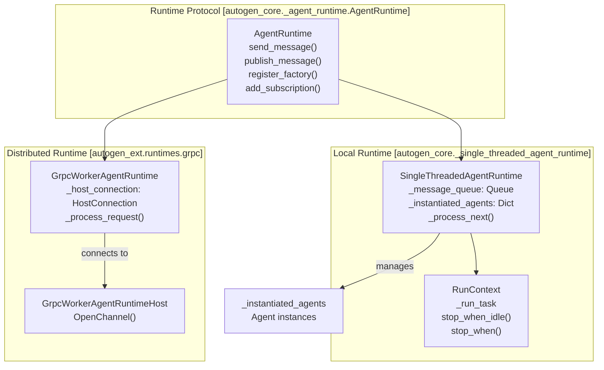
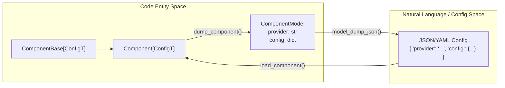

<!-- source: DeepWiki mcp.deepwiki.com · repo microsoft/autogen · page 2 Core Foundation · fetched 2026-10-27 -->

# Core Foundation

Relevant source files

The following files were used as context for generating this wiki page:

- [python/docs/src/user-guide/autogenstudio-user-guide/installation.md](python/docs/src/user-guide/autogenstudio-user-guide/installation.md)
- [python/packages/autogen-core/src/autogen_core/_agent.py](python/packages/autogen-core/src/autogen_core/_agent.py)
- [python/packages/autogen-core/src/autogen_core/_agent_instantiation.py](python/packages/autogen-core/src/autogen_core/_agent_instantiation.py)
- [python/packages/autogen-core/src/autogen_core/_agent_runtime.py](python/packages/autogen-core/src/autogen_core/_agent_runtime.py)
- [python/packages/autogen-core/src/autogen_core/_base_agent.py](python/packages/autogen-core/src/autogen_core/_base_agent.py)
- [python/packages/autogen-core/src/autogen_core/_component_config.py](python/packages/autogen-core/src/autogen_core/_component_config.py)
- [python/packages/autogen-core/src/autogen_core/_runtime_impl_helpers.py](python/packages/autogen-core/src/autogen_core/_runtime_impl_helpers.py)
- [python/packages/autogen-core/src/autogen_core/_single_threaded_agent_runtime.py](python/packages/autogen-core/src/autogen_core/_single_threaded_agent_runtime.py)
- [python/packages/autogen-core/src/autogen_core/_telemetry/_propagation.py](python/packages/autogen-core/src/autogen_core/_telemetry/_propagation.py)
- [python/packages/autogen-core/src/autogen_core/_telemetry/_tracing.py](python/packages/autogen-core/src/autogen_core/_telemetry/_tracing.py)
- [python/packages/autogen-core/tests/test_base_agent.py](python/packages/autogen-core/tests/test_base_agent.py)
- [python/packages/autogen-core/tests/test_component_config.py](python/packages/autogen-core/tests/test_component_config.py)
- [python/packages/autogen-core/tests/test_runtime.py](python/packages/autogen-core/tests/test_runtime.py)
- [python/packages/autogen-ext/conftest.py](python/packages/autogen-ext/conftest.py)
- [python/packages/autogen-ext/src/autogen_ext/agents/video_surfer/tools.py](python/packages/autogen-ext/src/autogen_ext/agents/video_surfer/tools.py)
- [python/packages/autogen-ext/src/autogen_ext/runtimes/grpc/_worker_runtime.py](python/packages/autogen-ext/src/autogen_ext/runtimes/grpc/_worker_runtime.py)
- [python/packages/autogen-ext/tests/test_worker_runtime.py](python/packages/autogen-ext/tests/test_worker_runtime.py)
- [python/packages/autogen-ext/tests/tools/http/test_http_tool.py](python/packages/autogen-ext/tests/tools/http/test_http_tool.py)
- [python/packages/autogen-studio/README.md](python/packages/autogen-studio/README.md)
- [python/packages/autogen-studio/autogenstudio/validation/component_test_service.py](python/packages/autogen-studio/autogenstudio/validation/component_test_service.py)
- [python/packages/autogen-studio/autogenstudio/web/routes/validation.py](python/packages/autogen-studio/autogenstudio/web/routes/validation.py)
- [python/packages/autogen-test-utils/src/autogen_test_utils/__init__.py](python/packages/autogen-test-utils/src/autogen_test_utils/__init__.py)

This document covers the foundational systems that underpin all of AutoGen. These core components provide the runtime environment, communication infrastructure, agent lifecycle management, and component configuration systems that enable multi-agent applications.

The foundation consists of:
- **Agent Runtime System**: Message routing and agent execution environments.
- **Model Client System**: Unified interfaces for LLM interactions.
- **Message Types and Tool Agents**: Structured communication and tool-augmented generation.
- **Memory Systems**: State persistence and context management.
- **Component Configuration System**: Declarative setup and serialization.

## Agent Runtime System

AutoGen's agent execution is built on the `AgentRuntime` protocol, which defines the core interface for agent communication and lifecycle management. The runtime system provides pluggable implementations for different deployment scenarios.

**Runtime Protocol and Implementations**

- **SingleThreadedAgentRuntime**: Provides local execution using an `asyncio.Queue` [python/packages/autogen-core/src/autogen_core/_single_threaded_agent_runtime.py:149-152](). It uses a `RunContext` to manage the processing loop [python/packages/autogen-core/src/autogen_core/_single_threaded_agent_runtime.py:99-131]().
- **GrpcWorkerAgentRuntime**: Enables distributed or cross-language agents by communicating with a host via gRPC [python/packages/autogen-ext/src/autogen_ext/runtimes/grpc/_worker_runtime.py:215-225](). It uses a `HostConnection` to manage bidirectional streams [python/packages/autogen-ext/src/autogen_ext/runtimes/grpc/_worker_runtime.py:95-124]().

For details, see [Agent Runtime System](#2.1).

Sources: [python/packages/autogen-core/src/autogen_core/_agent_runtime.py:21-188](), [python/packages/autogen-core/src/autogen_core/_single_threaded_agent_runtime.py:149-165](), [python/packages/autogen-ext/src/autogen_ext/runtimes/grpc/_worker_runtime.py:215-225]()

## Model Client System

The Model Client system provides a unified abstraction for interacting with Large Language Models (LLMs).

- **ChatCompletionClient**: The primary protocol for model interactions, supporting text and multimodal inputs.
- **Model Context**: Implementations like `BufferedChatCompletionContext` or `TokenLimitedChatCompletionContext` manage how conversation history is truncated or summarized before being sent to the model.
- **Tool System**: Defines `BaseTool` and `FunctionTool` for wrapping Python functions into schemas that LLMs can invoke.

For details, see [Model Client System](#2.2).

Sources: [python/packages/autogen-ext/src/autogen_ext/agents/video_surfer/tools.py:106-112](), [python/packages/autogen-core/tests/test_component_config.py:10-11]()

## Message Types and Tool Agents

Communication in AutoGen is structured through specific message types and specialized agents for tool execution.

- **LLMMessages**: A hierarchy including `SystemMessage`, `UserMessage`, `AssistantMessage`, and `FunctionExecutionResultMessage`.
- **ToolAgent**: A specialized agent designed to execute tools and return results to the requester.
- **Tool Calling Loop**: The `tool_agent_caller_loop` facilitates the iterative process of an LLM requesting tool calls and receiving results until a final answer is produced.

For details, see [Message Types and Tool Agents](#2.3).

Sources: [python/packages/autogen-ext/src/autogen_ext/agents/video_surfer/tools.py:127-134](), [python/packages/autogen-test-utils/src/autogen_test_utils/__init__.py:21-33]()

## Memory Systems

Memory systems allow agents to persist information across interactions and retrieve relevant context dynamically.

- **Memory Protocol**: Defines how content is stored and queried.
- **Implementations**: Includes simple `ListMemory`, vector-based `ChromaDB` for semantic search, and sequential storage like `Redis`.
- **MIME Types**: Supports various content types via `MemoryContent`.

For details, see [Memory Systems](#2.4).

## Component Configuration System

The Component Configuration system enables declarative definitions of agents, tools, and runtimes, allowing them to be serialized to JSON/YAML and reconstructed across different environments.

**Component Configuration Architecture**

- **ComponentModel**: A Pydantic model that stores the `provider` (the class path) and the `config` dictionary [python/packages/autogen-core/src/autogen_core/_component_config.py:18-41]().
- **Serialization**: Components implement `_to_config()` and `_from_config()` to convert between Python instances and serializable models [python/packages/autogen-core/src/autogen_core/_component_config.py:135-145]().
- **Validation**: The `ValidationService` ensures that configurations match the expected schemas before instantiation [python/packages/autogen-studio/autogenstudio/web/routes/validation.py:12-19]().

For details, see [Component Configuration System](#2.5).

Sources: [python/packages/autogen-core/src/autogen_core/_component_config.py:18-41](), [python/packages/autogen-core/tests/test_component_config.py:21-34](), [python/packages/autogen-studio/autogenstudio/web/routes/validation.py:12-19]()

---

