<!-- source: DeepWiki mcp.deepwiki.com · repo microsoft/autogen · page 2.1 Agent Runtime System · fetched 2026-10-27 -->

# Agent Runtime System

Relevant source files

The following files were used as context for generating this wiki page:

- [docs/design/01 - Programming Model.md](docs/design/01 - Programming Model.md)
- [docs/design/02 - Topics.md](docs/design/02 - Topics.md)
- [docs/design/03 - Agent Worker Protocol.md](docs/design/03 - Agent Worker Protocol.md)
- [docs/design/04 - Agent and Topic ID Specs.md](docs/design/04 - Agent and Topic ID Specs.md)
- [docs/design/05 - Services.md](docs/design/05 - Services.md)
- [dotnet/samples/dev-team/DevTeam.ServiceDefaults/Extensions.cs](dotnet/samples/dev-team/DevTeam.ServiceDefaults/Extensions.cs)
- [protos/agent_worker.proto](protos/agent_worker.proto)
- [protos/cloudevent.proto](protos/cloudevent.proto)
- [python/docs/src/user-guide/agentchat-user-guide/tracing.ipynb](python/docs/src/user-guide/agentchat-user-guide/tracing.ipynb)
- [python/docs/src/user-guide/core-user-guide/framework/telemetry.md](python/docs/src/user-guide/core-user-guide/framework/telemetry.md)
- [python/fixup_generated_files.py](python/fixup_generated_files.py)
- [python/packages/autogen-core/src/autogen_core/_agent.py](python/packages/autogen-core/src/autogen_core/_agent.py)
- [python/packages/autogen-core/src/autogen_core/_agent_instantiation.py](python/packages/autogen-core/src/autogen_core/_agent_instantiation.py)
- [python/packages/autogen-core/src/autogen_core/_agent_runtime.py](python/packages/autogen-core/src/autogen_core/_agent_runtime.py)
- [python/packages/autogen-core/src/autogen_core/_base_agent.py](python/packages/autogen-core/src/autogen_core/_base_agent.py)
- [python/packages/autogen-core/src/autogen_core/_intervention.py](python/packages/autogen-core/src/autogen_core/_intervention.py)
- [python/packages/autogen-core/src/autogen_core/_queue.py](python/packages/autogen-core/src/autogen_core/_queue.py)
- [python/packages/autogen-core/src/autogen_core/_single_threaded_agent_runtime.py](python/packages/autogen-core/src/autogen_core/_single_threaded_agent_runtime.py)
- [python/packages/autogen-core/src/autogen_core/_telemetry/_propagation.py](python/packages/autogen-core/src/autogen_core/_telemetry/_propagation.py)
- [python/packages/autogen-core/src/autogen_core/_telemetry/_tracing.py](python/packages/autogen-core/src/autogen_core/_telemetry/_tracing.py)
- [python/packages/autogen-core/tests/protos/serialization_test_pb2.py](python/packages/autogen-core/tests/protos/serialization_test_pb2.py)
- [python/packages/autogen-core/tests/protos/serialization_test_pb2_grpc.py](python/packages/autogen-core/tests/protos/serialization_test_pb2_grpc.py)
- [python/packages/autogen-core/tests/test_base_agent.py](python/packages/autogen-core/tests/test_base_agent.py)
- [python/packages/autogen-core/tests/test_cancellation.py](python/packages/autogen-core/tests/test_cancellation.py)
- [python/packages/autogen-core/tests/test_closure_agent.py](python/packages/autogen-core/tests/test_closure_agent.py)
- [python/packages/autogen-core/tests/test_intervention.py](python/packages/autogen-core/tests/test_intervention.py)
- [python/packages/autogen-core/tests/test_routed_agent.py](python/packages/autogen-core/tests/test_routed_agent.py)
- [python/packages/autogen-core/tests/test_runtime.py](python/packages/autogen-core/tests/test_runtime.py)
- [python/packages/autogen-core/tests/test_state.py](python/packages/autogen-core/tests/test_state.py)
- [python/packages/autogen-core/tests/test_subscription.py](python/packages/autogen-core/tests/test_subscription.py)
- [python/packages/autogen-core/tests/test_types.py](python/packages/autogen-core/tests/test_types.py)
- [python/packages/autogen-ext/conftest.py](python/packages/autogen-ext/conftest.py)
- [python/packages/autogen-ext/src/autogen_ext/runtimes/grpc/_utils.py](python/packages/autogen-ext/src/autogen_ext/runtimes/grpc/_utils.py)
- [python/packages/autogen-ext/src/autogen_ext/runtimes/grpc/_worker_runtime.py](python/packages/autogen-ext/src/autogen_ext/runtimes/grpc/_worker_runtime.py)
- [python/packages/autogen-ext/src/autogen_ext/runtimes/grpc/_worker_runtime_host_servicer.py](python/packages/autogen-ext/src/autogen_ext/runtimes/grpc/_worker_runtime_host_servicer.py)
- [python/packages/autogen-ext/src/autogen_ext/runtimes/grpc/protos/__init__.py](python/packages/autogen-ext/src/autogen_ext/runtimes/grpc/protos/__init__.py)
- [python/packages/autogen-ext/src/autogen_ext/runtimes/grpc/protos/agent_worker_pb2.py](python/packages/autogen-ext/src/autogen_ext/runtimes/grpc/protos/agent_worker_pb2.py)
- [python/packages/autogen-ext/src/autogen_ext/runtimes/grpc/protos/agent_worker_pb2.pyi](python/packages/autogen-ext/src/autogen_ext/runtimes/grpc/protos/agent_worker_pb2.pyi)
- [python/packages/autogen-ext/src/autogen_ext/runtimes/grpc/protos/agent_worker_pb2_grpc.py](python/packages/autogen-ext/src/autogen_ext/runtimes/grpc/protos/agent_worker_pb2_grpc.py)
- [python/packages/autogen-ext/src/autogen_ext/runtimes/grpc/protos/agent_worker_pb2_grpc.pyi](python/packages/autogen-ext/src/autogen_ext/runtimes/grpc/protos/agent_worker_pb2_grpc.pyi)
- [python/packages/autogen-ext/src/autogen_ext/runtimes/grpc/protos/cloudevent_pb2.py](python/packages/autogen-ext/src/autogen_ext/runtimes/grpc/protos/cloudevent_pb2.py)
- [python/packages/autogen-ext/src/autogen_ext/runtimes/grpc/protos/cloudevent_pb2_grpc.py](python/packages/autogen-ext/src/autogen_ext/runtimes/grpc/protos/cloudevent_pb2_grpc.py)
- [python/packages/autogen-ext/tests/protos/serialization_test_pb2.py](python/packages/autogen-ext/tests/protos/serialization_test_pb2.py)
- [python/packages/autogen-ext/tests/protos/serialization_test_pb2_grpc.py](python/packages/autogen-ext/tests/protos/serialization_test_pb2_grpc.py)
- [python/packages/autogen-ext/tests/protos/serialization_test_pb2_grpc.pyi](python/packages/autogen-ext/tests/protos/serialization_test_pb2_grpc.pyi)
- [python/packages/autogen-ext/tests/test_worker_runtime.py](python/packages/autogen-ext/tests/test_worker_runtime.py)
- [python/packages/autogen-ext/tests/tools/http/test_http_tool.py](python/packages/autogen-ext/tests/tools/http/test_http_tool.py)
- [python/packages/autogen-test-utils/src/autogen_test_utils/telemetry_test_utils.py](python/packages/autogen-test-utils/src/autogen_test_utils/telemetry_test_utils.py)

The Agent Runtime System provides the foundational infrastructure for executing agents and managing message communication within AutoGen. It defines the core protocol for agent lifecycle management, message routing, and distributed execution. This system serves as the execution engine that orchestrates agent interactions through both local single-threaded and distributed gRPC-based runtimes.

For information about high-level agent APIs that use these runtimes, see [AssistantAgent](#3.1). For details about message types and serialization, see [Message Types and Tool Agents](#2.3).

## Runtime Protocol Interface

The `AgentRuntime` protocol defines the contract that all runtime implementations must fulfill. It provides a standardized interface for agent registration, message communication, and state management. This is defined as a `Protocol` class to enable structural typing.

**AgentRuntime Protocol Structure**

```mermaid
graph TB
    subgraph "AgentRuntime Protocol"
        AR["AgentRuntime<br/>@runtime_checkable Protocol"]
    end
    
    subgraph "Message Operations"
        SM["send_message()<br/>recipient: AgentId<br/>returns: Any"]
        PM["publish_message()<br/>topic_id: TopicId<br/>returns: None"] 
    end
    
    subgraph "Agent Lifecycle"
        RF["register_factory()<br/>type: str | AgentType<br/>agent_factory: Callable<br/>returns: AgentType"]
        RAI["register_agent_instance()<br/>agent_instance: Agent<br/>agent_id: AgentId<br/>returns: AgentId"]
        TG["try_get_underlying_agent_instance()<br/>id: AgentId<br/>type: Type[T]<br/>returns: T"]
    end
    
    subgraph "State Persistence"
        SS["save_state()<br/>returns: Mapping[str, Any]"]
        LS["load_state()<br/>state: Mapping[str, Any]"]
        ASS["agent_save_state()<br/>agent: AgentId"]
        ALS["agent_load_state()<br/>agent: AgentId, state"]
    end
    
    subgraph "Subscription Control"
        AS["add_subscription()<br/>subscription: Subscription"]
        RS["remove_subscription()<br/>id: str"]
        AMS["add_message_serializer()<br/>serializer: MessageSerializer"]
    end
    
    subgraph "Metadata"
        AM["agent_metadata()<br/>agent: AgentId<br/>returns: AgentMetadata"]
    end
    
    AR --> SM
    AR --> PM
    AR --> RF
    AR --> RAI
    AR --> TG
    AR --> SS
    AR --> LS
    AR --> ASS
    AR --> ALS
    AR --> AS
    AR --> RS
    AR --> AMS
    AR --> AM
```

**Runtime Implementations**

| Implementation | Location | Use Case |
|----------------|----------|----------|
| `SingleThreadedAgentRuntime` | `autogen_core._single_threaded_agent_runtime` | Local development, single-process execution |
| `GrpcWorkerAgentRuntime` | `autogen_ext.runtimes.grpc._worker_runtime` | Distributed execution, cross-language agents |

Sources: [python/packages/autogen-core/src/autogen_core/_agent_runtime.py:20-296]()

## Message Routing and Subscriptions

The runtime system uses a subscription-based routing mechanism to deliver published messages to interested agents. The `SubscriptionManager` handles the mapping between topic types and agent instances.

**Subscription System Architecture**

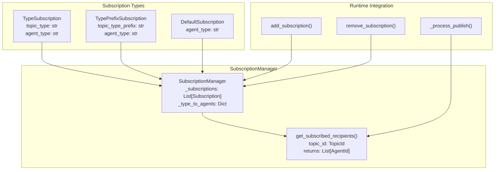

**Subscription Resolution Process**

1. Agent registers with runtime using `register_factory()` or `register_agent_instance()` [python/packages/autogen-core/src/autogen_core/_agent_runtime.py:75-185]().
2. Subscriptions are added via `add_subscription()` (often handled automatically by agent decorators) [python/packages/autogen-core/src/autogen_core/_agent_runtime.py:207-217]().
3. When `publish_message()` is called with a `TopicId`, the runtime queries `SubscriptionManager` [python/packages/autogen-core/src/autogen_core/_single_threaded_agent_runtime.py:557-630]().
4. `get_subscribed_recipients()` returns all `AgentId`s matching the topic [python/packages/autogen-core/src/autogen_core/_runtime_impl_helpers.py:120-130]().
5. Runtime delivers message to each subscribed agent via `on_message()` [python/packages/autogen-core/src/autogen_core/_single_threaded_agent_runtime.py:596-613]().

Sources: [python/packages/autogen-core/src/autogen_core/_single_threaded_agent_runtime.py:265](), [python/packages/autogen-core/src/autogen_core/_runtime_impl_helpers.py:80-150](), [docs/design/02 - Topics.md:36-45]()

## Message Envelope System

The runtime uses a message envelope system to manage different types of message operations. Each envelope type encapsulates the necessary information for routing and processing messages.

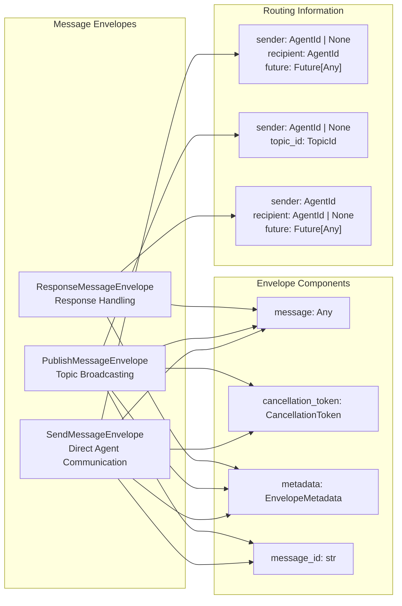

Each envelope type serves a specific communication pattern:

- **SendMessageEnvelope**: Used for direct agent-to-agent RPC-style communication with response handling [python/packages/autogen-core/src/autogen_core/_single_threaded_agent_runtime.py:71-82]().
- **PublishMessageEnvelope**: Used for broadcasting messages to all subscribed agents on a topic [python/packages/autogen-core/src/autogen_core/_single_threaded_agent_runtime.py:58-68]().
- **ResponseMessageEnvelope**: Used internally to deliver responses back to the original sender [python/packages/autogen-core/src/autogen_core/_single_threaded_agent_runtime.py:85-93]().

Sources: [python/packages/autogen-core/src/autogen_core/_single_threaded_agent_runtime.py:57-93]()

## SingleThreadedAgentRuntime Implementation

The `SingleThreadedAgentRuntime` is the primary local execution engine that processes all messages using a single asyncio event loop. It provides concurrent message processing while maintaining deterministic message ordering.

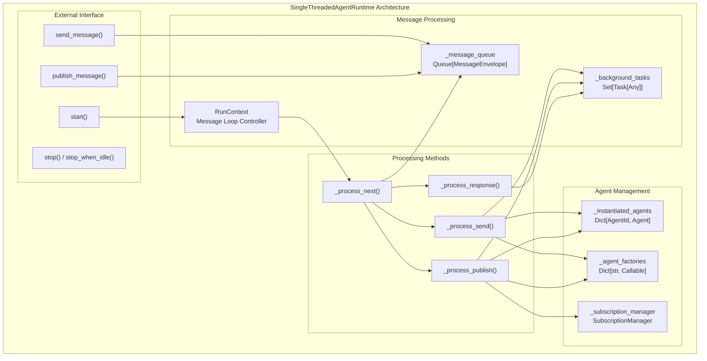

### Key Components

| Component | Type | Purpose | Location |
|-----------|------|---------|----------|
| **_message_queue** | `Queue[MessageEnvelope]` | Central asyncio queue for all message envelopes | [python/packages/autogen-core/src/autogen_core/_single_threaded_agent_runtime.py:257]() |
| **_run_context** | `RunContext | None` | Manages the message processing loop lifecycle | [python/packages/autogen-core/src/autogen_core/_single_threaded_agent_runtime.py:266]() |
| **_subscription_manager** | `SubscriptionManager` | Routes published messages to subscribed agents | [python/packages/autogen-core/src/autogen_core/_single_threaded_agent_runtime.py:265]() |
| **_agent_factories** | `Dict[str, Callable]` | Stores agent factory functions for lazy instantiation | [python/packages/autogen-core/src/autogen_core/_single_threaded_agent_runtime.py:259-261]() |
| **_instantiated_agents** | `Dict[AgentId, Agent]` | Cache of already instantiated agent instances | [python/packages/autogen-core/src/autogen_core/_single_threaded_agent_runtime.py:262]() |
| **_background_tasks** | `Set[Task[Any]]` | Tracks concurrent message processing tasks | [python/packages/autogen-core/src/autogen_core/_single_threaded_agent_runtime.py:264]() |
| **_intervention_handlers** | `List[InterventionHandler] | None` | Optional message interceptors for logging/modification | [python/packages/autogen-core/src/autogen_core/_single_threaded_agent_runtime.py:263]() |
| **_serialization_registry** | `SerializationRegistry` | Manages message type serialization/deserialization | [python/packages/autogen-core/src/autogen_core/_single_threaded_agent_runtime.py:267]() |

### Message Processing Flow

The runtime processes messages through a unified pipeline implemented in `_process_next()` [python/packages/autogen-core/src/autogen_core/_single_threaded_agent_runtime.py:671-795]():

**Processing Pipeline**

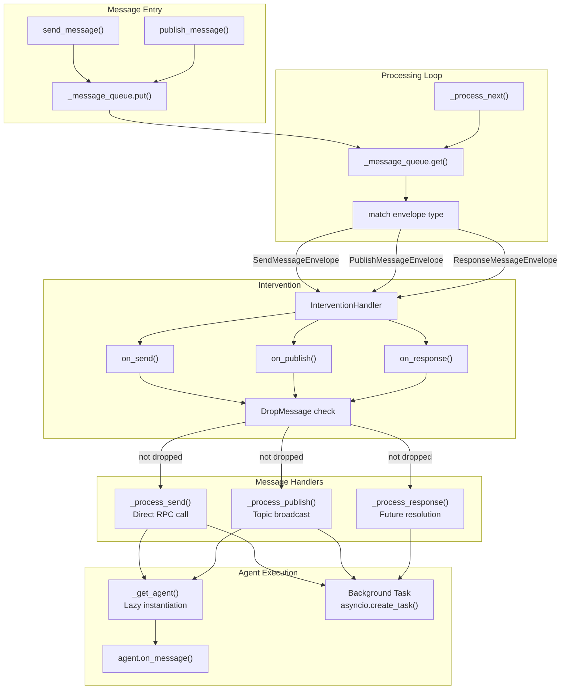

**Processing Steps**

1. **Message Enqueueing** ([python/packages/autogen-core/src/autogen_core/_single_threaded_agent_runtime.py:332-429]()): `send_message()` and `publish_message()` create envelopes and add to queue.
2. **Dequeue** ([python/packages/autogen-core/src/autogen_core/_single_threaded_agent_runtime.py:671-687]()): `_process_next()` retrieves next envelope from queue.
3. **Intervention** ([python/packages/autogen-core/src/autogen_core/_single_threaded_agent_runtime.py:691-791]()): Optional `InterventionHandler.on_send/on_publish/on_response()` can modify or drop messages.
4. **Agent Instantiation** ([python/packages/autogen-core/src/autogen_core/_single_threaded_agent_runtime.py:886-923]()): `_get_agent()` lazily creates agents using registered factories and `AgentInstantiationContext`.
5. **Message Delivery** ([python/packages/autogen-core/src/autogen_core/_single_threaded_agent_runtime.py:466-555](), [557-630]()): Agent's `on_message()` is called with `MessageContext`.
6. **Background Execution** ([python/packages/autogen-core/src/autogen_core/_single_threaded_agent_runtime.py:724-726](), [764-766]()): Processing happens in background tasks tracked in `_background_tasks`.
7. **Response Routing** ([python/packages/autogen-core/src/autogen_core/_single_threaded_agent_runtime.py:632-662]()): For `send_message()`, responses resolve the original `Future`.

Sources: [python/packages/autogen-core/src/autogen_core/_single_threaded_agent_runtime.py:664-795](), [python/packages/autogen-core/src/autogen_core/_single_threaded_agent_runtime.py:886-923]()

## GrpcWorkerAgentRuntime Implementation

The `GrpcWorkerAgentRuntime` enables distributed agent execution by connecting worker processes to a central host via gRPC. This allows agents to run across multiple processes or machines while maintaining the same runtime interface.

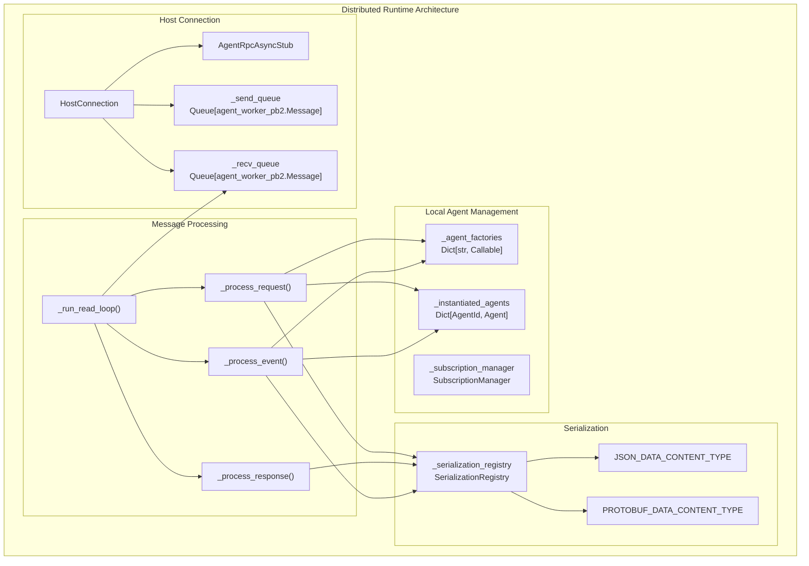

### GRPC Communication Protocol

The worker runtime communicates with the host using protobuf messages defined in `agent_worker.proto` [protos/agent_worker.proto]():

**Protobuf Message Structure**

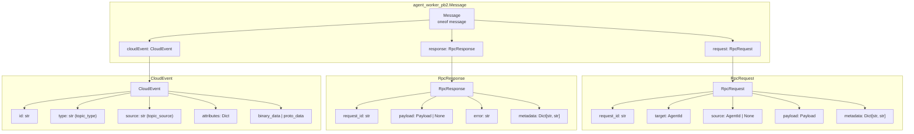

| Message Type | Direction | Purpose | Handled By |
|-------------|-----------|---------|------------|
| **RpcRequest** | Host → Worker | Direct agent method invocation | `_process_request()` [python/packages/autogen-ext/src/autogen_ext/runtimes/grpc/_worker_runtime.py:512-582]() |
| **RpcResponse** | Worker → Host / Host → Worker | Method call result or error | `_process_response()` [python/packages/autogen-ext/src/autogen_ext/runtimes/grpc/_worker_runtime.py:584-603]() |
| **CloudEvent** | Host → Worker | Published topic messages | `_process_event()` [python/packages/autogen-ext/src/autogen_ext/runtimes/grpc/_worker_runtime.py:605-703]() |

### Connection Management

The `HostConnection` class manages the bidirectional gRPC stream between worker and host [python/packages/autogen-ext/src/autogen_ext/runtimes/grpc/_worker_runtime.py:95-200]():

**HostConnection Architecture**

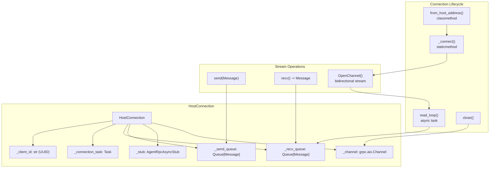

**Connection Features**

| Feature | Implementation | Location |
|---------|----------------|----------|
| **Retry Policy** | Exponential backoff, max 3 attempts, retries UNAVAILABLE status | [python/packages/autogen-ext/src/autogen_ext/runtimes/grpc/_worker_runtime.py:96-116]() |
| **Stream Management** | `OpenChannel()` bidirectional RPC with metadata-based client identification | [python/packages/autogen-ext/src/autogen_ext/runtimes/grpc/_worker_runtime.py:173-190]() |
| **Queue Separation** | Independent send/recv queues for async bidirectional communication | [python/packages/autogen-ext/src/autogen_ext/runtimes/grpc/_worker_runtime.py:120-121]() |
| **Connection Establishment** | Insecure channel creation with configurable options | [python/packages/autogen-ext/src/autogen_ext/runtimes/grpc/_worker_runtime.py:134-156]() |

Sources: [python/packages/autogen-ext/src/autogen_ext/runtimes/grpc/_worker_runtime.py:95-200]()

## Lifecycle Management

Both runtime implementations follow a consistent lifecycle pattern for managing agent execution and cleanup.

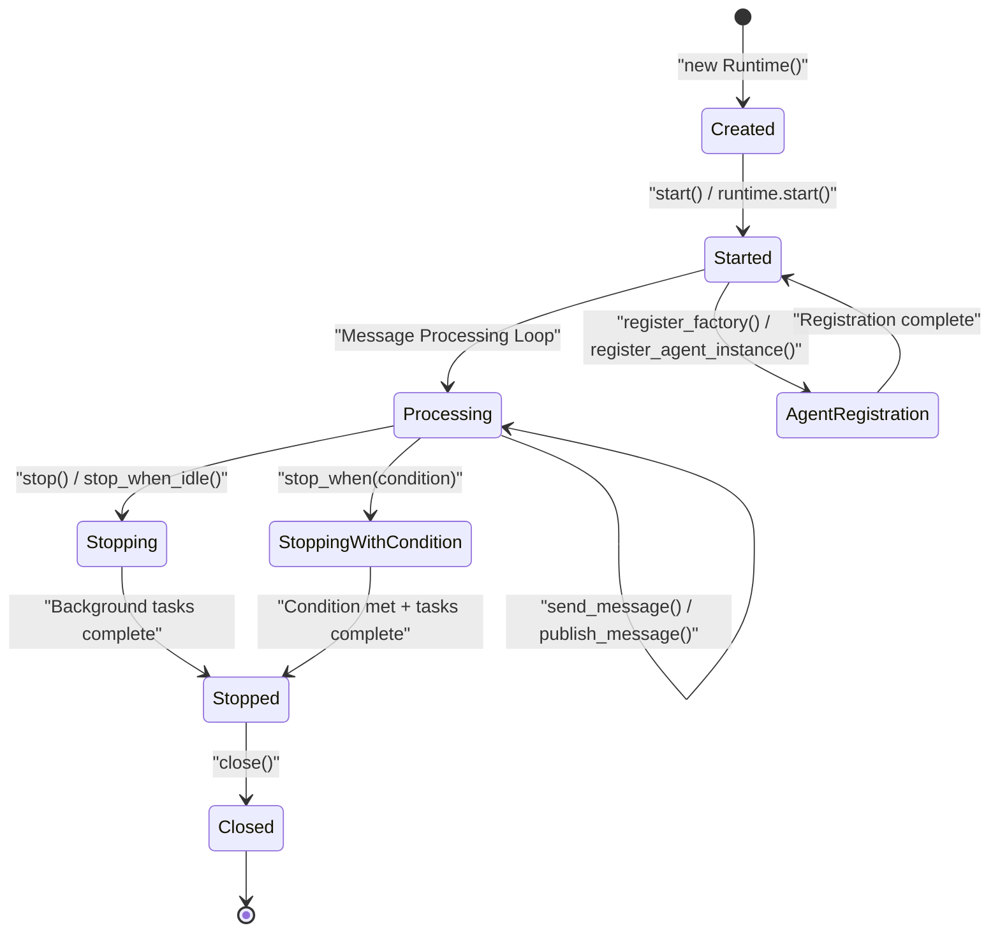

### Runtime States

| State | Description | Available Operations |
|-------|-------------|---------------------|
| **Created** | Runtime instantiated but not started | Configuration, agent registration |
| **Started** | Message processing loop active | All runtime operations |
| **Processing** | Actively handling messages | Message operations, agent registration |
| **Stopping** | Graceful shutdown in progress | Limited operations, awaiting completion |
| **Stopped** | Message processing halted | State persistence, restart possible |
| **Closed** | All resources released | None - runtime must be recreated |

### Agent Instantiation Context

The runtime provides context information during agent creation through `AgentInstantiationContext`, a static class using `ContextVar` for thread-safe context management:

**AgentInstantiationContext Usage**

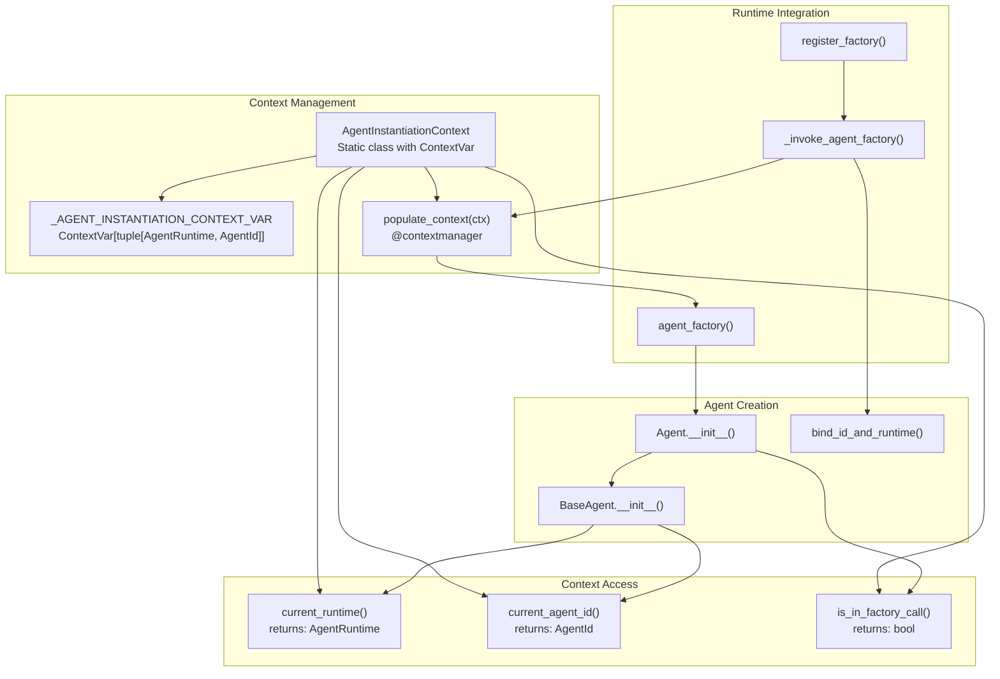

**Context Lifecycle**

1. **Context Setup** ([python/packages/autogen-core/src/autogen_core/_single_threaded_agent_runtime.py:886-923]()): Runtime calls `_invoke_agent_factory()` which uses `AgentInstantiationContext.populate_context()`.
2. **Factory Execution**: Factory function executes with context available [python/packages/autogen-core/src/autogen_core/_agent_instantiation.py:64-79]().
3. **Agent Construction**: `BaseAgent.__init__()` checks `is_in_factory_call()` and retrieves runtime/ID if true [python/packages/autogen-core/src/autogen_core/_base_agent.py:85-104]().
4. **Manual Binding**: For direct instantiation, `bind_id_and_runtime()` must be called explicitly [python/packages/autogen-core/src/autogen_core/_base_agent.py:106-117]().
5. **Context Cleanup**: Context automatically reset when exiting the context manager [python/packages/autogen-core/src/autogen_core/_agent_instantiation.py:53-62]().

Sources: [python/packages/autogen-core/src/autogen_core/_agent_instantiation.py:9-127](), [python/packages/autogen-core/src/autogen_core/_base_agent.py:85-104](), [python/packages/autogen-core/src/autogen_core/_single_threaded_agent_runtime.py:886-923]()

## Telemetry and Tracing

The runtime system includes comprehensive telemetry support through OpenTelemetry integration, providing observability into agent interactions and message flow.

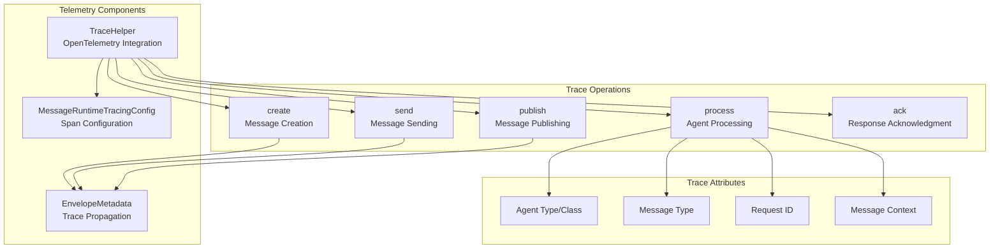

### Trace Propagation

The system supports distributed tracing across runtime boundaries:

- **Envelope Metadata**: Carries trace context in message envelopes [python/packages/autogen-core/src/autogen_core/_single_threaded_agent_runtime.py:58-82]().
- **gRPC Metadata**: Propagates traces across distributed worker connections [python/packages/autogen-ext/src/autogen_ext/runtimes/grpc/_worker_runtime.py:131-132]().
- **Context Links**: Links related spans across agent interactions [python/packages/autogen-core/src/autogen_core/_telemetry/_tracing.py:79-94]().

### Observability Features

| Feature | Purpose | Implementation |
|---------|---------|----------------|
| **Message Tracing** | Track message flow between agents | `TraceHelper.trace_block` creation for each message operation [python/packages/autogen-core/src/autogen_core/_telemetry/_tracing.py:40-99]() |
| **Agent Instrumentation** | Monitor agent lifecycle and performance | Agent creation and invocation spans [python/docs/src/user-guide/core-user-guide/framework/telemetry.md:7-10]() |
| **Error Tracking** | Capture and contextualize exceptions | Exception recording with span status [python/packages/autogen-core/src/autogen_core/_telemetry/_tracing.py:50-51]() |
| **Distributed Correlation** | Connect traces across runtime boundaries | Trace context propagation via metadata [python/packages/autogen-core/src/autogen_core/_telemetry/_propagation.py:8-9]() |

Sources: [python/packages/autogen-core/src/autogen_core/_telemetry/_tracing.py:12-100](), [python/packages/autogen-core/src/autogen_core/_single_threaded_agent_runtime.py:282-329](), [python/docs/src/user-guide/core-user-guide/framework/telemetry.md:1-16]()

---

