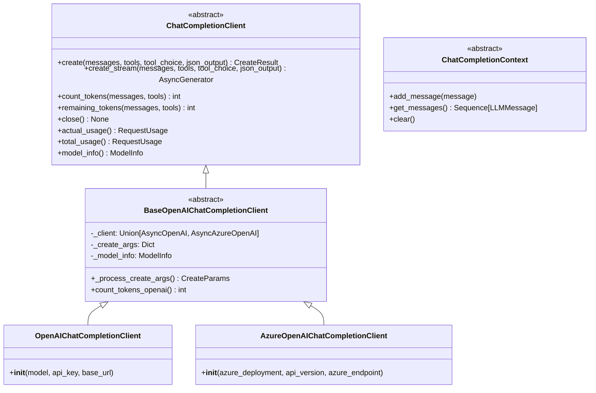
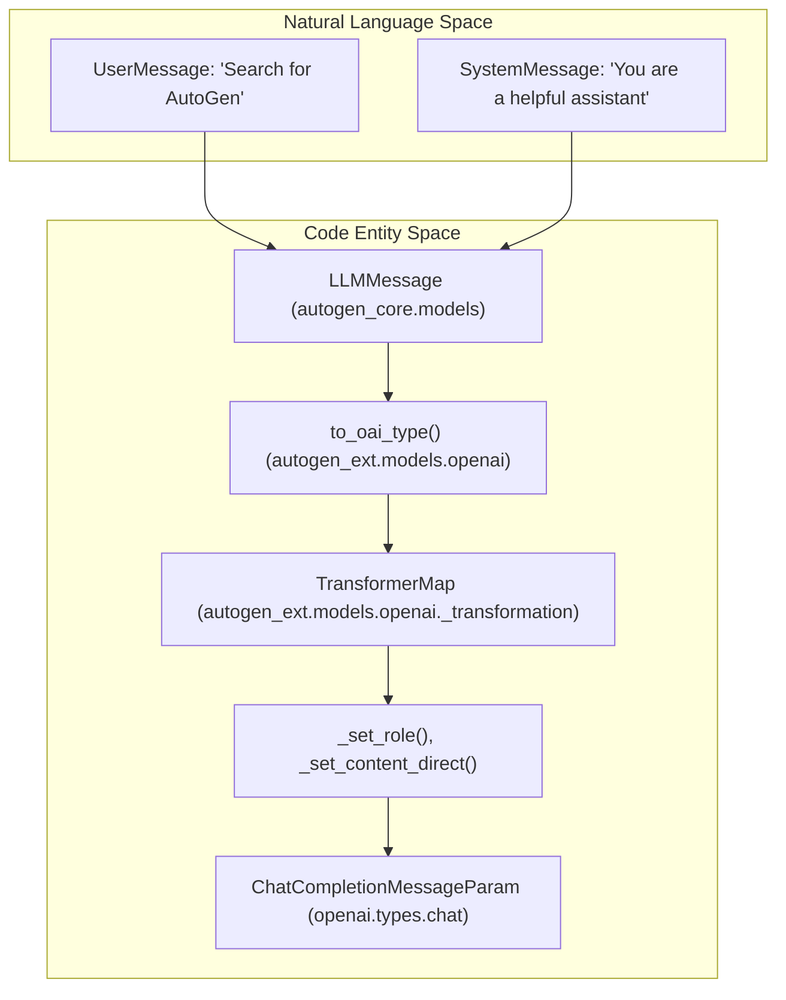
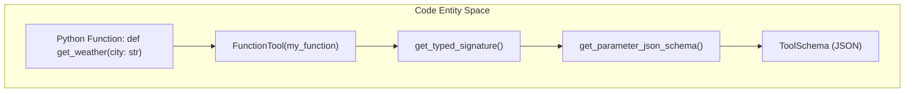

<!-- source: DeepWiki mcp.deepwiki.com · repo microsoft/autogen · page 2.2 Model Client System · fetched 2026-10-27 -->

# Model Client System

Relevant source files

The following files were used as context for generating this wiki page:

- [python/packages/autogen-agentchat/tests/test_declarative_components.py](python/packages/autogen-agentchat/tests/test_declarative_components.py)
- [python/packages/autogen-core/src/autogen_core/_constants.py](python/packages/autogen-core/src/autogen_core/_constants.py)
- [python/packages/autogen-core/src/autogen_core/_function_utils.py](python/packages/autogen-core/src/autogen_core/_function_utils.py)
- [python/packages/autogen-core/src/autogen_core/_routed_agent.py](python/packages/autogen-core/src/autogen_core/_routed_agent.py)
- [python/packages/autogen-core/src/autogen_core/logging.py](python/packages/autogen-core/src/autogen_core/logging.py)
- [python/packages/autogen-core/src/autogen_core/model_context/__init__.py](python/packages/autogen-core/src/autogen_core/model_context/__init__.py)
- [python/packages/autogen-core/src/autogen_core/model_context/_buffered_chat_completion_context.py](python/packages/autogen-core/src/autogen_core/model_context/_buffered_chat_completion_context.py)
- [python/packages/autogen-core/src/autogen_core/model_context/_chat_completion_context.py](python/packages/autogen-core/src/autogen_core/model_context/_chat_completion_context.py)
- [python/packages/autogen-core/src/autogen_core/model_context/_head_and_tail_chat_completion_context.py](python/packages/autogen-core/src/autogen_core/model_context/_head_and_tail_chat_completion_context.py)
- [python/packages/autogen-core/src/autogen_core/model_context/_token_limited_chat_completion_context.py](python/packages/autogen-core/src/autogen_core/model_context/_token_limited_chat_completion_context.py)
- [python/packages/autogen-core/src/autogen_core/model_context/_unbounded_chat_completion_context.py](python/packages/autogen-core/src/autogen_core/model_context/_unbounded_chat_completion_context.py)
- [python/packages/autogen-core/src/autogen_core/models/_model_client.py](python/packages/autogen-core/src/autogen_core/models/_model_client.py)
- [python/packages/autogen-core/src/autogen_core/models/_types.py](python/packages/autogen-core/src/autogen_core/models/_types.py)
- [python/packages/autogen-core/src/autogen_core/tools/_function_tool.py](python/packages/autogen-core/src/autogen_core/tools/_function_tool.py)
- [python/packages/autogen-core/src/autogen_core/utils/_json_to_pydantic.py](python/packages/autogen-core/src/autogen_core/utils/_json_to_pydantic.py)
- [python/packages/autogen-core/tests/test_json_to_pydantic.py](python/packages/autogen-core/tests/test_json_to_pydantic.py)
- [python/packages/autogen-core/tests/test_model_context.py](python/packages/autogen-core/tests/test_model_context.py)
- [python/packages/autogen-core/tests/test_tool_agent.py](python/packages/autogen-core/tests/test_tool_agent.py)
- [python/packages/autogen-core/tests/test_tools.py](python/packages/autogen-core/tests/test_tools.py)
- [python/packages/autogen-ext/src/autogen_ext/auth/azure/__init__.py](python/packages/autogen-ext/src/autogen_ext/auth/azure/__init__.py)
- [python/packages/autogen-ext/src/autogen_ext/experimental/task_centric_memory/__init__.py](python/packages/autogen-ext/src/autogen_ext/experimental/task_centric_memory/__init__.py)
- [python/packages/autogen-ext/src/autogen_ext/experimental/task_centric_memory/utils/__init__.py](python/packages/autogen-ext/src/autogen_ext/experimental/task_centric_memory/utils/__init__.py)
- [python/packages/autogen-ext/src/autogen_ext/experimental/task_centric_memory/utils/chat_completion_client_recorder.py](python/packages/autogen-ext/src/autogen_ext/experimental/task_centric_memory/utils/chat_completion_client_recorder.py)
- [python/packages/autogen-ext/src/autogen_ext/models/anthropic/_model_info.py](python/packages/autogen-ext/src/autogen_ext/models/anthropic/_model_info.py)
- [python/packages/autogen-ext/src/autogen_ext/models/llama_cpp/_llama_cpp_completion_client.py](python/packages/autogen-ext/src/autogen_ext/models/llama_cpp/_llama_cpp_completion_client.py)
- [python/packages/autogen-ext/src/autogen_ext/models/openai/__init__.py](python/packages/autogen-ext/src/autogen_ext/models/openai/__init__.py)
- [python/packages/autogen-ext/src/autogen_ext/models/openai/_message_transform.py](python/packages/autogen-ext/src/autogen_ext/models/openai/_message_transform.py)
- [python/packages/autogen-ext/src/autogen_ext/models/openai/_model_info.py](python/packages/autogen-ext/src/autogen_ext/models/openai/_model_info.py)
- [python/packages/autogen-ext/src/autogen_ext/models/openai/_openai_client.py](python/packages/autogen-ext/src/autogen_ext/models/openai/_openai_client.py)
- [python/packages/autogen-ext/src/autogen_ext/models/openai/_transformation/__init__.py](python/packages/autogen-ext/src/autogen_ext/models/openai/_transformation/__init__.py)
- [python/packages/autogen-ext/src/autogen_ext/models/openai/_transformation/registry.py](python/packages/autogen-ext/src/autogen_ext/models/openai/_transformation/registry.py)
- [python/packages/autogen-ext/src/autogen_ext/models/openai/_transformation/types.py](python/packages/autogen-ext/src/autogen_ext/models/openai/_transformation/types.py)
- [python/packages/autogen-ext/src/autogen_ext/models/openai/_utils.py](python/packages/autogen-ext/src/autogen_ext/models/openai/_utils.py)
- [python/packages/autogen-ext/src/autogen_ext/models/openai/config/__init__.py](python/packages/autogen-ext/src/autogen_ext/models/openai/config/__init__.py)
- [python/packages/autogen-ext/src/autogen_ext/models/replay/_replay_chat_completion_client.py](python/packages/autogen-ext/src/autogen_ext/models/replay/_replay_chat_completion_client.py)
- [python/packages/autogen-ext/src/autogen_ext/tools/mcp/_factory.py](python/packages/autogen-ext/src/autogen_ext/tools/mcp/_factory.py)
- [python/packages/autogen-ext/src/autogen_ext/tools/mcp/_sse.py](python/packages/autogen-ext/src/autogen_ext/tools/mcp/_sse.py)
- [python/packages/autogen-ext/src/autogen_ext/tools/mcp/_stdio.py](python/packages/autogen-ext/src/autogen_ext/tools/mcp/_stdio.py)
- [python/packages/autogen-ext/tests/models/test_openai_model_client.py](python/packages/autogen-ext/tests/models/test_openai_model_client.py)
- [python/packages/component-schema-gen/src/component_schema_gen/__main__.py](python/packages/component-schema-gen/src/component_schema_gen/__main__.py)
- [python/samples/agentchat_dspy/single_agent.py](python/samples/agentchat_dspy/single_agent.py)

The Model Client System provides a unified abstraction layer for integrating different Large Language Model (LLM) providers into the AutoGen framework. This system defines the `ChatCompletionClient` interface and implements concrete clients for various providers like OpenAI, Anthropic, Ollama, and others, enabling seamless switching between different LLM backends while maintaining consistent functionality.

## Core Architecture

The Model Client System is built around the `ChatCompletionClient` abstract base class, which defines a standardized interface for all LLM interactions. This abstraction enables agents to work with any LLM provider without modification.

**Sources:** [python/packages/autogen-core/src/autogen_core/models/_model_client.py:209-301](), [python/packages/autogen-ext/src/autogen_ext/models/openai/_openai_client.py:419-476](), [python/packages/autogen-core/src/autogen_core/model_context/_chat_completion_context.py:12-42]()

### Core Interface Methods

The `ChatCompletionClient` defines several key methods that all implementations must provide:

| Method | Purpose | Return Type |
|--------|---------|-------------|
| `create()` | Generate a single completion response | `CreateResult` |
| `create_stream()` | Generate streaming completion responses | `AsyncGenerator[Union[str, CreateResult], None]` |
| `count_tokens()` | Count tokens in messages and tools | `int` |
| `remaining_tokens()` | Calculate remaining tokens within model limits | `int` |
| `close()` | Clean up client resources | `None` |
| `actual_usage()` | Get actual token usage statistics | `RequestUsage` |
| `total_usage()` | Get cumulative token usage statistics | `RequestUsage` |

**Sources:** [python/packages/autogen-core/src/autogen_core/models/_model_client.py:211-300]()

## Model Information and Capabilities

The system uses `ModelInfo` to describe model properties, ensuring that agents can verify if a model supports required features like vision or function calling before attempting an operation.

### ModelInfo and ModelFamily

`ModelInfo` is a `TypedDict` containing required capability flags. `ModelFamily` provides a namespace for categorizing models (e.g., `GPT_4O`, `R1`, `CLAUDE_3_5_SONNET`).

| Field | Type | Description |
|-------|------|-------------|
| `vision` | `bool` | Supports image input |
| `function_calling` | `bool` | Supports native tool use |
| `json_output` | `bool` | Supports JSON mode |
| `structured_output` | `bool` | Supports schema-constrained JSON |
| `family` | `ModelFamily` | The architectural family of the model |

**Sources:** [python/packages/autogen-core/src/autogen_core/models/_model_client.py:16-95](), [python/packages/autogen-core/src/autogen_core/models/_model_client.py:164-184](), [python/packages/autogen-core/src/autogen_core/models/_model_client.py:185-207]()

## Model Context Management

`ChatCompletionContext` implementations manage the history of messages sent to a model. This is critical for handling context window limits and memory strategies.

| Implementation | Strategy | File Path |
|----------------|----------|-----------|
| `UnboundedChatCompletionContext` | Keeps all messages indefinitely. | [python/packages/autogen-core/src/autogen_core/model_context/_unbounded_chat_completion_context.py:9-37]() |
| `BufferedChatCompletionContext` | Keeps the last `N` messages. | [python/packages/autogen-core/src/autogen_core/model_context/_buffered_chat_completion_context.py:11-54]() |
| `HeadAndTailChatCompletionContext` | Keeps the first `N` (system/context) and last `M` messages. | [python/packages/autogen-core/src/autogen_core/model_context/_head_and_tail_chat_completion_context.py:12-78]() |
| `TokenLimitedChatCompletionContext` | Prunes history based on a token limit using `count_tokens`. | [python/packages/autogen-core/src/autogen_core/model_context/_token_limited_chat_completion_context.py:14-87]() |

**Sources:** [python/packages/autogen-core/src/autogen_core/model_context/__init__.py:1-20]()

## Message Transformation Pipeline

The Model Client System includes a modular transformation pipeline that converts AutoGen's unified `LLMMessage` format into provider-specific SDK formats (e.g., OpenAI's `ChatCompletionMessageParam`).

### Modular Transformer Pipeline

The pipeline decouples transformation logic from client implementation using "Mini Transformers"—functions that transform specific fields into keyword arguments.

**Key Components:**
- `get_transformer`: Retrieves the appropriate transformer for a provider and model family. [python/packages/autogen-ext/src/autogen_ext/models/openai/_transformation/registry.py:68-95]()
- `build_transformer_func`: Composes mini-transformers into a single pipeline. [python/packages/autogen-ext/src/autogen_ext/models/openai/_transformation/registry.py:16-38]()
- `to_oai_type`: The primary entry point for converting messages to OpenAI format. [python/packages/autogen-ext/src/autogen_ext/models/openai/_openai_client.py:165-185]()

**Sources:** [python/packages/autogen-ext/src/autogen_ext/models/openai/_message_transform.py:8-135](), [python/packages/autogen-ext/src/autogen_ext/models/openai/_message_transform.py:187-245]()

## Tools and Schema System

AutoGen provides a robust system for defining and executing tools, which are exposed to LLMs via JSON schemas.

### Tool Abstractions

- `BaseTool`: Abstract base class for defining tools with typed arguments and return values. [python/packages/autogen-core/src/autogen_core/tools/_base.py:53-111]()
- `FunctionTool`: A concrete implementation that wraps a Python function, automatically generating a schema from the function's signature and type hints. [python/packages/autogen-core/src/autogen_core/tools/_function_tool.py:22-123]()
- `ToolSchema`: The JSON schema representation of a tool, used by LLMs for function calling. [python/packages/autogen-core/src/autogen_core/tools/_base.py:12-25]()

### Schema Generation

The `FunctionTool` uses `get_typed_signature` and `get_parameters` to derive the JSON schema required by providers like OpenAI.

**Sources:** [python/packages/autogen-core/src/autogen_core/_function_utils.py:34-58](), [python/packages/autogen-core/src/autogen_core/_function_utils.py:132-151](), [python/packages/autogen-core/tests/test_tools.py:73-95]()

### Tool Agent and Execution

The `ToolAgent` is a specialized agent that acts as a tool execution host. It receives `FunctionCall` messages and returns `FunctionExecutionResult`.

- `ToolAgent`: Registers tools and handles their execution. [python/packages/autogen-core/src/autogen_core/tool_agent/_tool_agent.py:44-106]()
- `tool_agent_caller_loop`: A helper function that automates the loop of calling an LLM, executing tools, and feeding results back to the LLM until completion. [python/packages/autogen-core/src/autogen_core/tool_agent/_caller_loop.py:20-112]()

**Sources:** [python/packages/autogen-core/tests/test_tool_agent.py:47-94](), [python/packages/autogen-core/tests/test_tool_agent.py:98-187]()

---

