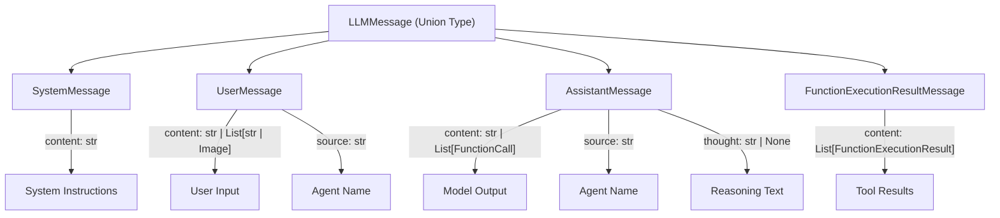

<!-- source: DeepWiki mcp.deepwiki.com · repo microsoft/autogen · page 2.3 Message Types and Tool Agents · fetched 2026-10-27 -->

# Message Types and Tool Agents

<details>
<summary>Relevant source files</summary>

The following files were used as context for generating this wiki page:

- [python/docs/src/user-guide/agentchat-user-guide/tutorial/agents.ipynb](python/docs/src/user-guide/agentchat-user-guide/tutorial/agents.ipynb)
- [python/packages/autogen-agentchat/src/autogen_agentchat/tools/_agent.py](python/packages/autogen-agentchat/src/autogen_agentchat/tools/_agent.py)
- [python/packages/autogen-agentchat/src/autogen_agentchat/tools/_task_runner_tool.py](python/packages/autogen-agentchat/src/autogen_agentchat/tools/_task_runner_tool.py)
- [python/packages/autogen-agentchat/src/autogen_agentchat/tools/_team.py](python/packages/autogen-agentchat/src/autogen_agentchat/tools/_team.py)
- [python/packages/autogen-agentchat/tests/test_task_runner_tool.py](python/packages/autogen-agentchat/tests/test_task_runner_tool.py)
- [python/packages/autogen-core/src/autogen_core/_constants.py](python/packages/autogen-core/src/autogen_core/_constants.py)
- [python/packages/autogen-core/src/autogen_core/_function_utils.py](python/packages/autogen-core/src/autogen_core/_function_utils.py)
- [python/packages/autogen-core/src/autogen_core/_routed_agent.py](python/packages/autogen-core/src/autogen_core/_routed_agent.py)
- [python/packages/autogen-core/src/autogen_core/_serialization.py](python/packages/autogen-core/src/autogen_core/_serialization.py)
- [python/packages/autogen-core/src/autogen_core/logging.py](python/packages/autogen-core/src/autogen_core/logging.py)
- [python/packages/autogen-core/src/autogen_core/models/_types.py](python/packages/autogen-core/src/autogen_core/models/_types.py)
- [python/packages/autogen-core/src/autogen_core/tools/__init__.py](python/packages/autogen-core/src/autogen_core/tools/__init__.py)
- [python/packages/autogen-core/src/autogen_core/tools/_base.py](python/packages/autogen-core/src/autogen_core/tools/_base.py)
- [python/packages/autogen-core/src/autogen_core/tools/_function_tool.py](python/packages/autogen-core/src/autogen_core/tools/_function_tool.py)
- [python/packages/autogen-core/src/autogen_core/tools/_static_workbench.py](python/packages/autogen-core/src/autogen_core/tools/_static_workbench.py)
- [python/packages/autogen-core/src/autogen_core/tools/_workbench.py](python/packages/autogen-core/src/autogen_core/tools/_workbench.py)
- [python/packages/autogen-core/tests/test_serialization.py](python/packages/autogen-core/tests/test_serialization.py)
- [python/packages/autogen-core/tests/test_static_workbench_overrides.py](python/packages/autogen-core/tests/test_static_workbench_overrides.py)
- [python/packages/autogen-core/tests/test_tools.py](python/packages/autogen-core/tests/test_tools.py)
- [python/packages/autogen-core/tests/test_workbench.py](python/packages/autogen-core/tests/test_workbench.py)
- [python/packages/autogen-ext/tests/tools/test_mcp_workbench_overrides.py](python/packages/autogen-ext/tests/tools/test_mcp_workbench_overrides.py)

</details>


This document covers the fundamental message types used for LLM communication and the tool execution patterns that enable agents to interact with external systems. It details the `LLMMessage` type hierarchy, the `ToolAgent` implementation, the `tool_agent_caller_loop` execution pattern, and workbench abstractions for tool management.

For information about the broader agent runtime system, see [Agent Runtime System](#2.1). For details about model client implementations, see [Model Client System](#2.2).

## LLM Message Types

AutoGen defines a standardized message type hierarchy for communication with language models. All message types are defined in the `LLMMessage` union type, which serves as the foundation for model interactions.

### Message Type Hierarchy



Sources: [python/packages/autogen-core/src/autogen_core/models/_types.py:10-82]()

### Core Message Types

| Message Type | Purpose | Key Fields | Usage |
|--------------|---------|------------|-------|
| `SystemMessage` | Developer instructions to the model | `content: str`, `type: Literal["SystemMessage"]` | Initial system prompts, behavior guidelines |
| `UserMessage` | End-user input or external data | `content: str \| List[str \| Image]`, `source: str`, `type: Literal["UserMessage"]` | User queries, multimodal input |
| `AssistantMessage` | Model-generated responses | `content: str \| List[FunctionCall]`, `source: str`, `thought: str \| None`, `type: Literal["AssistantMessage"]` | Text responses, tool calls, reasoning chains |
| `FunctionExecutionResultMessage` | Tool execution results | `content: List[FunctionExecutionResult]`, `type: Literal["FunctionExecutionResultMessage"]` | Function call outputs |

**Note**: OpenAI is transitioning from the 'system' role to a 'developer' role in their model specifications. However, the 'system' role remains supported in their API and is automatically converted to 'developer' role server-side. `SystemMessage` can be used for developer messages without modification [python/packages/autogen-core/src/autogen_core/models/_types.py:10-21]().

**Discriminated Union**: The `LLMMessage` type uses Pydantic's discriminator pattern with the `type` field, enabling efficient runtime type checking and serialization across different message types [python/packages/autogen-core/src/autogen_core/models/_types.py:80-82]().

### AssistantMessage Thought Field

The `thought` field in `AssistantMessage` captures reasoning text for completions, particularly useful for:
- **Reasoning models**: Models that generate explicit reasoning steps (e.g., o1-series models).
- **Function call context**: Additional text content that accompanies function calls.
- **Multi-step reasoning**: Chains of thought that precede final responses.

This field is optional (`str | None`) and will be `None` for standard completions [python/packages/autogen-core/src/autogen_core/models/_types.py:41-53]().

### Function Execution Results

The `FunctionExecutionResult` class encapsulates the output of tool executions. It includes a `call_id` to link the result back to the specific tool request from the model and an `is_error` flag to indicate execution failures [python/packages/autogen-core/src/autogen_core/models/_types.py:56-70]().

## Workbench and Tool Management

AutoGen uses the `Workbench` abstraction to manage sets of tools. This allows agents to interact with a dynamic or static collection of capabilities through a unified interface.

### StaticWorkbench

The `StaticWorkbench` provides a fixed set of tools that do not change between executions. It supports `ToolOverride` to rename or re-describe tools for specific contexts without modifying the underlying implementation [python/packages/autogen-core/src/autogen_core/tools/_static_workbench.py:24-36]().

- **Tool Mapping**: Maintains a mapping between override names and original tool names [python/packages/autogen-core/src/autogen_core/tools/_static_workbench.py:47-67]().
- **State Management**: Implements `save_state` and `load_state` to persist the state of all managed tools [python/packages/autogen-core/src/autogen_core/tools/_static_workbench.py:135-145]().
- **Serialization**: Fully supports AutoGen's component configuration system for declarative instantiation [python/packages/autogen-core/src/autogen_core/tools/_static_workbench.py:147-154]().

### Tool Abstractions

| Class | Role | Description |
|-------|------|-------------|
| `BaseTool` | Foundation | Abstract base class for all tools. Handles schema generation from Pydantic models [python/packages/autogen-core/src/autogen_core/tools/_base.py:96-113](). |
| `FunctionTool` | Wrapper | Wraps standard Python functions. Automatically extracts JSON schemas from type hints and docstrings [python/packages/autogen-core/src/autogen_core/tools/_function_tool.py:30-43](). |
| `BaseStreamTool` | Streaming | Extension for tools that yield intermediate results or data streams [python/packages/autogen-core/src/autogen_core/tools/_base.py:217-224](). |

Sources: [python/packages/autogen-core/src/autogen_core/tools/_base.py:1-224](), [python/packages/autogen-core/src/autogen_core/tools/_function_tool.py:30-132]()

## Hierarchical Tool Orchestration

AutoGen allows agents and teams to be exposed as tools themselves, enabling complex hierarchical orchestration patterns.

### AgentTool and TeamTool

These specialized tools wrap `BaseChatAgent` or `BaseGroupChat` instances, allowing a "manager" agent to delegate entire tasks to a sub-agent or a specialized team.

- **AgentTool**: Wraps a single agent. The task provided by the caller is passed to the agent's `run` method [python/packages/autogen-agentchat/src/autogen_agentchat/tools/_agent.py:20-31]().
- **TeamTool**: Wraps a group chat/team. Useful for multi-agent sub-tasks like "Research and Review" [python/packages/autogen-agentchat/src/autogen_agentchat/tools/_team.py:23-44]().
- **Concurrency Warning**: Parallel tool calls **must** be disabled in the model client configuration when using these tools, as agents/teams maintain internal state that is not thread-safe for concurrent execution [python/packages/autogen-agentchat/src/autogen_agentchat/tools/_agent.py:25-30]().

### TaskRunnerTool Logic

Both `AgentTool` and `TeamTool` inherit from `TaskRunnerTool`, which manages the execution loop and converts `TaskResult` objects back into string responses for the LLM. It can return either the last message or a concatenated history of the sub-task [python/packages/autogen-agentchat/src/autogen_agentchat/tools/_task_runner_tool.py:20-66]().

## Tool Agent Caller Loop

The `tool_agent_caller_loop` orchestrates the interaction between a language model and tool agents. This is the primary mechanism for "tool-augmented generation" where a model iterates until it satisfies a query.

### Execution Loop Diagram

```mermaid
sequenceDiagram
    participant App as "Application Logic"
    participant Loop as "tool_agent_caller_loop"
    participant Model as "ChatCompletionClient"
    participant Tool as "ToolAgent / Workbench"
    
    App->>Loop: run(input_messages, tools)
    Loop->>Model: create(messages, tools)
    Model-->>Loop: CreateResult (with FunctionCall)
    
    loop While FunctionCalls exist
        Loop->>Tool: call_tool(name, args)
        Tool-->>Loop: ToolResult
        Loop->>Loop: Append FunctionExecutionResultMessage
        Loop->>Model: create(messages + results, tools)
        Model-->>Loop: CreateResult
    end
    
    Loop-->>App: Final AssistantMessage
```

Sources: [python/packages/autogen-core/src/autogen_core/tool_agent/_caller_loop.py:16-80]()

### Key Logic in Caller Loop

1. **Parallel Execution**: The loop uses `asyncio.gather` to execute multiple tool calls simultaneously if the model returns a list of calls [python/packages/autogen-core/src/autogen_core/tool_agent/_caller_loop.py:48-51]().
2. **Error Handling**: Exceptions during tool execution are caught and converted into `FunctionExecutionResult` objects with `is_error=True`, allowing the LLM to see the error message and potentially fix its parameters [python/packages/autogen-core/src/autogen_core/tool_agent/_caller_loop.py:53-71]().
3. **Message Accumulation**: The loop maintains the conversation state, appending `AssistantMessage` (the calls) and `FunctionExecutionResultMessage` (the results) to the history before the next model turn [python/packages/autogen-core/src/autogen_core/tool_agent/_caller_loop.py:73-80]().

Sources: [python/packages/autogen-core/src/autogen_core/tool_agent/_caller_loop.py:16-80](), [python/packages/autogen-core/src/autogen_core/models/_types.py:56-82]()

---

